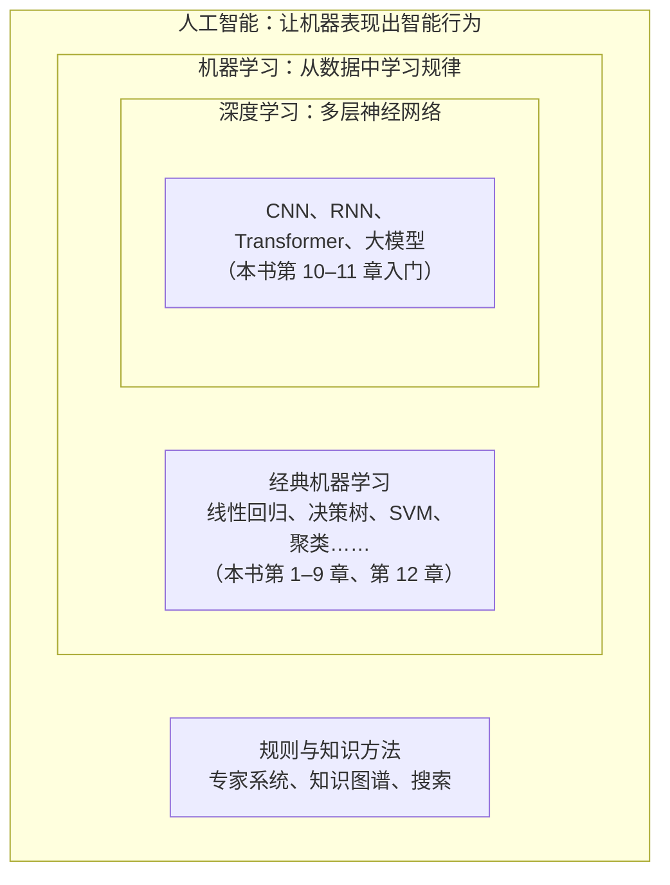
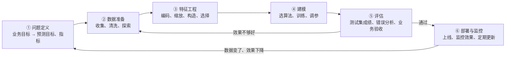
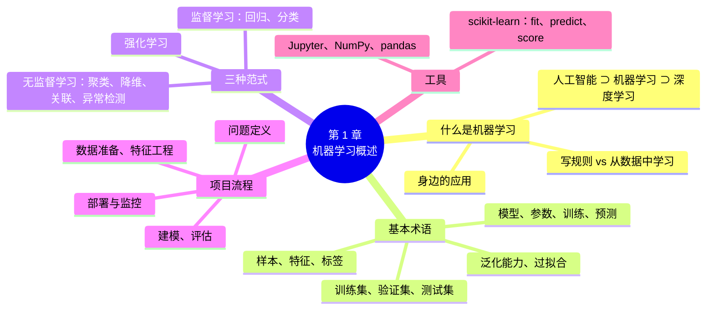

# 第 1 章 机器学习概述与项目流程

!!! abstract "本章学时"
    理论 4 学时 · 实验 2 学时（本章共 3 个实验，教师可任选）

## 学习目标

学完本章，你应该能够：

1. **说出**机器学习的含义，以及样本、特征、标签、模型、训练、预测、泛化等基本术语（记忆）；
2. **解释**“写规则”和“从数据中学习”两种做法的区别，以及训练集和测试集为什么必须分开（理解）；
3. **区分**监督学习（回归、分类）、无监督学习和强化学习，能判断一个业务问题属于哪一类（应用）；
4. **描述**机器学习项目从问题定义、数据准备、特征工程、建模、评估到部署监控的流程，并能把一个业务需求改写成机器学习问题（分析）；
5. **搭建**本书的实验环境，用 scikit-learn 的 fit、predict、score 完成第一个分类模型（应用）。

!!! info "先修要求"
    学习本章前，你需要掌握：

    - 人工智能的基本概念和发展脉络（“人工智能导论”课程）；
    - Python 的变量、列表、字典、函数和 for 循环，会安装第三方库（“Python 程序设计”课程，[附录 A Python 速查](../../appendix/a-python.md)）；
    - 平均数、比例和百分数的计算。

??? abstract "本章概念清单（24 个，点击查看定义和例子）"
    1. [机器学习](../../appendix/glossary.md#g-机器学习)
    2. [深度学习](../../appendix/glossary.md#g-深度学习)
    3. [样本](../../appendix/glossary.md#g-样本)
    4. [特征](../../appendix/glossary.md#g-特征)
    5. [标签](../../appendix/glossary.md#g-标签)
    6. [数据集](../../appendix/glossary.md#g-数据集)
    7. [模型](../../appendix/glossary.md#g-模型)
    8. [模型参数](../../appendix/glossary.md#g-模型参数)
    9. [训练](../../appendix/glossary.md#g-训练)
    10. [预测](../../appendix/glossary.md#g-预测)
    11. [泛化能力](../../appendix/glossary.md#g-泛化能力)
    12. [训练集](../../appendix/glossary.md#g-训练集)
    13. [测试集](../../appendix/glossary.md#g-测试集)
    14. [验证集](../../appendix/glossary.md#g-验证集)
    15. [监督学习](../../appendix/glossary.md#g-监督学习)
    16. [回归](../../appendix/glossary.md#g-回归)
    17. [分类](../../appendix/glossary.md#g-分类)
    18. [无监督学习](../../appendix/glossary.md#g-无监督学习)
    19. [强化学习](../../appendix/glossary.md#g-强化学习)
    20. [半监督学习](../../appendix/glossary.md#g-半监督学习)
    21. [自监督学习](../../appendix/glossary.md#g-自监督学习)
    22. [机器学习项目流程](../../appendix/glossary.md#g-机器学习项目流程)
    23. [scikit-learn](../../appendix/glossary.md#g-scikit-learn)
    24. [超参数](../../appendix/glossary.md#g-超参数)

## 情景导入

阿芳在一家连锁通信营业厅做店长。公司每个月都有几千名手机用户销号转网，总部给每家门店下了任务：提前找出“可能要走”的客户，打电话回访、送流量包，把人留下来。阿芳和同事凭经验总结了几条：合约快到期的、最近投诉过的、月租突然变高的，这些人比较危险。可是全店有两万多名客户，经验只能覆盖一小部分，名单拉出来，真正要走的人很多不在上面，打了电话的又大多本来就不打算走。

公司数据部门换了个思路：既然过去几年每个客户“走没走”都记录在案，那就把这几年的客户资料和最后的结果交给计算机，让它自己去找“要走的人”有什么共同特点，再用找到的规律给现在的每个客户打一个“流失风险分”。这就是机器学习的思路：**不是由人写出规则，而是让计算机从带有结果的历史数据中学出规则**。

这一章先讲清楚机器学习是什么、有哪几类、一个项目怎样从业务问题一步步做到上线，然后搭好实验环境，亲手训练第一个模型。阿芳遇到的“客户流失预警”问题，会贯穿本书的第 4、5、9 章。

## 1.1 什么是机器学习

### 1.1.1 写规则与从数据中学习

计算机解决问题，传统的做法是**写规则**：程序员把人的知识翻译成一条条 if-else。拿识别垃圾短信来说，可以写“短信里出现‘中奖’‘点击链接’‘免费领取’就判为垃圾短信”。这种做法直观、可控，在规则清楚、变化不大的场合很好用，比如个人所得税计算、银行转账限额检查。

但很多问题的规则说不清、写不完、还在变。垃圾短信的发送者很快就会把“中奖”改成“中ㄐ㈦”，把链接换成二维码；一张照片里是猫还是狗，人一眼就能看出来，却几乎没法用 if-else 写出判断标准。这时就需要换一种思路：收集大量**已经知道答案**的例子，比如十万条已经被用户举报或确认为正常的短信，让计算机自己从这些例子里总结出区分两类短信的规律。这就是[**机器学习**](../../appendix/glossary.md#g-机器学习 "让计算机从数据中学习规律，并用学到的规律对新数据做判断或预测的方法"){ .term }。

1959 年，美国 IBM 公司的阿瑟·塞缪尔（Arthur Samuel）发表了一篇论文，介绍他编写的跳棋程序怎样通过和自己对弈不断提高棋力，最后下得比他本人还好。<sup class="cite">[[1]](#ref1-1)</sup>“机器学习”这个说法由此流传开来。卡内基梅隆大学的米切尔（Tom Mitchell）在 1997 年的教材中给出了一个被广泛引用的定义：如果一个程序在某类任务 T 上的表现（用指标 P 衡量）随着经验 E 的增加而提高，就说这个程序从经验 E 中学习。<sup class="cite">[[2]](#ref1-2)</sup> 套到垃圾短信上：任务 T 是判断短信是不是垃圾短信，指标 P 是判断的准确率，经验 E 是已经标好的历史短信。

两种做法的对比如下：

| 对比项 | 写规则 | 从数据中学习（机器学习） |
|---|---|---|
| 规则从哪里来 | 专家总结，程序员写成代码 | 算法从带答案的历史数据中自动总结 |
| 需要什么 | 清楚的业务知识 | 足够多、足够好的数据 |
| 规则能不能看懂 | 能，每一条都是人写的 | 有的能（如决策树），有的很难（如深度神经网络） |
| 情况变了怎么办 | 人工修改规则 | 用新数据重新训练 |
| 适合的问题 | 规则清楚、稳定、必须精确执行 | 规则模糊、变量多、需要从大量数据中找规律 |

实际系统往往两者结合。银行的贷款审批就是这样：“年龄必须满 18 岁”“不能在失信被执行人名单上”这类硬性规定用规则写死，而“这个人还款可能性有多大”交给机器学习模型来打分。实验 1-3 会让你在同一份贷款数据上先手写规则、再让计算机学规则，亲自比较两者的效果。

### 1.1.2 身边的机器学习

机器学习早已不是实验室里的技术，你每天都在和它打交道：

- **推荐**：打开淘宝、抖音、美团，首页展示的商品、视频和店铺，是推荐模型根据你的浏览、点击和购买记录算出来的“你最可能感兴趣的内容”。
- **金融风控**：用手机申请消费贷款，几秒钟就能知道额度，背后是信用评分模型；刷卡时如果交易被拦截，往往是反欺诈模型判断这笔交易“不像你本人”。
- **出行**：导航软件给出的“预计 32 分钟到达”、外卖平台的“预计送达时间”，都是模型根据路况、天气、时段、骑手情况等预测出来的。
- **医疗**：医学影像辅助诊断系统能在胸部 CT 上标出可疑的肺结节，提醒医生重点查看。
- **智能客服与大模型**：电信、银行的智能客服能理解“我要查话费”“流量怎么超了”这样的口语；DeepSeek、通义千问、豆包等大模型更是能写文章、写代码、回答问题，它们本质上也是用海量数据训练出来的机器学习模型。

这些应用有一个共同点：它们都需要从大量历史数据中找出规律，用来对新情况做出判断或预测。

### 1.1.3 人工智能、机器学习与深度学习

在“人工智能导论”课中你已经学过，人工智能是让机器表现出智能行为的技术总称，包括专家系统、知识图谱、搜索与规划等很多方向。机器学习是实现人工智能的一类方法，也是今天最主要的一类方法。[**深度学习**](../../appendix/glossary.md#g-深度学习 "使用多层神经网络从数据中自动学习特征的机器学习方法"){ .term }是机器学习的一个分支，它使用多层神经网络从数据中自动学习特征，在图像、语音、文本等领域取得了巨大成功，今天的大模型也属于深度学习。三者是一层套一层的关系：



本书的重点是经典机器学习，最后几章介绍神经网络和深度学习的基础。大模型的原理在“自然语言处理”课程中讲，深度学习框架的系统用法在“人工智能开发框架技术”课程中讲。

## 1.2 机器学习的基本术语

### 1.2.1 样本、特征与标签

机器学习处理的数据，绝大多数时候可以整理成一张表格。下面是植物学家收集的鸢尾花测量数据中的 5 行，这份数据由英国统计学家费希尔（R. A. Fisher）在 1936 年的论文中使用，今天几乎是每本机器学习教材的第一个例子：<sup class="cite">[[3]](#ref1-3)</sup>

| 花萼长度（cm） | 花萼宽度（cm） | 花瓣长度（cm） | 花瓣宽度（cm） | 品种 |
|---|---|---|---|---|
| 5.8 | 4.0 | 1.2 | 0.2 | 山鸢尾 |
| 5.1 | 2.5 | 3.0 | 1.1 | 变色鸢尾 |
| 6.6 | 3.0 | 4.4 | 1.4 | 变色鸢尾 |
| 5.4 | 3.9 | 1.3 | 0.4 | 山鸢尾 |
| 7.9 | 3.8 | 6.4 | 2.0 | 维吉尼亚鸢尾 |

- 表格的每一行是一个[**样本**](../../appendix/glossary.md#g-样本 "数据集中的一条记录，代表一个研究对象"){ .term }，代表一个研究对象：一朵花、一个客户、一套房子、一笔交易。
- 前四列是[**特征**](../../appendix/glossary.md#g-特征 "描述样本的属性，是模型的输入，也叫自变量"){ .term }，是描述样本的属性，也叫自变量、输入。特征可以是数值（花瓣长度、月收入），也可以是类别（城市、合约类型）。
- 最后一列“品种”是[**标签**](../../appendix/glossary.md#g-标签 "样本中要预测的答案，也叫目标变量"){ .term }，是我们想让模型预测的答案，也叫目标变量、输出。
- 很多样本放在一起就是一个[**数据集**](../../appendix/glossary.md#g-数据集 "由许多样本组成、用于训练或评估模型的数据集合"){ .term }。整份鸢尾花数据集有 150 个样本，三个品种各 50 个。

用数学符号写，一个样本的特征通常记作 \( x \)（有多个特征时是一个向量），标签记作 \( y \)。“第 i 个样本”写成 \( (x_i, y_i) \)。本书尽量少用符号，但看到它们时要知道：\( x \) 是输入，\( y \) 是答案。

!!! tip "同一份数据，标签由问题决定"
    电信客户表里有“月消费”和“是否流失”两列。如果要预测客户会不会流失，“是否流失”是标签，“月消费”是特征；如果要预测下个月的话费，“月消费”就成了标签。所以拿到数据先问一句：**我到底要预测什么？**

### 1.2.2 模型、训练与预测

[**模型**](../../appendix/glossary.md#g-模型 "根据特征计算出标签的函数，形式由算法决定，具体参数从数据中学出"){ .term }可以理解为一个“从特征算出标签”的函数。它的形式由算法决定，比如线性回归的模型是一个加权求和的公式，决策树的模型是一棵由问题组成的树；而公式里的权重、树上每个节点问什么问题，这些具体内容要从数据里确定，叫作[**模型参数**](../../appendix/glossary.md#g-模型参数 "模型中由训练从数据里确定的数值"){ .term }。

[**训练**](../../appendix/glossary.md#g-训练 "用数据确定模型参数的过程，也叫学习或拟合"){ .term }就是用数据确定模型参数的过程，也叫“学习”或“拟合”。训练时，算法不断调整参数，让模型在已知答案的样本上算出的结果尽量接近真实答案。训练好以后，把新样本的特征输入模型，得到它的标签，就是[**预测**](../../appendix/glossary.md#g-预测 "把新样本的特征输入训练好的模型，得到它的标签"){ .term }。

用一个生活中的例子来类比：一位老中介看过几千套房子的成交价，他心里形成了“这个区域、这个面积、这个楼龄大概值多少钱”的经验，这是训练；有人拿着一套新房源来问价，他报出一个数，这是预测；他心里的那套经验，就是模型。

### 1.2.3 训练集、测试集与泛化能力

我们训练模型，不是为了让它“记住”历史数据的答案，而是希望它对**从来没见过的新数据**也能做出准确判断。模型对新数据的预测能力叫作[**泛化能力**](../../appendix/glossary.md#g-泛化能力 "模型对没有见过的新数据做出准确预测的能力"){ .term }。

怎样检验泛化能力？最基本的办法是把手上的数据分成两部分：

- [**训练集**](../../appendix/glossary.md#g-训练集 "用来训练模型的数据，相当于“课本和练习题”"){ .term }：用来训练模型的数据，相当于“课本和练习题”；
- [**测试集**](../../appendix/glossary.md#g-测试集 "训练时不让模型看见、训练完成后用来评估模型的数据，相当于“期末考试卷”"){ .term }：训练时不让模型看见、训练完成后用来评估模型的数据，相当于“期末考试卷”。

如果拿练习题原题考试，学生全背下来也能考满分，却说明不了他真的学会了。同样，如果用训练过的数据去评估模型，成绩会虚高。实验 5-1 中，一棵不加限制的决策树在训练集上准确率 100%，在测试集上只有 77.3%，就是这个道理。模型在训练集上表现很好、在新数据上表现差的现象叫作**过拟合**，第 3 章会专门讨论。

常见的划分比例是训练集 70%～80%、测试集 20%～30%，样本按随机方式分配。很多时候还要从训练数据里再分出一部分作为[**验证集**](../../appendix/glossary.md#g-验证集 "训练过程中用来调整参数、选择模型的数据，相当于“模拟考试”"){ .term }，在训练过程中用来比较不同的模型和参数，相当于“模拟考试”；测试集只在最后用一次。验证集和更稳妥的交叉验证方法在第 9 章详细介绍。

!!! warning "测试集不能“偷看”"
    测试集的作用是模拟“未来的新数据”。如果根据测试集成绩反复修改模型，测试集就悄悄变成了训练数据的一部分，最后报告的成绩不再可信。这类错误统称为**数据泄露**，是机器学习项目中最常见、也最隐蔽的错误之一，第 2 章会专门讲怎样识别和防止。

## 1.3 三种学习范式

按照训练数据里有没有标签、模型怎样获得反馈，机器学习通常分为三大类，叫作三种学习范式。

### 1.3.1 监督学习：回归与分类

[**监督学习**](../../appendix/glossary.md#g-监督学习 "从带有正确答案（标签）的样本中学习规律的机器学习方式"){ .term }从带有正确答案（标签）的样本中学习规律。训练数据就像一本带答案的习题册，模型做完每道题都能对答案、找差距、改进自己。监督学习是目前应用最广的一类机器学习，按标签的类型又分两种任务：

- [**回归**](../../appendix/glossary.md#g-回归 "标签是连续数值的监督学习任务"){ .term }：标签是一个连续的数值。例如预测二手房的成交价（万元）、外卖的送达时间（分钟）、门店明天的销量（杯）。
- [**分类**](../../appendix/glossary.md#g-分类 "标签是有限个类别之一的监督学习任务，分二分类和多分类"){ .term }：标签是有限个类别中的一个。例如判断客户会不会流失（是 / 否）、短信是不是垃圾短信、手写数字是 0～9 中的哪一个。只有两个类别的叫二分类，多于两个类别的叫多分类。

判断是回归还是分类，不看数据，只看**要预测的东西**：答案是“多少”，就是回归；答案是“哪一类”，就是分类。本书第 3 章讲回归，第 4～7 章讲分类，第 10～11 章的神经网络两种任务都能做。

### 1.3.2 无监督学习：聚类、降维与关联

[**无监督学习**](../../appendix/glossary.md#g-无监督学习 "从没有标签的数据中发现结构和规律的机器学习方式"){ .term }的训练数据没有标签，模型要自己从数据中发现结构。常见任务有：

- **聚类**：把相似的样本自动分成若干组。例如电商平台把会员按消费习惯分成“高价值忠实客户”“价格敏感型客户”“沉睡客户”等群体，事先并不知道应该分几类、每类是什么样。
- **降维**：把很多个特征压缩成少数几个，便于可视化和后续建模。例如把 64 个像素压缩成 2 个数，在平面上画出手写数字的分布。
- **关联规则**：从大量交易记录中找出“经常一起出现”的事物。例如超市发现买了面包的顾客常常也买牛奶，于是把两样商品摆得近一些。
- **异常检测**：找出与大多数样本明显不同的样本，例如可疑的刷卡交易、工厂里异常的传感器读数。

无监督学习不需要人工标注，数据容易获得，但结果没有标准答案可以对照，往往需要结合业务知识来解读。本书第 7 章讲关联规则，第 8 章讲聚类、降维和异常检测。

### 1.3.3 强化学习

[**强化学习**](../../appendix/glossary.md#g-强化学习 "智能体在环境中不断尝试、根据奖励调整行为，学习最优行动策略的机器学习方式"){ .term }的学习方式和前两种都不同：没有现成的数据集，而是让一个“智能体”在环境中不断尝试，做对了给奖励、做错了给惩罚，智能体通过试错学会在各种情况下怎样行动才能得到最多的奖励。这很像训练小狗：它做出“坐下”的动作就给零食，次数多了它就学会了。

2016 年，DeepMind 公司的围棋程序 AlphaGo 战胜世界冠军李世石，它在学习人类棋谱的基础上，又通过大量自我对弈的强化学习继续提高棋力。<sup class="cite">[[4]](#ref1-4)</sup> 今天强化学习被用于机器人控制、游戏、推荐系统，也是训练大模型的重要环节：让大模型的回答更符合人类偏好的人类反馈强化学习（RLHF），以及让模型学会一步步推理的训练方法，都用到了强化学习。本书第 12 章做入门介绍。

### 1.3.4 半监督学习与自监督学习

两种介于中间的情况也值得知道：

- [**半监督学习**](../../appendix/glossary.md#g-半监督学习 "同时利用少量有标签数据和大量无标签数据训练模型的方法"){ .term }：只有少量样本有标签、大量样本没有标签，同时利用两者来训练。例如医院有十万张影像，但只有一千张经过专家标注。
- [**自监督学习**](../../appendix/glossary.md#g-自监督学习 "从无标签数据本身自动构造标签来训练模型的方法"){ .term }：从无标签数据本身自动构造“标签”来训练。例如把一句话里的某个词遮住，让模型猜被遮住的是什么，答案就在原句里，不需要人工标注。大模型的预训练用的就是这种方法，详见“自然语言处理”课程。

下面的动画给出了 12 个真实场景，请你判断每个场景属于哪一种学习方式。

<iframe class="sim-frame" src="../../sims/ml-paradigms/main.html" height="760" loading="lazy" title="三种学习范式分一分"></iframe>

逐个点选场景的类别，马上能看到对错和理由；全部答完后看看哪一类你最容易判错。[全屏打开](../../sims/ml-paradigms/main.html){ target=_blank } · [教学说明](../../sims/ml-paradigms/index.md)
{ .sim-caption }

三种范式的对比：

| 范式 | 训练数据 | 学什么 | 典型任务 | 本书章节 |
|---|---|---|---|---|
| 监督学习 | 带标签的样本 | 从特征到标签的映射 | 回归、分类 | 第 3–7、9–11 章 |
| 无监督学习 | 不带标签的样本 | 数据内部的结构 | 聚类、降维、关联规则、异常检测 | 第 7、8 章 |
| 强化学习 | 与环境交互产生的经验 | 在每种状态下怎样行动 | 游戏、机器人控制、序列决策 | 第 12 章 |

!!! cert "证书考点 · 人工智能应用工程师（高级）· 机器学习、统计模型"
    常考机器学习的基本概念和分类：给出一个应用场景，判断属于监督学习、无监督学习还是强化学习，属于回归还是分类；区分训练集、验证集和测试集的作用；说出过拟合的含义。容易错在把“预测销量”当成分类（销量是数值，应为回归），把“客户分群”当成分类（没有标签，应为聚类）。

## 1.4 机器学习项目流程

### 1.4.1 从业务问题到机器学习问题

在真实工作中，没有人会直接对你说“请训练一个二分类模型”。业务部门提出的往往是“流失太多了，想想办法”“审批太慢了”“库存总是积压”这样的问题。机器学习项目的第一步，也是最容易被忽视的一步，是把业务问题翻译成机器学习问题。翻译时要回答五个问题：

1. **要预测什么？** 也就是标签是什么。“减少流失”要翻译成“预测每个客户在未来一个月内会不会销号”。
2. **在什么时间点预测？用什么数据？** 每月 1 日用截至上月底的客户资料预测本月，那么只能用上月底之前就已知的信息，不能用本月才产生的数据。
3. **是哪类任务？** 预测会不会流失是二分类；预测下个月话费多少是回归；把客户分群做差异化营销是聚类。
4. **怎样算做得好？** 要有一个可以计算的指标，并且与业务目标对应。客服每月只能回访 500 人，那么关键指标是“排名前 500 的名单里有多少人真的要流失”，而不是整体准确率。
5. **做出来怎么用？** 名单每月推送给门店，还是嵌到客服系统里实时显示？这决定了后面的部署方式。

!!! cert "证书考点 · 人工智能训练师（三级）· 业务分析"
    训练师三级的“业务分析”模块要求能分析业务需求，把业务问题转化为人工智能可以解决的问题，并写出需求文档。考核时常给出一段业务描述，要求写出预测目标、可用数据、任务类型和评价指标。答题时按本节的五个问题逐条写，能拿到大部分分数。

### 1.4.2 六个步骤

把业务问题翻译清楚以后，一个机器学习项目通常按下面六个步骤推进，这就是[**机器学习项目流程**](../../appendix/glossary.md#g-机器学习项目流程 "问题定义、数据准备、特征工程、建模、评估、部署与监控六个步骤反复迭代的工作过程，参考 CRISP-DM"){ .term }。这个流程参考了数据挖掘领域广泛使用的 CRISP-DM（跨行业数据挖掘标准流程）。<sup class="cite">[[5]](#ref1-5)</sup>



1. **问题定义**：如上一节所述，明确预测目标、任务类型和评价指标，和业务部门对齐“做到什么程度算成功”。
2. **数据准备**：从业务系统中取数，检查数据质量（缺失、重复、异常、格式不一致），通过统计和画图了解数据。这一步通常占整个项目一半以上的时间。第 2 章专门讲。
3. **特征工程**：把原始数据加工成模型能用、而且有用的特征，比如把“合约类型”这样的文字变成数字，从“入网日期”算出“在网月数”。第 2 章讲。
4. **建模**：选择合适的算法，用训练集训练，调整超参数。第 3～12 章介绍各种算法。
5. **评估**：用测试集评估模型，和简单方法（基线）对比，逐条分析判错的样本，再请业务人员看结果是否合理。不满意就回到前面的步骤。第 4、9 章讲。
6. **部署与监控**：把模型交给业务使用，并持续监控效果。客户行为、市场环境会变化，模型效果会逐渐下降，需要定期用新数据重新训练。第 9 章讲。

注意流程图中的两条回头箭头：机器学习项目从来不是一条直线走到底，而是反复迭代的过程。新手最常犯的错误是一上来就挑最复杂的算法，而花在问题定义和数据准备上的时间太少。

### 1.4.3 一个例子：客户流失预警

用情景导入中阿芳的问题，把六个步骤走一遍：

| 步骤 | 做什么 | 本书在哪里练习 |
|---|---|---|
| 问题定义 | 每月 1 日预测每个客户本月是否流失；二分类；指标是 AUC 和“前 500 名中真正流失的人数” | 本节 |
| 数据准备 | 从营业系统取近两年客户资料：年龄、在网月数、合约类型、宽带类型、月消费、投诉次数等，以及是否流失；检查缺失和异常 | 实验 2-1、2-2 |
| 特征工程 | 合约类型等文字转成数字，构造“月消费变化率”等特征 | 实验 2-2、2-3 |
| 建模 | 先用逻辑回归做基线，再试随机森林、梯度提升树 | 实验 4-1、5-2、5-3 |
| 评估 | 在测试集上比较 AUC，调分类阈值，分析判错的客户，写模型测试报告 | 实验 4-2、5-3、9-2 |
| 部署与监控 | 每月自动生成高风险名单推送到门店；跟踪回访后的实际挽留率，每季度用新数据重新训练 | 实验 9-3 |

这张表也是本书的一张“地图”：后面每学一种方法，都可以想一想它在这个流程中的哪一步发挥作用。

## 1.5 机器学习简史

机器学习的发展大致经历了几个阶段。下表只列本领域的关键节点，人工智能的完整发展史见“人工智能导论”课程。

| 年份 | 事件 | 意义 |
|---|---|---|
| 1957–1958 | 罗森布拉特（F. Rosenblatt）提出感知机<sup class="cite">[[6]](#ref1-6)</sup> | 第一个能从数据中学习的神经网络模型（第 10 章） |
| 1959 | 塞缪尔的跳棋程序 | “机器学习”一词流行开来 |
| 1986 | 昆兰提出 ID3 决策树；鲁梅尔哈特、辛顿等推广反向传播算法 | 决策树和多层神经网络进入实用（第 5、10 章） |
| 1995 | 科尔特斯（C. Cortes）和瓦普尼克（V. Vapnik）提出软间隔支持向量机 | 统计学习理论的代表，此后十多年是主流方法（第 6 章） |
| 2001 | 布雷曼提出随机森林 | 集成学习走向成熟（第 5 章） |
| 2006 | 辛顿等提出深度信念网络的逐层预训练 | “深度学习”概念兴起 |
| 2012 | AlexNet 在 ImageNet 图像识别比赛中大幅领先<sup class="cite">[[7]](#ref1-7)</sup> | 深度学习在图像领域突破（第 11 章） |
| 2016 | AlphaGo 战胜李世石；XGBoost 论文发表 | 深度强化学习受到广泛关注（第 12 章）；梯度提升树成为表格数据利器（第 5 章） |
| 2017 | Transformer 架构提出 | 成为今天大模型的基础（“自然语言处理”课程） |
| 2022 | ChatGPT 发布 | 大模型进入大众生活 |
| 2025 | DeepSeek-R1 等推理模型开源 | 强化学习训练推理能力受到关注；国产开源大模型走向世界 |

从这张表可以看出两条线索。一条是**方法越来越强大**：从需要人工设计特征的经典方法，发展到能自动学习特征的深度学习；另一条是**数据和算力越来越重要**：深度学习和大模型的突破，离不开互联网带来的海量数据和 GPU 带来的强大算力。<sup class="cite">[[8]](#ref1-8)</sup> 不过，在银行、电信、零售这些以表格数据为主的业务中，经典机器学习方法仍然是主力，这正是本书用大部分篇幅讲它们的原因。

## 1.6 本书使用的工具

### 1.6.1 Python 机器学习工具箱

本书全部实验用 Python 完成。Python 本身的语法在“Python 程序设计”课程中已经学过，下面几个库是做机器学习最常用的：

| 工具 | 作用 | 本书怎样用 |
|---|---|---|
| Jupyter Notebook / JupyterLab | 在浏览器里一段一段地运行代码，代码、结果和图表放在一起 | 做实验、写实验报告 |
| NumPy | 多维数组和数学运算 | 第 3、10、11 章从零实现算法 |
| pandas | 读写和处理表格数据 | 每一章读取和清洗数据 |
| Matplotlib | 画图 | 画数据分布、训练曲线、决策边界 |
| scikit-learn | 经典机器学习算法、预处理和评估工具 | 本书的主线工具 |
| XGBoost、LightGBM | 梯度提升树 | 第 5、9、12 章 |
| PyTorch、Keras | 深度学习框架 | 第 10、11、12 章 |

如果你的电脑配置较低，或者不方便安装软件，也可以使用在线的 Notebook 平台，例如百度飞桨 AI Studio、阿里云天池实验室、魔搭社区（ModelScope）Notebook，它们都提供免费的 CPU 环境，浏览器打开就能写代码。具体做法见实验 1-1 和[附录 C](../../appendix/c-environment.md)。

### 1.6.2 scikit-learn 的 fit、predict、score

[**scikit-learn**](../../appendix/glossary.md#g-scikit-learn "最流行的 Python 经典机器学习库，所有模型都用 fit、predict、score 统一接口"){ .term } 是最流行的 Python 机器学习库，由法国国家信息与自动化研究所（INRIA）的研究人员发起，2007 年开始开发，2011 年在《机器学习研究杂志》上发表了介绍论文。<sup class="cite">[[9]](#ref1-9)</sup> 它最大的优点是**所有算法的用法都一样**：先创建一个模型对象，再调用三个方法。

```python
from sklearn.neighbors import KNeighborsClassifier

model = KNeighborsClassifier(n_neighbors=5)   # ① 创建模型，括号里是超参数
model.fit(X_train, y_train)                   # ② 训练：用训练集的特征和标签
y_pred = model.predict(X_test)                # ③ 预测：只给特征，返回预测的标签
acc = model.score(X_test, y_test)             # ④ 评估：分类模型返回准确率
```

- `fit`（拟合）：训练模型，传入训练集的特征 `X_train` 和标签 `y_train`；
- `predict`（预测）：对新样本做预测，只传入特征；
- `score`（评分）：用给定数据评估模型，分类模型默认返回准确率，回归模型默认返回决定系数 R²（第 3 章）。

习惯上，特征矩阵用大写的 `X` 表示（一行一个样本、一列一个特征），标签用小写的 `y` 表示（一个样本一个值）。换一个算法，比如把 K 近邻换成决策树，只需要改第一行的类名，后面三行完全不变。这种统一的接口让我们可以很方便地比较不同算法，后面每一章都会用到。

创建模型时括号里写的 `n_neighbors=5` 是[**超参数**](../../appendix/glossary.md#g-超参数 "训练前由人设定、不由模型学习的参数"){ .term }：它在训练前由人设定，不由模型从数据中学出来，比如 K 近邻要看几个邻居、决策树最多长几层。超参数怎样选，第 9 章专门讲。

## 1.7 前沿视窗

**自动机器学习（AutoML）。**选算法、调超参数、构造特征这些工作很耗时间，也依赖经验。自动机器学习就是让计算机自动完成这些步骤：给定数据和目标，它自动尝试多种预处理方法、算法和参数组合，最后给出效果最好的模型。<sup class="cite">[[10]](#ref1-10)</sup> 阿里云 PAI、百度智能云千帆、华为云 ModelArts 等平台都提供了自动建模功能，开源工具也有不少。自动机器学习降低了建模门槛，但问题定义、数据质量和结果解读仍然需要人来把关。

**用大模型辅助建模。**今天的数据分析师越来越多地让 DeepSeek、通义千问、豆包等大模型帮忙写数据处理代码、解释报错、起草分析报告。你也可以在本书的实验中试一试，比如让大模型解释一段代码每一行在做什么。但要记住两点：第一，大模型写的代码可能有隐蔽的错误，比如用测试集调参、在划分数据之前做预处理，看起来能运行、成绩也很好，实际上犯了数据泄露的错误；第二，不要把含有客户个人信息的真实数据上传给公共大模型。本书各章讲的评估和检查方法，正是判断 AI 生成的结果是否可靠的基本功。

**国产机器学习平台与框架。**我国已经形成了较完整的机器学习软件生态。百度的飞桨（PaddlePaddle）是国内最早开源的深度学习框架，配套的 AI Studio 平台提供免费的在线 Notebook 和算力；华为的昇思（MindSpore）框架支持昇腾 AI 芯片；阿里云 PAI、华为云 ModelArts、百度智能云等平台提供从数据标注、建模训练到模型部署的一站式服务。本书的代码以 scikit-learn 和 PyTorch 为主，学会以后迁移到这些平台并不困难，框架之间的对照在第 10 章和“人工智能开发框架技术”课程中介绍。

## 本章实验

!!! abstract "实验总览"
    | 实验 | 类型 | 建议时长 | 内容 |
    |---|---|---|---|
    | 实验 1-1 | ★ 基础 | 40 分钟 | 本地或在线搭建实验环境，运行环境自检脚本 |
    | 实验 1-2 | ★ 基础 | 40 分钟 | 用 K 近邻完成鸢尾花分类，走一遍加载、划分、训练、预测、评估的完整流程 |
    | 实验 1-3 | ☆ 拓展 | 50 分钟 | 在贷款数据上比较手写规则和决策树学到的规则 |

    三个实验都在本机 CPU 上运行，每个脚本几秒钟就能跑完。实验代码见配套资源 `labs/ch01/` 目录，数据在 `labs/data/`。

### 实验 1-1 ★ 搭建机器学习实验环境

**实验目的**

1. 在本地电脑或在线平台上准备好本书的 Python 实验环境；
2. 学会用国内镜像源安装第三方库，会查看库的版本；
3. 运行环境自检脚本，确认本书用到的库都能正常使用。

**实验环境**：本机 CPU（Windows、macOS、Linux 均可），或飞桨 AI Studio、魔搭社区等在线 Notebook 平台，两种方式任选一种。

**实验数据**：无。

**实验步骤与代码**

**方式一：在本机安装。**

第 1 步，安装 Python。到 Python 官网（python.org）下载 3.11 版本的安装包；Windows 安装时一定要勾选 “Add python.exe to PATH”。也可以安装 Anaconda 或 Miniconda，它们自带 Python 和常用的科学计算库。安装好后打开命令行（Windows 是“命令提示符”或 PowerShell，macOS 是“终端”），输入：

```bash
python --version
```

能看到 `Python 3.11.x` 就说明安装成功（macOS 上可能要输入 `python3`）。

第 2 步，为本课程建一个独立的虚拟环境，避免和电脑上其他 Python 项目的库版本冲突：

```bash
python -m venv ml-env               # 在当前文件夹下建一个名为 ml-env 的虚拟环境
ml-env\Scripts\activate             # Windows 激活
source ml-env/bin/activate          # macOS、Linux 激活（两行选一行）
```

激活后命令行前面会出现 `(ml-env)`。以后每次做实验，先进入这个文件夹并激活环境。

第 3 步，用清华大学镜像源安装本书的库。镜像源是国内的服务器，比直接从国外下载快很多：

```bash
pip install -r requirements.txt -i https://pypi.tuna.tsinghua.edu.cn/simple
```

`requirements.txt` 在配套资源的 `labs/` 目录下，列出了本书前 9 章用到的库和编者实测的版本号。也可以一个个安装，如 `pip install scikit-learn -i https://pypi.tuna.tsinghua.edu.cn/simple`。

第 4 步，启动 Jupyter。在命令行输入 `jupyter lab`，浏览器会自动打开 JupyterLab 页面，新建一个 Notebook，在格子里输入 `print("你好，机器学习")`，按 Shift + Enter 运行。

**方式二：使用在线平台。**以飞桨 AI Studio 为例：用手机号注册登录后，进入“项目”页面，创建一个 Notebook 项目，环境选 CPU 基础版即可。平台已经预装了 NumPy、pandas、scikit-learn 等常用库；缺少的库可以在 Notebook 格子里输入 `!pip install 库名` 安装。把配套资源的 `labs/` 文件夹打包上传到项目中，就能直接运行实验代码。魔搭社区、天池实验室的用法类似。

第 5 步，运行环境自检脚本。进入 `labs/ch01` 目录，运行：

```bash
python check_env.py
```

脚本会检查 Python 版本、逐个导入本书用到的库并打印版本号、检查画图用的中文字体，最后训练一个最小的模型。核心代码如下：

```python
PACKAGES = [
    ("numpy", "NumPy", True), ("pandas", "pandas", True), ("matplotlib", "Matplotlib", True),
    ("sklearn", "scikit-learn", True), ("xgboost", "XGBoost", False), ("lightgbm", "LightGBM", False),
]
for module, name, required in PACKAGES:
    try:
        mod = importlib.import_module(module)       # 按名字导入库
        print(f"  ✓ {name:<13}{mod.__version__}")   # 打印版本号
    except ImportError:
        print(f"  {'✗' if required else '-'} {name:<13}未安装")
```

完整代码见 `labs/ch01/check_env.py`。

**运行结果**

编者在 Linux 电脑上的运行结果如下，你的操作系统和中文字体可能不同：

```text
Python 3.11.17（Linux x86_64）
  ✓ NumPy        2.4.6
  ✓ pandas       3.1.0
  ✓ Matplotlib   3.11.2
  ✓ scikit-learn 1.9.1
  ✓ XGBoost      3.2.0
  ✓ LightGBM     4.7.0

中文字体：WenQuanYi Zen Hei
最小例子：鸢尾花 150 条，训练准确率 1.00，用时 0.01 秒

环境检查通过，可以开始做实验了。
```

**实验记录表**

| 项目 | 你的结果 |
|---|---|
| 使用的方式（本机 / 哪个在线平台） | |
| 操作系统和 Python 版本 | |
| scikit-learn、pandas 的版本 | |
| 找到的中文字体 | |
| 遇到的问题和解决办法 | |

**常见问题排查**

| 现象 | 原因 | 解决办法 |
|---|---|---|
| 输入 `python` 提示“不是内部或外部命令” | 安装时没有勾选加入 PATH | 重新运行安装包，选 Modify，勾选 “Add python.exe to environment variables”；或用 `py` 命令代替 |
| `pip install` 很慢或超时 | 默认从国外服务器下载 | 加上 `-i https://pypi.tuna.tsinghua.edu.cn/simple`，或换阿里云镜像 `https://mirrors.aliyun.com/pypi/simple/` |
| Windows 激活虚拟环境时报“禁止运行脚本” | PowerShell 的执行策略限制 | 以管理员身份打开 PowerShell，运行 `Set-ExecutionPolicy RemoteSigned`；或改用“命令提示符” |
| 中文字体显示“没找到” | 系统没有常见中文字体 | Windows、macOS 一般都有；Linux 安装文泉驿字体（如 `sudo apt install fonts-wqy-zenhei`）后删除 `~/.cache/matplotlib` 再试 |
| 在线平台上 `import xgboost` 失败 | 平台没有预装 | 在 Notebook 中运行 `!pip install xgboost lightgbm` |

**思考与练习**

1. 为什么建议为每个课程或项目单独建一个虚拟环境？
2. `requirements.txt` 里为什么要写明版本号？如果不写，一年后别人运行你的代码可能会遇到什么问题？

**实验报告要求**

提交环境自检脚本的运行结果截图和实验记录表，回答思考题。

### 实验 1-2 ★ 第一个机器学习模型：鸢尾花分类

**实验目的**

1. 用 pandas 查看一份数据集，指出其中的样本、特征和标签；
2. 用 `train_test_split` 划分训练集和测试集；
3. 用 scikit-learn 的 fit、predict、score 完成训练、预测和评估，读懂混淆矩阵。

**实验环境**：本机 CPU 或在线 Notebook。

**实验数据**：scikit-learn 自带的鸢尾花数据集（`load_iris`），150 个样本、4 个特征（花萼长度、花萼宽度、花瓣长度、花瓣宽度，单位厘米）、3 个品种，每个品种 50 个。不需要另外下载。

**实验步骤与代码**

第 1 步，加载数据并转成表格，看几行样本、每个品种的数量和各品种的平均花瓣长度：

```python
iris = load_iris()
names = {0: "山鸢尾", 1: "变色鸢尾", 2: "维吉尼亚鸢尾"}
df = pd.DataFrame(iris.data, columns=["花萼长度", "花萼宽度", "花瓣长度", "花瓣宽度"])
df["品种"] = [names[i] for i in iris.target]
print(df.sample(5, random_state=1))
print(df["品种"].value_counts())
print(df.groupby("品种")["花瓣长度"].mean().round(2))
```

`iris.target` 中三个品种用 0、1、2 表示，这里换成中文名便于阅读。

第 2 步，划分训练集和测试集。`test_size=0.2` 表示 20% 做测试集；`random_state=42` 固定随机种子，保证每次运行划分结果相同；`stratify=y` 让训练集和测试集中三个品种的比例相同：

```python
X, y = iris.data, iris.target
X_train, X_test, y_train, y_test = train_test_split(
    X, y, test_size=0.2, random_state=42, stratify=y)
```

第 3 步，训练模型。这里用的 K 近邻算法思路很简单：要判断一朵新花，就在训练集里找和它最像（测量值最接近）的 5 朵花，它们多数是什么品种，新花就判为什么品种。算法细节在第 7 章介绍，现在只需要会用：

```python
model = KNeighborsClassifier(n_neighbors=5)
model.fit(X_train, y_train)
```

第 4 步，在测试集上预测，计算准确率，打印混淆矩阵：

```python
pred = model.predict(X_test)
print(accuracy_score(y_test, pred))
print(confusion_matrix(y_test, pred))
```

第 5 步，用训练好的模型判断两朵“新花”，`predict_proba` 给出每个品种的概率，K 近邻的概率就是 5 个邻居中各品种所占的比例：

```python
new_flower = [[5.0, 3.4, 1.5, 0.2], [6.3, 2.8, 5.1, 1.6]]
print(model.predict(new_flower))
print(model.predict_proba(new_flower))
```

完整代码见 `labs/ch01/lab1_2_iris.py`。

**运行结果**

```text
共 150 朵花，4 个特征（单位：厘米）
     花萼长度  花萼宽度  花瓣长度  花瓣宽度      品种
14    5.8   4.0   1.2   0.2     山鸢尾
98    5.1   2.5   3.0   1.1    变色鸢尾
75    6.6   3.0   4.4   1.4    变色鸢尾
16    5.4   3.9   1.3   0.4     山鸢尾
131   7.9   3.8   6.4   2.0  维吉尼亚鸢尾

每个品种的数量： {'山鸢尾': 50, '变色鸢尾': 50, '维吉尼亚鸢尾': 50}

各品种花瓣长度的平均值： {'变色鸢尾': 4.26, '山鸢尾': 1.46, '维吉尼亚鸢尾': 5.55}

训练集 120 条，测试集 30 条
测试集准确率：1.000（30/30）
混淆矩阵（行是真实品种，列是预测品种）：
        山鸢尾  变色鸢尾  维吉尼亚鸢尾
山鸢尾      10     0       0
变色鸢尾      0    10       0
维吉尼亚鸢尾    0     0      10
新花 [5.0, 3.4, 1.5, 0.2] → 山鸢尾（5 个邻居中 5 个是这个品种）
新花 [6.3, 2.8, 5.1, 1.6] → 维吉尼亚鸢尾（5 个邻居中 3 个是这个品种）
```

几点解读：

- 三个品种的平均花瓣长度差别很大（1.46、4.26、5.55 厘米），说明“花瓣长度”是一个区分能力很强的特征。
- 测试集 30 朵花全部判对。混淆矩阵的对角线是判对的数量，对角线以外的格子都是 0。这份数据很“干净”，三个品种分得比较开，所以简单的方法就能做到满分；真实业务数据很少这么理想，后面各章的准确率会低得多。
- 第二朵新花的 5 个邻居中只有 3 个是维吉尼亚鸢尾，另外 2 个是变色鸢尾，说明它落在两个品种的交界处，模型对它“不太有把握”。

**实验记录表**

| 步骤 | 观察内容 | 你的结果 |
|---|---|---|
| 1 | 这份数据有几个样本、几个特征？标签是什么？ | |
| 2 | 训练集、测试集各多少条？ | |
| 4 | 测试集准确率；混淆矩阵中有没有判错的？ | |
| 5 | 两朵新花的预测结果和邻居投票情况 | |
| 拓展 | 把 `random_state` 改成 0、1、2，准确率分别是多少？ | |

**常见问题排查**

| 现象 | 原因 | 解决办法 |
|---|---|---|
| `ModuleNotFoundError: No module named 'sklearn'` | 没有安装 scikit-learn，或没有激活虚拟环境 | 激活环境后 `pip install scikit-learn`；注意导入名是 `sklearn`，安装名是 `scikit-learn` |
| 中文列名显示成乱码 | 终端编码问题 | 在 Jupyter 里运行；Windows 命令行可以先运行 `chcp 65001` |
| `ValueError: Expected 2D array` | `predict` 只传了一朵花的一维列表 | 新样本要写成二维的形式，如 `[[5.0, 3.4, 1.5, 0.2]]`（外面再套一层方括号） |
| 每次运行准确率都不一样 | 没有固定 `random_state` | 在 `train_test_split` 中加上 `random_state=42` |

**思考与练习**

1. 把 `random_state` 依次改成 0 到 9，记录每次的测试集准确率。为什么会有差别？这说明只用一次划分来评估模型有什么问题？（第 9 章的交叉验证就是为解决这个问题而设计的。）
2. 把模型换成 `DecisionTreeClassifier(random_state=42)`（需要先 `from sklearn.tree import DecisionTreeClassifier`），其他代码不变，准确率是多少？体会 scikit-learn 统一接口的好处。
3. 如果只用“花萼长度”和“花萼宽度”两个特征训练，准确率会怎样变化？为什么？

**实验报告要求**

提交运行结果截图、实验记录表和思考题答案。用自己的话写出这个实验中“样本、特征、标签、训练集、测试集、模型、训练、预测”各指什么。

### 实验 1-3 ☆ 写规则 vs 学规则

**实验目的**

1. 在贷款审批数据上手写 if-else 规则，体会“写规则”的做法和困难；
2. 让决策树从同一份历史数据中学出规则，与手写规则比较在新数据上的准确率；
3. 理解为什么要在“没见过的数据”上检验规则。

**实验环境**：本机 CPU。

**实验数据**：`labs/data/loan_apply.csv`，2000 条模拟贷款审批记录，字段有年龄、工作年限、月收入、有房产、负债率、信用等级、近两年逾期次数、申请金额（万元）和是否批准，批准率 65.4%。数据由编者按固定随机种子生成（真实的银行数据含个人信息，不能公开），第 5 章也会用到。

**实验步骤与代码**

第 1 步，把数据分成“历史记录”（70%，用来写规则或训练）和“新申请”（30%，用来检验）：

```python
df = pd.read_csv("../data/loan_apply.csv")
train, test = train_test_split(df, test_size=0.3, random_state=42, stratify=df["是否批准"])
```

第 2 步，手写两版审批规则。第一版是师傅口诀“有房就批，没房看收入”；第二版是编者翻看了几十条被拒绝的记录后补充的，加上了信用和负债：

```python
def rule_v2(row):
    """第二版：看了几十条被拒的记录后加上信用和负债"""
    if row["信用等级"] == "一般" and row["近两年逾期次数"] >= 2:
        return "否"
    if row["负债率"] > 0.5:
        return "否"
    if row["有房产"] == "是":
        return "是"
    return "是" if row["月收入"] >= 6000 or row["信用等级"] == "非常好" else "否"
```

规则的准确率 = 规则判断结果与实际审批结果一致的比例：`(data.apply(rule, axis=1) == data["是否批准"]).mean()`。

第 3 步，让决策树从历史记录中学规则。“有房产”转成 0/1，“信用等级”按“一般、好、非常好”转成 0、1、2，然后训练一棵最多 6 层、每个叶子至少 20 个样本的树：

```python
tree = DecisionTreeClassifier(max_depth=6, min_samples_leaf=20, random_state=42)
tree.fit(encode(train), train["是否批准"])
print(tree.score(encode(test), test["是否批准"]))
```

第 4 步，用 `export_text` 把学到的规则打印出来。完整代码见 `labs/ch01/lab1_3_rules_vs_learning.py`。

**运行结果**

```text
历史记录 1400 条（用来写规则或训练），新申请 600 条（用来检验）
历史记录中批准率 65.4%

方法                      历史记录准确率  新申请准确率
手写规则 第一版（2 条）            0.739       0.745
手写规则 第二版（5 条）            0.796       0.820
决策树学到的规则（深度 6）        0.857       0.828

决策树一共学出 28 条规则，前几条：
|--- 信用等级 <= 0.50
|   |--- 有房产 <= 0.50
|   |   |--- 近两年逾期次数 <= 0.50
|   |   |   |--- 月收入 <= 7750.00
|   |   |   |   |--- class: 否
|   |   |   |--- 月收入 >  7750.00
|   |   |   |   |--- class: 是
|   |   |--- 近两年逾期次数 >  0.50
|   |   |   |--- 月收入 <= 10550.00
|   |   |   |   |--- 申请金额_万元 <= 12.00
|   |   |   |   |   |--- 负债率 <= 0.33
|   |   |   |   |   |   |--- class: 否
|   |   |   |   |   |--- 负债率 >  0.33
|   |   |   |   |   |   |--- class: 否
```

几点解读：

- 只有两条的师傅口诀，在新申请上准确率 0.745；编者花了不少时间研究被拒记录、改出第二版，准确率提高到 0.820。
- 决策树不需要任何人总结经验，1 秒钟就从 1400 条历史记录中学出了 28 条规则，在新申请上准确率 0.828，略高于反复修改的手写规则。更重要的是，如果下个季度的客户情况变了，决策树只要用新数据重新训练一次，手写规则却要重新研究、重新修改。
- 决策树在历史记录上的准确率（0.857）明显高于在新申请上的准确率（0.828），手写规则却没有这种差距。这是因为决策树是“照着”历史记录学的，会学到一些只在历史记录里成立的细节。这再次说明：评估模型一定要用它没见过的数据。
- 学到的规则里也有“不合理”的地方：倒数几行中“负债率 ≤ 0.33”和“> 0.33”两个分支的结论都是“否”，这一次划分其实没有改变结论（原因见实验 5-1 思考题 1）。机器学出的规则，仍需要业务人员审查。

**实验记录表**

| 方法 | 历史记录准确率 | 新申请准确率 | 规则条数 | 花费的时间 |
|---|---|---|---|---|
| 手写规则 第一版 | | | | |
| 手写规则 第二版 | | | | |
| 你自己写的第三版规则 | | | | |
| 决策树 | | | | |

**常见问题排查**

| 现象 | 原因 | 解决办法 |
|---|---|---|
| `KeyError: '有房产'` | CSV 文件编码不对，列名读成了乱码 | 用 `pd.read_csv(..., encoding="utf-8-sig")`；不要用 Excel 打开后再另存 |
| `FileNotFoundError` | 运行目录不对 | 先 `cd labs/ch01` 再运行，或把路径改成数据文件的完整路径 |
| 决策树报错 `could not convert string to float` | 有文字型的特征没有转成数字 | 检查 `encode` 函数，所有特征都要是数值 |

**思考与练习**

1. 试着写出你自己的第三版规则，能不能在“新申请”上超过决策树？你花了多长时间？
2. 为什么第二版规则在历史记录和新申请上的准确率差不多，决策树却相差约 3 个百分点？
3. 如果银行要求每一笔被拒绝的申请都要给出理由，手写规则和决策树哪个更容易做到？换成几百棵树组成的随机森林呢？

**实验报告要求**

提交运行结果截图、实验记录表和思考题答案。用 5～8 句话写一段体会：在贷款审批这类业务中，什么情况下适合写规则，什么情况下适合用机器学习，两者能否结合？

## 本章小结

- **机器学习**是让计算机从数据中学习规律、并用于对新数据做判断或预测的方法。与人工写规则相比，它适合规则模糊、变量多、需要不断更新的问题。
- 数据表的每一行是一个**样本**，描述样本的列是**特征**，要预测的列是**标签**；用数据确定模型参数的过程是**训练**，用模型对新样本给出结果是**预测**。
- 模型对没见过的数据的预测能力叫**泛化能力**。数据要分成**训练集**和**测试集**，测试集只用于最后评估，否则成绩会虚高。
- 机器学习分三种范式：**监督学习**从带标签的数据中学习，分为**回归**（预测数值）和**分类**（预测类别）；**无监督学习**从无标签数据中发现结构，如聚类、降维、关联规则、异常检测；**强化学习**通过与环境交互、获得奖励来学习行动策略。
- 机器学习项目的流程是：问题定义 → 数据准备 → 特征工程 → 建模 → 评估 → 部署与监控，并且要反复迭代。第一步要把业务问题翻译成“预测什么、用什么数据、什么任务、什么指标、怎样使用”。
- scikit-learn 中所有模型的用法相同：创建模型（设定**超参数**）、`fit` 训练、`predict` 预测、`score` 评估。



**下一章预告**

本章的鸢尾花数据非常“干净”：没有缺失，没有错误，所有特征都是数字。真实业务数据完全不是这样：面积一会儿写“89.5”，一会儿写“89.5㎡”；有的房子没填建成年份；有人把总价按“元”录成了“万元”；同一套房子被重复抓取了好几次。下一章以广州二手房挂牌数据为例，学习怎样检查数据质量、清洗数据、把文字变成数字，以及怎样构造和挑选有用的特征。

## 参考文献

正文中的上标编号（如<sup class="cite">[[2]](#ref1-2)</sup>）对应下面的文献。带链接的可以直接打开；书籍可在图书馆或电子书平台查阅。

<div class="refs" markdown>

**教材与专著**

- <span id="ref1-2"></span>[2] MITCHELL T M. Machine learning[M]. New York: McGraw-Hill, 1997.
    <span class="ref-note">经典机器学习教材，第 1 章给出了“任务 T、指标 P、经验 E”的机器学习定义，对应 1.1.1 节。</span>

**经典论文**

- <span id="ref1-1"></span>[1] SAMUEL A L. Some studies in machine learning using the game of checkers[J]. IBM Journal of Research and Development, 1959, 3(3): 210-229.
    <span class="ref-note">塞缪尔的跳棋程序论文，是“机器学习”一词的早期出处，对应 1.1.1 节。</span>
- <span id="ref1-3"></span>[3] FISHER R A. The use of multiple measurements in taxonomic problems[J]. Annals of Eugenics, 1936, 7(2): 179-188.
    <span class="ref-note">费希尔使用鸢尾花数据的原始论文，数据由植物学家安德森测量，对应 1.2.1 节和实验 1-2。</span>
- <span id="ref1-4"></span>[4] SILVER D, HUANG A, MADDISON C J, et al. Mastering the game of Go with deep neural networks and tree search[J]. Nature, 2016, 529(7587): 484-489.
    <span class="ref-note">AlphaGo 的论文，结合了监督学习、强化学习和树搜索，对应 1.3.3 节。</span>
- <span id="ref1-6"></span>[6] ROSENBLATT F. The perceptron: a probabilistic model for information storage and organization in the brain[J]. Psychological Review, 1958, 65(6): 386-408.
    <span class="ref-note">感知机的经典论文，对应 1.5 节，第 10 章会详细介绍感知机。</span>
- <span id="ref1-7"></span>[7] KRIZHEVSKY A, SUTSKEVER I, HINTON G E. ImageNet classification with deep convolutional neural networks[C]//Advances in Neural Information Processing Systems 25. Red Hook: Curran Associates, 2012: 1097-1105.
    <span class="ref-note">AlexNet 的论文，标志着深度学习在图像识别上的突破，对应 1.5 节。</span>
- <span id="ref1-8"></span>[8] LECUN Y, BENGIO Y, HINTON G. Deep learning[J]. Nature, 2015, 521(7553): 436-444.
    <span class="ref-note">三位深度学习先驱撰写的综述，说明了数据和算力对深度学习的作用，对应 1.5 节。</span>
- <span id="ref1-9"></span>[9] PEDREGOSA F, VAROQUAUX G, GRAMFORT A, et al. Scikit-learn: machine learning in Python[J]. Journal of Machine Learning Research, 2011, 12: 2825-2830.
    <span class="ref-note">scikit-learn 的介绍论文，说明了它统一的接口设计，对应 1.6.2 节。</span>
- <span id="ref1-10"></span>[10] HE X, ZHAO K, CHU X. AutoML: a survey of the state-of-the-art[J]. Knowledge-Based Systems, 2021, 212: 106622.
    <span class="ref-note">自动机器学习的综述，涵盖数据准备、特征工程、超参数优化和神经网络结构搜索，对应 1.7 节。</span>

**在线资源与数据**

- <span id="ref1-5"></span>[5] CHAPMAN P, CLINTON J, KERBER R, et al. CRISP-DM 1.0: step-by-step data mining guide[R]. SPSS Inc., 2000.
    <span class="ref-note">跨行业数据挖掘标准流程的官方指南，把项目分为业务理解、数据理解、数据准备、建模、评估、部署六个阶段，对应 1.4.2 节。</span>

</div>

## 课后练习

选择题和判断题可以直接点击选项作答，系统会马上告诉你对错，并展开答案与解析；多选题选好后点“提交答案”。简答和实操题请先自己作答，再点开“答案与解析”核对。每道题的解析下方都有“回看”链接，做错了可以直接跳回正文复习。

**一、单项选择题**

<div class="quiz" data-answer="C" markdown>

**1.** 下列问题中，最适合用机器学习而不是手写规则来解决的是（　　）。

- A. 按税率表计算个人所得税
- B. 检查转账金额是否超过单日限额
- C. 判断一张照片里的动物是猫还是狗
- D. 按会员等级计算折扣

</div>

??? tip "答案与解析"
    **答案：C**

    A、B、D 都有清楚、固定的规则，直接写程序更准确可靠；猫狗的区别人能看出来，却很难用 if-else 写清楚，适合让模型从大量标好的照片中学习。

    考查：写规则与从数据中学习 · 认知层次：理解 · [回看 1.1.1](#111)
    { .quiz-meta }

<div class="quiz" data-answer="B" markdown>

**2.** 在电信客户数据表中，要预测客户是否流失。表中的“月消费”一列属于（　　）。

- A. 样本
- B. 特征
- C. 标签
- D. 模型

</div>

??? tip "答案与解析"
    **答案：B**

    要预测的“是否流失”是标签，描述客户的“月消费”是特征；每一行（一个客户）才是样本。注意同一列在不同的问题中角色可能不同，如果要预测下个月话费，“月消费”就成了标签。

    考查：样本、特征与标签 · 认知层次：应用 · [回看 1.2.1](#121)
    { .quiz-meta }

<div class="quiz" data-answer="D" markdown>

**3.** 下列任务中属于回归任务的是（　　）。

- A. 判断一条短信是否为垃圾短信
- B. 识别手写数字是 0～9 中的哪一个
- C. 把会员分成若干群体
- D. 预测某门店明天的销售额

</div>

??? tip "答案与解析"
    **答案：D**

    销售额是一个连续的数值，属于回归。A、B 的答案是类别，属于分类；C 没有标签，属于聚类（无监督学习）。

    考查：回归与分类 · 认知层次：应用 · [回看 1.3.1](#131)
    { .quiz-meta }

<div class="quiz" data-answer="A" markdown>

**4.** 训练集和测试集要分开，最主要的原因是（　　）。

- A. 用训练过的数据评估模型，成绩会虚高，不能反映模型对新数据的预测能力
- B. 数据太多，一次训练不完
- C. 测试集可以帮助模型训练得更快
- D. scikit-learn 规定必须分开

</div>

??? tip "答案与解析"
    **答案：A**

    评估的目的是检验泛化能力，即模型对没见过的数据的表现。用训练数据考模型，就像拿练习题原题考试，即使模型只是“背答案”也能得高分。

    考查：训练集、测试集与泛化能力 · 认知层次：理解 · [回看 1.2.3](#123)
    { .quiz-meta }

<div class="quiz" data-answer="C" markdown>

**5.** 电商平台事先不知道会员可以分成几类，希望让算法根据消费记录自动把相似的会员分到一组。这属于（　　）。

- A. 分类
- B. 回归
- C. 聚类
- D. 强化学习

</div>

??? tip "答案与解析"
    **答案：C**

    数据没有标签、要自动分组，是无监督学习中的聚类。分类需要事先有标好类别的样本。

    考查：无监督学习 · 认知层次：应用 · [回看 1.3.2](#132)
    { .quiz-meta }

<div class="quiz" data-answer="B" markdown>

**6.** 一个机器人在模拟环境中反复尝试，走得越远得到的奖励越多，最终学会了走路。这种学习方式是（　　）。

- A. 监督学习
- B. 强化学习
- C. 无监督学习
- D. 半监督学习

</div>

??? tip "答案与解析"
    **答案：B**

    没有现成的“标准动作”作为标签，而是通过与环境交互、根据奖励调整行为，这是强化学习的特点。

    考查：强化学习 · 认知层次：理解 · [回看 1.3.3](#133)
    { .quiz-meta }

<div class="quiz" data-answer="A" markdown>

**7.** 在机器学习项目流程中，通常耗时最多的一步是（　　）。

- A. 数据准备
- B. 选择算法
- C. 编写预测代码
- D. 部署上线

</div>

??? tip "答案与解析"
    **答案：A**

    取数、检查质量、清洗、探索数据往往占整个项目一半以上的时间。新手常把精力放在挑选复杂算法上，而忽视数据准备。

    考查：机器学习项目流程 · 认知层次：记忆 · [回看 1.4.2](#142)
    { .quiz-meta }

<div class="quiz" data-answer="D" markdown>

**8.** 在 scikit-learn 中，对训练好的模型输入新样本的特征、得到预测结果，应调用的方法是（　　）。

- A. `fit`
- B. `score`
- C. `train_test_split`
- D. `predict`

</div>

??? tip "答案与解析"
    **答案：D**

    `fit` 用来训练，`predict` 用来预测，`score` 用来评估；`train_test_split` 是划分数据集的函数，不是模型的方法。

    考查：scikit-learn 的接口 · 认知层次：记忆 · [回看 1.6.2](#162-scikit-learn-fitpredictscore)
    { .quiz-meta }

<div class="quiz" data-answer="C" markdown>

**9.** 用 `KNeighborsClassifier(n_neighbors=5)` 创建模型时，`n_neighbors=5` 是（　　）。

- A. 模型从数据中学到的参数
- B. 测试集的样本数
- C. 训练前由人设定的超参数
- D. 标签的类别数

</div>

??? tip "答案与解析"
    **答案：C**

    要看几个邻居是训练前由人决定的，属于超参数；模型参数是训练过程中从数据里确定的，比如线性回归的权重。

    考查：超参数 · 认知层次：理解 · [回看 1.6.2](#162-scikit-learn-fitpredictscore)
    { .quiz-meta }

**二、多项选择题**

<div class="quiz quiz-multi" data-answer="ABD" markdown>

**1.** 下列属于监督学习的有（　　）。

- A. 根据历史成交记录预测二手房价格
- B. 根据标注过的影像判断是否有肺结节
- C. 从超市小票中找出经常一起购买的商品
- D. 根据历史数据预测客户是否会流失

</div>

??? tip "答案与解析"
    **答案：ABD**

    A 是回归，B、D 是分类，训练数据都带有标签；C 是关联规则，没有标签，属于无监督学习。

    考查：三种学习范式 · 认知层次：应用 · [回看 1.3](#13)
    { .quiz-meta }

<div class="quiz quiz-multi" data-answer="ACD" markdown>

**2.** 把业务需求“减少客户流失”翻译成机器学习问题时，需要明确的有（　　）。

- A. 预测目标，如“未来一个月是否销号”
- B. 一定要用最新、最复杂的深度学习算法
- C. 预测的时间点和可以使用的数据
- D. 衡量效果的指标，如“前 500 名中真正流失的人数”

</div>

??? tip "答案与解析"
    **答案：ACD**

    问题定义要回答预测什么、何时预测用什么数据、哪类任务、怎样算好、做出来怎么用。算法选择是建模阶段的事，而且应当先用简单模型做基线，不应一开始就限定用最复杂的算法。

    考查：从业务问题到机器学习问题 · 认知层次：分析 · [回看 1.4.1](#141)
    { .quiz-meta }

<div class="quiz quiz-multi" data-answer="ABC" markdown>

**3.** 下列属于无监督学习任务的有（　　）。

- A. 聚类
- B. 降维
- C. 关联规则挖掘
- D. 回归

</div>

??? tip "答案与解析"
    **答案：ABC**

    聚类、降维、关联规则和异常检测都不需要标签，属于无监督学习；回归需要数值型的标签，属于监督学习。

    考查：无监督学习 · 认知层次：记忆 · [回看 1.3.2](#132)
    { .quiz-meta }

<div class="quiz quiz-multi" data-answer="BCD" markdown>

**4.** 关于机器学习项目流程，下列说法正确的有（　　）。

- A. 流程是一条直线，每一步做完就不再回头
- B. 评估结果不满意时，常常要回到数据准备或特征工程
- C. 模型上线后要持续监控效果，必要时用新数据重新训练
- D. 评估时要和简单方法（基线）的成绩做对比

</div>

??? tip "答案与解析"
    **答案：BCD**

    机器学习项目是反复迭代的过程，评估不满意要回到前面的步骤，上线后数据变化会使效果下降，需要监控和更新；和基线对比才能知道复杂方法是否真的更好。

    考查：机器学习项目流程 · 认知层次：理解 · [回看 1.4.2](#142)
    { .quiz-meta }

**三、判断题**

<div class="quiz quiz-judge" data-answer="×" markdown>

**1.** 只要模型在训练集上的准确率达到 100%，它在新数据上的表现就一定很好。

- √ 正确
- × 错误

</div>

??? tip "答案与解析"
    **答案：×**

    训练集准确率高可能只是模型“背下了答案”，即过拟合。实验 5-1 中不限深度的决策树训练集准确率 100%，测试集只有 77.3%。

    考查：泛化能力与过拟合 · 认知层次：理解 · [回看 1.2.3](#123)
    { .quiz-meta }

<div class="quiz quiz-judge" data-answer="√" markdown>

**2.** 深度学习是机器学习的一个分支，机器学习是实现人工智能的一类方法。

- √ 正确
- × 错误

</div>

??? tip "答案与解析"
    **答案：√**

    三者是逐层包含的关系：人工智能 ⊃ 机器学习 ⊃ 深度学习。

    考查：人工智能、机器学习与深度学习 · 认知层次：记忆 · [回看 1.1.3](#113)
    { .quiz-meta }

<div class="quiz quiz-judge" data-answer="×" markdown>

**3.** 判断一个任务是回归还是分类，要看特征是数值还是类别。

- √ 正确
- × 错误

</div>

??? tip "答案与解析"
    **答案：×**

    看的是标签（要预测的东西）：标签是连续数值就是回归，是类别就是分类。特征是什么类型与任务类型无关。

    考查：回归与分类 · 认知层次：理解 · [回看 1.3.1](#131)
    { .quiz-meta }

<div class="quiz quiz-judge" data-answer="√" markdown>

**4.** 在 scikit-learn 中，把 K 近邻模型换成决策树模型，通常只需要修改创建模型的那一行代码。

- √ 正确
- × 错误

</div>

??? tip "答案与解析"
    **答案：√**

    scikit-learn 的所有模型都使用相同的 fit、predict、score 接口，这让比较不同算法非常方便。

    考查：scikit-learn 的接口 · 认知层次：理解 · [回看 1.6.2](#162-scikit-learn-fitpredictscore)
    { .quiz-meta }

<div class="quiz quiz-judge" data-answer="×" markdown>

**5.** 为了得到最好的模型，可以根据测试集的成绩反复调整模型，直到测试集成绩最高为止。

- √ 正确
- × 错误

</div>

??? tip "答案与解析"
    **答案：×**

    反复根据测试集调整模型，测试集就变相参与了训练，最终成绩不再可信。调整模型应当用验证集，测试集只在最后用一次。

    考查：训练集、验证集与测试集 · 认知层次：评价 · [回看 1.2.3](#123)
    { .quiz-meta }

**四、简答题**

**1.** 什么是机器学习？结合垃圾短信识别的例子，说明它与传统“写规则”的方法有什么不同。

??? tip "答案与解析"
    **参考答案：** 机器学习是让计算机从数据中学习规律、并用学到的规律对新数据做判断或预测的方法。用米切尔的定义说，就是程序在任务 T 上的表现 P 随经验 E 增加而提高。写规则的做法是由人总结出“出现‘中奖’‘点击链接’就是垃圾短信”之类的规则写进程序，规则清楚可控，但垃圾短信不断变换说法，规则很难写全、需要人工不断修改。机器学习的做法是收集大量已标好“垃圾 / 正常”的短信，让算法自动总结区分规律；短信变了只要用新数据重新训练。

    **评分要点：** 定义（2 分）；两种方法规则来源的区别（2 分）；结合例子说明各自优缺点（2 分）。

    考查：什么是机器学习 · 认知层次：理解 · [回看 1.1.1](#111)
    { .quiz-meta }

**2.** 简述机器学习项目的六个步骤，并说明为什么说这个流程是“迭代”的。

??? tip "答案与解析"
    **参考答案：** 六个步骤是：问题定义（明确预测目标、任务类型、评价指标）、数据准备（收集、清洗、探索数据）、特征工程（编码、缩放、构造、选择特征）、建模（选算法、训练、调参）、评估（测试集评估、与基线比较、错误分析、业务验收）、部署与监控（上线使用、监控效果、定期更新）。说它是迭代的，是因为评估不满意时要回到数据准备或特征工程重新做；上线后数据和业务环境变化导致效果下降时，又要重新定义问题、收集新数据、重新训练。

    **评分要点：** 六个步骤名称和内容（每步 0.5 分，共 3 分）；迭代的两种情形（3 分）。

    考查：机器学习项目流程 · 认知层次：理解 · [回看 1.4.2](#142)
    { .quiz-meta }

**3.** 某外卖平台的运营经理说：“最近很多用户抱怨送餐慢，你们用 AI 想想办法。”请按 1.4.1 节的五个问题，把它改写成一个机器学习问题。

??? tip "答案与解析"
    **参考答案（示例，合理即可）：** ①预测目标：用户下单时，预测这一单从下单到送达需要多少分钟。②预测时间点和数据：在下单时刻预测，只能用下单时已知的信息，如商家位置、用户地址、距离、时段、天气、商家当前排队单数、附近骑手数，以及历史上同一商家的出餐时间；不能用送达后才知道的信息。③任务类型：送达时间是数值，属于回归。④评价指标：平均绝对误差（预测与实际相差多少分钟），以及“实际送达比预测晚 10 分钟以上的订单占比”。⑤怎样使用：在下单页面显示更准确的预计送达时间；对预测超时的订单提前加派骑手。

    **评分要点：** 五个问题各 1 分，任务类型判断正确再加 1 分；第②点指出不能使用送达后才有的信息可酌情加分。

    考查：从业务问题到机器学习问题 · 认知层次：分析 · [回看 1.4.1](#141)
    { .quiz-meta }

**五、实操题**

**1.** 修改实验 1-2，把 `random_state` 依次取 0 到 9，每次重新划分数据、训练 K 近邻模型，输出 10 次的测试集准确率及其平均值。写出关键代码和运行结果，并说明只用一次划分评估模型有什么问题。

??? tip "答案与解析"
    **参考答案：** 关键代码：

    ```python
    scores = []
    for seed in range(10):
        X_train, X_test, y_train, y_test = train_test_split(
            X, y, test_size=0.2, random_state=seed, stratify=y)
        model = KNeighborsClassifier(n_neighbors=5).fit(X_train, y_train)
        scores.append(model.score(X_test, y_test))
    print([round(s, 3) for s in scores], round(sum(scores) / len(scores), 3))
    ```

    编者运行结果：

    ```text
    [1.0, 0.967, 0.967, 0.933, 0.933, 0.967, 0.933, 1.0, 0.967, 1.0] 0.967
    ```

    测试集只有 30 朵花，判错一朵准确率就差 3.3 个百分点，不同的随机划分使准确率在 0.933 到 1.0 之间变化，平均 0.967。只用一次划分时，成绩受“哪些样本碰巧分到测试集”的影响很大，偶然性强；实验 1-2 中的 1.000 比平均水平偏高。更可靠的做法是多次划分取平均，第 9 章的交叉验证就是这种思路。

    **评分要点：** 代码正确（2 分）；运行结果（1 分）；说明偶然性及改进办法（2 分）。

    考查：训练集、测试集与泛化能力 · 认知层次：应用 · [回看 实验 1-2](#1-2)
    { .quiz-meta }

**2.** 在实验 1-3 的基础上，写出你自己的第三版审批规则（不超过 6 条 if），分别计算它在“历史记录”和“新申请”上的准确率，与决策树比较，并写出你的规则和运行结果。

??? tip "答案与解析"
    **参考答案（示例）：** 下面是一种写法，思路是在第二版的基础上加入“申请金额相对收入过高就拒绝”：

    ```python
    def rule_v3(row):
        if row["信用等级"] == "一般" and row["近两年逾期次数"] >= 1:
            return "否"
        if row["负债率"] > 0.5:
            return "否"
        if row["申请金额_万元"] > 25 and row["月收入"] < 8000:
            return "否"
        if row["有房产"] == "是":
            return "是"
        return "是" if row["月收入"] >= 6000 or row["信用等级"] == "非常好" else "否"

    print(accuracy(rule_v3, train), accuracy(rule_v3, test))
    ```

    编者运行结果：

    ```text
    0.769 0.77
    ```

    这一版在新申请上的准确率只有 0.770，反而比第二版（0.820）低了 5 个百分点：把“逾期次数 ≥ 2”改成“≥ 1”看似更谨慎，却把很多本来会被批准的申请也拒掉了。手写规则要靠反复试错，每改一处都要重新检验，凭直觉“加严”一条规则，效果可能适得其反。学生写出的规则只要逻辑合理、准确率计算正确即可，重点在于比较和体会。

    **评分要点：** 规则合理并能运行（2 分）；两个准确率计算正确（2 分）；与决策树比较并写出体会（1 分）。

    考查：写规则与从数据中学习 · 认知层次：应用 · [回看 实验 1-3](#1-3-vs)
    { .quiz-meta }
