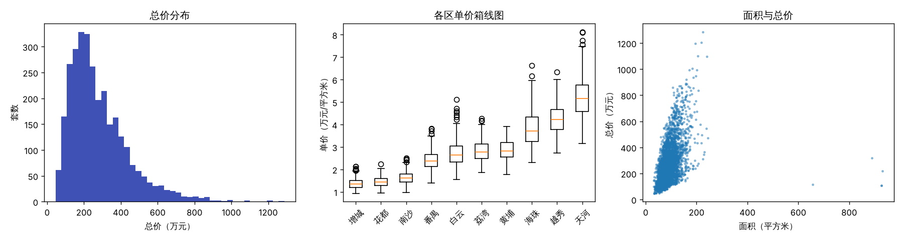
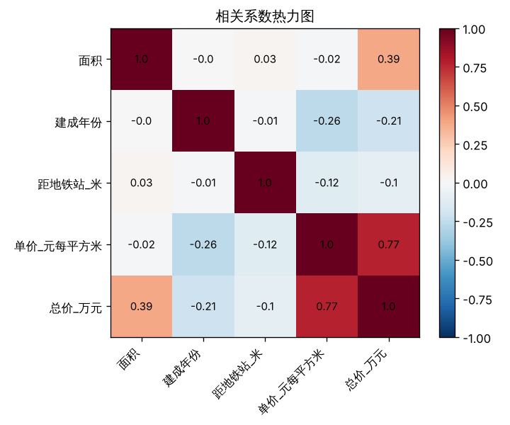
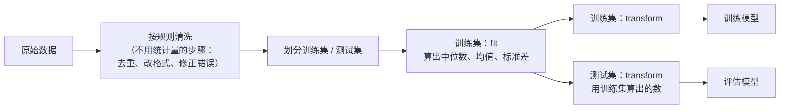
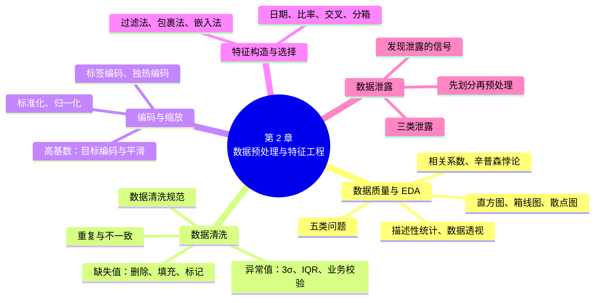

# 第 2 章 数据预处理与特征工程

!!! abstract "本章学时"
    理论 5 学时 · 实验 3 学时（本章共 3 个实验，教师可任选）

## 学习目标

学完本章，你应该能够：

1. **说出**常见的数据质量问题，以及缺失值填充、异常值检测、独热编码、标准化、归一化的含义（记忆）；
2. **解释**为什么要先划分数据集再做预处理，什么是数据泄露，哪些算法需要特征缩放（理解）；
3. **运用** pandas 和 scikit-learn 完成描述统计、数据透视、缺失与异常处理、编码和缩放（应用）；
4. **分析**一份数据的质量问题，用相关系数、特征重要性等方法比较特征，构造和选择特征（分析）；
5. **编写**一份字段、规则、理由齐全的数据清洗规范，并能在别人的数据中找出泄露特征（评价、创造）。

!!! info "先修要求"
    学习本章前，你需要掌握：

    - 样本、特征、标签、训练集与测试集（[1.2 机器学习的基本术语](../01-intro/index.md#12)）；
    - 机器学习项目流程中“数据准备”和“特征工程”两步的位置（[1.4 机器学习项目流程](../01-intro/index.md#14)）；
    - 平均数、中位数、标准差和四分位数（“人工智能数学基础”课程）；
    - 用 pandas 读取 CSV、选取列、`groupby` 分组统计（“Python 程序设计”课程，[附录 A Python 速查](../../appendix/a-python.md)）。

??? abstract "本章概念清单（31 个，点击查看定义和例子）"
    1. [数据质量](../../appendix/glossary.md#g-数据质量)
    2. [探索性数据分析](../../appendix/glossary.md#g-探索性数据分析)
    3. [描述性统计](../../appendix/glossary.md#g-描述性统计)
    4. [数据透视](../../appendix/glossary.md#g-数据透视)
    5. [相关系数](../../appendix/glossary.md#g-相关系数)
    6. [数据清洗](../../appendix/glossary.md#g-数据清洗)
    7. [缺失值](../../appendix/glossary.md#g-缺失值)
    8. [异常值](../../appendix/glossary.md#g-异常值)
    9. [3σ 法则](../../appendix/glossary.md#g-3σ-法则)
    10. [箱线图法](../../appendix/glossary.md#g-箱线图法)
    11. [重复值](../../appendix/glossary.md#g-重复值)
    12. [数据清洗规范](../../appendix/glossary.md#g-数据清洗规范)
    13. [数值型特征](../../appendix/glossary.md#g-数值型特征)
    14. [类别型特征](../../appendix/glossary.md#g-类别型特征)
    15. [标签编码](../../appendix/glossary.md#g-标签编码)
    16. [独热编码](../../appendix/glossary.md#g-独热编码)
    17. [高基数类别特征](../../appendix/glossary.md#g-高基数类别特征)
    18. [目标编码](../../appendix/glossary.md#g-目标编码)
    19. [特征缩放](../../appendix/glossary.md#g-特征缩放)
    20. [标准化](../../appendix/glossary.md#g-标准化)
    21. [归一化](../../appendix/glossary.md#g-归一化)
    22. [特征工程](../../appendix/glossary.md#g-特征工程)
    23. [特征构造](../../appendix/glossary.md#g-特征构造)
    24. [日期特征](../../appendix/glossary.md#g-日期特征)
    25. [交叉特征](../../appendix/glossary.md#g-交叉特征)
    26. [分箱](../../appendix/glossary.md#g-分箱)
    27. [特征选择](../../appendix/glossary.md#g-特征选择)
    28. [过滤法](../../appendix/glossary.md#g-过滤法)
    29. [包裹法](../../appendix/glossary.md#g-包裹法)
    30. [嵌入法](../../appendix/glossary.md#g-嵌入法)
    31. [数据泄露](../../appendix/glossary.md#g-数据泄露)

## 情景导入

小周刚进一家房产中介公司的数据部。经理交给他一个任务：公司想在 App 上推出“智能估价”功能，用户输入房子的区域、面积、楼层等信息，系统马上给出一个参考总价。数据部从各门店的挂牌系统里导出了广州 10 个区约 3000 套二手房的挂牌记录，让他先“把数据整理好”。

小周用 Excel 打开文件，一眼就看出了问题：同一套房子出现了两次；“面积”一列有的写“89.5”，有的写“89.5㎡”，还有的写“89.5平米”；有一套房子的总价是“2078000 万元”，显然是把“元”当成了“万元”；有两百多套房子没填建成年份；“装修”一会儿写“精装”，一会儿写“精装修”。他问经理：“这些都要我一条条改吗？改完怎么证明我改对了？”

经理说：“你先别急着改。第一步，用程序把所有问题查清楚，写一份数据质量报告；第二步，把每一种问题怎么处理写成规范，大家讨论通过了，再用代码一条条执行，这样谁来做结果都一样；第三步，才是把数据加工成模型能用的特征。”这三步，就是本章的内容。业内常说“数据和特征决定了机器学习的上限，模型和算法只是逼近这个上限”，花在本章内容上的时间，往往占一个项目的一半以上。

## 2.1 数据质量与探索性数据分析

### 2.1.1 常见的数据质量问题

“垃圾进，垃圾出”（Garbage In, Garbage Out）是数据行业的一句老话：数据有问题，再好的算法也学不出好结果。[**数据质量**](../../appendix/glossary.md#g-数据质量 "数据满足使用要求的程度，常从完整性、准确性、一致性、时效性等方面评价"){ .term }指数据满足使用要求的程度，我国国家标准《信息技术 数据质量评价指标》（GB/T 36344—2018）从规范性、完整性、准确性、一致性、时效性、可访问性六个方面评价数据质量。<sup class="cite">[[1]](#ref2-1)</sup> 落到一张数据表上，最常见的是下面五类问题，小周的二手房数据里都有：

| 问题 | 含义 | 二手房数据中的例子（实验 2-1 实测） |
|---|---|---|
| 缺失 | 该有的值没有 | 建成年份缺 213 条（7.0%），装修缺 88 条，距地铁站缺 137 条 |
| 重复 | 同一个对象被记录多次 | 60 套房子被重复抓取，完全相同的行有 60 行 |
| 格式不一致 | 同一个字段写法不统一 | 面积有 304 条带“㎡”或“平米”；装修“精装修”69 条、“简装修”36 条 |
| 单位不一致 | 同一个字段用了不同单位 | 5 套房的总价按“元”录入，最大的写成了 4277000 万元 |
| 异常 | 明显不合常理的值 | 6 套房的面积多打了一个 0，最大的写成 1295 平方米 |

这些问题的来源各不相同：缺失可能是业务员没填，也可能是那套房子本来就没有这个信息；重复多半是数据抓取或合并时出的错；格式和单位不一致，往往是因为数据来自不同门店、不同时期的系统。弄清问题的来源，才能决定怎样处理。

### 2.1.2 描述性统计与数据透视

拿到一份数据，第一件事不是建模，而是“看”：有多少行、多少列，每一列是什么类型，数值的范围和分布怎样，类别有哪些取值。这种通过统计和画图了解数据的过程叫作[**探索性数据分析**](../../appendix/glossary.md#g-探索性数据分析 "在建模之前通过统计和画图了解数据分布、关系和问题的过程"){ .term }（EDA），这个说法由美国统计学家图基（J. W. Tukey）在 1977 年的同名著作中提出，他主张在建立模型之前先用简单的方法“让数据自己说话”。<sup class="cite">[[2]](#ref2-2)</sup>

[**描述性统计**](../../appendix/glossary.md#g-描述性统计 "用均值、中位数、标准差、四分位数等少数几个数概括一列数据"){ .term }用几个数概括一列数据：

- **集中趋势**：均值（平均数）、中位数（排序后中间的那个数）、众数（出现最多的值）；
- **离散程度**：标准差、最小值、最大值、四分位数。把数据从小到大排好，处在 25% 位置的数叫第一四分位数 Q1，处在 75% 位置的叫第三四分位数 Q3。

pandas 的 `describe()` 一行代码就能算出这些量。实验 2-1 对原始数据的统计结果中，总价的均值是 5216.2 万元，中位数却只有 243.0 万元，标准差高达 12 万多。**均值远远大于中位数，标准差大得离谱**，这是有极端值的典型信号：几条按“元”录入的总价把平均数拉高了几十倍，而中位数几乎不受影响。所以看描述统计时，一定要把均值、中位数和最大值对照着看。

[**数据透视**](../../appendix/glossary.md#g-数据透视 "按一个或几个类别分组统计，并排成交叉表格的分析方法"){ .term }是把数据按一个或几个类别分组，再对每一组做统计，并排成交叉表格，Excel 里叫“数据透视表”，pandas 里用 `pivot_table`。例如统计各区不同装修的单价中位数（实验 2-1 实测，单位：元 / 平方米）：

| 区域 | 毛坯 | 简装 | 精装 |
|---|---|---|---|
| 天河 | 47100 | 50100 | 53400 |
| 海珠 | 33100 | 36300 | 39000 |
| 番禺 | 20800 | 23600 | 24700 |
| 增城 | 12000 | 13300 | 14400 |

一张表就看清了两个规律：区域之间的单价相差三四倍，是最主要的因素；同一个区内，精装比毛坯贵 10%～20%。

```python
pivot = pd.pivot_table(df, index="区域", columns="装修",
                       values="单价_元每平方米", aggfunc="median")
```

!!! cert "证书考点 · 人工智能数据处理工程师（高级）· 数据挖掘"
    数据挖掘模块要求会做数据清洗和数据透视。常考：用 pandas 的 `isna().sum()` 统计缺失、`duplicated()` 找重复、`describe()` 做描述统计、`groupby` 和 `pivot_table` 做分组和透视；给出一组数据，计算中位数、四分位数并判断异常值。容易错在把 `pivot_table` 的 `index`（行）和 `columns`（列）写反，以及忘记 `aggfunc` 默认是求平均。

### 2.1.3 用图形看分布

数字概括得再好，也比不上一张图直观。**数据可视化**是探索性数据分析的主要手段，最常用的三种图如下：

- **直方图**：把数值分成若干区间，数一数每个区间有多少个样本，看一个数值特征的分布形状；
- **箱线图**：用一个“箱子”画出 Q1 到 Q3 的范围，中间一条线是中位数，两头的“胡须”延伸到正常范围的边界，范围外的点单独画出来，适合比较不同组的分布；
- **散点图**：横轴、纵轴各放一个数值特征，每个样本一个点，看两个特征之间的关系。



这三张图来自实验 2-1（画图前先去掉了总价超过 1 万万元的 5 条明显错误）。左图：总价集中在 100 万～400 万元，右边拖着一条长尾巴，这种形状叫“右偏”，房价、收入这类数据通常都是右偏的。中图：各区单价从增城的 1 万多元到天河的 5 万多元，差别一目了然；天河、越秀的箱子更高更长，说明这两个区内部的价格差异也大。右图：面积和总价大体成正比，但右下方有几个点面积六百多到九百多平方米，总价却只有一两百万到三百万元（还有一条 1295 平方米的，画图时被过滤掉了），这不可能是真的，是面积多打了一个 0。**很多数据错误，画一张图就能发现。**

### 2.1.4 相关系数与相关性分析

两个数值特征之间的线性关系有多强，可以用[**相关系数**](../../appendix/glossary.md#g-相关系数 "衡量两个数值变量线性关系强弱和方向的指标，取值在 −1 到 1 之间"){ .term }（皮尔逊相关系数）来衡量。它的取值在 −1 到 1 之间：

- 接近 1：正相关，一个大另一个也大，如面积和总价；
- 接近 −1：负相关，一个大另一个就小，如距地铁站越远单价越低；
- 接近 0：没有明显的线性关系。

pandas 中用 `df.corr()` 计算所有数值列两两之间的相关系数，再画成热力图：



单价与总价的相关系数是 0.77，面积与总价是 0.39，距地铁站与单价是 −0.12，都符合常识。但有一个数值很奇怪：**建成年份与单价的相关系数是 −0.26**，意思是“房子越新越便宜”。这显然和常识相反。原因在于区域：越秀、荔湾这些老城区房子旧但地段好、单价高；南沙、增城这些新区房子新但单价低。把各区分开计算，每个区内部建成年份与单价的相关系数都在 0.25～0.38 之间，是正的，即同一个区里房子越新越贵。

这个例子说明了相关性分析的两个要点：第一，**相关不等于因果**，两个量相关，可能是因为有第三个因素同时影响它们；第二，**合在一起的结论可能和分组以后的结论相反**，统计学上叫辛普森悖论。所以看到“反常”的相关系数，要多想一步，分组看一看。

## 2.2 数据清洗

[**数据清洗**](../../appendix/glossary.md#g-数据清洗 "发现并处理数据中的缺失、重复、错误和不一致，使数据准确、完整、一致的过程"){ .term }就是发现并处理数据中的缺失、重复、错误和不一致，让数据变得准确、完整、一致。下面分类型来讲。

### 2.2.1 缺失值

处理[**缺失值**](../../appendix/glossary.md#g-缺失值 "数据中应该有却没有记录的值"){ .term }之前，先问一句“为什么缺”。如果是随机漏填的，可以放心地删除或填充；如果缺失本身有含义，比如“装修”没填的往往是业务员没进屋看过的房子，就不能简单地用众数顶上，而应该把“缺失”当成单独的一类。常用的处理方法有：

| 方法 | 做法 | 适用情况 |
|---|---|---|
| 删除 | 删掉有缺失的行（`dropna`）；某一列缺失太多（如超过一半）时删掉整列 | 缺失很少、随机缺失；或该列基本没用 |
| 统计量填充 | 数值用均值或中位数，类别用众数填充（`fillna`） | 缺失不多、随机缺失；有极端值时用中位数比均值稳 |
| 分组填充 | 按相关的类别分组，用组内的统计量填充 | 该列与某个类别关系密切，如建成年份与区域 |
| 单独一类 | 类别特征的缺失记为“未知” | 缺失可能有含义 |
| 加缺失标记 | 填充后再加一列“是否缺失”（0/1） | 想让模型自己判断缺失有没有含义 |
| 模型填充 | 用其他特征训练一个模型来预测缺失值，如 K 近邻填充 | 缺失较多、特征之间关系强 |

**算一算**：海珠区一套房子没填建成年份。如果用全部训练数据的中位数 2007 年来填，就忽略了海珠是老城区的事实；按区域分组，海珠区训练数据的建成年份中位数是 2004 年，用 2004 填更合理。实验 2-2 就是这样做的。

缺失值处理在统计学中有专门的研究，系统的方法可以参考利特尔（R. J. A. Little）和鲁宾（D. B. Rubin）的专著。<sup class="cite">[[3]](#ref2-3)</sup> 对初学者来说，记住三条就够了：先查清缺失比例和原因；填充用的统计量只能从训练集计算（2.5 节解释原因）；填充前后都要检查结果是否合理。

### 2.2.2 异常值

[**异常值**](../../appendix/glossary.md#g-异常值 "明显偏离大多数数据的值，可能是错误，也可能是真实但少见的情况"){ .term }是明显偏离大多数数据的值。它可能是错误（录入错、单位错），也可能是真实但少见的情况（天河区一套 225 平方米、1286.7 万元的大平层）。常用的检测方法有两种。

[**3σ 法则**](../../appendix/glossary.md#g-3σ-法则 "把落在“均值 ± 3 倍标准差”之外的值视为异常的规则，适用于近似正态分布的数据"){ .term }：对于大致呈钟形（正态）分布的数据，约 99.7% 的值落在“均值 ± 3 倍标准差”的范围内，超出这个范围的视为异常。σ（读作西格玛）就是标准差。

[**箱线图法**](../../appendix/glossary.md#g-箱线图法 "把落在 [Q1 − 1.5 × IQR, Q3 + 1.5 × IQR] 之外的值视为异常的规则，IQR = Q3 − Q1"){ .term }（IQR 法）：先算四分位距 IQR = Q3 − Q1，把 [Q1 − 1.5 × IQR, Q3 + 1.5 × IQR] 之外的值视为异常。这个方法也来自图基，箱线图上单独画出的点就是按这个规则找出的。它用的是四分位数，不受极端值本身的影响，对偏态数据也适用。

**算一算**：清洗后的总价，Q1 = 167.5 万元，Q3 = 361.3 万元，IQR = 361.3 − 167.5 = 193.8，正常范围上界 = 361.3 + 1.5 × 193.8 ≈ 652.0 万元。按这个规则，有 106 套房子算“异常”；用 3σ 法则（均值 281.7、标准差 160.0，上界 761.7 万元）只找出 45 套，而且这 45 套都在 IQR 法找出的 106 套里面。

问题是，这 106 套里有 74 套在天河区，都是真实存在的大户型、好地段的房子。如果把它们当成错误删掉，模型就永远学不会给豪宅估价。所以**异常值检测方法只负责“找出可疑的值”，处理不处理、怎样处理，要结合业务判断**：

- 能确认是错误的，能修正就修正（如总价按元录入的除以 10000），不能修正的设为缺失或删除；
- 真实但少见的，一般保留；如果它们严重影响模型，可以单独建模，或者用对极端值不敏感的模型；
- 判断依据要写下来。二手房数据有一个很好的校验办法：**单价 × 面积应该约等于总价**，不满足的就是录入错误。实验 2-2 用这个办法准确地找出了 5 条单位错误和 6 条面积错误，而没有误伤任何一套真实的豪宅。

### 2.2.3 重复值与不一致

[**重复值**](../../appendix/glossary.md#g-重复值 "同一个对象在数据中被记录了多次"){ .term }有两种：完全相同的行，用 `df.duplicated()` 能找出来；“关键字段相同、其他字段略有不同”的行，比如同一套房子先后挂牌两次、价格调过一次，就要按业务规则决定保留哪一条（通常保留最新的）。所以去重时最好按能唯一标识对象的字段来判断，二手房数据用的是“房源编号”：`df.drop_duplicates(subset="房源编号")`。

**不一致**包括写法不一致（“精装”和“精装修”）、单位不一致（元和万元，平方米和亩）、格式不一致（日期写成“2025-07-05”“2025/7/5”“2025年7月5日”）。处理办法是先用 `value_counts()` 把一个字段的所有取值列出来，人工确认哪些其实是同一个意思，再用 `replace` 统一；数值型字段要先用字符串函数去掉单位，再转成数字：

```python
df["面积"] = pd.to_numeric(df["面积"].str.replace("㎡", "").str.replace("平米", ""))
df["装修"] = df["装修"].replace({"精装修": "精装", "简装修": "简装"})
```

### 2.2.4 数据清洗规范

小周的经理坚持“先写规范、再动手”，是有道理的。[**数据清洗规范**](../../appendix/glossary.md#g-数据清洗规范 "写明每个字段的问题、处理规则、理由和影响条数的书面文件，使清洗过程可检查、可重复"){ .term }是一份书面文件，写明每个字段有哪些问题、按什么规则处理、为什么这样处理。它的作用有三个：让处理过程可以检查和讨论，避免个人随意修改；让别人照着执行能得到相同的结果；数据更新后可以重复执行。一份规范至少包括下面几栏：

| 编号 | 字段 | 问题 | 处理规则 | 理由 | 影响条数 |
|---|---|---|---|---|---|
| R1 | 全部 | 同一房源重复 | 按房源编号去重，保留第一条 | 重复记录会让模型偏向这些房子 | 60 |
| R2 | 面积 | 带“㎡”“平米” | 去掉单位，转为数值 | 统一为平方米 | 304 |
| R3 | 总价_万元 | 按元录入 | 大于 10000 且除以 10000 后与“单价 × 面积”相差小于 5% 的，除以 10000 | 用单价校验，避免误改真实高价房 | 5 |
| R4 | 面积 | 多打一个 0 | 大于 300 且除以 10 后与“总价 ÷ 单价”相差小于 5% 的，除以 10 | 同上 | 6 |
| R5 | 装修 | 写法不统一；缺失 | 统一为精装、简装、毛坯；缺失记为“未知” | 缺失可能表示未进屋查看，保留这一信息 | 105 + 88 |
| R6 | 楼层、户型 | 文字混合 | 拆成楼层位置、总楼层、室、厅四个字段 | 便于模型使用 | 全部 |
| R7 | 单价 | 由总价计算得出 | 删除 | 预测总价时属于数据泄露（2.5 节） | 全部 |
| R8 | 建成年份、距地铁站 | 缺失 | 划分数据集后，用训练集同区中位数、训练集整体中位数填充 | 老城区与新区的建成年份差异大 | 207 + 134 |

规范写好以后，代码要和规范一一对应，执行后输出每条规则影响了多少行，便于核对。实验 2-2 就是照这份规范写的。

!!! cert "证书考点 · 人工智能训练师（三级）· 智能训练"
    智能训练模块要求能“制定数据清洗规范，维护训练集和测试集”。技能考核常给一份有问题的数据，要求写出清洗规范并实施。评分看三点：每个问题有没有对应的规则；规则有没有写清判断条件和处理方法；有没有说明理由。只写“删除异常值”而不说怎样判断异常、为什么删，会被扣分。

## 2.3 特征编码与特征缩放

清洗后的数据仍然不能直接交给大多数模型：模型只认数字，而“区域”“装修”是文字；“面积”是几十到两百多，“距地铁站”是几百到几千，大小相差很大。这一节解决这两个问题。

### 2.3.1 类别型特征的编码

特征分两大类：[**数值型特征**](../../appendix/glossary.md#g-数值型特征 "取值是有大小意义的数的特征"){ .term }本身就是有大小意义的数，如面积、建成年份；[**类别型特征**](../../appendix/glossary.md#g-类别型特征 "取值是有限几个类别的特征"){ .term }的取值是有限的几个类别，如区域、装修、朝向。把类别型特征变成数字，常用两种方法。

[**标签编码**](../../appendix/glossary.md#g-标签编码 "给每个类别分配一个整数的编码方法，只适合本身有顺序的类别"){ .term }（也叫序号编码）：给每个类别一个整数，如低楼层 = 0、中楼层 = 1、高楼层 = 2。它只增加一列，很省事，但会让模型以为类别之间有大小和等距关系。所以只适合**本身有顺序**的类别，如楼层高低、学历、信用等级“一般 < 好 < 非常好”。

[**独热编码**](../../appendix/glossary.md#g-独热编码 "把一个有 k 个取值的类别特征变成 k 列 0/1，每个样本只在所属类别一列为 1"){ .term }（One-Hot Encoding）：一个类别特征有几个取值，就变成几列 0/1，每个样本只在自己所属的那一列是 1，其余是 0。例如“装修”有精装、简装、毛坯、未知四个取值，就变成四列：

| 原来的装修 | 装修_精装 | 装修_简装 | 装修_毛坯 | 装修_未知 |
|---|---|---|---|---|
| 精装 | 1 | 0 | 0 | 0 |
| 毛坯 | 0 | 0 | 1 | 0 |
| 未知 | 0 | 0 | 0 | 1 |

独热编码不引入虚假的大小关系，适合**没有顺序**的类别，如区域、装修、朝向。pandas 用 `pd.get_dummies`，scikit-learn 用 `OneHotEncoder`。实验 2-2 中，区域（10 个取值）、装修（4 个）、朝向（7 个）独热编码后，加上 7 个数值特征，一共 28 个特征。

!!! warning "训练集和测试集的编码结果要对齐"
    如果某个类别只在训练集里出现、测试集里没有，分别对两边做 `get_dummies` 会得到不同的列。实验 2-2 用 `X_test.reindex(columns=X_train.columns, fill_value=0)` 让测试集的列和训练集完全一致。scikit-learn 的 `OneHotEncoder(handle_unknown="ignore")` 会自动处理这个问题，第 9 章的流水线会用到。

### 2.3.2 取值很多的类别怎么办

“小区”也是类别型特征，但它有 337 个取值。独热编码会一下子增加 337 列，而且大多数小区只有几套房子，每一列几乎全是 0，模型很难学到东西。这种取值很多的类别叫[**高基数类别特征**](../../appendix/glossary.md#g-高基数类别特征 "取值非常多的类别特征，直接独热编码会产生大量稀疏的列"){ .term }，常见的还有城市、商品编号、用户编号。处理思路有几种：

- **合并稀有类别**：样本很少的类别合并成“其他”；
- **频数编码**：用每个类别出现的次数代替它；
- [**目标编码**](../../appendix/glossary.md#g-目标编码 "用每个类别对应的标签平均值（或中位数）代替类别的编码方法，必须只用训练集计算并做平滑"){ .term }：用每个类别对应的标签平均值（或中位数）代替它。例如用“这个小区每平方米多少万元”来代替小区名，一列就保留了小区的价格水平。

目标编码效果往往很好，但有两个坑。第一，挂牌很少的小区，统计出来的值很不稳定，要做**平滑**：用小区自己的值和所在区的值加权平均，挂牌越少越靠近区的水平。第二，计算时用到了标签，**必须只用训练集计算**，否则就是数据泄露（实验 2-3 会演示）。<sup class="cite">[[4]](#ref2-4)</sup>

**算一算**：某小区训练集里只有 2 套房，单价中位数 5.0 万元 / 平方米；所在的海珠区中位数是 3.7 万元。取平滑参数 k = 5，平滑后的小区参考单价 = (2 × 5.0 + 5 × 3.7) ÷ (2 + 5) = 28.5 ÷ 7 ≈ 4.07 万元，比只看这 2 套房更稳妥。

### 2.3.3 标准化与归一化

[**特征缩放**](../../appendix/glossary.md#g-特征缩放 "把不同特征的数值调整到可比范围的处理"){ .term }把不同特征的数值调整到可比的范围。常用的两种：

[**标准化**](../../appendix/glossary.md#g-标准化 "减去均值、除以标准差，使特征均值为 0、标准差为 1"){ .term }（Z-score 标准化）：减去均值，再除以标准差。处理后的特征均值为 0、标准差为 1，大多数值落在 −3 到 3 之间。

\[
z = \frac{x - \mu}{\sigma}
\]

其中 μ（读作缪）是这一列的均值，σ 是标准差。

[**归一化**](../../appendix/glossary.md#g-归一化 "减去最小值、除以“最大值 − 最小值”，使特征取值在 0 到 1 之间"){ .term }（最小—最大缩放）：减去最小值，再除以“最大值 − 最小值”，处理后的值都在 0 到 1 之间。

\[
x' = \frac{x - x_{\min}}{x_{\max} - x_{\min}}
\]

**算一算**：实验 2-2 的训练集中，面积的均值是 92.24 平方米、标准差 30.54；一套 63.5 平方米的房子，标准化后 z = (63.5 − 92.24) ÷ 30.54 ≈ −0.94，意思是“比平均面积小 0.94 个标准差”。如果用归一化，面积最小 32.0、最大 245.1，x' = (63.5 − 32.0) ÷ (245.1 − 32.0) = 31.5 ÷ 213.1 ≈ 0.148。

两者怎样选？标准化更常用，对极端值也没那么敏感；归一化保证结果在 0 到 1 之间，适合图像像素（0～255 除以 255）这类有明确上下限的数据。scikit-learn 中分别是 `StandardScaler` 和 `MinMaxScaler`，用法都是先 `fit`（从训练集算出均值、标准差或最小值、最大值），再 `transform`（用这些参数转换训练集和测试集）。

### 2.3.4 哪些算法需要缩放

不是所有算法都需要特征缩放：

- **需要缩放**：计算距离的算法，如 K 近邻（第 7 章）、K-Means 聚类（第 8 章）、支持向量机（第 6 章），不缩放的话，数值大的特征（距地铁站几千米）会完全压过数值小的特征（几室）；用梯度下降训练的算法，如线性回归、逻辑回归、神经网络（第 3、4、10 章），不缩放会让训练变慢、不稳定；带正则化的模型（第 3 章），缩放后各特征的系数才能公平比较。
- **不需要缩放**：树模型，如决策树、随机森林、XGBoost（第 5 章），因为它们每次只比较一个特征的大小，单位和量纲不影响划分结果。

拿不准的时候，缩放一下一般不会有坏处。

下面的动画用 8 行原始数据演示了从清洗到编码、缩放的全过程，你可以一步步打开，也可以故意跳过某一步，看看会出什么问题。

<iframe class="sim-frame" src="../../sims/preprocess-pipeline/main.html" height="620" loading="lazy" title="预处理流水线"></iframe>

先不勾选，找出红色格子分别是什么问题；再按顺序打开八个步骤；最后试试只打开“⑧ 标准化”而不打开“③ 修正录入错误”，看看 889 平方米那一行会怎样。[全屏打开](../../sims/preprocess-pipeline/main.html){ target=_blank } · [教学说明](../../sims/preprocess-pipeline/index.md)
{ .sim-caption }

## 2.4 特征构造与特征选择

[**特征工程**](../../appendix/glossary.md#g-特征工程 "把原始数据加工成对模型有用的特征的全部工作，包括编码、缩放、构造和选择"){ .term }泛指把原始数据加工成对模型有用的特征的全部工作，包括前面讲的编码和缩放，也包括这一节的构造新特征和挑选特征。<sup class="cite">[[5]](#ref2-5)</sup>

### 2.4.1 特征构造

[**特征构造**](../../appendix/glossary.md#g-特征构造 "根据业务理解从已有字段计算出新特征"){ .term }是根据业务理解，从已有字段算出新的特征。常见的有四种：

- [**日期特征**](../../appendix/glossary.md#g-日期特征 "从日期中拆出的年、月、星期、节假日或时间差等特征"){ .term }：从日期里拆出年、月、星期几、是否节假日，或者算出时间差。例如“房龄 = 挂牌年份 − 建成年份”“挂牌月序 = 从 2024 年 1 月起的第几个月”（房价随时间变化）。
- **比率特征**：两个字段相除，如“每室面积 = 面积 ÷ 室数”“负债率 = 月还款 ÷ 月收入”。
- [**交叉特征**](../../appendix/glossary.md#g-交叉特征 "由两个或多个特征组合（如相乘）得到的新特征"){ .term }：两个特征组合，如“区域参考单价 × 面积”，它直接给出了这套房子按所在区的平均单价算的“参考总价”。
- [**分箱**](../../appendix/glossary.md#g-分箱 "把连续数值按区间分成若干段，变成类别特征"){ .term }：把连续的数值分成几段，如面积分成“小户型（< 70 平方米）、中户型（70～110）、大户型（> 110）”；年龄分成“青年、中年、老年”。分箱能让线性模型表达“分段”的关系，也能减轻极端值的影响，但会损失一部分信息。

好的特征往往来自对业务的理解。线性回归只能把各个特征加权相加，表达不了“总价 ≈ 单价 × 面积”这种相乘的关系；而交叉特征“参考总价”把这个乘法提前算好了。实验 2-3 中，在 28 个原始特征上训练线性回归，测试集 R²（第 3 章介绍的指标，越接近 1 越好）是 0.836；加上房龄等 4 个日期、比率特征，只提高到 0.839；再加上“参考总价”这一个交叉特征，一下提高到 0.903。

### 2.4.2 特征选择

特征不是越多越好。无关的特征会干扰模型、增加过拟合的风险，也会让模型变慢、更难解释。[**特征选择**](../../appendix/glossary.md#g-特征选择 "从已有特征中挑出最有用的一部分的过程"){ .term }就是从已有的特征中挑出最有用的一部分。方法分三类：<sup class="cite">[[6]](#ref2-6)</sup>

| 方法 | 思路 | 例子 | 优点 | 缺点 |
|---|---|---|---|---|
| [**过滤法**](../../appendix/glossary.md#g-过滤法 "训练模型之前按统计指标给特征打分并筛选的特征选择方法"){ .term } | 训练模型之前，按统计指标给每个特征打分，留下分高的 | 去掉方差接近 0 的特征（几乎所有样本都一样）；按与标签的相关系数排序 | 快，与模型无关 | 一个一个看特征，看不到特征之间的配合 |
| [**包裹法**](../../appendix/glossary.md#g-包裹法 "把特征子集放进模型中试、按模型成绩挑选子集的特征选择方法"){ .term } | 把特征子集“包”进模型里试，按模型成绩挑子集 | 递归特征消除（RFE）：先用全部特征训练，删掉最不重要的一个，再训练、再删，直到剩下指定个数<sup class="cite">[[7]](#ref2-7)</sup> | 考虑了特征之间的配合，效果通常最好 | 要反复训练，慢 |
| [**嵌入法**](../../appendix/glossary.md#g-嵌入法 "在模型训练过程中自动完成特征选择的方法"){ .term } | 在模型训练过程中自动完成选择 | Lasso 回归会把不重要的特征系数压成 0（第 3 章）<sup class="cite">[[8]](#ref2-8)</sup>；树模型的特征重要性（第 5 章） | 一次训练就能完成，速度和效果折中 | 结果依赖所用的模型 |

实验 2-3 用三种方法各从 33 个特征中选 10 个。过滤法选出的是与总价相关系数最大的：参考总价、面积、室、厅……其中面积、室、厅三个特征彼此高度相关，内容重复；包裹法和嵌入法选出的则是参考总价加上建成年份、距地铁站、装修、区域等“补充信息”的特征。结果：过滤法选的 10 个特征测试 R² 为 0.886，包裹法和嵌入法都是 0.901，几乎追平全部 33 个特征的 0.903。这正说明了过滤法“一个一个看”的局限。

## 2.5 数据集划分与数据泄露

### 2.5.1 先划分，再预处理

第 1 章说过，测试集用来模拟“未来的新数据”，训练时不能让模型看见。这句话不只适用于标签，也适用于预处理中用到的所有统计量：填充缺失值的中位数、标准化的均值和标准差、目标编码的小区单价，都**只能从训练集计算**，然后用同样的数值去处理测试集。

为什么？设想模型已经上线，来了一套新房子，我们只能用历史数据（训练集）算出的均值去标准化它，不可能等未来所有房子都来了再算。如果在划分之前用全部数据计算这些统计量，测试集的信息就悄悄混进了训练过程，测试成绩会偏乐观。所以正确的顺序是：



去重、去单位、按单价校验修正错误这些规则，不需要用数据计算统计量，可以在划分前对全部数据执行；凡是要从数据中“算出一个数”的步骤，都放在划分之后。

### 2.5.2 常见的数据泄露

[**数据泄露**](../../appendix/glossary.md#g-数据泄露 "训练时用到了真实预测时刻无法获得的信息，导致评估成绩虚高的错误"){ .term }指训练模型时用到了在真实预测时刻无法获得的信息，导致模型的评估成绩虚高、上线后效果大幅下降。它是机器学习实践中最常见、危害最大的错误之一。<sup class="cite">[[9]](#ref2-9)</sup> 2023 年的一项研究梳理了多个学科中使用机器学习的论文，发现数据泄露影响了数百篇论文的结论。<sup class="cite">[[10]](#ref2-10)</sup> 常见的泄露有三类：

1. **特征里含有标签的信息**：二手房数据中的“单价”是用总价除以面积算出来的。预测总价时，用户只会告诉我们面积、区域等，不可能先告诉我们单价。把单价当特征，模型就是在“抄答案”。类似的还有：预测客户是否流失时用了“销户日期”，预测贷款是否违约时用了“催收次数”。
2. **用到了“未来”的信息**：预测时刻之后才产生的数据，如用下个月的消费金额预测这个月是否流失；时间序列数据随机打乱后划分，用未来的数据预测过去（第 12 章）。
3. **预处理时用了测试集**：在划分之前用全部数据计算填充值、标准化参数、目标编码，或者在全部数据上做特征选择；同一个对象的重复记录一条分到训练集、一条分到测试集。

### 2.5.3 怎样发现数据泄露

数据泄露的特点是“成绩好得不正常”。下面几个信号要特别警惕：

- **成绩好得难以置信**：二手房估价的测试 R² 达到 0.997，几乎没有误差，现实中不可能；
- **某一个特征的重要性压倒一切**：实验 2-3 中加入单价后，随机森林的特征重要性单价占 0.607、面积占 0.388，其他特征加起来不到 0.01；
- **测试成绩比训练成绩还好**：用全部数据计算小区参考单价时，测试 R²（0.960）反而高于训练 R²（0.959）；
- **上线后效果骤降**：离线评估很好，一上线就不行。

发现可疑特征后，逐个问自己：**在真正需要预测的那一刻，这个特征的值能不能拿到？是怎样算出来的？**这个问题问清楚了，大部分泄露都能避免。

## 2.6 前沿视窗

**用大模型辅助数据清洗。**数据清洗中很多工作需要“理解”文字：把“精装修”“精装”“豪装”归为一类，从“中楼层/共18层”里拆出楼层信息，把五花八门的日期写法统一起来。今天，数据分析师可以把字段的取值清单交给 DeepSeek、通义千问等大模型，让它建议归并方案、写出清洗代码，效率大大提高。但大模型给出的归并可能不符合业务口径，写出的代码可能在划分之前用全部数据计算统计量，所以本章强调的“先写规范、评审后执行、记录每条规则影响多少行”的做法更显重要。处理含个人信息的数据时，还要遵守数据安全规定，不能把原始数据上传到公共的大模型服务。

**自动特征工程。**特征构造高度依赖经验。自动特征工程工具会自动尝试各种字段组合、聚合和变换，生成成百上千个候选特征，再用特征选择方法筛选。第 1 章介绍的自动机器学习平台通常都带有这项功能。它适合作为“启发”，最终保留哪些特征，仍要检查是否合理、是否有泄露。

**数据标注与合成数据。**监督学习需要标签，而很多业务数据没有现成的标签，需要人工标注，例如给客服对话标注意图、给影像标出病灶。数据标注的方法、规范和质量控制，在“人工智能数据分析与处理”课程中系统讲授，对应人工智能训练师四级的“数据标注”模块。另一种思路是用程序或大模型生成**合成数据**：既能补充稀缺的样本，也能在不泄露真实个人信息的情况下共享数据。本书实验中的贷款、电信客户和二手房数据，就是按真实业务规律生成的模拟数据。

## 本章实验

!!! abstract "实验总览"
    | 实验 | 类型 | 建议时长 | 内容 |
    |---|---|---|---|
    | 实验 2-1 | ★ 基础 | 45 分钟 | 用 pandas 检查二手房原始数据的缺失、重复、格式和异常，做描述统计、数据透视和可视化，写数据质量报告 |
    | 实验 2-2 | ★ 基础 | 60 分钟 | 按清洗规范逐条清洗数据，划分训练集和测试集后填充缺失值、编码和标准化 |
    | 实验 2-3 | ☆ 拓展 | 60 分钟 | 构造日期、比率和交叉特征，用三种方法做特征选择，找出数据中的泄露特征 |

    三个实验都在本机 CPU 上运行，每个脚本不超过 1 分钟。实验代码见配套资源 `labs/ch02/` 目录，数据在 `labs/data/`。

### 实验 2-1 ★ 认识一份真实数据：二手房数据探索

**实验目的**

1. 用 pandas 查看数据的规模、字段类型，统计缺失值和重复值；
2. 发现格式不一致和录入错误，用描述统计、箱线图规则找出可疑的异常值；
3. 用数据透视表、直方图、箱线图、散点图和相关系数热力图了解数据，写出一份数据质量报告。

**实验环境**：本机 CPU。Python 3.11，pandas、matplotlib。

**实验数据**：`labs/data/house_raw.csv`，3060 行广州二手房挂牌记录（含 60 行重复），字段有房源编号、区域、小区、面积、户型、楼层、建成年份、装修、朝向、距地铁站（米）、挂牌日期、单价（元 / 平方米）、总价（万元）。数据由 `labs/data/make_datasets.py` 按各区挂牌价格的大致水平生成，并故意加入了缺失、重复、格式不一致和录入错误（真实的挂牌数据涉及平台版权和个人信息，不能公开）。

**实验步骤与代码**

第 1 步，读入数据，查看规模、每列的类型和前几行：

```python
df = pd.read_csv("../data/house_raw.csv")
print(df.shape)
print(df.dtypes)
print(df.head(3))
```

第 2 步，统计每列的缺失数和缺失比例，只列出有缺失的字段：

```python
missing = df.isna().sum()
print(pd.DataFrame({"缺失数": missing, "缺失比例": (missing / len(df)).round(3)})[missing > 0])
```

第 3 步，检查重复：`df.duplicated().sum()` 数完全相同的行，`df["房源编号"].duplicated().sum()` 数重复的编号。

第 4 步，检查格式。“面积”本应是数字，看看哪些值无法转成数字；用 `value_counts` 列出“装修”的所有取值：

```python
not_number = df.loc[pd.to_numeric(df["面积"], errors="coerce").isna(), "面积"]
print(len(not_number), not_number.head(4).tolist())
print(df["装修"].value_counts(dropna=False))
```

`errors="coerce"` 的意思是转换失败的值变成缺失，而不是报错，这样就能把转换失败的值挑出来。

第 5 步，临时去掉面积的单位后做描述统计；用 IQR 规则找出总价的可疑值：

```python
q1, q3 = df["总价_万元"].quantile([0.25, 0.75])
iqr = q3 - q1
low, high = q1 - 1.5 * iqr, q3 + 1.5 * iqr
out = df[(df["总价_万元"] < low) | (df["总价_万元"] > high)]
```

第 6 步，分组统计和数据透视：各区套数与单价中位数，各区不同装修的单价中位数（代码见 2.1.2 节）。

第 7 步，画总价直方图、各区单价箱线图、面积与总价散点图，计算相关系数并画热力图；再按区分组计算“建成年份—单价”的相关系数。完整代码见 `labs/ch02/lab2_1_explore.py`。

**运行结果**（节选）

```text
共 3060 行、13 列

缺失值（只列有缺失的字段）：
        缺失数   缺失比例
建成年份    213  0.070
装修       88  0.029
距地铁站_米  137  0.045

完全相同的重复行：60 行；房源编号重复：60 个

“面积”列的类型：str
无法直接转成数字的面积：304 个，例如 ['57.9平米', '63.5㎡', '122.7平米', '88.5㎡']
“装修”列的取值： {'精装': 1525, '简装': 1017, '毛坯': 325, nan: 88, '精装修': 69, '简装修': 36}

数值字段的描述统计：
           count     mean       std     min      25%      50%      75%        max
建成年份      2847.0   2007.3       7.7  1985.0   2002.0   2007.0   2013.0     2023.0
距地铁站_米    2923.0    995.9     888.4   100.0    360.0    730.0   1335.0     6000.0
单价_元每平方米  3060.0  30570.1   13235.9  9244.0  20749.0  28121.5  39046.5    81320.0
总价_万元     3060.0   5216.2  126262.4    45.4    167.4    243.0    361.3  4277000.0
面积        3060.0     93.9      51.8    32.0     70.3     86.4    109.9     1295.0

总价的 IQR 范围：[-123.5, 652.2] 万元，范围外 113 套，其中超过 1 万万元的 5 套：
    房源编号 区域    面积  单价_元每平方米     总价_万元
GZ301661 海珠 104.0     41125 4277000.0
GZ300183 天河  88.4     39661 3506000.0
GZ302735 番禺 106.4     27697 2947000.0
GZ301770 番禺 110.7     20723 2294000.0
GZ300956 南沙 131.2     15838 2078000.0
GZ300648 天河 224.9     57212    1286.7

各区挂牌套数与单价中位数（元/平方米）：
区域         天河     越秀     海珠     黄埔     荔湾     白云     番禺     南沙     花都     增城
count     433    260    375    269    228    410    467    187    206    225
median  51693  42242  37232  28296  27764  26452  23772  16095  14454  13472

相关系数矩阵：
            面积  建成年份  距地铁站_米  单价_元每平方米  总价_万元
面积        1.00 -0.00    0.03     -0.02   0.39
建成年份     -0.00  1.00   -0.01     -0.26  -0.21
距地铁站_米    0.03 -0.01    1.00     -0.12  -0.10
单价_元每平方米 -0.02 -0.26   -0.12      1.00   0.77
总价_万元     0.39 -0.21   -0.10      0.77   1.00
各区内部“建成年份—单价”相关系数：0.25～0.38（全部数据合在一起是 -0.26）
```

几点解读：

- “面积”列的类型是 `str`（文字），因为其中混有带单位的值，这一列现在不能参与任何计算。
- 总价超过 1 万万元的 5 套，单价都在正常范围（1.6 万～4.1 万元 / 平方米），用单价 × 面积一算就知道总价应该是两三百万元，是按“元”录入的；而排第 6 的 1286.7 万元那一套，是天河区 224.9 平方米的大户型，单价 5.7 万元，是真实的。
- IQR 规则找出了 113 套，其中真正的错误只有 5 套，这再次说明异常值规则只能“找出可疑”，不能代替判断。
- 面积的最大值 1295.0 平方米明显不合理，结合散点图可以找出这些录入错误。

**实验记录表：数据质量报告**

| 检查项 | 发现的问题（写清字段、条数、例子） | 建议的处理方法 |
|---|---|---|
| 缺失 | | |
| 重复 | | |
| 格式不一致 | | |
| 单位不一致 / 录入错误 | | |
| 可疑的异常值 | | |
| 其他发现（如各区价格、相关性） | | |

**常见问题排查**

| 现象 | 原因 | 解决办法 |
|---|---|---|
| 列名或中文内容显示为乱码 | 文件编码与读取方式不一致 | 用 `pd.read_csv(..., encoding="utf-8-sig")`；如果是 Excel 导出的 CSV，可能是 `gbk` 编码 |
| `TypeError: '<' not supported between instances of 'str' and 'int'` | 对文字型的“面积”做了大小比较 | 先去单位、用 `pd.to_numeric` 转成数字 |
| 图上中文显示成方框 | 没有设置中文字体 | 按实验 1-1 的方法检查字体，设置 `plt.rcParams["font.sans-serif"]` |
| `boxplot` 报错 `unexpected keyword argument 'tick_labels'` | Matplotlib 版本低于 3.9 | 把 `tick_labels` 改成 `labels`，或升级 Matplotlib |

**思考与练习**

1. 总价的均值和中位数相差 20 多倍，说明了什么？如果要用一个数代表“典型房价”，应该用哪一个？
2. “装修”缺失的 88 套房子，你认为应该怎样处理？说出理由。
3. 为什么全部数据中“建成年份”与单价负相关，而每个区内部却是正相关？这对建模有什么启示？

**实验报告要求**

提交运行结果截图和数据质量报告（实验记录表）。报告要写成业务人员也能看懂的文字，每类问题给出具体条数和至少一个例子。

### 实验 2-2 ★ 按规范清洗并编码

**实验目的**

1. 按 2.2.4 节的数据清洗规范，逐条用代码实施清洗，并输出每条规则影响的条数；
2. 理解“先划分、再预处理”的原则，只用训练集计算填充值和标准化参数；
3. 完成标签编码、独热编码和标准化，得到可以直接训练模型的数据。

**实验环境**：本机 CPU。Python 3.11，pandas、scikit-learn。

**实验数据**：`labs/data/house_raw.csv`（同实验 2-1）。本实验会生成 `labs/data/house_clean.csv`，第 3 章和第 9 章要用。

**实验步骤与代码**

第 1 步，执行不需要统计量的清洗规则 R1～R7。以 R3（总价单位错误）为例，先用单价和面积推算总价，只修正“大于 10000、除以 10000 后与推算值相差不到 5%”的记录：

```python
implied = df["单价_元每平方米"] * df["面积"] / 10000      # 用单价和面积推算的总价（万元）
wrong_unit = (df["总价_万元"] > 10000) & ((df["总价_万元"] / 10000 / implied - 1).abs() < 0.05)
df.loc[wrong_unit, "总价_万元"] = df.loc[wrong_unit, "总价_万元"] / 10000
```

R6 用正则表达式从“中楼层/共18层”中提取楼层位置和总楼层，从“3室2厅”中提取室数和厅数：

```python
df[["楼层位置", "总楼层"]] = df["楼层"].str.extract(r"(.)楼层/共(\d+)层")
df[["室", "厅"]] = df["户型"].str.extract(r"(\d)室(\d)厅").astype(int)
```

清洗后的数据保存为 `house_clean.csv`，此时建成年份和距地铁站仍有缺失，留到划分以后再填。

第 2 步，去掉房源编号、小区（实验 2-3 再处理）、挂牌日期和标签，按 8 : 2 划分训练集和测试集。

第 3 步，用训练集计算各区建成年份中位数和距地铁站中位数，填充两边的缺失值：

```python
year_median = X_train.groupby("区域")["建成年份"].median()
subway_median = X_train["距地铁站_米"].median()
for part in (X_train, X_test):
    part["建成年份"] = part["建成年份"].fillna(part["区域"].map(year_median))
    part["距地铁站_米"] = part["距地铁站_米"].fillna(subway_median)
```

第 4 步，楼层位置按“低、中、高”编成 0、1、2；区域、装修、朝向做独热编码，并让测试集的列与训练集对齐。

第 5 步，标准化 6 个数值特征，`fit` 只用训练集：

```python
scaler = StandardScaler().fit(X_train[num_cols])
X_train[num_cols] = scaler.transform(X_train[num_cols])
X_test[num_cols] = scaler.transform(X_test[num_cols])
```

完整代码见 `labs/ch02/lab2_2_clean.py`。

**运行结果**

```text
清洗记录：
  R1 去重            60 条
  R2 面积去单位        304 条
  R3 总价单位错误         5 条
  R4 面积多打 0         6 条
  R5 装修统一写法       105 条
清洗后 3000 行；仍有缺失（留到划分后再填）：{'建成年份': 207, '距地铁站_米': 134}
总价范围 45.4～1286.7 万元，面积范围 32.0～245.1 平方米
已保存 ../data/house_clean.csv

训练集 2400 条，测试集 600 条
训练集各区建成年份中位数： {'南沙': 2015, '增城': 2012, '天河': 2006, '海珠': 2004, '番禺': 2009, '白云': 2007, '花都': 2012, '荔湾': 2001, '越秀': 1998, '黄埔': 2011}
训练集距地铁站中位数：720 米

编码后共 28 个特征：['面积', '建成年份', '距地铁站_米', '楼层位置', '总楼层', '室', '厅', '区域_南沙', '区域_增城', '区域_天河', '区域_海珠', '区域_番禺', '区域_白云', '区域_花都', '区域_荔湾', '区域_越秀', '区域_黄埔', '装修_未知', '装修_毛坯', '装修_简装', '装修_精装', '朝向_东', '朝向_东南', '朝向_北', '朝向_南', '朝向_南北', '朝向_西', '朝向_西南']
训练集标准化后的均值和标准差：
       面积  建成年份  距地铁站_米  总楼层    室    厅
mean -0.0   0.0    -0.0 -0.0  0.0 -0.0
std   1.0   1.0     1.0  1.0  1.0  1.0
测试集标准化后的均值和标准差（不必正好是 0 和 1）：
         面积   建成年份  距地铁站_米    总楼层      室      厅
mean -0.029  0.068   0.002 -0.007 -0.002 -0.055
std   1.025  1.028   0.932  0.980  1.072  1.011

处理后的前 2 行（只显示部分列）：
       面积  建成年份  距地铁站_米  楼层位置   总楼层     室     厅  区域_南沙  区域_增城  区域_天河
646 -1.45  0.52    0.18     0  0.71 -1.74 -1.24      0      0      0
704  1.22  0.12    1.25     0 -1.23  1.04  0.81      0      0      0
缺失值总数：训练集 0，测试集 0
```

几点解读：

- 每条规则影响的条数与 2.2.4 节规范中预估的一致，说明规则执行正确。清洗后总价最高 1286.7 万元，面积最大 245.1 平方米，都在合理范围。
- 各区建成年份中位数从越秀的 1998 年到南沙的 2015 年，相差 17 年，按区填充比用整体中位数更合理。
- 训练集标准化后均值正好是 0、标准差正好是 1；测试集用的是训练集的均值和标准差，所以结果接近但不正好是 0 和 1，这是正常的，也正是“没有偷看测试集”的证明。

**实验记录表**

| 规则 | 影响条数 | 抽查一条记录：处理前 → 处理后 |
|---|---|---|
| R1 去重 | | |
| R3 总价单位错误 | | |
| R4 面积多打 0 | | |
| R5 装修统一写法 | | |
| R8 缺失值填充 | | |
| 编码后的特征数 | | — |

**常见问题排查**

| 现象 | 原因 | 解决办法 |
|---|---|---|
| `str.extract` 结果全是 NaN | 正则表达式和实际写法不匹配，如“楼层”写成了“层” | 先 `df["楼层"].unique()` 看清所有写法，再调整正则表达式 |
| 测试集比训练集少了几列，模型预测时报错 | 某些类别只出现在训练集中 | 用 `reindex(columns=X_train.columns, fill_value=0)` 对齐 |
| `SettingWithCopyWarning` 警告 | 对 `train_test_split` 返回的切片直接赋值 | 先 `.copy()` 再修改，如实验代码所示 |
| 标准化后仍有 NaN | 缺失值还没填就标准化了 | 先填充，再标准化 |

**思考与练习**

1. 规则 R3 和 R4 为什么要用“单价 × 面积”来校验，而不是直接把“总价大于 10000”“面积大于 300”的都改掉？
2. 如果把第 3 步的填充放在第 2 步划分之前，用全部数据计算中位数，会有什么问题？在这份数据上影响大吗？
3. 楼层位置为什么用 0、1、2 编码，区域却要用独热编码？

**实验报告要求**

提交清洗规范（可以在 2.2.4 节的基础上修改）、运行结果截图和实验记录表。规范中每条规则都要写明判断条件、处理方法和理由。

### 实验 2-3 ☆ 特征构造、特征选择与数据泄露“侦探”

**实验目的**

1. 构造日期、比率和交叉特征，观察它们对线性回归效果的影响；
2. 用过滤法、包裹法（递归特征消除）和嵌入法（Lasso）做特征选择，比较选出的特征和效果；
3. 在一份埋了泄露的数据中找出泄露特征，体会目标编码只用训练集计算的必要性。

**实验环境**：本机 CPU。Python 3.11，pandas、scikit-learn。

**实验数据**：`labs/data/house_clean.csv`（实验 2-2 生成）；泄露实验另外用到 `house_raw.csv` 中的“单价”一列。

**实验步骤与代码**

第 1 步，按实验 2-2 的方法划分并填充数据，构造原始的 28 个特征，训练线性回归作为基准。

第 2 步，构造新特征。区域参考单价只用训练集计算：

```python
ref_price = (train["总价_万元"] / train["面积"]).groupby(train["区域"]).median()
listed = pd.to_datetime(part["挂牌日期"])
X["房龄"] = listed.dt.year - part["建成年份"]                       # 日期特征
X["挂牌月序"] = (listed.dt.year - 2024) * 12 + listed.dt.month     # 日期特征
X["朝南"] = part["朝向"].isin(["南", "南北"]).astype(int)            # 二值特征
X["每室面积"] = part["面积"] / part["室"]                            # 比率特征
X["参考总价"] = part["区域"].map(ref_price) * part["面积"]            # 交叉特征
```

第 3 步，三种方法各选 10 个特征。包裹法和嵌入法要先把特征标准化：

```python
corr = Xf_tr.corrwith(y_tr).abs().sort_values(ascending=False)
filter_sel = list(corr.index[:10])                                   # 过滤法
rfe = RFE(LinearRegression(), n_features_to_select=10).fit(Xs_tr, y_tr)
wrap_sel = list(Xs_tr.columns[rfe.support_])                         # 包裹法
lasso = LassoCV(cv=5, random_state=42).fit(Xs_tr, y_tr)              # 嵌入法
```

第 4 步，泄露侦探。同事交来的数据多了一列“单价”，用随机森林训练，看成绩和特征重要性；再比较小区参考单价用全部数据和只用训练集计算的差别。完整代码见 `labs/ch02/lab2_3_features_leakage.py`。

**运行结果**

```text
① 特征构造（线性回归）
  原始特征 28 个：训练 R² 0.848，测试 R² 0.836
  加日期、比率特征        32 个：训练 R² 0.853，测试 R² 0.839
  再加交叉特征“参考总价”    33 个：训练 R² 0.907，测试 R² 0.903

② 特征选择（在 ① 的全部特征上，各选 10 个）
  方差过滤：方差小于 0.01 的特征 []
  过滤法（与总价相关系数绝对值最大的 10 个）：['参考总价', '面积', '室', '区域_天河', '厅', '区域_增城', '区域_花都', '建成年份', '房龄', '区域_越秀']
  包裹法（递归特征消除）：['建成年份', '距地铁站_米', '区域_海珠', '区域_荔湾', '区域_越秀', '装修_毛坯', '装修_简装', '房龄', '挂牌月序', '参考总价']
  嵌入法（Lasso，alpha=0.227，系数为 0 的有 6 个）系数最大的 10 个：['参考总价', '建成年份', '距地铁站_米', '挂牌月序', '装修_精装', '区域_越秀', '区域_荔湾', '装修_毛坯', '区域_海珠', '区域_南沙']

  方法          特征数  训练 R²  测试 R²
  全部特征          33    0.907    0.903
  过滤法           10    0.891    0.886
  包裹法           10    0.904    0.901
  嵌入法           10    0.905    0.901

③ 数据泄露侦探（模型换成随机森林，第 5 章介绍）
  原始特征：            训练 R² 0.972，测试 R² 0.889
  同事给的数据（多了“单价”）：训练 R² 0.998，测试 R² 0.997
  特征重要性前 4：{'单价': 0.607, '面积': 0.388, '室': 0.002, '距地铁站_米': 0.001}

  小区有 337 个，每个小区平均 8.9 套，独热编码太多，改用“小区参考单价”
  小区参考单价用全部数据计算（泄露）：线性回归 训练 R² 0.959，测试 R² 0.960
  小区参考单价只用训练集计算（正确）：线性回归 训练 R² 0.958，测试 R² 0.952
  测试集 600 套中，所在小区在训练集里没出现过的 8 套
```

几点解读：

- **特征构造**：一个基于业务理解的交叉特征“参考总价”，让测试 R² 从 0.839 提高到 0.903，作用远大于另外 4 个特征。
- **特征选择**：包裹法和嵌入法选出的 10 个特征几乎达到了全部 33 个特征的效果，且两种方法选出的特征大部分相同；过滤法选了面积、室、厅这些彼此重复的特征，效果最差。
- **泄露一**：加入“单价”后，测试 R² 从 0.889 跳到 0.997，单价和面积两个特征的重要性加起来占 99.5%。模型其实只学会了“单价 × 面积 = 总价”，用户估价时根本拿不出单价，这个模型上线就没用了。
- **泄露二**：小区参考单价确实很有用（线性回归测试 R² 从 0.903 提高到 0.952），但用全部数据计算时，测试 R² 达到 0.960，**比训练 R² 还高**，这就是泄露的信号：测试集房子的价格被提前“编”进了特征里。这份数据每个小区平均有近 9 套房，泄露的影响不到 1 个百分点；如果换成每个小区只有一两套房的数据，影响会大得多。

**实验记录表**

| 实验内容 | 训练 R² | 测试 R² | 你的结论 |
|---|---|---|---|
| 原始 28 个特征 | | | |
| 加入“参考总价” | | | |
| 你选出的最好的 10 个特征 | | | |
| 加入“单价”（随机森林） | | | |
| 小区参考单价：全部数据 / 只用训练集 | | | |

**常见问题排查**

| 现象 | 原因 | 解决办法 |
|---|---|---|
| `LassoCV` 运行时出现 `ConvergenceWarning` | 特征没有标准化，或迭代次数不够 | 先标准化；或设 `max_iter=10000` |
| RFE 运行很慢 | 每删一个特征都要重新训练 | 设 `step=2` 或更大，一次删多个；或先用过滤法去掉明显无关的特征 |
| 测试集出现 `NaN` 的“小区参考总价” | 测试集中有训练集没见过的小区 | 用所在区的参考单价代替，如实验代码中的 `fillna` |

**思考与练习**

1. 除了“参考总价”，你还能想到哪些对估价有用的特征？试着加入一个，看测试 R² 有没有提高。
2. 过滤法选出的特征中，“面积”“室”“厅”同时入选，这有什么问题？怎样改进过滤法？
3. 假设你要预测“一套房挂牌后多少天能卖出去”，下列字段哪些会造成数据泄露：挂牌价、挂牌后第一周的浏览量、成交价、成交日期、业主是否急售？

**实验报告要求**

提交运行结果截图、实验记录表和思考题答案。写一段 200 字左右的“泄露侦探报告”：你是怎样发现泄露特征的，依据是什么，应该怎样修复。

## 本章小结

- **数据质量**问题主要有缺失、重复、格式不一致、单位不一致和异常五类。**探索性数据分析**用描述统计、数据透视和可视化了解数据，均值远大于中位数、图上离群的点都是数据有问题的信号。
- **相关系数**衡量两个数值特征的线性关系，但相关不等于因果，合并数据得出的结论可能和分组后相反。
- **缺失值**可以删除、用统计量填充、分组填充、记为单独一类或加缺失标记；**异常值**用 3σ 法则或 IQR 法找出，但处理不处理要结合业务判断，能校验的用业务规则校验。
- 清洗要先写**数据清洗规范**，写明字段、问题、规则、理由和影响条数，再用代码逐条执行。
- 有顺序的类别用**标签编码**，没有顺序的用**独热编码**，取值很多的考虑目标编码并做平滑。**标准化**和**归一化**让特征大小可比，距离类和梯度类算法需要缩放，树模型不需要。
- **特征构造**（日期、比率、交叉、分箱）要从业务出发；**特征选择**有过滤法、包裹法和嵌入法三类。
- **先划分、再预处理**：填充值、标准化参数、目标编码都只能从训练集计算。成绩好得不正常、单个特征压倒一切、测试比训练还好，都是**数据泄露**的信号。



**下一章预告**

数据整理好了，小周终于可以建模了。下一章从最简单、也最经典的模型讲起：**线性回归**。它假设总价等于各个特征的加权和，“训练”就是找出最合适的权重。我们会用 5 个点手算最小二乘，用“下山”的比喻理解梯度下降，再在本章清洗好的二手房数据上训练一个真正的估价模型，并学习 MAE、RMSE、R² 这些回归指标的含义。

## 参考文献

正文中的上标编号（如<sup class="cite">[[2]](#ref2-2)</sup>）对应下面的文献。带链接的可以直接打开；书籍可在图书馆或电子书平台查阅。

<div class="refs" markdown>

**教材与专著**

- <span id="ref2-2"></span>[2] TUKEY J W. Exploratory data analysis[M]. Reading: Addison-Wesley, 1977.
    <span class="ref-note">探索性数据分析的奠基之作，提出了箱线图和用四分位距判断异常值的方法，对应 2.1.2、2.2.2 节。</span>
- <span id="ref2-3"></span>[3] LITTLE R J A, RUBIN D B. Statistical analysis with missing data[M]. 3rd ed. Hoboken: Wiley, 2019.
    <span class="ref-note">缺失数据分析的经典专著，系统介绍缺失机制和各类填充方法，对应 2.2.1 节。</span>
- <span id="ref2-5"></span>[5] ZHENG A, CASARI A. Feature engineering for machine learning: principles and techniques for data scientists[M]. Sebastopol: O'Reilly Media, 2018.
    <span class="ref-note">特征工程的入门专著，讲解数值、类别、文本特征的处理和特征缩放，对应 2.3、2.4 节。</span>

**经典论文**

- <span id="ref2-4"></span>[4] MICCI-BARRECA D. A preprocessing scheme for high-cardinality categorical attributes in classification and prediction problems[J]. ACM SIGKDD Explorations Newsletter, 2001, 3(1): 27-32.
    <span class="ref-note">提出用带平滑的目标均值编码高基数类别特征，对应 2.3.2 节。</span>
- <span id="ref2-6"></span>[6] GUYON I, ELISSEEFF A. An introduction to variable and feature selection[J]. Journal of Machine Learning Research, 2003, 3: 1157-1182.
    <span class="ref-note">特征选择的经典综述，把方法分为过滤法、包裹法和嵌入法，对应 2.4.2 节。</span>
- <span id="ref2-7"></span>[7] GUYON I, WESTON J, BARNHILL S, et al. Gene selection for cancer classification using support vector machines[J]. Machine Learning, 2002, 46(1-3): 389-422.
    <span class="ref-note">提出递归特征消除（RFE）方法，对应 2.4.2 节和实验 2-3。</span>
- <span id="ref2-8"></span>[8] TIBSHIRANI R. Regression shrinkage and selection via the lasso[J]. Journal of the Royal Statistical Society: Series B (Methodological), 1996, 58(1): 267-288.
    <span class="ref-note">Lasso 回归的原始论文，说明了它能把部分系数压缩为 0 从而完成特征选择，对应 2.4.2 节，第 3 章详细介绍。</span>
- <span id="ref2-9"></span>[9] KAUFMAN S, ROSSET S, PERLICH C, et al. Leakage in data mining: formulation, detection, and avoidance[J]. ACM Transactions on Knowledge Discovery from Data, 2012, 6(4): 1-21.
    <span class="ref-note">系统讨论数据泄露的定义、类型、发现与避免方法，对应 2.5 节。</span>
- <span id="ref2-10"></span>[10] KAPOOR S, NARAYANAN A. Leakage and the reproducibility crisis in machine-learning-based science[J]. Patterns, 2023, 4(9): 100804.
    <span class="ref-note">梳理了多个学科中因数据泄露导致结论有误的论文，并给出泄露类型清单，对应 2.5.2 节。</span>

**在线资源与数据**

- <span id="ref2-1"></span>[1] 国家市场监督管理总局，中国国家标准化管理委员会. 信息技术 数据质量评价指标：GB/T 36344—2018[S]. 北京：中国标准出版社，2018.
    <span class="ref-note">我国数据质量评价的国家标准，从规范性、完整性、准确性、一致性、时效性、可访问性六方面评价数据质量，对应 2.1.1 节。</span>
- <span id="ref2-11"></span>[11] scikit-learn developers. Preprocessing data; Feature selection[EB/OL]. [2026-10-29]. https://scikit-learn.org/stable/modules/preprocessing.html; https://scikit-learn.org/stable/modules/feature_selection.html.
    <span class="ref-note">scikit-learn 用户指南中数据预处理和特征选择两章，`StandardScaler`、`OneHotEncoder`、`RFE` 等的参数以此为准，对应本章实验。</span>

</div>

## 课后练习

选择题和判断题可以直接点击选项作答，系统会马上告诉你对错，并展开答案与解析；多选题选好后点“提交答案”。简答和实操题请先自己作答，再点开“答案与解析”核对。每道题的解析下方都有“回看”链接，做错了可以直接跳回正文复习。

**一、单项选择题**

<div class="quiz" data-answer="B" markdown>

**1.** 一列数据的均值是 5216 万元，中位数是 243 万元，最可能的原因是（　　）。

- A. 数据中有大量缺失值
- B. 数据中有少数极大的值把均值拉高了
- C. 数据是左偏分布
- D. 计算出错，均值不可能比中位数大这么多

</div>

??? tip "答案与解析"
    **答案：B**

    均值受极端值影响很大，中位数几乎不受影响。实验 2-1 中 5 条按“元”录入的总价把均值拉高了 20 多倍。缺失值在计算时会被跳过，不会造成这种差距。

    考查：描述性统计 · 认知层次：分析 · [回看 2.1.2](#212)
    { .quiz-meta }

<div class="quiz" data-answer="D" markdown>

**2.** 某列数据的 Q1 = 20，Q3 = 40。按箱线图（IQR）规则，正常范围的上界是（　　）。

- A. 40
- B. 50
- C. 60
- D. 70

</div>

??? tip "答案与解析"
    **答案：D**

    IQR = 40 − 20 = 20，上界 = Q3 + 1.5 × IQR = 40 + 30 = 70。常见错误是用 Q3 + IQR = 60，忘了乘 1.5。

    考查：异常值检测 · 认知层次：应用 · [回看 2.2.2](#222)
    { .quiz-meta }

<div class="quiz" data-answer="A" markdown>

**3.** 训练集中某特征的均值为 50、标准差为 10。测试集中一个值为 65 的样本，标准化后的结果是（　　）。

- A. 1.5
- B. 0.65
- C. 15
- D. −1.5

</div>

??? tip "答案与解析"
    **答案：A**

    z = (65 − 50) ÷ 10 = 1.5。注意测试集也要用训练集的均值和标准差来计算。

    考查：标准化 · 认知层次：应用 · [回看 2.3.3](#233)
    { .quiz-meta }

<div class="quiz" data-answer="C" markdown>

**4.** 对“区域”（天河、越秀、海珠……共 10 个取值）这一特征，最合适的编码方法是（　　）。

- A. 按拼音顺序编成 0～9
- B. 直接删除
- C. 独热编码
- D. 标准化

</div>

??? tip "答案与解析"
    **答案：C**

    区域之间没有大小顺序，按序号编码会让模型误以为“越秀 > 天河”且间隔相等；独热编码不引入虚假的顺序。标准化是对数值特征的处理。

    考查：类别型特征的编码 · 认知层次：应用 · [回看 2.3.1](#231)
    { .quiz-meta }

<div class="quiz" data-answer="B" markdown>

**5.** 下列算法中，通常**不需要**对特征做缩放的是（　　）。

- A. K 近邻
- B. 决策树
- C. 支持向量机
- D. 用梯度下降训练的线性回归

</div>

??? tip "答案与解析"
    **答案：B**

    决策树每次只比较一个特征的大小来划分，量纲不影响结果。K 近邻和支持向量机要计算距离，梯度下降对特征尺度敏感，都需要缩放。

    考查：哪些算法需要缩放 · 认知层次：理解 · [回看 2.3.4](#234)
    { .quiz-meta }

<div class="quiz" data-answer="D" markdown>

**6.** 递归特征消除（RFE）属于哪一类特征选择方法？（　　）

- A. 过滤法
- B. 嵌入法
- C. 降维法
- D. 包裹法

</div>

??? tip "答案与解析"
    **答案：D**

    RFE 反复训练模型、每次删掉最不重要的特征，用模型成绩来挑选特征子集，属于包裹法。Lasso 和树模型特征重要性属于嵌入法。

    考查：特征选择 · 认知层次：记忆 · [回看 2.4.2](#242)
    { .quiz-meta }

<div class="quiz" data-answer="A" markdown>

**7.** 预测二手房总价时，把“单价（元 / 平方米）”作为特征，测试 R² 达到 0.997。最可能的原因是（　　）。

- A. 单价由总价计算得出，属于数据泄露
- B. 模型选得很好
- C. 数据量足够大
- D. 单价与总价无关

</div>

??? tip "答案与解析"
    **答案：A**

    单价 = 总价 ÷ 面积，预测时用户无法提供单价。成绩好得不正常、单个特征重要性压倒一切，是数据泄露的典型信号。

    考查：数据泄露 · 认知层次：分析 · [回看 2.5.2](#252)
    { .quiz-meta }

<div class="quiz" data-answer="C" markdown>

**8.** 关于预处理和数据集划分的顺序，下列做法正确的是（　　）。

- A. 先用全部数据计算均值和标准差做标准化，再划分训练集和测试集
- B. 训练集和测试集分别计算各自的均值和标准差，各自标准化
- C. 先划分，再用训练集的均值和标准差同时标准化训练集和测试集
- D. 只对训练集标准化，测试集保持原样

</div>

??? tip "答案与解析"
    **答案：C**

    A 让测试集的信息混进了训练过程；B 让两边的尺度不一致，而且真实预测时单个新样本没法“自己算均值”；D 让测试集和训练集尺度不同，模型无法正确预测。

    考查：先划分再预处理 · 认知层次：理解 · [回看 2.5.1](#251)
    { .quiz-meta }

<div class="quiz" data-answer="B" markdown>

**9.** 用 pandas 统计各区不同装修的单价中位数，并排成“行是区域、列是装修”的表格，应使用（　　）。

- A. `df.describe()`
- B. `pd.pivot_table(df, index="区域", columns="装修", values="单价", aggfunc="median")`
- C. `df.drop_duplicates()`
- D. `pd.get_dummies(df, columns=["区域", "装修"])`

</div>

??? tip "答案与解析"
    **答案：B**

    `pivot_table` 做数据透视，`index` 是行、`columns` 是列、`values` 是要统计的字段、`aggfunc` 是统计方法（默认是平均值）。`get_dummies` 是独热编码。

    考查：数据透视 · 认知层次：应用 · [回看 2.1.2](#212)
    { .quiz-meta }

**二、多项选择题**

<div class="quiz quiz-multi" data-answer="ABD" markdown>

**1.** 一份数据清洗规范中，每条规则应当写明的有（　　）。

- A. 涉及的字段和发现的问题
- B. 判断条件和处理方法
- C. 处理人的姓名和工号
- D. 这样处理的理由

</div>

??? tip "答案与解析"
    **答案：ABD**

    规范的目的是让处理过程可检查、可讨论、可重复执行，核心是字段、问题、规则、理由，最好再加上影响条数。处理人信息可以记录在版本说明中，不是每条规则的必要内容。

    考查：数据清洗规范 · 认知层次：理解 · [回看 2.2.4](#224)
    { .quiz-meta }

<div class="quiz quiz-multi" data-answer="ACD" markdown>

**2.** 下列属于数据泄露的有（　　）。

- A. 预测客户本月是否流失时，用了客户下个月的消费金额
- B. 用训练集计算的中位数填充测试集的缺失值
- C. 在划分数据集之前，用全部数据计算目标编码
- D. 预测贷款是否违约时，用了“催收次数”这一特征

</div>

??? tip "答案与解析"
    **答案：ACD**

    A 用了未来信息；C 在预处理中用到了测试集的标签；D 中催收发生在违约之后，相当于特征里含有标签信息。B 是正确做法。

    考查：常见的数据泄露 · 认知层次：分析 · [回看 2.5.2](#252)
    { .quiz-meta }

<div class="quiz quiz-multi" data-answer="BC" markdown>

**3.** 关于异常值，下列说法正确的有（　　）。

- A. 用 IQR 规则找出的异常值都应该删除
- B. 能确认是录入错误且能修正的，应当修正
- C. 真实但少见的值一般应当保留
- D. 3σ 法则对任何分布的数据都同样适用

</div>

??? tip "答案与解析"
    **答案：BC**

    检测规则只负责找出可疑值。实验 2-1 中 IQR 规则找出的 113 套里，大部分是真实的高价房。3σ 法则以近似正态分布为前提，对房价这类右偏数据不太适用。

    考查：异常值 · 认知层次：评价 · [回看 2.2.2](#222)
    { .quiz-meta }

<div class="quiz quiz-multi" data-answer="ABCD" markdown>

**4.** 下列属于特征构造的有（　　）。

- A. 从挂牌日期和建成年份算出房龄
- B. 面积 ÷ 室数得到每室面积
- C. 区域参考单价 × 面积得到参考总价
- D. 把年龄分成青年、中年、老年三段

</div>

??? tip "答案与解析"
    **答案：ABCD**

    四个选项分别是日期特征、比率特征、交叉特征和分箱，都属于特征构造。

    考查：特征构造 · 认知层次：理解 · [回看 2.4.1](#241)
    { .quiz-meta }

**三、判断题**

<div class="quiz quiz-judge" data-answer="×" markdown>

**1.** 两个特征的相关系数接近 0，说明它们之间一定没有任何关系。

- √ 正确
- × 错误

</div>

??? tip "答案与解析"
    **答案：×**

    相关系数只衡量线性关系。两个特征之间可能有很强的非线性关系（如 U 形），相关系数却接近 0。

    考查：相关系数 · 认知层次：理解 · [回看 2.1.4](#214)
    { .quiz-meta }

<div class="quiz quiz-judge" data-answer="√" markdown>

**2.** 有极端值时，用中位数填充缺失值通常比用均值更稳妥。

- √ 正确
- × 错误

</div>

??? tip "答案与解析"
    **答案：√**

    均值会被极端值拉偏，中位数不受极端值影响。

    考查：缺失值处理 · 认知层次：理解 · [回看 2.2.1](#221)
    { .quiz-meta }

<div class="quiz quiz-judge" data-answer="×" markdown>

**3.** 标签编码（0、1、2……）适用于所有类别型特征，因为它只增加一列，比独热编码更好。

- √ 正确
- × 错误

</div>

??? tip "答案与解析"
    **答案：×**

    标签编码会引入大小和等距关系，只适合本身有顺序的类别（如楼层高低）；没有顺序的类别（如区域）应使用独热编码。

    考查：类别型特征的编码 · 认知层次：理解 · [回看 2.3.1](#231)
    { .quiz-meta }

<div class="quiz quiz-judge" data-answer="√" markdown>

**4.** 归一化（最小—最大缩放）后，训练集中特征的取值都在 0 到 1 之间。

- √ 正确
- × 错误

</div>

??? tip "答案与解析"
    **答案：√**

    最小值变成 0，最大值变成 1。但测试集中可能出现比训练集最大值还大的值，转换后会略大于 1。

    考查：标准化与归一化 · 认知层次：记忆 · [回看 2.3.3](#233)
    { .quiz-meta }

<div class="quiz quiz-judge" data-answer="×" markdown>

**5.** 特征越多，模型的效果一定越好。

- √ 正确
- × 错误

</div>

??? tip "答案与解析"
    **答案：×**

    无关和重复的特征会干扰模型、增加过拟合风险。实验 2-3 中包裹法选出的 10 个特征就几乎达到了 33 个特征的效果。

    考查：特征选择 · 认知层次：理解 · [回看 2.4.2](#242)
    { .quiz-meta }

**四、简答题**

**1.** 什么是数据泄露？列举三种常见的数据泄露，并说明怎样发现数据泄露。

??? tip "答案与解析"
    **参考答案：** 数据泄露指训练模型时用到了在真实预测时刻无法获得的信息，使评估成绩虚高、上线后效果大幅下降。常见的有：①特征中含有标签信息，如预测总价时用了由总价算出的单价；②用了未来信息，如用下个月的数据预测本月；③预处理时用到了测试集，如在划分前用全部数据计算标准化参数或目标编码。发现方法：成绩好得难以置信；某个特征的重要性压倒一切；测试成绩比训练成绩还好；上线后效果骤降。对可疑特征逐一追问“预测时刻能不能拿到这个值、它是怎样算出来的”。

    **评分要点：** 定义（2 分）；三种类型各 1 分；发现方法至少两条（1 分）。

    考查：数据泄露 · 认知层次：理解 · [回看 2.5](#25)
    { .quiz-meta }

**2.** 比较标签编码和独热编码，说明各自适用的情况，并各举一个二手房数据中的例子。

??? tip "答案与解析"
    **参考答案：** 标签编码给每个类别一个整数，只占一列，但会让模型认为类别之间有大小和等距关系，适用于本身有顺序的类别，如楼层位置“低、中、高”编为 0、1、2。独热编码把一个类别特征变成若干列 0/1，不引入虚假的顺序，但取值多时列数会很多，适用于没有顺序、取值不太多的类别，如区域、装修、朝向。取值很多的类别（如 337 个小区）可以考虑目标编码。

    **评分要点：** 两种方法的做法（2 分）；各自优缺点和适用情况（2 分）；例子（2 分）。

    考查：类别型特征的编码 · 认知层次：理解 · [回看 2.3.1](#231)
    { .quiz-meta }

**3.** 某电商公司的数据中，“会员等级”字段有 8% 的缺失。请说明你会怎样决定处理方法，并给出至少两种可选方案及其适用条件。

??? tip "答案与解析"
    **参考答案：** 先查缺失的原因：看缺失的会员有什么共同点，如是否都是新注册用户、是否来自某个渠道、是否都在某次系统升级前注册。如果缺失是随机的，可以用众数填充，或者按注册渠道等分组用组内众数填充；如果缺失有含义（如新用户还没有等级），应把缺失记为单独一类“未评级”；也可以填充后加一列“会员等级是否缺失”，让模型自己判断。无论哪种方法，用到的统计量只从训练集计算，并把规则写进清洗规范。

    **评分要点：** 先分析缺失原因（2 分）；至少两种方案及适用条件（3 分）；提到只用训练集计算或写入规范（1 分）。

    考查：缺失值处理 · 认知层次：评价 · [回看 2.2.1](#221)
    { .quiz-meta }

**五、实操题**

**1.** 对 `house_clean.csv` 中的“总价_万元”，分别用 3σ 法则和 IQR 法找出异常值，输出各自的数量、两种方法找出的记录有多少重合，以及 IQR 法找出的记录在各区的分布。写出关键代码、运行结果，并判断这些“异常值”应不应该删除。

??? tip "答案与解析"
    **参考答案：** 关键代码：

    ```python
    df = pd.read_csv("../data/house_clean.csv")
    t = df["总价_万元"]
    m, s = t.mean(), t.std()
    sigma = df[(t < m - 3 * s) | (t > m + 3 * s)]
    q1, q3 = t.quantile([0.25, 0.75])
    iqr = q3 - q1
    box = df[(t < q1 - 1.5 * iqr) | (t > q3 + 1.5 * iqr)]
    print(len(sigma), len(box), len(set(sigma["房源编号"]) & set(box["房源编号"])))
    print(box["区域"].value_counts().head(4))
    ```

    编者运行结果：3σ 法则的范围是 [−198.3, 761.7] 万元，找出 45 套；IQR 法的范围是 [−123.3, 652.0] 万元，找出 106 套；3σ 找出的 45 套全部包含在 IQR 找出的 106 套中。IQR 法找出的 106 套中，天河 74 套、越秀 17 套、海珠 13 套、番禺 1 套。

    判断：清洗后的数据已经按单价校验修正了录入错误，剩下的“异常值”集中在天河、越秀这些高房价区，是真实的大户型、好地段房源，不应删除，否则模型无法给这类房子估价。可以在报告中说明，必要时对高价房单独分析。

    **评分要点：** 代码正确（2 分）；结果正确（2 分）；结合业务给出处理判断（1 分）。

    考查：异常值检测 · 认知层次：评价 · [回看 2.2.2](#222)
    { .quiz-meta }

**2.** 修改实验 2-2 的缺失值处理，比较三种处理建成年份缺失的方法：按区域中位数填充、按整体中位数填充、删除训练集中有缺失的行（测试集仍按区域中位数填充）。用 28 个原始特征训练线性回归，输出每种方法的训练样本数和测试 R²。写出关键代码和结果，并分析差别大小的原因。

??? tip "答案与解析"
    **参考答案：** 关键代码（以整体中位数为例，其余两种改动填充的那一行即可）：

    ```python
    m = train["建成年份"].median()
    for part in (train, test):
        part["建成年份"] = part["建成年份"].fillna(m)
    model = LinearRegression().fit(base_features(train), train["总价_万元"])
    print(model.score(base_features(test).reindex(columns=..., fill_value=0), test["总价_万元"]))
    ```

    编者运行结果：

    ```text
    区域中位数  训练 2400 条  测试 R² 0.8363
    整体中位数  训练 2400 条  测试 R² 0.8362
    删除缺失行  训练 2232 条  测试 R² 0.8368
    ```

    三种方法的测试 R² 相差不到 0.001。原因：建成年份只缺 7%，而且它对总价的影响远小于区域和面积，所以填充方法对整体成绩影响很小。单看测试集中建成年份缺失的那些房子，按区域中位数填充的平均误差（50.1 万元）比按整体中位数（51.3 万元）略小。结论：方法的选择要结合缺失比例和特征的重要程度，缺失少、特征次要时选简单稳妥的方法即可；但按区域填充更符合业务实际，写进规范也更容易解释。

    **评分要点：** 三种方法实现正确（3 分）；结果（1 分）；能解释差别小的原因（1 分）。

    考查：缺失值处理 · 认知层次：分析 · [回看 实验 2-2](#2-2)
    { .quiz-meta }
