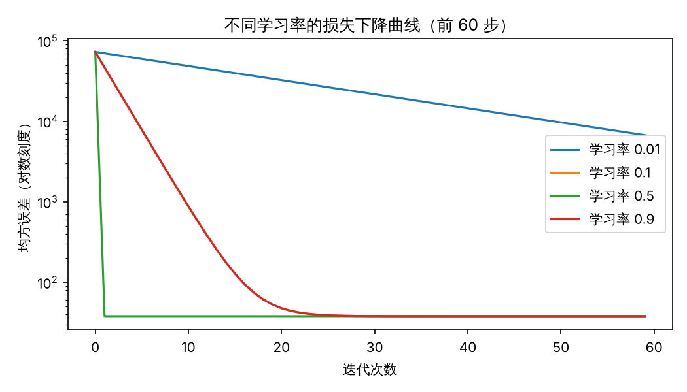
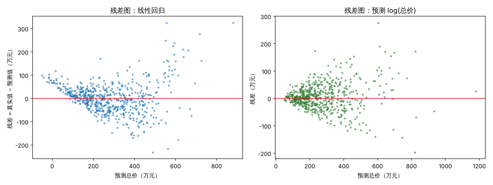
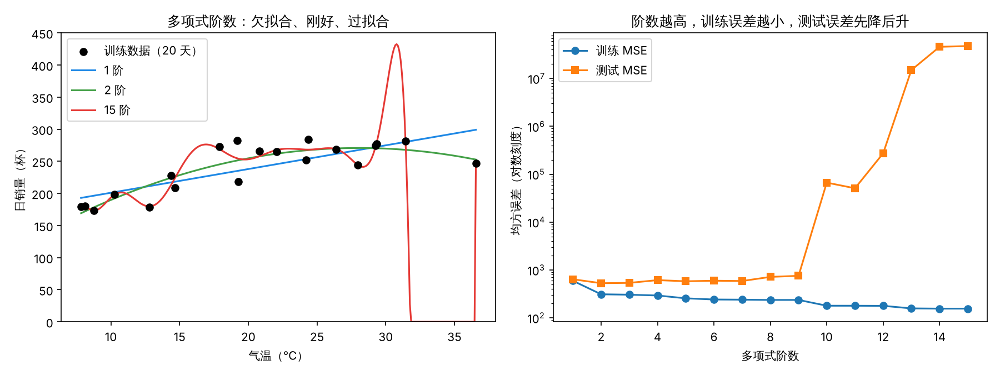
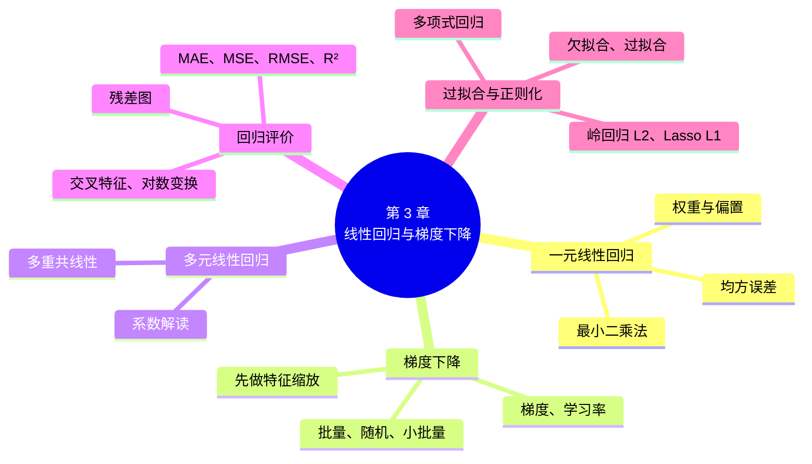

# 第 3 章 线性回归与梯度下降

!!! abstract "本章学时"
    理论 5 学时 · 实验 2 学时（本章共 3 个实验，教师可任选）

## 学习目标

学完本章，你应该能够：

1. **说出**线性回归、损失函数、均方误差、梯度、学习率、过拟合和正则化的含义（记忆）；
2. **解释**最小二乘法和梯度下降的思路，学习率过大、过小分别会怎样，批量、随机、小批量三种梯度下降的区别（理解）；
3. **运用** NumPy 实现一元线性回归的梯度下降，用 scikit-learn 训练多元线性回归、岭回归和 Lasso，计算 MAE、RMSE、R²（应用）；
4. **分析**回归系数的含义和残差图的形状，根据训练误差和测试误差判断欠拟合和过拟合（分析）；
5. **评价**一个回归模型够不够用，并能提出改进方向（评价）。

!!! info "先修要求"
    学习本章前，你需要掌握：

    - 样本、特征、标签、训练集与测试集，模型的训练与预测（[1.2 机器学习的基本术语](../01-intro/index.md#12)）；
    - 独热编码、标准化，先划分再预处理（[2.3 特征编码与特征缩放](../02-preprocessing/index.md#23)、[2.5 数据集划分与数据泄露](../02-preprocessing/index.md#25)）；
    - 一次函数 y = kx + b 的图像，求和符号 Σ，导数表示函数的变化快慢（“人工智能数学基础”课程）；
    - NumPy 数组的加减乘除和求和（“Python 程序设计”课程，[附录 A Python 速查](../../appendix/a-python.md)）。

??? abstract "本章概念清单（24 个，点击查看定义和例子）"
    1. [线性回归](../../appendix/glossary.md#g-线性回归)
    2. [一元线性回归](../../appendix/glossary.md#g-一元线性回归)
    3. [多元线性回归](../../appendix/glossary.md#g-多元线性回归)
    4. [权重与偏置](../../appendix/glossary.md#g-权重与偏置)
    5. [损失函数](../../appendix/glossary.md#g-损失函数)
    6. [残差](../../appendix/glossary.md#g-残差)
    7. [均方误差](../../appendix/glossary.md#g-均方误差)
    8. [最小二乘法](../../appendix/glossary.md#g-最小二乘法)
    9. [梯度](../../appendix/glossary.md#g-梯度)
    10. [梯度下降](../../appendix/glossary.md#g-梯度下降)
    11. [学习率](../../appendix/glossary.md#g-学习率)
    12. [随机梯度下降](../../appendix/glossary.md#g-随机梯度下降)
    13. [小批量梯度下降](../../appendix/glossary.md#g-小批量梯度下降)
    14. [多重共线性](../../appendix/glossary.md#g-多重共线性)
    15. [平均绝对误差](../../appendix/glossary.md#g-平均绝对误差)
    16. [均方根误差](../../appendix/glossary.md#g-均方根误差)
    17. [决定系数](../../appendix/glossary.md#g-决定系数)
    18. [残差图](../../appendix/glossary.md#g-残差图)
    19. [多项式回归](../../appendix/glossary.md#g-多项式回归)
    20. [欠拟合](../../appendix/glossary.md#g-欠拟合)
    21. [过拟合](../../appendix/glossary.md#g-过拟合)
    22. [正则化](../../appendix/glossary.md#g-正则化)
    23. [岭回归](../../appendix/glossary.md#g-岭回归)
    24. [Lasso 回归](../../appendix/glossary.md#g-Lasso-回归)

## 情景导入

上一章，小周把 3000 套二手房的挂牌数据整理干净了。经理问他：“现在能做估价了吗？用户输入面积、区域、楼层，系统要马上给出一个总价。”

小周先想到最朴素的办法：在 Excel 里画一张“面积—总价”的散点图，点大致排成一条斜向上的带子，用“添加趋势线”就能画出一条直线，Excel 还会给出公式，比如“总价 = 3.1 × 面积 − 3.4”。来一套 90 平方米的房子，代入公式就能估出总价。

经理接着问了三个问题：“这条直线是怎么算出来的？只看面积够吗，天河和增城同样 90 平方米，价格差三四倍；估得准不准，用什么数来说明？”回答这三个问题，就是本章的内容。线性回归是最简单的机器学习模型，但它包含了几乎所有模型都要用到的基本思路：**先定一个模型的样子，再定一个衡量好坏的损失，最后想办法把损失降到最低**。降低损失的方法“梯度下降”，正是今天训练大模型用的同一套方法。

## 3.1 回归问题

第 1 章介绍过，监督学习中标签是一个连续的数，就叫回归问题。生活中的回归问题很多：

- 预测一套二手房能卖多少万元；
- 预测一家奶茶店明天能卖多少杯；
- 预测一单外卖多少分钟能送到；
- 预测一位客户明年会在保险上花多少钱。

它们的共同点是：答案是一个可以比较大小、可以做加减的数，预测得“差一点”和“差很多”是不一样的。这和分类问题（判断“流失还是不流失”）不同：分类只有对和错，回归要看错了多少。

“回归”这个词有一段来历。19 世纪英国学者高尔顿（F. Galton）研究父母身高和子女身高的关系，发现特别高的父母，子女平均来说没有父母那么高；特别矮的父母，子女平均来说也没有那么矮，子女身高有向平均值“回归”的趋势。<sup class="cite">[[1]](#ref3-1)</sup> 他用一条直线描述这种关系，后来人们就把“用数据拟合一个关系来预测一个数”统称为回归，尽管大多数回归问题和“回到平均值”已经没有关系了。

在所有回归模型中，[**线性回归**](../../appendix/glossary.md#g-线性回归 "假设标签等于各特征的加权和再加一个常数的回归模型"){ .term }最简单：它假设标签等于各个特征分别乘一个系数、再加起来。它的优点是计算快、容易解释，每个系数都能直接读出“这个特征每增加 1，预测值变多少”，所以在房价评估、销量预测、成本测算中至今仍被大量使用，也常作为复杂模型的“对照组”。

## 3.2 一元线性回归

### 3.2.1 用一条直线拟合数据

先只用一个特征。只有一个特征的线性回归叫[**一元线性回归**](../../appendix/glossary.md#g-一元线性回归 "只有一个特征的线性回归，模型是一条直线 ŷ = wx + b"){ .term }，模型就是一条直线：

\[
\hat{y} = w x + b
\]

其中 x 是特征（面积），ŷ（读作“y hat”）是模型的预测值（预测总价），w 是直线的斜率，b 是直线在纵轴上的截距。w 和 b 是模型要从数据里学出来的参数，在机器学习中分别叫[**权重与偏置**](../../appendix/glossary.md#g-权重与偏置 "线性模型中由训练学到的参数：权重是特征的系数，偏置是常数项"){ .term }：权重 w 表示面积每增加 1 平方米，预测总价增加多少万元；偏置 b 是面积为 0 时的预测值，它本身往往没有实际意义（没有 0 平方米的房子），作用是让直线可以上下平移。

“训练一元线性回归”，就是在所有可能的直线中，找出和数据最贴近的那一条，也就是找出最好的 w 和 b。

### 3.2.2 损失函数与均方误差

“最贴近”要变成一个能计算的数，才能比较。设有 n 个样本，第 i 个样本的真实值是 yᵢ，预测值是 ŷᵢ，两者的差 yᵢ − ŷᵢ 叫[**残差**](../../appendix/glossary.md#g-残差 "一个样本的真实值减去预测值"){ .term }，也就是这一个样本上的误差。把所有样本的误差合成一个数，就是[**损失函数**](../../appendix/glossary.md#g-损失函数 "衡量模型预测与真实答案之间差距的函数"){ .term }：它衡量模型预测与真实答案之间的差距，损失越小，模型越好。<sup class="cite">[[2]](#ref3-2)</sup><sup class="cite">[[3]](#ref3-3)</sup>

线性回归最常用的损失是[**均方误差**](../../appendix/glossary.md#g-均方误差 "残差平方的平均值，是线性回归最常用的损失"){ .term }（MSE），即残差平方的平均值：

\[
L(w, b) = \text{MSE} = \frac{1}{n} \sum_{i=1}^{n} (y_i - \hat{y}_i)^2 = \frac{1}{n} \sum_{i=1}^{n} \big(y_i - (w x_i + b)\big)^2
\]

为什么要平方，而不是直接把残差加起来？因为残差有正有负，直接相加会互相抵消，一条很差的直线也可能“加起来等于 0”；平方之后都是正数，而且大误差被放得更大，模型会尽量避免出现特别离谱的预测。平方还有一个数学上的好处：函数是光滑的，可以求导，下面两种求解方法都依赖这一点。

注意 L(w, b) 写成了 w 和 b 的函数：数据是固定的，换一组 w、b 就换了一条直线，算出的损失也不同。训练的目标就是找到让 L 最小的 w 和 b。

**算一算**：用 3.2.3 节表中的 5 套房子（面积 50、70、90、110、130 平方米，总价 160、210、250、320、360 万元），比较两条凭感觉画出的直线。

- 直线甲“总价 = 3 × 面积”：5 个预测值是 150、210、270、330、390，残差是 10、0、−20、−10、−30，残差平方和 100 + 0 + 400 + 100 + 900 = 1500，MSE = 300。
- 直线乙“总价 = 2.5 × 面积 + 35”：预测值是 160、210、260、310、360，残差是 0、0、−10、10、0，残差平方和 200，MSE = 40。

直线乙有 3 个点完全命中，MSE 也小得多，看起来已经很好了。但它还不是最好的：下面用最小二乘求出的直线，MSE 只有 38。凭感觉只能试几条，要在无数条直线中找到最好的那条，需要系统的方法。

### 3.2.3 算一算：手算最小二乘

让均方误差最小，也就是让残差平方和最小，这个方法叫[**最小二乘法**](../../appendix/glossary.md#g-最小二乘法 "让残差平方和最小来求模型参数的方法，一元线性回归有现成公式"){ .term }（“二乘”就是平方）。它在 1805 年由法国数学家勒让德（A. M. Legendre）发表，德国数学家高斯（C. F. Gauss）1809 年也发表了这一方法，并说自己早在 1795 年就开始使用。<sup class="cite">[[4]](#ref3-4)</sup><sup class="cite">[[5]](#ref3-5)</sup> 对一元线性回归，用微积分可以推出让损失最小的 w 和 b 有现成的公式：

\[
w = \frac{\sum_{i=1}^{n} (x_i - \bar{x})(y_i - \bar{y})}{\sum_{i=1}^{n} (x_i - \bar{x})^2}, \qquad b = \bar{y} - w \bar{x}
\]

其中 x̄、ȳ 分别是 x 和 y 的平均值。下面用 5 套房子手算一遍。

| 房子 | 面积 x（平方米） | 总价 y（万元） | x − x̄ | y − ȳ | (x − x̄)(y − ȳ) | (x − x̄)² |
|---|---|---|---|---|---|---|
| ① | 50 | 160 | −40 | −100 | 4000 | 1600 |
| ② | 70 | 210 | −20 | −50 | 1000 | 400 |
| ③ | 90 | 250 | 0 | −10 | 0 | 0 |
| ④ | 110 | 320 | 20 | 60 | 1200 | 400 |
| ⑤ | 130 | 360 | 40 | 100 | 4000 | 1600 |
| 合计 | x̄ = 90 | ȳ = 260 | | | 10200 | 4000 |

第 1 步，算平均值：x̄ = (50 + 70 + 90 + 110 + 130) / 5 = 90，ȳ = (160 + 210 + 250 + 320 + 360) / 5 = 260。

第 2 步，算 w：w = 10200 / 4000 = 2.55，即面积每多 1 平方米，总价多 2.55 万元。

第 3 步，算 b：b = 260 − 2.55 × 90 = 30.5。

得到直线：**总价 = 2.55 × 面积 + 30.5**。代回去检验，5 套房子的预测值是 158、209、260、311、362 万元，残差是 2、1、−10、9、−2，残差平方和是 4 + 1 + 100 + 81 + 4 = 190，均方误差 MSE = 190 / 5 = 38。任何别的直线，在这 5 个点上的 MSE 都会大于 38。实验 3-1 用 NumPy 复算了这个结果。

公式解法又快又准，为什么还要学别的方法？因为它只对线性回归这类简单模型成立。特征一多，公式里要算一个很大的矩阵的逆，速度慢、还可能算不出来；第 4 章的逻辑回归、第 10 章的神经网络则根本没有这样的公式。这时就需要一种“一步步逼近”的通用方法：梯度下降。

## 3.3 梯度下降

### 3.3.1 蒙眼下山

想象你被蒙住眼睛，站在一座山的半山腰，任务是走到山谷的最低点。你看不到整座山，但能用脚感觉到脚下哪个方向最陡。一个可行的办法是：每次朝着脚下最陡的下坡方向迈一小步，走到新的位置再感觉一次，再迈一步……一直走到四面都不再往下为止。

把损失函数 L(w, b) 想成一座山：横向的两个坐标是 w 和 b，高度是损失。我们要找的就是山谷的最低点。“脚下哪个方向最陡”，在数学上就是[**梯度**](../../appendix/glossary.md#g-梯度 "损失函数对参数的偏导数，指示参数调整的方向和幅度"){ .term }：损失函数对每个参数的偏导数，它指出参数朝哪个方向变、损失增加得最快。往梯度的**反方向**走，损失下降得最快。这就是[**梯度下降**](../../appendix/glossary.md#g-梯度下降 "沿梯度反方向更新参数以减小损失的优化方法"){ .term }，它由法国数学家柯西（A. Cauchy）在 1847 年提出。<sup class="cite">[[6]](#ref3-6)</sup>

对均方误差，两个偏导数是：

\[
\frac{\partial L}{\partial w} = \frac{2}{n} \sum_{i=1}^{n} (\hat{y}_i - y_i)\, x_i, \qquad \frac{\partial L}{\partial b} = \frac{2}{n} \sum_{i=1}^{n} (\hat{y}_i - y_i)
\]

不用记推导，看懂它的意思就行：预测偏大（ŷᵢ − yᵢ > 0）的样本越多、偏得越多，梯度就越大，说明参数应该调小；反过来就应该调大。每走一步，参数按下面的规则更新：

\[
w \leftarrow w - \eta \cdot \frac{\partial L}{\partial w}, \qquad b \leftarrow b - \eta \cdot \frac{\partial L}{\partial b}
\]

η（读作“伊塔”）是[**学习率**](../../appendix/glossary.md#g-学习率 "每次参数更新的步长，是最重要的超参数之一"){ .term }，即每一步迈多大。

**算一算**：仍用 3.2.3 节的 5 套房子，面积先标准化为 z =（面积 − 90）/ 28.28，从 w = 0、b = 0 出发，此时所有预测都是 0，损失是 72840。b 的梯度是 2 × (0 − 260) = −520，w 的梯度算出来是 −144.25，都是负数，说明两个参数都应该调大。学习率取 0.1，走一步之后 b = 0 − 0.1 × (−520) = 52，w = 0 − 0.1 × (−144.25) ≈ 14.42，损失降到 46631；第二步之后 w ≈ 25.96、b = 93.6，损失 29858。一步一步走下去，200 步后到达 w = 72.12、b = 260，损失 38。把面积换算回平方米，w = 72.12 / 28.28 ≈ 2.55，b = 30.5，和最小二乘的结果一模一样。

**会不会困在半山腰的小坑里？**蒙眼下山有一个风险：如果山上有很多小坑，走进一个小坑后四面都是上坡，就以为到了谷底，其实只是一个局部的最低点。好在线性回归的均方误差是一个“碗”形的函数，数学上叫**凸函数**，只有一个谷底，从哪里出发都能走到同一个最低点，只要学习率合适、步数足够，梯度下降和最小二乘的结果一定一致。第 10 章的神经网络就没有这么幸运，它的损失函数凹凸不平，有许多局部最低点，但实践表明，梯度下降找到的点通常已经足够好。

### 3.3.2 学习率：步子迈多大

学习率是梯度下降中最重要的一个设置。它不是从数据里学出来的，而是人在训练前定好的，这类设置叫**超参数**，第 9 章会系统介绍怎样选择。

- 学习率**太小**：方向是对的，但步子太小，要走很多步才能到达谷底。实验 3-1 中学习率 0.01 走了 20 步，损失还有 33820，远没到最低点 38。
- 学习率**合适**：几十步就到谷底。学习率 0.5 时，20 步就到了 38。
- 学习率**偏大**：每一步都越过谷底，在山谷两侧来回跳，虽然也能慢慢收敛，但走了弯路。学习率 0.9 时，20 步后损失还在 53 左右。
- 学习率**太大**：每一步越过谷底跳到更高的地方，损失越来越大，这叫**发散**。学习率 1.05 时，200 步后损失变成了 2 × 10²¹。



上图是实验 3-1 画出的损失曲线（纵轴是对数刻度）。训练时画出这样的曲线，是判断学习率合不合适最直接的办法：曲线平稳下降说明合适；下降很慢说明偏小；忽高忽低或者一路上升，说明太大，应该调小。

下面这个动画画出了这 5 套房子的“损失地形图”。你可以选一个学习率，一步步走，看参数走过的路线和右边的直线怎样变化。

<iframe class="sim-frame" src="../../sims/gradient-descent/main.html" height="720" loading="lazy" title="梯度下降下山"></iframe>

依次试学习率 0.01、0.5、0.9、1.05，各连走 20 步，比较走过的路线；再点“不标准化”，看看为什么怎么调学习率都不顺利。[全屏打开](../../sims/gradient-descent/main.html){ target=_blank } · [教学说明](../../sims/gradient-descent/index.md)
{ .sim-caption }

### 3.3.3 批量、随机与小批量梯度下降

上面每走一步，都要用**全部样本**算一次梯度，这叫批量梯度下降。样本只有 5 个时没问题；如果有 100 万个样本，每走一步都要把 100 万个样本算一遍，就太慢了。于是有了两种变体：

- [**随机梯度下降**](../../appendix/glossary.md#g-随机梯度下降 "每次只用一个随机样本计算梯度并更新参数的梯度下降"){ .term }（SGD）：每次只随机取 **1 个**样本算梯度、更新一次参数。每一步很快，但一个样本代表不了全体，方向忽左忽右，损失曲线抖动很大。它的思想来自罗宾斯（H. Robbins）和门罗（S. Monro）1951 年提出的随机逼近方法。<sup class="cite">[[7]](#ref3-7)</sup>
- [**小批量梯度下降**](../../appendix/glossary.md#g-小批量梯度下降 "每次用一小批随机样本计算梯度并更新参数的梯度下降，最常用"){ .term }：每次随机取**一小批**样本（如 32 个、64 个）算梯度。它兼顾了速度和稳定，是今天最常用的做法。人们说“SGD”时，很多时候实际指的就是小批量梯度下降。

把全部训练样本都用过一遍，叫一**轮**（epoch）。实验 3-1 在 2400 套房子上只用面积一个特征，比较了三种方法各训练 20 轮的结果（最小二乘的最优 MSE 是 17606.1）：

| 方法 | 每次用的样本 | 20 轮共更新参数 | 第 1 轮后 MSE | 第 20 轮后 MSE |
|---|---|---|---|---|
| 批量梯度下降 | 2400 | 20 次 | 90490.8 | 18936.4 |
| 小批量梯度下降 | 32 | 1500 次 | 17924.3 | 17680.3 |
| 随机梯度下降 | 1 | 48000 次 | 17721.8 | 18476.7 |

可以看到：同样把数据过 20 遍，批量梯度下降只更新了 20 次参数，还没走到谷底；随机梯度下降第 1 轮就很接近最优了，但因为每步方向在抖，最后停在了离谷底有一段距离的地方；小批量梯度下降最接近最优值。

### 3.3.4 梯度下降前先做特征缩放

第 2 章说过，梯度类算法需要特征缩放，原因现在可以看清楚了。如果直接用平方米表示面积（取值 50～130），而偏置 b 对应的“特征”相当于常数 1，那么损失在 w 方向上非常陡、在 b 方向上非常平，地形图是一条又窄又长的峡谷。学习率稍大，w 方向就发散；学习率小到 w 不发散，b 又几乎走不动。实验 3-1 中，不标准化、学习率 0.0001 走 200 步后，w = 2.86、b = 0.138，损失 121，b 离最优的 30.5 还差得很远；学习率加到 0.0002 就发散了。标准化之后，各方向的坡度差不多，用一个学习率就能顺利走到谷底。

??? microvideo "思维工具微课｜步子迈多大，才下得了山？　4 分 11 秒"

    <video class="mv-video" controls preload="none" playsinline poster="../../assets/video/m2.jpg">
      <source src="../../assets/video/m2.mp4" type="video/mp4">
    </video>

    **这一集的思维工具：改一处，记一笔。** 什么时候用：调参数、查毛病。怎么用：一次一样，改完就记。局限：慢，一急就想省。

    **看完选两件做：**

    - 玩一玩：在“梯度下降下山”动画里拖学习率。
    - 审一审 AI：让它帮你调参，看它是不是一次改一样。
    - 想一想自己：上次同时改了几样东西。

    <p class="mv-note">本片配音和部分画面由 AI 生成。</p>

## 3.4 多元线性回归与回归评价

### 3.4.1 多元线性回归与系数解读

房价不只和面积有关。把多个特征都放进模型，就是[**多元线性回归**](../../appendix/glossary.md#g-多元线性回归 "有多个特征的线性回归，每个特征有自己的权重"){ .term }：

\[
\hat{y} = w_1 x_1 + w_2 x_2 + \cdots + w_d x_d + b
\]

d 是特征的个数，每个特征有自己的权重。它的求解方法和一元的完全一样：既可以用最小二乘的矩阵公式，也可以用梯度下降。scikit-learn 的 `LinearRegression` 用的是最小二乘，`SGDRegressor` 用的是随机梯度下降。<sup class="cite">[[8]](#ref3-8)</sup>

实验 3-2 用第 2 章清洗好的二手房数据训练了多元线性回归，25 个特征包括面积、建成年份、室、厅、总楼层、距地铁站（千米）、楼层位置，以及区域、装修、朝向的独热编码。独热编码时每个类别特征去掉了一个取值作为“基准”：区域以南沙为基准，装修以“未知”为基准。部分系数如下：

| 特征 | 系数 | 含义（其他特征不变时） |
|---|---|---|
| 面积 | 2.98 | 每多 1 平方米，总价多约 3 万元 |
| 建成年份 | 2.17 | 房龄每新 1 年，总价多约 2 万元 |
| 距地铁站_千米 | −14.29 | 离地铁站每远 1 千米，总价少约 14 万元 |
| 区域_天河 | 354.08 | 同样条件的房子，在天河比在南沙贵约 354 万元 |
| 区域_增城 | −12.41 | 在增城比在南沙便宜约 12 万元 |
| 装修_毛坯 | −25.08 | 毛坯比装修“未知”的房子便宜约 25 万元 |

解读系数时要注意三点：

1. **“其他特征不变”**。面积的系数 2.98 是说“区域、房龄等都一样时”多 1 平方米的影响，不是只看面积时的影响。
2. **系数的大小和单位有关**，不能直接比较哪个特征更重要。距地铁站用千米表示系数是 −14.29，改用米表示就变成 −0.01429，影响其实一样大。要比较重要性，应该先把特征标准化，再比较系数的绝对值。
3. **截距不一定有实际意义**。这个模型的截距是 −4505.2，因为它对应“建成年份为 0”的房子，这种房子并不存在。

### 3.4.2 多重共线性

“室”（卧室数）的系数只有 2.49，难道多一间卧室只多 2.49 万元？原因是“室”和“面积”高度相关，相关系数达 0.845：卧室多的房子面积通常也大。只用“室”一个特征时，它的系数是 75.30；和面积放在一起，面积已经解释了大部分差别，“室”能额外解释的就很少了。

特征之间高度相关，叫[**多重共线性**](../../appendix/glossary.md#g-多重共线性 "特征之间高度相关，导致回归系数不稳定、难以解释的现象"){ .term }。它通常不太影响预测的准确度，但会让单个系数很不稳定、难以解释：换一批数据，系数可能变化很大，甚至正负号都会变。所以用线性回归做“哪个因素影响大”的分析时，要先检查特征之间的相关系数，必要时去掉重复的特征，或者使用 3.5.3 节的岭回归。

### 3.4.3 回归评价指标

模型训练好以后，要在测试集上用指标说明它“估得准不准”。常用的回归指标有四个。

[**平均绝对误差**](../../appendix/glossary.md#g-平均绝对误差 "残差绝对值的平均，单位与标签相同"){ .term }（MAE）：残差绝对值的平均。

\[
\text{MAE} = \frac{1}{n} \sum_{i=1}^{n} |y_i - \hat{y}_i|
\]

它的单位和标签一样，含义最直观：“平均每套房估错多少万元”。

**均方误差**（MSE）就是训练时用的损失。它的单位是“万元的平方”，不好解释，所以报告时常开平方，得到[**均方根误差**](../../appendix/glossary.md#g-均方根误差 "均方误差的平方根，单位与标签相同，对大误差更敏感"){ .term }（RMSE）：

\[
\text{RMSE} = \sqrt{\text{MSE}} = \sqrt{\frac{1}{n} \sum_{i=1}^{n} (y_i - \hat{y}_i)^2}
\]

RMSE 的单位也是万元。因为先平方，大误差的影响被放大，所以 RMSE 总是大于等于 MAE；两者相差越多，说明误差中“特别离谱”的预测越多。

[**决定系数**](../../appendix/glossary.md#g-决定系数 "用 1 减去模型与“猜平均值”的误差平方和之比，1 为完美，0 与猜平均值相当"){ .term }（R²）把模型和一个最笨的“基线”比较：不管什么房子，都猜训练集的平均总价。

\[
R^2 = 1 - \frac{\sum_{i=1}^{n} (y_i - \hat{y}_i)^2}{\sum_{i=1}^{n} (y_i - \bar{y})^2}
\]

分母是基线的误差平方和，分子是模型的误差平方和。R² = 1 表示完全预测对；R² = 0 表示和猜平均值一样；R² 小于 0 表示还不如猜平均值。R² 没有单位，便于比较不同的问题，但它不能告诉你“平均错多少万元”，所以常和 MAE 或 RMSE 一起报告。

实验 3-2 的结果（测试集 600 套房，平均总价 279.8 万元）：

| 模型 | MAE（万元） | RMSE（万元） | R² |
|---|---|---|---|
| 基线：猜平均值 | 124.2 | 163.7 | −0.000 |
| 多元线性回归（训练集） | 45.2 | 61.9 | 0.848 |
| 多元线性回归（测试集） | 47.9 | 66.2 | 0.836 |

线性回归把平均误差从 124.2 万元降到了 47.9 万元，R² 为 0.836。训练集和测试集的成绩接近，说明模型没有过拟合。但平均估错 48 万元，对一套 280 万元的房子来说还是偏大，下一节的残差图会告诉我们问题出在哪里。

!!! cert "证书考点 · 人工智能数据处理工程师（高级）· 数据挖掘"
    数据挖掘模块要求会用回归算法建模并评估。常考：给出几个真实值和预测值，计算 MAE、MSE、RMSE；根据误差平方和计算 R²，说明 R² = 0 和 R² < 0 的含义；scikit-learn 中 `LinearRegression` 的 `coef_`（系数）和 `intercept_`（截距），`mean_absolute_error`、`mean_squared_error`、`r2_score` 三个函数。容易错在 RMSE 忘了开平方，以及把 `r2_score` 的真实值和预测值两个参数写反（写反后结果会变）。

### 3.4.4 残差图

只看几个指标，看不出模型错在哪里。[**残差图**](../../appendix/glossary.md#g-残差图 "以预测值为横轴、残差为纵轴的散点图，用来发现模型漏掉的规律"){ .term }以预测值为横轴、残差（真实值 − 预测值）为纵轴，每个样本画一个点。一个好的模型，残差应该均匀地散布在 0 线上下，看不出规律；如果看出了规律，说明模型漏掉了数据里的某种关系。



左图是实验 3-2 线性回归的残差图，能看出两个问题：

1. **喇叭口**：预测价越高，残差越分散。预测价低于 200 万元的房子，平均绝对残差 30.4 万元；高于 500 万元的，达 125.9 万元。误差最大的 10 套房中有 6 套在天河，例如天河景御豪庭一套 218.7 平方米的房子，实际 1205.6 万元，模型只估了 880.2 万元。
2. **弯曲**：左侧预测价很低的地方，残差几乎都是正的，有 10 套房子的预测值甚至是负数。

两个问题的根源是同一个：线性回归假设总价等于各项“相加”，天河加 354 万元、多 1 平方米加 3 万元，不管房子在哪个区都一样。而实际上总价更接近“单价 × 面积”：天河的单价高，多 1 平方米多出的钱也多。实验 3-2 尝试了两种改进：

- 加一个**交叉特征**“区域参考单价 × 面积”（第 2 章介绍过），测试集 MAE 降到 37.2 万元，R² 升到 0.901；
- 改为预测 **log(总价)**，再把预测结果取指数还原。取对数之后，“相乘”变成了“相加”，线性模型就能表达“天河的房子贵一个比例”了，测试集 MAE 降到 34.9 万元，R² 升到 0.910。此时天河的系数是 1.232，含义是同样条件下天河的房价约为南沙的 e^1.232 ≈ 3.43 倍。

右图是改进后的残差图，喇叭口明显收窄，弯曲也消失了。这说明：线性回归的“线性”是指对参数线性，特征可以先做变换；**读懂残差图，再有针对性地改特征**，往往比换一个复杂的模型更有效。

### 3.4.5 线性回归的优缺点

学到这里，可以对线性回归做一个小结。

| 方面 | 优点 | 局限 |
|---|---|---|
| 训练和预测 | 计算量很小，几千个样本不到一秒，预测就是做一次加权求和 | 只能表达“相加”的关系，曲线、相乘关系要靠人构造特征 |
| 解释性 | 每个系数都能读出“这个因素的影响有多大”，方便向业务人员解释 | 特征高度相关时系数不稳定，解释容易出错 |
| 对数据的要求 | 需要的数据量不大 | 对异常值敏感（误差先平方，一个离谱的样本就能把直线拉偏）；类别特征要先编码，缺失值要先填充 |
| 外推 | 在训练数据范围之外仍能给出结果 | 外推结果往往不可靠，还可能出现负数房价这样不合理的预测 |

所以在实际项目中，线性回归常作为第一个模型和对照组：先用它得到一个基准成绩，读懂系数和残差图，了解数据中有哪些规律；如果效果不够，再尝试第 5 章的随机森林、梯度提升树等模型，看它们能比线性回归好多少。

## 3.5 过拟合与正则化

### 3.5.1 多项式回归

有些关系本身就是弯的。奶茶店的日销量和气温有关：天气暖和时越热越好卖，但到了 30 ℃ 以上，太热了人们不愿出门，销量反而下降。一条直线描述不了“先升后降”。

办法是把气温的平方、立方……也当成新的特征：

\[
\hat{y} = w_1 x + w_2 x^2 + \cdots + w_k x^k + b
\]

这叫[**多项式回归**](../../appendix/glossary.md#g-多项式回归 "把特征的平方、立方等各次方也作为特征的线性回归，可以拟合曲线"){ .term }，k 叫多项式的**阶数**。它对 x 是曲线，但对参数 w₁、w₂……仍然是线性的，所以仍然可以用线性回归求解。scikit-learn 中用 `PolynomialFeatures` 生成各次方，再接 `LinearRegression`。阶数越高，曲线能弯的次数越多，越灵活。

### 3.5.2 欠拟合与过拟合

越灵活就越好吗？实验 3-3 模拟了一家奶茶店 20 天的数据，真实规律是“销量 = 100 + 12 × 气温 − 0.2 × 气温²”，再加上标准差为 20 杯的随机波动（天气、节假日等造成的）。用这 20 天训练，再用另外 200 天检验，阶数从 1 加到 15：

| 阶数 | 1 | 2 | 3 | 5 | 8 | 9 | 10 | 15 |
|---|---|---|---|---|---|---|---|---|
| 训练 MSE | 594.4 | 310.6 | 304.6 | 256.0 | 236.7 | 236.7 | 179.3 | 155.8 |
| 测试 MSE | 640.0 | **529.4** | 537.8 | 580.8 | 717.3 | 755.2 | 66863.3 | 47714365.1 |



规律很清楚：

- **1 阶（直线）**：训练误差和测试误差都大。模型太简单，没学到“先升后降”的规律，这叫[**欠拟合**](../../appendix/glossary.md#g-欠拟合 "模型太简单、没学到规律，训练集和测试集成绩都差的现象"){ .term }。
- **2 阶**：测试误差最小（529.4），和真实规律的形状一致。
- **阶数越来越高**：训练误差一直在下降，15 阶时降到 155.8；测试误差却先缓慢上升，到 10 阶以上急剧变大，15 阶时达到四千多万。左图红线显示，15 阶曲线为了穿过每一个训练点而剧烈扭动，在 32～36 ℃ 之间没有训练数据的地方，曲线一下子冲到了 0 以下。模型把随机波动也当成规律“背”了下来，在训练集上表现好、在新数据上表现差，这就是[**过拟合**](../../appendix/glossary.md#g-过拟合 "模型在训练集上表现好、在新数据上表现差的现象"){ .term }。

训练误差小、测试误差大，是过拟合的典型信号；两者都大，是欠拟合的信号。<sup class="cite">[[9]](#ref3-9)</sup> 注意测试 MSE 最小也只到 529.4，低不到随机波动本身的方差 400：数据中的随机波动是任何模型都预测不了的。

为什么会这样？可以用射箭打个比方。欠拟合的模型像一个姿势有问题的射手，箭箭都偏向同一边，这叫**偏差**大；过拟合的模型像一个手很抖的射手，平均来看瞄得不偏，但每一箭落点差别很大，换一批训练数据，拟合出的曲线就完全不同，这叫**方差**大。模型太简单，偏差大；模型太复杂，方差大。好的模型要在两者之间找到平衡，实验 3-3 中的 2 阶多项式就是这个平衡点。

减轻过拟合的常用办法有：增加训练数据；减少特征或降低模型复杂度（如降低阶数）；以及下面要讲的正则化。第 9 章还会介绍用交叉验证选择合适复杂度的方法。

下面的动画用的是实验 3-3 的同一批数据，你可以拖动阶数和正则化强度，实时看曲线和误差的变化。

<iframe class="sim-frame" src="../../sims/poly-overfit/main.html" height="700" loading="lazy" title="多项式阶数与过拟合"></iframe>

先把阶数从 1 拖到 15，找到测试 MSE 最小的阶数；再固定 15 阶，把岭回归 alpha 从 0 逐步调大到 100，看曲线怎样从剧烈扭动变得平滑、最后变得太平。[全屏打开](../../sims/poly-overfit/main.html){ target=_blank } · [教学说明](../../sims/poly-overfit/index.md)
{ .sim-caption }

### 3.5.3 正则化：岭回归与 Lasso

过拟合的模型有一个共同特征：**系数特别大**。15 阶多项式的 15 个系数绝对值加起来超过 165 万，正负系数互相抵消，才让曲线穿过每一个训练点。既然如此，可以在损失函数里加一项“惩罚”，系数越大，惩罚越重，逼着模型在“拟合训练数据”和“系数不要太大”之间取得平衡。这种做法叫[**正则化**](../../appendix/glossary.md#g-正则化 "在损失函数中加入对参数大小的惩罚，以减轻过拟合的方法"){ .term }。

[**岭回归**](../../appendix/glossary.md#g-岭回归 "在均方误差上加系数平方和（L2）惩罚的线性回归，系数整体变小但不为 0"){ .term }在均方误差后面加上所有系数的平方和，叫 L2 正则化：

\[
L = \text{MSE} + \alpha \sum_{j=1}^{d} w_j^2
\]

[**Lasso 回归**](../../appendix/glossary.md#g-Lasso-回归 "在均方误差上加系数绝对值之和（L1）惩罚的线性回归，能把部分系数压成 0"){ .term }加的是所有系数的绝对值之和，叫 L1 正则化：

\[
L = \text{MSE} + \alpha \sum_{j=1}^{d} |w_j|
\]

α 是正则化强度，也是一个超参数：α = 0 就是普通线性回归；α 越大，系数被压得越小，模型越简单。偏置 b 一般不参加惩罚。岭回归由霍尔（A. E. Hoerl）和肯纳德（R. W. Kennard）在 1970 年提出，用来解决多重共线性时系数不稳定的问题；<sup class="cite">[[10]](#ref3-10)</sup> Lasso 由蒂布希拉尼（R. Tibshirani）在 1996 年提出。<sup class="cite">[[11]](#ref3-11)</sup>

实验 3-3 在 15 阶多项式上比较了它们（特征先标准化）：

| 模型 | α | 训练 MSE | 测试 MSE | 系数绝对值之和 | 为 0 的系数 |
|---|---|---|---|---|---|
| 普通线性回归 | — | 155.8 | 47714365.1 | 1659481.2 | 0 |
| 岭回归 | 0.01 | 240.1 | 673.6 | 325.4 | 0 |
| 岭回归 | 1 | 286.5 | **512.5** | 71.3 | 0 |
| 岭回归 | 10 | 398.6 | 558.7 | 41.1 | 0 |
| Lasso | 1 | 301.8 | 526.8 | 44.4 | 12 |
| Lasso | 5 | 347.5 | 570.8 | 34.6 | 13 |

几点观察：

1. 只要加一点正则化（岭回归 α = 0.01），测试 MSE 就从四千多万降到 673.6，系数之和从 165 万降到 325。
2. α = 1 时测试 MSE 最小（512.5），比单用 2 阶多项式还略好；α 继续增大到 10，训练 MSE 和测试 MSE 都上升，模型又开始欠拟合了。所以 α 不是越大越好，要通过验证来选。
3. 岭回归让所有系数都变小，但一个也不会变成 0；Lasso 则把 15 个系数中的 12 个直接压成了 0，只留下 x、x² 和 x¹⁵ 三项，其中 x 和 x² 的系数最大，正好对应真实规律的形状。也就是说，**Lasso 能自动做特征选择**，这就是第 2 章说的“嵌入法”。

两种方法怎样选？特征很多、估计其中只有少数真正有用时，用 Lasso，它能帮你挑出这些特征；特征之间高度相关、希望每个特征都保留时，用岭回归，它让相关的特征“分摊”影响，系数更稳定。scikit-learn 还提供了把两种惩罚按比例结合起来的 `ElasticNet`（弹性网络）。使用正则化时有两点要注意：一是**先标准化特征**，否则单位大的特征系数小、单位小的系数大，惩罚就不公平了；二是 α 要通过验证来选，scikit-learn 的 `RidgeCV`、`LassoCV` 可以自动用交叉验证挑选 α，第 9 章再详细介绍。

!!! cert "证书考点 · 人工智能应用工程师（高级）· 统计模型"
    统计模型部分要求理解常见回归模型的原理和适用场景。常考：线性回归的假设和最小二乘法的含义；梯度下降中学习率过大、过小的表现；根据训练误差和测试误差判断欠拟合、过拟合并给出解决办法；岭回归（L2）与 Lasso（L1）的区别，哪一种能把系数压缩为 0；scikit-learn 中 `Ridge`、`Lasso` 的 `alpha` 参数越大，正则化越强。容易错在把 `alpha` 的方向记反，以及以为正则化能提高训练集成绩（实际上训练误差会变大）。

## 3.6 前沿视窗

**从 2 个参数到几千亿个参数：同一个梯度下降。**本章用梯度下降训练了只有 w、b 两个参数的模型。今天的大语言模型有几百亿到几千亿个参数，训练它们用的仍然是本章的方法：定义损失（预测下一个字预测得准不准），算出损失对每个参数的梯度，沿梯度的反方向更新一小步。区别只在于规模和细节：一次取几百万个字作为一个“小批量”，用成千上万块 GPU 并行计算梯度，用 Adam 等改进算法让每个参数有自己的步长。<sup class="cite">[[12]](#ref3-12)</sup> 训练大模型时工程师最关心的也是本章讲的这些事：学习率怎样设置和逐步调小，损失曲线有没有突然“炸掉”（发散），数据要不要先归一化。

**梯度谁来算：自动求导与可微分编程。**本章的梯度公式是手推的，参数一多就不可能手推了。PyTorch、TensorFlow 等深度学习框架可以根据计算过程自动求出梯度，叫“自动求导”。它让一个新想法变得很简单：只要把一段计算写成可以求导的程序，就能用梯度下降去优化其中的参数，这叫**可微分编程**。第 10 章会用 PyTorch 体验这一点。

**线性回归没有过时。**在销量预测、定价、成本测算等业务中，线性回归仍是最常用的模型之一，因为它的每个系数都能向业务人员解释清楚。即使最终用了更复杂的模型，通常也要先训练一个线性回归作为对照：复杂模型如果比它好不了多少，就没有必要上线。

## 本章实验

!!! abstract "实验总览"
    | 实验 | 类型 | 建议时长 | 内容 |
    |---|---|---|---|
    | 实验 3-1 | ★ 基础 | 45 分钟 | 用 NumPy 复算最小二乘，从零实现梯度下降，比较不同学习率和三种梯度下降 |
    | 实验 3-2 | ★ 基础 | 45 分钟 | 用 scikit-learn 训练二手房多元线性回归，计算 MAE、RMSE、R²，解读系数，画残差图并分析误差最大的房子 |
    | 实验 3-3 | ☆ 拓展 | 45 分钟 | 多项式阶数从 1 到 15 观察欠拟合和过拟合，用岭回归、Lasso 治理并比较系数 |

    三个实验都在本机 CPU 上运行，每个脚本不超过 30 秒。实验代码见配套资源 `labs/ch03/` 目录，数据在 `labs/data/`。

### 实验 3-1 ★ 手算与 NumPy 实现梯度下降

**实验目的**

1. 用 NumPy 复算 3.2.3 节的最小二乘结果；
2. 从零编写一元线性回归的梯度下降，画出损失下降曲线，比较不同学习率，体会特征缩放的作用；
3. 比较批量、随机、小批量三种梯度下降。

**实验环境**：本机 CPU。Python 3.11，NumPy、pandas、Matplotlib、scikit-learn。

**实验数据**：①②两部分用 3.2.3 节的 5 套房子；③部分从 `labs/data/house_clean.csv`（实验 2-2 清洗后的 3000 套二手房）中随机取 2400 套，只用面积一个特征。

**实验步骤与代码**

第 1 步，用最小二乘公式计算 w 和 b，并计算 MSE：

```python
x = np.array([50, 70, 90, 110, 130], dtype=float)      # 面积（平方米）
y = np.array([160, 210, 250, 320, 360], dtype=float)   # 总价（万元）
w = ((x - x.mean()) * (y - y.mean())).sum() / ((x - x.mean()) ** 2).sum()
b = y.mean() - w * x.mean()
pred = w * x + b
print(w, b, ((y - pred) ** 2).mean())
```

第 2 步，从零写梯度下降。每一步算预测值、误差、两个偏导数，再沿梯度的反方向更新：

```python
def gradient_descent(x, y, lr, steps):
    w, b, history = 0.0, 0.0, []
    n = len(x)
    for _ in range(steps):
        pred = w * x + b
        error = pred - y
        history.append((error ** 2).mean())             # 均方误差
        grad_w = 2 / n * (error * x).sum()               # 损失对 w 的偏导数
        grad_b = 2 / n * error.sum()                     # 损失对 b 的偏导数
        w -= lr * grad_w                                 # 沿梯度的反方向走一步
        b -= lr * grad_b
    return w, b, history
```

第 3 步，把面积标准化后，分别用学习率 0.01、0.1、0.5、0.9、1.05 各走 200 步，记录损失，画出前 60 步的损失曲线；再用不标准化的原始面积试学习率 0.0001 和 0.0002：

```python
z = (x - x.mean()) / x.std()
for lr in [0.01, 0.1, 0.5, 0.9, 1.05]:
    wz, bz, hist = gradient_descent(z, y, lr, 200)
    print(lr, hist[19], wz, bz, hist[-1])
```

第 4 步，在 2400 套房子上，分别用每批 2400 个（批量）、32 个（小批量）、1 个（随机）样本训练 20 轮。每一轮先用 `rng.permutation` 打乱样本顺序，再按批取样本更新参数，每轮结束时记录全体样本上的 MSE。完整代码见 `lab3_1_gradient_descent.py`。

**运行结果**

```text
① 最小二乘：w = 2.55，b = 30.50，即 总价 ≈ 2.55 × 面积 + 30.50
   预测值 [158.0, 209.0, 260.0, 311.0, 362.0]，残差 [2.0, 1.0, -10.0, 9.0, -2.0]，MSE = 38.0

② 梯度下降（面积先标准化，z = (面积 − 90) / 28.28）
   学习率   20 步后的损失   200 步后的 w、b        200 步后的损失
   0.01      3.382e+04     w=    70.86, b=    255.4        61.45
   0.1           53.12     w=    72.12, b=      260           38
   0.5              38     w=    72.12, b=      260           38
   0.9           53.12     w=    72.12, b=      260           38
   1.05      2.723e+06     w=-1.37e+10, b=-4.938e+10     2.17e+21
   换算回原来的面积：w = 2.55，b = 30.50（与最小二乘一致）
   不标准化，学习率 0.0001：200 步后 w=2.86, b=0.138，损失 121
   不标准化，学习率 0.0002：200 步后 w=-1.31e+82, b=-1.32e+80，损失 2.32e+167

③ 2400 套房子，只用面积一个特征。最小二乘的 MSE = 17606.1（w=96.13，b=284.15）
   方法                   每次用的样本  参数更新次数   第 1 轮后 MSE   第 20 轮后 MSE
   批量梯度下降              2400          20       90490.8       18936.4
   小批量梯度下降               32        1500       17924.3       17680.3
   随机梯度下降                 1       48000       17721.8       18476.7
```

几点解读：

- 梯度下降走到的 w、b 换算回去和最小二乘公式完全一致，说明两种方法求的是同一个最优解。
- 学习率 0.1 和 0.9 在 20 步后的损失恰好都是 53.12：一个是从一侧慢慢靠近谷底，一个是在谷底两侧来回跳着靠近。看损失曲线图能分辨出两者的区别。
- ③中面积标准化后，w = 96.13 表示面积每增加一个标准差，总价增加约 96 万元。随机梯度下降的学习率用的是 0.005，比另外两种小，因为单个样本的梯度抖动很大，步子大了会停不稳。

**实验记录表**

| 学习率 | 20 步后的损失 | 200 步后的损失 | 损失曲线的形状（平稳下降 / 很慢 / 来回跳 / 发散） |
|---|---|---|---|
| 0.01 | | | |
| 0.1 | | | |
| 0.5 | | | |
| 0.9 | | | |
| 1.05 | | | |

**常见问题排查**

| 现象 | 原因 | 解决办法 |
|---|---|---|
| 输出 `nan` 或 `inf`，提示 `RuntimeWarning: overflow` | 学习率太大，参数发散，数值超出范围 | 调小学习率，检查特征是否已标准化 |
| 损失几乎不下降 | 学习率太小，或者更新时写成了 `w += lr * grad_w`（方向反了） | 调大学习率；确认是“减去”学习率乘梯度 |
| 梯度下降的结果和最小二乘对不上 | 走的步数不够，或者忘了把标准化的 w、b 换算回原始单位 | 增加步数；用 w / 标准差、b − w × 均值 / 标准差 换算 |
| 标准差和教材不一样（28.28 与 31.62） | `np.std` 默认除以 n，pandas 的 `std` 默认除以 n − 1 | 两种都可以，但同一个实验中要统一 |

**思考与练习**

1. 学习率 0.01 走 200 步还没到谷底。要走到损失低于 38.5，大约要走多少步？改代码试一试。
2. 把 ③ 中小批量的大小从 32 改成 8 和 256，第 20 轮后的 MSE 怎样变化？
3. 为什么不标准化时学习率 0.0002 就会发散，而标准化后学习率 0.9 都不会发散？

**实验报告要求**

提交运行结果截图、损失曲线图和实验记录表，回答思考与练习第 3 题。

### 实验 3-2 ★ 二手房价格预测

**实验目的**

1. 用 scikit-learn 训练多元线性回归，读懂系数和截距；
2. 计算 MAE、RMSE、R²，和“猜平均值”的基线比较；
3. 画残差图，分析误差最大的 10 套房，并根据残差图提出改进。

**实验环境**：本机 CPU。Python 3.11，pandas、scikit-learn、Matplotlib。

**实验数据**：`labs/data/house_clean.csv`，实验 2-2 清洗后的 3000 套广州二手房，按 8 : 2 划分为训练集 2400 套、测试集 600 套（`random_state=42`，与实验 2-2 相同）。

**实验步骤与代码**

第 1 步，读入数据，划分训练集和测试集，用训练集的统计量填充缺失值（同实验 2-2）：

```python
df = pd.read_csv("../data/house_clean.csv")
train, test = train_test_split(df, test_size=0.2, random_state=42)
train, test = train.copy(), test.copy()
year_median = train.groupby("区域")["建成年份"].median()
subway_median = train["距地铁站_米"].median()
for part in (train, test):
    part["建成年份"] = part["建成年份"].fillna(part["区域"].map(year_median))
    part["距地铁站_米"] = part["距地铁站_米"].fillna(subway_median)
```

第 2 步，构造特征。`drop_first=True` 让每个类别特征去掉第一个取值作为基准，系数就表示“与基准相比”的差别：

```python
def features(part):
    X = part[["面积", "建成年份", "室", "厅", "总楼层"]].copy()
    X["距地铁站_千米"] = part["距地铁站_米"] / 1000
    X["楼层位置"] = part["楼层位置"].map({"低": 0, "中": 1, "高": 2})
    return X.join(pd.get_dummies(part[["区域", "装修", "朝向"]], drop_first=True, dtype=int))

X_train, X_test = features(train), features(test)
X_test = X_test.reindex(columns=X_train.columns, fill_value=0)   # 测试集的列和训练集对齐
y_train, y_test = train["总价_万元"], test["总价_万元"]
```

第 3 步，先算基线，再训练线性回归，在训练集和测试集上分别计算三个指标：

```python
model = LinearRegression().fit(X_train, y_train)
pred = model.predict(X_test)
mae = mean_absolute_error(y_test, pred)
rmse = mean_squared_error(y_test, pred) ** 0.5
r2 = r2_score(y_test, pred)
coef = pd.Series(model.coef_, index=X_train.columns)   # 每个特征的系数
```

基线就是 `np.full(len(y_test), y_train.mean())`：对每套房都猜训练集的平均总价。

第 4 步，画残差图，列出误差最大的 10 套房：

```python
resid = y_test - pred
plt.scatter(pred, resid, s=6, alpha=0.5)
plt.axhline(0, color="red")
worst = test.assign(预测=pred, 误差=resid).reindex(resid.abs().sort_values(ascending=False).index[:10])
```

第 5 步，两处改进：加交叉特征“区域参考单价 × 面积”；改为预测 `np.log(总价)`，预测后用 `np.exp` 还原。完整代码见 `lab3_2_house_price.py`。

**运行结果**

```text
训练集 2400 套，测试集 600 套，特征 25 个；测试集总价均值 279.8 万元

① 基线：不管什么房子都猜训练集的平均总价
  基线（测试集）               MAE  124.2   RMSE  163.7   R² -0.000

② 多元线性回归
  训练集                   MAE   45.2   RMSE   61.9   R²  0.848
  测试集                   MAE   47.9   RMSE   66.2   R²  0.836

  截距 -4505.2；部分系数（区域以“南沙”为基准，装修以“未知”为基准）：
    面积             2.98
    建成年份           2.17
    距地铁站_千米      -14.29
    楼层位置           4.22
    室              2.49
    区域_天河        354.08
    区域_越秀        283.06
    区域_增城        -12.41
    装修_精装          7.73
    装修_毛坯        -25.08

  “室”与“面积”的相关系数 0.845；只用“室”时系数 75.30，和面积等一起用时 2.49

  残差：预测价 < 200 万的房子平均绝对残差 30.4 万元；> 500 万的 125.9 万元
  预测值为负数的房子：10 套

  误差最大的 10 套房：
区域   小区    面积   建成年份 装修  总价_万元    预测     误差
天河 景御豪庭 218.7 2014.0 简装 1205.6 880.2  325.4
海珠 御逸花园 158.0 2003.0 精装  880.4 556.8  323.6
越秀 云御豪庭 201.6 1998.0 毛坯  994.2 717.2  277.0
天河 凤汇花园 109.8 2011.0 简装  800.6 551.6  249.0
天河 星碧山庄 123.6 2009.0 精装  833.1 594.5  238.6
增城  逸碧苑 203.5 2015.0 精装  258.9 490.2 -231.3
天河 景御豪庭 130.5 2000.0 精装  814.1 588.5  225.6
南沙 汇凤山庄 227.9 2016.0 简装  345.5 562.3 -216.8
天河 湖丽豪庭 124.2 2020.0 精装  845.9 634.5  211.4
天河 天景公馆 168.2 2007.0 精装  867.3 661.2  206.1

③ 改进：残差随房价变大而变大，说明“总价 = 各项相加”不对路，房价更像“单价 × 面积”
  加交叉特征（测试集）            MAE   37.2   RMSE   51.6   R²  0.901
  预测 log(总价)（测试集）       MAE   34.9   RMSE   49.2   R²  0.910
  log 模型的系数：log面积 0.986，建成年份 0.0083，区域_天河 1.232（即 e^1.232 ≈ 3.43 倍），装修_精装 0.004
  log 模型：预测价 < 200 万的平均绝对残差 17.0；> 500 万的 82.4
```

几点解读：

- 误差最大的 10 套房分两类：天河、越秀、海珠的高价房被**低估**（误差为正），增城、南沙的大户型被**高估**（误差为负）。原因都是模型让“多 1 平方米多 2.98 万元”在所有区一样，高价区被算少了，低价区被算多了。
- log 模型中 log面积 的系数 0.986 接近 1，意思是面积增加 1%，总价约增加 1%，正好符合“总价 ≈ 单价 × 面积”。建成年份的系数 0.0083 表示房龄每新 1 年，总价约高 0.8%。
- 改进后 R² 从 0.836 提高到 0.910，模型没换，换的只是特征和标签的形式。

**实验记录表**

| 模型 | 测试集 MAE | 测试集 RMSE | 测试集 R² | 残差图的特点 |
|---|---|---|---|---|
| 基线：猜平均值 | | | | — |
| 多元线性回归 | | | | |
| 加交叉特征 | | | | — |
| 预测 log(总价) | | | | |

**常见问题排查**

| 现象 | 原因 | 解决办法 |
|---|---|---|
| `ValueError: The feature names should match those that were passed during fit` | 测试集独热编码后的列和训练集不一致 | 用 `X_test.reindex(columns=X_train.columns, fill_value=0)` 对齐 |
| `ValueError: Input X contains NaN` | 建成年份或距地铁站的缺失值没有填充 | 先完成第 1 步的填充，再构造特征 |
| 系数和教材相差很大 | 独热编码没有 `drop_first=True`，或者基准类别不同 | 按第 2 步的代码构造特征；也可以用 `coef.round(2)` 对照 |
| log 模型的 MAE 比原模型还大 | 忘了用 `np.exp` 把预测结果还原成万元 | 用 `np.exp(model.predict(...))` 后再计算指标 |

**思考与练习**

1. 测试集 R² 是 0.836，你会怎样向不懂机器学习的经理解释这个数？用 MAE 解释呢？
2. 模型对 10 套房子预测出了负数，为什么？log 模型还会出现负数吗？
3. 如果把“单价”作为特征加进来，R² 会怎样变化？这样做对吗？（提示：第 2 章数据泄露。）

**实验报告要求**

提交运行结果截图、残差图和实验记录表；从误差最大的 10 套房中挑 2 套，分析模型估错的原因。

### 实验 3-3 ☆ 过拟合与正则化

**实验目的**

1. 通过改变多项式阶数，观察欠拟合和过拟合，画出训练误差和测试误差随阶数变化的曲线；
2. 用岭回归和 Lasso 治理过拟合，比较不同正则化强度下系数的变化。

**实验环境**：本机 CPU。Python 3.11，NumPy、scikit-learn、Matplotlib。

**实验数据**：模拟数据。一家奶茶店的日销量与当天气温，真实规律“销量 = 100 + 12 × 气温 − 0.2 × 气温²”，加上标准差为 20 杯的随机波动。训练集 20 天，测试集 200 天（气温在训练数据的范围内）。数据由脚本用固定随机种子生成，交互动画“多项式阶数与过拟合”用的是同一批数据。

**实验步骤与代码**

第 1 步，生成数据。`rng.normal(0, 20, ...)` 生成标准差为 20 的随机波动：

```python
rng = np.random.default_rng(3)
def sales(t):
    return 100 + 12 * t - 0.2 * t ** 2
t_train = np.sort(rng.uniform(5, 38, 20))
t_test = np.sort(rng.uniform(t_train.min(), t_train.max(), 200))
y_train = sales(t_train) + rng.normal(0, 20, t_train.size)
y_test = sales(t_test) + rng.normal(0, 20, t_test.size)
```

第 2 步，用管道（`make_pipeline`）把几个步骤串起来：先把气温缩放到 [−1, 1]，避免 38 的 15 次方这样的巨大数字；再生成 1～k 次方；然后标准化；最后接回归模型。

```python
def poly_model(degree, reg=None):
    return make_pipeline(MinMaxScaler((-1, 1)), PolynomialFeatures(degree, include_bias=False),
                         StandardScaler(), reg or LinearRegression())
```

第 3 步，阶数从 1 到 15，分别训练并计算训练 MSE 和测试 MSE，画出曲线：

```python
for d in range(1, 16):
    m = poly_model(d).fit(X_train, y_train)
    print(d, mean_squared_error(y_train, m.predict(X_train)), mean_squared_error(y_test, m.predict(X_test)))
```

第 4 步，固定 15 阶，换成 `Ridge(alpha=a)` 和 `Lasso(alpha=a, max_iter=100000)`，比较训练 MSE、测试 MSE、系数绝对值之和和为 0 的系数个数。`m[-1].coef_` 取出管道最后一步（回归模型）的系数。完整代码见 `lab3_3_regularization.py`。

**运行结果**

```text
训练集 20 天，测试集 200 天；真实规律：销量 = 100 + 12 × 气温 − 0.2 × 气温²，随机波动标准差 20

① 多项式阶数与过拟合
  阶数   训练 MSE   测试 MSE
    1      594.4       640.0
    2      310.6       529.4
    3      304.6       537.8
    4      293.0       613.8
    5      256.0       580.8
    6      241.7       597.1
    7      239.9       588.4
    8      236.7       717.3
    9      236.7       755.2
   10      179.3     66863.3
   11      179.1     50923.0
   12      178.3    273943.6
   13      157.6  15012748.5
   14      155.8  45930693.6
   15      155.8  47714365.1
  测试 MSE 最小的是 2 阶（529.4）；随机波动本身的方差是 400

② 15 阶多项式 + 正则化
  模型                 alpha    训练 MSE   测试 MSE   系数绝对值之和   为 0 的系数
  普通线性回归             —      155.8  47714365.1     1659481.2         0
  岭回归             0.01      240.1       673.6         325.4         0
  岭回归              0.1      254.2       548.0         170.1         0
  岭回归                1      286.5       512.5          71.3         0
  岭回归               10      398.6       558.7          41.1         0
  Lasso            0.1      252.2       543.9         158.6         8
  Lasso              1      301.8       526.8          44.4        12
  Lasso              5      347.5       570.8          34.6        13
  Lasso（alpha=1）各次方的系数： {'x^1': 24.77, 'x^2': -17.33, 'x^15': -2.26}
```

几点解读：

- 训练 MSE 随阶数增加单调下降，测试 MSE 在 2 阶最低。10 阶以上测试误差暴涨，是因为曲线在训练点之间剧烈摆动，在 32～36 ℃ 之间没有训练数据的地方尤其明显（见 3.5.2 节的图）。
- Lasso（α = 1）留下的 x 系数为正、x² 系数为负，正好是“先升后降”的形状；x¹⁵ 的系数很小，影响不大。
- 用测试集挑选阶数和 α，严格来说也是一种“偷看”，正式做法是第 9 章的交叉验证。本实验为了直观，直接用测试集比较。

**实验记录表**

| 设置 | 训练 MSE | 测试 MSE | 判断（欠拟合 / 合适 / 过拟合） |
|---|---|---|---|
| 1 阶 | | | |
| 2 阶 | | | |
| 9 阶 | | | |
| 15 阶 | | | |
| 15 阶 + 岭回归 α = 1 | | | |
| 15 阶 + Lasso α = 1 | | | |

**常见问题排查**

| 现象 | 原因 | 解决办法 |
|---|---|---|
| `ConvergenceWarning: Objective did not converge` | Lasso 用坐标下降法求解，默认的 1000 次迭代不够 | 设置 `max_iter=100000`，或用 `warnings.filterwarnings` 忽略 |
| 高阶时系数全是 `1e+20` 这样的大数 | 没有先缩放气温，38 的 15 次方约为 5 × 10²³ | 按第 2 步先用 `MinMaxScaler` 缩放到 [−1, 1] |
| 拿不到回归模型的系数，`AttributeError: 'Pipeline' object has no attribute 'coef_'` | 系数在管道的最后一步里 | 用 `m[-1].coef_` 或 `m.named_steps["ridge"].coef_` |

**思考与练习**

1. 把训练数据从 20 天增加到 200 天（修改 `rng.uniform` 的个数），15 阶多项式还会严重过拟合吗？
2. 岭回归 α = 100 时，训练 MSE 和测试 MSE 会怎样？用交互动画验证你的猜想。
3. 为什么 Lasso 能把系数压成 0，而岭回归不能？（提示：比较 |w| 和 w² 在 w 很小时的大小。）

**实验报告要求**

提交阶数—误差曲线图和实验记录表，用自己的话说明什么是欠拟合、过拟合，正则化是怎样起作用的。

## 本章小结

- **回归问题**预测一个连续的数。**线性回归**假设标签是特征的加权和，参数是权重与偏置；一元线性回归就是一条直线。
- **损失函数**衡量预测与真实值的差距，线性回归常用**均方误差**。**最小二乘法**直接用公式求出让均方误差最小的参数。
- **梯度下降**沿损失函数**梯度**的反方向一步步更新参数，适用于几乎所有模型。**学习率**太小走得慢，太大会来回跳甚至发散。**随机梯度下降**每次用 1 个样本，**小批量梯度下降**每次用一小批，是最常用的做法。梯度下降前要先做特征缩放。
- **多元线性回归**的系数表示“其他特征不变时”这个特征的影响；系数大小受单位影响；特征高度相关（多重共线性）时系数不稳定。
- 回归评价常用 **MAE**、**RMSE**（单位与标签相同）和 **R²**（与猜平均值比较）。**残差图**能发现模型漏掉的规律，喇叭口和弯曲都说明需要改进特征。
- **多项式回归**能拟合曲线。训练、测试误差都大是**欠拟合**；训练误差小、测试误差大是**过拟合**。**正则化**惩罚过大的系数：**岭回归**（L2）让系数整体变小，**Lasso**（L1）能把部分系数压成 0、完成特征选择。



**下一章预告**

小周的估价模型上线了。公司另一个部门找到他：电信客户经理想知道下个月哪些客户可能销号转网，好提前去挽留。这次要预测的不再是一个数，而是“流失”或“不流失”。下一章把线性回归的输出套上一个 S 形的函数，变成 0 到 1 之间的概率，这就是**逻辑回归**；我们还会学习准确率、精确率、召回率、ROC 曲线这些分类指标，以及在 100 个客户里只有 1 个流失时，为什么“准确率 99%”可能毫无用处。

## 参考文献

正文中的上标编号（如<sup class="cite">[[4]](#ref3-4)</sup>）对应下面的文献。带链接的可以直接打开；书籍可在图书馆或电子书平台查阅。

<div class="refs" markdown>

**教材与专著**

- <span id="ref3-2"></span>[2] 周志华. 机器学习[M]. 北京: 清华大学出版社, 2016.
    <span class="ref-note">国内广泛使用的机器学习教材（俗称“西瓜书”），第 3 章“线性模型”讲解线性回归和最小二乘，对应 3.2 节。</span>
- <span id="ref3-3"></span>[3] 李航. 统计学习方法[M]. 2 版. 北京: 清华大学出版社, 2019.
    <span class="ref-note">第 1 章介绍损失函数、经验风险、正则化和过拟合等统计学习的基本概念，对应 3.2.2、3.5 节。</span>
- <span id="ref3-4"></span>[4] LEGENDRE A M. Nouvelles méthodes pour la détermination des orbites des comètes[M]. Paris: Firmin Didot, 1805.
    <span class="ref-note">勒让德的《确定彗星轨道的新方法》，附录中第一次公开发表了最小二乘法，对应 3.2.3 节。</span>
- <span id="ref3-5"></span>[5] GAUSS C F. Theoria motus corporum coelestium in sectionibus conicis solem ambientium[M]. Hamburg: Perthes et Besser, 1809.
    <span class="ref-note">高斯的《天体运动论》，系统阐述了最小二乘法并给出它的概率论依据，对应 3.2.3 节。</span>
- <span id="ref3-9"></span>[9] HASTIE T, TIBSHIRANI R, FRIEDMAN J. The elements of statistical learning: data mining, inference, and prediction[M]. 2nd ed. New York: Springer, 2009.
    <span class="ref-note">统计学习的经典专著，第 3 章讲线性回归、岭回归和 Lasso，第 7 章讲模型复杂度与训练误差、测试误差的关系，对应 3.4、3.5 节。作者网站提供免费电子版。</span>

**经典论文**

- <span id="ref3-1"></span>[1] GALTON F. Regression towards mediocrity in hereditary stature[J]. The Journal of the Anthropological Institute of Great Britain and Ireland, 1886, 15: 246-263.
    <span class="ref-note">高尔顿研究父母与子女身高关系的论文，“回归”一词由此而来，对应 3.1 节。</span>
- <span id="ref3-6"></span>[6] CAUCHY A. Méthode générale pour la résolution des systèmes d'équations simultanées[J]. Comptes Rendus Hebdomadaires des Séances de l'Académie des Sciences, 1847, 25: 536-538.
    <span class="ref-note">柯西提出沿函数下降最快的方向逐步逼近最小值的方法，被认为是梯度下降的起源，对应 3.3.1 节。</span>
- <span id="ref3-7"></span>[7] ROBBINS H, MONRO S. A stochastic approximation method[J]. The Annals of Mathematical Statistics, 1951, 22(3): 400-407.
    <span class="ref-note">提出用带噪声的观测逐步逼近目标的随机逼近方法，是随机梯度下降的理论源头，对应 3.3.3 节。</span>
- <span id="ref3-10"></span>[10] HOERL A E, KENNARD R W. Ridge regression: biased estimation for nonorthogonal problems[J]. Technometrics, 1970, 12(1): 55-67.
    <span class="ref-note">岭回归的原始论文，针对特征高度相关时最小二乘系数不稳定的问题，对应 3.4.2、3.5.3 节。</span>
- <span id="ref3-11"></span>[11] TIBSHIRANI R. Regression shrinkage and selection via the lasso[J]. Journal of the Royal Statistical Society: Series B (Methodological), 1996, 58(1): 267-288.
    <span class="ref-note">Lasso 回归的原始论文，说明 L1 惩罚能把部分系数压缩为 0，对应 3.5.3 节和实验 3-3。</span>
- <span id="ref3-12"></span>[12] KINGMA D P, BA J. Adam: a method for stochastic optimization[C]//International Conference on Learning Representations (ICLR). San Diego, 2015. https://arxiv.org/abs/1412.6980.
    <span class="ref-note">Adam 优化算法的原始论文，它在小批量梯度下降的基础上为每个参数自动调整步长，是训练神经网络和大模型最常用的优化器，对应 3.6 节，第 10 章还会用到。</span>

**在线资源**

- <span id="ref3-8"></span>[8] scikit-learn developers. Linear models[EB/OL]. [2026-10-29]. https://scikit-learn.org/stable/modules/linear_model.html.
    <span class="ref-note">scikit-learn 用户指南“线性模型”一章，`LinearRegression`、`Ridge`、`Lasso`、`SGDRegressor` 的用法和参数以此为准，对应本章实验。</span>

</div>

## 课后练习

选择题和判断题可以直接点击选项作答，系统会马上告诉你对错，并展开答案与解析；多选题选好后点“提交答案”。简答和实操题请先自己作答，再点开“答案与解析”核对。每道题的解析下方都有“回看”链接，做错了可以直接跳回正文复习。

**一、单项选择题**

<div class="quiz" data-answer="C" markdown>

**1.** 下列问题中，属于回归问题的是（　　）。

- A. 判断一封邮件是不是垃圾邮件
- B. 判断一位客户下个月会不会流失
- C. 预测一家门店下周的营业额
- D. 把会员按消费习惯分成几群

</div>

??? tip "答案与解析"
    **答案：C**

    营业额是一个连续的数，是回归问题。A、B 的答案是类别，属于分类；D 没有标签，属于聚类。

    考查：回归问题 · 认知层次：理解 · [回看 3.1](#31)
    { .quiz-meta }

<div class="quiz" data-answer="B" markdown>

**2.** 用最小二乘法拟合 4 个点 (1, 3)、(2, 5)、(3, 4)、(4, 8)，得到的直线是（　　）。

- A. y = 1.5x + 1.4
- B. y = 1.4x + 1.5
- C. y = 2x
- D. y = 1.25x + 2

</div>

??? tip "答案与解析"
    **答案：B**

    x̄ = 2.5，ȳ = 5。x − x̄ 为 −1.5、−0.5、0.5、1.5；y − ȳ 为 −2、0、−1、3。分子 = 3 + 0 − 0.5 + 4.5 = 7，分母 = 2.25 + 0.25 + 0.25 + 2.25 = 5，w = 7 / 5 = 1.4；b = 5 − 1.4 × 2.5 = 1.5。常见错误是把分子、分母算反，或者 b 忘了减去 w × x̄。

    考查：最小二乘法 · 认知层次：应用 · [回看 3.2.3](#323)
    { .quiz-meta }

<div class="quiz" data-answer="A" markdown>

**3.** 4 个样本的残差分别是 2、−1、−3、2，它们的 MAE 和 MSE 分别是（　　）。

- A. 2 和 4.5
- B. 0 和 4.5
- C. 2 和 2.12
- D. 0 和 18

</div>

??? tip "答案与解析"
    **答案：A**

    MAE = (2 + 1 + 3 + 2) / 4 = 2；MSE = (4 + 1 + 9 + 4) / 4 = 4.5。RMSE = √4.5 ≈ 2.12。B 是把残差直接相加，正负抵消得到 0；D 是忘了除以样本数。

    考查：回归评价指标 · 认知层次：应用 · [回看 3.4.3](#343)
    { .quiz-meta }

<div class="quiz" data-answer="D" markdown>

**4.** 用梯度下降训练模型，损失越来越大，最后变成 `inf`，最可能的原因是（　　）。

- A. 训练数据太多
- B. 学习率太小
- C. 迭代次数太少
- D. 学习率太大

</div>

??? tip "答案与解析"
    **答案：D**

    学习率太大，每一步都越过谷底跳到更高的地方，损失越来越大，这叫发散。学习率太小只会下降得慢，不会变大。没有做特征缩放也容易导致这种情况。

    考查：学习率 · 认知层次：理解 · [回看 3.3.2](#332)
    { .quiz-meta }

<div class="quiz" data-answer="B" markdown>

**5.** 某参数当前值 w = 3，损失对 w 的梯度为 4，学习率为 0.1。梯度下降更新一步后，w 等于（　　）。

- A. 3.4
- B. 2.6
- C. 2.9
- D. −1

</div>

??? tip "答案与解析"
    **答案：B**

    w ← w − 学习率 × 梯度 = 3 − 0.1 × 4 = 2.6。梯度为正，说明 w 增大损失会增大，所以 w 要调小。A 是把减号写成了加号。

    考查：梯度下降 · 认知层次：应用 · [回看 3.3.1](#331)
    { .quiz-meta }

<div class="quiz" data-answer="C" markdown>

**6.** 某回归模型在测试集上的误差平方和是 20，“猜平均值”的误差平方和是 100，这个模型的 R² 是（　　）。

- A. 0.2
- B. 0.25
- C. 0.8
- D. 5

</div>

??? tip "答案与解析"
    **答案：C**

    R² = 1 − 20 / 100 = 0.8。A 是忘了用 1 去减。

    考查：决定系数 · 认知层次：应用 · [回看 3.4.3](#343)
    { .quiz-meta }

<div class="quiz" data-answer="A" markdown>

**7.** 二手房线性回归模型中，区域以“南沙”为基准做独热编码，“区域_天河”的系数是 354.08。它的含义是（　　）。

- A. 其他条件相同时，天河的房子比南沙的预测总价高约 354 万元
- B. 天河房子的平均总价是 354 万元
- C. 天河的房子每平方米比南沙贵 354 元
- D. 天河是所有特征中最重要的，因为它的系数最大

</div>

??? tip "答案与解析"
    **答案：A**

    独热编码去掉一个基准类别后，每个类别的系数表示“与基准相比”的差别，而且是在其他特征不变的前提下。系数的大小和单位有关，不能直接说明重要性，所以 D 不对。

    考查：多元线性回归 · 认知层次：理解 · [回看 3.4.1](#341)
    { .quiz-meta }

<div class="quiz" data-answer="D" markdown>

**8.** 下列关于岭回归和 Lasso 回归的说法，正确的是（　　）。

- A. 岭回归在损失中加入系数绝对值之和
- B. Lasso 回归的 alpha 越大，系数越大
- C. 岭回归能把部分系数压缩为 0，起到特征选择作用
- D. Lasso 回归能把部分系数压缩为 0，起到特征选择作用

</div>

??? tip "答案与解析"
    **答案：D**

    岭回归加的是系数平方和（L2），让系数整体变小但不会为 0；Lasso 加的是绝对值之和（L1），能把部分系数压成 0。alpha 越大，正则化越强，系数越小。实验 3-3 中 Lasso（α = 1）把 15 个系数中的 12 个压成了 0。

    考查：正则化 · 认知层次：理解 · [回看 3.5.3](#353-lasso)
    { .quiz-meta }

<div class="quiz" data-answer="B" markdown>

**9.** 某模型训练集 MSE 为 155.8，测试集 MSE 为 4771 万，下列做法中**最不可能**改善这种情况的是（　　）。

- A. 增加训练数据
- B. 提高多项式的阶数
- C. 使用岭回归或 Lasso
- D. 减少特征个数

</div>

??? tip "答案与解析"
    **答案：B**

    训练误差小、测试误差极大，是严重过拟合。提高阶数会让模型更复杂，过拟合更严重。增加数据、正则化、减少特征都能减轻过拟合。

    考查：过拟合 · 认知层次：分析 · [回看 3.5.2](#352)
    { .quiz-meta }

**二、多项选择题**

<div class="quiz quiz-multi" data-answer="ABD" markdown>

**1.** 下列指标中，可以用来评价回归模型的有（　　）。

- A. 平均绝对误差（MAE）
- B. 均方根误差（RMSE）
- C. 准确率
- D. 决定系数（R²）

</div>

??? tip "答案与解析"
    **答案：ABD**

    准确率是分类指标，统计“猜对的比例”。回归预测的是连续的数，几乎不可能和真实值完全相等，要用误差的大小来评价。

    考查：回归评价指标 · 认知层次：记忆 · [回看 3.4.3](#343)
    { .quiz-meta }

<div class="quiz quiz-multi" data-answer="ACD" markdown>

**2.** 关于批量、随机和小批量梯度下降，下列说法正确的有（　　）。

- A. 批量梯度下降每次更新都用全部训练样本计算梯度
- B. 随机梯度下降的损失曲线比批量梯度下降更平滑
- C. 小批量梯度下降每次用一小批样本，兼顾速度和稳定
- D. 同样训练 20 轮，随机梯度下降更新参数的次数比批量梯度下降多得多

</div>

??? tip "答案与解析"
    **答案：ACD**

    随机梯度下降每次只用 1 个样本，梯度方向抖动大，损失曲线反而更不平滑，B 错。实验 3-1 中 2400 个样本训练 20 轮，批量梯度下降更新 20 次，随机梯度下降更新 48000 次。

    考查：随机梯度下降、小批量梯度下降 · 认知层次：理解 · [回看 3.3.3](#333)
    { .quiz-meta }

<div class="quiz quiz-multi" data-answer="BC" markdown>

**3.** 线性回归的残差图中，预测值越大，残差越分散（喇叭口形）。下列改进思路合理的有（　　）。

- A. 直接删除残差大的样本
- B. 把标签改为 log(总价) 再建模
- C. 加入“区域参考单价 × 面积”这样的交叉特征
- D. 把学习率调大

</div>

??? tip "答案与解析"
    **答案：BC**

    喇叭口说明“各项相加”的模型形式不对，总价更像“单价 × 面积”。取对数把相乘变成相加，交叉特征直接表达相乘，实验 3-2 中两种方法分别把 R² 提高到 0.910 和 0.901。删除样本只是掩盖问题，模型仍不会估高价房；`LinearRegression` 用最小二乘求解，与学习率无关。

    考查：残差图 · 认知层次：分析 · [回看 3.4.4](#344)
    { .quiz-meta }

<div class="quiz quiz-multi" data-answer="ABD" markdown>

**4.** 下列关于线性回归系数的说法，正确的有（　　）。

- A. 系数表示其他特征不变时，该特征增加 1 个单位预测值的变化
- B. 把“距地铁站”的单位从千米改成米，它的系数会变成原来的千分之一
- C. 系数绝对值越大的特征一定越重要
- D. 两个特征高度相关时，它们的系数可能很不稳定

</div>

??? tip "答案与解析"
    **答案：ABD**

    系数的大小受单位影响，要比较重要性应先标准化特征，C 错。实验 3-2 中“室”和“面积”的相关系数为 0.845，“室”的系数单独用时是 75.30，和面积一起用时只有 2.49，这就是多重共线性。

    考查：多元线性回归、多重共线性 · 认知层次：理解 · [回看 3.4.2](#342)
    { .quiz-meta }

**三、判断题**

<div class="quiz quiz-judge" data-answer="√" markdown>

**1.** 模型在测试集上的 R² 可能小于 0。

- √ 正确
- × 错误

</div>

??? tip "答案与解析"
    **答案：√**

    R² 小于 0 说明模型的误差平方和比“猜平均值”还大。严重过拟合的模型（如实验 3-3 的 15 阶多项式）在测试集上的 R² 就远小于 0。

    考查：决定系数 · 认知层次：理解 · [回看 3.4.3](#343)
    { .quiz-meta }

<div class="quiz quiz-judge" data-answer="×" markdown>

**2.** 学习率越大，梯度下降收敛得越快。

- √ 正确
- × 错误

</div>

??? tip "答案与解析"
    **答案：×**

    学习率在一定范围内增大能加快收敛，但太大会在谷底两侧来回跳，甚至发散。实验 3-1 中学习率 0.5 收敛最快，0.9 反而慢一些，1.05 发散。

    考查：学习率 · 认知层次：理解 · [回看 3.3.2](#332)
    { .quiz-meta }

<div class="quiz quiz-judge" data-answer="√" markdown>

**3.** 最小二乘法求出的直线，使所有样本残差的平方和最小。

- √ 正确
- × 错误

</div>

??? tip "答案与解析"
    **答案：√**

    “二乘”就是平方，最小二乘就是让残差平方和（等价于均方误差）最小。

    考查：最小二乘法 · 认知层次：记忆 · [回看 3.2.3](#323)
    { .quiz-meta }

<div class="quiz quiz-judge" data-answer="×" markdown>

**4.** 加入正则化后，模型在训练集上的误差通常会变小。

- √ 正确
- × 错误

</div>

??? tip "答案与解析"
    **答案：×**

    正则化限制了系数，模型不能再“死记”训练数据，训练误差通常会变大，换来的是测试误差变小。实验 3-3 中 15 阶多项式加岭回归（α = 1）后，训练 MSE 从 155.8 升到 286.5，测试 MSE 从四千多万降到 512.5。

    考查：正则化 · 认知层次：理解 · [回看 3.5.3](#353-lasso)
    { .quiz-meta }

<div class="quiz quiz-judge" data-answer="√" markdown>

**5.** 用梯度下降训练线性回归之前，通常应该对特征做标准化。

- √ 正确
- × 错误

</div>

??? tip "答案与解析"
    **答案：√**

    特征的取值范围相差很大时，损失在不同参数方向上的坡度相差很大，一个学习率很难兼顾。实验 3-1 中不标准化时学习率 0.0002 就发散，标准化后学习率 0.9 也能收敛。

    考查：梯度下降 · 认知层次：理解 · [回看 3.3.4](#334)
    { .quiz-meta }

**四、简答题**

**1.** 用“蒙眼下山”的比喻说明梯度下降的过程，并说明学习率过大和过小分别会出现什么现象。

??? tip "答案与解析"
    **参考答案：** 把损失函数想成一座山，参数是所在的位置，高度是损失。蒙着眼睛看不到全局，只能感觉脚下最陡的下坡方向（梯度的反方向），于是每次朝这个方向迈一小步，到新位置再感觉一次，反复进行，直到走到谷底（损失最小）。每一步迈多大由学习率决定。学习率过小，方向对但走得慢，要很多步才能到谷底；学习率过大，会越过谷底在两侧来回跳，甚至越跳越高，损失变大直至发散。训练时可以画出损失曲线来判断。

    **评分要点：** 比喻中损失、参数、梯度的对应关系（3 分）；更新过程（1 分）；学习率过大、过小的现象各 1 分。

    考查：梯度下降、学习率 · 认知层次：理解 · [回看 3.3](#33)
    { .quiz-meta }

**2.** 比较 MAE、RMSE 和 R² 三个回归指标，说明为什么在报告中通常要同时给出 R² 和 MAE（或 RMSE）。

??? tip "答案与解析"
    **参考答案：** MAE 是残差绝对值的平均，单位与标签相同，含义直观（平均估错多少）；RMSE 是均方误差开平方，单位也与标签相同，但对大误差更敏感，RMSE 明显大于 MAE 说明有不少离谱的预测；R² 把模型与“猜平均值”比较，没有单位，1 为完美、0 为与猜平均值相当、小于 0 为不如猜平均值，便于在不同问题间比较。R² 只说明相对好坏，不能告诉业务人员“差多少万元”；MAE、RMSE 有单位，却难以判断算不算好（同样错 50 万元，对 300 万元和 3000 万元的房子意义不同）。所以两类指标要一起报告。

    **评分要点：** 三个指标的含义各 1 分；RMSE 与 MAE 的差别（1 分）；同时报告的理由（2 分）。

    考查：回归评价指标 · 认知层次：分析 · [回看 3.4.3](#343)
    { .quiz-meta }

**3.** 某同学用 20 天的数据训练销量预测模型，训练 MSE 很小，测试 MSE 却很大。请判断这是什么问题，分析原因，并给出至少三种解决办法。

??? tip "答案与解析"
    **参考答案：** 这是过拟合。原因是模型相对于数据量太复杂（如阶数很高的多项式、特征太多），把训练数据中的随机波动也当成规律记了下来，在新数据上表现差。解决办法：①增加训练数据；②降低模型复杂度，如降低多项式阶数、减少特征；③使用正则化，如岭回归、Lasso，并选择合适的 alpha；④用验证集或交叉验证（第 9 章）选择模型复杂度。

    **评分要点：** 判断正确（1 分）；原因（2 分）；三种办法各 1 分。

    考查：过拟合、正则化 · 认知层次：评价 · [回看 3.5](#35)
    { .quiz-meta }

**五、实操题**

**1.** 修改实验 3-2，分别用三组特征训练线性回归：①只用面积；②面积和区域（独热编码）；③全部 25 个特征。输出每组的特征个数和测试集 MAE、RMSE、R²，写出关键代码和结果，并分析哪一类特征对估价最重要。

??? tip "答案与解析"
    **参考答案：** 关键代码（沿用实验 3-2 的 `X_train`、`X_test`）：

    ```python
    qu = [c for c in X_train.columns if c.startswith("区域_")]
    for name, cols in [("面积", ["面积"]), ("面积+区域", ["面积"] + qu), ("全部", list(X_train.columns))]:
        m = LinearRegression().fit(X_train[cols], y_train)
        p = m.predict(X_test[cols])
        print(name, len(cols), mean_absolute_error(y_test, p),
              mean_squared_error(y_test, p) ** 0.5, r2_score(y_test, p))
    ```

    编者运行结果：

    ```text
    面积         1 个特征  MAE 103.3  RMSE 137.0  R² 0.299
    面积+区域   10 个特征  MAE  52.5  RMSE  71.6  R² 0.809
    全部        25 个特征  MAE  47.9  RMSE  66.2  R² 0.836
    ```

    分析：只用面积，R² 只有 0.299，平均估错 100 多万元；加入区域后 R² 跃升到 0.809，MAE 减半，说明区域是最重要的一类特征，这和第 2 章数据透视看到的“各区单价相差三四倍”一致。其余 15 个特征（房龄、地铁、装修、朝向等）合起来只再提高了 0.027。

    **评分要点：** 代码正确（2 分）；结果正确（2 分）；分析合理（1 分）。

    考查：多元线性回归、回归评价指标 · 认知层次：分析 · [回看 3.4.1](#341)
    { .quiz-meta }

**2.** 在实验 3-2 的 25 个特征上，先用 `StandardScaler` 标准化，再分别训练普通线性回归、岭回归（alpha = 1、10、100）和 Lasso（alpha = 1、5、20），输出测试集 R²、RMSE 和 Lasso 中系数为 0 的特征。写出关键代码和结果，并说明在这份数据上正则化有没有帮助，为什么。

??? tip "答案与解析"
    **参考答案：** 关键代码：

    ```python
    from sklearn.pipeline import make_pipeline
    from sklearn.preprocessing import StandardScaler
    models = [("OLS", LinearRegression())] + [(f"Ridge {a}", Ridge(alpha=a)) for a in [1, 10, 100]] \
           + [(f"Lasso {a}", Lasso(alpha=a, max_iter=100000)) for a in [1, 5, 20]]
    for name, reg in models:
        m = make_pipeline(StandardScaler(), reg).fit(X_train, y_train)
        p = m.predict(X_test)
        zero = X_train.columns[np.abs(m[-1].coef_) < 1e-8].tolist()
        print(name, r2_score(y_test, p), mean_squared_error(y_test, p) ** 0.5, len(zero), zero)
    ```

    编者运行结果：

    ```text
    OLS        R² 0.8363  RMSE 66.23  为 0 的系数 0 个
    Ridge 1    R² 0.8363  RMSE 66.24  为 0 的系数 0 个
    Ridge 10   R² 0.8359  RMSE 66.32  为 0 的系数 0 个
    Ridge 100  R² 0.8238  RMSE 68.73  为 0 的系数 0 个
    Lasso 1    R² 0.8317  RMSE 67.16  为 0 的系数 4 个：厅、总楼层、装修_简装、朝向_北
    Lasso 5    R² 0.7966  RMSE 73.83  为 0 的系数 12 个（含建成年份、楼层位置、全部 6 个朝向特征等）
    Lasso 20   R² 0.6977  RMSE 90.01  为 0 的系数 19 个
    ```

    分析：在这份数据上正则化没有提高测试成绩，alpha 越大成绩越差。原因是 2400 个样本、25 个特征，样本远多于特征，训练集和测试集成绩接近（0.848 与 0.836），模型本来就没有过拟合；它的问题是欠拟合（“相加”的形式不对），正则化让模型更简单，只会更差。但 Lasso 仍有价值：alpha = 1 时去掉 4 个特征，R² 只下降 0.005，可以用来精简特征。正则化对“特征多、样本少、过拟合”的情况最有效，如实验 3-3。

    **评分要点：** 代码正确，含标准化（2 分）；结果正确（2 分）；能结合过拟合与欠拟合解释（1 分）。

    考查：岭回归、Lasso 回归 · 认知层次：评价 · [回看 3.5.3](#353-lasso)
    { .quiz-meta }
