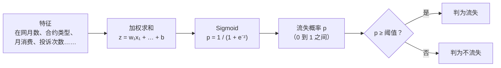
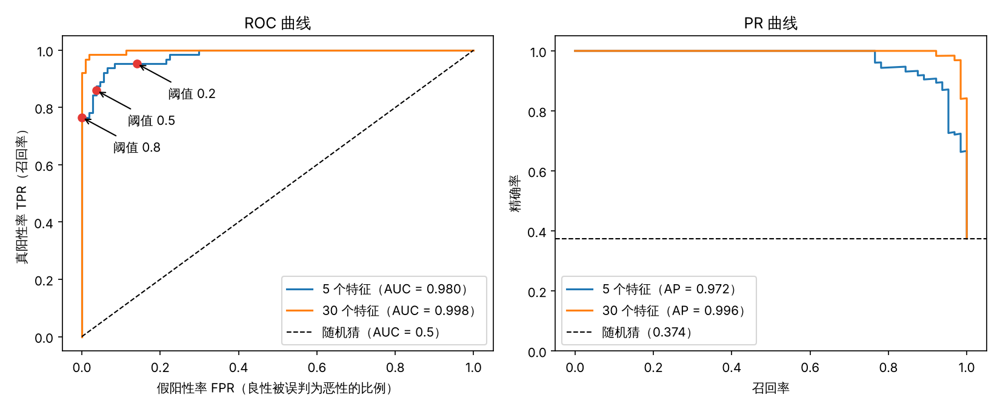
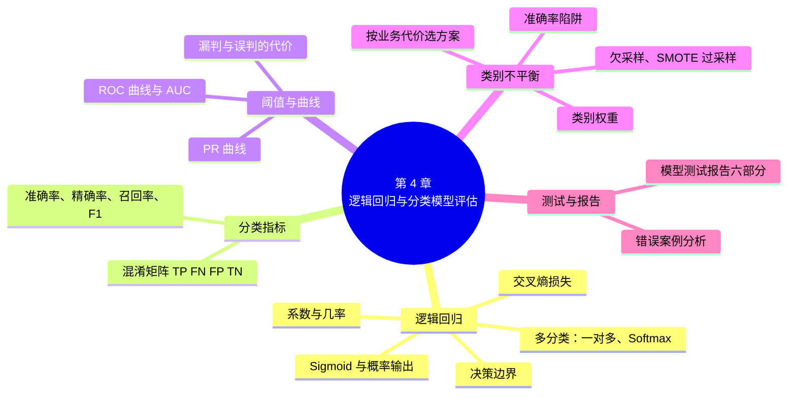

# 第 4 章 逻辑回归与分类模型评估

!!! abstract "本章学时"
    理论 6 学时 · 实验 3 学时（本章共 3 个实验，教师可任选）

## 学习目标

学完本章，你应该能够：

1. **说出**逻辑回归、Sigmoid 函数、交叉熵、混淆矩阵、精确率、召回率、ROC 曲线和 AUC 的含义（记忆）；
2. **解释**逻辑回归怎样把线性组合变成概率，分类阈值怎样影响精确率和召回率，类别不平衡时准确率为什么会误导人（理解）；
3. **运用** scikit-learn 训练逻辑回归，计算混淆矩阵和各项指标，画 ROC 和 PR 曲线，用类别权重、SMOTE 等方法处理不平衡数据（应用）；
4. **分析**逻辑回归的系数和错误案例，比较不同模型、不同阈值的优劣（分析）；
5. **根据**漏判和误判的业务代价选择阈值和方案，**撰写**一份完整的模型测试报告（评价、创造）。

!!! info "先修要求"
    学习本章前，你需要掌握：

    - 分类与回归的区别，训练集与测试集（[1.2 机器学习的基本术语](../01-intro/index.md#12)、[1.3 三种学习范式](../01-intro/index.md#13)）；
    - 独热编码和标准化（[2.3 特征编码与特征缩放](../02-preprocessing/index.md#23)）；
    - 线性回归的加权求和、损失函数和梯度下降（[第 3 章 线性回归与梯度下降](../03-linear-regression/index.md)）；
    - 指数函数 eˣ 和自然对数 ln x 的大致形状（“人工智能数学基础”课程）。

??? abstract "本章概念清单（26 个，点击查看定义和例子）"
    1. [二分类](../../appendix/glossary.md#g-二分类)
    2. [正类](../../appendix/glossary.md#g-正类)
    3. [多分类](../../appendix/glossary.md#g-多分类)
    4. [逻辑回归](../../appendix/glossary.md#g-逻辑回归)
    5. [Sigmoid 函数](../../appendix/glossary.md#g-Sigmoid-函数)
    6. [概率输出](../../appendix/glossary.md#g-概率输出)
    7. [分类阈值](../../appendix/glossary.md#g-分类阈值)
    8. [决策边界](../../appendix/glossary.md#g-决策边界)
    9. [交叉熵](../../appendix/glossary.md#g-交叉熵)
    10. [几率](../../appendix/glossary.md#g-几率)
    11. [Softmax](../../appendix/glossary.md#g-Softmax)
    12. [混淆矩阵](../../appendix/glossary.md#g-混淆矩阵)
    13. [准确率](../../appendix/glossary.md#g-准确率)
    14. [精确率](../../appendix/glossary.md#g-精确率)
    15. [召回率](../../appendix/glossary.md#g-召回率)
    16. [F1 值](../../appendix/glossary.md#g-F1-值)
    17. [假阳性率](../../appendix/glossary.md#g-假阳性率)
    18. [ROC 曲线](../../appendix/glossary.md#g-ROC-曲线)
    19. [AUC](../../appendix/glossary.md#g-AUC)
    20. [PR 曲线](../../appendix/glossary.md#g-PR-曲线)
    21. [类别不平衡](../../appendix/glossary.md#g-类别不平衡)
    22. [类别权重](../../appendix/glossary.md#g-类别权重)
    23. [过采样与欠采样](../../appendix/glossary.md#g-过采样与欠采样)
    24. [SMOTE](../../appendix/glossary.md#g-SMOTE)
    25. [错误案例分析](../../appendix/glossary.md#g-错误案例分析)
    26. [模型测试报告](../../appendix/glossary.md#g-模型测试报告)

## 情景导入

小周的估价模型上线后，公司另一个部门找上门来。原来公司还承接了一家电信运营商的数据分析业务：运营商每个月都有不少客户销号转网，客户经理想在客户离开之前打电话挽留，送流量、送话费，但人手有限，每个月只能联系几百人。他们问小周：“能不能从 5000 个客户里，挑出最可能流失的那些人？”

这次要预测的不再是一个数，而是“流失”还是“不流失”，是一个分类问题。小周很快训练出一个模型，准确率 77.5%。客户经理却不太满意：“77.5% 是什么意思？我打 100 个电话，能挽留到几个真要走的人？那些真要走的人，你又找出了几成？”

这两个问题，一个叫精确率，一个叫召回率，是分类模型评估的核心。本章先介绍最常用的分类模型逻辑回归，再系统学习分类模型的评估方法：混淆矩阵、精确率、召回率、ROC 曲线，以及在 100 个客户里只有 1 个“坏人”时，为什么“准确率 99%”可能毫无用处。最后学习怎样把这些写成一份业务人员看得懂的模型测试报告。

## 4.1 分类问题

标签是有限个类别之一的问题，叫分类问题。生活中的分类问题比回归问题还要多：

- 电信客户下个月会不会流失；
- 一条短信是不是垃圾短信；
- 一个乳腺肿块是良性还是恶性；
- 一笔刷卡交易是不是盗刷；
- 一张图片里的手写数字是 0～9 中的哪一个。

只有两个类别的叫[**二分类**](../../appendix/glossary.md#g-二分类 "只有两个类别的分类任务"){ .term }，前四个都是。二分类中，我们关心、要找出来的那一类叫[**正类**](../../appendix/glossary.md#g-正类 "二分类中要找出来、记为 1 的那一类，通常是少数、“出了问题”的一类"){ .term }，记为 1，如“流失”“垃圾短信”“恶性”“欺诈”；另一类叫负类，记为 0。正类通常是少数、是“出了问题”的那一类，“正”并不表示“好”。有三个及以上类别的叫[**多分类**](../../appendix/glossary.md#g-多分类 "有三个及以上类别的分类任务"){ .term }，如识别手写数字是 10 个类别。

能不能直接用第 3 章的线性回归，把“流失”记为 1、“不流失”记为 0 来做回归？可以算，但有两个毛病：一是线性回归的输出可以是 −0.3，也可以是 1.8，不在 0 到 1 之间，没法当成概率来解释；二是均方误差对分类问题不合适，一个“非常确定是流失”的样本预测出 1.8，本来是对的，却会被当成误差很大而去调整模型。我们需要一个输出天然在 0 到 1 之间的模型，这就是逻辑回归。

## 4.2 逻辑回归

### 4.2.1 从线性回归到 Sigmoid

[**逻辑回归**](../../appendix/glossary.md#g-逻辑回归 "给每个特征一个权重、加权求和后用 Sigmoid 函数输出类别概率的分类模型"){ .term }分两步计算。第一步和线性回归一样，把特征加权求和：

\[
z = w_1 x_1 + w_2 x_2 + \cdots + w_d x_d + b
\]

z 可以是任何实数，可正可负，可大可小。第二步，把 z 送进一个“压缩”函数，把它变成 0 到 1 之间的数：

\[
p = \sigma(z) = \frac{1}{1 + e^{-z}}
\]

这个函数叫 [**Sigmoid 函数**](../../appendix/glossary.md#g-Sigmoid-函数 "把任意实数压缩到 0 到 1 之间的 S 形函数 σ(z) = 1 / (1 + e⁻ᶻ)"){ .term }，它的图像是一条 S 形曲线：z 很大时，e⁻ᶻ 接近 0，p 接近 1；z 很小（很负）时，e⁻ᶻ 非常大，p 接近 0；z = 0 时，p = 1 / (1 + 1) = 0.5。z 越大，p 越大，顺序不会变。



p 就是模型给出的“这个样本属于正类的概率”，这叫[**概率输出**](../../appendix/glossary.md#g-概率输出 "分类模型给出的样本属于某一类的概率，而不只是类别"){ .term }。有了概率，再定一个分界值，概率大于等于它就判为正类，否则判为负类，这个分界值叫[**分类阈值**](../../appendix/glossary.md#g-分类阈值 "把概率转换成类别时使用的分界值"){ .term }，默认是 0.5。

**算一算**：z = 2 时，e⁻² ≈ 0.135，p = 1 / 1.135 ≈ 0.881；z = −2 时，e² ≈ 7.389，p = 1 / 8.389 ≈ 0.119。实验 4-1 中测试集的第 1 个客户（C101053），加权求和得 z = −0.204，p = 1 / (1 + e^0.204) ≈ 0.449，小于 0.5，模型判他“不流失”，但并不太确定。scikit-learn 中用 `predict_proba` 取得概率，用 `predict` 直接得到按 0.5 判出的类别。

逻辑回归名字里有“回归”，却是一个**分类**模型。这个名字是历史原因：它对“概率”做回归。统计学家考克斯（D. R. Cox）在 1958 年系统研究了这种模型，它至今仍是银行信用评分、医疗风险预测中最常用的模型之一。<sup class="cite">[[1]](#ref4-1)</sup>

### 4.2.2 决策边界

阈值取 0.5 时，“p ≥ 0.5”等价于“z ≥ 0”。所以逻辑回归判为正类和负类的分界，就是所有满足 w₁x₁ + w₂x₂ + … + b = 0 的点。这条分界叫[**决策边界**](../../appendix/glossary.md#g-决策边界 "分类模型把不同类别分开的分界线（面）；逻辑回归中是 z = 0 的直线或平面"){ .term }。只有两个特征时，它是平面上的一条直线：直线一侧判为正类，另一侧判为负类，离直线越远，模型越确定。

决策边界是直线（特征多时是平面），说明逻辑回归是一个**线性分类器**：它只能用一条直线把两类分开。如果两类数据的分界是弯的，比如一类在中间、另一类围在外面，逻辑回归就分不好，这时可以像第 3 章那样构造平方、交叉等特征，或者换用第 5 章的决策树、第 6 章的支持向量机。

### 4.2.3 交叉熵损失

逻辑回归怎样训练？和线性回归一样：定一个损失函数，用梯度下降找到让损失最小的 w 和 b。但损失函数换成了[**交叉熵**](../../appendix/glossary.md#g-交叉熵 "分类任务常用的损失函数，等于正确类别预测概率的负对数"){ .term }：对每个样本，取模型给“正确类别”的概率，再取负对数：

\[
L = -\frac{1}{n} \sum_{i=1}^{n} \Big[ y_i \ln p_i + (1 - y_i) \ln (1 - p_i) \Big]
\]

公式看起来复杂，含义很简单：yᵢ = 1 时只剩前一项 −ln pᵢ，yᵢ = 0 时只剩后一项 −ln(1 − pᵢ)，都是“正确类别的概率取负对数”。

**算一算**：一个真实流失的客户，模型给出流失概率 0.9，损失是 −ln 0.9 ≈ 0.105；给出 0.5，损失 −ln 0.5 ≈ 0.693；给出 0.1，也就是很有把握地判错了，损失是 −ln 0.1 ≈ 2.303。可见交叉熵的特点是：**判对了损失很小，越有把握地判错，惩罚越重**。概率接近 0 时，−ln p 会趋向无穷大，模型会尽力避免“自信地犯错”。

交叉熵没有像最小二乘那样的现成公式，只能用梯度下降一类的方法一步步求解。scikit-learn 的 `LogisticRegression` 默认使用一种改进的梯度方法（lbfgs），如果提示 `ConvergenceWarning`（没有收敛），通常是因为特征没有标准化或迭代次数 `max_iter` 不够。它默认还带有 L2 正则化（第 3 章的岭回归惩罚），强度由参数 `C` 控制：`C` 越小，正则化越强，这与 `Ridge` 的 `alpha` 方向正好相反。

### 4.2.4 系数解读：几率与倍数

逻辑回归的系数怎样解读？要借助一个概念：[**几率**](../../appendix/glossary.md#g-几率 "事件发生的概率与不发生的概率之比；逻辑回归中特征加 1，几率变为 e^w 倍"){ .term }，即“发生的概率 ÷ 不发生的概率”。流失概率 0.75 时，几率是 0.75 / 0.25 = 3，也就是“流失和不流失是 3 比 1”。可以证明，逻辑回归中的 z 正是几率的对数，所以：

> 特征 xⱼ 增加 1 个单位，几率变为原来的 e^wⱼ 倍。

实验 4-1 用电信客户数据训练了逻辑回归，特征先做了标准化，所以每个系数表示“该特征增加一个标准差”的影响，可以互相比较大小。部分系数如下：

| 特征 | 系数 | e^系数 | 含义 |
|---|---|---|---|
| 合约类型_月付 | 0.703 | 2.02 | 月付客户流失的几率明显更高 |
| 近半年投诉次数 | 0.501 | 1.65 | 投诉每多一个标准差，流失几率变为 1.65 倍 |
| 月消费 | 0.381 | 1.46 | 月消费越高越容易流失，可能是觉得资费贵 |
| 合约类型_两年 | −0.746 | 0.47 | 签两年合约的客户流失几率低得多 |
| 在网月数 | −1.051 | 0.35 | 在网时间每长一个标准差（约 16 个月），流失几率降为 0.35 倍 |

系数为正，说明这个特征越大越容易属于正类；为负则相反。这张表本身就是给客户经理的业务建议：重点关注月付、投诉多、入网时间短的客户，推动他们改签长期合约。和第 3 章一样，“其他特征不变”“单位影响系数大小”“相关特征会让系数不稳定”这几点在这里同样成立。

### 4.2.5 多分类：一对多与 Softmax

逻辑回归天生只能分两类。要分 K 类，有两种办法。

**一对多**：训练 K 个二分类器，第 k 个专门判断“是不是第 k 类”。预测时，K 个分类器各给出一个概率，取最大的那个类别。它简单，但 K 个概率加起来不一定等于 1。

[**Softmax**](../../appendix/glossary.md#g-Softmax "把一组得分转换为和为 1 的概率分布的函数"){ .term }：给每个类别各算一个得分 zₖ，再用 **Softmax** 函数把 K 个得分变成和为 1 的概率：

\[
p_k = \frac{e^{z_k}}{\sum_{j=1}^{K} e^{z_j}}
\]

**算一算**：三个类别的得分是 2.0、1.0、0.1。e^2.0 ≈ 7.389，e^1.0 ≈ 2.718，e^0.1 ≈ 1.105，三者之和 11.212，三个概率分别是 7.389 / 11.212 ≈ 0.66、0.24、0.10，加起来正好是 1。得分越高，概率越大，而且取指数会把差距拉大，最高分的类别占了一大半。二分类时，Softmax 和 Sigmoid 是等价的。

scikit-learn 的 `LogisticRegression` 遇到多分类数据会自动使用 Softmax 方式（也叫多项逻辑回归）。第 10 章的神经网络做分类时，最后一层同样是 Softmax，损失同样是交叉熵，所以本节的内容在后面会反复用到。

## 4.3 混淆矩阵与分类指标

### 4.3.1 混淆矩阵

分类模型的预测结果，按“实际是什么”和“预测成什么”交叉统计，可以排成一张 2 × 2 的表，叫[**混淆矩阵**](../../appendix/glossary.md#g-混淆矩阵 "按“实际类别 × 预测类别”交叉统计样本数量的表格"){ .term }。四个格子各有名字：

| | 预测为正类（流失） | 预测为负类（不流失） |
|---|---|---|
| **实际是正类（流失）** | TP 真正例：找对了 | FN 假负例：漏掉了 |
| **实际是负类（不流失）** | FP 假正例：误报了 | TN 真负例：判对了 |

名字的记法：第二个字母 P / N 表示模型“预测成什么”，第一个字母 T / F 表示“预测对没对”。FN 就是“预测成负类，但预测错了”，即漏掉的正类；FP 是“预测成正类，但错了”，即误报。

实验 4-1 中，测试集有 1500 个客户，其中 455 人实际流失。逻辑回归（阈值 0.5）的混淆矩阵是：

| | 预测流失 | 预测不流失 | 合计 |
|---|---|---|---|
| **实际流失** | TP = 264 | FN = 191 | 455 |
| **实际不流失** | FP = 147 | TN = 898 | 1045 |
| **合计** | 411 | 1089 | 1500 |

所有分类指标都由这四个数算出来。

### 4.3.2 准确率、精确率、召回率与 F1 值

[**准确率**](../../appendix/glossary.md#g-准确率 "预测正确的样本占全部样本的比例"){ .term }：预测对的样本占全部样本的比例。

\[
\text{准确率} = \frac{TP + TN}{TP + FN + FP + TN} = \frac{264 + 898}{1500} \approx 0.775
\]

它回答“总体判对了多少”，但不区分错在哪里。

[**精确率**](../../appendix/glossary.md#g-精确率 "预测为某类的样本中，真正属于该类的比例（判得准不准）"){ .term }：预测为正类的样本中，真正是正类的比例，衡量“判得准不准”。

\[
\text{精确率} = \frac{TP}{TP + FP} = \frac{264}{411} \approx 0.642
\]

这回答了客户经理的第一个问题：模型挑出 411 人，其中 264 人真的要走，打 100 个电话大约有 64 个打给了真要流失的人。

[**召回率**](../../appendix/glossary.md#g-召回率 "某类的全部样本中，被正确找出来的比例（找得全不全）"){ .term }：所有正类样本中，被模型找出来的比例，衡量“找得全不全”。

\[
\text{召回率} = \frac{TP}{TP + FN} = \frac{264}{455} \approx 0.580
\]

这回答了第二个问题：455 个真要走的人，模型找出了 58%，还有 42% 被漏掉了。

[**F1 值**](../../appendix/glossary.md#g-F1-值 "精确率与召回率的调和平均数，综合衡量两者"){ .term }是精确率和召回率的调和平均数<sup class="cite">[[2]](#ref4-2)</sup>：

\[
F1 = \frac{2 \times \text{精确率} \times \text{召回率}}{\text{精确率} + \text{召回率}} = \frac{2 \times 0.642 \times 0.580}{0.642 + 0.580} \approx 0.610
\]

为什么用调和平均而不用普通平均？因为调和平均会被较小的那个数拉低：精确率 1.0、召回率 0.1 时，普通平均是 0.55，看起来还行；F1 只有 0.18，说明这个模型基本没用。F1 只有在两者都高时才会高。

| 指标 | 回答的问题 | 什么时候最看重它 |
|---|---|---|
| 准确率 | 总体判对了多少？ | 各类样本数量差不多、各种错误代价差不多时 |
| 精确率 | 判为正类的，有多少是真的？ | 误报代价高：垃圾短信过滤（把正常短信当垃圾拦掉，用户会错过重要信息） |
| 召回率 | 真正的正类，找出了多少？ | 漏报代价高：癌症筛查、盗刷识别（漏掉一个，后果严重） |
| F1 值 | 精确率和召回率的综合 | 两者都要兼顾，需要一个数比较模型时 |

多分类时，可以把每个类别轮流当作正类，分别算出精确率、召回率和 F1，再取平均。scikit-learn 的 `classification_report` 会一次输出每个类别的指标和平均值<sup class="cite">[[3]](#ref4-3)</sup>。

!!! cert "证书考点 · 人工智能数据处理工程师（高级）· 数据挖掘"
    数据挖掘模块要求会用分类算法建模并评估。常考：给出混淆矩阵的四个数，计算准确率、精确率、召回率和 F1 值；判断不同业务场景应重点看精确率还是召回率；逻辑回归的 Sigmoid 函数，z = 0 时概率为 0.5；scikit-learn 中 `predict` 与 `predict_proba` 的区别，`confusion_matrix`、`classification_report`、`roc_auc_score` 的用法。容易错在把精确率和召回率的分母弄混（精确率除以“预测为正”的个数，召回率除以“实际为正”的个数），以及 `confusion_matrix(y_true, y_pred)` 的参数顺序写反。

## 4.4 分类阈值、ROC 与 PR 曲线

### 4.4.1 阈值：漏判和误判哪个代价更高

阈值 0.5 并不是必须的。阈值调低，更多样本被判为正类，漏掉的少了，召回率上升，但误报也多了，精确率通常下降；阈值调高则相反。精确率和召回率往往**此消彼长**，不可兼得。

实验 4-2 用 scikit-learn 自带的乳腺肿瘤诊断数据（569 例，来自美国威斯康星大学医院的细胞核图像测量<sup class="cite">[[4]](#ref4-4)</sup>）训练逻辑回归，以“恶性”为正类。为了让阈值的影响看得更清楚，只用了 5 个特征。测试集 171 例（恶性 64 例）在不同阈值下的结果：

| 阈值 | TP | FN（漏诊） | FP（误诊） | TN | 精确率 | 召回率 | F1 |
|---|---|---|---|---|---|---|---|
| 0.1 | 63 | 1 | 25 | 82 | 0.716 | 0.984 | 0.829 |
| 0.3 | 61 | 3 | 10 | 97 | 0.859 | 0.953 | 0.904 |
| 0.5 | 55 | 9 | 4 | 103 | 0.932 | 0.859 | 0.894 |
| 0.7 | 51 | 13 | 3 | 104 | 0.944 | 0.797 | 0.864 |
| 0.9 | 42 | 22 | 0 | 107 | 1.000 | 0.656 | 0.792 |

阈值从 0.9 降到 0.1，漏诊从 22 例减到 1 例，误诊从 0 例增到 25 例。选哪个阈值，不是数学问题，而是业务问题：**看漏判和误判哪个代价更高**。

- **癌症初筛**：漏诊一例，病人可能错过最佳治疗时机；误诊一例，病人要多做一次穿刺检查。漏诊代价高得多，应该选较低的阈值，保证召回率。实验 4-2 中要求召回率不低于 0.95，阈值可以取 0.3 左右。
- **垃圾短信拦截**：把正常短信当成垃圾拦掉，用户可能错过验证码或银行通知；漏掉一条垃圾短信，用户删掉就是了。误报代价高，应该选较高的阈值，保证精确率。
- **客户流失挽留**：每个月只能打几百个电话，阈值要配合人手：按流失概率从高到低排序，从上往下打，能打多少打多少。实验 4-1 中，流失概率最高的 50 个客户里有 48 个真的流失了。

### 4.4.2 ROC 曲线与 AUC

每换一个阈值，就得到一个混淆矩阵。为了不依赖具体的阈值，全面评价一个模型，可以把所有阈值的结果画成一条曲线。

[**ROC 曲线**](../../appendix/glossary.md#g-ROC-曲线 "以假阳性率为横轴、真阳性率（召回率）为纵轴，把所有阈值的结果连成的曲线"){ .term }（受试者工作特征曲线，这个名字来自二战时的雷达信号检测）的横轴是[**假阳性率**](../../appendix/glossary.md#g-假阳性率 "实际为负类的样本中被误判为正类的比例，是 ROC 曲线的横轴"){ .term }（FPR = FP / (FP + TN)，负类被误判为正类的比例），纵轴是**真阳性率**（TPR = TP / (TP + FN)，也就是召回率）。阈值从 1 降到 0，曲线从左下角 (0, 0) 走到右上角 (1, 1)：阈值为 1 时什么都不判为正类，阈值为 0 时全都判为正类。



怎样看 ROC 曲线？好的模型，曲线会迅速升到左上角：误报还很少的时候，就已经把大部分正类找出来了。对角线代表随机乱猜。曲线下的面积叫 [**AUC**](../../appendix/glossary.md#g-AUC "ROC 曲线下的面积，等于随机正类样本得分高于随机负类样本的概率，0.5 为乱猜、1 为完美"){ .term }，取值在 0.5（乱猜）到 1（完美）之间。AUC 有一个直观的含义：**随机抽一个正类样本和一个负类样本，模型给正类样本打分更高的概率**。<sup class="cite">[[5]](#ref4-5)</sup> 实验 4-2 中，5 个特征的模型 AUC = 0.980，全部 30 个特征的模型 AUC = 0.998。

AUC 的优点是**与阈值无关**：它评价的是模型把正类“排在”负类前面的能力。比较两个模型时，先比 AUC，选出排序能力强的模型，再根据业务选阈值。

下面的动画用的就是实验 4-2 中 5 个特征模型的输出。拖动阈值，观察混淆矩阵、各项指标和两条曲线上的红点怎样同步变化。

<iframe class="sim-frame" src="../../sims/threshold-roc/main.html" height="760" loading="lazy" title="阈值、混淆矩阵与 ROC"></iframe>

先把阈值从 0.9 慢慢拖到 0.1，记下漏诊和误诊的例数；再点三个场景按钮，说说每个阈值适合什么场合。注意拖动时 AUC 始终不变。[全屏打开](../../sims/threshold-roc/main.html){ target=_blank } · [教学说明](../../sims/threshold-roc/index.md)
{ .sim-caption }

### 4.4.3 PR 曲线

[**PR 曲线**](../../appendix/glossary.md#g-PR-曲线 "以召回率为横轴、精确率为纵轴的曲线，正类很少时比 ROC 更能说明问题"){ .term }的横轴是召回率，纵轴是精确率，同样是把所有阈值的结果连起来。好的模型，曲线靠近右上角：召回率很高时，精确率依然很高。PR 曲线下的面积常用**平均精确率**（AP）表示。PR 曲线的“随机基线”不是对角线，而是一条水平线，高度等于正类所占的比例：乱猜时，判为正类的样本中正类的比例就是总体中正类的比例。

ROC 和 PR 曲线什么时候用哪个？各类样本数量差不多时，两者结论一致，ROC 更常用。**正类很少时，PR 曲线更能说明问题**。<sup class="cite">[[6]](#ref4-6)</sup> 原因是 ROC 的横轴 FPR 以负类总数为分母，负类成千上万时，多误报几百个，FPR 也只增加一点点，曲线看起来依然很好；而 PR 曲线的精确率会直接反映出误报的增加。下一节的信用卡欺诈数据就是一个例子：模型的 AUC 有 0.962，看起来很好，AP 却只有 0.487。

## 4.5 类别不平衡

### 4.5.1 准确率陷阱

很多重要的分类问题中，正类非常少：盗刷交易可能只占千分之一，罕见病患者只占人群的万分之一。各类样本数量相差很大的情况，叫[**类别不平衡**](../../appendix/glossary.md#g-类别不平衡 "各类别样本数量相差很大的情况"){ .term }。

实验 4-3 的模拟信用卡交易数据有 2 万笔，欺诈只占 1.04%。测试集 6000 笔中欺诈 63 笔。一个什么都不做、把所有交易都判为“正常”的“模型”，准确率是 5937 / 6000 ≈ 0.990，但一笔欺诈也抓不到。直接训练逻辑回归，结果是：

| 做法 | TP | FN | FP | 准确率 | 精确率 | 召回率 | F1 | AUC | AP |
|---|---|---|---|---|---|---|---|---|---|
| 全部判为正常 | 0 | 63 | 0 | 0.990 | — | 0 | — | — | — |
| 逻辑回归，不处理 | 17 | 46 | 6 | 0.991 | 0.739 | 0.270 | 0.395 | 0.962 | 0.487 |

准确率 0.991，只比全部猜“正常”高一点点，召回率只有 0.270，63 笔欺诈漏掉了 46 笔。这就是**准确率陷阱**：类别不平衡时，准确率几乎完全由多数类决定，再高也说明不了什么。这时应该看召回率、精确率、F1 和 PR 曲线。

为什么模型会“偏向”多数类？因为训练时损失是所有样本的平均，146 笔欺诈在 14000 笔训练数据里占比太小，模型只要把正常交易判对，损失就已经很小了。

### 4.5.2 三类处理方法

处理类别不平衡，常用的有三类方法：<sup class="cite">[[7]](#ref4-7)</sup>

1. [**类别权重**](../../appendix/glossary.md#g-类别权重 "在损失函数中给少数类样本更大权重的不平衡处理方法"){ .term }：在损失函数中给少数类样本更大的权重，判错一个少数类样本，相当于判错很多个多数类样本。scikit-learn 中大多数分类器都有参数 `class_weight`，设为 `"balanced"` 时，权重与各类样本数成反比。实验 4-3 中欺诈样本的权重约为 47.9，正常样本约为 0.505，相当于把一笔欺诈“看作”95 笔正常交易。
2. **欠采样**：从多数类中随机抽一部分，使两类数量接近。简单快速，但丢掉了大量多数类的信息。
3. **过采样**：增加少数类样本。最简单的是把少数类样本复制几份，但容易过拟合。更常用的是 [**SMOTE**](../../appendix/glossary.md#g-SMOTE "在少数类样本与其近邻之间插值、合成新样本的过采样方法"){ .term }（合成少数类过采样技术）：在一个少数类样本和它附近的另一个少数类样本之间连一条线，在线上随机取一点，作为一个新的“合成”样本。<sup class="cite">[[8]](#ref4-8)</sup> 这样生成的样本不会和原来的完全一样。

欠采样和过采样合称[**过采样与欠采样**](../../appendix/glossary.md#g-过采样与欠采样 "增加少数类或减少多数类训练样本，使各类数量接近的方法，只能用于训练集"){ .term }，都是改变训练数据中各类的比例，Python 中常用 imbalanced-learn 库实现。<sup class="cite">[[9]](#ref4-9)</sup> 有一条铁律：**只能对训练集做采样，测试集必须保持原样**。测试集代表真实世界，真实世界里欺诈就是只有 1%；对测试集做过采样，相当于在一份“假的”试卷上考试，成绩毫无意义。imbalanced-learn 的流水线（`imblearn.pipeline`）会保证采样只在训练时进行。

实验 4-3 比较了四种做法（阈值都是 0.5）：

| 做法 | TP | FN | FP | 准确率 | 精确率 | 召回率 | F1 | AUC | AP |
|---|---|---|---|---|---|---|---|---|---|
| 不处理 | 17 | 46 | 6 | 0.991 | 0.739 | 0.270 | 0.395 | 0.962 | 0.487 |
| 类别权重 balanced | 53 | 10 | 663 | 0.888 | 0.074 | 0.841 | 0.136 | 0.956 | 0.467 |
| 随机欠采样 | 55 | 8 | 813 | 0.863 | 0.063 | 0.873 | 0.118 | 0.953 | 0.446 |
| SMOTE 过采样 | 53 | 10 | 638 | 0.892 | 0.077 | 0.841 | 0.141 | 0.955 | 0.482 |

结果很值得琢磨：

- 三种处理方法都把召回率从 0.270 提高到 0.84 以上，但精确率掉到了 0.08 以下，误报从 6 笔增加到 600 多笔，准确率反而下降了。
- 四种做法的 AUC 和 AP 几乎一样。也就是说，这些方法并没有让模型“更会区分”欺诈和正常交易，主要作用是**把判为欺诈的门槛降低了**。实验 4-3 中，只把不处理模型的阈值从 0.5 降到 0.1，召回率也能升到 0.587。
- 所以处理不平衡，与其纠结用哪种采样方法，不如先选一个 AUC、AP 高的模型，再根据业务代价调阈值或调权重。

### 4.5.3 按业务代价选方案

到底哪种做法最好？还是要回到业务。假设漏掉一笔欺诈，损失这笔交易的金额；误报一笔正常交易，需要客服打电话向持卡人核实，成本按 20 元计。实验 4-3 算出了测试集 6000 笔交易上的总代价：

| 做法 | 漏判 | 误报 | 漏判损失（元） | 误报成本（元） | 总代价（元） |
|---|---|---|---|---|---|
| 不用模型（全部放行） | 63 | 0 | 42318 | 0 | 42318 |
| 不处理 | 46 | 6 | 26052 | 120 | 26172 |
| 类别权重 balanced | 10 | 663 | 2373 | 13260 | 15633 |
| SMOTE 过采样 | 10 | 638 | 2373 | 12760 | 15133 |
| 不处理 + 阈值 0.1 | 26 | 66 | 13786 | 1320 | 15106 |
| 类别权重 + 阈值 0.8 | 21 | 176 | 8637 | 3520 | 12157 |

按这个代价算，“类别权重 + 阈值 0.8”总代价最低，比不用模型节省了约七成损失。如果误报的成本更高（比如误拦交易导致客户投诉、销卡），最优的阈值又会不同。这说明：**评价指标是手段，业务代价才是目的**。在模型测试报告中，应该把模型的指标“翻译”成业务语言：抓住多少笔欺诈，挽回多少损失，要多打多少个核实电话。

## 4.6 错误案例分析与模型测试报告

### 4.6.1 错误案例分析

指标告诉我们模型错了多少，[**错误案例分析**](../../appendix/glossary.md#g-错误案例分析 "逐条查看模型判错的样本，归纳出错原因并提出改进建议的方法"){ .term }告诉我们模型错在哪里、为什么错。做法是：把模型判错的样本（漏判的、误报的）一条条拿出来，和判对的样本对比，找出它们的共同点。

实验 4-3 以“类别权重”模型为例，列出了漏判的 10 笔欺诈。和测试集中全部欺诈交易相比：

| 特征 | 全部欺诈交易 | 漏判的欺诈 | 全部正常交易 | 误报的正常交易 |
|---|---|---|---|---|
| 交易金额（中位数，元） | 473.05 | 148.97 | 121.45 | 254.35 |
| 交易小时（中位数） | 10 | 17 | 14 | 13 |
| 距上次交易（中位数，小时） | 8.6 | 19.1 | 20.1 | 7.3 |
| 是否新设备（比例） | 0.10 | 0 | 0.07 | 0.18 |

规律很清楚：漏掉的欺诈交易金额小、发生在白天、离上次交易时间长、没有换设备，“看起来”和正常交易一模一样；误报的正常交易则金额偏大、交易频繁、换过设备，“看起来”像欺诈。分析的结论可以指导下一步改进：漏掉的小额欺诈可能是盗刷者在“试卡”，可以加入“同一张卡短时间内在不同商户的交易次数”等特征；误报中换新设备的较多，可以结合设备是否经过实名验证来区分。

错误案例分析的一般步骤：

1. 按错误类型（漏判、误报）分别列出错误样本，各挑出最典型的几条（如概率最接近阈值的、模型最有把握却判错的）；
2. 与判对的样本对比各特征的分布，找出差异；
3. 逐条查看原始记录，判断是模型的问题、特征不够，还是标签本身标错了；
4. 归纳成几类原因，每类给出数量、例子和改进建议。

### 4.6.2 模型测试报告

模型训练好以后，要写一份[**模型测试报告**](../../appendix/glossary.md#g-模型测试报告 "说明测试目的、数据、指标、结果、错误分析和结论建议，作为模型能否上线依据的文档"){ .term }，交给业务部门、上级或客户，作为模型能否上线的依据。它和第 2 章的数据清洗规范一样，是人工智能训练师的基本功。一份完整的测试报告通常包括下面几部分：

| 部分 | 写什么 | 实验 4-3 的例子 |
|---|---|---|
| 1. 测试目的 | 模型要解决什么业务问题，上线后怎样使用 | 识别信用卡盗刷交易，判为可疑的交易由客服电话核实 |
| 2. 测试数据 | 数据来源、时间范围、样本数、各类比例，怎样划分 | 2 万笔交易，欺诈 1.04%；按 7 : 3 分层划分，测试集 6000 笔，欺诈 63 笔 |
| 3. 评价指标 | 用哪些指标，为什么 | 类别严重不平衡，以召回率、精确率、AP 为主，同时计算业务代价 |
| 4. 测试结果 | 各模型、各方案的指标对比表，混淆矩阵，ROC / PR 曲线 | 4.5.2、4.5.3 节的两张表和 PR 曲线 |
| 5. 错误案例分析 | 漏判和误报的典型案例、原因、数量 | 漏判的多为小额、白天、无设备变化的交易 |
| 6. 结论与建议 | 推荐哪个方案上线、阈值多少，预期效果；局限和风险；改进计划 | 推荐类别权重 + 阈值 0.8，预计抓住约三分之二的欺诈；需增加试卡类特征；上线后每月复查 |

写报告时要注意三点：一是**结论先行**，第一段就写清“推荐什么、效果如何”，业务人员不一定看完全文；二是**用业务语言**，“召回率 0.667”要同时写成“63 笔欺诈中抓住 42 笔”；三是**如实写局限**，测试数据是不是能代表上线后的情况，有哪些情况模型处理不好，都要写清楚。

!!! cert "证书考点 · 人工智能训练师（三级）· 智能训练"
    智能训练模块要求能训练和测试算法模型，分析错误案例，撰写测试报告。常考：给出一个业务场景和混淆矩阵，说明应优先关注哪个指标、阈值应调高还是调低；类别不平衡时为什么不能只看准确率，有哪些处理方法；采样只能用于训练集；模型测试报告应包含哪些部分；对一组错误案例归纳原因并提出改进建议。实操题常要求在给定代码上调整阈值或设置 `class_weight="balanced"`，并按模板写出测试结论。

## 4.7 前沿视窗

**离线指标好，不等于上线效果好。**本章的指标都是在历史数据上算出来的，叫离线评估。模型上线后，情况可能不同：客户经理会不会按名单打电话？挽留的话术有没有用？被挽留的客户本来是不是就不打算走？所以互联网公司在正式推广一个模型之前，通常要做 **A/B 测试**：把用户随机分成两组，一组用新模型，一组用旧办法，比较一段时间内的业务指标（如流失率、成交额），用实际效果说话。<sup class="cite">[[10]](#ref4-10)</sup> 离线 AUC 提高了 0.01，上线后业务指标可能毫无变化；反过来，有时离线指标差不多的两个模型，上线效果相差很大。

**大模型做分类：不用训练也能分。**传统的分类模型需要成千上万条标注数据。大语言模型出现后，很多文本分类任务可以直接用提示词完成：告诉模型“请判断下面这条客户留言属于投诉、咨询还是表扬”，它就能给出答案，这叫零样本分类；再在提示词里给几个例子，叫少样本分类。《自然语言处理导论》第 6 章的前沿视窗对此有详细介绍（[链接](https://mingzifu9.github.io/nlp-textbook/chapters/06-classification/)）。但无论是传统模型还是大模型，评估方法都一样：拿一份有标签的测试集，算混淆矩阵、精确率、召回率，写测试报告。大模型的输出还可能不稳定、格式不规范，测试时更要多看错误案例。

**公平性：模型对不同人群是否一样准？**信用评分、招聘筛选等模型，即使总体指标很好，也可能对某些人群（如某个年龄段、某个地区）的误判明显更多。近年来，各国都要求对这类模型做公平性测试：分人群分别计算精确率、召回率、误报率，看差距是否在合理范围内。第 12 章会进一步讨论。

## 本章实验

!!! abstract "实验总览"
    | 实验 | 类型 | 建议时长 | 内容 |
    |---|---|---|---|
    | 实验 4-1 | ★ 基础 | 45 分钟 | 用逻辑回归预测电信客户流失，计算混淆矩阵和各项指标，解读系数，输出流失概率最高的 50 个客户 |
    | 实验 4-2 | ★ 基础 | 45 分钟 | 在乳腺肿瘤诊断数据上调整阈值，观察精确率和召回率的变化，画 ROC 和 PR 曲线，按“漏诊代价高”选阈值 |
    | 实验 4-3 | ☆ 拓展 | 90 分钟 | 在信用卡欺诈数据上比较不处理、类别权重、欠采样、SMOTE 四种做法，计算业务代价，做错误案例分析，写模型测试报告 |

    三个实验都在本机 CPU 上运行，每个脚本不超过 30 秒。实验代码见配套资源 `labs/ch04/` 目录，数据在 `labs/data/`。实验 4-3 需要先安装 imbalanced-learn：`pip install imbalanced-learn`。

### 实验 4-1 ★ 电信客户流失预测

**实验目的**

1. 用 scikit-learn 训练逻辑回归，用 `predict_proba` 得到概率，用 `predict` 得到类别；
2. 计算混淆矩阵、准确率、精确率、召回率、F1 值和 AUC，并与“全部猜不流失”的基线比较；
3. 解读系数，手算一个客户的流失概率，输出流失概率最高的 50 个客户名单。

**实验环境**：本机 CPU。Python 3.11，pandas、scikit-learn。

**实验数据**：`labs/data/telco_churn.csv`，5000 条模拟电信客户记录，字段有客户编号、年龄、在网月数、合约类型、宽带类型、技术支持、视频会员、付款方式、月消费、累计消费、近半年投诉次数和是否流失，流失率 30.3%。数据由 `labs/data/make_datasets.py` 按固定随机种子生成，内容为虚构。第 5 章的实验 5-2 用同一份数据、同样的划分，结果可以直接对比。

**实验步骤与代码**

第 1 步，读取数据，独热编码，按 7 : 3 分层划分。`stratify=y` 让训练集和测试集的流失率保持一致：

```python
df = pd.read_csv("../data/telco_churn.csv")
y = (df["是否流失"] == "是").astype(int)
X = pd.get_dummies(df.drop(columns=["客户编号", "是否流失"]),
                   columns=["合约类型", "宽带类型", "技术支持", "视频会员", "付款方式"], dtype=int)
X_train, X_test, y_train, y_test = train_test_split(X, y, test_size=0.3, random_state=42, stratify=y)
```

第 2 步，用流水线把标准化和逻辑回归串起来，训练后取概率和类别，计算混淆矩阵和各项指标：

```python
model = make_pipeline(StandardScaler(), LogisticRegression(max_iter=1000))
model.fit(X_train, y_train)
prob = model.predict_proba(X_test)[:, 1]          # 第 2 列是“流失”（类别 1）的概率
pred = model.predict(X_test)                      # 默认阈值 0.5
tn, fp, fn, tp = confusion_matrix(y_test, pred).ravel()
print(precision_score(y_test, pred), recall_score(y_test, pred), f1_score(y_test, pred), roc_auc_score(y_test, prob))
```

注意 `confusion_matrix` 返回的矩阵第一行是实际为 0 的样本，所以 `ravel()` 展开的顺序是 TN、FP、FN、TP，和 4.3.1 节表格的排列不同。AUC 要用概率 `prob` 计算，不能用类别 `pred`。

第 3 步，取出系数并排序。`model[-1]` 是流水线的最后一步，即逻辑回归：

```python
lr = model[-1]
coef = pd.Series(lr.coef_[0], index=X.columns).sort_values()
print(coef, np.exp(coef))
```

第 4 步，手算测试集第 1 个客户的概率：先用流水线第一步 `model[0]` 标准化，再加权求和、代入 Sigmoid，与 `predict_proba` 的结果对照。

第 5 步，按流失概率从高到低排序，取前 50 名保存为名单，统计其中实际流失的人数：

```python
top = df.loc[X_test.index].assign(流失概率=prob.round(3)).sort_values("流失概率", ascending=False).head(50)
top.to_csv("churn_top50.csv", index=False, encoding="utf-8-sig")
print((top["是否流失"] == "是").sum())
```

完整代码见 `lab4_1_churn_logistic.py`。

**运行结果**

```text
训练集 3500 条，测试集 1500 条，特征 20 个；训练集流失率 30.3%，测试集流失率 30.3%

① 基线（全猜不流失）：准确率 0.697，召回率 0.000

② 逻辑回归（阈值 0.5）
  混淆矩阵：TP=264  FN=191  FP=147  TN=898
  训练准确率 0.801  测试准确率 0.775
  精确率 0.642  召回率 0.580  F1 0.610  AUC 0.836

③ 截距 -1.571；系数（特征已标准化，按大小排序）：
  在网月数          -1.051   e^系数 = 0.35
  合约类型_两年       -0.746   e^系数 = 0.47
  宽带类型_DSL      -0.184   e^系数 = 0.83
  技术支持_是        -0.138   e^系数 = 0.87
  合约类型_一年       -0.115   e^系数 = 0.89
  技术支持_否         0.133   e^系数 = 1.14
  宽带类型_光纤        0.187   e^系数 = 1.21
  月消费            0.381   e^系数 = 1.46
  近半年投诉次数        0.501   e^系数 = 1.65
  合约类型_月付        0.703   e^系数 = 2.02

④ 测试集第 1 个客户 C101053：z = -0.204，Sigmoid(z) = 1 / (1 + e^0.204) = 0.449；predict_proba 给出 0.449

⑤ 流失概率前 50 名中，实际流失 48 人（命中率 96%）；随机抽 50 人预计只有 15 人
   客户编号  在网月数 合约类型  月消费  近半年投诉次数  流失概率 是否流失
C102453     1   月付 63.0        3 0.970    是
C102127     5   月付 82.1        3 0.963    是
C102959    15   月付 78.0        4 0.962    是
C100009     4   月付 77.0        3 0.953    是
C100622     2   月付 97.8        2 0.953    是
C102684    16   月付 82.8        3 0.948    是
C101065     4   月付 89.8        2 0.945    是
C102853     6   月付 85.9        2 0.944    是
  前 50 名的流失概率在 0.869～0.970 之间；名单已保存到 churn_top50.csv
```

几点解读：

- 基线准确率已经有 0.697，逻辑回归的 0.775 只高了 7.8 个百分点。只报准确率，看不出模型的真正价值；精确率、召回率和前 50 名的命中率更能说明问题。
- 训练准确率 0.801、测试准确率 0.775，差距不大，没有明显过拟合。
- 前 50 名的命中率高达 96%，远高于整体精确率 0.642，因为排在最前面的都是模型最有把握的。名单上的客户几乎都是月付、入网时间短、投诉多的，与系数的解读一致。

**实验记录表**

| 项目 | 结果 | 用一句话向客户经理解释 |
|---|---|---|
| 混淆矩阵 TP / FN / FP / TN | | — |
| 准确率 | | |
| 精确率 | | |
| 召回率 | | |
| AUC | | |
| 前 50 名命中人数 | | |
| 影响流失最大的 3 个因素 | | |

**常见问题排查**

| 现象 | 原因 | 解决办法 |
|---|---|---|
| `ConvergenceWarning: lbfgs failed to converge` | 特征没有标准化，或迭代次数不够 | 用流水线加 `StandardScaler`，`max_iter` 调到 1000 |
| `roc_auc_score` 的结果和教材相差很多 | 用了 `predict` 的类别而不是 `predict_proba` 的概率 | 改为 `roc_auc_score(y_test, prob)` |
| `predict_proba` 取第 1 列，结果和流失正好相反 | 第 1 列（下标 0）是“不流失”的概率 | 用 `[:, 1]` 取第 2 列 |
| 保存的 CSV 用 Excel 打开是乱码 | 没有写 BOM | 用 `encoding="utf-8-sig"` |

**思考与练习**

1. 客户经理每月只能打 150 个电话。按流失概率排序取前 150 名，能找到多少真正要流失的客户？占全部流失客户的几成？
2. 把阈值改为 0.3，精确率和召回率各是多少？你会推荐客户经理用哪个阈值？
3. “月消费”的系数为正，是不是说应该给高消费客户降价？还需要什么信息才能下结论？

**实验报告要求**

提交运行结果截图、实验记录表和流失概率前 50 名名单；用不超过 200 字向客户经理说明模型的效果和使用方法。

### 实验 4-2 ★ 阈值、混淆矩阵与 ROC

**实验目的**

1. 调整分类阈值，观察混淆矩阵、精确率、召回率的变化，体会二者此消彼长；
2. 画 ROC 曲线和 PR 曲线，计算 AUC 和 AP；
3. 按“漏诊代价高”的要求选择阈值。

**实验环境**：本机 CPU。Python 3.11，scikit-learn、Matplotlib。

**实验数据**：scikit-learn 自带的威斯康星乳腺癌诊断数据集（`load_breast_cancer`），569 例乳腺肿块细针穿刺的细胞核图像测量结果，每例 30 个特征（半径、纹理、平滑度等的均值、标准误和最大值），恶性 212 例、良性 357 例。原数据中 0 表示恶性、1 表示良性，本实验反过来，让恶性为正类 1。按 7 : 3 分层划分，测试集 171 例，其中恶性 64 例。

**实验步骤与代码**

第 1 步，读取数据并划分，翻转标签：

```python
data = load_breast_cancer()
X, y = data.data, 1 - data.target          # 让“恶性”为正类 1
X_train, X_test, y_train, y_test = train_test_split(X, y, test_size=0.3, random_state=42, stratify=y)
```

第 2 步，为了让阈值的影响更明显，只用平均半径、平均纹理、平均平滑度、平均对称性、平均分形维数 5 个特征训练逻辑回归，得到测试集的恶性概率：

```python
cols = [list(data.feature_names).index(c) for c in
        ["mean radius", "mean texture", "mean smoothness", "mean symmetry", "mean fractal dimension"]]
model = make_pipeline(StandardScaler(), LogisticRegression(max_iter=1000))
model.fit(X_train[:, cols], y_train)
prob = model.predict_proba(X_test[:, cols])[:, 1]
```

第 3 步，阈值从 0.1 到 0.9，每次用 `(prob >= t).astype(int)` 得到预测类别，计算混淆矩阵和指标。

第 4 步，用 `roc_curve` 和 `precision_recall_curve` 得到两条曲线上的点，用 `roc_auc_score` 和 `average_precision_score` 计算 AUC 和 AP，画图：

```python
fpr, tpr, thr = roc_curve(y_test, prob)
prec, rec, _ = precision_recall_curve(y_test, prob)
plt.plot(fpr, tpr); plt.plot([0, 1], [0, 1], "k--")
```

第 5 步，在 `roc_curve` 返回的阈值中，找出召回率（`tpr`）不低于 0.95 的最大阈值。`thr` 是从大到小排列的，满足条件的第一个就是最大的：

```python
t_best = thr[tpr >= 0.95][0]
```

第 6 步，换成全部 30 个特征重新训练，比较 AUC。完整代码见 `lab4_2_threshold_roc.py`，它还会把 5 个特征模型的概率导出为 `lab4_2_scores.json`，供交互动画使用。

**运行结果**

```text
共 569 例，恶性 212 例（37.3%），特征 30 个；训练集 398 例，测试集 171 例（恶性 64 例）

① 不同阈值下的混淆矩阵和指标（测试集）
  阈值   TP  FN  FP  TN   准确率  精确率  召回率    F1
  0.1    63   1  25  82    0.848   0.716   0.984  0.829
  0.2    61   3  15  92    0.895   0.803   0.953  0.871
  0.3    61   3  10  97    0.924   0.859   0.953  0.904
  0.4    58   6   6 101    0.930   0.906   0.906  0.906
  0.5    55   9   4 103    0.924   0.932   0.859  0.894
  0.6    54  10   4 103    0.918   0.931   0.844  0.885
  0.7    51  13   3 104    0.906   0.944   0.797  0.864
  0.8    49  15   0 107    0.912   1.000   0.766  0.867
  0.9    42  22   0 107    0.871   1.000   0.656  0.792

② AUC = 0.980；PR 曲线下面积（平均精确率 AP）= 0.972；恶性比例 0.374（PR 曲线的随机基线）

③ 要求召回率 ≥ 0.95：阈值取 0.309，TP=61 FN=3 FP=9 TN=98，召回率 0.953，精确率 0.871，假阳性率 0.084
  注意：阈值是在测试集上挑的，结果偏乐观；正式做法是在验证集上挑阈值，再到测试集上检验（第 9 章）

④ 用全部 30 个特征：AUC = 0.998，AP = 0.996，阈值 0.5 时 TP=60 FN=4 FP=1 TN=106
```

几点解读：

- 准确率在阈值 0.4 时最高（0.930），F1 也在 0.4 附近最高；但对癌症筛查来说，漏诊 6 例仍然太多，按召回率 ≥ 0.95 的要求，阈值应降到 0.309，漏诊减到 3 例，代价是误诊从 6 例增加到 9 例。
- 阈值 0.8 和 0.9 时精确率都是 1.000，没有一例误诊，但漏诊了 15～22 例，这样的模型不能用于筛查。
- 用全部 30 个特征时 AUC 达到 0.998，阈值 0.5 时只漏诊 4 例、误诊 1 例。特征更充分，模型的排序能力更强，精确率和召回率就能同时都很高。“此消彼长”是在同一个模型上调阈值时才有的现象。

**实验记录表**

| 阈值 | 漏诊（FN） | 误诊（FP） | 精确率 | 召回率 | 你认为适用的场景 |
|---|---|---|---|---|---|
| 0.1 | | | | | |
| 0.3 | | | | | |
| 0.5 | | | | | |
| 0.8 | | | | | |

**常见问题排查**

| 现象 | 原因 | 解决办法 |
|---|---|---|
| 精确率、召回率和教材的结果正好对调 | 没有翻转标签，正类变成了“良性” | 用 `y = 1 - data.target` |
| `UndefinedMetricWarning: Precision is ill-defined` | 阈值太高，没有一个样本被判为正类，精确率的分母为 0 | 正常现象，这时精确率记为 0；也可以设 `zero_division=0` |
| ROC 曲线是一条折线，而不是光滑的曲线 | 测试集只有 171 例，点数有限 | 正常现象，样本越多曲线越平滑 |

**思考与练习**

1. 如果漏诊一例的代价相当于误诊十例，在 0.1～0.9 这几个阈值中选哪个总代价最低？
2. 为什么阈值变化时 AUC 不变？
3. 本实验在测试集上挑阈值，为什么说结果偏乐观？应该怎样做？

**实验报告要求**

提交 ROC 和 PR 曲线图、实验记录表；为“社区乳腺癌初筛”选一个阈值，并用业务语言说明理由。

### 实验 4-3 ☆ 类别不平衡：信用卡欺诈识别

**实验目的**

1. 体会类别不平衡时的准确率陷阱；
2. 比较不处理、类别权重、随机欠采样、SMOTE 过采样四种做法，以及只调阈值的效果；
3. 计算不同方案的业务代价，做错误案例分析，写一份完整的模型测试报告。

**实验环境**：本机 CPU。Python 3.11，pandas、scikit-learn、imbalanced-learn。

**实验数据**：`labs/data/card_fraud.csv`，2 万笔模拟信用卡交易，字段有交易编号、交易金额、交易小时、商户类别、是否境外、是否新设备、距上次交易（小时）、近 24 小时交易次数、距常用地（公里）和是否欺诈，欺诈 209 笔（1.04%）。数据由 `labs/data/make_datasets.py` 按盗刷交易的常见特点生成（金额偏大、多在深夜、常在境外或新设备上、离常用地远、短时间内连续交易），各特征在欺诈和正常交易之间都有重叠，内容为虚构。

**实验步骤与代码**

第 1 步，读取数据，构造特征。交易金额和距离的跨度很大，取对数；增加“是否深夜”特征；商户类别做独热编码。按 7 : 3 分层划分：

```python
df = pd.read_csv("../data/card_fraud.csv")
y = df["是否欺诈"]
X = df.drop(columns=["交易编号", "是否欺诈"])
X["交易金额_对数"] = np.log1p(X.pop("交易金额"))
X["距常用地_对数"] = np.log1p(X.pop("距常用地_公里"))
X["深夜"] = (X["交易小时"] < 6).astype(int)
X = pd.get_dummies(X, columns=["商户类别"], dtype=int)
X_train, X_test, y_train, y_test = train_test_split(X, y, test_size=0.3, random_state=42, stratify=y)
```

`np.log1p(x)` 计算 ln(1 + x)，x 为 0 时也不会出错。

第 2 步，定义四种做法。采样要用 imbalanced-learn 的流水线，它保证采样只在 `fit`（训练）时进行，预测测试集时不会采样：

```python
from imblearn.over_sampling import SMOTE
from imblearn.pipeline import make_pipeline as imb_pipeline
from imblearn.under_sampling import RandomUnderSampler

models = {
    "不处理": make_pipeline(StandardScaler(), LogisticRegression(max_iter=1000)),
    "类别权重 balanced": make_pipeline(StandardScaler(), LogisticRegression(max_iter=1000, class_weight="balanced")),
    "随机欠采样": imb_pipeline(StandardScaler(), RandomUnderSampler(random_state=42), LogisticRegression(max_iter=1000)),
    "SMOTE 过采样": imb_pipeline(StandardScaler(), SMOTE(random_state=42), LogisticRegression(max_iter=1000)),
}
```

第 3 步，逐个训练，计算混淆矩阵、各项指标、AUC 和 AP；再对“不处理”的模型试 0.5、0.3、0.2、0.1、0.05 五个阈值。

第 4 步，错误案例分析：取出“类别权重”模型漏判的欺诈和误报的正常交易，与测试集中全部欺诈、全部正常交易对比各特征的中位数（0/1 特征对比比例）。

第 5 步，计算业务代价：漏判损失 = 漏掉的欺诈交易金额之和，误报成本 = 误报笔数 × 20 元。完整代码见 `lab4_3_imbalance.py`。

**运行结果**

```text
训练集 14000 笔（欺诈 146 笔），测试集 6000 笔（欺诈 63 笔），欺诈率 1.04%，特征 15 个

① 全部猜“正常”：准确率 0.990，一笔欺诈也抓不到

② 四种做法（测试集，阈值 0.5）
  做法                TP  FN   FP    TN  准确率  精确率  召回率    F1    AUC     AP
  不处理              17  46    6  5931  0.991  0.739  0.270  0.395  0.962  0.487
  类别权重 balanced    53  10  663  5274  0.888  0.074  0.841  0.136  0.956  0.467
  随机欠采样            55   8  813  5124  0.863  0.063  0.873  0.118  0.953  0.446
  SMOTE 过采样        53  10  638  5299  0.892  0.077  0.841  0.141  0.955  0.482

③ 不处理的模型只调阈值：
  阈值      TP  FN   FP  精确率  召回率    F1
  0.5     17  46    6  0.739  0.270  0.395
  0.3     26  37   21  0.553  0.413  0.473
  0.2     28  35   31  0.475  0.444  0.459
  0.1     37  26   66  0.359  0.587  0.446
  0.05    41  22  148  0.217  0.651  0.325

④ 错误案例分析（类别权重模型）：漏判 10 笔欺诈，误报 663 笔正常交易
  漏判的欺诈交易：
    交易编号   交易金额  交易小时 商户类别  是否境外  是否新设备  距上次交易_小时  近24小时交易次数  距常用地_公里  欺诈概率
T1016019 112.54    21 珠宝首饰     0      0      37.4          1     35.0 0.100
T1001635  84.10    16   加油     0      0      19.5          4     22.9 0.281
T1004758 156.59    16   网购     0      0      19.3          4      5.2 0.301
T1011924 938.18    12 珠宝首饰     0      0      41.0          2     13.0 0.328
T1008152 322.12    12   超市     1      0      29.0          2      3.8 0.343
T1002395 140.91    23 游戏充值     0      0      12.4          4      1.3 0.415
T1001142 141.35     6   网购     0      0       6.6          2      8.0 0.422
T1017347 175.53    19 游戏充值     0      0       1.2          3      0.5 0.476
T1001821 175.59    19   加油     0      0      18.9          7      6.5 0.477
T1014201 126.26    18 数码电器     0      0       1.9          1      5.8 0.479
  欺诈概率最高的 5 笔误报：
    交易编号    交易金额  交易小时 商户类别  是否境外  是否新设备  距上次交易_小时  近24小时交易次数  距常用地_公里  欺诈概率
T1018776 1453.48     5   餐饮     0      1       9.4          3      2.0 0.997
T1019571  264.67     5 珠宝首饰     1      0       2.2          0      7.3 0.996
T1007226  518.40     5 数码电器     0      0       0.6          0      8.2 0.993
T1005472  159.13     4 游戏充值     1      0       8.6          0      1.7 0.993
T1015779  194.68     5   餐饮     0      0       1.3          4     10.1 0.991
  各组特征对比（数值特征取中位数，是否境外、是否新设备取比例）：
           测试集欺诈（中位数/比例）   漏判的欺诈  测试集正常交易  误报的正常交易
交易金额              473.05  148.97   121.45   254.35
交易小时               10.00   17.00    14.00    13.00
是否境外                0.13    0.10     0.03     0.13
是否新设备               0.10    0.00     0.07     0.18
距上次交易_小时            8.60   19.10    20.10     7.30
近24小时交易次数           3.00    2.50     2.00     3.00
距常用地_公里            10.30    6.15     4.10     7.50

⑤ 业务代价（测试集 6000 笔；漏判损失 = 漏掉的欺诈金额之和，误报成本 = 误报笔数 × 20 元）
  做法                      漏判    误报      漏判损失      误报成本       总代价
  不处理                    46      6      26052       120      26172
  类别权重 balanced          10    663       2373     13260      15633
  随机欠采样                   8    813       2057     16260      18317
  SMOTE 过采样              10    638       2373     12760      15133
  不处理 + 阈值 0.1           26     66      13786      1320      15106
  类别权重 + 阈值 0.8          21    176       8637      3520      12157
  什么都不做（全部放行）：漏判 63 笔，损失 42318 元
```

几点解读：

- 欺诈概率最高的 5 笔误报都发生在凌晨 4～5 点，有的还在境外或新设备上，从数据上看确实很可疑。对这类交易，打电话核实是合理的，“误报”并不完全是坏事。
- 漏判的 10 笔欺诈大多金额不大（中位数约 149 元），加起来只有 2373 元；而 46 笔漏判（不处理时）损失 26052 元，可见处理不平衡后抓住的主要是金额大的欺诈。
- 业务代价只是一个估算：误报成本 20 元是假设的，真实项目中要和业务部门一起确定，并在测试报告里写明假设。

**实验记录表：模型测试报告**

按 4.6.2 节的六个部分，写一份信用卡欺诈识别模型的测试报告：

| 部分 | 你的内容 |
|---|---|
| 1. 测试目的 | |
| 2. 测试数据 | |
| 3. 评价指标及理由 | |
| 4. 测试结果（指标对比表、代价对比表） | |
| 5. 错误案例分析（至少 2 类原因，各附例子） | |
| 6. 结论与建议（推荐方案和阈值、预期效果、局限、改进计划） | |

**常见问题排查**

| 现象 | 原因 | 解决办法 |
|---|---|---|
| `ModuleNotFoundError: No module named 'imblearn'` | 没有安装 imbalanced-learn | `pip install imbalanced-learn`（导入时写 `imblearn`） |
| `TypeError: All intermediate steps of the chain should be estimators that implement fit and transform or fit_resample` | 用 scikit-learn 的 `make_pipeline` 装了 SMOTE | 改用 `from imblearn.pipeline import make_pipeline` |
| 测试集的欺诈数比教材多很多 | 在划分之前就做了 SMOTE，或者对测试集也做了采样 | 先划分，只在训练集上采样（放进 imblearn 流水线即可） |
| 精确率显示 0 并有警告 | 阈值太高，没有交易被判为欺诈 | 降低阈值，或设 `zero_division=0` |

**思考与练习**

1. 把 `class_weight` 改为 `{0: 1, 1: w}`，w 取 5、20、50，总代价分别是多少？哪个最低？
2. 如果误报一笔的成本从 20 元提高到 100 元（考虑到客户被打扰后可能投诉、销卡），推荐的方案会变吗？
3. 为什么不能在划分训练集和测试集之前做 SMOTE？

**实验报告要求**

提交完整的模型测试报告（实验记录表），不少于 800 字。报告第一段写结论，用业务语言说明推荐方案的效果。

## 本章小结

- 标签是类别的问题叫分类，分**二分类**和**多分类**。二分类中要找出的那一类叫正类。
- **逻辑回归**先加权求和得到 z，再用 **Sigmoid 函数**压缩成 0 到 1 之间的概率；概率与**分类阈值**比较得到类别；阈值为 0.5 时，**决策边界**是 z = 0 的直线（平面）。训练用**交叉熵**损失，越有把握地判错，惩罚越重。系数表示特征增加 1 个单位时，几率变为原来的 e^w 倍。多分类用一对多或 **Softmax**。
- **混淆矩阵**的四个格子 TP、FN、FP、TN 是一切分类指标的基础。**准确率**看总体，**精确率**看“判得准不准”，**召回率**看“找得全不全”，**F1 值**综合两者。
- 阈值调低，召回率升、精确率降；阈值调高则相反。选阈值要看漏判和误判哪个代价更高。**ROC 曲线**和 **AUC** 评价模型的排序能力，与阈值无关；正类很少时，**PR 曲线**更能说明问题。
- **类别不平衡**时准确率会严重误导人。处理方法有**类别权重**、**过采样与欠采样**（如 SMOTE），采样只能用于训练集；它们的主要作用相当于降低判为正类的门槛，最终方案要按业务代价选择。
- **错误案例分析**找出模型错在哪里、为什么错；**模型测试报告**包括测试目的、数据、指标、结果、错误分析、结论与建议六部分，要结论先行、用业务语言、如实写局限。



**下一章预告**

逻辑回归的系数可以解读，但它只能画直线做决策。客户经理又问：“能不能把判断规则直接写出来？比如‘月付且在网不到一年的，流失风险高’。”下一章的**决策树**就能做到：它像玩“二十个问题”游戏一样，一步步提问，把客户分成越来越“纯”的小组，画出来就是一棵人人都能看懂的树。我们还会学习把许多棵树组合起来的随机森林和梯度提升树，它们是表格数据上效果最好的模型之一，并在同一份电信客户数据上和本章的逻辑回归一较高下。

## 参考文献

正文中的上标编号（如<sup class="cite">[[5]](#ref4-5)</sup>）对应下面的文献。带链接的可以直接打开；书籍可在图书馆或电子书平台查阅。

<div class="refs" markdown>

**教材与专著**

- <span id="ref4-2"></span>[2] 周志华. 机器学习[M]. 北京: 清华大学出版社, 2016.
    <span class="ref-note">第 2 章“模型评估与选择”讲混淆矩阵、查准率（精确率）、查全率（召回率）、ROC 与 AUC、代价敏感错误率，第 3 章讲对数几率回归（逻辑回归）和类别不平衡，对应本章各节。</span>

**经典论文**

- <span id="ref4-1"></span>[1] COX D R. The regression analysis of binary sequences[J]. Journal of the Royal Statistical Society: Series B (Methodological), 1958, 20(2): 215-242.
    <span class="ref-note">系统讨论用 Logistic 函数对二值结果做回归分析的经典论文，对应 4.2.1 节。</span>
- <span id="ref4-4"></span>[4] STREET W N, WOLBERG W H, MANGASARIAN O L. Nuclear feature extraction for breast tumor diagnosis[C]//Biomedical Image Processing and Biomedical Visualization. Proceedings of SPIE, 1993, 1905: 861-870.
    <span class="ref-note">威斯康星乳腺癌诊断数据集的原始论文，介绍了从细针穿刺图像中提取 30 个细胞核特征的方法，对应 4.4.1 节和实验 4-2。</span>
- <span id="ref4-5"></span>[5] FAWCETT T. An introduction to ROC analysis[J]. Pattern Recognition Letters, 2006, 27(8): 861-874.
    <span class="ref-note">ROC 分析的入门综述，讲解 ROC 曲线的画法、AUC 的含义（随机正例得分高于随机负例的概率）和使用注意事项，对应 4.4.2 节。</span>
- <span id="ref4-6"></span>[6] SAITO T, REHMSMEIER M. The precision-recall plot is more informative than the ROC plot when evaluating binary classifiers on imbalanced datasets[J]. PLoS ONE, 2015, 10(3): e0118432.
    <span class="ref-note">用实验说明类别不平衡时 PR 曲线比 ROC 曲线更能反映模型的实际表现，对应 4.4.3 节。</span>
- <span id="ref4-7"></span>[7] HE H, GARCIA E A. Learning from imbalanced data[J]. IEEE Transactions on Knowledge and Data Engineering, 2009, 21(9): 1263-1284.
    <span class="ref-note">类别不平衡学习的经典综述，系统介绍采样方法、代价敏感学习和评价指标，对应 4.5 节。</span>
- <span id="ref4-8"></span>[8] CHAWLA N V, BOWYER K W, HALL L O, et al. SMOTE: synthetic minority over-sampling technique[J]. Journal of Artificial Intelligence Research, 2002, 16: 321-357.
    <span class="ref-note">SMOTE 方法的原始论文，提出在少数类样本与其近邻之间插值生成新样本，对应 4.5.2 节和实验 4-3。</span>
- <span id="ref4-9"></span>[9] LEMAÎTRE G, NOGUEIRA F, ARIDAS C K. Imbalanced-learn: a python toolbox to tackle the curse of imbalanced datasets in machine learning[J]. Journal of Machine Learning Research, 2017, 18(17): 1-5.
    <span class="ref-note">imbalanced-learn 库的介绍论文，`SMOTE`、`RandomUnderSampler` 和带采样的流水线都来自这个库，对应实验 4-3。</span>
- <span id="ref4-10"></span>[10] KOHAVI R, LONGBOTHAM R, SOMMERFIELD D, et al. Controlled experiments on the web: survey and practical guide[J]. Data Mining and Knowledge Discovery, 2009, 18(1): 140-181.
    <span class="ref-note">互联网 A/B 测试（在线对照实验）的经典综述，介绍实验设计、指标选择和常见陷阱，对应 4.7 节。</span>

**在线资源与数据**

- <span id="ref4-3"></span>[3] scikit-learn developers. Metrics and scoring: quantifying the quality of predictions[EB/OL]. [2026-10-29]. https://scikit-learn.org/stable/modules/model_evaluation.html.
    <span class="ref-note">scikit-learn 用户指南中模型评估一章，`confusion_matrix`、`precision_score`、`roc_curve`、`average_precision_score` 等函数的定义和用法以此为准，对应本章实验。</span>

</div>

## 课后练习

选择题和判断题可以直接点击选项作答，系统会马上告诉你对错，并展开答案与解析；多选题选好后点“提交答案”。简答和实操题请先自己作答，再点开“答案与解析”核对。每道题的解析下方都有“回看”链接，做错了可以直接跳回正文复习。

**一、单项选择题**

<div class="quiz" data-answer="B" markdown>

**1.** 下列问题中，属于二分类问题的是（　　）。

- A. 预测一家门店明天的销量
- B. 判断一笔贷款申请会不会逾期
- C. 识别一张图片中的手写数字是 0～9 中的哪一个
- D. 把客户按消费习惯分成几群

</div>

??? tip "答案与解析"
    **答案：B**

    “会逾期 / 不会逾期”只有两个类别，是二分类。A 是回归；C 有 10 个类别，是多分类；D 没有标签，是聚类。

    考查：二分类 · 认知层次：理解 · [回看 4.1](#41)
    { .quiz-meta }

<div class="quiz" data-answer="C" markdown>

**2.** 逻辑回归中，若某样本的加权求和结果 z = 0，则模型给出的正类概率是（　　）。

- A. 0
- B. 0.25
- C. 0.5
- D. 1

</div>

??? tip "答案与解析"
    **答案：C**

    σ(0) = 1 / (1 + e⁰) = 1 / 2 = 0.5。这也是阈值取 0.5 时决策边界是 z = 0 的原因。

    考查：Sigmoid 函数 · 认知层次：应用 · [回看 4.2.1](#421-sigmoid)
    { .quiz-meta }

<div class="quiz" data-answer="A" markdown>

**3.** 某二分类模型在测试集上 TP = 40，FN = 20，FP = 10，TN = 930。它的召回率约为（　　）。

- A. 0.667
- B. 0.800
- C. 0.970
- D. 0.727

</div>

??? tip "答案与解析"
    **答案：A**

    召回率 = TP / (TP + FN) = 40 / 60 ≈ 0.667。B 是精确率 40 / 50；C 是准确率 970 / 1000；D 是 F1 值 2 × 0.8 × 0.667 / (0.8 + 0.667)。常见错误是把精确率和召回率的分母弄混。

    考查：召回率 · 认知层次：应用 · [回看 4.3.2](#432-f1)
    { .quiz-meta }

<div class="quiz" data-answer="D" markdown>

**4.** 社区开展宫颈癌初筛，筛查结果为阳性的人会被安排进一步检查。评价筛查模型时最应重视的指标是（　　）。

- A. 准确率
- B. 精确率
- C. 特异度（负类判对的比例）
- D. 召回率

</div>

??? tip "答案与解析"
    **答案：D**

    初筛漏诊的代价远高于误诊：漏诊可能延误治疗，误诊只是多做一次检查。所以要尽量把患者都找出来，重视召回率。

    考查：召回率、分类阈值 · 认知层次：评价 · [回看 4.4.1](#441)
    { .quiz-meta }

<div class="quiz" data-answer="B" markdown>

**5.** 把逻辑回归的分类阈值从 0.5 调到 0.3，通常会出现的情况是（　　）。

- A. 精确率上升，召回率下降
- B. 召回率上升，精确率下降
- C. 精确率和召回率都上升
- D. AUC 上升

</div>

??? tip "答案与解析"
    **答案：B**

    阈值调低，更多样本被判为正类，漏掉的正类减少（召回率上升），误报增加（精确率通常下降）。AUC 评价整条曲线，与阈值无关。在实验 4-1 的模型上把阈值从 0.5 调到 0.3，召回率从 0.580 升到 0.800，精确率从 0.642 降到 0.542（见实操题 1）。

    考查：分类阈值 · 认知层次：理解 · [回看 4.4.1](#441)
    { .quiz-meta }

<div class="quiz" data-answer="C" markdown>

**6.** 一个分类模型的 AUC 等于 0.5，说明（　　）。

- A. 模型的准确率是 50%
- B. 模型的召回率是 50%
- C. 模型的排序能力和随机乱猜差不多
- D. 模型完美区分了正负类

</div>

??? tip "答案与解析"
    **答案：C**

    AUC 是随机抽一个正类和一个负类样本，模型给正类打分更高的概率。0.5 表示一半对一半，等于乱猜；1 表示完美。AUC 与准确率、召回率不是一回事。

    考查：AUC · 认知层次：理解 · [回看 4.4.2](#442-roc-auc)
    { .quiz-meta }

<div class="quiz" data-answer="A" markdown>

**7.** 一个真实为正类的样本，模型给出的正类概率是 0.1。它的交叉熵损失约为（　　）。

- A. 2.303
- B. 0.105
- C. 0.9
- D. 0.693

</div>

??? tip "答案与解析"
    **答案：A**

    交叉熵是正确类别概率的负对数：−ln 0.1 ≈ 2.303。B 是概率为 0.9 时的损失，D 是概率为 0.5 时的损失。越有把握地判错，损失越大。

    考查：交叉熵 · 认知层次：应用 · [回看 4.2.3](#423)
    { .quiz-meta }

<div class="quiz" data-answer="D" markdown>

**8.** 某数据集中欺诈交易只占 1%，一个模型把所有交易都判为正常。下列说法正确的是（　　）。

- A. 模型准确率 99%，可以上线
- B. 模型精确率 99%
- C. 模型 AUC 为 0.99
- D. 模型召回率为 0，没有实用价值

</div>

??? tip "答案与解析"
    **答案：D**

    全判为正常，准确率确实有 99%，但一笔欺诈也没抓到，召回率为 0。这就是类别不平衡时的准确率陷阱。实验 4-3 中这样的“模型”准确率 0.990。

    考查：类别不平衡 · 认知层次：分析 · [回看 4.5.1](#451)
    { .quiz-meta }

<div class="quiz" data-answer="B" markdown>

**9.** 关于 Softmax 函数，下列说法正确的是（　　）。

- A. 它只能用于二分类
- B. 它把一组得分转换为和为 1 的概率
- C. 得分越高的类别，概率越小
- D. 它的输出可能是负数

</div>

??? tip "答案与解析"
    **答案：B**

    Softmax 先对每个得分取指数（都是正数），再除以总和，所以每个概率都在 0 到 1 之间、加起来等于 1，得分越高概率越大。它常用于多分类；二分类时与 Sigmoid 等价。

    考查：Softmax · 认知层次：理解 · [回看 4.2.5](#425-softmax)
    { .quiz-meta }

**二、多项选择题**

<div class="quiz quiz-multi" data-answer="ABC" markdown>

**1.** 处理类别不平衡问题，下列做法合理的有（　　）。

- A. 设置 `class_weight="balanced"`，加大少数类的权重
- B. 只对训练集用 SMOTE 生成少数类样本
- C. 根据业务代价调整分类阈值
- D. 对测试集做过采样，让测试集中两类数量相等

</div>

??? tip "答案与解析"
    **答案：ABC**

    测试集代表真实世界，必须保持原来的类别比例，D 错。对测试集采样后算出的指标不能反映上线后的效果。

    考查：过采样与欠采样、类别权重 · 认知层次：应用 · [回看 4.5.2](#452)
    { .quiz-meta }

<div class="quiz quiz-multi" data-answer="ACD" markdown>

**2.** 关于 ROC 曲线和 AUC，下列说法正确的有（　　）。

- A. ROC 曲线的横轴是假阳性率，纵轴是真阳性率（召回率）
- B. AUC 越接近 0.5，模型越好
- C. AUC 的大小与具体选择哪个阈值无关
- D. 正类非常少时，PR 曲线往往比 ROC 曲线更能反映模型的实际表现

</div>

??? tip "答案与解析"
    **答案：ACD**

    AUC 越接近 1 越好，0.5 相当于乱猜，B 错。实验 4-3 中，欺诈识别模型 AUC 有 0.962，但 AP 只有 0.487，PR 曲线更真实地反映了误报多的问题。

    考查：ROC 曲线、AUC、PR 曲线 · 认知层次：理解 · [回看 4.4](#44-roc-pr)
    { .quiz-meta }

<div class="quiz quiz-multi" data-answer="ABCD" markdown>

**3.** 一份模型测试报告中应包含的内容有（　　）。

- A. 测试数据的来源、规模、类别比例和划分方法
- B. 各模型或方案的指标对比和混淆矩阵
- C. 漏判、误报的典型案例及原因分析
- D. 推荐方案、预期效果和模型的局限

</div>

??? tip "答案与解析"
    **答案：ABCD**

    完整的测试报告包括测试目的、测试数据、评价指标、测试结果、错误案例分析、结论与建议六部分。

    考查：模型测试报告 · 认知层次：记忆 · [回看 4.6.2](#462)
    { .quiz-meta }

<div class="quiz quiz-multi" data-answer="BD" markdown>

**4.** 关于逻辑回归，下列说法正确的有（　　）。

- A. 逻辑回归是一种回归算法，用来预测连续的数值
- B. 逻辑回归输出的是样本属于正类的概率
- C. 逻辑回归的决策边界可以是任意形状的曲线
- D. 标准化特征后，系数为正表示该特征越大越容易属于正类

</div>

??? tip "答案与解析"
    **答案：BD**

    逻辑回归是分类模型，A 错。在原始特征上，它的决策边界是直线（平面），要画出曲线需要构造新特征，C 错。

    考查：逻辑回归、决策边界 · 认知层次：理解 · [回看 4.2](#42)
    { .quiz-meta }

**三、判断题**

<div class="quiz quiz-judge" data-answer="×" markdown>

**1.** 只要模型的准确率达到 99%，就说明模型效果很好。

- √ 正确
- × 错误

</div>

??? tip "答案与解析"
    **答案：×**

    类别不平衡时，全部猜多数类也能得到很高的准确率。要结合精确率、召回率和业务代价判断。

    考查：准确率、类别不平衡 · 认知层次：理解 · [回看 4.5.1](#451)
    { .quiz-meta }

<div class="quiz quiz-judge" data-answer="√" markdown>

**2.** F1 值是精确率和召回率的调和平均数，两者中有一个很低时，F1 值也会很低。

- √ 正确
- × 错误

</div>

??? tip "答案与解析"
    **答案：√**

    调和平均会被较小的数拉低。精确率 1.0、召回率 0.1 时，F1 只有约 0.18。

    考查：F1 值 · 认知层次：理解 · [回看 4.3.2](#432-f1)
    { .quiz-meta }

<div class="quiz quiz-judge" data-answer="×" markdown>

**3.** 对同一个模型，只调整分类阈值，就能让精确率和召回率同时大幅提高。

- √ 正确
- × 错误

</div>

??? tip "答案与解析"
    **答案：×**

    同一个模型调阈值，精确率和召回率通常此消彼长。要让两者都提高，需要提高模型本身的区分能力，如增加有用的特征。实验 4-2 中把特征从 5 个增加到 30 个，AUC 从 0.980 提高到 0.998，两者就都能很高。

    考查：分类阈值 · 认知层次：理解 · [回看 4.4.1](#441)
    { .quiz-meta }

<div class="quiz quiz-judge" data-answer="√" markdown>

**4.** 混淆矩阵中的 FN 表示实际为正类、却被预测为负类的样本数，也就是漏掉的正类。

- √ 正确
- × 错误

</div>

??? tip "答案与解析"
    **答案：√**

    第二个字母 N 表示预测为负类，第一个字母 F 表示预测错了，所以 FN 是被漏掉的正类。

    考查：混淆矩阵 · 认知层次：记忆 · [回看 4.3.1](#431)
    { .quiz-meta }

<div class="quiz quiz-judge" data-answer="×" markdown>

**5.** 为了让模型学到更多欺诈样本，应该在划分训练集和测试集之前先对全部数据做 SMOTE 过采样。

- √ 正确
- × 错误

</div>

??? tip "答案与解析"
    **答案：×**

    先采样再划分，测试集中会混入合成的样本，而且合成样本是由训练集中的样本插值得到的，相当于数据泄露，测试成绩会虚高。应该先划分，只在训练集上采样。

    考查：过采样与欠采样 · 认知层次：理解 · [回看 4.5.2](#452)
    { .quiz-meta }

**四、简答题**

**1.** 分别以“垃圾短信拦截”和“癌症初筛”为例，说明精确率和召回率的含义，以及两个场景各应更重视哪个指标、阈值应调高还是调低。

??? tip "答案与解析"
    **参考答案：** 精确率是被判为正类的样本中真正是正类的比例，衡量“判得准不准”；召回率是所有正类样本中被找出来的比例，衡量“找得全不全”。垃圾短信拦截中，精确率表示被拦截的短信里真是垃圾短信的比例，召回率表示全部垃圾短信中被拦住的比例；把正常短信（如验证码、银行通知）拦掉的代价高，应更重视精确率，阈值调高。癌症初筛中，精确率表示筛查阳性者中真正患病的比例，召回率表示全部患者中被筛出的比例；漏诊可能延误治疗，代价远高于误诊，应更重视召回率，阈值调低。

    **评分要点：** 两个指标的含义（2 分）；两个场景中指标的具体含义（2 分）；各自的选择和阈值方向（2 分）。

    考查：精确率、召回率、分类阈值 · 认知层次：评价 · [回看 4.4.1](#441)
    { .quiz-meta }

**2.** 什么是类别不平衡？为什么类别不平衡时不能只看准确率？列举三种处理方法，并说明使用时的注意事项。

??? tip "答案与解析"
    **参考答案：** 类别不平衡是指各类样本数量相差很大，如欺诈交易只占 1%。这时把所有样本都判为多数类，准确率也能达到 99%，但少数类一个也找不出来，准确率几乎完全由多数类决定，不能反映模型找出少数类的能力，应该看召回率、精确率、F1 和 PR 曲线。处理方法：①类别权重，加大少数类在损失中的权重，如 `class_weight="balanced"`；②欠采样，随机减少多数类样本；③过采样，如 SMOTE 在少数类样本之间插值生成新样本。注意：采样只能用于训练集，测试集保持原样；这些方法主要相当于降低判为正类的门槛，会带来更多误报，最终方案和阈值要按业务代价选择。

    **评分要点：** 定义（1 分）；准确率误导的原因（2 分）；三种方法（2 分）；注意事项（1 分）。

    考查：类别不平衡、过采样与欠采样、类别权重 · 认知层次：理解 · [回看 4.5](#45)
    { .quiz-meta }

**3.** 某同学训练的客户流失模型测试集 AUC 为 0.84，他在报告中只写了一句“模型 AUC 达到 0.84，效果良好，建议上线”。请指出这份报告的不足，并说明一份完整的模型测试报告应包含哪些部分。

??? tip "答案与解析"
    **参考答案：** 不足：①只有一个技术指标，业务人员看不懂 AUC 的含义；②没有说明用什么阈值、混淆矩阵如何，精确率、召回率是多少，即“打多少个电话能找到多少个要流失的客户”；③没有和基线或其他方案比较；④没有错误案例分析，不知道模型在哪类客户上容易出错；⑤没有写测试数据和局限。完整的测试报告应包括：测试目的、测试数据（来源、规模、类别比例、划分方法）、评价指标及理由、测试结果（指标对比、混淆矩阵、曲线）、错误案例分析、结论与建议（推荐方案和阈值、预期业务效果、局限和改进计划），并做到结论先行、用业务语言表达。

    **评分要点：** 指出至少三处不足（3 分）；报告的六个部分（3 分）。

    考查：模型测试报告 · 认知层次：评价 · [回看 4.6.2](#462)
    { .quiz-meta }

**五、实操题**

**1.** 在实验 4-1 的基础上，分别计算阈值为 0.3、0.4、0.5 时的判为流失人数、精确率、召回率和 F1 值，再训练一个 `class_weight="balanced"` 的逻辑回归（阈值 0.5）做比较；最后按流失概率取前 150 名和前 300 名，统计各自的命中人数。写出关键代码和结果，并为“每月只能打 300 个电话”的客户经理推荐用法。

??? tip "答案与解析"
    **参考答案：** 关键代码：

    ```python
    for t in [0.3, 0.4, 0.5]:
        pred = (prob >= t).astype(int)
        print(t, pred.sum(), precision_score(y_test, pred), recall_score(y_test, pred), f1_score(y_test, pred))
    mb = make_pipeline(StandardScaler(), LogisticRegression(max_iter=1000, class_weight="balanced")).fit(X_train, y_train)
    pb = mb.predict(X_test)
    print(pb.sum(), precision_score(y_test, pb), recall_score(y_test, pb), f1_score(y_test, pb))
    for k in [150, 300]:
        idx = np.argsort(-prob)[:k]
        print(k, y_test.to_numpy()[idx].sum())
    ```

    编者运行结果：

    ```text
    阈值 0.3   判为流失 672 人  精确率 0.542  召回率 0.800  F1 0.646
    阈值 0.4   判为流失 538 人  精确率 0.604  召回率 0.714  F1 0.655
    阈值 0.5   判为流失 411 人  精确率 0.642  召回率 0.580  F1 0.610
    balanced   判为流失 665 人  精确率 0.546  召回率 0.798  F1 0.648
    前 150 名  命中 123 人（82.0%），占全部流失客户的 27.0%
    前 300 名  命中 208 人（69.3%），占全部流失客户的 45.7%
    ```

    推荐：人手固定时，不必纠结阈值，直接按流失概率从高到低排序，每月打前 300 名，预计约七成是真要流失的客户，能覆盖近一半的流失客户。`class_weight="balanced"` 的效果和把阈值降到 0.3 左右相当。

    **评分要点：** 代码正确（2 分）；结果正确（2 分）；结合人手给出用法（1 分）。

    考查：分类阈值、类别权重 · 认知层次：应用 · [回看 4.4.1](#441)
    { .quiz-meta }

**2.** 在实验 4-3 的基础上，把逻辑回归的 `class_weight` 设为 `{0: 1, 1: w}`，w 分别取 1、5、10、20、50、95，计算每种情况下的漏判笔数、误报笔数、召回率、精确率和总代价（误报每笔 20 元）。写出关键代码和结果，找出总代价最低的 w，并解释 w = 95 的结果为什么和 `"balanced"` 完全一样。

??? tip "答案与解析"
    **参考答案：** 关键代码：

    ```python
    amount = df.loc[X_test.index, "交易金额"].to_numpy()
    yv = y_test.to_numpy()
    for w in [1, 5, 10, 20, 50, 95]:
        m = make_pipeline(StandardScaler(), LogisticRegression(max_iter=1000, class_weight={0: 1, 1: w}))
        pred = m.fit(X_train, y_train).predict(X_test)
        miss, fa = (yv == 1) & (pred == 0), (yv == 0) & (pred == 1)
        print(w, miss.sum(), fa.sum(), recall_score(y_test, pred), precision_score(y_test, pred),
              amount[miss].sum() + fa.sum() * 20)
    ```

    编者运行结果：

    ```text
    w     漏判   误报   召回率   精确率   总代价（元）
    1      46      6    0.270    0.739     26172
    5      32     36    0.492    0.463     17518
    10     27     78    0.571    0.316     15941
    20     21    150    0.667    0.219     11637
    50     13    369    0.794    0.119     11746
    95     10    663    0.841    0.074     15633
    ```

    w = 20 时总代价最低（11637 元），w = 50 几乎一样。w 越大，漏判越少、误报越多。`"balanced"` 的权重是“样本总数 ÷（类别数 × 该类样本数）”：欺诈 14000 / (2 × 146) ≈ 47.9，正常 14000 / (2 × 13854) ≈ 0.505，两者之比约为 95，所以和 `{0: 1, 1: 95}` 等价。

    **评分要点：** 代码正确（2 分）；结果正确（2 分）；找出最优 w 并解释 balanced 的权重（1 分）。

    考查：类别权重 · 认知层次：分析 · [回看 4.5.3](#453)
    { .quiz-meta }
