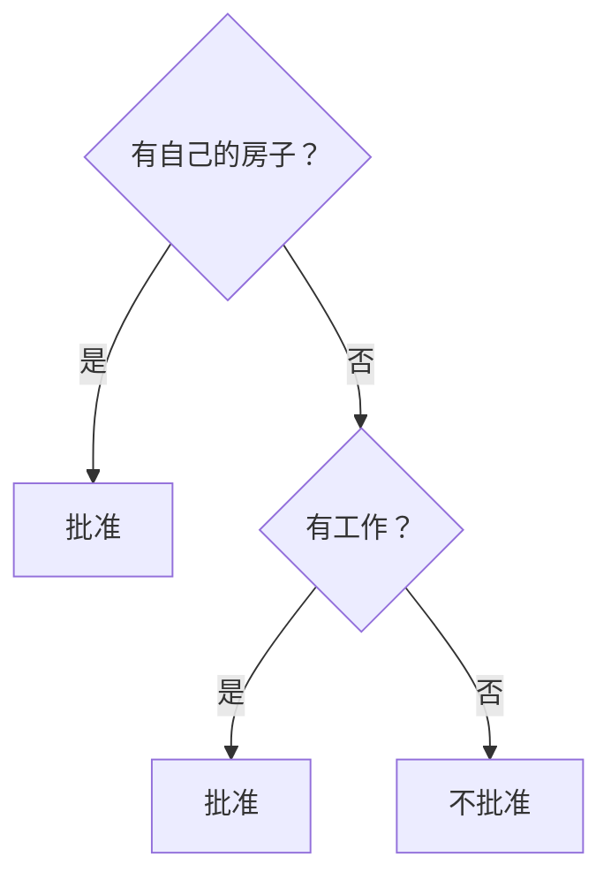
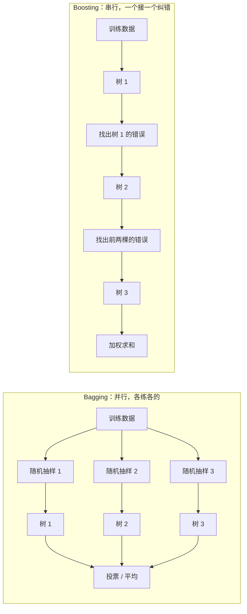
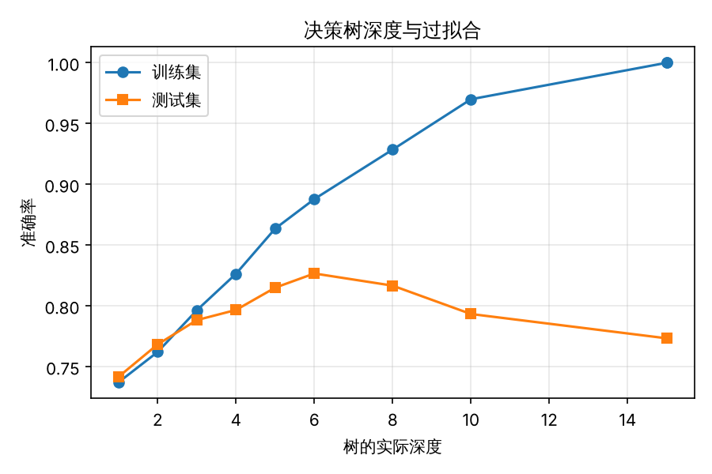
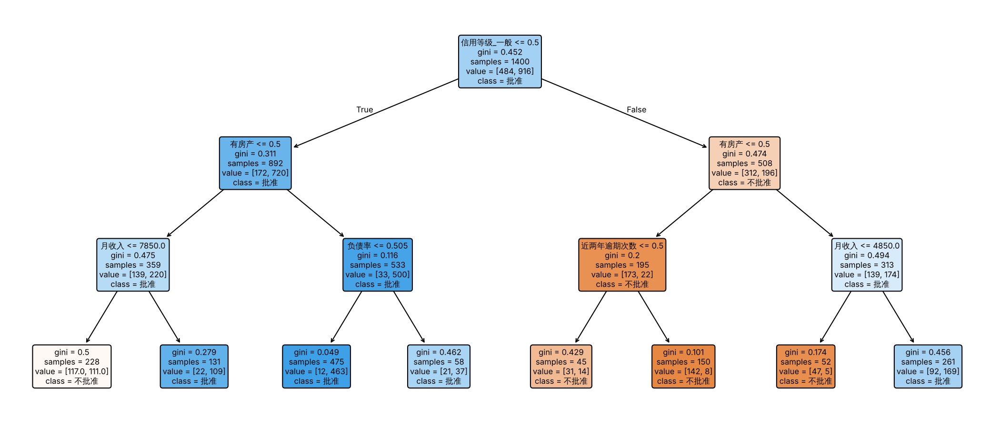
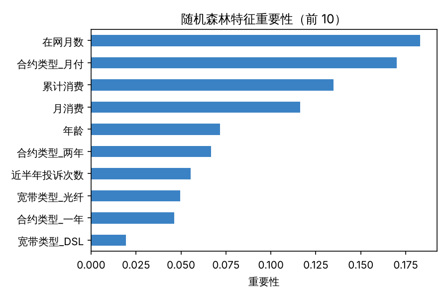
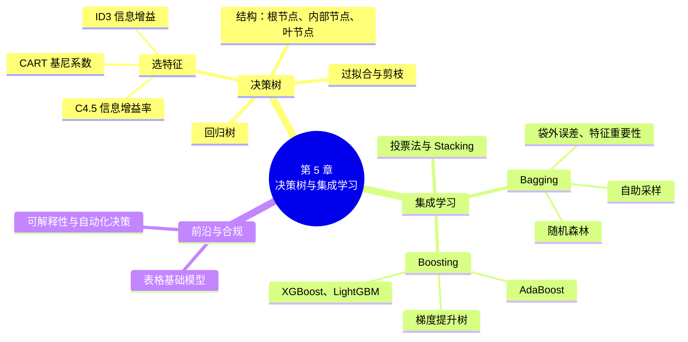

# 第 5 章 决策树与集成学习

!!! abstract "本章学时"
    理论 6 学时 · 实验 3 学时（本章共 3 个实验，教师可任选）

## 学习目标

学完本章，你应该能够：

1. **说出**决策树的结构和 ID3、C4.5、CART 三种算法选择划分特征的依据（记忆）；
2. **解释**过拟合在决策树上的表现，以及 Bagging 和 Boosting 两条集成路线分别解决什么问题（理解）；
3. **计算**一个小数据集的信息熵、信息增益和基尼系数，并用 scikit-learn 训练、可视化决策树（应用）；
4. **比较**单棵决策树、随机森林、XGBoost、LightGBM 在同一份数据上的效果、速度和可解释性，并用特征重要性分析影响结果的因素（分析）；
5. **评价**一个树模型是否过拟合，选择合适的剪枝和调参方法，并写出模型测试报告（评价、创造）。

!!! info "先修要求"
    学习本章前，你需要掌握：

    - 训练集、测试集和泛化能力（[1.2 机器学习的基本术语](../01-intro/index.md)）；
    - 独热编码与类别型特征（[第 2 章 数据预处理与特征工程](../02-preprocessing/index.md)）；
    - 过拟合与欠拟合、正则化、梯度下降（[第 3 章 线性回归与梯度下降](../03-linear-regression/index.md)）；
    - 混淆矩阵、精确率、召回率、AUC 与模型测试报告（[第 4 章 逻辑回归与分类模型评估](../04-logistic-regression/index.md)）；
    - 对数的含义：log₂8 = 3，表示 2 自乘 3 次得 8（“人工智能数学基础”课程）；
    - 用 pandas 读取 CSV 文件（[附录 A Python 速查](../../appendix/a-python.md)）。


??? abstract "本章概念清单（29 个，点击查看定义和例子）"
    1. [决策树](../../appendix/glossary.md#g-决策树)
    2. [根节点](../../appendix/glossary.md#g-根节点)
    3. [叶节点](../../appendix/glossary.md#g-叶节点)
    4. [树的深度](../../appendix/glossary.md#g-树的深度)
    5. [信息熵](../../appendix/glossary.md#g-信息熵)
    6. [信息增益](../../appendix/glossary.md#g-信息增益)
    7. [ID3 算法](../../appendix/glossary.md#g-ID3-算法)
    8. [信息增益率](../../appendix/glossary.md#g-信息增益率)
    9. [C4.5 算法](../../appendix/glossary.md#g-C4.5-算法)
    10. [基尼系数](../../appendix/glossary.md#g-基尼系数)
    11. [CART 算法](../../appendix/glossary.md#g-CART-算法)
    12. [回归树](../../appendix/glossary.md#g-回归树)
    13. [剪枝](../../appendix/glossary.md#g-剪枝)
    14. [预剪枝](../../appendix/glossary.md#g-预剪枝)
    15. [后剪枝](../../appendix/glossary.md#g-后剪枝)
    16. [集成学习](../../appendix/glossary.md#g-集成学习)
    17. [Bagging](../../appendix/glossary.md#g-Bagging)
    18. [Boosting](../../appendix/glossary.md#g-Boosting)
    19. [自助采样](../../appendix/glossary.md#g-自助采样)
    20. [随机森林](../../appendix/glossary.md#g-随机森林)
    21. [袋外误差](../../appendix/glossary.md#g-袋外误差)
    22. [特征重要性](../../appendix/glossary.md#g-特征重要性)
    23. [弱学习器](../../appendix/glossary.md#g-弱学习器)
    24. [AdaBoost](../../appendix/glossary.md#g-AdaBoost)
    25. [梯度提升树](../../appendix/glossary.md#g-梯度提升树)
    26. [残差](../../appendix/glossary.md#g-残差)
    27. [早停](../../appendix/glossary.md#g-早停)
    28. [XGBoost](../../appendix/glossary.md#g-XGBoost)
    29. [LightGBM](../../appendix/glossary.md#g-LightGBM)

## 情景导入

小林在一家城市商业银行做信贷审批。每天他要看几十份贷款申请：申请人多大年纪、有没有稳定工作、名下有没有房子、过去的信用记录怎么样。他手边有一张师傅传下来的“审批口诀”：**先看有没有房，有房基本能批；没房再看有没有工作，有工作也能批；两样都没有，就要看信用记录了。**这张口诀其实就是一棵树：从“有没有房”这个问题出发，按回答分成两支，每一支再接着问下一个问题，直到得出“批”或“不批”。

问题是，口诀是师傅凭多年经验总结的，换了一个城市、换了一批客户，还灵不灵？银行有好几万条历史审批记录，能不能让计算机直接从记录里把这张口诀“学”出来，而且学出来的规则还要能讲得清楚，因为监管部门要求银行在拒绝贷款时说明理由？这就是[**决策树**](../../appendix/glossary.md#g-决策树 "用一连串只看一个特征的是 / 否问题对样本逐步划分，在叶节点给出结论的模型"){ .term }要做的事。

小林所在的银行还有另一个难题：手机卡业务的客户流失越来越多。一棵树学出来的规则虽然清楚，但预测流失的准确度不够高。数据团队的做法是让几百棵树一起投票，或者让后一棵树专门纠正前一棵树的错误，这就是本章后半部分要讲的[**集成学习**](../../appendix/glossary.md#g-集成学习 "把多个模型的预测组合起来，得到比单个模型更好结果的方法"){ .term }。今天在银行风控、电商推荐、保险定价这些以表格数据为主的业务里，随机森林、XGBoost、LightGBM 这一类树模型仍然是用得最多的模型。

## 5.1 决策树是怎样做决定的

### 5.1.1 从“二十个问题”说起

有一个流传很广的游戏叫“二十个问题”：一个人心里想好一样东西，另一个人最多问二十个只能回答“是”或“不是”的问题，把它猜出来。会玩的人第一个问题往往是“它是活的吗？”，而不会一上来就问“它是不是一只橘猫？”。原因很简单：第一个问题能把所有可能的答案砍掉一半，第二个问题只能排除极少数。

决策树做判断的方式和这个游戏一模一样：它把一个复杂的判断拆成一连串简单的问题，每次只看一个特征，按照回答走向不同的分支，直到得出结论。训练决策树，就是要从数据里找出“先问什么、再问什么”。和猜东西一样，好的决策树总是先问那些最能把不同类别分开的问题。

### 5.1.2 决策树的结构

把小林的审批口诀画出来，就是下面这棵树：



一棵决策树由下面几部分组成：

- [**根节点**](../../appendix/glossary.md#g-根节点 "决策树最上面的节点，所有样本都从这里进入"){ .term }：最上面的那个问题（“有自己的房子？”），所有样本都从这里进入；
- **内部节点**：中间的每一个问题（“有工作？”），每个内部节点对一个特征做一次判断；
- **分支**：节点下面的连线，代表这个问题的一种回答；
- [**叶节点**](../../appendix/glossary.md#g-叶节点 "决策树中不再提问、直接给出预测结果的节点"){ .term }：最下面不再提问的节点，给出最终结论（“批准”“不批准”）。

从根节点走到叶节点要经过几层问题，叫作这条路径的长度；所有路径里最长的那条，叫作[**树的深度**](../../appendix/glossary.md#g-树的深度 "从根节点到最远叶节点要经过的提问层数"){ .term }。上面这棵树的深度是 2。每一条从根到叶的路径都可以写成一条“如果……而且……那么……”的规则，例如“如果没有房子，而且没有工作，那么不批准”。这正是决策树最受业务人员欢迎的地方：模型本身就是一组看得懂的规则，可以直接拿给审批员、客户和监管人员看。

决策树既能做分类，也能做回归。叶节点给出类别的，叫**分类树**；叶节点给出一个数值（比如预测房价）的，叫[**回归树**](../../appendix/glossary.md#g-回归树 "叶节点输出数值、用误差平方和选择划分的决策树"){ .term }，我们在 5.3 节再讲。

### 5.1.3 决策树是怎样“学”出来的

假设我们有一份历史审批记录，每条记录有若干特征和一个标签“是否批准”。计算机学习决策树的过程可以概括成三句话：

1. **挑问题**：在所有特征里，挑出最能把“批准”和“不批准”分开的一个，作为当前节点的问题；
2. **分数据**：按这个问题的回答，把当前节点的数据分成几份，分别交给下面的子节点；
3. **重复**：对每一个子节点，重复前两步，直到满足停止条件。

停止条件通常有三种：子节点里的样本已经全部属于同一类（已经“纯”了，没必要再问）；已经没有可以用来提问的特征；或者人为规定的限制到了，比如树的深度达到上限、节点里的样本太少。这种“先挑当前最好的问题，分完再说”的做法叫**贪心策略**：它每一步只看眼前最好的选择，不保证整棵树是全局最优的，但计算快、效果也不错。

整个过程里，最关键的是第一步：怎样判断哪个问题“最能把类别分开”？这就需要一个衡量标准，下一节介绍三种最常用的标准。

## 5.2 选出最好的问题：信息熵、信息增益与基尼系数

### 5.2.1 纯度与信息熵

先看一个直观的例子。两个篮子里各有 10 个球：甲篮子 10 个全是红球，乙篮子 5 个红球、5 个蓝球。从甲篮子里随手摸一个球，不用看就知道是红的；从乙篮子里摸，就完全猜不准。我们说甲篮子很“纯”，乙篮子很“混”。

决策树希望每次提问之后，分出来的每一份数据都尽可能“纯”，也就是尽可能都属于同一类。要比较“纯不纯”，就得把它变成一个数。最常用的一个数叫[**信息熵**](../../appendix/glossary.md#g-信息熵 "衡量一组样本类别混乱程度的指标，越纯越小，二分类时取值在 0 到 1 之间"){ .term }，它来自信息论的创始人香农：熵越大，说明数据越混乱、越难猜；熵越小，说明数据越纯。如果一个数据集里有 K 个类别，第 k 类样本所占的比例是 pₖ，那么它的信息熵是：

\[
H(D) = -\sum_{k=1}^{K} p_k \log_2 p_k
\]

其中 D 表示这个数据集，log₂ 是以 2 为底的对数，约定 0 × log₂0 = 0。公式前面的负号是为了让结果变成正数，因为比例都小于 1，它们的对数都是负数。

**算一算**：甲篮子只有红球，p = 1，H = −1 × log₂1 = 0，最纯；乙篮子红蓝各一半，H = −(0.5 × log₂0.5 + 0.5 × log₂0.5) = −(0.5 × (−1) + 0.5 × (−1)) = 1，对两个类别来说这是最混乱的情况。如果一个篮子 8 红 2 蓝，H = −(0.8 × log₂0.8 + 0.2 × log₂0.2) ≈ −(0.8 × (−0.322) + 0.2 × (−2.322)) ≈ 0.722，介于两者之间。

所以对二分类来说，信息熵在 0 到 1 之间：全是一类时为 0，两类各占一半时为 1。

### 5.2.2 信息增益与 ID3 算法

有了“纯度”的度量，就可以评价一个问题问得好不好：问之前，数据有一个熵；按某个特征分开之后，每一份数据各有一个熵，按样本数加权平均，得到问之后的熵。两者相减，就是这个问题让数据“变纯”了多少，叫作[**信息增益**](../../appendix/glossary.md#g-信息增益 "按某个特征划分后信息熵减少的量，越大说明这个特征越能区分类别"){ .term }：

\[
g(D, A) = H(D) - \sum_{v} \frac{|D_v|}{|D|} H(D_v)
\]

其中 A 是用来提问的特征，Dᵥ 是特征 A 取第 v 个值的那部分样本，|Dᵥ| 和 |D| 分别是这部分样本数和全部样本数。信息增益越大，说明这个问题把类别分得越开。1986 年，澳大利亚学者昆兰（J. R. Quinlan）提出的 [**ID3 算法**](../../appendix/glossary.md#g-ID3-算法 "昆兰 1986 年提出、用信息增益选择划分特征的决策树算法"){ .term }，就是每次都选信息增益最大的特征来提问。<sup class="cite">[[1]](#ref5-1)</sup>

下面用一份 15 条的贷款申请数据（取自李航《统计学习方法》中的经典例子<sup class="cite">[[2]](#ref5-2)</sup>）完整算一遍。

| 编号 | 年龄 | 有工作 | 有自己的房子 | 信贷情况 | 是否批准 |
|---|---|---|---|---|---|
| 1 | 青年 | 否 | 否 | 一般 | 否 |
| 2 | 青年 | 否 | 否 | 好 | 否 |
| 3 | 青年 | 是 | 否 | 好 | 是 |
| 4 | 青年 | 是 | 是 | 一般 | 是 |
| 5 | 青年 | 否 | 否 | 一般 | 否 |
| 6 | 中年 | 否 | 否 | 一般 | 否 |
| 7 | 中年 | 否 | 否 | 好 | 否 |
| 8 | 中年 | 是 | 是 | 好 | 是 |
| 9 | 中年 | 否 | 是 | 非常好 | 是 |
| 10 | 中年 | 否 | 是 | 非常好 | 是 |
| 11 | 老年 | 否 | 是 | 非常好 | 是 |
| 12 | 老年 | 否 | 是 | 好 | 是 |
| 13 | 老年 | 是 | 否 | 好 | 是 |
| 14 | 老年 | 是 | 否 | 非常好 | 是 |
| 15 | 老年 | 否 | 否 | 一般 | 否 |

**算一算**：

**第一步，算整个数据集的熵。**15 条里批准 9 条、不批准 6 条：

H(D) = −(9/15 × log₂(9/15) + 6/15 × log₂(6/15)) = −(0.6 × (−0.737) + 0.4 × (−1.322)) ≈ 0.971

**第二步，算按“有自己的房子”分开后的熵。**有房的 6 人全部批准，熵为 0；没房的 9 人里批准 3 人、不批准 6 人，熵为 −(1/3 × log₂(1/3) + 2/3 × log₂(2/3)) ≈ 0.918。加权平均：6/15 × 0 + 9/15 × 0.918 ≈ 0.551。

**第三步，相减得信息增益。**g(D, 有自己的房子) = 0.971 − 0.551 = 0.420。

用同样的方法算另外三个特征，结果如下：

| 特征 | 分组情况（批准 / 不批准） | 分组后的加权熵 | 信息增益 |
|---|---|---|---|
| 年龄 | 青年 2/3，中年 3/2，老年 4/1 | 0.888 | 0.083 |
| 有工作 | 是 5/0，否 4/6 | 0.647 | 0.324 |
| 有自己的房子 | 是 6/0，否 3/6 | 0.551 | **0.420** |
| 信贷情况 | 一般 1/4，好 4/2，非常好 4/0 | 0.608 | 0.363 |

“有自己的房子”的信息增益最大，所以它成为根节点。有房的一支已经全是“批准”，变成叶节点；没房的 9 个人再按同样的方法在剩下的特征里挑问题，算出来“有工作”的信息增益最大（这 9 人里有工作的 3 人全部批准，没工作的 6 人全部不批准，分完熵为 0），于是得到了 5.1.2 节那棵树。小林师傅的口诀，计算机从 15 条记录里就学出来了。

!!! tip "怎样快速检查自己算得对不对"
    信息增益不会是负数，也不会超过 H(D)。如果某个特征分完以后每一组都是纯的，它的信息增益就正好等于 H(D)。实验 5-1 会用 Python 把上表复算一遍，你可以对照自己的手算结果。

### 5.2.3 信息增益率与 C4.5 算法

信息增益有一个毛病：它偏爱取值多的特征。设想我们把“编号”也当成一个特征：编号有 15 个取值，按编号分开后，每一组只有 1 个人，当然全是纯的，信息增益等于 H(D) = 0.971，比“有自己的房子”还高。可是“编号”对预测新客户毫无用处，新来的客户根本没有出现在这 15 个编号里。

为了纠正这个偏好，昆兰在 1993 年的 [**C4.5 算法**](../../appendix/glossary.md#g-C4.5-算法 "昆兰 1993 年提出、用信息增益率选择特征，能处理连续特征和缺失值并带剪枝的决策树算法"){ .term }里改用[**信息增益率**](../../appendix/glossary.md#g-信息增益率 "信息增益除以特征固有值的结果，用来纠正信息增益偏爱取值多的特征"){ .term }：用信息增益除以特征本身的“取值分散程度”（叫作固有值）。<sup class="cite">[[3]](#ref5-3)</sup> 固有值的算法和熵一样，只是把“类别的比例”换成“特征各取值的比例”。取值越多、越分散，固有值越大，信息增益率就被压得越低。

\[
g_R(D, A) = \frac{g(D, A)}{IV(A)}, \quad IV(A) = -\sum_{v} \frac{|D_v|}{|D|} \log_2 \frac{|D_v|}{|D|}
\]

**算一算**：“编号”的固有值是 log₂15 ≈ 3.907，信息增益率 = 0.971 ÷ 3.907 ≈ 0.249；“有自己的房子”的固有值是 −(6/15 × log₂(6/15) + 9/15 × log₂(9/15)) ≈ 0.971，信息增益率 = 0.420 ÷ 0.971 ≈ 0.433。这下“有自己的房子”重新排到了“编号”前面。

不过信息增益率反过来又偏爱取值少的特征，所以 C4.5 实际的做法是两步走：先挑出信息增益高于平均水平的特征，再在其中选信息增益率最高的一个。C4.5 还能直接处理连续型特征和缺失值，并带有剪枝功能，曾被评为数据挖掘领域最有影响力的十大算法之首。<sup class="cite">[[4]](#ref5-4)</sup>

### 5.2.4 基尼系数与 CART 算法

第三种常用标准叫[**基尼系数**](../../appendix/glossary.md#g-基尼系数 "随机抽两个样本、它们类别不同的概率，用来衡量节点的不纯度"){ .term }（又叫基尼不纯度），它的含义更直观：从数据集里随机抽两个样本，它们类别不一样的概率。

\[
\text{Gini}(D) = 1 - \sum_{k=1}^{K} p_k^2
\]

**算一算**：甲篮子全红，Gini = 1 − 1² = 0；乙篮子红蓝各半，Gini = 1 − (0.5² + 0.5²) = 0.5。贷款数据集批准 9 条、不批准 6 条，Gini = 1 − (0.6² + 0.4²) = 0.48。按“有自己的房子”分开后，有房一组 Gini = 0，没房一组 Gini = 1 − ((1/3)² + (2/3)²) ≈ 0.444，加权得 9/15 × 0.444 ≈ 0.267。基尼系数从 0.48 降到 0.267，降得越多越好。

基尼系数不用算对数，计算更快，和信息熵选出来的特征在大多数情况下是一样的。1984 年布雷曼（L. Breiman）等人提出的 [**CART 算法**](../../appendix/glossary.md#g-CART-算法 "布雷曼等人 1984 年提出、用基尼系数或均方误差划分、只生成二叉树的决策树算法"){ .term }（分类与回归树）就用基尼系数选特征。<sup class="cite">[[5]](#ref5-5)</sup> CART 和 ID3、C4.5 还有一个重要区别：它每次只把数据分成两份，生成的一定是**二叉树**。比如“信贷情况”有三个取值，CART 不会一次分成三支，而是比较“一般 / 其他”“好 / 其他”“非常好 / 其他”三种二分法，挑最好的一种。

**连续型特征怎样提问？**像“月收入”这样的数值特征，CART 的做法是：把所有样本的月收入从小到大排好，取相邻两个值的中点作为候选的“门槛”，逐个试“月收入 ≤ 门槛”这个问题，选让基尼系数下降最多的门槛。例如月收入有 4000、6000、9000 三个值，候选门槛就是 5000 和 7500。scikit-learn 里的决策树用的就是优化过的 CART 算法，所以它画出来的树，每个节点都是“某特征 ≤ 某个数”的形式，类别型特征要先做独热编码或者其他编码变成数值。

!!! cert "证书考点 · 人工智能数据处理工程师（高级）· 数据挖掘"
    数据挖掘模块要求会用分类、回归算法建模。决策树部分常考：三种算法各用什么指标（ID3 信息增益、C4.5 信息增益率、CART 基尼系数）；给出一个小数据表，计算熵、信息增益或基尼系数并判断根节点；scikit-learn 中 `criterion` 参数的取值（`gini`、`entropy`）。计算题容易错在忘了“按样本数加权”。

### 5.2.5 三种算法对比

| 算法 | 提出者与年份 | 选特征的依据 | 树的形状 | 能处理的任务 | 特点 |
|---|---|---|---|---|---|
| ID3 | 昆兰，1986 | 信息增益 | 多叉树 | 分类 | 只能处理离散特征，偏爱取值多的特征，没有剪枝 |
| C4.5 | 昆兰，1993 | 信息增益率 | 多叉树 | 分类 | 能处理连续特征和缺失值，带剪枝 |
| CART | 布雷曼等，1984 | 基尼系数（分类）、均方误差（回归） | 二叉树 | 分类和回归 | scikit-learn 采用；也是随机森林、梯度提升树的基础 |

下面这个动画用的就是上面的 15 条贷款数据。你可以自己选择每个节点用哪个特征提问，动画会实时算出信息增益和基尼系数，帮你检验刚才的手算，也能体会“先问好问题”为什么重要。

<iframe class="sim-frame" src="../../sims/decision-tree-split/main.html" height="640" loading="lazy" title="决策树生长"></iframe>

在根节点和下一层节点上依次选择不同的特征，比较信息增益、基尼系数和树的深度；试试先选“年龄”，看看树要长多深才能把数据分开。[全屏打开](../../sims/decision-tree-split/main.html){ target=_blank } · [教学说明](../../sims/decision-tree-split/index.md)
{ .sim-caption }

## 5.3 回归树、过拟合与剪枝

### 5.3.1 回归树：用叶子的平均值做预测

决策树不只能回答“批不批”，也能回答“多少钱”。用来预测数值的决策树叫回归树。它的结构和分类树完全一样，只有两处不同：

1. **叶节点给出的是一个数**：落在这个叶子里的训练样本，标签取平均值，就是这个叶子的预测值；
2. **挑问题的标准换成了误差**：分类树看分完以后“纯不纯”，回归树看分完以后每一组内部的数值“齐不齐”，通常用均方误差（第 3 章学过）衡量。哪个问题能让两组的均方误差加权之和最小，就选哪个。

**算一算**：某小区 4 套二手房，面积和单价（万元 / 平方米）如下：60 平方米 2.0，70 平方米 2.2，110 平方米 3.0，120 平方米 3.2。候选门槛有 65、90、115 三个。

- 按“面积 ≤ 90”分：左边 {2.0, 2.2} 平均 2.1，误差平方和 = 0.1² + 0.1² = 0.02；右边 {3.0, 3.2} 平均 3.1，误差平方和 = 0.02；合计 0.04。
- 按“面积 ≤ 65”分：左边 {2.0}，误差 0；右边 {2.2, 3.0, 3.2} 平均 2.8，误差平方和 = 0.6² + 0.2² + 0.4² = 0.56；合计 0.56。
- 按“面积 ≤ 115”分：左边 {2.0, 2.2, 3.0} 平均 2.4，误差平方和 = 0.4² + 0.2² + 0.6² = 0.56；右边 {3.2}，误差 0；合计 0.56。

“面积 ≤ 90”的误差最小，被选为根节点。一套 80 平方米的房子走左边，预测单价 2.1 万元；一套 100 平方米的走右边，预测 3.1 万元。可以看出，回归树的预测是一级一级的“台阶”：同一个叶子里的房子预测值都一样。树越深、台阶越密，曲线就越贴近训练数据。

### 5.3.2 决策树为什么容易过拟合

如果不加任何限制，决策树会一直往下分，直到每个叶子都“纯”为止，极端情况下一个叶子只有一个样本。这样的树在训练集上可以做到 100% 正确，但它其实是把训练数据“背”了下来，连数据里的偶然和噪声也当成了规律。比如训练集里恰好有一位 37 岁、月收入 6800 元的申请人被人工拒绝了（也许那天审批员看漏了材料），一棵不受限制的树就会专门长出一个分支：“年龄在 36.5 到 37.5 之间、月收入在 6750 到 6850 之间的，不批准”。这样的规则对新客户毫无意义。

这就是第 3 章讲过的**过拟合**：在训练集上表现很好，在没见过的新数据上表现变差。决策树特别容易过拟合，原因是它太灵活了：只要允许它一直分下去，它总能把任何训练数据完全分开。实验 5-1 会让你亲眼看到，树的最大深度从 2 加到 20，训练集准确率一路涨到 100%，测试集准确率却先升后降。

### 5.3.3 剪枝：给树“修枝”

园丁会剪掉果树上多余的枝条，让养分集中到结果的枝上。给决策树防止过拟合的办法也叫[**剪枝**](../../appendix/glossary.md#g-剪枝 "通过限制或删减分支来降低决策树复杂度、减轻过拟合的方法"){ .term }，分为两种。

[**预剪枝**](../../appendix/glossary.md#g-预剪枝 "在树生长过程中提前停止划分的剪枝方法"){ .term }是在树生长的过程中提前喊停。scikit-learn 的 `DecisionTreeClassifier` 提供了这样几个参数：

| 参数 | 含义 | 取值越大 / 越小 |
|---|---|---|
| `max_depth` | 树的最大深度 | 越小越简单，越不容易过拟合 |
| `min_samples_split` | 一个节点至少要有多少个样本才允许继续分 | 越大越简单 |
| `min_samples_leaf` | 每个叶子至少要有多少个样本 | 越大越简单，叶子的预测越稳 |
| `max_leaf_nodes` | 叶子总数的上限 | 越小越简单 |
| `min_impurity_decrease` | 一次划分至少要让不纯度下降多少 | 越大越简单 |

预剪枝的好处是快，坏处是可能“剪早了”：有些划分当下看收益不大，但它下面的划分收益很大，提前停下就错过了。

[**后剪枝**](../../appendix/glossary.md#g-后剪枝 "先让树充分生长，再自下而上剪掉对泛化无益的子树的剪枝方法"){ .term }是先让树充分长大，再从下往上检查：把某个内部节点下面的子树换成一个叶子，如果在验证数据上的表现不变差，甚至变好，就剪掉。CART 使用的“代价复杂度剪枝”把这件事变成了一个可以调的参数：在误差上加一项“叶子越多罚得越多”的惩罚，惩罚系数在 scikit-learn 里叫 `ccp_alpha`。这和第 3 章的正则化是同一个思想：在“拟合得好”和“模型简单”之间找平衡。

这些参数取多少合适，没有放之四海而皆准的答案，要用验证集或交叉验证来选，这是第 9 章的内容。实用的经验是：先用 `max_depth` 和 `min_samples_leaf` 粗调，树的深度一般在 3 到 10 之间；需要给业务人员看规则时，深度控制在 3 到 4 层，规则才看得过来。

### 5.3.4 决策树的优点和缺点

| 优点 | 缺点 |
|---|---|
| 规则直观，能画出来，能解释每一个预测的理由 | 容易过拟合，必须剪枝 |
| 不需要对特征做标准化或归一化 | 不稳定：数据稍有变化，树的结构可能完全不同 |
| 能同时处理数值型和类别型特征，能自动发现特征之间的组合关系 | 每次只看一个特征，边界都是“横平竖直”的，斜着的分界线要用很多台阶去逼近 |
| 训练和预测都很快 | 单棵树的预测精度往往不如集成模型 |

其中“不稳定”这一条值得多说一句：同一份数据随机抽掉 10%，重新训练出来的树，根节点可能就从“有自己的房子”变成了“信贷情况”。单棵树的这种不稳定，统计学上叫作**方差**大。好在“不稳定”恰恰是集成学习可以利用的：既然每棵树都不太一样，那就多种几棵，让它们取长补短。

## 5.4 集成学习：三个臭皮匠，顶个诸葛亮

### 5.4.1 为什么“集体”比个人强

**集成学习**的想法来自生活常识：遇到难题，与其只听一个专家的，不如多听几个人的意见再综合。假设有 3 个分类器，每个单独判断的准确率都是 70%，而且它们犯错互不相关。我们让它们投票，少数服从多数。

**算一算**：投票结果正确，需要至少 2 个分类器判对。

- 3 个都对：0.7 × 0.7 × 0.7 = 0.343；
- 恰好 2 个对：有 3 种组合，每种概率 0.7 × 0.7 × 0.3 = 0.147，共 3 × 0.147 = 0.441；
- 合计：0.343 + 0.441 = 0.784。

三个 70% 的“臭皮匠”投票，准确率变成了 78.4%。分类器越多，投票的准确率越高：如果有 25 个这样的分类器，多数投票的准确率超过 98%。不过这个计算有一个关键前提：**分类器犯错互不相关**。如果 3 个分类器是一模一样的，它们会在同样的地方犯同样的错，投票就毫无意义。所以集成学习的核心问题是：怎样让每个成员既有一定的准确率，又彼此不同？

还有一个前提是每个成员要比瞎猜强。如果每个分类器的准确率只有 40%，投票只会越投越差。集成学习“好而不同”的要求，就是这两条。<sup class="cite">[[6]](#ref5-6)</sup>

### 5.4.2 两条路线：Bagging 和 Boosting

让成员“不同”的办法主要有两种，形成了集成学习的两条路线：



- [**Bagging**](../../appendix/glossary.md#g-Bagging "用自助采样得到多份训练集、并行训练多个模型再投票或平均的集成方法，主要降低方差"){ .term }（自助聚合）：从训练数据里有放回地随机抽出好几份样本，每份训练一棵树，彼此独立，可以同时训练；预测时分类投票、回归取平均。每棵树都比较深、比较“过拟合”，但它们错得各不相同，平均下来误差就互相抵消了。所以 Bagging 主要降低的是**方差**，代表算法是[**随机森林**](../../appendix/glossary.md#g-随机森林 "对自助采样的数据训练多棵决策树，并在每个节点随机选部分特征划分，最后投票或平均的集成模型"){ .term }。
- [**Boosting**](../../appendix/glossary.md#g-Boosting "串行训练多个弱学习器、后一个重点纠正前面的错误、最后加权组合的集成方法，主要降低偏差"){ .term }（提升）：一棵接一棵地训练，后一棵树专门关注前面的树做错的地方；最后把所有树的结果加权相加。每棵树都很简单（比如只有几层），单独看只比瞎猜强一点，但一棵接一棵纠错，整体越来越准。所以 Boosting 主要降低的是**偏差**，代表算法是 [**AdaBoost**](../../appendix/glossary.md#g-AdaBoost "每轮调高被错分样本的权重、按错误率给各弱学习器分配话语权的 Boosting 算法"){ .term } 和[**梯度提升树**](../../appendix/glossary.md#g-梯度提升树 "每棵新树拟合当前模型的残差（负梯度），按学习率累加的 Boosting 模型"){ .term }，以及基于梯度提升树的 XGBoost、LightGBM。

偏差和方差是诊断模型的两把尺子，第 9 章会系统地讲。这里可以先这样理解：偏差大，是模型“想得太简单”，总是偏离正确答案；方差大，是模型“想得太多”，换一批数据答案就变。

### 5.4.3 投票法与 Stacking

除了 Bagging 和 Boosting，还有两种把不同模型组合起来的简单办法：

- **投票法**：训练几个不同类型的模型，比如逻辑回归、决策树、K 近邻，让它们投票。直接数票数叫“硬投票”；把每个模型输出的概率取平均再判断，叫“软投票”，通常效果更好。scikit-learn 中对应 `VotingClassifier`。
- **Stacking**（堆叠）：把几个模型的预测结果当作新的特征，再训练一个“元模型”去学习怎样综合它们，好比请一位主审法官听取几位陪审员的意见后做最终判决。Stacking 在数据竞赛中很常用，但结构复杂、容易过拟合，业务中用得比前三种少。scikit-learn 中对应 `StackingClassifier`。

## 5.5 随机森林

### 5.5.1 两种随机：样本随机和特征随机

**随机森林**是布雷曼在 2001 年提出的，它在 Bagging 的基础上又加了一层随机，所以森林里的树彼此更不一样。<sup class="cite">[[7]](#ref5-7)</sup>

**第一种随机：自助采样。**假设训练集有 n 个样本。每种一棵树之前，先从训练集里**有放回地**随机抽 n 次，得到一份同样大小的新训练集。因为是有放回地抽，有的样本会被抽中好几次，有的一次也没被抽中。这种抽样方法叫[**自助采样**](../../appendix/glossary.md#g-自助采样 "从 n 个样本中有放回地抽取 n 次得到新样本集的方法，约 63.2% 的不同样本会被抽中"){ .term }（bootstrap），Bagging 这个名字就是“bootstrap aggregating”（自助聚合）的缩写。<sup class="cite">[[8]](#ref5-8)</sup>

**算一算**：某个样本在一次抽取中没被抽中的概率是 1 − 1/n，n 次都没被抽中的概率是 (1 − 1/n)ⁿ。当 n = 1000 时，(1 − 1/1000)¹⁰⁰⁰ ≈ 0.368。也就是说，每棵树大约只见过 63.2% 的不同样本，剩下约 36.8% 的样本它从没见过。

**第二种随机：随机选特征。**普通的决策树在每个节点上会比较所有特征，挑最好的一个。随机森林的树在每个节点上只从随机抽出的一部分特征里挑。对分类问题，常用的默认值是抽取特征总数的平方根个，比如有 16 个特征，每个节点只看随机的 4 个。这样一来，即使有一个特别强的特征（比如“有自己的房子”），也不会每棵树的根节点都是它，树和树之间就有了真正的差别。

两种随机加在一起，随机森林里每一棵树都“偏科”，但偏的方向各不相同。最后分类时投票，回归时取平均。

### 5.5.2 袋外误差：不用测试集也能估计效果

每棵树大约有 36.8% 的样本没见过，这些样本叫作这棵树的**袋外样本**。对训练集中的每个样本，找出所有“没见过它”的树，让它们投票，就得到这个样本的袋外预测。把所有样本的袋外预测和真实标签比较，算出的错误率叫[**袋外误差**](../../appendix/glossary.md#g-袋外误差 "用每个样本没参与训练的那些树来预测它而得到的错误率，可代替验证集估计效果"){ .term }。它相当于随机森林“自带”的一次验证，在数据量不大、舍不得单独留出验证集的时候特别有用。scikit-learn 中只要设置 `oob_score=True`，训练完就能从 `oob_score_` 读到袋外准确率。

### 5.5.3 特征重要性

随机森林虽然由几百棵树组成，没法像单棵树那样画出来逐条看规则，但它可以告诉我们：哪些特征对预测贡献最大。最常用的算法是：一个特征在所有树的所有节点上，每被用来划分一次，就记下这次划分让不纯度下降了多少（按节点样本数加权），全部加起来再归一化，就是这个特征的[**特征重要性**](../../appendix/glossary.md#g-特征重要性 "衡量各个特征对模型预测贡献大小的指标，树模型中常按不纯度下降量累计"){ .term }。scikit-learn 中训练好的模型有 `feature_importances_` 属性，所有特征的重要性加起来等于 1。

特征重要性是向业务人员解释模型最常用的工具，比如“合约类型和在网月数是影响客户流失最大的两个因素”。使用时要注意两点：

1. 这种基于不纯度的重要性**偏爱取值多的特征**，连续型特征和高基数类别特征的重要性容易被高估；
2. 重要性只说明“这个特征对预测有用”，不说明“它是导致结果的原因”，更不说明影响的方向（是越大越容易流失，还是越小越容易流失）。

更可靠的方法有置换重要性和 SHAP 值，它们能给出方向，也能解释单个样本的预测，第 9 章会介绍。

### 5.5.4 主要参数

| 参数（scikit-learn） | 含义 | 默认值 | 调参建议 |
|---|---|---|---|
| `n_estimators` | 树的数量 | 100 | 一般越多越稳，到几百棵后提升很小，主要受时间限制 |
| `max_features` | 每个节点随机抽取的特征数 | 分类 `"sqrt"`，回归 `1.0`（全部） | 越小树越不相同，常试 `"sqrt"`、`"log2"`、0.3～0.5 |
| `max_depth`、`min_samples_leaf` | 每棵树的复杂度 | 不限深度、1 | 随机森林对过拟合不太敏感，但限制一下可以加快速度、减小模型体积 |
| `class_weight` | 类别权重 | 无 | 类别不平衡时设为 `"balanced"`（第 4 章） |
| `oob_score` | 是否计算袋外得分 | `False` | 想省掉验证集时设为 `True` |
| `n_jobs` | 同时使用的 CPU 核数 | 1 | 设为 `-1` 用上所有核，树可以并行训练 |

以上默认值以 scikit-learn 用户指南为准。<sup class="cite">[[9]](#ref5-9)</sup> 随机森林是一个“开箱即用”的模型：几乎不用调参就能得到不错的效果，不需要特征缩放，对缺失值和异常值也比较宽容（scikit-learn 1.4 起的随机森林已经能直接处理缺失值）。在拿到一份新的表格数据时，很多数据分析师会先跑一个随机森林作为“基线”，看看这份数据大概能做到什么水平。

## 5.6 Boosting：一棵树纠正上一棵的错

### 5.6.1 AdaBoost：给做错的题加分量

Boosting 家族里最早获得广泛应用的是 1995 年前后由弗罗因德（Y. Freund）和沙皮尔（R. E. Schapire）提出的 **AdaBoost**（自适应提升）。<sup class="cite">[[10]](#ref5-10)</sup> 它的思路很像学生准备考试时整理“错题本”：

1. 一开始，所有训练样本的权重都一样；
2. 训练第一个[**弱学习器**](../../appendix/glossary.md#g-弱学习器 "单独使用时只比随机猜测略好的简单模型，是 Boosting 的组成单元"){ .term }，通常是只有一层的决策树（叫“决策树桩”），它的准确率只要比瞎猜好一点就行；
3. 把它做错的样本**权重调高**，做对的调低，再训练第二个弱学习器，它就会更关注上一轮做错的样本；
4. 重复若干轮。每个弱学习器也有一个“话语权”：错误率 e 越低，话语权越大，计算公式是 α = ½ ln((1 − e)/e)；
5. 预测时，所有弱学习器按话语权加权投票。

**算一算**：一个弱学习器的加权错误率 e = 0.3，它的话语权 α = ½ × ln(0.7/0.3) = ½ × ln 2.333 ≈ ½ × 0.847 ≈ 0.42；如果 e = 0.5（等于瞎猜），α = ½ × ln 1 = 0，没有话语权。

### 5.6.2 梯度提升树：一棵树拟合上一轮的残差

2001 年，弗里德曼（J. H. Friedman）把 Boosting 推广成更一般的**梯度提升**框架。<sup class="cite">[[11]](#ref5-11)</sup> 用决策树（通常是 CART 回归树）作为弱学习器的梯度提升，叫**梯度提升树**（GBDT）。它的想法比 AdaBoost 更直接：**既然前面的模型还有误差，下一棵树就专门去预测这个误差，然后把它补上。**

以回归为例，“误差”就是真实值减去当前预测值，叫[**残差**](../../appendix/glossary.md#g-残差 "真实值减去当前预测值得到的差"){ .term }。

**算一算**：3 套房子的真实成交价分别是 100、120、200 万元。

1. **起点**：先不用任何特征，所有房子都预测为平均价 140 万元。残差分别是 −40、−20、+60。
2. **第 1 棵树**：用房子的特征去拟合残差。假设这棵小树把前两套分到一个叶子（残差平均 −30），第三套分到另一个叶子（残差 +60）。
3. **更新预测**：预测值 = 原来的预测 + **学习率** × 树的输出。取学习率 0.5：前两套变成 140 + 0.5 × (−30) = 125，第三套变成 140 + 0.5 × 60 = 170。
4. **新的残差**：100 − 125 = −25，120 − 125 = −5，200 − 170 = +30。残差的平方和从 40² + 20² + 60² = 5600 降到了 25² + 5² + 30² = 1550。
5. **第 2 棵树**：接着拟合新的残差 −25、−5、+30……一直重复几百轮。

为什么叫“梯度”提升？第 3 章学过，梯度下降是沿着损失函数下降最快的方向一步步更新参数。对均方误差来说，损失下降最快的方向恰好就是残差。梯度提升树每加一棵树，就相当于在“预测值”这个层面沿梯度方向走了一步，学习率就是步长。把损失函数换成交叉熵，同样的方法就能做分类。

### 5.6.3 学习率与树的数量

梯度提升树最重要的两个参数是学习率和树的数量，它们是一对“跷跷板”：

- 学习率大（如 0.3），每棵树补得多，少量的树就能拟合好，但容易冲过头、过拟合；
- 学习率小（如 0.05），每一步走得稳，泛化通常更好，但需要更多的树，训练更慢。

常用的做法是：先把学习率定在 0.05～0.1，然后用验证集观察误差随树的数量的变化，在验证误差不再下降的时候停下来，这叫[**早停**](../../appendix/glossary.md#g-早停 "在验证集指标连续若干轮不再改善时停止训练的方法"){ .term }。另外，梯度提升树里的每棵树都应该比较浅（深度 3～8），因为它的“威力”来自很多棵树的累加，而不是单棵树的复杂度。

下面的动画演示了梯度提升树在一组一维数据上的拟合过程：每点一次“加一棵树”，就会新训练一棵深度为 1 或 2 的小树去拟合当前的残差，你可以看到预测曲线一步步贴近数据，也可以调大学习率，观察过拟合是怎样出现的。动画同时演示了随机森林对同一组数据的平均过程，便于对比两条路线。

<iframe class="sim-frame" src="../../sims/bagging-boosting/main.html" height="620" loading="lazy" title="Bagging 与 Boosting"></iframe>

先选“Boosting”，用学习率 0.3 连续加 20 棵树，看训练误差和测试误差的变化；再选“Bagging”，比较同样 20 棵树的随机森林。[全屏打开](../../sims/bagging-boosting/main.html){ target=_blank } · [教学说明](../../sims/bagging-boosting/index.md)
{ .sim-caption }

### 5.6.4 XGBoost 和 LightGBM

梯度提升树的思想在 2001 年就有了，但真正让它“出圈”的是两个工程上做得极好的开源实现。

[**XGBoost**](../../appendix/glossary.md#g-XGBoost "陈天奇等人开发的梯度提升树实现，加入正则化、二阶近似和缺失值自动处理"){ .term }（eXtreme Gradient Boosting，极端梯度提升）由陈天奇等人开发，2016 年发表论文。<sup class="cite">[[12]](#ref5-12)</sup> 它在梯度提升树上做了几项关键改进：

- **加入正则化**：在损失函数里加上对叶子个数和叶子输出值大小的惩罚，让每棵树不要太复杂，减轻过拟合；
- **用到二阶导数**：不仅看损失下降的方向（梯度），还看下降的“弯曲程度”，每一步走得更准；
- **自动处理缺失值**：训练时为每个划分学出一个“缺失值默认往哪边走”，不用事先填充；
- **并行与优化**：特征预先排序分块存储，可以多线程并行地找最佳划分点。

[**LightGBM**](../../appendix/glossary.md#g-LightGBM "微软亚洲研究院开发的梯度提升树实现，用直方图算法和按叶子生长提高速度、节省内存"){ .term }（Light Gradient Boosting Machine，轻量梯度提升机）由微软亚洲研究院团队开发，2017 年发表论文。<sup class="cite">[[13]](#ref5-13)</sup> 它的目标是“更快、更省内存”：

- **直方图算法**：把连续特征先分成若干个箱子（默认最多 255 个），只在箱子的边界上找划分点，计算量大大减少；
- **按叶子生长**：普通的树一层一层地长，LightGBM 每次挑整棵树里收益最大的那个叶子往下分，同样的叶子数下误差更低，但容易长得太深，要用 `num_leaves` 和 `max_depth` 加以限制；
- **单边梯度采样和互斥特征捆绑**：只保留误差大的样本和一部分误差小的样本参与计算，把很少同时取非零值的稀疏特征捆在一起，进一步提速。

此外，俄罗斯 Yandex 公司开发的 **CatBoost** 擅长直接处理类别型特征，也很常用。三者在大多数表格数据上效果相近，LightGBM 在大数据上通常训练最快。下表对照了它们最常调的参数：

| 作用 | scikit-learn `GradientBoostingClassifier` | XGBoost `XGBClassifier` | LightGBM `LGBMClassifier` |
|---|---|---|---|
| 树的数量 | `n_estimators`（默认 100） | `n_estimators` | `n_estimators`（默认 100） |
| 学习率 | `learning_rate`（默认 0.1） | `learning_rate`（默认 0.3） | `learning_rate`（默认 0.1） |
| 每棵树的复杂度 | `max_depth`（默认 3） | `max_depth`（默认 6） | `num_leaves`（默认 31）、`max_depth` |
| 叶子的最小样本量 | `min_samples_leaf` | `min_child_weight` | `min_child_samples`（默认 20） |
| 每棵树抽多少样本 | `subsample` | `subsample` | `subsample`（需同时设 `subsample_freq`） |
| 每棵树抽多少特征 | `max_features` | `colsample_bytree` | `colsample_bytree` |
| 正则化 | — | `reg_alpha`、`reg_lambda` | `reg_alpha`、`reg_lambda` |

!!! cert "证书考点 · Python 技术应用工程师（高级）· 集成学习"
    高级考试的实操题常要求用随机森林、XGBoost 或 LightGBM 完成一个分类或回归任务，并比较效果。要会：Bagging 与 Boosting 的区别（并行 / 串行，降方差 / 降偏差）；随机森林的两种随机；梯度提升树“拟合残差”的思想；学习率与树的数量的关系；用 `feature_importances_` 输出特征重要性。常见错误：把 Boosting 说成“并行训练”；以为树越多随机森林越容易过拟合。

## 5.7 前沿视窗

**树模型仍是表格数据的首选。**深度学习在图像、语音、文本上大获成功之后，很多人以为它在表格数据上也会取代树模型，但事实并非如此。2022 年一项在 45 个中等规模表格数据集上的系统比较发现，XGBoost、随机森林等树模型在大多数数据集上仍然优于各种深度学习模型，而且调参成本更低；研究者认为，原因之一是表格数据里常有很多无用特征、特征之间的关系又不规则，而树模型恰好擅长处理这种情况。<sup class="cite">[[14]](#ref5-14)</sup> 在银行风控、保险定价、电商营销、工业质量预测等业务中，梯度提升树至今是最常见的主力模型之一。

**表格基础模型开始挑战树模型。**大模型的思路也在进入表格数据领域。2025 年 1 月发表在《自然》上的 TabPFN 是一个专门为表格数据预训练的 Transformer 模型：它在约 1 亿个人工合成的小数据集上预训练，遇到新的表格数据时不需要再训练就能直接预测；在样本数不超过一万的数据集上，它的效果明显超过以往的方法，在分类任务上用 2.8 秒得到的结果就超过了调参 4 小时的最强基线模型组合（其中包括梯度提升树）。<sup class="cite">[[15]](#ref5-15)</sup> 不过这类模型目前主要适用于中小数据，对计算资源的要求也比树模型高得多，在大规模生产环境中还在探索阶段。

**用大模型辅助建模。**在实际工作中，越来越多的数据分析师让通义千问、DeepSeek 等大模型帮忙写特征工程和调参代码、解释特征重要性、起草模型测试报告。这能节省大量时间，但大模型写的代码可能有数据泄露、评估方法不当等隐蔽错误，所以本书各章讲到的评估和诊断方法，仍然是检查 AI 生成结果的必备本领。

**可解释性与合规。**银行用模型自动审批贷款，属于《中华人民共和国个人信息保护法》中所说的“自动化决策”。该法第二十四条规定，通过自动化决策方式作出对个人权益有重大影响的决定，个人有权要求说明，并有权拒绝仅通过自动化决策的方式作出决定。<sup class="cite">[[16]](#ref5-16)</sup> 这就是为什么金融机构特别看重模型的可解释性：决策树的规则可以直接给出拒绝理由；随机森林、梯度提升树则要借助特征重要性、SHAP 值等工具（第 9 章）来解释，必要时还要保留人工复核环节。

## 本章实验

!!! abstract "实验总览"
    | 实验 | 类型 | 建议时长 | 内容 |
    |---|---|---|---|
    | 实验 5-1 | ★ 基础 | 50 分钟 | 用 Python 复算信息增益，训练贷款审批决策树，观察树的深度与过拟合 |
    | 实验 5-2 | ★ 基础 | 60 分钟 | 用随机森林预测客户流失，与逻辑回归、单棵树比较，解读特征重要性 |
    | 实验 5-3 | ☆ 拓展 | 70 分钟 | 比较 XGBoost 与 LightGBM，用验证集早停调学习率，写模型测试报告 |

    三个实验都在本机 CPU 上运行，每个脚本不超过 1 分钟。实验代码见配套资源 `labs/ch05/` 目录，数据在 `labs/data/`。

### 实验 5-1 ★ 手算信息增益并训练决策树

**实验目的**

1. 用 Python 复算 5.2 节的信息熵、信息增益、信息增益率和基尼系数，检验手算结果；
2. 用 scikit-learn 训练决策树，画出树形图，读懂每个节点上的信息；
3. 改变树的最大深度，观察训练集和测试集准确率的变化，理解过拟合和预剪枝。

**实验环境**：本机 CPU。Python 3.11，pandas、scikit-learn、matplotlib（版本见 `labs/requirements.txt`）。

**实验数据**

- `labs/data/loan_small.csv`：5.2.2 节的 15 条贷款申请数据；
- `labs/data/loan_apply.csv`：2000 条模拟贷款审批记录，字段有年龄、工作年限、月收入、有房产、负债率、信用等级、近两年逾期次数、申请金额（万元）和是否批准，由 `labs/data/make_datasets.py` 按固定随机种子生成（真实的银行数据含个人信息，不能公开）。

**实验步骤与代码**

第 1 步，复算信息增益。两个函数分别实现 5.2 节的熵和基尼系数公式，`groupby` 按特征取值分组后加权求和：

```python
def entropy(labels):
    """信息熵：-Σ p·log2(p)"""
    n = len(labels)
    return -sum(c / n * log2(c / n) for c in Counter(labels).values())

h_d = entropy(small[target])
for feature in ["年龄", "有工作", "有自己的房子", "信贷情况"]:
    groups = small.groupby(feature)[target]
    weights = groups.size() / len(small)                       # 每个取值所占比例
    cond_h = sum(weights[v] * entropy(g) for v, g in groups)   # 划分后的加权熵
    iv = -sum(w * log2(w) for w in weights)                    # 固有值
    gain = h_d - cond_h
    print(feature, round(gain, 3), round(gain / iv, 3))
```

第 2 步，准备 2000 条审批数据。只有两个取值的“有房产”直接变成 0/1，三个取值的“信用等级”做独热编码；按 7 : 3 划分训练集和测试集，`stratify=y` 保证两边批准率一致：

```python
df = pd.read_csv("../data/loan_apply.csv")
df["有房产"] = (df["有房产"] == "是").astype(int)
X = pd.get_dummies(df.drop(columns=target), columns=["信用等级"], dtype=int)
y = (df[target] == "是").astype(int)
X_train, X_test, y_train, y_test = train_test_split(
    X, y, test_size=0.3, random_state=42, stratify=y)
```

第 3 步，让最大深度从 1 变到“不限”，每次训练一棵树并记录两个准确率：

```python
for depth in [1, 2, 3, 4, 5, 6, 8, 10, 15, None]:
    tree = DecisionTreeClassifier(max_depth=depth, random_state=42).fit(X_train, y_train)
    print(depth, tree.get_n_leaves(), tree.score(X_train, y_train), tree.score(X_test, y_test))
```

第 4 步，训练一棵深度为 3、每个叶子至少 20 个样本的树，用 `export_text` 打印规则，用 `plot_tree` 画图。完整代码见 `labs/ch05/lab5_1_decision_tree.py`。

**运行结果**

```text
数据集的信息熵 H(D) = 0.971，基尼系数 = 0.480
特征          信息增益     增益率     划分后基尼
年龄           0.083     0.052       0.427
有工作          0.324     0.352       0.320
有自己的房子       0.420     0.433       0.267
信贷情况         0.363     0.232       0.284

训练集 1400 条，测试集 600 条，特征 10 个
最大深度     叶子数    训练集准确率    测试集准确率
1            2       0.737       0.742
2            4       0.762       0.768
3            8       0.796       0.788
4           16       0.826       0.797
5           31       0.864       0.815
6           48       0.888       0.827
8           99       0.929       0.817
10         152       0.970       0.793
15         202       1.000       0.773
不限         202       1.000       0.773
```

第一部分和 5.2 节手算的结果完全一致。第二部分清楚地显示了过拟合：深度从 1 加到 6，两个准确率一起上升；深度超过 6 以后，训练集准确率继续涨到 100%，测试集准确率却从 0.827 一路降到 0.773。深度 15 和“不限”结果相同，说明树长到 15 层时每个叶子都已经纯了。



深度为 3 的树打印出来的部分规则如下（测试集准确率 0.788）：

```text
|--- 信用等级_一般 <= 0.50
|   |--- 有房产 <= 0.50
|   |   |--- 月收入 <= 7850.00
|   |   |   |--- class: 不批准
|   |   |--- 月收入 >  7850.00
|   |   |   |--- class: 批准
……
|--- 信用等级_一般 >  0.50
|   |--- 有房产 >  0.50
|   |   |--- 月收入 <= 4850.00
|   |   |   |--- class: 不批准
|   |   |--- 月收入 >  4850.00
|   |   |   |--- class: 批准
```



读图时注意：每个方框第一行是提问的条件，满足走左边（True），不满足走右边（False）；`gini` 是这个节点的基尼系数，`samples` 是落到这里的训练样本数，`value` 是两类样本各有多少（前面是“不批准”，后面是“批准”），`class` 是这个节点多数样本的类别，颜色越深表示越纯。“信用等级_一般 <= 0.50”的意思是“信用等级不是一般”，这是独热编码后的 0/1 特征常见的写法。

**实验记录表**

| 步骤 | 观察内容 | 你的结果 |
|---|---|---|
| 1 | 4 个特征的信息增益是否与手算一致？哪个特征做根节点？ | |
| 3 | 测试集准确率最高时的最大深度和准确率 | |
| 3 | 不限深度时训练集、测试集准确率之差 | |
| 4 | 深度 3 的树根节点用了哪个特征？有没有两个叶子结论相同、其实可以合并的分支？ | |

**常见问题排查**

| 现象 | 原因 | 解决办法 |
|---|---|---|
| 图中的中文显示成方框 | matplotlib 找不到中文字体 | Windows 一般有 SimHei 或 Microsoft YaHei；macOS 用 PingFang SC；Linux 安装文泉驿正黑后删除 matplotlib 字体缓存（`~/.cache/matplotlib`） |
| `ValueError: could not convert string to float: '青年'` | scikit-learn 的决策树只接受数值 | 先对类别型特征做独热编码或转成 0/1 |
| 你的准确率与书上差一点 | 数据或随机种子不同 | 确认数据由 `make_datasets.py` 生成，`random_state` 都是 42 |
| 树形图太挤看不清 | 树太深 | 只画深度 3 以内的树，或把 `figsize` 调大 |

**思考与练习**

1. 深度 3 的树中，“有房产 > 0.50”下面的两个叶子都是“批准”，为什么树还要分这一次？（提示：看两个叶子的 `gini`。）
2. 把 `criterion="entropy"` 加到决策树的参数里重新训练，根节点和测试集准确率有变化吗？
3. 用 `min_samples_leaf`（试 5、20、50）代替 `max_depth` 做预剪枝，哪个取值的测试集准确率最高？

**实验报告要求**

提交运行结果截图、实验记录表和思考题答案。用 3～5 句话说明你会选择哪一个最大深度交付给信贷部门，理由是什么（准确率和可解释性两方面都要考虑）。

### 实验 5-2 ★ 随机森林预测客户流失

**实验目的**

1. 用随机森林预测电信客户是否流失，与逻辑回归、单棵决策树比较效果；
2. 读取袋外准确率，观察树的数量对效果的影响；
3. 用特征重要性解释“哪些因素最影响客户流失”，输出高风险客户名单。

**实验环境**：本机 CPU。

**实验数据**：`labs/data/telco_churn.csv`，5000 条模拟电信客户记录（与第 4 章相同），字段包括年龄、在网月数、合约类型、宽带类型、技术支持、视频会员、付款方式、月消费、累计消费、近半年投诉次数和是否流失，流失率 30.3%。

**实验步骤与代码**

第 1 步，读取数据并独热编码，按 7 : 3 分层划分（与第 4 章的划分相同，结果可以直接对比）。

第 2 步，训练四个模型并在测试集上比较。逻辑回归需要标准化，所以用流水线把 `StandardScaler` 和模型串起来；树模型不需要标准化：

```python
models = {
    "逻辑回归": make_pipeline(StandardScaler(), LogisticRegression(max_iter=1000)),
    "决策树（不限深度）": DecisionTreeClassifier(random_state=42),
    "决策树（深度 5）": DecisionTreeClassifier(max_depth=5, min_samples_leaf=20, random_state=42),
    "随机森林（300 棵）": RandomForestClassifier(n_estimators=300, min_samples_leaf=5,
                                          oob_score=True, n_jobs=-1, random_state=42),
}
for name, model in models.items():
    model.fit(X_train, y_train)
    prob = model.predict_proba(X_test)[:, 1]
    print(name, model.score(X_test, y_test), roc_auc_score(y_test, prob))
```

第 3 步，读取 `rf.oob_score_`；把树的数量从 1 改到 300，观察测试集 AUC。

第 4 步，读取 `feature_importances_`，排序后画条形图；按流失概率从高到低列出客户名单。完整代码见 `labs/ch05/lab5_2_random_forest.py`。

**运行结果**

```text
训练集 3500 条，测试集 1500 条，特征 20 个，流失率 30.3%

模型               训练准确率   测试准确率   召回率    F1    AUC
逻辑回归               0.801     0.775    0.580   0.610   0.836
决策树（不限深度）          1.000     0.705    0.523   0.518   0.653
决策树（深度 5）          0.810     0.765    0.543   0.584   0.804
随机森林（300 棵）        0.862     0.771    0.545   0.590   0.819

随机森林袋外准确率：0.798

树的数量    测试 AUC
1            0.773
5            0.811
10           0.811
50           0.816
100          0.818
300          0.819

特征重要性（前 8）：
在网月数       0.183
合约类型_月付    0.170
累计消费       0.135
月消费        0.116
年龄         0.072
合约类型_两年    0.067
近半年投诉次数    0.055
宽带类型_光纤    0.050
```



从结果可以读出三点：

1. **集成大大改善了单棵树。**不限深度的决策树在训练集上 100% 正确，测试集 AUC 只有 0.653，严重过拟合；剪枝后升到 0.804；300 棵树的随机森林达到 0.819。树的数量从 1 加到 5 时提升最明显，之后越来越平缓，但不会因为树多而变差。
2. **复杂模型不一定赢。**在这份数据上，逻辑回归的 AUC（0.836）反而略高于随机森林。原因是这份数据中影响流失的因素大多是“越大越容易流失”这类单调关系，逻辑回归正好擅长；随机森林的优势在于特征之间有复杂组合关系的数据。所以实际工作中一定要把简单模型作为基线一起比较，不能想当然地认为“越复杂越好”。
3. **袋外准确率（0.798）和测试集准确率（0.771）在同一水平**，可以用来粗略估计效果。

特征重要性排在前面的是在网月数、合约类型（月付）、累计消费和月消费，符合业务常识：签月付合约、刚入网不久的客户最容易流失。注意“累计消费”约等于月消费乘以在网月数，它和这两个特征高度相关，分走了一部分重要性，这正是 5.5.3 节说的局限。

**实验记录表**

| 步骤 | 观察内容 | 你的结果 |
|---|---|---|
| 2 | 四个模型中测试集 AUC 最高的是哪个？不限深度的决策树训练集和测试集准确率差多少？ | |
| 3 | 袋外准确率是多少？树的数量增加到多少以后 AUC 基本不变？ | |
| 4 | 特征重要性前 3 名，你能用业务语言解释吗？ | |

**常见问题排查**

| 现象 | 原因 | 解决办法 |
|---|---|---|
| 训练很慢 | 只用了一个 CPU 核 | 设置 `n_jobs=-1` |
| `oob_score_` 属性不存在 | 训练时没有设置 `oob_score=True` | 加上这个参数重新训练 |
| 逻辑回归提示 `ConvergenceWarning` | 没有标准化或迭代次数不够 | 用流水线加 `StandardScaler`，`max_iter` 调大 |
| 每次运行结果都略有不同 | 随机森林有随机性 | 固定 `random_state` |

**思考与练习**

1. 去掉“累计消费”这一列重新训练，特征重要性的排名和测试集 AUC 有什么变化？
2. 召回率只有 0.545，意味着近一半流失客户没被找出来。参照第 4 章，调低分类阈值或设置 `class_weight="balanced"`，召回率能提高到多少？精确率付出了多少代价？
3. 运营部门每月只能给 200 位客户打挽留电话，你会怎样使用模型的输出？

**实验报告要求**

提交运行结果、记录表和思考题答案。按第 4 章的模板写一份简要的模型测试报告：数据与划分、四个模型的指标对比表、结论（推荐哪个模型及理由）、特征重要性的业务解读。

### 实验 5-3 ☆ XGBoost 与 LightGBM 对比

**实验目的**

1. 比较随机森林、scikit-learn 梯度提升树、XGBoost、LightGBM 在同一份数据上的效果和训练速度；
2. 用验证集和早停为不同学习率找到合适的树的数量；
3. 按“测试报告 + 错误案例分析”的格式评估最终模型，对应人工智能训练师（三级）“智能训练”模块的要求。

**实验环境**：本机 CPU。需要安装 `xgboost` 和 `lightgbm`（`pip install xgboost lightgbm`，见附录 C）。

**实验数据**：同实验 5-2。这次把数据分成三份：先留出 30% 作为测试集，再从剩下的数据里分出 20% 作为验证集。验证集用来早停和选参数，测试集只在最后用一次，这样测试集上的成绩才是对新数据的公平估计。

**实验步骤与代码**

第 1 步，用默认参数训练四个模型，记录训练集 AUC、测试集 AUC 和训练用时。

第 2 步，学习率分别取 0.3、0.1、0.03，把树的数量设得很大（2000），让模型在验证集 AUC 连续 50 轮不再提高时自动停止。XGBoost 和 LightGBM 的写法略有不同：

```python
xgb_m = xgb.XGBClassifier(n_estimators=2000, learning_rate=lr, max_depth=3,
                          subsample=0.8, colsample_bytree=0.8, eval_metric="auc",
                          early_stopping_rounds=50, random_state=42, n_jobs=-1)
xgb_m.fit(X_train, y_train, eval_set=[(X_val, y_val)], verbose=False)
print(xgb_m.best_iteration + 1, xgb_m.best_score)          # 最佳树数、验证 AUC

lgb_m = lgb.LGBMClassifier(n_estimators=2000, learning_rate=lr, num_leaves=8,
                           min_child_samples=30, subsample=0.8, subsample_freq=1,
                           colsample_bytree=0.8, random_state=42, verbose=-1)
lgb_m.fit(X_train, y_train, eval_set=[(X_val, y_val)], eval_metric="auc",
          callbacks=[lgb.early_stopping(50, verbose=False)])
print(lgb_m.best_iteration_, lgb_m.best_score_["valid_0"]["auc"])
```

第 3 步，按验证集 AUC 选出最终模型，在测试集上输出混淆矩阵和分类报告。

第 4 步，找出模型“最有把握却判错”的客户：真实流失但流失概率最低的 5 位（漏判），真实未流失但流失概率最高的 5 位（误判）。完整代码见 `labs/ch05/lab5_3_xgb_lgbm.py`。

**运行结果**

```text
训练集 2800，验证集 700，测试集 1500

模型（默认参数）          训练 AUC  测试 AUC     训练用时(秒)
随机森林                  0.947    0.820        0.69
sklearn GBDT          0.909    0.829        0.49
XGBoost               1.000    0.801        0.09
LightGBM              0.986    0.816        0.07

模型           学习率    最佳树数   验证 AUC   测试 AUC
XGBoost        0.3       10     0.856    0.831
LightGBM       0.3        9     0.859    0.825
XGBoost        0.1       49     0.861    0.836
LightGBM       0.1       60     0.860    0.837
XGBoost       0.03      131     0.859    0.835
LightGBM      0.03       63     0.861    0.828

===== 测试报告（LightGBM，学习率 0.03，阈值 0.5）=====
测试集 AUC：0.828
混淆矩阵（行：真实 未流失/流失；列：预测 未流失/流失）：
[[928 117]
 [220 235]]
              precision    recall  f1-score   support

         未流失      0.808     0.888     0.846      1045
          流失      0.668     0.516     0.582       455

    accuracy                          0.775      1500
   macro avg      0.738     0.702     0.714      1500
weighted avg      0.766     0.775     0.766      1500

漏判（真实流失，模型认为不会流失）概率最低的 5 位：
   客户编号  在网月数 合约类型 宽带类型  月消费  近半年投诉次数 是否流失  流失概率
C103103    52   一年  DSL 53.5        0    是 0.074
C104927    51   两年   光纤 86.9        1    是 0.075
C104488    52   一年  DSL 55.9        0    是 0.075
C100418    46   两年   光纤 77.9        1    是 0.077
C102089    26   两年  DSL 47.8        0    是 0.082
误判（真实未流失，模型认为会流失）概率最高的 5 位：
   客户编号  在网月数 合约类型 宽带类型  月消费  近半年投诉次数 是否流失  流失概率
C101565     7   月付   光纤 66.1        2    否 0.788
C103686     6   月付   光纤 84.9        1    否 0.769
C102914     4   月付   光纤 64.1        0    否 0.756
C103590     8   月付   光纤 74.6        1    否 0.747
C102223     9   月付   光纤 72.1        1    否 0.740
```

训练用时每次运行略有不同，和电脑配置有关。从结果可以读出：

1. **默认参数的 XGBoost 过拟合了**：训练集 AUC 达到 1.000，测试集只有 0.801。它默认学习率 0.3、深度 6，对这份只有 2800 条训练数据的小数据来说太“猛”了。
2. **早停很有效**：学习率 0.3 时只需要 9～10 棵树就到了最佳点；学习率降到 0.1，需要 50～60 棵树，测试集 AUC 升到 0.836～0.837。学习率再降到 0.03，树更多，效果没有再提高。
3. **XGBoost 和 LightGBM 效果相近**，调参后都比默认参数好，训练都只要零点几秒。
4. **最终模型的选择依据是验证集，而不是测试集。**学习率 0.03 的 LightGBM 验证 AUC 最高（0.861），所以选它；它在测试集上是 0.828，比学习率 0.1 的略低。这很正常：如果按测试集成绩挑模型，测试集就不再是“没见过的数据”了。

**错误案例分析**：漏判的客户都是签了一年或两年合约、在网时间较长、投诉很少的客户，从数据上看他们是“最不像会流失”的一群，模型的判断符合数据规律；他们的流失可能来自数据里没有的原因（例如搬家、单位统一换了运营商）。误判的客户则全是月付、光纤、入网不到 10 个月的客户，正是高风险人群的典型画像。改进方向：补充“合约到期时间”“是否收到竞争对手优惠”等特征；对月付新客户可以单独建模或调整阈值。

**实验记录表**

| 步骤 | 观察内容 | 你的结果 |
|---|---|---|
| 1 | 默认参数下哪个模型过拟合最明显？依据是什么？ | |
| 2 | 三种学习率下的最佳树数，学习率和树的数量是什么关系？ | |
| 3 | 最终模型的精确率、召回率、F1（流失类） | |
| 4 | 漏判和误判客户各有什么共同特点？ | |

**常见问题排查**

| 现象 | 原因 | 解决办法 |
|---|---|---|
| `ModuleNotFoundError: No module named 'xgboost'` | 没有安装 | `pip install xgboost lightgbm -i https://pypi.tuna.tsinghua.edu.cn/simple` |
| macOS 上导入 LightGBM 报 `libomp` 错误 | 缺少 OpenMP 运行库 | 用 Homebrew 执行 `brew install libomp` |
| XGBoost 报 `early_stopping_rounds` 参数错误 | XGBoost 版本太旧（早于 1.6） | 升级 XGBoost，或把该参数改写到 `fit()` 中 |
| LightGBM 输出大量 `[Warning]` 信息 | 默认日志级别较高 | 设置 `verbose=-1` |
| LightGBM 提示 `eval_set` 已弃用 | LightGBM 4.7 起改用 `eval_X`、`eval_y` | 旧写法仍可用；新版本也可改为 `eval_X=(X_val,), eval_y=(y_val,)` |

**思考与练习**

1. 把 XGBoost 的 `max_depth` 从 3 改为 6，再做一次早停实验，最佳树数和测试集 AUC 怎样变化？
2. 召回率只有 0.516。如果漏掉一个流失客户的损失是误打一个挽留电话的 5 倍，阈值应该调高还是调低？试着找出使“总损失”最小的阈值。
3. 本实验中梯度提升树的最好成绩（0.837）和实验 5-2 的逻辑回归（0.836）几乎一样。如果你是数据团队负责人，会选择哪个模型上线？请从效果、可解释性、维护成本三方面说明。

**实验报告要求**

按“模型测试报告”格式提交，至少包括：

1. **测试目的与数据**：数据来源、训练 / 验证 / 测试集的划分方法和样本数；
2. **测试方法**：比较了哪些模型和参数，怎样用验证集选模型；
3. **测试结果**：指标对比表、最终模型的混淆矩阵与分类报告；
4. **错误案例分析**：至少分析 10 个判错的样本，归纳原因；
5. **结论与改进建议**：推荐的模型、阈值和下一步要补充的数据。

## 本章小结

- **决策树**用一连串只看一个特征的问题对样本逐步划分，从根节点走到叶节点就得到一条看得懂的规则，既能分类也能回归。
- 挑选划分特征的标准有三种：ID3 用**信息增益**，C4.5 用**信息增益率**（纠正对取值多的特征的偏爱），CART 用**基尼系数**并且只生成二叉树；scikit-learn 采用 CART。
- **回归树**的叶子用样本平均值做预测，用均方误差挑选划分。
- 决策树很容易**过拟合**，要用**剪枝**控制复杂度：预剪枝限制最大深度、叶子最少样本数等，后剪枝先长后剪；参数用验证集选。
- **集成学习**让多个“好而不同”的模型一起决策。**Bagging** 并行训练、投票或平均，主要降低方差；**Boosting** 串行训练、逐步纠错，主要降低偏差。
- **随机森林**在自助采样之外再随机选特征，几乎不用调参，自带**袋外误差**和**特征重要性**。
- **梯度提升树**让每棵新树拟合当前的残差，学习率和树的数量要配合调，用**早停**确定树数；**XGBoost** 加入正则化和缺失值处理，**LightGBM** 用直方图和按叶子生长提速。
- 树模型仍是表格数据的首选之一，但要始终和逻辑回归等简单模型对比，并重视可解释性和合规要求。



**下一章预告**

决策树的分界线总是“横平竖直”的，逻辑回归的分界线是一条直线。下一章介绍的**支持向量机**换了一个角度思考分类问题：在两类数据之间，找一条离两边都尽可能远的分界线，就像在两排房子之间修一条最宽的路；再借助“核技巧”，它还能画出弯曲的分界线。支持向量机在样本不多、特征很多的问题上表现出色。

## 参考文献

正文中的上标编号（如<sup class="cite">[[6]](#ref5-6)</sup>）对应下面的文献。带链接的可以直接打开；书籍可在图书馆或电子书平台查阅。

<div class="refs" markdown>

**教材与专著**

- <span id="ref5-2"></span>[2] 李航. 统计学习方法[M]. 2 版. 北京：清华大学出版社，2019.
    <span class="ref-note">第 5 章“决策树”，5.2.2 节的 15 条贷款申请数据即取自该章；第 8 章介绍 AdaBoost 与提升树。</span>
- <span id="ref5-3"></span>[3] QUINLAN J R. C4.5: programs for machine learning[M]. San Mateo: Morgan Kaufmann, 1993.
    <span class="ref-note">C4.5 算法的原著，介绍信息增益率、连续特征与缺失值的处理和剪枝，对应 5.2.3 节。</span>
- <span id="ref5-5"></span>[5] BREIMAN L, FRIEDMAN J H, OLSHEN R A, et al. Classification and regression trees[M]. Belmont: Wadsworth, 1984.
    <span class="ref-note">CART 算法的原著，提出基尼系数、二叉划分、回归树和代价复杂度剪枝，对应 5.2.4、5.3 节。</span>
- <span id="ref5-6"></span>[6] 周志华. 机器学习[M]. 北京：清华大学出版社，2016.
    <span class="ref-note">第 4 章“决策树”和第 8 章“集成学习”，“好而不同”的说法和投票准确率的分析见第 8 章，对应 5.2、5.4 节。</span>

**经典论文**

- <span id="ref5-1"></span>[1] QUINLAN J R. Induction of decision trees[J]. Machine Learning, 1986, 1(1): 81-106.
    <span class="ref-note">ID3 算法的原始论文，用信息增益选择划分特征，对应 5.2.2 节。</span>
- <span id="ref5-4"></span>[4] WU X, KUMAR V, QUINLAN J R, et al. Top 10 algorithms in data mining[J]. Knowledge and Information Systems, 2008, 14(1): 1-37.
    <span class="ref-note">数据挖掘十大算法的评选结果与介绍，C4.5、CART、AdaBoost 均在其中，对应 5.2.3 节。</span>
- <span id="ref5-7"></span>[7] BREIMAN L. Random forests[J]. Machine Learning, 2001, 45(1): 5-32.
    <span class="ref-note">随机森林的原始论文，包括随机选特征、袋外误差和变量重要性，对应 5.5 节。</span>
- <span id="ref5-8"></span>[8] BREIMAN L. Bagging predictors[J]. Machine Learning, 1996, 24(2): 123-140.
    <span class="ref-note">提出 Bagging（自助聚合），说明它为什么能降低不稳定模型的误差，对应 5.4.2、5.5.1 节。</span>
- <span id="ref5-10"></span>[10] FREUND Y, SCHAPIRE R E. A decision-theoretic generalization of on-line learning and an application to boosting[J]. Journal of Computer and System Sciences, 1997, 55(1): 119-139.
    <span class="ref-note">AdaBoost 算法的正式论文，对应 5.6.1 节。</span>
- <span id="ref5-11"></span>[11] FRIEDMAN J H. Greedy function approximation: a gradient boosting machine[J]. The Annals of Statistics, 2001, 29(5): 1189-1232.
    <span class="ref-note">提出梯度提升框架和梯度提升树，对应 5.6.2、5.6.3 节。</span>
- <span id="ref5-12"></span>[12] CHEN T, GUESTRIN C. XGBoost: a scalable tree boosting system[C]//Proceedings of the 22nd ACM SIGKDD International Conference on Knowledge Discovery and Data Mining. New York: ACM, 2016: 785-794.
    <span class="ref-note">XGBoost 的论文，介绍正则化目标、二阶近似、稀疏感知的缺失值处理和并行设计，对应 5.6.4 节。</span>
- <span id="ref5-13"></span>[13] KE G, MENG Q, FINLEY T, et al. LightGBM: a highly efficient gradient boosting decision tree[C]//Advances in Neural Information Processing Systems 30. Red Hook: Curran Associates, 2017: 3146-3154.
    <span class="ref-note">LightGBM 的论文，提出单边梯度采样和互斥特征捆绑，对应 5.6.4 节。</span>
- <span id="ref5-14"></span>[14] GRINSZTAJN L, OYALLON E, VAROQUAUX G. Why do tree-based models still outperform deep learning on typical tabular data?[C]//Advances in Neural Information Processing Systems 35 (Datasets and Benchmarks Track). 2022.
    <span class="ref-note">在 45 个表格数据集上比较树模型与深度学习模型，并分析原因，对应 5.7 节。</span>
- <span id="ref5-15"></span>[15] HOLLMANN N, MÜLLER S, PURUCKER L, et al. Accurate predictions on small data with a tabular foundation model[J]. Nature, 2025, 637(8045): 319-326.
    <span class="ref-note">TabPFN 表格基础模型的论文，对应 5.7 节。</span>

**在线资源与数据**

- <span id="ref5-9"></span>[9] scikit-learn developers. Decision Trees; Ensembles: Gradient boosting, random forests, bagging, voting, stacking[EB/OL]. [2026-10-29]. https://scikit-learn.org/stable/modules/tree.html; https://scikit-learn.org/stable/modules/ensemble.html.
    <span class="ref-note">scikit-learn 用户指南中决策树和集成方法两章，参数含义和默认值以此为准，对应 5.3.3、5.5.4、5.6.4 节和本章实验。</span>
- <span id="ref5-16"></span>[16] 中华人民共和国个人信息保护法[EB/OL]. (2021-08-20)[2026-10-29]. https://www.cac.gov.cn/2021-08/20/c_1631050028355286.htm.
    <span class="ref-note">第二十四条关于自动化决策的规定，对应 5.7 节。</span>

</div>

## 课后练习

选择题和判断题可以直接点击选项作答，系统会马上告诉你对错，并展开答案与解析；多选题选好后点“提交答案”。简答和实操题请先自己作答，再点开“答案与解析”核对。每道题的解析下方都有“回看”链接，做错了可以直接跳回正文复习。

**一、单项选择题**

<div class="quiz" data-answer="B" markdown>

**1.** 决策树中，最上面、所有样本都从它进入的节点叫作（　　）。

- A. 叶节点
- B. 根节点
- C. 内部节点
- D. 分支

</div>

??? tip "答案与解析"
    **答案：B**

    根节点是树的起点；叶节点给出结论，内部节点是中间的问题，分支是连线。

    考查：决策树的结构 · 认知层次：记忆 · [回看 5.1.2](#512)
    { .quiz-meta }

<div class="quiz" data-answer="C" markdown>

**2.** 一个数据集中正、负样本各占一半，它的信息熵是（　　）。

- A. 0
- B. 0.5
- C. 1
- D. 2

</div>

??? tip "答案与解析"
    **答案：C**

    H = −(0.5 × log₂0.5 + 0.5 × log₂0.5) = 1。对二分类来说这是最混乱的情况，熵最大为 1；A 是全部同类时的熵，B 是这时的基尼系数。

    考查：信息熵 · 认知层次：应用 · [回看 5.2.1](#521)
    { .quiz-meta }

<div class="quiz" data-answer="A" markdown>

**3.** 一个节点中有 8 个“批准”、2 个“不批准”，它的基尼系数是（　　）。

- A. 0.32
- B. 0.5
- C. 0.72
- D. 0.8

</div>

??? tip "答案与解析"
    **答案：A**

    Gini = 1 − (0.8² + 0.2²) = 1 − 0.68 = 0.32。常见错误是只算出 0.8² + 0.2² = 0.68，忘了用 1 去减。

    考查：基尼系数 · 认知层次：应用 · [回看 5.2.4](#524-cart)
    { .quiz-meta }

<div class="quiz" data-answer="D" markdown>

**4.** ID3、C4.5、CART 三种算法选择划分特征的依据依次是（　　）。

- A. 基尼系数、信息增益、信息增益率
- B. 信息增益率、信息增益、基尼系数
- C. 信息增益、基尼系数、信息增益率
- D. 信息增益、信息增益率、基尼系数

</div>

??? tip "答案与解析"
    **答案：D**

    ID3 用信息增益；C4.5 为纠正信息增益偏爱取值多的特征，改用信息增益率；CART 用基尼系数并生成二叉树。

    考查：三种决策树算法 · 认知层次：记忆 · [回看 5.2.5](#525)
    { .quiz-meta }

<div class="quiz" data-answer="B" markdown>

**5.** 在贷款数据中加入“编号”作为特征，它的信息增益最大，却不能用来预测新客户。C4.5 为此采用的改进是（　　）。

- A. 限制树的深度
- B. 用信息增益率代替信息增益
- C. 改用基尼系数
- D. 删除取值多的特征

</div>

??? tip "答案与解析"
    **答案：B**

    信息增益偏爱取值多的特征，信息增益率用特征的固有值做分母，压低取值多的特征的得分。

    考查：信息增益率 · 认知层次：理解 · [回看 5.2.3](#523-c45)
    { .quiz-meta }

<div class="quiz" data-answer="C" markdown>

**6.** 用 scikit-learn 训练决策树时，训练集准确率 100%、测试集准确率只有 75%，最合适的做法是（　　）。

- A. 增大 max_depth
- B. 对特征做标准化
- C. 减小 max_depth 或增大 min_samples_leaf
- D. 把测试集也加入训练

</div>

??? tip "答案与解析"
    **答案：C**

    这是典型的过拟合，应做预剪枝让树变简单。决策树不需要标准化；把测试集加入训练会使评估失真。

    考查：剪枝 · 认知层次：应用 · [回看 5.3.3](#533)
    { .quiz-meta }

<div class="quiz" data-answer="A" markdown>

**7.** 随机森林中每棵树训练时都采用自助采样，当训练集很大时，每棵树大约有多少比例的样本没有被抽中？（　　）

- A. 36.8%
- B. 50%
- C. 63.2%
- D. 10%

</div>

??? tip "答案与解析"
    **答案：A**

    一个样本 n 次都没被抽中的概率 (1 − 1/n)ⁿ ≈ 0.368；被抽中过的约 63.2%（C 是这个比例，容易混淆）。

    考查：自助采样 · 认知层次：应用 · [回看 5.5.1](#551)
    { .quiz-meta }

<div class="quiz" data-answer="D" markdown>

**8.** 关于 Bagging 和 Boosting，下列说法正确的是（　　）。

- A. 两者都是串行训练
- B. Bagging 主要降低偏差，Boosting 主要降低方差
- C. Boosting 中各个学习器可以完全并行训练
- D. Bagging 并行训练、主要降低方差，Boosting 串行训练、主要降低偏差

</div>

??? tip "答案与解析"
    **答案：D**

    Bagging 的各个模型独立训练、投票或平均，降低方差；Boosting 后一个模型依赖前一个模型的结果，只能串行，主要降低偏差。

    考查：Bagging 与 Boosting · 认知层次：理解 · [回看 5.4.2](#542-bagging-boosting)
    { .quiz-meta }

<div class="quiz" data-answer="B" markdown>

**9.** 梯度提升树对 3 套房子的当前预测都是 140 万元，真实价格是 100、120、200 万元。下一棵树要拟合的目标是（　　）。

- A. 100、120、200
- B. −40、−20、60
- C. 140、140、140
- D. 40、20、−60

</div>

??? tip "答案与解析"
    **答案：B**

    回归问题中，下一棵树拟合残差 = 真实值 − 当前预测值，即 −40、−20、+60。D 符号反了。

    考查：梯度提升树 · 认知层次：应用 · [回看 5.6.2](#562)
    { .quiz-meta }

**二、多项选择题**

<div class="quiz quiz-multi" data-answer="ABD" markdown>

**1.** 下列属于决策树预剪枝方法的有（　　）。

- A. 限制最大深度 max_depth
- B. 限制叶子的最少样本数 min_samples_leaf
- C. 先长成完整的树再用代价复杂度剪枝
- D. 限制叶子总数 max_leaf_nodes

</div>

??? tip "答案与解析"
    **答案：ABD**

    A、B、D 都是在生长过程中提前停止；C 是先长后剪，属于后剪枝。

    考查：剪枝 · 认知层次：记忆 · [回看 5.3.3](#533)
    { .quiz-meta }

<div class="quiz quiz-multi" data-answer="ACD" markdown>

**2.** 随机森林让每棵树“彼此不同”的做法有（　　）。

- A. 每棵树使用自助采样得到的训练集
- B. 每棵树使用不同的损失函数
- C. 每个节点只从随机抽取的部分特征中选择划分
- D. 不同的树看到的样本和特征组合不同，因而结构不同

</div>

??? tip "答案与解析"
    **答案：ACD**

    随机森林的两种随机是样本随机（自助采样）和特征随机；所有树使用相同的划分标准，不会换损失函数。

    考查：随机森林 · 认知层次：理解 · [回看 5.5.1](#551)
    { .quiz-meta }

<div class="quiz quiz-multi" data-answer="BC" markdown>

**3.** 关于随机森林的特征重要性，下列说法正确的有（　　）。

- A. 重要性高说明该特征是导致结果的原因
- B. 基于不纯度的重要性容易高估连续型和取值多的特征
- C. 所有特征的重要性加起来等于 1
- D. 重要性能告诉我们特征越大越容易流失还是越不容易

</div>

??? tip "答案与解析"
    **答案：BC**

    scikit-learn 的 feature_importances_ 归一化后和为 1，并且偏爱取值多的特征；它只说明特征有用，不说明因果和方向。

    考查：特征重要性 · 认知层次：分析 · [回看 5.5.3](#553)
    { .quiz-meta }

<div class="quiz quiz-multi" data-answer="ABD" markdown>

**4.** 与 scikit-learn 自带的梯度提升树相比，XGBoost、LightGBM 的改进包括（　　）。

- A. XGBoost 在目标函数中加入了对叶子个数和叶子输出的正则化
- B. LightGBM 用直方图算法寻找划分点
- C. 两者都改为并行训练互相独立的树
- D. XGBoost 能在训练时学出缺失值的默认划分方向

</div>

??? tip "答案与解析"
    **答案：ABD**

    两者仍然是 Boosting，树与树之间串行；它们的“并行”是在一棵树内部并行寻找划分点。

    考查：XGBoost 与 LightGBM · 认知层次：理解 · [回看 5.6.4](#564-xgboost-lightgbm)
    { .quiz-meta }

**三、判断题**

<div class="quiz quiz-judge" data-answer="×" markdown>

**1.** 决策树的特征在训练前必须先做标准化，否则效果会很差。

- √ 正确
- × 错误

</div>

??? tip "答案与解析"
    **答案：×**

    决策树每次只按一个特征的大小比较划分，特征的量纲不影响划分结果，所以不需要标准化。

    考查：决策树的优缺点 · 认知层次：理解 · [回看 5.3.4](#534)
    { .quiz-meta }

<div class="quiz quiz-judge" data-answer="√" markdown>

**2.** CART 算法生成的决策树一定是二叉树。

- √ 正确
- × 错误

</div>

??? tip "答案与解析"
    **答案：√**

    CART 每次只把数据分成两份，多取值的类别特征也是挑一种“某值 / 其他”的二分法。

    考查：CART · 认知层次：记忆 · [回看 5.2.4](#524-cart)
    { .quiz-meta }

<div class="quiz quiz-judge" data-answer="×" markdown>

**3.** 随机森林中树的数量越多，越容易过拟合。

- √ 正确
- × 错误

</div>

??? tip "答案与解析"
    **答案：×**

    实验 5-2 中树从 1 棵加到 300 棵，测试集 AUC 一直上升并趋于平稳。树越多结果越稳，主要代价是训练时间。

    考查：随机森林 · 认知层次：理解 · [回看 实验 5-2](#5-2)
    { .quiz-meta }

<div class="quiz quiz-judge" data-answer="√" markdown>

**4.** 梯度提升树中，学习率调小后，通常需要更多的树才能达到同样的效果。

- √ 正确
- × 错误

</div>

??? tip "答案与解析"
    **答案：√**

    学习率是每一步的步长，步子小就要走更多步。实验 5-3 中学习率 0.3 只需约 10 棵树，0.1 需要约 50 棵。

    考查：学习率与树的数量 · 认知层次：理解 · [回看 5.6.3](#563)
    { .quiz-meta }

<div class="quiz quiz-judge" data-answer="×" markdown>

**5.** 选择最终模型时，应当挑测试集成绩最好的那一个。

- √ 正确
- × 错误

</div>

??? tip "答案与解析"
    **答案：×**

    按测试集挑模型等于让测试集参与了选择，它就不再是“没见过的数据”。应当用验证集或交叉验证选模型，测试集只在最后用一次。

    考查：模型选择 · 认知层次：评价 · [回看 实验 5-3](#5-3-xgboost-lightgbm)
    { .quiz-meta }

**四、简答题**

**1.** 什么是过拟合？结合实验 5-1 的结果说明决策树为什么容易过拟合，以及可以怎样防止。

??? tip "答案与解析"
    **参考答案：** 过拟合指模型在训练集上表现很好、在新数据上表现变差。实验 5-1 中，最大深度超过 6 以后训练集准确率升到 100%，测试集准确率从 0.827 降到 0.773。决策树只要不加限制就能一直划分到每个叶子都纯，会把训练数据中的噪声也学进去。防止的方法是剪枝：预剪枝限制 max_depth、min_samples_leaf 等，后剪枝用 ccp_alpha，参数用验证集选择；也可以改用随机森林等集成模型。

    **评分要点：** 答出定义（2 分），结合数据说明（2 分），给出至少两种方法（2 分）。

    考查：过拟合与剪枝 · 认知层次：理解 · [回看 5.3.2](#532)
    { .quiz-meta }

**2.** 比较 Bagging 和 Boosting 两种集成思路的区别，各举一个代表算法。

??? tip "答案与解析"
    **参考答案：** Bagging：各个学习器用自助采样得到不同的训练集，彼此独立、可以并行训练，结果投票或平均，主要降低方差，代表算法是随机森林。Boosting：学习器一个接一个训练，后一个重点纠正前面的错误（AdaBoost 调高错分样本的权重，梯度提升树拟合残差），结果加权相加，主要降低偏差，代表算法是 AdaBoost、梯度提升树、XGBoost、LightGBM。

    **评分要点：** 训练方式、降低的误差、组合方式、代表算法各占一部分分值。

    考查：Bagging 与 Boosting · 认知层次：分析 · [回看 5.4.2](#542-bagging-boosting)
    { .quiz-meta }

**3.** 某银行用梯度提升树自动审批信用卡申请。一位被拒绝的申请人要求银行说明理由。请说明银行可以怎样回应，以及这对模型选择有什么启示。

??? tip "答案与解析"
    **参考答案：** 按《个人信息保护法》第二十四条，通过自动化决策作出对个人权益有重大影响的决定，个人有权要求说明，并有权拒绝仅由自动化决策作出决定。银行可以借助特征重要性、SHAP 值说明对该申请影响最大的因素（如负债率高、近期有逾期），并提供人工复核渠道。启示：在效果相近时优先选择可解释性更好的模型（如深度受限的决策树、逻辑回归），或为复杂模型配套解释工具和人工复核流程。

    **评分要点：** 答出法律依据（2 分）、解释方法（2 分）、对模型选择的启示（2 分）。

    考查：可解释性与合规 · 认知层次：评价 · [回看 5.7](#57)
    { .quiz-meta }

**五、实操题**

**1.** 修改实验 5-1，在决策树参数中加入 criterion="entropy"，并让 max_depth 取 3 到 8，输出每个深度的测试集准确率，与默认的基尼系数比较。写出关键代码和运行结果，说明两种标准的差别大不大。

??? tip "答案与解析"
    **参考答案：** 关键代码：

    ```python
    for crit in ["gini", "entropy"]:
        for depth in range(3, 9):
            tree = DecisionTreeClassifier(criterion=crit, max_depth=depth, random_state=42)
            tree.fit(X_train, y_train)
            print(crit, depth, round(tree.score(X_test, y_test), 3))
    ```

    编者运行结果（深度 3～8 的测试集准确率）：

    ```text
    gini    0.788 0.797 0.815 0.827 0.830 0.817
    entropy 0.783 0.802 0.820 0.833 0.832 0.822
    ```

    两种标准在各个深度上相差不到 1 个百分点，最佳深度都在 6～7。结论：基尼系数和信息熵在大多数数据上选出的划分相近，基尼系数不用算对数、略快，所以是 scikit-learn 的默认值。

    **评分要点：** 代码能运行（4 分），结果表格完整（3 分），结论合理（3 分）。

    考查：划分标准 · 认知层次：应用 · [回看 实验 5-1](#5-1)
    { .quiz-meta }

**2.** 在实验 5-3 的基础上，用 LightGBM 最终模型的预测概率，把阈值从 0.1 到 0.9 每隔 0.05 取一个值，计算流失类的精确率和召回率，找出召回率不低于 0.7 时精确率最高的阈值，并写一段给运营部门的说明。

??? tip "答案与解析"
    **参考答案：** 关键代码：

    ```python
    from sklearn.metrics import precision_score, recall_score
    import numpy as np
    for t in np.arange(0.1, 0.91, 0.05):
        pred = (prob >= t).astype(int)
        print(round(t, 2), round(precision_score(y_test, pred), 3), round(recall_score(y_test, pred), 3))
    ```

    编者运行结果（节选）：

    ```text
    阈值  精确率  召回率
    0.30  0.546  0.780
    0.35  0.587  0.703
    0.40  0.624  0.618
    0.50  0.668  0.516
    ```

    阈值越低召回率越高、精确率越低。召回率不低于 0.7 的阈值中，0.35 的精确率最高（0.587）。给运营部门的说明可以这样写：把流失概率 ≥ 0.35 的客户列为“高风险”，能找出约 70% 的流失客户；每 100 个被列为高风险的客户中，约 59 人确实会流失。

    **评分要点：** 代码正确（4 分），阈值选择正确（3 分），业务说明清楚（3 分）。

    考查：分类阈值与测试报告 · 认知层次：评价 · [回看 实验 5-3](#5-3-xgboost-lightgbm)
    { .quiz-meta }
