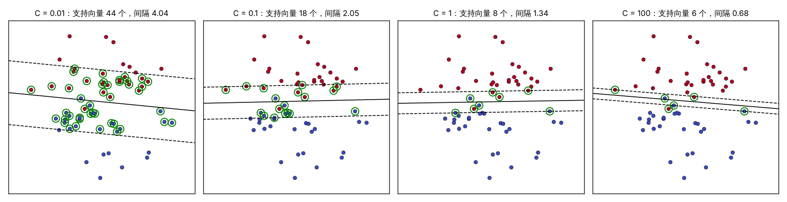
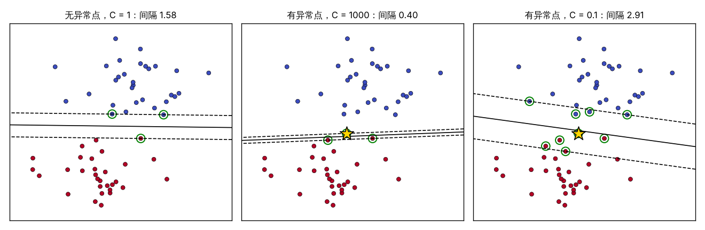
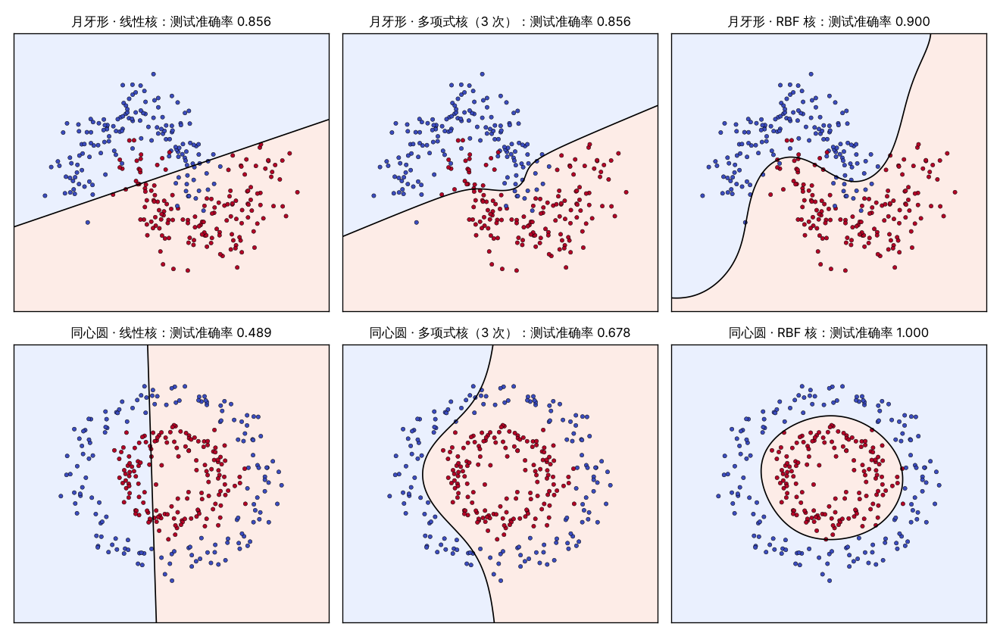
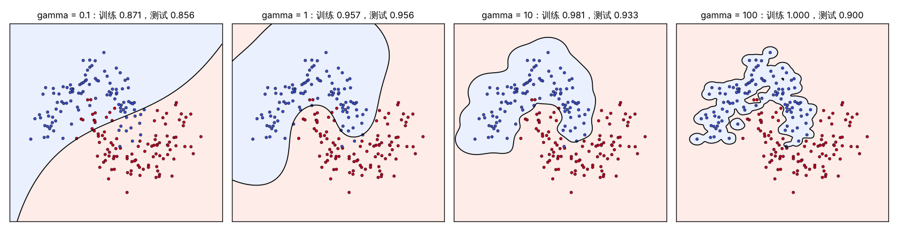
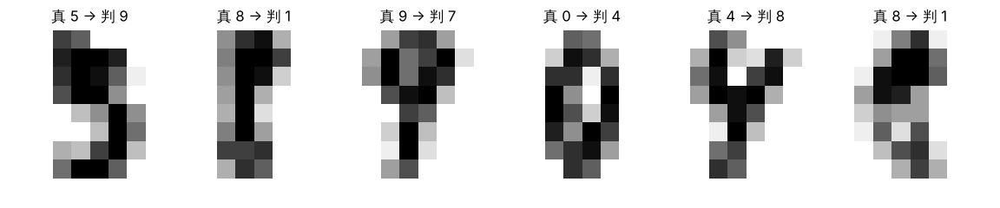
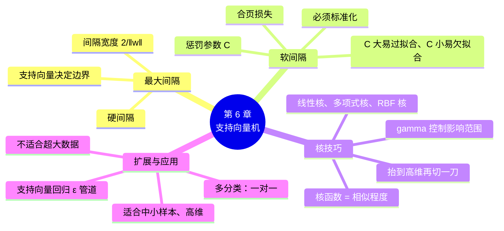

# 第 6 章 支持向量机

!!! abstract "本章学时"
    理论 4 学时 · 实验 2 学时（本章共 3 个实验，教师可任选）

## 学习目标

学完本章，你应该能够：

1. **说出**支持向量机、间隔、支持向量、软间隔、核函数、RBF 核的含义（记忆）；
2. **解释**为什么要找间隔最大的分界线，惩罚参数 C 和 gamma 变大、变小时模型怎样变化，核技巧为什么能处理线性不可分的数据（理解）；
3. **运用** scikit-learn 的 `SVC` 训练线性核和 RBF 核的支持向量机，画出决策边界和支持向量，用交叉验证选择 C 和 gamma（应用）；
4. **分析**不同核函数、不同参数下的决策边界，判断欠拟合与过拟合；在手写数字识别中查看被认错的图片，分析原因（分析）；
5. **根据**数据规模、特征类型和业务要求，**判断**一个任务适不适合用支持向量机（评价）。

!!! info "先修要求"
    学习本章前，你需要掌握：

    - 标准化，以及哪些模型需要特征缩放（[2.3 特征编码与特征缩放](../02-preprocessing/index.md#23)）；
    - 过拟合与正则化（[3.5 过拟合与正则化](../03-linear-regression/index.md#35)）；
    - 决策边界、线性分类器，混淆矩阵和准确率（[4.2.2 决策边界](../04-logistic-regression/index.md#422)、[4.3 混淆矩阵与分类指标](../04-logistic-regression/index.md#43)）；
    - 向量的点积和长度：(a₁, a₂)·(b₁, b₂) = a₁b₁ + a₂b₂，‖a‖ = √(a₁² + a₂²)（“人工智能数学基础”课程）。

??? abstract "本章概念清单（16 个，点击查看定义和例子）"
    1. [支持向量机](../../appendix/glossary.md#g-支持向量机)
    2. [线性可分](../../appendix/glossary.md#g-线性可分)
    3. [间隔](../../appendix/glossary.md#g-间隔)
    4. [支持向量](../../appendix/glossary.md#g-支持向量)
    5. [硬间隔](../../appendix/glossary.md#g-硬间隔)
    6. [软间隔](../../appendix/glossary.md#g-软间隔)
    7. [合页损失](../../appendix/glossary.md#g-合页损失)
    8. [惩罚参数 C](../../appendix/glossary.md#g-惩罚参数-C)
    9. [核函数](../../appendix/glossary.md#g-核函数)
    10. [核技巧](../../appendix/glossary.md#g-核技巧)
    11. [线性核](../../appendix/glossary.md#g-线性核)
    12. [多项式核](../../appendix/glossary.md#g-多项式核)
    13. [RBF 核](../../appendix/glossary.md#g-RBF-核)
    14. [gamma 参数](../../appendix/glossary.md#g-gamma-参数)
    15. [支持向量回归](../../appendix/glossary.md#g-支持向量回归)
    16. [一对一](../../appendix/glossary.md#g-一对一)

## 情景导入

小周所在的公司接了一个银行的项目：银行每天要处理大量纸质单据，上面手写的金额、账号要由柜员一个个录入系统，又慢又容易出错。银行想先做一个小试点：让计算机认出单据上手写的 0～9 十个数字。

小周拿到了一批 8×8 像素的手写数字图片，先用第 4 章的逻辑回归和第 5 章的随机森林试了试，准确率分别是 98.1% 和 96.9%，已经不错了。项目组里一位老工程师说：“认手写数字，你试试支持向量机。二十多年前美国邮政认信封上的邮政编码，支持向量机就是最好的方法之一。”小周换上支持向量机，一行参数都没改，准确率就到了 98.9%，540 张测试图片只认错 6 张。

支持向量机（SVM）是 20 世纪 90 年代发展起来的分类方法，在深度学习流行之前，它是很多任务上效果最好的模型。它的想法非常直观：在两类样本之间修一条尽可能宽的“路”。本章先从这条“路”讲起，再介绍允许少数样本越界的软间隔、处理弯曲边界的核技巧，最后讨论它适合什么样的任务。

## 6.1 最大间隔分类器

### 6.1.1 能把两类分开的直线有无数条

第 4 章说过，逻辑回归是线性分类器，它用一条直线（特征多时是平面）把两类分开。如果两类样本能被一条直线完全分开，这样的数据叫[**线性可分**](../../appendix/glossary.md#g-线性可分 "存在一条直线（平面）能把两类样本完全分开"){ .term }的。

线性可分时，能把两类完全分开的直线其实有无数条：稍微转一转、挪一挪，只要不碰到样本，都能把训练集分得一个不错。那么哪一条最好？

想象两类样本是路两边的房子，我们要在中间修一条路。路可以修得很窄，紧贴着某一边的房子；也可以尽量修宽，让路的中线离两边的房子都尽可能远。哪条路更“安全”？显然是宽的那条：新来的样本总会和训练样本有些出入，如果分界线紧贴着某一类的样本，新样本稍微偏一点就会被分错；分界线离两边都远，就能容忍更大的偏差。

[**支持向量机**](../../appendix/glossary.md#g-支持向量机 "在两类样本之间寻找间隔最大的分界线的分类算法"){ .term }（Support Vector Machine，SVM）就是按这个想法设计的：在所有能把两类分开的直线中，选“路”最宽的那一条。这个想法由苏联学者瓦普尼克（V. Vapnik）等人提出，1995 年科尔特斯（C. Cortes）和瓦普尼克发表的论文给出了今天使用的形式。<sup class="cite">[[1]](#ref6-1)</sup>

### 6.1.2 间隔与支持向量

和逻辑回归一样，SVM 也先把特征加权求和：

\[
f(x) = w_1 x_1 + w_2 x_2 + \cdots + w_d x_d + b = w \cdot x + b
\]

f(x) > 0 判为正类，f(x) < 0 判为负类，f(x) = 0 是决策边界。不同的是，SVM 还画了两条平行的“路边线”：f(x) = 1 和 f(x) = −1。训练时要求正类样本都在 f(x) ≥ 1 的一侧，负类样本都在 f(x) ≤ −1 的一侧，路中间没有样本。两条路边线之间的距离叫[**间隔**](../../appendix/glossary.md#g-间隔 "SVM 中两条间隔边界 f(x) = ±1 之间的距离，等于 2/‖w‖"){ .term }，可以证明它等于

\[
\text{间隔宽度} = \frac{2}{\lVert w \rVert} = \frac{2}{\sqrt{w_1^2 + w_2^2 + \cdots + w_d^2}}
\]

w 越小，间隔越宽。正好压在路边线上的样本叫[**支持向量**](../../appendix/glossary.md#g-支持向量 "落在间隔边界上或间隔以内（含被分错）的训练样本，决定了 SVM 的决策边界"){ .term }，它们像撑住路两边的柱子，“支持”着这条路。SVM 有一个重要的性质：**分界线只由支持向量决定**。离路很远的样本，删掉也好、挪动一点也好，只要不越过路边线，分界线都不会变。这也是“支持向量机”这个名字的由来。


**算一算**：平面上有 3 个样本，正类 A(3, 3)、B(4, 3)，负类 C(1, 1)。<sup class="cite">[[3]](#ref6-3)</sup> SVM 求出的分界线是 f(x) = 0.5x₁ + 0.5x₂ − 2，即 w = (0.5, 0.5)，b = −2。验证一下：

- A 点：f = 0.5 × 3 + 0.5 × 3 − 2 = 1，正好在正类的路边线上，是支持向量；
- C 点：f = 0.5 × 1 + 0.5 × 1 − 2 = −1，正好在负类的路边线上，也是支持向量；
- B 点：f = 0.5 × 4 + 0.5 × 3 − 2 = 1.5 > 1，在路外，不是支持向量；
- 间隔宽度 = 2 / √(0.5² + 0.5²) = 2 / 0.707 ≈ 2.83，正好等于 A、C 两点之间的距离 √(2² + 2²) ≈ 2.83。

把 B 点挪到 (5, 4) 或者删掉，分界线完全不变；但只要挪动 A 或 C，分界线就会跟着变。用 scikit-learn 的 `SVC(kernel="linear")` 训练这 3 个点，得到的 w、b 和支持向量与手算完全一致。

### 6.1.3 SVM 要解的问题

“让间隔最宽”等价于“让 ‖w‖ 最小”。为了计算方便，写成让 ½‖w‖² 最小，同时要求每个样本都在自己那一侧的路边线以外。把正类记为 y = +1、负类记为 y = −1，这个要求可以合写成一个式子：

\[
\min_{w,\,b}\ \frac{1}{2}\lVert w \rVert^2 \qquad \text{要求每个样本都满足}\ \ y_i\,(w \cdot x_i + b) \ge 1
\]

y·f(x) ≥ 1 的意思是：正类样本的 f(x) ≥ 1，负类样本的 f(x) ≤ −1。这种要求所有样本都不能进入路中间、更不能被分错的 SVM，叫[**硬间隔**](../../appendix/glossary.md#g-硬间隔 "要求所有训练样本都在间隔以外、一个都不能分错的 SVM"){ .term } SVM。

这个问题的求解要用到拉格朗日乘子和对偶问题等数学工具，本书不展开。我们只需要知道两件事：一是它有唯一的最优解，不会像梯度下降那样担心学习率或陷在半路；二是求解的结果里，只有支持向量对应的系数不为 0，其他样本的系数都是 0，这从数学上说明了“分界线只由支持向量决定”。scikit-learn 的 `SVC` 底层调用台湾大学林智仁团队开发的 LIBSVM 库求解，用的是一种叫 SMO（序列最小优化）的算法，每次只调整两个样本的系数，反复迭代直到满足条件。<sup class="cite">[[5]](#ref6-5)</sup>

## 6.2 软间隔与惩罚参数 C

### 6.2.1 允许少数样本越界

现实数据很少是完全线性可分的：两类样本常有一些重叠，还可能有个别录入错误的样本混在对方阵营里。硬间隔 SVM 遇到这种情况，要么根本找不到分界线，要么为了迁就一两个特殊样本，把路修得极窄。

解决办法是放宽要求：允许少数样本进入路中间，甚至跑到路的另一边（被分错），但要为此付出代价。这种 SVM 叫[**软间隔**](../../appendix/glossary.md#g-软间隔 "允许少数样本进入间隔甚至被分错、但要为此付出代价的 SVM"){ .term } SVM。每个样本的代价用[**合页损失**](../../appendix/glossary.md#g-合页损失 "SVM 使用的损失 max(0, 1 − y·f(x))：样本在间隔以外为 0，越界越深损失越大"){ .term }（Hinge Loss）计算：

\[
\text{合页损失} = \max\big(0,\ 1 - y \cdot f(x)\big)
\]

**算一算**：一个正类样本（y = +1），

- f(x) = 1.8，在正类路边线以外，损失 max(0, 1 − 1.8) = 0，不用付代价；
- f(x) = 0.4，在路中间，但还在正确的一侧，损失 1 − 0.4 = 0.6；
- f(x) = −0.5，跑到了路的另一边，被分错，损失 1 − (−0.5) = 1.5。

越界越深，代价越大；在路边线以外的样本，代价都是 0。损失的图像像一扇半开的合页，所以叫合页损失。和第 4 章的交叉熵对比：交叉熵对每个样本都有一点损失，判得再有把握也不为 0；合页损失对“已经分得足够好”的样本不再计较，只盯着路边线附近和越界的样本，这就是 SVM 只由支持向量决定的原因。软间隔时，支持向量包括压在路边线上的样本、进入路中间的样本和被分错的样本。

### 6.2.2 惩罚参数 C：路宽与越界之间的权衡

软间隔 SVM 要同时兼顾两件事：路要宽（‖w‖ 小），越界的样本要少、越界要浅（合页损失之和小）。两者用[**惩罚参数 C**](../../appendix/glossary.md#g-惩罚参数-C "SVM 中合页损失的权重：C 大则尽量不让样本越界、间隔窄，C 小则允许越界、间隔宽"){ .term }来平衡：

\[
\min_{w,\,b}\ \frac{1}{2}\lVert w \rVert^2 + C \sum_{i} \max\big(0,\ 1 - y_i f(x_i)\big)
\]

- **C 大**：越界的代价高，模型尽量把每个样本都分对，路修得窄，容易被个别样本带偏，可能过拟合；C 非常大时，就接近硬间隔。
- **C 小**：越界的代价低，模型宁可让一些样本进入路中间，也要把路修宽，支持向量多，边界更稳，但 C 太小会欠拟合。

实验 6-1 在 60 个二维样本（两类有少量重叠）上把 C 从 0.01 调到 100，结果如下：

| C | 支持向量数 | 间隔宽度 | 训练集分错的点 |
|---|---|---|---|
| 0.01 | 44 | 4.04 | 2 |
| 0.1 | 18 | 2.05 | 2 |
| 1 | 8 | 1.34 | 2 |
| 100 | 6 | 0.68 | 2 |



C 越大，路越窄，支持向量越少。四种 C 下训练集都只分错 2 个点，看不出区别，但路的宽窄差了 6 倍。哪个更好，要看新数据上的表现，第 9 章会讲怎样用交叉验证来选。

C 的作用在有异常点时更明显。实验 6-1 第③步在一份本来可以完全分开的数据里，加入了 1 个“录错了”的样本：它标为蓝色（0 类），位置却靠近红色（1 类）。C = 1000 时，模型为了把这一个点也分对，把路压窄到 0.40（原来是 1.58），分界线紧贴着红点；C = 0.1 时，模型放弃了这个点（把它判为红色），路宽 2.91，分界线基本保持原来的方向。如果这个点确实是录入错误，C 小的模型显然更可信。



C 的作用和第 3 章的正则化一脉相承：½‖w‖² 就是 L2 正则化项，C 越小，正则化越强，模型越简单。注意方向：岭回归的 alpha 越大正则化越强，SVM 的 C 和逻辑回归的 C 一样，**越小正则化越强**。scikit-learn 中 `SVC` 的 C 默认值是 1。

### 6.2.3 别忘了标准化

间隔是用距离来衡量的，所以 SVM 和第 7 章的 K 近邻一样，对特征的单位非常敏感。假如一个特征是月收入（几千到几万元），另一个是负债率（0 到 1 之间），不做缩放时，距离几乎完全由月收入决定，负债率再重要也起不了作用。

实验 6-1 第④步在第 5 章的贷款审批数据上做了对比：RBF 核的 SVM（6.3 节介绍）不标准化时，测试准确率只有 0.672，只比“全部猜批准”（0.653）高一点；标准化后达到 0.847，与第 5 章调好的决策树（0.827）相当。线性核的 SVM 不标准化时，编者的电脑训练了将近 1 分钟，标准化后不到 0.1 秒，因为特征尺度相差悬殊时，求解算法要迭代很多次才能收敛。所以，**用 SVM 之前一定要做标准化**，最好用第 2 章的流水线 `make_pipeline(StandardScaler(), SVC())`，保证测试集用的是训练集的均值和标准差。<sup class="cite">[[6]](#ref6-6)</sup>

!!! cert "证书考点 · 人工智能应用工程师 · 机器学习"
    常考 SVM 的基本概念：SVM 寻找间隔最大的分类超平面；支持向量是离分类超平面最近（压在间隔边界上）的样本，决定了超平面的位置；删除非支持向量不影响模型；间隔宽度 2/‖w‖；硬间隔与软间隔的区别；惩罚参数 C 越大，对误分类的惩罚越重，间隔越窄，越容易过拟合。容易错在把 C 的方向和岭回归的 alpha 弄反，以及忘记 SVM 需要特征标准化。

## 6.3 核技巧

### 6.3.1 把数据“抬”到高维再切一刀

软间隔解决的是“两类大致能用直线分开，只是有些重叠”的情况。如果两类的分界本来就是弯的呢？实验 6-2 用了两份典型的数据：月牙形数据，两类像两个交错的月牙；同心圆数据，一类在内圈、另一类围在外圈。同心圆数据上，无论直线怎么画，都只能把圆切成两半，线性核 SVM 的测试准确率只有 0.489，和瞎猜差不多。

换个角度想：给每个点加一个新特征 r² = x₁² + x₂²，也就是到圆心距离的平方。内圈的点 r² 小（平均 0.27），外圈的点 r² 大（平均 1.01）。把 r² 当作第三个坐标，所有点就被“抬”到了三维空间里：内圈的点低，外圈的点高。这时只要在 r² ≈ 0.59 的高度水平切一刀，两类就完全分开了。实验 6-2 第②步正是这样做的：加上 r² 这一列后，线性核 SVM 的测试准确率从 0.489 变成 1.000。


三维空间中那个平面，投影回原来的二维平面，正好是一个圆。也就是说：**在低维空间中弯曲的边界，在合适的高维空间中可能是平直的。**这就是 SVM 处理非线性问题的基本思路。

### 6.3.2 核函数：不用真的“抬”上去

问题是，“合适的高维空间”往往不好找：同心圆可以想到加 r²，月牙形该加什么？如果把所有平方项、交叉项、三次项……都加上，特征数会急剧增长，计算量也跟着暴涨。

SVM 有一个巧妙的办法。在 6.1.3 节的求解过程中，样本之间只以“点积”的形式出现：算法从来不需要知道每个样本在高维空间中的坐标，只需要知道任意两个样本在高维空间中的点积。如果有一个函数，直接用原始坐标就能算出这个点积，就不用真的把数据抬上去了。这样的函数叫[**核函数**](../../appendix/glossary.md#g-核函数 "直接用原始特征算出两个样本在某个高维空间中的点积（相似程度）的函数"){ .term }，这种做法叫[**核技巧**](../../appendix/glossary.md#g-核技巧 "用核函数代替高维空间中的点积，不必真的把数据映射到高维，就能得到弯曲的决策边界"){ .term }（Kernel Trick）。核技巧最早在 1992 年被用到最大间隔分类器上。<sup class="cite">[[4]](#ref6-4)</sup>

**算一算**：两个二维样本 x = (1, 2)、z = (3, 1)。

- 先“抬”上去：把每个点映射成三维 φ(x) = (x₁², √2·x₁x₂, x₂²)。φ(x) = (1, 2.828, 4)，φ(z) = (9, 4.243, 1)，点积 = 1 × 9 + 2.828 × 4.243 + 4 × 1 = 9 + 12 + 4 = 25。
- 不抬，直接算：(x·z)² = (1 × 3 + 2 × 1)² = 5² = 25。

两种算法结果一样，但第二种只在二维里算了一次点积再平方。K(x, z) = (x·z)² 就是一个核函数，它对应的高维空间是“所有二次项”。特征多、次数高时，高维空间的维数非常大，甚至是无穷维，核函数却始终只在原始空间里计算，这就是核技巧的威力。

核函数可以理解为两个样本的**相似程度**：越相似，核函数值越大。SVM 判断新样本时，实际上是在算它和每个支持向量的相似程度，再加权求和：

\[
f(x) = \sum_{\text{支持向量}\ i} \alpha_i\, y_i\, K(x_i, x) + b
\]

新样本和哪类的支持向量更像，就判为哪一类。

### 6.3.3 常用核函数

scikit-learn 的 `SVC` 用 `kernel` 参数选择核函数，常用的有三种：

| 核函数 | 公式 | 决策边界 | 适用场合 |
|---|---|---|---|
| [**线性核**](../../appendix/glossary.md#g-线性核 "K(x, z) = x·z，即不做映射，决策边界是直线（平面）"){ .term } `"linear"` | K(x, z) = x·z | 直线（平面） | 特征很多的数据，如文本；先试它做基线 |
| [**多项式核**](../../appendix/glossary.md#g-多项式核 "K(x, z) = (γ·x·z + r)^d，相当于加入 d 次以内的多项式特征"){ .term } `"poly"` | K(x, z) = (γ·x·z + r)^d | d 次曲线 | 特征之间有乘积关系，较少使用 |
| [**RBF 核**](../../appendix/glossary.md#g-RBF-核 "K(x, z) = exp(−γ‖x − z‖²)，按两个样本的距离衡量相似程度，又叫高斯核"){ .term } `"rbf"` | K(x, z) = exp(−γ‖x − z‖²) | 任意形状 | 不知道用什么核时的首选，`SVC` 的默认值 |

RBF 核又叫高斯核，它只看两个样本之间的距离：距离为 0 时值为 1（完全相似），距离越远值越接近 0。它对应的高维空间是无穷维的，所以能画出任意形状的边界。

实验 6-2 在月牙形和同心圆数据上比较了三种核（都先标准化）：

| 数据 | 线性核 | 多项式核（3 次） | RBF 核 |
|---|---|---|---|
| 月牙形 | 0.856 | 0.856 | **0.900** |
| 同心圆 | 0.489 | 0.678 | **1.000** |



RBF 核在两份数据上都最好。多项式核在这两份数据上表现一般：scikit-learn 中多项式核的常数项 r（参数 `coef0`）默认为 0，3 次多项式只含三次项，画不出同心圆需要的二次曲线。这也说明核函数要和数据的形状匹配，拿不准时先试 RBF 核。

### 6.3.4 gamma 与 C 的组合

RBF 核有一个参数 γ，即 [**gamma 参数**](../../appendix/glossary.md#g-gamma-参数 "RBF 核中控制每个样本影响范围的参数：gamma 越大影响范围越小，边界越曲折，越容易过拟合"){ .term }，它决定了每个样本的“影响范围”。

**算一算**：两个样本之间的距离为 d，RBF 核的值是 e^(−γd²)。

| 距离 d | γ = 1 | γ = 10 |
|---|---|---|
| 0.5 | e^(−0.25) ≈ 0.779 | e^(−2.5) ≈ 0.082 |
| 1 | e^(−1) ≈ 0.368 | e^(−10) ≈ 0.00005 |
| 2 | e^(−4) ≈ 0.018 | e^(−40) ≈ 0 |

γ = 1 时，相距 1 的两个样本还有 0.368 的相似度；γ = 10 时，相距 0.5 就几乎“不认识”了。所以：

- **gamma 大**：每个样本只影响身边很小的范围，边界围着训练样本绕圈，训练准确率很高，但容易过拟合；
- **gamma 小**：每个样本影响很大的范围，边界很平滑，接近直线，可能欠拟合。

scikit-learn 中 gamma 默认取 `"scale"`，即 1 /（特征数 × 特征的方差）。标准化后的二维数据，方差为 1，默认 gamma = 0.5。

实验 6-2 第③步在月牙形数据上，用 5 折交叉验证（第 9 章详细介绍，这里理解为“只用训练集反复做小测验”）试了 C 和 gamma 的 16 种组合。表中每格是“训练准确率 / 交叉验证准确率”：

| C ＼ gamma | 0.1 | 1 | 10 | 100 |
|---|---|---|---|---|
| 0.1 | 0.867 / 0.867 | 0.919 / 0.914 | 0.967 / **0.948** | 0.995 / 0.790 |
| 1 | 0.871 / 0.871 | 0.957 / **0.948** | 0.981 / 0.938 | 1.000 / 0.910 |
| 10 | 0.895 / 0.890 | 0.976 / **0.948** | 0.995 / 0.933 | 1.000 / 0.910 |
| 100 | 0.938 / 0.929 | 0.976 / 0.929 | 1.000 / 0.933 | 1.000 / 0.910 |



从表中可以读出三个规律：

1. **左上角欠拟合**：C 和 gamma 都小，训练准确率和交叉验证准确率都只有 0.87 左右，边界接近直线。
2. **右边一列过拟合**：gamma = 100 时训练准确率接近或等于 1，交叉验证准确率却降到 0.79～0.91，边界围着每个训练点绕小圈（见上图最右）。
3. **C 和 gamma 要一起调**：C 大、gamma 大都让模型更复杂。C = 0.1、gamma = 10 和 C = 10、gamma = 1 的交叉验证准确率相同，一个用“弱惩罚 + 小范围”，一个用“强惩罚 + 大范围”。

三个并列最好的组合中，C = 10、gamma = 1 的支持向量最少（31 个），模型最简单，测试准确率 0.967 也最高。实践中常用的调参方法是：C 和 gamma 各取 0.001、0.01、0.1、1、10、100 等按 10 倍递增的值，用交叉验证在网格上逐个试，选出最好的组合后再在附近细调。<sup class="cite">[[6]](#ref6-6)</sup> 第 9 章会用 `GridSearchCV` 自动完成这件事。

下面的动画用的就是实验 6-1、6-2 的数据，页面在浏览器中用与 scikit-learn 相同的算法求解。可以拖动 C 和 gamma，也可以拖动、添加、删除数据点，看边界和支持向量怎样变化：

<iframe class="sim-frame" src="../../sims/svm-margin/main.html" height="900" loading="lazy" title="SVM 间隔与核函数"></iframe>

动画：SVM 间隔与核函数。先在“实验 6-1 数据”上拖动一个没有绿圈的点，再拖动一个有绿圈的点，比较边界的变化；再切换到“月牙形”，把 gamma 从 0.1 拖到 100。[全屏打开](../../sims/svm-margin/main.html){ target=_blank }
{ .sim-caption }

## 6.4 支持向量回归

SVM 的思路也可以用来做回归，叫[**支持向量回归**](../../appendix/glossary.md#g-支持向量回归 "用 SVM 思路做回归：在预测值周围留一条宽 ε 的管道，管道内的误差不计，只惩罚管道外的样本"){ .term }（Support Vector Regression，SVR）。分类时，SVM 要求样本都在“路”外面；回归时反过来，SVR 在预测曲线上下各留宽度 ε 的一条“管道”，要求样本尽量落在管道**里面**：<sup class="cite">[[7]](#ref6-7)</sup>

- 落在管道内的样本，误差不超过 ε，**不计损失**；
- 落在管道外的样本，损失等于它到管道边的距离，用 C 控制惩罚力度；
- 只有落在管道边上或管道外的样本是支持向量。

这和第 3 章线性回归的均方误差不同：均方误差对每一点误差都计较，SVR 对 ε 以内的小误差“睁一只眼闭一只眼”，大误差也只按距离而不按平方计算，所以受异常值的影响更小。ε 越大，管道越宽，支持向量越少，模型越粗糙。

实验 6-2 第④步用 RBF 核的 SVR 拟合第 3 章奶茶店的销量数据（20 天训练、200 天测试）：

| epsilon | C | 支持向量数 | 训练 MSE | 测试 MSE |
|---|---|---|---|---|
| 5 | 1000 | 15 | 281.1 | 623.7 |
| 20 | 1000 | 5 | 277.8 | 708.9 |
| 40 | 1000 | 4 | 793.8 | 1170.4 |
| 20 | 100 | 6 | 291.8 | 691.6 |

ε 从 5 加到 40，支持向量从 15 个减到 4 个，测试 MSE 越来越大。最好的 SVR（测试 MSE 623.7）仍不如第 3 章的 2 阶多项式回归（529.4）。原因是这份数据的真实规律就是一条二次曲线，用二次多项式正好对路；只有 20 个训练样本时，灵活的 RBF 核反而占不到便宜。这再次说明：**没有在所有数据上都最好的模型**，要和简单的基线一起比较。scikit-learn 中 SVR 的用法是 `SVR(kernel="rbf", C=..., epsilon=...)`，同样需要先标准化。

## 6.5 SVM 的优缺点与适用场景

### 6.5.1 多分类：一对一

SVM 本身是二分类器。处理手写数字这样的 10 类问题，scikit-learn 的 `SVC` 用[**一对一**](../../appendix/glossary.md#g-一对一 "多分类策略：每两类训练一个二分类器，K 类共 K(K−1)/2 个，预测时投票决定类别"){ .term }（One-vs-One）的办法：每两个类别训练一个 SVM，10 个类别共 10 × 9 / 2 = 45 个；预测时 45 个 SVM 各投一票，得票最多的类别胜出。第 4 章逻辑回归用的一对多只要 10 个分类器，但每个都要用全部数据训练；一对一的每个分类器只用两个类别的数据，SVM 训练时间随样本数增长很快，所以一对一反而更快。

### 6.5.2 手写数字识别：SVM 的拿手好戏

实验 6-3 用 scikit-learn 自带的手写数字数据<sup class="cite">[[11]](#ref6-11)</sup>，共 1797 张 8×8 像素的灰度图片，每个像素是一个特征（共 64 个），比较三种模型：

| 模型 | 训练准确率 | 测试准确率 | 认错张数（共 540 张） |
|---|---|---|---|
| SVM（RBF 核，默认参数） | 0.998 | **0.989** | 6 |
| SVM（RBF 核，标准化） | 0.998 | 0.983 | 9 |
| 逻辑回归（标准化） | 1.000 | 0.981 | 10 |
| 随机森林（300 棵） | 1.000 | 0.969 | 17 |

两点值得注意。第一，这里**不标准化反而更好**：64 个像素的单位相同（都是灰度 0～16），本来就可以直接比较；图片边缘的像素几乎总是 0，方差极小，标准化后会把这些像素上偶然出现的一点笔画放得很大，反而带来干扰。“SVM 必须标准化”针对的是单位不同的特征。第二，训练样本很少时 SVM 的优势更明显：每个数字只取 50 张训练时，SVM 的测试准确率 0.985，逻辑回归 0.950，随机森林 0.954。

SVM 认错的 6 张图片如下，其中两张是“8”被认成“1”：这两个 8 写得又窄又细，中间的圈几乎没有写出来。有些图片连人也很难认，这类错误靠换模型很难解决，需要更高分辨率的图片或更多样本。



### 6.5.3 优缺点与适用场景

| 方面 | SVM 的表现 |
|---|---|
| 小样本 | **好**。只由支持向量决定，几百、几千个样本就能学得不错 |
| 高维数据 | **好**。特征数比样本数还多也能用，如文本（几万个词）、基因数据（几万个基因） |
| 非线性 | **好**。换个核函数就能画出弯曲的边界 |
| 稳定性 | **好**。优化问题有唯一最优解，结果可重复 |
| 大数据 | **差**。训练时间大致随样本数的平方到三次方增长，超过 10 万条就很慢了 |
| 参数 | **要调**。C、gamma 对结果影响大，必须标准化 |
| 概率输出 | **不直接给**。`SVC(probability=True)` 要额外做 5 折交叉验证来估计概率，训练慢约 5 倍 |
| 可解释性 | **差**。RBF 核 SVM 说不清“为什么”，不如逻辑回归的系数和决策树的规则直观 |
| 缺失值、类别特征 | 不能直接处理，要先填充、编码 |

所以，SVM 最适合**中小规模（几百到几万条）、特征较多、边界可能弯曲**的分类任务，如手写字符识别、文本分类、医学检验数据、生物信息。数据量很大时，可以改用只支持线性核、速度快得多的 `LinearSVC`，或者第 5 章的梯度提升树；业务方要求解释时，优先考虑逻辑回归或决策树。

!!! cert "证书考点 · 人工智能应用工程师 · 机器学习"
    常考核函数的概念和选择：核技巧把低维线性不可分的数据映射到高维使其线性可分，但不需要显式计算映射；常用核函数有线性核、多项式核、高斯（RBF）核，`SVC` 默认是 RBF 核；gamma 越大，单个样本影响范围越小，模型越复杂，越容易过拟合；SVM 适合中小样本、高维数据，不适合超大规模数据；SVM 做多分类采用一对一或一对多。实操题常考 `SVC(kernel=..., C=..., gamma=...)` 的写法、`support_vectors_` 和 `n_support_` 属性，以及与 `StandardScaler` 组成流水线。

## 6.6 前沿视窗

**深度学习时代，SVM 还在哪里用？**2012 年以后，图像、语音、自然语言等任务的冠军大多换成了深度神经网络，SVM 风光不再。但它没有消失：在**样本少**的场合，比如一家医院只有几百例病人的检验数据、一条产线只有几百个不良品样本，深度学习“喂不饱”，SVM 往往更稳；在**文本分类**中，线性 SVM 早在 1998 年就被证明非常适合几万维的词袋特征<sup class="cite">[[8]](#ref6-8)</sup>，至今仍是常用的基线；在**生物信息**领域，基因表达数据常常是“几十个样本、几万个基因”，SVM 被广泛用于癌症分型、蛋白质功能预测<sup class="cite">[[9]](#ref6-9)</sup>。此外，大模型时代常见的做法是先用预训练模型把文本、图片变成向量（嵌入），再在上面训练一个小分类器，线性 SVM 和逻辑回归就是最常用的选择。

**核方法与神经网络的联系。**本章的核函数衡量两个样本的相似程度，SVM 用相似程度加权投票。研究者发现，非常“宽”的神经网络在训练时的行为，也可以用一个特定的核函数来描述，称为神经正切核（NTK）。<sup class="cite">[[12]](#ref6-12)</sup> 这为理解神经网络提供了一个新的视角，也说明核方法的思想并没有过时。

## 本章实验

!!! abstract "实验总览"
    | 实验 | 类型 | 建议时长 | 内容 |
    |---|---|---|---|
    | 实验 6-1 | ★ 基础 | 45 分钟 | 在二维数据上画出线性 SVM 的决策边界、间隔和支持向量，观察 C 的作用和异常点的影响；在贷款审批数据上比较标准化前后的效果 |
    | 实验 6-2 | ★ 基础 | 45 分钟 | 在月牙形、同心圆数据上比较三种核函数，手工“抬高一维”体会核技巧，网格观察 C 与 gamma 的组合，用 SVR 做回归 |
    | 实验 6-3 | ☆ 拓展 | 60 分钟 | 手写数字识别：SVM 与逻辑回归、随机森林对比，查看混淆矩阵和被认错的图片，比较训练样本很少时的表现 |

    三个实验都在本机 CPU 上运行，每个脚本不超过 30 秒。实验代码见配套资源 `labs/ch06/` 目录，数据用 scikit-learn 自带的生成函数和数据集，以及 `labs/data/loan_apply.csv`。

### 实验 6-1 ★ 线性 SVM 与参数 C

**实验目的**

1. 用 `SVC(kernel="linear")` 训练线性 SVM，画出决策边界、间隔边界和支持向量；
2. 观察惩罚参数 C 从小到大时间隔宽度、支持向量数的变化，体会 C 对异常点的敏感程度；
3. 验证“只有支持向量决定边界”，体会标准化对 SVM 的重要性。

**实验环境**：本机 CPU。Python 3.11，NumPy、pandas、Matplotlib、scikit-learn。

**实验数据**：第一部分用 `make_blobs` 生成两份二维数据，各 60 个点，两类各 30 个；第二部分用第 5 章的贷款审批数据 `labs/data/loan_apply.csv`（2000 条，批准率 65.4%），划分方式与第 5 章相同。

**实验步骤与代码**

第 1 步，生成二维数据，C 取 4 个值，分别训练并画图。`coef_` 是 w，只有线性核才有；`support_` 是支持向量在训练集中的下标，`support_vectors_` 是支持向量本身：

```python
X, y = make_blobs(n_samples=60, centers=2, cluster_std=1.3, random_state=4)
for C in [0.01, 0.1, 1, 100]:
    m = SVC(kernel="linear", C=C).fit(X, y)
    width = 2 / np.linalg.norm(m.coef_[0])          # 间隔宽度 2/‖w‖
    print(C, len(m.support_), width, (m.predict(X) != y).sum())
```

画间隔边界的方法：在画布上取一张密集的网格，用 `decision_function` 算出每个格点的 f(x)，再用 `contour` 画出 f(x) = −1、0、1 三条等高线：

```python
f = m.decision_function(np.c_[xx.ravel(), yy.ravel()]).reshape(xx.shape)
ax.contour(xx, yy, f, levels=[-1, 0, 1], linestyles=["--", "-", "--"])
ax.scatter(m.support_vectors_[:, 0], m.support_vectors_[:, 1], s=90, facecolors="none", edgecolors="green")
```

第 2 步，取 C = 1 的模型，打印 w 和 b，检查支持向量的 f(x)，找出离边界最远的点。

第 3 步，在另一份可以完全分开的数据中加入一个异常点，分别用 C = 1000 和 C = 0.1 训练，比较间隔宽度。

第 4 步，读取贷款审批数据，比较 RBF 核 SVM 不标准化和标准化的效果：

```python
for name, model in [("线性核 SVM，标准化", make_pipeline(StandardScaler(), SVC(kernel="linear"))),
                    ("RBF 核 SVM，不标准化", SVC()),
                    ("RBF 核 SVM，标准化", make_pipeline(StandardScaler(), SVC()))]:
    model.fit(X_train, y_train)
    print(name, model.score(X_train, y_train), model.score(X_test, y_test))
```

完整代码见 `lab6_1_linear_svm.py`。

**运行结果**

```text
二维示例数据：60 个点，两类各 30、30 个

① 惩罚参数 C 对间隔和支持向量的影响
     C   支持向量数   间隔宽度 2/‖w‖   训练集分错的点
  0.01       44           4.04            2
   0.1       18           2.05            2
     1        8           1.34            2
   100        6           0.68            2

② C = 1 时：w = (-0.036, 1.489)，b = -3.743，‖w‖ = 1.490，间隔宽度 = 2 / 1.490 = 1.34
   8 个支持向量中，3 个正好落在间隔边界上（f(x) = ±1），其余 5 个在间隔内或被分错（|f(x)| < 1）
   例：支持向量 (12.05, 2.13)，f(x) = -0.036×12.05 + 1.489×2.13 + (-3.743) = -1.001
   离边界最远的点 (9.40, -2.12)，f(x) = -7.241，不是支持向量，删掉它边界不变

③ 另一份可以完全分开的数据，再加入 1 个异常点 (7.21, -6.56)（标为 0 类，却靠近 1 类）
            C    支持向量数   间隔宽度   训练集分错   异常点被分对了吗
  无异常点       1        3        1.58         0        —
  有异常点    1000        3        0.40         0        是
  有异常点     0.1        9        2.91         1        否

④ 贷款审批数据：训练集 1400 条，测试集 600 条，特征 10 个
           月收入   负债率  近两年逾期次数  申请金额_万元
mean   8368.71  0.30     0.72    15.42
std    4138.34  0.16     1.03     8.45
min    1500.00  0.01     0.00     1.00
max   41600.00  0.89     8.00    30.00

  模型                         训练准确率  测试准确率  支持向量数  用时（秒）
  线性核 SVM，标准化              0.846     0.848       529       0.04
  RBF 核 SVM，不标准化           0.694     0.672       930       0.10
  RBF 核 SVM，标准化            0.865     0.847       574       0.07
```

用时因电脑而异，其余数字应与上面完全相同。几点解读：

- ② 中 w 的第一个分量只有 −0.036，第二个分量 1.489，说明这份数据几乎只靠纵坐标 x₂ 就能分开，分界线接近水平（见 6.2.2 节的图）。
- ③ 中 C = 1000 时异常点被“分对”了，代价是路宽从 1.58 缩到 0.40；C = 0.1 时模型宁可分错它，也保持了宽路。
- ④ 中月收入的标准差是 4138，负债率只有 0.16，相差两万多倍。不标准化时 RBF 核几乎只看月收入，930 个训练样本（占 66%）都成了支持向量，模型基本没学到东西。

**实验记录表**

| 项目 | 结果 |
|---|---|
| C = 0.01 和 C = 100 的间隔宽度之比 | |
| C = 1 时压在间隔边界上的支持向量个数 | |
| 加异常点后，C = 1000 与 C = 0.1 的间隔宽度 | |
| 贷款数据 RBF 核 SVM 不标准化 / 标准化的测试准确率 | |
| 你认为哪一个 C 更适合有录入错误的数据？为什么 | |

**常见问题排查**

| 现象 | 原因 | 解决办法 |
|---|---|---|
| `AttributeError: coef_ is only available when using a linear kernel` | RBF 核等非线性核没有 w | 只在 `kernel="linear"` 时取 `coef_`；其他核用 `decision_function` |
| 线性核 SVM 训练很久不结束 | 特征没有标准化，求解迭代次数暴增 | 先用 `StandardScaler`；数据量大时改用 `LinearSVC` |
| 准确率和“全部猜多数类”差不多，支持向量占大多数 | 没有标准化，或 C、gamma 设置不当 | 加标准化；按 6.3.4 节调 C 和 gamma |
| 图中没有虚线 | 网格范围太小，或 C 太大使间隔很窄 | 扩大网格范围；放大局部查看 |

**思考与练习**

1. 把第 1 步中某个不是支持向量的点删掉，重新训练，w 和 b 变了吗？再删掉一个支持向量试试。
2. 第 4 步加上“线性核 SVM，不标准化”，记下用时。编者的电脑上用了将近 1 分钟，测试准确率 0.833。为什么不标准化会这么慢？
3. 第 5 章调好的决策树在贷款数据上测试准确率 0.827，SVM 是 0.847。如果你是银行的风控经理，还会考虑哪些因素来决定用哪个模型？

**实验报告要求**

提交两张决策边界图和运行结果截图，填写实验记录表；用不超过 200 字说明 C 的作用，以及为什么用 SVM 之前要标准化。

### 实验 6-2 ★ 核函数与非线性分类

**实验目的**

1. 在月牙形、同心圆数据上比较线性核、多项式核、RBF 核的决策边界和准确率；
2. 手工给数据加一个特征，体会“抬到高维再切一刀”的核技巧思路；
3. 用交叉验证观察 C 与 gamma 的组合，识别欠拟合和过拟合；
4. 用支持向量回归拟合第 3 章的奶茶店数据，与多项式回归对比。

**实验环境**：同实验 6-1。

**实验数据**：`make_moons(n_samples=300, noise=0.2, random_state=42)` 生成的月牙形数据，`make_circles(n_samples=300, noise=0.1, factor=0.5, random_state=42)` 生成的同心圆数据，都按 7 : 3 划分；第④步用与实验 3-3 相同的代码生成奶茶店数据。

**实验步骤与代码**

第 1 步，两份数据、三种核函数，都用流水线先标准化：

```python
kernels = {"线性核": SVC(kernel="linear"), "多项式核（3 次）": SVC(kernel="poly", degree=3), "RBF 核": SVC(kernel="rbf")}
for kname, svc in kernels.items():
    m = make_pipeline(StandardScaler(), svc).fit(X_train, y_train)
    print(kname, m.score(X_test, y_test))
```

第 2 步，给同心圆数据加一列 r² = x₁² + x₂²，再用线性核：

```python
lift = lambda A: np.c_[A, (A ** 2).sum(axis=1)]      # 原来两列，再加一列 x1² + x2²
m = SVC(kernel="linear").fit(lift(X_train), y_train)
print(m.score(lift(X_test), y_test), m.coef_)
```

第 3 步，C 和 gamma 各取 0.1、1、10、100，计算训练准确率和 5 折交叉验证准确率。`cross_val_score` 把训练集分成 5 份，轮流用 4 份训练、1 份验证，取 5 次的平均：

```python
for C in [0.1, 1, 10, 100]:
    for g in [0.1, 1, 10, 100]:
        m = make_pipeline(StandardScaler(), SVC(C=C, gamma=g))
        cv = cross_val_score(m, X_train, y_train, cv=5).mean()
        tr = m.fit(X_train, y_train).score(X_train, y_train)
```

第 4 步，用 `SVR` 拟合奶茶店数据，epsilon 和 C 取几组值，计算训练和测试 MSE：

```python
m = make_pipeline(StandardScaler(), SVR(C=1000, epsilon=5)).fit(t_train, y_train)
print(len(m[-1].support_), mean_squared_error(y_test, m.predict(t_test)))
```

完整代码见 `lab6_2_kernels.py`。

**运行结果**

```text
① 三种核函数的测试准确率（每份数据 300 个点，按 7 : 3 划分）
  数据               线性核     多项式核（3 次）         RBF 核
  月牙形               0.856            0.856            0.900
  同心圆               0.489            0.678            1.000

② 同心圆数据加一个特征 r² = x1² + x2²（到圆心距离的平方），再用线性核：测试准确率 1.000
   外圈（0 类）r² 平均 1.01，内圈（1 类）r² 平均 0.27；三维空间中用一个水平面 r² ≈ 0.59 就能切开（w = [ 0.02  0.14 -4.33]）

③ 月牙数据：RBF 核不同 C 和 gamma 的训练准确率 / 5 折交叉验证准确率（只用训练集）
  C \ gamma             0.1               1              10             100
       0.1   0.867 / 0.867   0.919 / 0.914   0.967 / 0.948   0.995 / 0.790
         1   0.871 / 0.871   0.957 / 0.948   0.981 / 0.938   1.000 / 0.910
        10   0.895 / 0.890   0.976 / 0.948   0.995 / 0.933   1.000 / 0.910
       100   0.938 / 0.929   0.976 / 0.929   1.000 / 0.933   1.000 / 0.910
  交叉验证准确率最高为 0.948，并列的组合在测试集上：
    C = 0.1  gamma = 10   测试准确率 0.922，支持向量 210 个
    C = 1    gamma = 1    测试准确率 0.956，支持向量 54 个
    C = 10   gamma = 1    测试准确率 0.967，支持向量 31 个

④ 支持向量回归（RBF 核，特征标准化）拟合奶茶店 20 天的销量，测试集 200 天
     epsilon     C   支持向量数   训练 MSE   测试 MSE
         5   1000       15       281.1      623.7
        20   1000        5       277.8      708.9
        40   1000        4       793.8     1170.4
        20    100        6       291.8      691.6
  对照（实验 3-3）：2 阶多项式回归测试 MSE 529.4，15 阶 + 岭回归 512.5
```

几点解读：

- ② 中 w 的第三个分量 −4.33 远大于前两个，说明模型几乎只用 r² 这一个新特征来分类，正是“水平切一刀”。
- ③ 中 C = 0.1、gamma = 10 的组合有 210 个支持向量，所有训练样本都是支持向量，模型实际上在“死记”训练集，虽然交叉验证分数并列最高，测试准确率却最低。交叉验证分不出高下时，选支持向量少、更简单的模型。
- ④ 中 SVR 没有赢过 2 阶多项式，见 6.4 节的分析。

**实验记录表**

| 项目 | 月牙形 | 同心圆 |
|---|---|---|
| 线性核测试准确率 | | |
| RBF 核测试准确率 | | |
| 加 r² 特征后线性核的测试准确率 | — | |
| 交叉验证最好的 C、gamma（选支持向量最少的） | | — |
| gamma = 100 时训练、交叉验证准确率 | | — |

**常见问题排查**

| 现象 | 原因 | 解决办法 |
|---|---|---|
| 同心圆上 RBF 核也只有 0.5 左右 | gamma 太小（如 0.001），边界几乎是直线 | 用默认的 `gamma="scale"`，或在 0.1～10 之间试 |
| 训练准确率 1.000，测试准确率明显低 | gamma 或 C 太大，过拟合 | 减小 gamma 或 C，用交叉验证选 |
| 多项式核运行很慢 | degree 太高或没有标准化 | degree 一般取 2～3；先标准化 |
| SVR 的预测几乎是一条水平线 | C 太小或 epsilon 太大 | 增大 C、减小 epsilon；目标值范围大时可以对 y 也做缩放 |

**思考与练习**

1. 把多项式核改为 `SVC(kernel="poly", degree=2, coef0=1)`，同心圆上的准确率是多少？为什么 `coef0=1` 会有帮助？
2. 在第 3 步的表中再加入 gamma = 0.01 一列，结果会怎样？先预测再验证。
3. 用 RBF 核时，标准化和不标准化，对月牙形数据影响大吗？为什么和贷款数据的情况不同？

**实验报告要求**

提交两张决策边界图和运行结果截图，填写实验记录表；用自己的话解释核技巧，并说明怎样从训练准确率和交叉验证准确率判断欠拟合和过拟合。

### 实验 6-3 ☆ 手写数字识别

**实验目的**

1. 在真实的图像数据上比较 SVM、逻辑回归和随机森林的准确率和训练时间；
2. 读懂 10 类的混淆矩阵，查看被认错的图片，分析错误原因；
3. 比较训练样本很少时三种模型的表现，理解 SVM 适合小样本的特点。

**实验环境**：同实验 6-1。

**实验数据**：scikit-learn 自带的 `load_digits()`，来自 UCI 机器学习库的手写数字数据集<sup class="cite">[[11]](#ref6-11)</sup>，共 1797 张 8×8 像素的灰度图片，每个像素是 0～16 的整数，10 个数字各约 180 张。按 7 : 3 分层划分。

**实验步骤与代码**

第 1 步，读取数据，看一看图片的样子：`digits.images[0]` 是 8×8 的矩阵，`digits.data[0]` 是展平后的 64 个数。

第 2 步，训练四个模型，记录准确率、认错张数和训练时间：

```python
models = {"SVM（RBF 核）": SVC(),
          "SVM（RBF 核，标准化）": make_pipeline(StandardScaler(), SVC()),
          "逻辑回归（标准化）": make_pipeline(StandardScaler(), LogisticRegression(max_iter=2000)),
          "随机森林（300 棵）": RandomForestClassifier(n_estimators=300, random_state=42)}
for name, m in models.items():
    t = time.perf_counter(); m.fit(X_train, y_train); sec = time.perf_counter() - t
    print(name, m.score(X_test, y_test), (m.predict(X_test) != y_test).sum(), sec)
```

第 3 步，输出 SVM 的混淆矩阵，找出认错的图片并画出来：

```python
pred = svm.predict(X_test)
print(confusion_matrix(y_test, pred))
wrong = np.where(pred != y_test)[0]
for ax, i in zip(axes, wrong):
    ax.imshow(X_test[i].reshape(8, 8), cmap="gray_r")
    ax.set_title(f"真 {y_test[i]} → 判 {pred[i]}")
```

第 4 步，从训练集中每个数字只取 5、10、20、50 张，测试集不变，比较三种模型。

完整代码见 `lab6_3_digits.py`。

**运行结果**

```text
共 1797 张图片，每张 8×8 = 64 个像素，灰度 0～16；各数字的张数：[178, 182, 177, 183, 181, 182, 181, 179, 174, 180]
训练集 1257 张，测试集 540 张

① 三种模型对比
  模型                     训练准确率   测试准确率    认错张数   训练用时（秒）
  SVM（RBF 核）               0.998      0.989        6         0.05
  SVM（RBF 核，标准化）           0.998      0.983        9         0.07
  逻辑回归（标准化）                1.000      0.981       10         0.18
  随机森林（300 棵）              1.000      0.969       17         1.37
  SVM 的 gamma 默认取 'scale' = 1 / (64 × 像素方差) = 0.00043；支持向量 600 个，占训练集 48%；各数字的支持向量数 [36, 68, 56, 62, 57, 58, 44, 60, 82, 77]

② SVM 的混淆矩阵（行：真实数字，列：预测数字）
        0   1   2   3   4   5   6   7   8   9
  0:   53   0   0   0   1   0   0   0   0   0
  1:    0  55   0   0   0   0   0   0   0   0
  2:    0   0  53   0   0   0   0   0   0   0
  3:    0   0   0  55   0   0   0   0   0   0
  4:    0   0   0   0  53   0   0   0   1   0
  5:    0   0   0   0   0  54   0   0   0   1
  6:    0   0   0   0   0   0  54   0   0   0
  7:    0   0   0   0   0   0   0  54   0   0
  8:    0   2   0   0   0   0   0   0  50   0
  9:    0   0   0   0   0   0   0   1   0  53
  认错的 6 张：5→9，8→1，9→7，0→4，4→8，8→1

③ 训练样本很少时（从训练集中每个数字只取 n 张，测试集不变）
  每个数字    SVM     逻辑回归   随机森林
       5 张     0.833     0.856     0.841
      10 张     0.915     0.900     0.885
      20 张     0.935     0.915     0.924
      50 张     0.985     0.950     0.954
```

几点解读：

- 支持向量占训练集的 48%，比二维数据多得多。图片的类别之间差别细微，很多样本都在“路边”附近。“8”的支持向量最多（82 个），因为 8 和 1、3、9 都有相似之处；“0”最少（36 个），它的形状最有特点。
- 混淆矩阵的对角线是认对的张数。错误分散在不同的数字对上，只有“8 → 1”出现了两次。
- 每个数字只有 5 张训练图片时，三种模型都在 0.83～0.86 之间，样本实在太少；到 10 张以上，SVM 一直领先。

**实验记录表**

| 项目 | 结果 |
|---|---|
| 测试准确率最高的模型及其准确率 | |
| 训练最快和最慢的模型及用时 | |
| SVM 认错最多的一对数字 | |
| 认错的图片中，你认为人也容易认错的有几张 | |
| 每个数字 10 张训练图片时三种模型的准确率 | |

**常见问题排查**

| 现象 | 原因 | 解决办法 |
|---|---|---|
| `imshow` 显示的是一条线 | 没有把 64 个数变回 8×8 | 用 `.reshape(8, 8)` |
| 逻辑回归出现 `ConvergenceWarning` | 迭代次数不够 | `max_iter=2000` |
| 随机森林每次结果略有不同 | 没有固定随机种子 | 设 `random_state=42` |
| 准确率比教材低很多 | 用了 `gamma=1` 等过大的值 | 像素值是 0～16，用默认的 `gamma="scale"` |

**思考与练习**

1. 用 `SVC(C=10)` 再试一次，准确率有变化吗？试着在 C = 1、10、100 中选一个最好的，注意只能用训练集上的交叉验证来选。
2. 把认错的图片和同一数字认对的图片放在一起比较，说说认错的原因。
3. 银行单据上的数字和这份数据有什么不同？要把这个模型用到真实的单据上，还需要做哪些工作？

**实验报告要求**

提交运行结果截图、认错图片的截图，填写实验记录表；以“给银行项目组的试点报告”的形式，用不超过 300 字说明推荐的模型、效果、主要错误和下一步建议（参考 4.6.2 节的测试报告结构）。

## 本章小结

- **支持向量机**在所有能分开两类的直线（平面）中，选**间隔**最宽的那一条。间隔宽度为 2/‖w‖，所以 SVM 要让 ‖w‖ 尽量小。压在间隔边界上的样本叫**支持向量**，分界线只由它们决定。
- 要求所有样本都在间隔以外的叫**硬间隔**；允许少数样本越界、按**合页损失**付代价的叫**软间隔**。**惩罚参数 C** 平衡路宽和越界：C 大，间隔窄，容易被异常点带偏、过拟合；C 小，间隔宽，正则化强，太小会欠拟合。SVM 用距离衡量间隔，**单位不同的特征必须先标准化**。
- 数据**线性可分**时用直线就够了；分界是弯的时，**核技巧**用**核函数**直接算出样本在高维空间中的点积（相似程度），不用真的映射，就能画出弯曲的边界。常用**线性核**、**多项式核**和 **RBF 核**，拿不准时先试 RBF 核。
- RBF 核的 **gamma 参数**控制每个样本的影响范围：gamma 大，边界曲折，容易过拟合；gamma 小，边界平滑，可能欠拟合。C 和 gamma 要用交叉验证一起选。
- **支持向量回归**在预测值周围留一条宽 ε 的管道，管道内的误差不计。
- SVM 做多分类用**一对一**。它适合中小规模、特征较多、边界可能弯曲的分类任务，如手写字符、文本、医学和生物数据；不适合超大规模数据，可解释性也不如逻辑回归和决策树。



**下一章预告**

SVM 判断新样本时，看的是它和支持向量有多“像”。有一种更直接的方法：完全不训练模型，来了新样本，就去训练集里找和它最像的几个“邻居”，邻居多数是哪一类，就判为哪一类，这就是 **K 近邻**。下一章还会学习基于概率的**朴素贝叶斯**，用它来过滤垃圾短信；以及超市里“买了啤酒的人常常也买尿布”这类发现背后的**关联规则**。

## 参考文献

正文中的上标编号（如<sup class="cite">[[1]](#ref6-1)</sup>）对应下面的文献。带链接的可以直接打开；书籍可在图书馆或电子书平台查阅。

<div class="refs" markdown>

**教材与专著**

- <span id="ref6-2"></span>[2] 周志华. 机器学习[M]. 北京: 清华大学出版社, 2016.
    <span class="ref-note">第 6 章“支持向量机”讲间隔与支持向量、对偶问题、核函数、软间隔与正则化、支持向量回归，比本章多了对偶问题的推导，想深入了解数学原理的读者可以参考。</span>
- <span id="ref6-3"></span>[3] 李航. 统计学习方法[M]. 2 版. 北京: 清华大学出版社, 2019.
    <span class="ref-note">第 7 章“支持向量机”例 7.1 用 3 个样本手算最大间隔分离超平面，6.1.2 节的“算一算”即取自该例；书中还给出了 SMO 算法的详细步骤。</span>

**经典论文**

- <span id="ref6-1"></span>[1] CORTES C, VAPNIK V. Support-vector networks[J]. Machine Learning, 1995, 20(3): 273-297.
    <span class="ref-note">提出软间隔支持向量机的经典论文，并在美国邮政手写数字数据上做了实验，对应 6.1、6.2 节。</span>
- <span id="ref6-4"></span>[4] BOSER B E, GUYON I M, VAPNIK V N. A training algorithm for optimal margin classifiers[C]//Proceedings of the Fifth Annual Workshop on Computational Learning Theory. Pittsburgh: ACM, 1992: 144-152.
    <span class="ref-note">首次把核函数用于最大间隔分类器，使其能够处理非线性问题，对应 6.3.2 节。</span>
- <span id="ref6-5"></span>[5] CHANG C C, LIN C J. LIBSVM: a library for support vector machines[J]. ACM Transactions on Intelligent Systems and Technology, 2011, 2(3): 27.
    <span class="ref-note">LIBSVM 库的说明论文，介绍其求解算法（SMO 类分解方法）、多分类的一对一策略和概率估计方法；scikit-learn 的 `SVC`、`SVR` 底层就是 LIBSVM，对应 6.1.3 节、6.5.1 节。</span>
- <span id="ref6-7"></span>[7] SMOLA A J, SCHÖLKOPF B. A tutorial on support vector regression[J]. Statistics and Computing, 2004, 14(3): 199-222.
    <span class="ref-note">支持向量回归的经典教程，讲解 ε 不敏感损失和管道的含义，对应 6.4 节。</span>
- <span id="ref6-8"></span>[8] JOACHIMS T. Text categorization with support vector machines: learning with many relevant features[C]//Machine Learning: ECML-98. Berlin: Springer, 1998: 137-142.
    <span class="ref-note">用实验说明 SVM 特别适合高维稀疏的文本特征，在多个文本分类数据集上优于当时的其他方法，对应 6.6 节。</span>
- <span id="ref6-9"></span>[9] NOBLE W S. What is a support vector machine?[J]. Nature Biotechnology, 2006, 24(12): 1565-1567.
    <span class="ref-note">面向生物学研究者的 SVM 入门短文，以基因表达数据分类为例，用图解说明间隔、软间隔和核函数，对应 6.6 节。</span>
- <span id="ref6-12"></span>[12] JACOT A, GABRIEL F, HONGLER C. Neural tangent kernel: convergence and generalization in neural networks[C]//Advances in Neural Information Processing Systems 31. 2018: 8571-8580.
    <span class="ref-note">提出神经正切核，说明无限宽的神经网络在梯度下降训练中的行为可以用一个核函数描述，对应 6.6 节。</span>

**在线资源与数据**

- <span id="ref6-6"></span>[6] HSU C W, CHANG C C, LIN C J. A practical guide to support vector classification[EB/OL]. Taipei: National Taiwan University, 2003 (2016 修订). [2026-10-30]. https://www.csie.ntu.edu.tw/~cjlin/papers/guide/guide.pdf.
    <span class="ref-note">LIBSVM 作者写给初学者的使用指南，建议的步骤是：数据缩放 → 先试 RBF 核 → 用交叉验证在按指数递增的网格上找 C 和 gamma，对应 6.2.3 节和 6.3.4 节。</span>
- <span id="ref6-10"></span>[10] scikit-learn developers. Support Vector Machines[EB/OL]. [2026-10-30]. https://scikit-learn.org/stable/modules/svm.html.
    <span class="ref-note">scikit-learn 用户指南中支持向量机一章，`SVC`、`LinearSVC`、`SVR` 的参数、核函数的公式、多分类方式和使用建议以此为准，对应本章实验。</span>
- <span id="ref6-11"></span>[11] ALPAYDIN E, KAYNAK C. Optical recognition of handwritten digits[DS/OL]. UCI Machine Learning Repository, 1998. https://doi.org/10.24432/C50P49.
    <span class="ref-note">手写数字数据集的来源，由 43 人书写，原图 32×32 像素，按 4×4 的小块统计黑点数得到 8×8 的灰度矩阵，scikit-learn 的 `load_digits()` 用的是其中的测试部分，对应 6.5.2 节和实验 6-3。</span>

</div>

## 课后练习

选择题和判断题可以直接点击选项作答，系统会马上告诉你对错，并展开答案与解析；多选题选好后点“提交答案”。简答和实操题请先自己作答，再点开“答案与解析”核对。每道题的解析下方都有“回看”链接，做错了可以直接跳回正文复习。

**一、单项选择题**

<div class="quiz" data-answer="C" markdown>

**1.** 支持向量机在所有能把两类分开的直线中，选择的是（　　）。

- A. 经过样本最多的直线
- B. 训练误差最小的直线
- C. 与两类样本之间间隔最大的直线
- D. 与坐标轴平行的直线

</div>

??? tip "答案与解析"
    **答案：C**

    线性可分时，能把训练集完全分开的直线有无数条，训练误差都是 0，B 无法区分它们。SVM 选间隔最宽的那条，离两类样本都尽可能远，对新样本的容忍度最大。

    考查：支持向量机 · 认知层次：记忆 · [回看 6.1.1](#611)
    { .quiz-meta }

<div class="quiz" data-answer="B" markdown>

**2.** 线性 SVM 求得 w = (0.6, 0.8)，则间隔宽度为（　　）。

- A. 1
- B. 2
- C. 1.4
- D. 0.5

</div>

??? tip "答案与解析"
    **答案：B**

    ‖w‖ = √(0.6² + 0.8²) = √1 = 1，间隔宽度 = 2/‖w‖ = 2。常见错误是忘了分子是 2，或者把 ‖w‖ 算成 0.6 + 0.8 = 1.4。

    考查：间隔 · 认知层次：应用 · [回看 6.1.2](#612)
    { .quiz-meta }

<div class="quiz" data-answer="D" markdown>

**3.** 关于支持向量，下列说法正确的是（　　）。

- A. 支持向量是离决策边界最远的样本
- B. 删除任意一个训练样本，SVM 的决策边界都会改变
- C. 支持向量越多，模型越复杂，一定越容易过拟合
- D. 删除一个不是支持向量的样本，重新训练后决策边界不变

</div>

??? tip "答案与解析"
    **答案：D**

    分界线只由支持向量决定，删除或移动非支持向量（不越过间隔边界）不影响结果。支持向量是离边界最近的样本，A 错；B 只对支持向量成立；C 不对，C 很小时支持向量很多，但模型反而更简单（间隔宽、正则化强）。

    考查：支持向量 · 认知层次：理解 · [回看 6.1.2](#612)
    { .quiz-meta }

<div class="quiz" data-answer="A" markdown>

**4.** 一个正类样本（y = +1）的 SVM 输出 f(x) = 0.3，它的合页损失是（　　）。

- A. 0.7
- B. 0
- C. 0.3
- D. 1.3

</div>

??? tip "答案与解析"
    **答案：A**

    合页损失 = max(0, 1 − y·f(x)) = max(0, 1 − 0.3) = 0.7。这个样本被分对了（f > 0），但进入了间隔（f < 1），仍要付出代价。f(x) ≥ 1 时损失才为 0。

    考查：合页损失 · 认知层次：应用 · [回看 6.2.1](#621)
    { .quiz-meta }

<div class="quiz" data-answer="C" markdown>

**5.** 用 `SVC(kernel="linear")` 训练时，把 C 从 1 调到 1000，最可能出现的情况是（　　）。

- A. 间隔变宽，支持向量变多
- B. 模型变得更简单，更不容易过拟合
- C. 间隔变窄，模型更容易被个别异常点带偏
- D. 对结果没有影响

</div>

??? tip "答案与解析"
    **答案：C**

    C 是越界的惩罚权重。C 越大，越不允许样本越界，间隔越窄，个别异常点也会被迁就，容易过拟合。实验 6-1 中，加入一个异常点后 C = 1000 的间隔只有 0.40，C = 0.1 时为 2.91。

    考查：惩罚参数 C · 认知层次：理解 · [回看 6.2.2](#622-c)
    { .quiz-meta }

<div class="quiz" data-answer="B" markdown>

**6.** 二维平面上，一类样本分布在圆心附近，另一类围成一圈分布在外面。下列做法中最可能取得高准确率的是（　　）。

- A. 线性核 SVM，把 C 调到很大
- B. RBF 核 SVM
- C. 线性核 SVM，不做标准化
- D. 3 次多项式核 SVM，`coef0` 取默认值 0

</div>

??? tip "答案与解析"
    **答案：B**

    这是典型的线性不可分数据，分界是一个圆。线性核无论 C 取多大都只能画直线（实验 6-2 中准确率 0.489）；默认 `coef0=0` 的 3 次多项式核只含三次项，画不出圆（0.678）；RBF 核能画出任意形状的边界（1.000）。

    考查：核函数、RBF 核 · 认知层次：应用 · [回看 6.3.3](#633)
    { .quiz-meta }

<div class="quiz" data-answer="A" markdown>

**7.** RBF 核 SVM 的训练准确率为 1.000，5 折交叉验证准确率只有 0.79。下列调整最合理的是（　　）。

- A. 减小 gamma
- B. 增大 gamma
- C. 增大 C
- D. 换用更多的特征

</div>

??? tip "答案与解析"
    **答案：A**

    训练很好、验证差很多，是过拟合。gamma 越大，每个样本的影响范围越小，边界越曲折，越容易过拟合，应减小 gamma（或减小 C）。B、C 都会让模型更复杂。实验 6-2 中 C = 0.1、gamma = 100 正是这种情况。

    考查：gamma 参数 · 认知层次：分析 · [回看 6.3.4](#634-gamma-c)
    { .quiz-meta }

<div class="quiz" data-answer="D" markdown>

**8.** 用 SVM 对 10 个类别做分类，scikit-learn 的 `SVC` 采用一对一策略，一共要训练（　　）个二分类器。

- A. 10
- B. 20
- C. 90
- D. 45

</div>

??? tip "答案与解析"
    **答案：D**

    一对一：每两个类别训练一个分类器，共 K(K − 1)/2 = 10 × 9 / 2 = 45 个。一对多只要 K = 10 个。

    考查：一对一 · 认知层次：应用 · [回看 6.5.1](#651)
    { .quiz-meta }

<div class="quiz" data-answer="C" markdown>

**9.** 下列任务中，最不适合直接用 RBF 核 SVM 的是（　　）。

- A. 某医院 600 例病人、30 项检验指标的良恶性判断
- B. 2000 份合同文本的类别划分
- C. 某电商平台 5000 万条点击记录的点击率预测
- D. 1800 张小尺寸手写数字图片的识别

</div>

??? tip "答案与解析"
    **答案：C**

    SVM 的训练时间大致随样本数的平方到三次方增长，5000 万条数据用 RBF 核 SVM 几乎无法训练，应选用 `LinearSVC`、逻辑回归或梯度提升树等。A、B、D 都是中小规模数据，正是 SVM 擅长的场合。

    考查：支持向量机的适用场景 · 认知层次：评价 · [回看 6.5.3](#653)
    { .quiz-meta }

**二、多项选择题**

<div class="quiz quiz-multi" data-answer="ABD" markdown>

**1.** 关于 SVM 与特征标准化，下列说法正确的有（　　）。

- A. SVM 用距离衡量间隔，单位相差很大的特征会使距离几乎由一个特征决定
- B. 应在训练集上计算均值和标准差，再用同样的参数变换测试集
- C. 所有数据用 SVM 之前都必须标准化，否则准确率一定下降
- D. 不标准化时，线性核 SVM 的训练可能非常慢

</div>

??? tip "答案与解析"
    **答案：ABD**

    C 说得太绝对。实验 6-3 的手写数字，64 个像素单位相同，不标准化的准确率（0.989）反而高于标准化（0.983）。“必须标准化”针对的是单位不同的特征，如贷款数据中的月收入和负债率。

    考查：支持向量机、特征缩放 · 认知层次：理解 · [回看 6.2.3](#623)
    { .quiz-meta }

<div class="quiz quiz-multi" data-answer="ACD" markdown>

**2.** 关于核技巧，下列说法正确的有（　　）。

- A. 低维空间中线性不可分的数据，映射到合适的高维空间后可能变得线性可分
- B. 使用核函数时，必须先显式算出每个样本在高维空间中的坐标
- C. 核函数可以理解为两个样本的相似程度
- D. RBF 核对应的高维空间是无穷维的

</div>

??? tip "答案与解析"
    **答案：ACD**

    核技巧的关键正是**不需要**显式映射：核函数直接用原始特征算出高维空间中的点积，B 错。例如 K(x, z) = (x·z)² 在二维里算一次点积再平方，就等于映射到三维后的点积。

    考查：核技巧、核函数 · 认知层次：理解 · [回看 6.3.2](#632)
    { .quiz-meta }

<div class="quiz quiz-multi" data-answer="BC" markdown>

**3.** 对 RBF 核 SVM，下列调整中会使模型变得更复杂（更容易过拟合）的有（　　）。

- A. 减小 C
- B. 增大 C
- C. 增大 gamma
- D. 减小 gamma

</div>

??? tip "答案与解析"
    **答案：BC**

    C 大，越界惩罚重，间隔窄；gamma 大，每个样本影响范围小，边界曲折。两者都让模型更复杂。A、D 让模型更简单。

    考查：惩罚参数 C、gamma 参数 · 认知层次：理解 · [回看 6.3.4](#634-gamma-c)
    { .quiz-meta }

<div class="quiz quiz-multi" data-answer="ABC" markdown>

**4.** 关于支持向量回归（SVR），下列说法正确的有（　　）。

- A. 预测值上下各留宽 ε 的管道，管道内的误差不计损失
- B. ε 越大，支持向量通常越少
- C. 与均方误差相比，它受个别异常值的影响较小
- D. 在任何回归数据上，SVR 的效果都优于多项式回归

</div>

??? tip "答案与解析"
    **答案：ABC**

    实验 6-2 中，奶茶店数据的真实规律是二次曲线，2 阶多项式回归的测试 MSE（529.4）好于最好的 SVR（623.7），D 错。

    考查：支持向量回归 · 认知层次：理解 · [回看 6.4](#64)
    { .quiz-meta }

**三、判断题**

<div class="quiz quiz-judge" data-answer="√" markdown>

**1.** 支持向量机的决策边界只由支持向量决定。

- √ 正确
- × 错误

</div>

??? tip "答案与解析"
    **答案：√**

    求解结果中只有支持向量的系数不为 0，其他样本对边界没有影响。

    考查：支持向量 · 认知层次：记忆 · [回看 6.1.3](#613-svm)
    { .quiz-meta }

<div class="quiz quiz-judge" data-answer="×" markdown>

**2.** SVM 的惩罚参数 C 和岭回归的 alpha 一样，值越大正则化越强。

- √ 正确
- × 错误

</div>

??? tip "答案与解析"
    **答案：×**

    方向相反。C 是合页损失（越界代价）的权重，C 越大越不允许越界，正则化越**弱**；C 越小正则化越强。逻辑回归的 C 也是这样。

    考查：惩罚参数 C · 认知层次：理解 · [回看 6.2.2](#622-c)
    { .quiz-meta }

<div class="quiz quiz-judge" data-answer="√" markdown>

**3.** 软间隔 SVM 允许少数训练样本进入间隔，甚至被分错。

- √ 正确
- × 错误

</div>

??? tip "答案与解析"
    **答案：√**

    这正是软间隔与硬间隔的区别，越界的样本按合页损失付出代价，代价大小由 C 控制。

    考查：软间隔 · 认知层次：记忆 · [回看 6.2.1](#621)
    { .quiz-meta }

<div class="quiz quiz-judge" data-answer="×" markdown>

**4.** RBF 核的 gamma 越大，每个训练样本的影响范围越大，决策边界越平滑。

- √ 正确
- × 错误

</div>

??? tip "答案与解析"
    **答案：×**

    正好相反。RBF 核的值是 e^(−γd²)，γ 越大，距离稍远相似度就迅速降到 0，每个样本的影响范围越小，边界越曲折。

    考查：gamma 参数 · 认知层次：理解 · [回看 6.3.4](#634-gamma-c)
    { .quiz-meta }

<div class="quiz quiz-judge" data-answer="×" markdown>

**5.** scikit-learn 的 `SVC` 默认就会输出每个类别的概率，可以直接调用 `predict_proba`。

- √ 正确
- × 错误

</div>

??? tip "答案与解析"
    **答案：×**

    `SVC` 默认 `probability=False`，直接调用 `predict_proba` 会报错。要先设 `probability=True`，训练时额外做交叉验证来估计概率，训练会明显变慢。只需要排序时，可以用 `decision_function` 的输出代替概率。

    考查：支持向量机 · 认知层次：应用 · [回看 6.5.3](#653)
    { .quiz-meta }

**四、简答题**

**1.** 用“修路”的比喻解释支持向量机的最大间隔思想，并说明什么是支持向量、为什么删除非支持向量不会改变决策边界。

??? tip "答案与解析"
    **参考答案：** 把两类样本看作路两边的房子，能把两类分开的“路”有无数条，SVM 选最宽的那条，让路的中线（决策边界）离两边的样本都尽可能远，这样新样本稍有偏差也不容易被分错。路宽就是间隔，等于 2/‖w‖。压在路边线上（以及软间隔时进入路中间或被分错）的样本叫支持向量，它们像柱子一样撑住了路的位置。路的位置只取决于离它最近的这些样本，远处的样本只要不越过路边线，删掉或挪动都不影响路怎么修；从数学上说，求解结果中非支持向量的系数为 0。

    **评分要点：** 修路比喻与最大间隔（2 分）；间隔 2/‖w‖（1 分）；支持向量的定义（1 分）；删除非支持向量不变的原因（2 分）。

    考查：支持向量机、间隔、支持向量 · 认知层次：理解 · [回看 6.1.2](#612)
    { .quiz-meta }

**2.** 什么是核技巧？以同心圆数据为例说明“把数据抬到高维再切一刀”的思路，并说明为什么核技巧不需要真的把数据映射到高维。

??? tip "答案与解析"
    **参考答案：** 同心圆数据一类在内圈、一类在外圈，二维平面上任何直线都分不开。给每个点加一个特征 r² = x₁² + x₂²，把它当作第三个坐标，内圈的点低、外圈的点高，用一个水平面就能分开，这个平面投影回二维就是一个圆。核技巧是：SVM 的求解和预测中，样本只以点积的形式出现，只要有一个核函数能直接用原始特征算出两个样本在高维空间中的点积，就可以用它代替点积，而不必算出高维坐标。例如 (x·z)² 等于映射到“所有二次项”空间后的点积。高维空间维数很大甚至无穷大（如 RBF 核）时，核函数的计算量仍然只和原始特征数有关。

    **评分要点：** 同心圆的例子（2 分）；核函数代替点积（2 分）；不需显式映射的原因（2 分）。

    考查：核技巧、核函数、线性可分 · 认知层次：理解 · [回看 6.3](#63)
    { .quiz-meta }

**3.** 某同学用 RBF 核 SVM 预测客户流失，C 和 gamma 都用默认值，没有做标准化，测试准确率与“全部猜不流失”几乎一样。请分析可能的原因，并给出改进步骤。

??? tip "答案与解析"
    **参考答案：** 原因：①客户数据的特征单位差别很大（如在网月数、月消费几十到几百，投诉次数 0～5，独热编码只有 0/1），不标准化时 RBF 核的距离几乎只由数值最大的特征决定，其他特征不起作用；②默认 gamma 按全部特征的方差计算，不标准化时可能很不合适，模型几乎学不到东西，大量样本都成了支持向量。改进步骤：①用 `make_pipeline(StandardScaler(), SVC())` 先标准化（只用训练集计算均值和标准差）；②先用默认参数看效果，再在 C、gamma 各取 0.01～100 的网格上用交叉验证选择；③与逻辑回归等基线比较；④类别不平衡时，同时看召回率、精确率，必要时设 `class_weight="balanced"`。

    **评分要点：** 指出没有标准化及其后果（3 分）；改进步骤（3 分）。

    考查：支持向量机、特征缩放、gamma 参数 · 认知层次：分析 · [回看 6.2.3](#623)
    { .quiz-meta }

**五、实操题**

**1.** 在实验 6-2 的同心圆数据上，比较以下四个模型的测试准确率和支持向量数：线性核；3 次多项式核（`coef0=0`）；2 次多项式核（`coef0=1`）；RBF 核。都先标准化，其余参数用默认值。写出关键代码和结果，并解释 2 次多项式核加 `coef0=1` 为什么效果好。

??? tip "答案与解析"
    **参考答案：** 关键代码：

    ```python
    for name, svc in [("线性核", SVC(kernel="linear")),
                      ("3 次多项式核 coef0=0", SVC(kernel="poly", degree=3)),
                      ("2 次多项式核 coef0=1", SVC(kernel="poly", degree=2, coef0=1)),
                      ("RBF 核", SVC())]:
        m = make_pipeline(StandardScaler(), svc).fit(X_train, y_train)
        print(name, m.score(X_test, y_test), len(m[-1].support_))
    ```

    编者运行结果：

    ```text
    线性核               测试准确率 0.489  支持向量 202 个
    3 次多项式核 coef0=0   测试准确率 0.678  支持向量 199 个
    2 次多项式核 coef0=1   测试准确率 1.000  支持向量 36 个
    RBF 核             测试准确率 1.000  支持向量 53 个
    ```

    同心圆的分界是一个圆，方程含 x₁² 和 x₂² 这样的二次项。`coef0=1` 时，(γx·z + 1)² 展开后包含常数项、一次项和二次项，相当于加入了 x₁²、x₂² 等特征，正好能表示圆；`coef0=0` 的 3 次核只含三次项，画不出圆。线性核和 3 次核的支持向量有 202 个和 199 个，几乎占满 210 个训练样本，说明模型没有学到规律；2 次核只用 36 个支持向量就完全分开了两类，比 RBF 核（53 个）还简单。

    **评分要点：** 代码正确（2 分）；结果正确（2 分）；解释 coef0 的作用（1 分）。

    考查：多项式核、RBF 核 · 认知层次：分析 · [回看 6.3.3](#633)
    { .quiz-meta }

**2.** 在实验 6-1 的贷款审批数据上，用流水线（标准化 + RBF 核 SVM），C 取 0.1、1、10、100，gamma 取 0.01、0.1、1，在训练集上用 5 折交叉验证选出最好的组合，再报告它的测试准确率，并与第 5 章深度为 6 的决策树（测试准确率 0.827）比较。写出关键代码和结果。

??? tip "答案与解析"
    **参考答案：** 关键代码：

    ```python
    best = (0, None)
    for C in [0.1, 1, 10, 100]:
        for g in [0.01, 0.1, 1]:
            cv = cross_val_score(make_pipeline(StandardScaler(), SVC(C=C, gamma=g)), X_train, y_train, cv=5).mean()
            print(C, g, round(cv, 3))
            if cv > best[0]:
                best = (cv, (C, g))
    C, g = best[1]
    m = make_pipeline(StandardScaler(), SVC(C=C, gamma=g)).fit(X_train, y_train)
    print(best, m.score(X_test, y_test))
    ```

    编者运行结果：

    ```text
    C = 0.1   gamma = 0.01  交叉验证准确率 0.806
    C = 0.1   gamma = 0.1   交叉验证准确率 0.825
    C = 0.1   gamma = 1     交叉验证准确率 0.654
    C = 1     gamma = 0.01  交叉验证准确率 0.841
    C = 1     gamma = 0.1   交叉验证准确率 0.841
    C = 1     gamma = 1     交叉验证准确率 0.801
    C = 10    gamma = 0.01  交叉验证准确率 0.845
    C = 10    gamma = 0.1   交叉验证准确率 0.833
    C = 10    gamma = 1     交叉验证准确率 0.785
    C = 100   gamma = 0.01  交叉验证准确率 0.843
    C = 100   gamma = 0.1   交叉验证准确率 0.804
    C = 100   gamma = 1     交叉验证准确率 0.782
    最好：C = 10，gamma = 0.01，交叉验证 0.845；测试准确率 0.857
    ```

    最好的组合是 C = 10、gamma = 0.01，测试准确率 0.857，比默认参数（0.847）略高，也高于第 5 章的决策树（0.827）。gamma = 1 的一列明显偏低，是过拟合；C = 0.1、gamma = 1 只有 0.654，和全部猜批准差不多。标准化后有 10 个特征，默认 gamma = 1/10 = 0.1，本来就在合理范围内，所以调参的提升不大。不过 SVM 给不出决策树那样的审批规则，银行如果要向客户解释拒贷原因，决策树或逻辑回归更合适。

    **评分要点：** 代码正确（2 分）；只用训练集交叉验证选参数（1 分）；结果与比较（2 分）。

    考查：惩罚参数 C、gamma 参数 · 认知层次：应用 · [回看 6.3.4](#634-gamma-c)
    { .quiz-meta }
