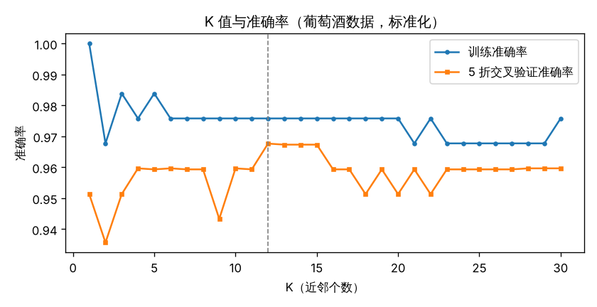
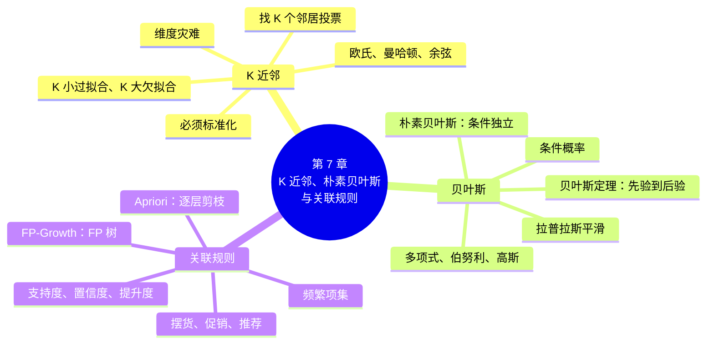

# 第 7 章 K 近邻、朴素贝叶斯与关联规则

!!! abstract "本章学时"
    理论 5 学时 · 实验 2 学时（本章共 3 个实验，教师可任选）

## 学习目标

学完本章，你应该能够：

1. **说出** K 近邻、欧氏距离、贝叶斯定理、朴素贝叶斯、拉普拉斯平滑、支持度、置信度、提升度的含义（记忆）；
2. **解释** K 近邻为什么必须标准化、K 值怎样影响结果，朴素贝叶斯为什么“朴素”，提升度为什么比置信度更能说明规则的价值（理解）；
3. **运用** scikit-learn 训练 K 近邻和朴素贝叶斯分类器，用 mlxtend 挖掘频繁项集和关联规则；手算贝叶斯定理和关联规则的三个指标（应用）；
4. **分析**被误判的短信和“看上去很准却没有意义”的关联规则（分析）；
5. 根据关联规则**撰写**一份给门店经理的摆货和促销建议（创造）。

!!! info "先修要求"
    学习本章前，你需要掌握：

    - 标准化（[2.3 特征编码与特征缩放](../02-preprocessing/index.md#23)）；
    - 混淆矩阵、精确率、召回率（[4.3 混淆矩阵与分类指标](../04-logistic-regression/index.md#43)）；
    - 交叉验证选参数的思路（[6.3.4 gamma 与 C 的组合](../06-svm/index.md#634-gamma-c)）；
    - 概率的基本运算：P(A 且 B)、P(A | B) 的含义（“人工智能数学基础”课程）。

??? abstract "本章概念清单（25 个，点击查看定义和例子）"
    1. [K 近邻](../../appendix/glossary.md#g-K-近邻)
    2. [距离度量](../../appendix/glossary.md#g-距离度量)
    3. [欧氏距离](../../appendix/glossary.md#g-欧氏距离)
    4. [曼哈顿距离](../../appendix/glossary.md#g-曼哈顿距离)
    5. [余弦相似度](../../appendix/glossary.md#g-余弦相似度)
    6. [K 值选择](../../appendix/glossary.md#g-K-值选择)
    7. [维度灾难](../../appendix/glossary.md#g-维度灾难)
    8. [条件概率](../../appendix/glossary.md#g-条件概率)
    9. [贝叶斯定理](../../appendix/glossary.md#g-贝叶斯定理)
    10. [先验概率与后验概率](../../appendix/glossary.md#g-先验概率与后验概率)
    11. [朴素贝叶斯](../../appendix/glossary.md#g-朴素贝叶斯)
    12. [条件独立假设](../../appendix/glossary.md#g-条件独立假设)
    13. [拉普拉斯平滑](../../appendix/glossary.md#g-拉普拉斯平滑)
    14. [高斯朴素贝叶斯](../../appendix/glossary.md#g-高斯朴素贝叶斯)
    15. [多项式朴素贝叶斯](../../appendix/glossary.md#g-多项式朴素贝叶斯)
    16. [关联规则](../../appendix/glossary.md#g-关联规则)
    17. [项集](../../appendix/glossary.md#g-项集)
    18. [支持度](../../appendix/glossary.md#g-支持度)
    19. [频繁项集](../../appendix/glossary.md#g-频繁项集)
    20. [置信度](../../appendix/glossary.md#g-置信度)
    21. [提升度](../../appendix/glossary.md#g-提升度)
    22. [Apriori 算法](../../appendix/glossary.md#g-Apriori-算法)
    23. [FP-Growth 算法](../../appendix/glossary.md#g-FP-Growth-算法)
    24. [购物篮分析](../../appendix/glossary.md#g-购物篮分析)
    25. [推荐系统](../../appendix/glossary.md#g-推荐系统)

## 情景导入

一家连锁超市的数字化部门同时找来了三件事。

第一件，会员中心想给新注册的会员推荐合适的酒：“新会员只填了几项口味偏好，能不能找到和他口味最像的老会员，看老会员都买什么？”

第二件，客服部门每天收到大量用户举报的骚扰短信，想先做一个垃圾短信过滤器：“哪些词一出现，基本就是垃圾短信？”

第三件，门店经理最直接：“我有几万张收银小票，能不能告诉我哪些商品经常被一起买？货架怎么摆，促销怎么搭？”

这三件事分别对应本章的三种方法。**K 近邻**的想法是“近朱者赤，近墨者黑”，找最像的邻居；**朴素贝叶斯**用概率来回答“看到这些词，它是垃圾短信的可能性有多大”；**关联规则**从购物小票中找出“买了 A 的人也常买 B”。三种方法都很简单，却在今天的[推荐系统](../../appendix/glossary.md#g-推荐系统 "根据用户的行为和商品的特点，向用户推荐可能感兴趣的商品或内容的系统"){ .term }、搜索引擎、大模型应用中随处可见。

## 7.1 K 近邻

### 7.1.1 近朱者赤：找最像的邻居

[**K 近邻**](../../appendix/glossary.md#g-K-近邻 "找出与新样本最相近的 K 个已知样本，按它们的类别投票决定新样本类别的方法"){ .term }（K-Nearest Neighbors，KNN）可能是最容易理解的机器学习方法：来了一个新样本，在训练集中找出和它最相近的 K 个样本（邻居），邻居中哪一类最多，就把新样本判为哪一类。做回归时，取 K 个邻居的平均值作为预测值。<sup class="cite">[[1]](#ref7-1)</sup>

KNN 有一个特别之处：**它没有训练过程**。前几章的模型都要先用训练数据求出参数（线性回归的 w、决策树的划分规则），KNN 只是把训练数据存起来，等到预测时再去计算距离、找邻居。这类方法叫“懒惰学习”。好处是训练不花时间，新数据来了直接加进去就行；代价是预测时要和所有训练样本比一遍，训练集很大时预测很慢。

实验 7-1 用葡萄酒数据集做演示：意大利同一产区三个品种的葡萄酒共 178 瓶，每瓶测了酒精度、苹果酸、类黄酮、脯氨酸等 13 项化学成分。<sup class="cite">[[12]](#ref7-12)</sup> 对测试集的第 1 瓶酒，KNN（K = 5）在标准化后的 13 维空间中找到了 5 个最近的训练样本，距离分别为 2.03、2.06、2.21、2.56、2.63，5 个邻居都是品种 0，于是判为品种 0，判断正确。

### 7.1.2 距离度量

“最相近”要用距离来衡量。常用的[**距离度量**](../../appendix/glossary.md#g-距离度量 "衡量两个样本相差多远（或多相似）的计算方法，如欧氏距离、曼哈顿距离、余弦相似度"){ .term }有三种：

- [**欧氏距离**](../../appendix/glossary.md#g-欧氏距离 "两点之间的直线距离：各特征之差的平方和再开平方"){ .term }：两点之间的直线距离，各特征之差的平方和再开方。KNN 默认用它。
- [**曼哈顿距离**](../../appendix/glossary.md#g-曼哈顿距离 "各特征之差的绝对值之和，像在棋盘式街道上只能横走竖走的距离"){ .term }：各特征之差的绝对值之和，像在曼哈顿棋盘式的街道上只能横着走、竖着走。
- [**余弦相似度**](../../appendix/glossary.md#g-余弦相似度 "两个向量夹角的余弦值，只看方向是否一致、不看长短，常用于文本和嵌入向量"){ .term }：两个向量夹角的余弦，只看方向是否一致，不看长短，取值 −1 到 1，越大越相似。常用于文本：一篇长文章和一篇短摘要用词比例相近，方向就相近。

**算一算**：A = (0, 0)，B = (3, 4)。欧氏距离 = √(3² + 4²) = 5；曼哈顿距离 = |3| + |4| = 7。再看 C = (1, 2) 和 D = (2, 4)：欧氏距离 √(1² + 2²) ≈ 2.24，不算近；余弦相似度 = (1 × 2 + 2 × 4) / (√5 × √20) = 10 / 10 = 1，方向完全相同。如果 C、D 是两篇文章中“价格”“质量”两个词的出现次数，D 只是更长，用词比例一样，余弦相似度认为它们最相似。

实验 7-1 第⑤步在葡萄酒数据上比较了三种距离（K = 12），交叉验证准确率分别是 0.968、0.967、0.959，差别很小。对于普通的数值表格数据，欧氏距离通常就够用；文本、嵌入向量等高维数据才更常用余弦相似度。

### 7.1.3 K 值的选择

K 是 KNN 唯一的主要参数，怎样定 K 叫 [**K 值选择**](../../appendix/glossary.md#g-K-值选择 "确定 KNN 中邻居个数 K 的过程：K 太小易过拟合，太大易欠拟合，一般用交叉验证选"){ .term }。

- **K = 1**：只看最近的一个邻居。训练集上每个样本的最近邻就是它自己，训练准确率一定是 1.000；但如果那个邻居恰好是个特殊样本或标错了，新样本就跟着错，决策边界支离破碎，是**过拟合**。
- **K 很大**：比如 K 等于训练集的大小，所有新样本都判为人数最多的那一类，是**欠拟合**。
- **K 适中**：边界比较平滑，又能反映局部的差别。

二分类时 K 一般取奇数，避免平票。和 SVM 的 C、gamma 一样，K 要用交叉验证来选。实验 7-1 第④步的结果：



K = 1 时训练准确率 1.000，交叉验证 0.951；K = 12 时交叉验证最高，为 0.968，测试准确率 0.963。葡萄酒数据比较容易分，K 从 4 到 30 的交叉验证准确率都在 0.94～0.97 之间，曲线有些上下跳动，是因为训练集只有 124 条，每一折只有二十几条验证数据，多对一条、少对一条就差 4 个百分点。数据少时不必死抠“最好的那个 K”，在一段平稳的区间里选一个即可。

下面的动画用实验 7-1 的数据，只取脯氨酸和类黄酮两个特征，可以拖动 K、换距离、开关标准化，点击图中任意位置查看它的邻居：

<iframe class="sim-frame" src="../../sims/knn-regions/main.html" height="900" loading="lazy" title="KNN 决策区域"></iframe>

动画：KNN 决策区域。先选“K = 5，不标准化”，看区域为什么变成一条条竖带；再把 K 从 1 拖到 30，观察边界由锯齿变平滑。[全屏打开](../../sims/knn-regions/main.html){ target=_blank }
{ .sim-caption }

### 7.1.4 为什么一定要标准化

葡萄酒的 13 项成分单位、量级相差悬殊：脯氨酸的取值在 278～1515 之间，标准差 308；非类黄酮酚只在 0.13～0.63 之间，标准差 0.12，相差两千多倍。不标准化时，两瓶酒的距离几乎完全由脯氨酸决定：实验 7-1 中，不标准化找出的 5 个邻居，距离的平方中脯氨酸一项平均就占 70%，其余 12 项成分形同虚设。

结果对比很鲜明：K = 5 时，不标准化的测试准确率只有 0.722（54 瓶错 15 瓶），标准化后达到 0.944（只错 3 瓶）。在上面的动画中，不标准化时分类区域变成了一条条竖带，就是因为距离只看横轴（脯氨酸）。所以，**KNN 和 SVM 一样，用之前一定要标准化**，并且用训练集的均值和标准差去变换测试集。

### 7.1.5 维度灾难

KNN 的前提是“相近的样本类别相同”。但特征越来越多时，会出现一个违反直觉的现象：**所有样本之间的距离都差不多远**，“最近的邻居”和“普通的路人”距离相差无几，“近邻”也就失去了意义。这叫[**维度灾难**](../../appendix/glossary.md#g-维度灾难 "特征维数很高时，样本变得稀疏、彼此距离趋于相同，依赖距离的方法效果变差的现象"){ .term }。<sup class="cite">[[8]](#ref7-8)</sup>

实验 7-1 第⑥步在葡萄酒数据的 13 个特征之外，加入纯随机、与品种无关的特征：

| 特征总数 | 测试准确率 | 最近两个样本的距离 ÷ 平均距离 |
|---|---|---|
| 13 | 0.963 | 0.24 |
| 23 | 0.963 | 0.37 |
| 63 | 0.926 | 0.65 |
| 213 | 0.741 | 0.83 |
| 1013 | 0.537 | 0.93 |

加到 1013 个特征时，最近的两个样本之间的距离已经是平均距离的 93%，几乎“人人都一样远”，KNN 的准确率跌到 0.537。真实数据中，无关、冗余的特征越多，这个问题越严重。应对的办法是做特征选择（第 2 章）或降维（第 8 章），只保留真正有用的特征。

### 7.1.6 KNN 的优缺点

| 优点 | 缺点 |
|---|---|
| 原理简单，没有训练过程，新数据随时加入 | 预测时要和所有训练样本算距离，数据大时很慢 |
| 天然支持多分类，也能做回归 | 必须标准化，对无关特征敏感，有维度灾难 |
| 决策边界可以是任意形状 | 要存下全部训练数据，占内存 |
| 结果容易解释：“和这几个老客户最像” | 类别不平衡时，多数类容易在投票中占优 |

KNN 适合样本量不太大、特征不太多、需要“找相似”的场合，如根据口味找相似会员、根据症状找相似病例。scikit-learn 中用 `KNeighborsClassifier(n_neighbors=5)` 做分类，`KNeighborsRegressor` 做回归。

## 7.2 贝叶斯定理

### 7.2.1 条件概率

[**条件概率**](../../appendix/glossary.md#g-条件概率 "在事件 B 已经发生的条件下事件 A 发生的概率，记作 P(A | B)"){ .term } P(A | B) 是“在 B 已经发生的条件下，A 发生的概率”：

\[
P(A \mid B) = \frac{P(A \text{ 且 } B)}{P(B)}
\]

例如，100 条短信中有 20 条含“免费”，这 20 条中有 15 条是垃圾短信，那么 P(垃圾 | 含“免费”) = 15 / 20 = 0.75。注意 P(A | B) 和 P(B | A) 是两回事：P(含“免费” | 垃圾) 是“垃圾短信中有多少含‘免费’”，假如 100 条中共有 25 条垃圾短信，它就是 15 / 25 = 0.6。

### 7.2.2 贝叶斯定理：检测阳性就一定患病吗

[**贝叶斯定理**](../../appendix/glossary.md#g-贝叶斯定理 "用 P(B|A)、P(A) 和 P(B) 计算 P(A|B) 的公式，把“原因导致结果的概率”反推为“看到结果后原因的概率”"){ .term }告诉我们怎样把 P(B | A) “反过来”变成 P(A | B)：

\[
P(A \mid B) = \frac{P(B \mid A)\,P(A)}{P(B)}
\]

**算一算**：某种疾病的患病率是 1%。一种检测方法，患者检测为阳性的概率是 95%，健康人被误检为阳性的概率是 5%。小李检测结果为阳性，他真正患病的概率是多少？

很多人的第一反应是 95%。用贝叶斯定理算一算。设想 10000 个人去检测：

| | 人数 | 检测阳性 |
|---|---|---|
| 患者 | 10000 × 1% = 100 | 100 × 95% = 95 |
| 健康人 | 9900 | 9900 × 5% = 495 |
| 合计 | 10000 | 590 |

590 个阳性中只有 95 个真正患病，P(患病 | 阳性) = 95 / 590 ≈ **16.1%**。用公式算也一样：P(阳性) = 0.01 × 0.95 + 0.99 × 0.05 = 0.059，P(患病 | 阳性) = 0.95 × 0.01 / 0.059 ≈ 0.161。

结果远低于直觉，是因为患病的人本来就很少（1%），健康人里那 5% 的误检，绝对人数（495）比真正的患者（95）还多。这里，检测之前就知道的 P(患病) = 1% 叫先验概率，看到检测结果后更新得到的 P(患病 | 阳性) = 16.1% 叫后验概率，合称[**先验概率与后验概率**](../../appendix/glossary.md#g-先验概率与后验概率 "看到证据之前对某事发生可能性的估计叫先验概率，看到证据后用贝叶斯定理更新得到的叫后验概率"){ .term }。贝叶斯定理就是“用证据更新判断”的方法。这和第 4 章的类别不平衡是同一个道理：正类很少时，即使模型很准，判为正类的样本中也可能大多是误报。

## 7.3 朴素贝叶斯

### 7.3.1 用贝叶斯定理做分类

把贝叶斯定理用到分类上：给定一条短信的内容（特征 x），它是垃圾短信的概率

\[
P(\text{垃圾} \mid x) = \frac{P(x \mid \text{垃圾})\,P(\text{垃圾})}{P(x)}
\]

分别算出 P(垃圾 | x) 和 P(正常 | x)，哪个大就判为哪一类。两个式子的分母都是 P(x)，比较大小时可以不算，只需比较分子：P(x | 类别) × P(类别)。P(类别) 是先验概率，从训练集中数一数各类的比例就行；难的是 P(x | 类别)：x 是一整条短信，同样内容的短信在训练集中几乎不会再出现，没法直接数。

[**朴素贝叶斯**](../../appendix/glossary.md#g-朴素贝叶斯 "基于贝叶斯定理、假设各个词相互独立的分类算法"){ .term }（Naive Bayes）做了一个大胆的简化：假设在类别确定的条件下，各个特征（各个词）相互独立，互不影响。这叫[**条件独立假设**](../../appendix/glossary.md#g-条件独立假设 "朴素贝叶斯的假设：类别确定后，各个特征之间相互独立，于是整体的条件概率等于各特征条件概率的乘积"){ .term }。有了它，整条短信的概率就等于每个词的概率相乘：

\[
P(x \mid \text{垃圾}) = P(\text{词}_1 \mid \text{垃圾}) \times P(\text{词}_2 \mid \text{垃圾}) \times \cdots
\]

每个词的条件概率很好估计：在训练集的垃圾短信中，数一数这个词出现的次数占全部词数的比例。

这个假设显然不完全对：“免费”和“领取”在垃圾短信中常常一起出现，并不独立。这正是它被称为“朴素”的原因。但实践表明，即使假设不成立，朴素贝叶斯的分类效果往往仍然不错，因为分类只需要比较两类概率谁大，概率值本身不必很准。1998 年，研究者就用它来过滤垃圾邮件<sup class="cite">[[7]](#ref7-7)</sup>，至今它仍是文本分类最常用的基线方法之一。

### 7.3.2 算一算：判断一条短信

训练集有 10 条短信，其中垃圾短信 4 条（共 20 个词），正常短信 6 条（共 30 个词），词表共 10 个不同的词。几个词出现的次数如下：

| 词 | 在垃圾短信中出现 | 在正常短信中出现 |
|---|---|---|
| 免费 | 4 次 | 1 次 |
| 中奖 | 3 次 | 0 次 |
| 开会 | 0 次 | 3 次 |

新来一条短信“免费 中奖”。先验概率 P(垃圾) = 4/10 = 0.4，P(正常) = 0.6。词的条件概率用 7.3.3 节的拉普拉斯平滑计算：(出现次数 + 1) ÷ (该类总词数 + 词表大小)。

- 垃圾：0.4 × (4 + 1)/(20 + 10) × (3 + 1)/(20 + 10) = 0.4 × 0.167 × 0.133 ≈ 0.00889
- 正常：0.6 × (1 + 1)/(30 + 10) × (0 + 1)/(30 + 10) = 0.6 × 0.05 × 0.025 = 0.00075

0.00889 > 0.00075，判为垃圾短信。归一化后，P(垃圾 | “免费 中奖”) = 0.00889 / (0.00889 + 0.00075) ≈ 0.92。

实际计算时，几十上百个小于 1 的概率连乘，结果会小到计算机无法表示（下溢），所以程序中都先取对数，把连乘变成相加。scikit-learn 的 `feature_log_prob_` 属性存的就是各个词条件概率的对数。

### 7.3.3 拉普拉斯平滑

为什么要“加 1”？看另一条短信“免费 开会”。如果直接用出现次数除以总词数，“开会”在垃圾短信中出现 0 次，P(开会 | 垃圾) = 0，连乘后整条短信是垃圾短信的概率就成了 0，不管“免费”多么可疑。一个没见过的词就能“一票否决”，这显然不合理：训练集只有 10 条短信，没见过不等于不可能。

[**拉普拉斯平滑**](../../appendix/glossary.md#g-拉普拉斯平滑 "计算条件概率时给每个词的出现次数都加 1（分母相应加上词表大小），避免没见过的词使概率变成 0"){ .term }的做法是：给每个词的出现次数都加 1，分母相应加上词表大小，保证概率加起来仍然是 1。这样没出现过的词也有一个很小但不为 0 的概率。用平滑后的概率算“免费 开会”：

- 垃圾：0.4 × 5/30 × 1/30 ≈ 0.00222
- 正常：0.6 × 2/40 × 4/40 = 0.003

P(垃圾 | “免费 开会”) = 0.00222 / (0.00222 + 0.003) ≈ 0.43，判为正常短信，但模型没有把话说死。

scikit-learn 中用参数 `alpha` 控制平滑的力度，`alpha=1`（默认）就是拉普拉斯平滑。实验 7-2 发现，词表中有 66% 的词从没在训练集的垃圾短信里出现过。一条测试集中的垃圾短信“Dear Voucher Holder 2 claim your 1st class airport lounge passes……”，含有 airport、lounge 等 5 个从没在垃圾短信中出现的词：几乎不平滑（alpha ≈ 0）时，它被判为垃圾短信的概率是 0.000；alpha = 1 时是 1.000，判断正确。

### 7.3.4 三种朴素贝叶斯

P(特征 | 类别) 的算法要看特征是什么类型，scikit-learn 提供了三种常用的朴素贝叶斯：

| 模型 | 特征类型 | 典型用途 |
|---|---|---|
| [**多项式朴素贝叶斯**](../../appendix/glossary.md#g-多项式朴素贝叶斯 "按每个词在某类中出现次数的比例计算条件概率的朴素贝叶斯，适合词袋等计数特征"){ .term } `MultinomialNB` | 出现次数（词袋） | 垃圾短信、新闻分类 |
| 伯努利朴素贝叶斯 `BernoulliNB` | 出现与否（0/1） | 短文本 |
| [**高斯朴素贝叶斯**](../../appendix/glossary.md#g-高斯朴素贝叶斯 "假设每个连续特征在每一类中服从正态分布、按正态分布计算条件概率的朴素贝叶斯"){ .term } `GaussianNB` | 连续数值 | 身高、检验指标等 |

高斯朴素贝叶斯假设每个特征在每一类中服从正态分布，用训练集算出每类的均值和标准差，再按正态分布的公式计算概率。

朴素贝叶斯的优点是：训练极快（只是数数），数据少时也能工作，天然支持多分类，能处理几万维的稀疏文本特征。实验 7-2 中，它训练 3901 条短信只用了 0.005 秒左右，比逻辑回归快约十倍。缺点是条件独立假设常常不成立，给出的概率值往往过于极端（接近 0 或 1），不宜直接当作真实概率使用。

!!! cert "证书考点 · 人工智能应用工程师 · 机器学习"
    常考：K 近邻的基本步骤；K 值过小容易过拟合、过大容易欠拟合；KNN 需要标准化，没有显式的训练过程；欧氏距离、曼哈顿距离的计算；贝叶斯定理的计算（检测阳性的例子）；朴素贝叶斯的“朴素”指条件独立假设；拉普拉斯平滑用于解决零概率问题；多项式、伯努利、高斯三种朴素贝叶斯分别适用的特征类型。容易错在把 P(A|B) 和 P(B|A) 混为一谈。

## 7.4 关联规则

### 7.4.1 购物篮问题

超市收银台每天打出成千上万张小票，每张小票记录了一位顾客一次买了什么。从这些小票中找出“哪些商品经常被一起买”，叫[**购物篮分析**](../../appendix/glossary.md#g-购物篮分析 "从大量购物记录中找出经常被一起购买的商品组合，用于摆货、促销和推荐"){ .term }。找到的结果写成[**关联规则**](../../appendix/glossary.md#g-关联规则 "形如“如果买了 A，那么也常买 B”的规律 A → B，用支持度、置信度和提升度衡量"){ .term }的形式：{面包} → {牛奶}，读作“买了面包的顾客，也常买牛奶”。箭头左边叫前件，右边叫后件。

关联规则属于无监督学习：小票上没有“标签”，我们也不预测什么，只是在数据中找规律。它在零售业的用途很直接：常一起买的商品放在相邻的货架上，或者反过来放在两头，让顾客穿过整个卖场；搭配促销（买火锅底料送丸子）；线上商城的“买了此商品的顾客还买了……”。

数据挖掘领域广为流传一个“啤酒与尿布”的故事：某超市发现年轻父亲下班买尿布时常顺手买啤酒，于是把两者放在一起，销量双双上升。这个故事的出处和细节都有争议，更像是一个说明关联规则用途的“段子”。实验 7-3 的模拟数据中也放了这个组合，结果它的支持度太低，连频繁项集都进不了。故事好听，结论还是要靠数据说话。

### 7.4.2 支持度、置信度与提升度

先定义几个概念。一张小票中的商品集合叫一个[**项集**](../../appendix/glossary.md#g-项集 "一组商品（项）的集合，包含 k 件商品的叫 k 项集"){ .term }，如 {面包, 牛奶}；包含 k 件商品的叫 k 项集。衡量一个项集、一条规则有三个指标：

- [**支持度**](../../appendix/glossary.md#g-支持度 "同时包含某个项集的小票占全部小票的比例；规则 A → B 的支持度是同时含 A 和 B 的比例"){ .term }：同时包含这些商品的小票占全部小票的比例，说明这个组合**常不常见**。support(A → B) = P(A 且 B)。
- [**置信度**](../../appendix/glossary.md#g-置信度 "规则 A → B 中，含 A 的小票里同时含 B 的比例，即条件概率 P(B | A)"){ .term }：含前件的小票中，同时含后件的比例，说明规则**准不准**。confidence(A → B) = P(B | A)，就是 7.2 节的条件概率。
- [**提升度**](../../appendix/glossary.md#g-提升度 "置信度除以后件的支持度：大于 1 表示买了 A 的人更可能买 B，等于 1 表示无关，小于 1 表示负相关"){ .term }：置信度除以后件本身的支持度，说明买了前件**比一般顾客多大可能**买后件。lift(A → B) = P(B | A) / P(B)。

**算一算**：下面是某门店的 10 张小票。

| 小票 | 商品 | 小票 | 商品 |
|---|---|---|---|
| 1 | 面包、牛奶、鸡蛋 | 6 | 啤酒、花生、薯片 |
| 2 | 面包、牛奶 | 7 | 面包、鸡蛋 |
| 3 | 啤酒、花生 | 8 | 纸尿裤、湿巾、啤酒 |
| 4 | 面包、牛奶、啤酒 | 9 | 面包、牛奶、鸡蛋、薯片 |
| 5 | 牛奶、鸡蛋 | 10 | 啤酒、薯片 |

规则 {面包} → {牛奶}：含面包的有 1、2、4、7、9 共 5 张，含牛奶的有 1、2、4、5、9 共 5 张，两者都含的有 1、2、4、9 共 4 张。

- 支持度 = 4 / 10 = 0.4；
- 置信度 = 4 / 5 = 0.8：买面包的顾客中 80% 也买了牛奶；
- 提升度 = 0.8 / (5/10) = 1.6：买了面包的顾客买牛奶的可能性，是一般顾客的 1.6 倍。

再看 {啤酒} → {花生}：含啤酒 5 张，含花生 2 张，两者都含 2 张（3、6）。支持度 0.2，置信度 2/5 = 0.4，提升度 0.4 / 0.2 = 2.0。置信度只有 0.4，比“面包 → 牛奶”低一半，提升度却更高：花生本来很少有人买（20%），买啤酒的人买花生的比例翻了一倍。反过来 {花生} → {啤酒} 的置信度是 2/2 = 1.0，提升度仍是 2.0：同一对商品，正反两个方向的支持度、提升度相同，置信度可以不同。

最后看 {啤酒} → {面包}：两者都含的只有小票 4，置信度 1/5 = 0.2，提升度 0.2 / 0.5 = 0.4，小于 1，说明买啤酒的顾客反而不太买面包。

**为什么要看提升度？**置信度高不一定说明有关系。实验 7-3 的 3000 张小票中，鸡蛋是最热门的商品，22.6% 的小票里都有。规则 {苹果} → {鸡蛋} 的置信度 0.249，看上去“四个买苹果的人就有一个买鸡蛋”，但提升度只有 1.10：任何一位顾客买鸡蛋的比例本来就有 22.6%，买苹果的人只是略高一点点。只看置信度，热门商品会出现在一大堆规则的后件里，误导决策。**提升度大于 1 且明显偏离 1 的规则才有价值。**

下面的动画就是这 10 张小票，可以自己选前件和后件验证上面的计算：

<iframe class="sim-frame" src="../../sims/assoc-rules/main.html" height="820" loading="lazy" title="关联规则计算器"></iframe>

动画：关联规则计算器。依次点击“面包 → 牛奶”“牛奶 → 面包”“啤酒 → 面包”，比较三个指标。[全屏打开](../../sims/assoc-rules/main.html){ target=_blank }
{ .sim-caption }

### 7.4.3 Apriori 算法

商品有几千种时，可能的组合数是天文数字，不可能把每个组合的支持度都算一遍。实际做法分两步：先找出支持度不低于某个门槛（最小支持度）的项集，叫[**频繁项集**](../../appendix/glossary.md#g-频繁项集 "支持度不低于最小支持度的项集"){ .term }；再从频繁项集中生成置信度不低于最小置信度的规则。

第一步最费时间。[**Apriori 算法**](../../appendix/glossary.md#g-Apriori-算法 "利用“频繁项集的子集也一定频繁”的性质，从 1 项集开始逐层生成、筛选候选项集的频繁项集挖掘算法"){ .term }利用了一个简单的性质：**如果一个项集是频繁的，它的所有子集也一定是频繁的**；反过来，如果 {花生} 不频繁，任何包含花生的项集都不可能频繁，可以直接跳过。<sup class="cite">[[4]](#ref7-4)</sup> 于是算法一层一层地做：


**算一算**：用上面 10 张小票，最小支持度取 0.3。

1. 1 项集：面包 0.5、牛奶 0.5、啤酒 0.5、鸡蛋 0.4、薯片 0.3 是频繁的；花生 0.2、纸尿裤 0.1、湿巾 0.1 不频繁，以后所有含它们的组合都不用算。
2. 2 项集：5 个频繁商品两两组合，共 10 个候选。{面包, 牛奶} 0.4、{面包, 鸡蛋} 0.3、{牛奶, 鸡蛋} 0.3 是频繁的；{啤酒, 薯片} 只有 0.2，其余更低。
3. 3 项集：候选只有 {面包, 牛奶, 鸡蛋}，它的 3 个 2 项子集都频繁，需要计算：支持度 0.2（小票 1、9），不频繁。算法结束。

共得到 5 个频繁 1 项集和 3 个频繁 2 项集。如果不剪枝，8 种商品的组合有 2⁸ − 1 = 255 个，现在只算了 8 + 10 + 1 = 19 个。

最小支持度定得太高，有价值的小众组合会被漏掉（上例中的啤酒和花生）；定得太低，频繁项集和规则会多到看不过来，计算也慢。一般先从较高的值开始，逐步调低，直到规则的数量便于人工审阅。

### 7.4.4 FP-Growth 算法

Apriori 每生成一层候选项集，就要把所有小票扫描一遍，数据量大、项集长时很慢。[**FP-Growth 算法**](../../appendix/glossary.md#g-FP-Growth-算法 "先把所有小票压缩成一棵频繁模式树，再在树上直接挖掘频繁项集、不生成候选项集的算法"){ .term }换了一种思路：只扫描数据两遍，把所有小票压缩成一棵“频繁模式树”（FP 树），共同前缀的小票共用树枝，然后直接在树上挖掘频繁项集，不需要生成候选项集。<sup class="cite">[[5]](#ref7-5)</sup> 两种算法找到的频繁项集完全相同，只是速度不同。实验 7-3 中，最小支持度 0.02 时 Apriori 反而略快（频繁项集只有 80 个）；降到 0.002，频繁项集增加到 1620 个时，FP-Growth 明显更快。mlxtend 库中两者的用法一样，把 `apriori` 换成 `fpgrowth` 即可。<sup class="cite">[[9]](#ref7-9)</sup>

### 7.4.5 从关联规则到推荐

关联规则可以直接变成最简单的推荐：顾客把某件商品放进购物车时，找出以它为前件的规则，按提升度从高到低推荐后件。实验 7-3 的结果：

| 放入购物车 | 推荐（提升度） |
|---|---|
| 火锅底料 | 肥牛卷（11.0）、丸子（9.9）、生菜（6.7） |
| 啤酒 | 鸭脖（4.9）、花生（4.3）、薯片（2.9） |
| 面包 | 牛奶（3.4）、鸡蛋（1.7）、火腿肠（1.7） |

这就是“买了又买”的基本思路。真实的**推荐系统**还要考虑每位顾客自己的历史、商品的库存和利润、推荐的多样性，常用协同过滤等方法，在“人工智能数据分析与处理”课程中详细介绍。关联规则的优点是结果直观、门店经理一看就懂，适合摆货、捆绑促销这类线下决策。

!!! cert "证书考点 · 人工智能数据处理工程师（高级）· 关联规则与智能推荐"
    常考：给出若干条交易记录，计算项集的支持度、规则的置信度和提升度；提升度大于 1、等于 1、小于 1 的含义；Apriori 算法的原理（频繁项集的子集一定频繁，非频繁项集的超集一定非频繁）和步骤；最小支持度、最小置信度的作用；FP-Growth 与 Apriori 的区别（不生成候选项集，只扫描两遍数据）；能根据规则提出摆货、促销或推荐建议。容易错在算置信度时分母用了后件的数量，以及把规则 A → B 和 B → A 的置信度当成一样。

## 7.5 前沿视窗

**K 近邻在大模型时代的新生：向量检索。**大模型应用中常用一种叫“检索增强生成”（RAG）的方法：先把企业的文档切成小段，用嵌入模型把每一段变成一个几百到几千维的向量；用户提问时，把问题也变成向量，在几百万个文档向量中找出与它余弦相似度最高的几段，交给大模型参考着回答。这一步“找最相似的几个”，正是 K 近邻。《自然语言处理导论》第 5 章和第 11 章详细介绍了嵌入向量和 RAG（[链接](https://mingzifu9.github.io/nlp-textbook/)）。

几百万个向量逐一算距离太慢，于是发展出了**近似最近邻**（ANN）检索：不保证找到的一定是最近的，但能在毫秒内找到“足够近”的。常用方法有把向量分桶的倒排索引、把向量压缩编码的乘积量化，以及按“小世界”网络组织向量的 HNSW 图<sup class="cite">[[11]](#ref7-11)</sup>。Meta 开源的 Faiss 库可以在 GPU 上对十亿级向量做相似检索<sup class="cite">[[10]](#ref7-10)</sup>，国产的 Milvus 等向量数据库也被广泛使用。本章 7.1.5 节的维度灾难提醒我们：这些方法之所以有效，是因为好的嵌入向量把“意思相近”的内容放得足够近，而不是随便一堆高维数字都能检索。

**朴素贝叶斯与大模型的思想联系。**大语言模型的核心任务是根据前面的词，预测下一个词的条件概率 P(下一个词 | 前面的词)。朴素贝叶斯假设词与词相互独立，大模型则用几千亿个参数来刻画词与词之间复杂的依赖关系。从“数词频、算概率”到“学习词与词的关系”，是自然语言处理几十年发展的一条主线。

## 本章实验

!!! abstract "实验总览"
    | 实验 | 类型 | 建议时长 | 内容 |
    |---|---|---|---|
    | 实验 7-1 | ★ 基础 | 45 分钟 | 用 KNN 给葡萄酒分类，比较标准化前后的效果，手看一个样本的近邻，画 K 值与准确率的曲线，观察维度灾难 |
    | 实验 7-2 | ★ 基础 | 45 分钟 | 用词袋和多项式朴素贝叶斯过滤垃圾短信，查看最能代表垃圾短信的词，比较平滑参数，分析被误判的短信 |
    | 实验 7-3 | ★ 基础 | 60 分钟 | 用 Apriori 分析 3000 张超市小票，按提升度筛选规则，识别无意义的规则，写一份给门店经理的摆货建议 |

    三个实验都在本机 CPU 上运行，每个脚本不超过 30 秒。实验代码见配套资源 `labs/ch07/` 目录。实验 7-3 需要先安装 mlxtend：`pip install mlxtend`。

### 实验 7-1 ★ KNN 葡萄酒分类与 K 值选择

**实验目的**

1. 用 `KNeighborsClassifier` 做分类，比较标准化前后的效果；
2. 手工找出一个样本的 K 个近邻，理解投票过程；
3. 用交叉验证画出 K 值与准确率的曲线，比较三种距离；
4. 加入无关特征，观察维度灾难。

**实验环境**：本机 CPU。Python 3.11，NumPy、pandas、Matplotlib、scikit-learn。

**实验数据**：scikit-learn 自带的 `load_wine()`，来自 UCI 机器学习库的葡萄酒数据集<sup class="cite">[[12]](#ref7-12)</sup>，178 条，13 项化学成分，3 个品种。按 7 : 3 分层划分。

**实验步骤与代码**

第 1 步，读取数据，查看各特征的取值范围，比较标准化前后的 KNN：

```python
raw = KNeighborsClassifier(n_neighbors=5).fit(X_train, y_train)
std = make_pipeline(StandardScaler(), KNeighborsClassifier(n_neighbors=5)).fit(X_train, y_train)
print(raw.score(X_test, y_test), std.score(X_test, y_test))
```

第 2 步，手工算出测试集第 1 条到所有训练样本的距离，取最近的 5 个，统计票数，与 `predict` 的结果对照：

```python
Z_train, z0 = std[0].transform(X_train), std[0].transform(X_test.iloc[[0]])[0]
d = np.sqrt(((Z_train - z0) ** 2).sum(axis=1))      # 欧氏距离
idx = np.argsort(d)[:5]                              # 最近的 5 个
print(d[idx], y_train[idx], np.bincount(y_train[idx], minlength=3))
```

第 3 步，K 从 1 到 30，计算训练准确率和 5 折交叉验证准确率，画曲线，选出交叉验证最好的 K。

第 4 步，用选出的 K，分别设 `metric="euclidean"`、`"manhattan"`、`"cosine"`，比较三种距离。

第 5 步，在原始特征后面拼接 10、50、200、1000 列标准正态分布的随机数，观察准确率和样本间距离的变化。

完整代码见 `lab7_1_knn_wine.py`。

**运行结果**

```text
共 178 条，13 个特征，3 个品种的条数：[59, 71, 48]
训练集 124 条，测试集 54 条

① 特征的取值范围相差很大（训练集，按标准差排序，取首尾各 3 个）：
                         min      max     std
nonflavanoid_phenols    0.13     0.63    0.12
hue                     0.48     1.71    0.23
ash                     1.36     3.22    0.27
alcalinity_of_ash      10.60    30.00    3.39
magnesium              70.00   162.00   15.23
proline               278.00  1515.00  308.07

② K = 5，标准化前后对比
  不标准化：测试准确率 0.722
  标准化后：测试准确率 0.944

③ 测试集第 1 条（真实品种 0）在标准化空间中的 5 个最近邻：
  第 1 近：训练样本  55，距离 2.03，品种 0
  第 2 近：训练样本  30，距离 2.06，品种 0
  第 3 近：训练样本  57，距离 2.21，品种 0
  第 4 近：训练样本  31，距离 2.56，品种 0
  第 5 近：训练样本  16，距离 2.63，品种 0
  投票：品种 0/1/2 各 [5, 0, 0] 票 → 判为品种 0；predict 给出 0
  不标准化时，5 个最近邻的品种是 [0, 0, 0, 0, 0]；距离的平方中 proline 一项平均占 70%，相当于只按 proline 找邻居
  不标准化时整个测试集：15 条判错；标准化后 3 条

④ K 值与准确率（标准化；交叉验证只用训练集）
  K =  1：训练准确率 1.000，5 折交叉验证准确率 0.951
  K =  3：训练准确率 0.984，5 折交叉验证准确率 0.951
  K =  5：训练准确率 0.984，5 折交叉验证准确率 0.959
  K =  7：训练准确率 0.976，5 折交叉验证准确率 0.959
  K =  9：训练准确率 0.976，5 折交叉验证准确率 0.943
  K = 15：训练准确率 0.976，5 折交叉验证准确率 0.967
  K = 21：训练准确率 0.968，5 折交叉验证准确率 0.959
  K = 30：训练准确率 0.976，5 折交叉验证准确率 0.960
  交叉验证最好的 K = 12（0.968），测试准确率 0.963

⑤ 三种距离（标准化，K = 12）
  euclidean  交叉验证 0.968，测试准确率 0.963
  manhattan  交叉验证 0.967，测试准确率 0.981
  cosine     交叉验证 0.959，测试准确率 0.944

⑥ 维度灾难：加入纯随机的无关特征（标准化，K = 12）
  特征   13 个：测试准确率 0.963；样本间距离 最小 1.2，平均 4.9，最小/平均 = 0.24
  特征   23 个：测试准确率 0.963；样本间距离 最小 2.5，平均 6.7，最小/平均 = 0.37
  特征   63 个：测试准确率 0.926；样本间距离 最小 7.3，平均 11.2，最小/平均 = 0.65
  特征  213 个：测试准确率 0.741；样本间距离 最小 17.2，平均 20.7，最小/平均 = 0.83
  特征 1013 个：测试准确率 0.537；样本间距离 最小 41.8，平均 45.2，最小/平均 = 0.93
```

几点解读：

- ①中脯氨酸的标准差是非类黄酮酚的两千多倍；②中标准化把测试准确率从 0.722 提高到 0.944。
- ③中 5 个邻居全是品种 0，投票 5 : 0；不标准化时，邻居基本是按脯氨酸找的。
- ④中 K = 1 的训练准确率是 1.000，因为每个训练样本的最近邻就是它自己。
- ⑥中特征越多，最近距离与平均距离越接近，KNN 越分不清谁是“近邻”。

**实验记录表**

| 项目 | 结果 |
|---|---|
| K = 5 时不标准化 / 标准化的测试准确率 | |
| 测试集第 1 条的 5 个邻居的品种和票数 | |
| 交叉验证最好的 K 及测试准确率 | |
| 三种距离中交叉验证最好的一种 | |
| 加入 1000 个随机特征后的测试准确率 | |

**常见问题排查**

| 现象 | 原因 | 解决办法 |
|---|---|---|
| 准确率只有 0.7 左右 | 没有标准化 | 用 `make_pipeline(StandardScaler(), KNeighborsClassifier())` |
| 手算的邻居和程序不一致 | 手算时没有用训练集的均值、标准差变换测试样本 | 用流水线第一步 `std[0].transform` |
| `metric="cosine"` 报错 | 用了 `algorithm="kd_tree"` 等不支持余弦距离的算法 | 不指定 `algorithm`，或设为 `"brute"` |
| 第 5 步内存占用大 | 两两距离矩阵太大 | 只在样本少的数据上计算，或用 `sklearn.metrics.pairwise_distances` 分块 |

**思考与练习**

1. 用 `KNeighborsClassifier(n_neighbors=12, weights="distance")`（距离越近，票的权重越大），交叉验证准确率有变化吗？
2. 只用脯氨酸和类黄酮两个特征（同动画），K = 5 时测试准确率是多少？和 13 个特征相比如何？
3. 第 5 步中，如果加入的不是随机数，而是和品种有关的特征，结果会怎样？这说明了什么？

**实验报告要求**

提交 K 值曲线图和运行结果截图，填写实验记录表；用不超过 200 字说明 KNN 为什么需要标准化，以及特征越多越好吗。

### 实验 7-2 ★ 朴素贝叶斯垃圾短信过滤

**实验目的**

1. 用 `CountVectorizer` 把短信变成词袋特征，理解稀疏矩阵；
2. 训练多项式朴素贝叶斯，与逻辑回归比较准确率、精确率、召回率和训练时间；
3. 查看各个词的条件概率，找出最能代表垃圾短信的词；
4. 比较不同平滑参数的效果，分析被误判的短信。

**实验环境**：同实验 7-1。

**实验数据**：`labs/data/sms_spam.csv`，UCI 机器学习库的 SMS Spam Collection 数据集<sup class="cite">[[6]](#ref7-6)</sup>，5574 条英文手机短信，其中垃圾短信 747 条（13.4%），按 CC BY 4.0 许可使用。这是公开的真实数据，内容是英文；中文短信需要先用 jieba 等工具分词，其他步骤完全一样（见《自然语言处理导论》第 2、6 章）。

**实验步骤与代码**

第 1 步，读取数据，分层划分，用 `CountVectorizer` 建立词表并把短信变成词频矩阵。词表只能用训练集建立（`fit_transform`），测试集只做 `transform`，道理和第 2 章的标准化一样：

```python
vec = CountVectorizer()
X_train = vec.fit_transform(X_train_txt)
X_test = vec.transform(X_test_txt)
```

第 2 步，训练多项式朴素贝叶斯和逻辑回归，计算各项指标：

```python
nb = MultinomialNB()                 # alpha=1.0，拉普拉斯平滑
nb.fit(X_train, y_train)
pred = nb.predict(X_test)
print(confusion_matrix(y_test, pred), precision_score(y_test, pred), recall_score(y_test, pred))
```

第 3 步，取出 `feature_log_prob_`（第 0 行是各词在正常短信中的条件概率的对数，第 1 行是在垃圾短信中的），按两者之比排序：

```python
logp = nb.feature_log_prob_
ratio = logp[1] - logp[0]            # 对数相减 = 概率相除
words = vec.get_feature_names_out()
print(words[np.argsort(-ratio)[:10]])
```

第 4 步，`alpha` 取 1e-10、0.01、0.1、1，比较效果，并找一条受平滑影响的短信。

第 5 步，列出漏判和误判的短信及模型给出的垃圾概率。

完整代码见 `lab7_2_naive_bayes_sms.py`。

**运行结果**

```text
共 5574 条短信，垃圾短信 747 条（13.4%）
训练集 3901 条，测试集 1673 条（垃圾短信 224 条）

① 词袋：训练集词表 7179 个词；矩阵 3901 × 7179，非零元素只占 0.18%
  例：“Its on in engalnd! But telly has decided it won't let me watch it and mia and elliot were kissing! Damn it!”
  → {'its': 1, 'on': 1, 'in': 1, 'engalnd': 1, 'but': 1, 'telly': 1, 'has': 1, 'decided': 1, 'it': 3, 'won': 1, 'let': 1, 'me': 1, 'watch': 1, 'and': 2, 'mia': 1, 'elliot': 1, 'were': 1, 'kissing': 1, 'damn': 1}

② 模型对比（测试集）
  多项式朴素贝叶斯              准确率 0.984  精确率 0.967  召回率 0.911  漏判  20  误判  7  用时 0.005 秒
  逻辑回归                  准确率 0.984  精确率 1.000  召回率 0.879  漏判  27  误判  0  用时 0.047 秒

③ 先验概率：P(垃圾) = 0.134，P(正常) = 0.866
  最能代表垃圾短信的词（P(词|垃圾) ÷ P(词|正常) 最大，且在训练集中出现至少 20 次）：
   claim（207 倍），prize（156 倍），150p（119 倍），18（103 倍），tone（98 倍），500（95 倍），cs（93 倍），guaranteed（88 倍），awarded（74 倍），1000（72 倍）
  最能代表正常短信的词：
   gt（87 倍），lt（86 倍），he（60 倍），lor（44 倍），da（43 倍），she（38 倍），later（37 倍），amp（25 倍），anything（25 倍），ask（24 倍）
  P(free | 垃圾) = 0.00870，P(free | 正常) = 0.00078
  P(call | 垃圾) = 0.01279，P(call | 正常) = 0.00330
  P(you | 垃圾) = 0.01077，P(you | 正常) = 0.02645
  P(love | 垃圾) = 0.00052，P(love | 正常) = 0.00307

④ 拉普拉斯平滑的作用
  词表中有 4758 个词从没在训练集的垃圾短信里出现过（占 66%）
  alpha = 1e-10  准确率 0.983  精确率 0.962  召回率 0.906
  alpha = 0.01   准确率 0.986  精确率 0.976  召回率 0.920
  alpha = 0.1    准确率 0.987  精确率 0.972  召回率 0.933
  alpha = 1      准确率 0.984  精确率 0.967  召回率 0.911
  例：“Dear Voucher Holder 2 claim your 1st class airport lounge passes when using Your……”
  其中 ['airport', 'booking', 'class', 'lounge', 'quote'] 从没在训练集的垃圾短信里出现过；alpha ≈ 0 时 P(这些词 | 垃圾) ≈ 0，整条短信判为垃圾的概率 0.000；alpha = 1 时为 1.000

⑤ 漏判的垃圾短信共 20 条，其中 5 条：
  [0.000] Sorry I missed your call let's talk when you have the time. I'm on 07090201529
  [0.000] Do you realize that in about 40 years, we'll have thousands of old ladies running around w
  [0.004] For sale - arsenal dartboard. Good condition but no doubles or trebles!
  [0.006] Xmas & New Years Eve tickets are now on sale from the club, during the day from 10am till 
  [0.224] Ever thought about living a good life with a perfect partner? Just txt back NAME and AGE t
  误判为垃圾的正常短信共 7 条：
  [0.973] We have sent JD for Customer Service cum Accounts Executive to ur mail id, For details con
  [0.843] Nokia phone is lovly..
  [0.791] Have you laid your airtel line to rest?
  [0.648] Can u get pic msgs to your phone?
  [0.579] Mathews or tait or edwards or anderson
  [0.530] Also andros ice etc etc
  [0.526] Your daily text from me – a favour this time
```

用时因电脑而异，其余数字应与上面相同。几点解读：

- ①中词频矩阵 99.8% 以上的元素是 0，叫**稀疏矩阵**，scikit-learn 只存非零元素，所以几千维也不占多少内存。
- ②中两个模型准确率相同，但朴素贝叶斯召回率更高（多抓 7 条垃圾短信），代价是 7 条误判；逻辑回归一条都没误判。对用户来说，正常短信被拦掉通常比收到一条垃圾短信更糟，所以要结合第 4 章的方法按代价选阈值。
- ③中最能代表垃圾短信的是 claim（领取）、prize（奖品）、150p（每条 1.5 英镑的收费标准）、guaranteed（保证）、awarded（获奖）等，和我们收到的中文骚扰短信如出一辙；最能代表正常短信的 gt、lt 是短信中 “&gt;” “&lt;” 等转义字符的残留，lor、da 是新加坡、印度一带的口语词。
- ④中 alpha 取 0.1 最好，比默认的 1 略好。alpha 也是超参数，可以用交叉验证选。
- ⑤中漏判的垃圾短信大多是用聊天口吻写的交友、广告短信，用词和正常短信很像；有的看上去完全正常（如“Sorry I missed your call……”），可能是标注时就有疑问。误判的正常短信多含 phone、line、text、customer service 等常在推销短信中出现的词。漏判的 20 条中约一半是付费交友类短信，内容不宜印在教材里，运行代码可以看到。

**实验记录表**

| 项目 | 朴素贝叶斯 | 逻辑回归 |
|---|---|---|
| 准确率 | | |
| 精确率 | | |
| 召回率 | | |
| 漏判 / 误判条数 | | |
| 训练用时 | | |

**常见问题排查**

| 现象 | 原因 | 解决办法 |
|---|---|---|
| `ValueError: Negative values in data passed to MultinomialNB` | 特征做了标准化，出现负数 | 多项式朴素贝叶斯只接受非负的计数特征，不要标准化 |
| 测试集 `transform` 后列数不同 | 测试集也用了 `fit_transform` | 测试集只能用 `transform` |
| 读入的短信有乱码 | 编码不对 | `pd.read_csv(..., encoding="utf-8-sig")` |
| 打印 `X_train` 只显示一行摘要 | 它是稀疏矩阵 | 用 `X_train[0].toarray()` 查看一行 |

**思考与练习**

1. 用 `CountVectorizer(stop_words="english")` 去掉 you、the 等常用词，结果有变化吗？为什么朴素贝叶斯不太受这些词的影响？
2. 把判为垃圾短信的阈值从 0.5 提高到 0.9，误判和漏判各变成多少？
3. 如果要在你的手机上过滤中文骚扰短信，还需要做哪些工作？

**实验报告要求**

提交运行结果截图，填写实验记录表；从漏判、误判的短信中各选两条，分析模型为什么判错，提出一条改进建议。

### 实验 7-3 ★ 超市购物篮分析

**实验目的**

1. 把购物小票转成 0/1 表，用 mlxtend 的 Apriori 挖掘频繁项集和关联规则；
2. 手算一条规则的三个指标，与程序结果核对；
3. 按提升度筛选规则，识别“置信度看上去不低却没有意义”的规则；
4. 比较 Apriori 与 FP-Growth，做一个简单的“买了又买”推荐，写一份给门店经理的建议。

**实验环境**：同实验 7-1，另需 mlxtend：`pip install mlxtend`。

**实验数据**：`labs/data/basket.csv`，3000 张模拟的社区超市购物小票，31 种商品，平均每张 2.9 件。数据由 `labs/data/make_datasets.py` 按早餐、火锅、看球、宝宝用品、洗漱、宵夜等购物场景生成，内容为虚构。

**实验步骤与代码**

第 1 步，读取小票，用 `TransactionEncoder` 转成 0/1 表，每行一张小票，每列一种商品：

```python
transactions = df["商品"].str.split("|").tolist()
te = TransactionEncoder()
X = pd.DataFrame(te.fit(transactions).transform(transactions), columns=te.columns_)
```

第 2 步，手算 {面包} → {牛奶} 的支持度、置信度、提升度。

第 3 步，Apriori 找频繁项集，再生成规则：

```python
freq = apriori(X, min_support=0.02, use_colnames=True)
rules = association_rules(freq, metric="confidence", min_threshold=0.3)
print(rules.sort_values("lift", ascending=False)[["antecedents", "consequents", "support", "confidence", "lift"]])
```

第 4 步，把最小置信度降到 0.15，查看后件是鸡蛋、矿泉水、纸巾等热门商品的规则。

第 5 步，用 `fpgrowth` 代替 `apriori`，核对结果，比较不同最小支持度下的用时。

第 6 步，对几种商品，找出以它为前件、提升度最高的 3 条规则，作为推荐。

完整代码见 `lab7_3_basket.py`。

**运行结果**

```text
共 3000 张小票，平均每张 2.9 件商品
前 3 张： [['鸡蛋'], ['可乐', '洗衣液', '苹果', '鸡蛋'], ['丸子', '火锅底料', '生菜', '矿泉水', '肥牛卷']]

① 0/1 表：3000 行 × 31 列（商品种数）
  单个商品的支持度（前 8）：鸡蛋 0.226，矿泉水 0.196，牛奶 0.183，面包 0.166，纸巾 0.160，啤酒 0.128，苹果 0.127，香蕉 0.120

② 规则 {面包} → {牛奶}：含面包 499 张，含牛奶 548 张，同时含两者 309 张
  支持度 = 309/3000 = 0.103；置信度 = 309/499 = 0.619；提升度 = 0.619 ÷ 0.183 = 3.39

③ Apriori（最小支持度 0.02）：频繁项集 80 个，其中 1 项 31 个、2 项 46 个、3 项 3 个、4 项 0 个
  支持度最高的 3 项及以上项集：
    {牛奶、面包、鸡蛋}  0.040
    {丸子、火锅底料、肥牛卷}  0.030
    {火锅底料、生菜、肥牛卷}  0.027

④ 置信度 ≥ 0.3 的单商品规则共 27 条，按提升度排序：
        规则  support  confidence   lift
火锅底料 → 肥牛卷    0.048       0.763 11.007
肥牛卷 → 火锅底料    0.048       0.697 11.007
   牙刷 → 牙膏    0.034       0.571 10.070
   牙膏 → 牙刷    0.034       0.594 10.070
 火锅底料 → 丸子    0.039       0.621  9.910
 丸子 → 火锅底料    0.039       0.628  9.910
  纸尿裤 → 湿巾    0.036       0.712  8.448
  湿巾 → 纸尿裤    0.036       0.431  8.448
  方便面 → 卤蛋    0.024       0.320  7.800
  卤蛋 → 方便面    0.024       0.577  7.800
  丸子 → 肥牛卷    0.030       0.473  6.828
  肥牛卷 → 丸子    0.030       0.428  6.828
 火锅底料 → 生菜    0.035       0.547  6.702
 生菜 → 火锅底料    0.035       0.424  6.702
 火腿肠 → 方便面    0.040       0.410  5.535
 方便面 → 火腿肠    0.040       0.541  5.535
   鸭脖 → 啤酒    0.029       0.628  4.891
  肥牛卷 → 生菜    0.027       0.389  4.768
  生菜 → 肥牛卷    0.027       0.331  4.768
   啤酒 → 花生    0.041       0.317  4.282
   花生 → 啤酒    0.041       0.550  4.282
   丸子 → 生菜    0.020       0.319  3.908
   牛奶 → 面包    0.103       0.564  3.390
   面包 → 牛奶    0.103       0.619  3.390
   薯片 → 啤酒    0.041       0.378  2.946
   啤酒 → 薯片    0.041       0.322  2.946
   面包 → 鸡蛋    0.066       0.395  1.749

⑤ 换一个角度：后件是“鸡蛋”“矿泉水”这类热门商品的规则（置信度看上去不低，提升度却接近 1）
      规则  support  confidence  lift
 面包 → 鸡蛋    0.066       0.395 1.749
 牛奶 → 鸡蛋    0.055       0.299 1.326
可乐 → 矿泉水    0.027       0.253 1.289
 苹果 → 鸡蛋    0.032       0.249 1.105
 纸巾 → 鸡蛋    0.039       0.242 1.071
火腿肠 → 鸡蛋    0.023       0.239 1.059

  传说中的 {纸尿裤} → {啤酒}：支持度 0.011（低于 0.02，没进频繁项集），置信度 0.216，提升度 1.68

⑥ FP-Growth：频繁项集 80 个，与 Apriori 完全相同：True
  最小支持度 0.02   频繁项集   80 个；Apriori 0.008 秒，FP-Growth 0.024 秒
  最小支持度 0.005  频繁项集  531 个；Apriori 0.326 秒，FP-Growth 0.069 秒
  最小支持度 0.002  频繁项集 1620 个；Apriori 0.408 秒，FP-Growth 0.132 秒

⑦ “买了又买”推荐（规则前件为该商品，置信度 ≥ 0.15，按提升度取前 3）
  放入“火锅底料” → 肥牛卷（置信度 0.76，提升度 11.0），丸子（置信度 0.62，提升度 9.9），生菜（置信度 0.55，提升度 6.7）
  放入“啤酒” → 鸭脖（置信度 0.22，提升度 4.9），花生（置信度 0.32，提升度 4.3），薯片（置信度 0.32，提升度 2.9）
  放入“面包” → 牛奶（置信度 0.62，提升度 3.4），鸡蛋（置信度 0.39，提升度 1.7），火腿肠（置信度 0.17，提升度 1.7）
  放入“纸尿裤” → 湿巾（置信度 0.71，提升度 8.4）
```

用时因电脑而异。几点解读：

- ②中手算结果与程序一致：买面包的顾客 61.9% 也买了牛奶，是一般顾客（18.3%）的 3.39 倍。
- ④中提升度最高的是火锅组合、牙膏牙刷、纸尿裤湿巾，都是“一个场景一起买”的商品。注意 {纸尿裤} → {湿巾} 的置信度 0.71，反过来 {湿巾} → {纸尿裤} 只有 0.43：买湿巾的人不一定有宝宝。
- ⑤中 {面包} → {鸡蛋} 置信度 0.395，几乎和 {啤酒} → {花生} 一样，但提升度只有 1.75，因为鸡蛋本来就有 22.6% 的人买。其余几条提升度都在 1.06～1.33 之间，基本没有关联。
- “纸尿裤 → 啤酒”支持度只有 0.011，提升度 1.68，在 3000 张小票中只有 33 张同时含两者，不足以支撑“把啤酒摆到尿布旁边”的决策。

**实验记录表**

| 项目 | 结果 |
|---|---|
| 频繁项集个数（最小支持度 0.02） | |
| 提升度最高的 3 条规则 | |
| 一条置信度不低但提升度接近 1 的规则 | |
| Apriori 与 FP-Growth 结果是否一致 | |
| 你会给“啤酒”货架旁摆什么 | |

**常见问题排查**

| 现象 | 原因 | 解决办法 |
|---|---|---|
| `ModuleNotFoundError: No module named 'mlxtend'` | 没有安装 | `pip install mlxtend` |
| `apriori` 报 DataFrame 类型的警告或错误 | 0/1 表的值不是 True/False | 用 `TransactionEncoder` 生成的布尔表，或 `.astype(bool)` |
| 一条规则也没有 | 最小支持度或最小置信度太高 | 逐步调低，比如支持度 0.01、置信度 0.2 |
| 规则太多看不过来 | 门槛太低 | 调高门槛，按提升度排序，只看前件、后件各一件商品的规则 |

**思考与练习**

1. 把最小支持度降到 0.01，会多出哪些规则？其中有没有值得门店关注的？
2. 找出提升度小于 1 的商品对，它们说明了什么？
3. 关联规则说明“经常一起买”，能不能说明“因为买了 A 所以买 B”？举例说明。

**实验报告要求**

提交运行结果截图，填写实验记录表；以“给门店经理的摆货和促销建议”为题，写一份不超过 400 字的报告：结论先行，至少给出 3 条建议，每条写清依据的规则和三个指标，并说明数据的局限（如只有一个月、一家门店的数据）。

## 本章小结

- **K 近邻**找出训练集中与新样本最近的 K 个邻居投票，没有训练过程。常用**欧氏距离**、**曼哈顿距离**，文本和向量常用**余弦相似度**。**K 值选择**：K 小易过拟合，K 大易欠拟合，用交叉验证选。KNN 必须标准化；特征太多时出现**维度灾难**，距离失去区分能力。
- **条件概率** P(A | B) 是 B 发生条件下 A 的概率。**贝叶斯定理**把 P(B | A) 反过来算成 P(A | B)，从**先验概率与后验概率**的角度，是“用证据更新判断”。患病率低时，检测阳性的人中真正患病的可能只占少数。
- **朴素贝叶斯**基于贝叶斯定理，用**条件独立假设**把整条文本的概率变成各个词概率的乘积。**拉普拉斯平滑**给每个词的次数加 1，避免没见过的词使概率为 0。**多项式朴素贝叶斯**适合词频，**高斯朴素贝叶斯**适合连续数值。它训练极快，是文本分类的常用基线。
- **购物篮分析**从小票中找**关联规则** A → B。**支持度**看组合常不常见，**置信度**是条件概率 P(B | A)，**提升度**看买 A 的人比一般人多大可能买 B，提升度明显大于 1 的规则才有价值。
- **Apriori 算法**利用“频繁项集的子集一定频繁”逐层剪枝找**频繁项集**；**FP-Growth 算法**把数据压缩成树，不生成候选项集，数据大时更快。关联规则可以直接用于摆货、促销和简单的“买了又买”推荐。



**下一章预告**

关联规则是一种无监督学习：小票没有标签，我们只是在数据里找规律。下一章继续学习无监督学习中最常用的三类方法：把客户按消费习惯自动分成几群的**聚类**，把几十个特征压缩成两三个、方便画图和建模的**降维**，以及从大量交易中找出可疑记录的**异常检测**。

## 参考文献

正文中的上标编号（如<sup class="cite">[[1]](#ref7-1)</sup>）对应下面的文献。带链接的可以直接打开；书籍可在图书馆或电子书平台查阅。

<div class="refs" markdown>

**教材与专著**

- <span id="ref7-2"></span>[2] 周志华. 机器学习[M]. 北京: 清华大学出版社, 2016.
    <span class="ref-note">第 7 章“贝叶斯分类器”讲贝叶斯决策论、朴素贝叶斯和拉普拉斯修正，第 10 章开头讲 k 近邻学习，并讨论了维数灾难，对应 7.1 至 7.3 节。</span>

**经典论文**

- <span id="ref7-1"></span>[1] COVER T, HART P. Nearest neighbor pattern classification[J]. IEEE Transactions on Information Theory, 1967, 13(1): 21-27.
    <span class="ref-note">最近邻分类的经典论文，证明了样本足够多时，最近邻分类的错误率不超过最优分类器错误率的两倍，对应 7.1.1 节。</span>
- <span id="ref7-3"></span>[3] AGRAWAL R, IMIELIŃSKI T, SWAMI A. Mining association rules between sets of items in large databases[C]//Proceedings of the 1993 ACM SIGMOD International Conference on Management of Data. Washington: ACM, 1993: 207-216.
    <span class="ref-note">提出关联规则挖掘问题，定义了支持度和置信度，以超市交易数据为例，对应 7.4.1、7.4.2 节。</span>
- <span id="ref7-4"></span>[4] AGRAWAL R, SRIKANT R. Fast algorithms for mining association rules[C]//Proceedings of the 20th International Conference on Very Large Data Bases. Santiago: Morgan Kaufmann, 1994: 487-499.
    <span class="ref-note">提出 Apriori 算法，利用“频繁项集的子集也频繁”的性质逐层生成和剪枝候选项集，对应 7.4.3 节。</span>
- <span id="ref7-5"></span>[5] HAN J, PEI J, YIN Y. Mining frequent patterns without candidate generation[C]//Proceedings of the 2000 ACM SIGMOD International Conference on Management of Data. Dallas: ACM, 2000: 1-12.
    <span class="ref-note">提出 FP-Growth 算法和 FP 树结构，不生成候选项集即可挖掘频繁项集，对应 7.4.4 节。</span>
- <span id="ref7-6"></span>[6] ALMEIDA T A, GÓMEZ HIDALGO J M, YAMAKAMI A. Contributions to the study of SMS spam filtering: new collection and results[C]//Proceedings of the 11th ACM Symposium on Document Engineering. Mountain View: ACM, 2011: 259-262.
    <span class="ref-note">SMS Spam Collection 数据集的原始论文，介绍了数据的收集方法，并比较了朴素贝叶斯、SVM 等方法的过滤效果，对应实验 7-2。</span>
- <span id="ref7-7"></span>[7] SAHAMI M, DUMAIS S, HECKERMAN D, et al. A Bayesian approach to filtering junk e-mail[C]//Learning for Text Categorization: Papers from the 1998 Workshop. Madison: AAAI Press, 1998: 55-62.
    <span class="ref-note">最早用朴素贝叶斯过滤垃圾邮件的论文之一，并讨论了把误判正常邮件的代价考虑进阈值，对应 7.3.1 节。</span>
- <span id="ref7-8"></span>[8] BEYER K, GOLDSTEIN J, RAMAKRISHNAN R, et al. When is "nearest neighbor" meaningful?[C]//Database Theory — ICDT'99. Berlin: Springer, 1999: 217-235.
    <span class="ref-note">证明在很宽的条件下，维数增加时最近点与最远点的距离之比趋于 1，“最近邻”失去意义，对应 7.1.5 节。</span>
- <span id="ref7-10"></span>[10] JOHNSON J, DOUZE M, JÉGOU H. Billion-scale similarity search with GPUs[J]. IEEE Transactions on Big Data, 2021, 7(3): 535-547.
    <span class="ref-note">Faiss 向量检索库的论文，介绍在 GPU 上对十亿级向量做近似最近邻检索的方法，对应 7.5 节。</span>
- <span id="ref7-11"></span>[11] MALKOV Y A, YASHUNIN D A. Efficient and robust approximate nearest neighbor search using hierarchical navigable small world graphs[J]. IEEE Transactions on Pattern Analysis and Machine Intelligence, 2020, 42(4): 824-836.
    <span class="ref-note">提出 HNSW 图索引，是当前向量数据库最常用的近似最近邻检索方法之一，对应 7.5 节。</span>

**在线资源与数据**

- <span id="ref7-9"></span>[9] RASCHKA S. MLxtend: providing machine learning and data science utilities and extensions to Python's scientific computing stack[J]. Journal of Open Source Software, 2018, 3(24): 638.
    <span class="ref-note">mlxtend 库的介绍论文，实验 7-3 用到的 `TransactionEncoder`、`apriori`、`fpgrowth`、`association_rules` 都来自这个库。</span>
- <span id="ref7-12"></span>[12] AEBERHARD S, FORINA M. Wine[DS/OL]. UCI Machine Learning Repository, 1991. https://doi.org/10.24432/C5PC7J.
    <span class="ref-note">葡萄酒数据集，意大利同一产区三个品种葡萄酒的 13 项化学分析结果，scikit-learn 的 `load_wine()` 即为该数据，对应 7.1 节和实验 7-1。</span>

</div>

## 课后练习

选择题和判断题可以直接点击选项作答，系统会马上告诉你对错，并展开答案与解析；多选题选好后点“提交答案”。简答和实操题请先自己作答，再点开“答案与解析”核对。每道题的解析下方都有“回看”链接，做错了可以直接跳回正文复习。

**一、单项选择题**

<div class="quiz" data-answer="B" markdown>

**1.** 关于 K 近邻算法，下列说法正确的是（　　）。

- A. 训练时要用梯度下降求出每个特征的权重
- B. 训练时只是把训练数据存起来，预测时才计算距离、找邻居
- C. K 值越大，模型越容易过拟合
- D. 不需要对特征做标准化

</div>

??? tip "答案与解析"
    **答案：B**

    KNN 没有显式的训练过程，属于“懒惰学习”。K 越小越容易过拟合，C 错；KNN 依赖距离，必须标准化，D 错。

    考查：K 近邻 · 认知层次：理解 · [回看 7.1.1](#711)
    { .quiz-meta }

<div class="quiz" data-answer="C" markdown>

**2.** 点 A(1, 2) 与点 B(4, 6) 之间的欧氏距离和曼哈顿距离分别是（　　）。

- A. 7 和 5
- B. 5 和 5
- C. 5 和 7
- D. 25 和 7

</div>

??? tip "答案与解析"
    **答案：C**

    差为 (3, 4)。欧氏距离 √(3² + 4²) = 5；曼哈顿距离 3 + 4 = 7。D 中的 25 忘了开平方。

    考查：欧氏距离、曼哈顿距离 · 认知层次：应用 · [回看 7.1.2](#712)
    { .quiz-meta }

<div class="quiz" data-answer="A" markdown>

**3.** 用 KNN 对客户分类，特征有“年收入（元）”和“年龄（岁）”。没有标准化时，最可能出现的问题是（　　）。

- A. 距离几乎只由年收入决定，年龄的作用被忽略
- B. 距离几乎只由年龄决定
- C. 模型无法运行
- D. 不会有任何影响

</div>

??? tip "答案与解析"
    **答案：A**

    年收入数值在几万到几十万，年龄只有几十，差的平方相差上万倍。实验 7-1 中，不标准化时脯氨酸一项平均占距离平方的 70%，准确率从 0.944 降到 0.722。

    考查：K 近邻、距离度量 · 认知层次：分析 · [回看 7.1.4](#714)
    { .quiz-meta }

<div class="quiz" data-answer="D" markdown>

**4.** 某病患病率 2%，患者检测阳性的概率为 90%，健康人误检为阳性的概率为 10%。一个人检测阳性，他真正患病的概率约为（　　）。

- A. 90%
- B. 50%
- C. 2%
- D. 15.5%

</div>

??? tip "答案与解析"
    **答案：D**

    设 1000 人：患者 20 人，阳性 18 人；健康人 980 人，阳性 98 人。P(患病 | 阳性) = 18 / (18 + 98) = 18 / 116 ≈ 15.5%。

    考查：贝叶斯定理 · 认知层次：应用 · [回看 7.2.2](#722)
    { .quiz-meta }

<div class="quiz" data-answer="B" markdown>

**5.** 朴素贝叶斯中的“朴素”指的是（　　）。

- A. 算法只能处理两个类别
- B. 假设在类别确定的条件下，各个特征相互独立
- C. 不需要训练数据
- D. 所有特征的权重相等

</div>

??? tip "答案与解析"
    **答案：B**

    条件独立假设让整体的条件概率等于各特征条件概率的乘积。这个假设常不完全成立，所以叫“朴素”。

    考查：条件独立假设 · 认知层次：记忆 · [回看 7.3.1](#731)
    { .quiz-meta }

<div class="quiz" data-answer="C" markdown>

**6.** 朴素贝叶斯中使用拉普拉斯平滑的主要目的是（　　）。

- A. 加快训练速度
- B. 让特征满足条件独立
- C. 避免训练集中没出现过的词使条件概率为 0
- D. 对特征做标准化

</div>

??? tip "答案与解析"
    **答案：C**

    某个词在某类中出现 0 次，不平滑时条件概率为 0，连乘后整条文本属于该类的概率就是 0，一个词就能“一票否决”。

    考查：拉普拉斯平滑 · 认知层次：理解 · [回看 7.3.3](#733)
    { .quiz-meta }

<div class="quiz" data-answer="A" markdown>

**7.** 1000 张小票中，含面包的 200 张，含牛奶的 250 张，同时含两者的 120 张。规则 {面包} → {牛奶} 的置信度是（　　）。

- A. 0.6
- B. 0.48
- C. 0.12
- D. 2.4

</div>

??? tip "答案与解析"
    **答案：A**

    置信度 = 同时含两者的数量 ÷ 含前件的数量 = 120 / 200 = 0.6。B 是 120/250，即反方向规则的置信度；C 是支持度；D 是提升度 0.6 / 0.25。

    考查：置信度 · 认知层次：应用 · [回看 7.4.2](#742)
    { .quiz-meta }

<div class="quiz" data-answer="D" markdown>

**8.** 一条关联规则的置信度为 0.3，后件本身的支持度为 0.3，它的提升度为 1。这说明（　　）。

- A. 这条规则非常有价值
- B. 买了前件的顾客一定会买后件
- C. 前件和后件负相关
- D. 前件和后件基本没有关联

</div>

??? tip "答案与解析"
    **答案：D**

    提升度 = 1 表示买了前件的顾客买后件的比例和一般顾客一样，两者独立；大于 1 正相关，小于 1 负相关。

    考查：提升度 · 认知层次：理解 · [回看 7.4.2](#742)
    { .quiz-meta }

<div class="quiz" data-answer="B" markdown>

**9.** Apriori 算法能够大量减少计算量，依据的性质是（　　）。

- A. 频繁项集的超集一定频繁
- B. 非频繁项集的超集一定不频繁
- C. 置信度高的规则提升度一定高
- D. 支持度越高的项集包含的商品越多

</div>

??? tip "答案与解析"
    **答案：B**

    频繁项集的子集一定频繁，等价地，非频繁项集的所有超集都不频繁，可以直接剪掉。A 说反了。

    考查：Apriori 算法 · 认知层次：理解 · [回看 7.4.3](#743-apriori)
    { .quiz-meta }

**二、多项选择题**

<div class="quiz quiz-multi" data-answer="ABD" markdown>

**1.** 关于 K 值的选择，下列说法正确的有（　　）。

- A. K = 1 时训练准确率一定是 1，但容易过拟合
- B. K 过大时，少数类可能被多数类“淹没”
- C. K 值越大越好
- D. 应该用交叉验证来选择 K

</div>

??? tip "答案与解析"
    **答案：ABD**

    K 太大会欠拟合，极端情况下所有样本都判为人数最多的一类，C 错。

    考查：K 值选择 · 认知层次：理解 · [回看 7.1.3](#713-k)
    { .quiz-meta }

<div class="quiz quiz-multi" data-answer="ACD" markdown>

**2.** 关于维度灾难，下列说法正确的有（　　）。

- A. 特征维数很高时，样本之间的距离趋于相同
- B. 特征越多，KNN 的效果一定越好
- C. 加入大量无关特征会降低 KNN 的准确率
- D. 特征选择和降维是常用的应对办法

</div>

??? tip "答案与解析"
    **答案：ACD**

    实验 7-1 中，加入 1000 个随机特征后，最近距离是平均距离的 93%，准确率从 0.963 降到 0.537。

    考查：维度灾难 · 认知层次：理解 · [回看 7.1.5](#715)
    { .quiz-meta }

<div class="quiz quiz-multi" data-answer="ABC" markdown>

**3.** 下列关于三种朴素贝叶斯的对应关系，正确的有（　　）。

- A. 词袋的词频特征 —— 多项式朴素贝叶斯
- B. 词是否出现的 0/1 特征 —— 伯努利朴素贝叶斯
- C. 身高、血压等连续数值 —— 高斯朴素贝叶斯
- D. 标准化后含负数的特征 —— 多项式朴素贝叶斯

</div>

??? tip "答案与解析"
    **答案：ABC**

    多项式朴素贝叶斯要求特征是非负的计数，含负数会报错，D 错。

    考查：多项式朴素贝叶斯、高斯朴素贝叶斯 · 认知层次：应用 · [回看 7.3.4](#734)
    { .quiz-meta }

<div class="quiz quiz-multi" data-answer="BCD" markdown>

**4.** 关于 Apriori 和 FP-Growth，下列说法正确的有（　　）。

- A. FP-Growth 找到的频繁项集比 Apriori 更多
- B. Apriori 每生成一层候选项集，都要扫描一遍数据
- C. FP-Growth 把数据压缩成 FP 树，不生成候选项集
- D. 最小支持度设得越低，找到的频繁项集越多，计算越慢

</div>

??? tip "答案与解析"
    **答案：BCD**

    两种算法在相同的最小支持度下找到的频繁项集完全相同，只是速度不同，A 错。实验 7-3 中两者都找到 80 个。

    考查：Apriori 算法、FP-Growth 算法 · 认知层次：理解 · [回看 7.4.4](#744-fp-growth)
    { .quiz-meta }

**三、判断题**

<div class="quiz quiz-judge" data-answer="×" markdown>

**1.** P(A | B) 和 P(B | A) 总是相等的。

- √ 正确
- × 错误

</div>

??? tip "答案与解析"
    **答案：×**

    一般不相等。例如 P(阳性 | 患病) = 95%，而 P(患病 | 阳性) 只有约 16%。两者通过贝叶斯定理联系起来。

    考查：条件概率、贝叶斯定理 · 认知层次：理解 · [回看 7.2.1](#721)
    { .quiz-meta }

<div class="quiz quiz-judge" data-answer="√" markdown>

**2.** 余弦相似度只看两个向量的方向，不看长短。

- √ 正确
- × 错误

</div>

??? tip "答案与解析"
    **答案：√**

    (1, 2) 和 (2, 4) 的余弦相似度是 1，尽管欧氏距离约为 2.24。所以它适合比较长短不同的文本。

    考查：余弦相似度 · 认知层次：记忆 · [回看 7.1.2](#712)
    { .quiz-meta }

<div class="quiz quiz-judge" data-answer="√" markdown>

**3.** 关联规则 A → B 与 B → A 的支持度、提升度相同，置信度可能不同。

- √ 正确
- × 错误

</div>

??? tip "答案与解析"
    **答案：√**

    支持度都是 P(A 且 B)，提升度都是 P(A 且 B) / (P(A)P(B))；置信度一个除以 P(A)，一个除以 P(B)。实验 7-3 中纸尿裤 → 湿巾置信度 0.71，湿巾 → 纸尿裤只有 0.43。

    考查：支持度、置信度、提升度 · 认知层次：理解 · [回看 7.4.2](#742)
    { .quiz-meta }

<div class="quiz quiz-judge" data-answer="×" markdown>

**4.** 置信度越高的关联规则，越说明前件和后件有关联。

- √ 正确
- × 错误

</div>

??? tip "答案与解析"
    **答案：×**

    后件本身很热门时，任何规则的置信度都会偏高。实验 7-3 中 {苹果} → {鸡蛋} 置信度 0.249，提升度只有 1.10，基本无关。要看提升度。

    考查：置信度、提升度 · 认知层次：评价 · [回看 7.4.2](#742)
    { .quiz-meta }

<div class="quiz quiz-judge" data-answer="√" markdown>

**5.** 朴素贝叶斯的条件独立假设在实际数据中常常不成立，但它的分类效果仍可能不错。

- √ 正确
- × 错误

</div>

??? tip "答案与解析"
    **答案：√**

    分类只需要比较各类概率谁大，概率值本身不必很准。实验 7-2 中朴素贝叶斯准确率 0.984，与逻辑回归相同。

    考查：朴素贝叶斯 · 认知层次：理解 · [回看 7.3.1](#731)
    { .quiz-meta }

**四、简答题**

**1.** 用“近朱者赤，近墨者黑”说明 K 近邻的分类过程，并说明为什么使用 KNN 前必须对特征做标准化、K 值过大和过小各有什么问题。

??? tip "答案与解析"
    **参考答案：** KNN 认为相近的样本类别相同。预测时，计算新样本到所有训练样本的距离，找出最近的 K 个，按它们的类别投票，票数最多的类别就是预测结果（回归时取平均）。KNN 用距离衡量相似程度，如果特征的单位、量级相差很大，距离几乎由数值大的特征决定，其他特征不起作用，所以必须先标准化，并用训练集的均值和标准差变换测试集。K 过小（如 1）只看最近的一个邻居，容易被特殊样本或错误标签带偏，边界支离破碎，过拟合；K 过大则把很远的样本也算进来，边界过于平滑，少数类被多数类淹没，欠拟合。K 要用交叉验证选择。

    **评分要点：** 分类过程（2 分）；标准化的原因（2 分）；K 过大、过小的问题（2 分）。

    考查：K 近邻、K 值选择 · 认知层次：理解 · [回看 7.1](#71-k)
    { .quiz-meta }

**2.** 训练集有垃圾短信 2 条（共 10 个词）、正常短信 3 条（共 15 个词），词表大小为 5。“优惠”在垃圾短信中出现 3 次、正常短信中 1 次；“明天”在垃圾短信中出现 0 次、正常短信中出现 2 次。用拉普拉斯平滑的多项式朴素贝叶斯判断短信“优惠 明天”属于哪一类，写出计算过程。

??? tip "答案与解析"
    **参考答案：** 先验概率 P(垃圾) = 2/5 = 0.4，P(正常) = 3/5 = 0.6。平滑后的条件概率 = (次数 + 1) / (该类总词数 + 5)：P(优惠 | 垃圾) = 4/15，P(明天 | 垃圾) = 1/15；P(优惠 | 正常) = 2/20 = 0.1，P(明天 | 正常) = 3/20 = 0.15。垃圾：0.4 × 4/15 × 1/15 ≈ 0.4 × 0.267 × 0.0667 ≈ 0.00711；正常：0.6 × 0.1 × 0.15 = 0.009。0.009 > 0.00711，判为正常短信；归一化后 P(正常 | 短信) ≈ 0.009 / 0.01611 ≈ 0.56。如果不平滑，P(明天 | 垃圾) = 0，垃圾的得分直接为 0。

    **评分要点：** 先验概率（1 分）；平滑后的四个条件概率（2 分）；两类得分与结论（2 分）；说明平滑的作用（1 分）。

    考查：朴素贝叶斯、拉普拉斯平滑 · 认知层次：应用 · [回看 7.3.2](#732)
    { .quiz-meta }

**3.** 某门店分析小票后得到规则 {矿泉水} → {纸巾}，置信度 0.35，并据此建议把纸巾和矿泉水放在一起。已知纸巾本身出现在 34% 的小票中。请评价这个建议，并说明评价一条关联规则应看哪些指标。

??? tip "答案与解析"
    **参考答案：** 这条规则的提升度 = 0.35 / 0.34 ≈ 1.03，接近 1，说明买矿泉水的顾客买纸巾的比例和一般顾客几乎一样，两者基本没有关联，置信度 0.35 只是因为纸巾本身就很热门。据此调整货架没有依据。评价一条规则要同时看三个指标：支持度说明组合是否足够常见，太低的规则即使提升度高也影响面小、结论不稳；置信度说明规则的可靠程度；提升度说明前件对后件有没有真正的带动作用，应明显大于 1。此外还要结合业务判断，关联不等于因果，最好通过小范围试点验证效果。

    **评分要点：** 算出提升度并得出结论（3 分）；三个指标的作用（2 分）；关联不等于因果或试点验证（1 分）。

    考查：支持度、置信度、提升度 · 认知层次：评价 · [回看 7.4.2](#742)
    { .quiz-meta }

**五、实操题**

**1.** 在实验 7-1 的基础上，比较 K = 12 时 `weights="uniform"`（等权投票）和 `weights="distance"`（距离越近权重越大）两种方式的 5 折交叉验证准确率和测试准确率；再只用 proline、flavanoids 两个特征（都先标准化），K 取 1、5、15，计算测试准确率。写出关键代码和结果。

??? tip "答案与解析"
    **参考答案：** 关键代码：

    ```python
    for w in ["uniform", "distance"]:
        m = make_pipeline(StandardScaler(), KNeighborsClassifier(n_neighbors=12, weights=w))
        cv = cross_val_score(m, X_train, y_train, cv=5).mean()
        print(w, cv, m.fit(X_train, y_train).score(X_test, y_test))
    cols = ["proline", "flavanoids"]
    for k in [1, 5, 15]:
        m = make_pipeline(StandardScaler(), KNeighborsClassifier(n_neighbors=k)).fit(X_train[cols], y_train)
        print(k, m.score(X_test[cols], y_test))
    ```

    编者运行结果：

    ```text
    weights=uniform   交叉验证 0.968  测试准确率 0.963
    weights=distance  交叉验证 0.959  测试准确率 0.963
    两个特征 K = 1   测试准确率 0.907
    两个特征 K = 5   测试准确率 0.963
    两个特征 K = 15  测试准确率 0.944
    ```

    按距离加权和等权投票的测试准确率相同，交叉验证略低，在这份数据上没有优势。只用两个特征、K = 5 时测试准确率也有 0.963，和 13 个特征一样：脯氨酸和类黄酮已经包含了区分品种的大部分信息，其余特征多数是冗余的，这也是 7.1.5 节说“特征不是越多越好”的一个例子。K = 1 时只有 0.907，边界过于曲折。

    **评分要点：** 代码正确（2 分）；结果正确（2 分）；简要分析（1 分）。

    考查：K 近邻、K 值选择 · 认知层次：应用 · [回看 7.1.3](#713-k)
    { .quiz-meta }

**2.** 在实验 7-3 的基础上，把最小支持度降到 0.01，生成置信度不低于 0.3 的单商品规则，列出提升度最高的 5 条和新增的规则数；再找出所有提升度小于 0.8 的单商品规则（最小置信度设为 0），写出关键代码和结果，并据此给门店经理提一条建议。

??? tip "答案与解析"
    **参考答案：** 关键代码：

    ```python
    freq = apriori(X, min_support=0.01, use_colnames=True)
    rules = association_rules(freq, metric="confidence", min_threshold=0.3)
    one = rules[(rules["antecedents"].apply(len) == 1) & (rules["consequents"].apply(len) == 1)]
    print(len(one), one.sort_values("lift", ascending=False).head(5))
    allr = association_rules(freq, metric="confidence", min_threshold=0)
    allr = allr[(allr["antecedents"].apply(len) == 1) & (allr["consequents"].apply(len) == 1)]
    print(allr[allr["lift"] < 0.8].sort_values("lift"))
    ```

    编者运行结果：

    ```text
    最小支持度 0.01：置信度 ≥ 0.3 的单商品规则 29 条（最小支持度 0.02 时 27 条）
            规则  support  confidence   lift
    火锅底料 → 肥牛卷    0.048       0.763 11.007
    肥牛卷 → 火锅底料    0.048       0.697 11.007
       牙刷 → 牙膏    0.034       0.571 10.070
       牙膏 → 牙刷    0.034       0.594 10.070
     火锅底料 → 丸子    0.039       0.621  9.910
    提升度小于 0.8 的单商品规则 8 条：
          规则  support  confidence  lift
     纸巾 → 湿巾    0.010       0.062 0.741
     湿巾 → 纸巾    0.010       0.119 0.741
     香蕉 → 可乐    0.010       0.083 0.772
     可乐 → 香蕉    0.010       0.093 0.772
    酸奶 → 矿泉水    0.015       0.153 0.778
    矿泉水 → 酸奶    0.015       0.078 0.778
    牛奶 → 肥牛卷    0.010       0.055 0.790
    肥牛卷 → 牛奶    0.010       0.144 0.790
    ```

    降低门槛后只多了 2 条规则：“奶粉 → 纸尿裤”（支持度 0.013，置信度 0.463，提升度 9.09）和“卤蛋 → 火腿肠”（0.014，0.333，3.41）。前者，值得关注：奶粉买的人少（约 1%），支持度 0.02 时被漏掉了，这正是最小支持度定得太高的代价。提升度小于 0.8 的 8 条规则支持度都只有 0.01～0.015，每条只涉及 30～45 张小票，提升度也只是略低于 1，更可能是随机波动，不能说明“买纸巾的人不买湿巾”。建议：母婴区可以把奶粉、纸尿裤、湿巾放在一起，做母婴组合促销；提升度略低于 1 的商品对不必刻意调整货架。

    **评分要点：** 代码正确（2 分）；结果正确（2 分）；建议有依据（1 分）。

    考查：Apriori 算法、提升度 · 认知层次：分析 · [回看 7.4.3](#743-apriori)
    { .quiz-meta }
