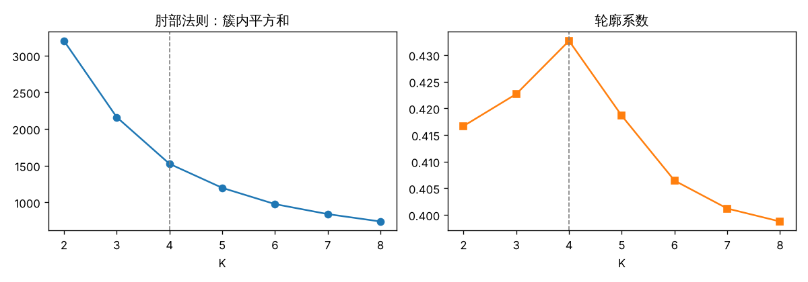
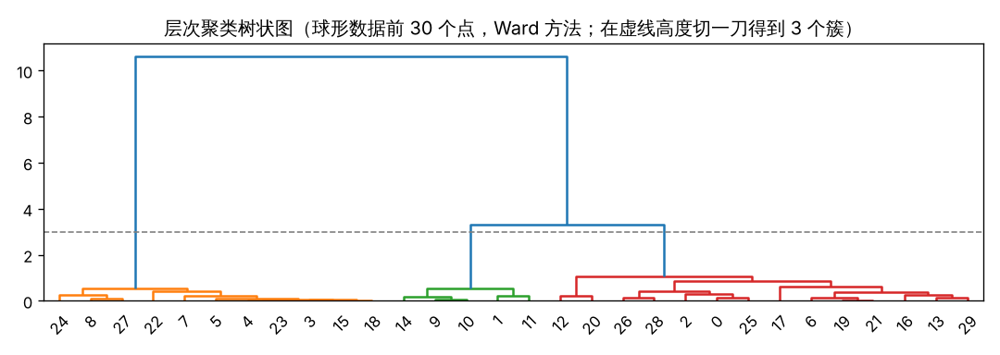
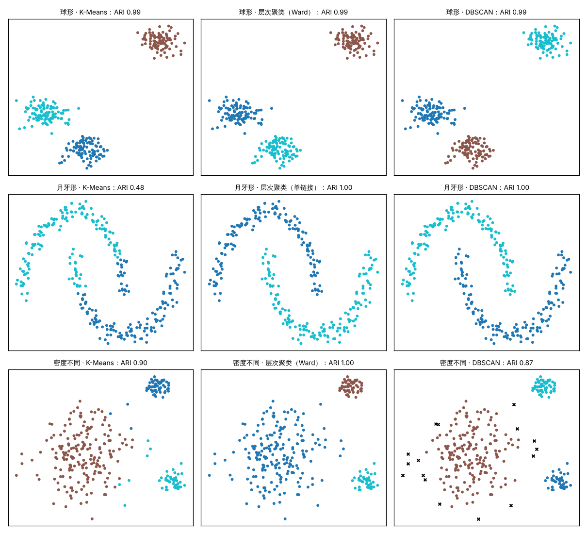
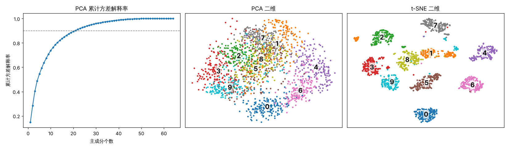
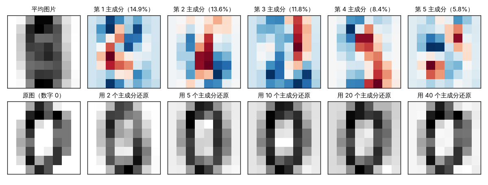
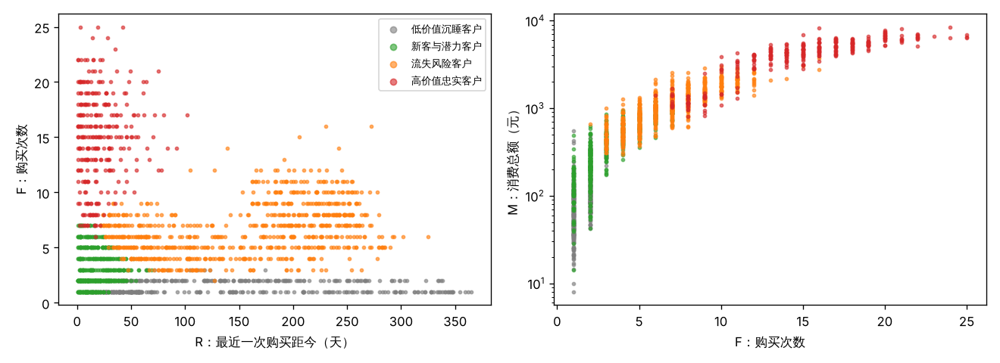
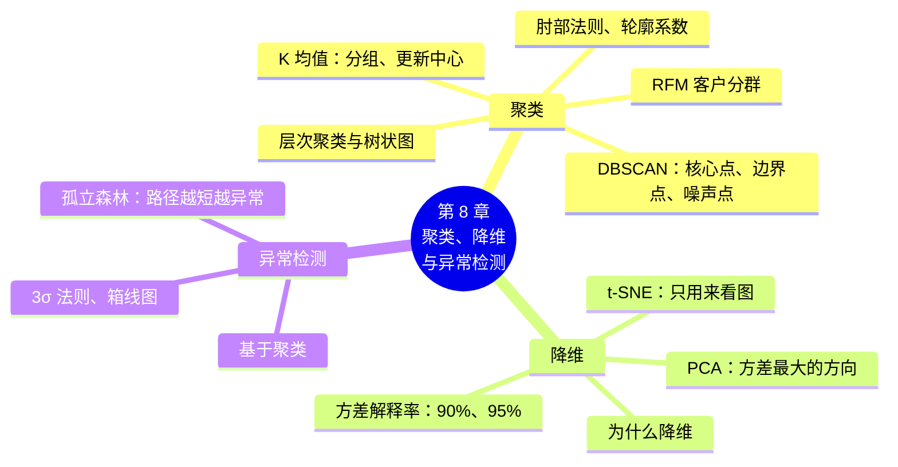

# 第 8 章 聚类、降维与异常检测

!!! abstract "本章学时"
    理论 5 学时 · 实验 3 学时（本章共 3 个实验，教师可任选）

## 学习目标

学完本章，你应该能够：

1. **说出**聚类、K 均值、簇中心、轮廓系数、DBSCAN、噪声点、降维、主成分分析、方差解释率、孤立森林的含义（记忆）；
2. **解释** K 均值为什么切不开月牙形的数据，DBSCAN 的 eps 和 min_samples 怎样影响结果，PCA 为什么要找“方差最大的方向”，t-SNE 为什么只用来看图（理解）；
3. **运用** scikit-learn 完成 K 均值、层次聚类、DBSCAN、PCA、t-SNE 和孤立森林；手算 K 均值的迭代和一个点的轮廓系数（应用）；
4. 用肘部法则、轮廓系数和业务需要**分析**该分几群，用方差解释率分析该保留几个主成分（分析）；
5. 根据 RFM 分群结果**撰写**一份客户分群和运营建议报告（创造）。

!!! info "先修要求"
    学习本章前，你需要掌握：

    - 无监督学习的含义（[1.3.2 无监督学习：聚类、降维与关联](../01-intro/index.md#132)）；
    - 异常值的识别：3σ 法则和箱线图（[2.2.2 异常值](../02-preprocessing/index.md#222)）；
    - 标准化（[2.3.3 标准化与归一化](../02-preprocessing/index.md#233)）；
    - 随机森林的思路：很多棵随机的树一起投票（[5.5 随机森林](../05-decision-tree/index.md#55)）；
    - 欧氏距离和维度灾难（[7.1.2 距离度量](../07-knn-bayes-rules/index.md#712)、[7.1.5 维度灾难](../07-knn-bayes-rules/index.md#715)）。

??? abstract "本章概念清单（17 个，点击查看定义和例子）"
    1. [聚类](../../appendix/glossary.md#g-聚类)
    2. [K 均值](../../appendix/glossary.md#g-K-均值)
    3. [簇中心](../../appendix/glossary.md#g-簇中心)
    4. [肘部法则](../../appendix/glossary.md#g-肘部法则)
    5. [轮廓系数](../../appendix/glossary.md#g-轮廓系数)
    6. [层次聚类](../../appendix/glossary.md#g-层次聚类)
    7. [树状图](../../appendix/glossary.md#g-树状图)
    8. [DBSCAN](../../appendix/glossary.md#g-DBSCAN)
    9. [密度可达](../../appendix/glossary.md#g-密度可达)
    10. [噪声点](../../appendix/glossary.md#g-噪声点)
    11. [客户分群](../../appendix/glossary.md#g-客户分群)
    12. [降维](../../appendix/glossary.md#g-降维)
    13. [主成分分析](../../appendix/glossary.md#g-主成分分析)
    14. [方差解释率](../../appendix/glossary.md#g-方差解释率)
    15. [t-SNE](../../appendix/glossary.md#g-t-SNE)
    16. [异常检测](../../appendix/glossary.md#g-异常检测)
    17. [孤立森林](../../appendix/glossary.md#g-孤立森林)

## 情景导入

一家网上商城的运营部门手里有 2000 位老客户一年的订单记录，部门经理提了三个问题。

第一，“每个月给所有客户发一样的优惠券，钱花了不少，效果一般。能不能把客户分成几类，每类用不同的办法？”客户身上没有现成的“类别”标签，要让机器自己从订单里发现“哪些客户彼此相像”，这就是[**聚类**](../../appendix/glossary.md#g-聚类 "把没有标签的样本按相似程度自动分成若干组的无监督学习任务"){ .term }。

第二，“分析报告里每个客户有几十项指标，图根本画不出来。能不能压缩成两三个数，一张图看清客户的整体分布？”这是[**降维**](../../appendix/glossary.md#g-降维 "把很多个特征压缩成少数几个新特征，同时尽量保留原有信息的方法"){ .term }。

第三，风控部门顺便提了一句：“每天几万笔交易，标了欺诈的只是极少数，大部分新骗局根本没人标过。能不能不靠标签，把‘看起来就不正常’的交易先挑出来？”这是[**异常检测**](../../appendix/glossary.md#g-异常检测 "从大量数据中找出与大多数样本明显不同的少数样本的任务，常用无监督方法"){ .term }。

这三类任务都没有标签，属于无监督学习。第 7 章的关联规则也是无监督学习，本章把无监督学习中最常用的三类方法讲完。

## 8.1 聚类与 K 均值

### 8.1.1 物以类聚：聚类与分类的区别

**聚类**是把没有标签的样本按相似程度自动分成若干组。分出来的每一组叫一个“簇”（cluster），同一簇内的样本尽量相像，不同簇的样本尽量不同。

聚类和分类听起来相近，其实是两回事：

| | 分类 | 聚类 |
|---|---|---|
| 训练数据 | 有标签（如“是否流失”） | 没有标签 |
| 类别 | 事先定好，如“流失 / 不流失” | 事先不知道，由算法分出来 |
| 结果的含义 | 类别名称是现成的 | 每一簇是什么意思，要人来解读、起名 |
| 怎样评价 | 和真实标签比，算准确率 | 没有标准答案，看簇内紧不紧、簇间开不开，以及对业务有没有用 |
| 典型用途 | 流失预警、垃圾短信过滤 | 客户分群、商品归类、新闻自动归类 |

聚类最常见的用途是[**客户分群**](../../appendix/glossary.md#g-客户分群 "按消费行为等特征把客户分成若干群、对不同群采取不同运营策略的做法，常用 RFM 模型"){ .term }：按消费行为把客户分成几群，每群采用不同的运营策略，而不是对所有人“一刀切”。它也常作为探索数据的第一步：先聚类看看数据里大致有几种情况，再决定下一步怎么分析。

### 8.1.2 K 均值算法

[**K 均值**](../../appendix/glossary.md#g-K-均值 "先选 K 个中心、再交替执行“分组”和“更新中心”的聚类方法"){ .term }（K-Means）是最常用的聚类方法。<sup class="cite">[[1]](#ref8-1)</sup> 它把样本分成事先指定的 K 个簇，每个簇用一个[**簇中心**](../../appendix/glossary.md#g-簇中心 "K 均值中代表一个簇的点，等于簇内所有样本的平均位置"){ .term }（簇内所有样本的平均位置）来代表。步骤只有四步：

1. **选中心**：随机选 K 个样本作为初始的簇中心；
2. **分组**：每个样本分到离它最近的簇中心那一组；
3. **更新中心**：把每个簇中心移到本组样本的平均位置；
4. **重复** 2、3 两步，直到分组不再变化（或中心几乎不再移动）。

K 均值要让每个样本到所属簇中心的距离平方之和（叫“簇内平方和”）尽量小。“分组”和“更新中心”这两步都只会让簇内平方和变小或不变，所以算法一定会停下来。但它停下来的地方不一定是最好的：初始中心选得不好，可能停在一个较差的结果上。scikit-learn 用两个办法应对：一是用 k-means++ 方法挑初始中心，让几个初始中心尽量分散<sup class="cite">[[5]](#ref8-5)</sup>；二是设 `n_init=10`，换 10 组初始中心各跑一遍，取簇内平方和最小的一次。

K 均值用距离来衡量相像程度，所以和 KNN、SVM 一样，**用之前要标准化**，否则数值大的特征说了算。

### 8.1.3 算一算：K 均值迭代两轮

6 个样本：A(1, 1)、B(2, 1)、C(1, 2)、D(6, 5)、E(7, 5)、F(6, 6)，K = 2。为了演示，故意选了一组不好的初始中心：A 和 B。

**第 1 轮分组**：C 到 A 的距离是 1，到 B 是 √2 ≈ 1.41，分给 A；D、E、F 离 B 更近（例如 D 到 B 是 √32 ≈ 5.66，到 A 是 √41 ≈ 6.40），都分给 B。两组是 {A, C} 和 {B, D, E, F}。

**第 1 轮更新中心**：第 1 组中心 = ((1 + 1) / 2, (1 + 2) / 2) = (1, 1.5)；第 2 组中心 = ((2 + 6 + 7 + 6) / 4, (1 + 5 + 5 + 6) / 4) = (5.25, 4.25)。

**第 2 轮分组**：B 到 (1, 1.5) 的距离 ≈ 1.12，到 (5.25, 4.25) 的距离 ≈ 4.60，B 改到第 1 组。两组变成 {A, B, C} 和 {D, E, F}。

**第 2 轮更新中心**：(4/3, 4/3) ≈ (1.33, 1.33) 和 (19/3, 16/3) ≈ (6.33, 5.33)。

**第 3 轮分组**：分组不再变化，算法结束。簇内平方和从第 1 轮的 30.0 降到 2.67。

可以看到，即使初始中心选得很差（两个都在左下角），K 均值也能通过几轮迭代“纠正”过来。下面的动画用实验 8-2 的数据演示整个过程，可以一步一步看：

<iframe class="sim-frame" src="../../sims/kmeans-steps/main.html" height="820" loading="lazy" title="K-Means 迭代"></iframe>

动画：K 均值迭代。按“下一步”交替执行分组和更新中心，虚线是中心移动的轨迹；换成“月牙形”数据，看 K 均值为什么切不开两个月牙。[全屏打开](../../sims/kmeans-steps/main.html){ target=_blank }
{ .sim-caption }

### 8.1.4 K 值的选择：肘部法则与轮廓系数

K 均值要事先给出 K。数据没有标签，不能像分类那样用准确率来选，常用的有两个办法。

[**肘部法则**](../../appendix/glossary.md#g-肘部法则 "画出簇内平方和随 K 变化的曲线，取下降由快变慢的拐点作为 K 的方法"){ .term }：K 从小到大各跑一遍，画出簇内平方和随 K 变化的曲线。K 越大，簇内平方和一定越小（K 等于样本数时为 0），所以不能选最小的。曲线一开始下降很快，过了某个 K 之后下降变缓，形状像一只弯曲的手臂，拐弯的“肘部”就是比较合适的 K。

[**轮廓系数**](../../appendix/glossary.md#g-轮廓系数 "用 s = (b − a) / max(a, b) 衡量样本与本簇是否紧凑、与别簇是否分开的指标，取值 −1 到 1，越大越好"){ .term }：对每个样本算两个量：a 是它到本簇其他样本的平均距离（越小说明本簇越紧凑），b 是它到最近的另一个簇所有样本的平均距离（越大说明和别的簇分得越开）。这个样本的轮廓系数 s = (b − a) / max(a, b)，取值在 −1 到 1 之间：接近 1 说明分得很好，接近 0 说明它处在两个簇的交界，为负说明它可能被分错了簇。所有样本取平均，就是整体的轮廓系数，越大越好。<sup class="cite">[[3]](#ref8-3)</sup>

**算一算**：在 8.1.3 节的最终结果中，A 到本簇 B、C 的距离都是 1，a = 1；A 到另一簇 D、E、F 的距离分别为 √41 ≈ 6.40、√52 ≈ 7.21、√50 ≈ 7.07，b ≈ 6.90。s = (6.90 − 1) / 6.90 ≈ 0.855。6 个样本平均，整体轮廓系数为 0.823，两簇分得很开。

实验 8-1 对 2000 位客户做 K 均值，K 从 2 到 8：



| K | 2 | 3 | 4 | 5 | 6 | 7 | 8 |
|---|---|---|---|---|---|---|---|
| 簇内平方和 | 3200.7 | 2159.9 | 1523.9 | 1196.4 | 975.1 | 838.7 | 737.8 |
| 轮廓系数 | 0.417 | 0.423 | **0.433** | 0.419 | 0.406 | 0.401 | 0.399 |

簇内平方和从 K = 4 开始下降变缓，轮廓系数也在 K = 4 时最高，两个办法都指向 K = 4。真实数据的“肘部”常常不太明显，轮廓系数也可能只差零点零几，这时还要看**业务需要**：运营部门能为几类客户分别制定方案？每一群人数是否太少、不值得单独运营？每一群能不能用一句话说清楚是什么样的人？分出来没法解释、没法用的群，指标再好也没有意义。

### 8.1.5 K 均值的局限

K 均值简单、快，几十万个样本也能很快算完，但它有几个明显的局限：

- **要事先给出 K**，K 选得不对，结果就不对。
- **对初始中心敏感**，不同的初始中心可能得到不同的结果，所以要多跑几次（`n_init`）。
- **只能分出“圆团状”的簇**。K 均值按“离哪个中心近”分组，相邻两个中心之间的分界线是一条直线，每个簇都是凸的一块。月牙形、环形这类弯曲的簇它分不开：实验 8-2 中，K 均值在月牙形数据上的调整兰德指数只有 0.479（1 表示与真实分组完全一致，0 相当于随机乱分<sup class="cite">[[9]](#ref8-9)</sup>），两个月牙被横着切开了。
- **倾向于把各簇分得差不多大**，疏密、大小相差很大的簇容易分错。
- **受异常值影响**：一个离群很远的点会把簇中心拉过去。
- **每个样本必须属于某个簇**，不会说“这个点谁都不像”。

后三个问题，下一节的层次聚类和 DBSCAN 可以部分解决。

## 8.2 层次聚类与 DBSCAN

### 8.2.1 层次聚类与树状图

[**层次聚类**](../../appendix/glossary.md#g-层次聚类 "从每个样本自成一簇开始，每次合并最相近的两个簇，逐层形成树状结构的聚类方法"){ .term }不一次性分成 K 组，而是一层一层地合并：一开始每个样本自成一簇；每一步找出最相近的两个簇，合并成一个；重复下去，直到所有样本合成一个大簇。把合并的过程画出来，就是一棵[**树状图**](../../appendix/glossary.md#g-树状图 "画出层次聚类合并过程的树形图，纵轴是合并时的距离，横切一刀得到若干簇"){ .term }：



树状图的横轴是样本，纵轴是合并时两个簇之间的距离。越早合并（位置越低）的样本越相像。在某个高度横着切一刀，切到几根竖线就得到几个簇：上图在高度 3 处切，得到 3 个簇。层次聚类的好处是不必事先定 K，可以先画出树状图，看看在哪个高度切比较自然。

“两个簇之间的距离”有几种算法，叫链接方式：

| 链接方式 | 两个簇的距离 | 特点 |
|---|---|---|
| Ward（默认） | 合并后簇内平方和增加多少 | 簇比较圆、大小均衡，效果与 K 均值相近 |
| 单链接 | 两簇中最近的两个点的距离 | 能顺着细长、弯曲的形状连下去，但容易被一串点“链”在一起 |
| 全链接 | 两簇中最远的两个点的距离 | 簇比较紧凑 |
| 平均链接 | 两簇所有点对距离的平均 | 介于单链接和全链接之间 |

实验 8-2 中，月牙形数据用单链接的层次聚类，调整兰德指数达到 1.000，两个月牙完全分开。层次聚类的缺点是计算量大：要反复计算所有簇两两之间的距离，样本到几万个时就很慢，一般用于几千个样本以内的数据。

### 8.2.2 DBSCAN：按密度找簇

[**DBSCAN**](../../appendix/glossary.md#g-DBSCAN "按密度找簇的聚类方法：密集区域连成簇，稀疏处的点作为噪声点，不需要事先给出簇数"){ .term }（基于密度的带噪声空间聚类）换了一个思路：**簇是一片密集的区域，簇与簇之间被稀疏的区域隔开**。<sup class="cite">[[4]](#ref8-4)</sup> 它有两个参数：半径 eps 和最少点数 min_samples。每个样本按它周围的密度分成三种：

- **核心点**：以它为圆心、eps 为半径的圆内（含它自己）至少有 min_samples 个样本；
- **边界点**：自己不是核心点，但落在某个核心点的圆内；
- [**噪声点**](../../appendix/glossary.md#g-噪声点 "DBSCAN 中既不是核心点、也不在任何核心点邻域内的点，不属于任何簇，编号为 −1"){ .term }：既不是核心点，也不在任何核心点的圆内。

从一个核心点出发，它圆内的点都和它同簇；圆内如果还有核心点，就继续往外扩展。这样一步步能到达的点叫[**密度可达**](../../appendix/glossary.md#g-密度可达 "DBSCAN 中，从一个核心点出发，经过一串相邻的核心点能够到达某个点的关系；相互密度可达的点属于同一簇"){ .term }，所有相互密度可达的点组成一个簇。噪声点不属于任何簇，scikit-learn 中它的簇编号为 −1。

**算一算**：一维数据 1、2、3、4、10、11、12、20，eps = 1.5，min_samples = 3。点 2 的圆内有 1、2、3 共 3 个点，是核心点；点 3 的圆内有 2、3、4，也是核心点；点 1 的圆内只有 1、2 两个点，不是核心点，但在核心点 2 的圆内，是边界点；同理 4 也是边界点。所以 1、2、3、4 成为第一个簇。11 是核心点，10、12 是边界点，组成第二个簇。20 的圆内只有它自己，又不在任何核心点的圆内，是噪声点。结果：2 个簇，1 个噪声点，簇的个数是算法自己找出来的。

DBSCAN 的优点正好补上 K 均值的短处：**不用事先给出簇的个数**；**能找出任意形状的簇**，因为它是顺着密集区域一路“传染”下去的；**能自动识别噪声点**，噪声点本身就可以当作异常值。缺点是 eps 和 min_samples 不好定，而且同一个 eps 很难同时适合疏密差别很大的几个簇。实验 8-2 在月牙形数据上比较了不同的 eps：

| eps | 簇数 | 噪声点 | 调整兰德指数 | 说明 |
|---|---|---|---|---|
| 0.1 | 21 | 160 | 0.036 | 半径太小，一半以上的点成了噪声，簇碎成很多小块 |
| 0.2 | 3 | 5 | 0.799 | 接近了，但一个月牙断成了两截 |
| 0.3 | 2 | 0 | 1.000 | 两个月牙完全分开 |
| 0.5 | 2 | 0 | 1.000 | 仍然正确 |
| 1.0 | 1 | 0 | 0.000 | 半径太大，两个月牙连成一片 |

数据要先标准化，eps 才有统一的尺度。实践中，可以先把 min_samples 定为特征数的两倍左右，再从小到大试 eps，看噪声点的比例和簇的个数是否合理。下面的动画可以自己拖动两个参数试一试：

<iframe class="sim-frame" src="../../sims/dbscan-density/main.html" height="820" loading="lazy" title="DBSCAN 密度聚类"></iframe>

动画：DBSCAN 密度聚类。大圆点是核心点，小圆点是边界点，灰色叉是噪声点；点击任意一个点，画出它的 eps 邻域。[全屏打开](../../sims/dbscan-density/main.html){ target=_blank }
{ .sim-caption }

### 8.2.3 三种算法怎么选

实验 8-2 在三种形状的数据上比较了三种算法（数据都已标准化），用调整兰德指数和真实分组对照：



| 数据 | K 均值 | 层次聚类 | DBSCAN（eps = 0.3） |
|---|---|---|---|
| 球形（3 团） | 0.990 | 0.990（Ward） | 0.990 |
| 月牙形 | 0.479 | 1.000（单链接） | 1.000 |
| 密度不同 | 0.904 | 1.000（Ward） | 0.869（16 个噪声点） |

球形的数据三种算法都没问题；月牙形的数据，K 均值不行；密度不同的数据，K 均值把稀疏大簇的边缘分给了旁边的小簇，DBSCAN 则把稀疏大簇边缘的 16 个点当成了噪声。没有哪种算法在所有数据上都最好，可以按下表初步选择：

| 情况 | 推荐 |
|---|---|
| 样本多、簇大致呈圆团状、知道大概要分几群（如客户分群） | K 均值 |
| 样本不多（几千以内）、想看样本之间的层次关系 | 层次聚类 |
| 簇的形状不规则、不知道有几群、需要找出噪声点 | DBSCAN |

!!! cert "证书考点 · 人工智能数据处理工程师（高级）· 聚类"
    常考：聚类与分类的区别（有无标签）；K 均值的步骤和手算一两轮迭代；K 均值需要事先指定 K、对初始中心敏感、只适合凸形簇、需要标准化；肘部法则和轮廓系数的含义，轮廓系数的取值范围和计算；层次聚类的合并过程和树状图的读法；DBSCAN 的两个参数，核心点、边界点、噪声点的判断，不需要指定簇数、能发现任意形状的簇和噪声点。容易错在把“簇内平方和最小”当成选 K 的标准，以及把 DBSCAN 的边界点当成噪声点。

## 8.3 降维与主成分分析

### 8.3.1 为什么要降维

**降维**是把很多个特征压缩成少数几个新特征，同时尽量保留原有的信息。为什么要这样做？

- **看图**：人只能看懂二维、三维的图。64 个特征的手写数字图片，降到二维才能画在一张散点图上，看各数字是否分得开。
- **去掉冗余**：很多特征之间高度相关。比如客户的购买次数和消费金额，买得多的人通常花得也多，两个特征说的几乎是同一件事。
- **缓解维度灾难**：第 7 章讲过，特征太多时距离失去区分能力，依赖距离的 KNN、K 均值效果变差。
- **加快计算、减少存储**：特征少了，模型训练更快。

降维和第 2 章的特征选择不同：特征选择是从原有特征中挑出一部分，保留的仍是原来的特征；降维是构造出新的特征，每个新特征都综合了原来的多个特征。

### 8.3.2 PCA：找最能拉开差距的方向

[**主成分分析**](../../appendix/glossary.md#g-主成分分析 "寻找数据方差最大的若干个相互垂直的方向，把数据投影到这些方向上实现降维的方法"){ .term }（PCA）是最常用的降维方法。<sup class="cite">[[6]](#ref8-6)</sup> 用一个二维的例子来理解：实验 8-1 中 300 位客户的购买次数和消费金额（都取了对数）画在图上，大致沿一条斜线分布。现在要把每个客户压缩成一个数，相当于在图上画一条直线，把所有点垂直投影到直线上，用投影的位置代表这个客户。

往哪个方向投影最好？投影后的点**分得越开**（方差越大），客户之间的差别保留得越多；如果投影后点都挤在一起，就分不清谁是谁了。PCA 就是找方差最大的那个方向，叫**第一主成分**；在与第一主成分垂直的方向中再找方差最大的，叫第二主成分；以此类推。可以证明，方差最大的方向，也就是所有点到这条直线的垂直距离（图中的红色细线）平方和最小的方向。

<iframe class="sim-frame" src="../../sims/pca-projection/main.html" height="900" loading="lazy" title="PCA 投影方向"></iframe>

动画：PCA 投影方向。转动红色直线，观察下方长条上投影后的点分得开不开，以及保留的方差比例。[全屏打开](../../sims/pca-projection/main.html){ target=_blank }
{ .sim-caption }

在这个例子中，沿水平方向（0°，只看购买次数）投影，只保留了 19.7% 的方差；转到 45°，保留 87.9%；转到约 64.3° 时达到最大，保留 98.5%。这个方向就是第一主成分，它相当于给每位客户算了一个综合的“购买力”分数：买得越多、花得越多，分数越高。只用这一个分数，就保留了两个特征 98.5% 的信息，丢掉的 1.5% 是“同样的次数，有人花得多一点、有人少一点”这类细小差别。

每个主成分都是原来各特征的加权组合，例如上面的第一主成分 ≈ 0.43 × ln(1 + 次数) + 0.90 × ln(1 + 金额)（先减去均值）。PCA 之前通常要标准化，否则数值大的特征方差大，会主导主成分的方向；如果各特征单位相同、量级相近（如图片的像素），也可以不标准化。

### 8.3.3 方差解释率：保留几个主成分

每个主成分保留的方差占总方差的比例，叫这个主成分的[**方差解释率**](../../appendix/glossary.md#g-方差解释率 "一个主成分保留的方差占全部方差的比例，用于决定保留几个主成分"){ .term }。主成分按方差解释率从大到小排列，前 k 个的方差解释率加起来，叫累计方差解释率，表示降到 k 维后保留了多少信息。

实验 8-3 对手写数字数据（1797 张 8×8 的图片，64 个像素特征）做 PCA：



- 前三个主成分的方差解释率分别是 0.149、0.136、0.118，前 2 个合计只有 28.5%。
- 累计达到 80% 需要 13 个主成分，90% 需要 21 个，95% 需要 29 个。
- 有 3 个方向的方差几乎为 0：图片边缘的几个像素在所有图片中几乎都是空白，没有任何信息。

保留几个主成分，常用的标准是累计方差解释率达到 90% 或 95%。在 scikit-learn 中可以直接写 `PCA(n_components=0.95)`，它会自动选出够用的主成分个数。

降维后再建模效果如何？实验 8-3 先用 PCA 降维，再用第 6 章的 SVM 分类：

| 保留的主成分 | 2 个 | 5 个 | 10 个 | 20 个 | 30 个 | 不降维（64 个） |
|---|---|---|---|---|---|---|
| 测试准确率 | 0.639 | 0.922 | 0.978 | 0.989 | 0.989 | 0.989 |

保留 20 个主成分（约 89% 的方差）时，准确率就和不降维一样了，特征只剩不到三分之一。不过这份数据很小，降维前后训练时间都在 0.1 秒以内，看不出速度上的差别；数据有几十万条、几千个特征时，降维节省的时间才明显。另外要注意：PCA 和标准化一样，**只能在训练集上拟合**，再用同样的变换处理测试集，最简单的做法是放进流水线 `make_pipeline(PCA(n_components=20), SVC())`。

主成分也可以画出来看：



上排是 64 个像素的平均图片和前 5 个主成分，每个主成分是一种“笔画模式”，红色表示这一位置的像素加分，蓝色表示减分。下排用前 k 个主成分还原第一张图片（数字 0）：用 2 个主成分还原得很模糊（平均每个像素差 1.89 个灰度级，灰度范围 0～16），用 10 个已能认出是 0（差 1.02），用 40 个几乎和原图一样（差 0.20）。这说明一张图片可以近似写成“平均图片 + 若干个主成分的加权和”，只要记住这几个权重，就能大致还原图片，这也是 PCA 能用来压缩数据的原因。

### 8.3.4 t-SNE：只用来看图

PCA 降到二维时，手写数字的 10 个类别在图上挤成一团，很多数字相互重叠。原因是 PCA 只能做“线性”的投影，前两个主成分只保留了 28.5% 的信息。

[**t-SNE**](../../appendix/glossary.md#g-t-SNE "让高维空间中相近的样本在二维图上也相近的非线性降维方法，只用于可视化"){ .term } 是一种专门用来把高维数据画成二维图的方法。<sup class="cite">[[7]](#ref8-7)</sup> 它的目标不是保留方差，而是**保留“邻居关系”**：在原来 64 维空间中彼此相近的样本，到了二维图上也要相近。实验 8-3 的结果：t-SNE 的二维图上 10 个数字各自聚成清清楚楚的一团；用“每个点的 10 个最近邻中同一数字的比例”来衡量，PCA 二维图是 0.571，t-SNE 是 0.982。

但是 t-SNE 有几个限制，决定了它**只用于看图，不用于建模**：<sup class="cite">[[10]](#ref8-10)</sup>

- **坐标没有含义**：图上两团之间离得远近、每一团的大小，都不能说明什么，只有“谁和谁是邻居”是可信的；
- **结果不稳定**：换一个随机种子或参数 perplexity（大致相当于每个点关注多少个邻居），图会变；
- **不能处理新数据**：scikit-learn 的 `TSNE` 只有 `fit_transform`，没有 `transform`，来了新样本只能整个重算；
- **慢**：1797 个样本用了 7.0 秒，PCA 不到 0.1 秒。

所以常见的做法是：建模用 PCA（或者不降维），看图用 t-SNE；数据很大时，可以先用 PCA 降到 50 维左右，再用 t-SNE 降到二维。近年来另一种方法 UMAP<sup class="cite">[[11]](#ref8-11)</sup> 也很常用，速度比 t-SNE 快，结构保留得也不错。

## 8.4 异常检测

**异常检测**是从大量数据中找出和大多数样本明显不同的少数样本，比如欺诈交易、设备故障、网络入侵、录入错误。它和分类的区别在于：异常往往极少，而且类型不断变化（骗子会换新花样），很难收集到足够的、有代表性的“异常”标签，所以通常用无监督的方法：不告诉模型哪些是异常，让它自己找出“不像大多数”的样本。

### 8.4.1 基于统计的方法

第 2 章介绍过两种简单的方法：**3σ 法则**，把与均值相差超过 3 个标准差的值当作异常；**箱线图法**，把超出上下四分位数 1.5 倍四分位距的值当作异常。它们简单、好解释，但一次只看一个特征。

实验 8-2 只看交易金额（取对数后）用 3σ 法则，在 20000 笔信用卡交易中标出 45 笔，其中真正的欺诈只有 11 笔。很多欺诈交易的金额并不出奇，而是“金额略高，又在凌晨，又在境外，又用了新设备”，每一项单独看都不算异常，合在一起才可疑。这就需要同时考虑多个特征的方法。

### 8.4.2 基于聚类的方法

聚类也能用来找异常：

- **DBSCAN 的噪声点**就是天然的异常候选：它们周围太稀疏，不属于任何一个密集区域。实验 8-2 中，密度不同的数据里稀疏大簇边缘的 16 个点就被 DBSCAN 标成了噪声。
- **K 均值**：算出每个样本到所属簇中心的距离，距离特别远的（比如排在最远的 1%）就是异常候选。

这类方法的效果依赖于聚类本身的好坏，参数不好定时结果变化较大。

### 8.4.3 孤立森林

[**孤立森林**](../../appendix/glossary.md#g-孤立森林 "用许多棵随机切分的树，按样本被单独切出所需的平均次数衡量异常程度的方法，次数越少越异常"){ .term }是目前最常用的无监督异常检测方法之一，由 Liu、Ting 和周志华于 2008 年提出。<sup class="cite">[[8]](#ref8-8)</sup> 它的想法很巧妙：**异常的点更容易被“孤立”出来**。

设想随机地在数据上切刀：随机选一个特征，在它的最小值和最大值之间随机选一个位置切一刀，把数据分成两半；再对每一半继续随机切，直到每个样本都被单独切出来。一个正常的样本处在人群中间，周围都是相似的样本，要切很多刀才能把它单独分出来；一个异常的样本远离人群，往往切几刀就被孤立了。例如交易金额 10、12、13、15、100 元，在 10 到 100 之间随便切一刀，有约 94% 的可能落在 15 和 100 之间，一刀就把 100 元单独切了出来。

一次随机切分有偶然性，于是像随机森林一样，造几百棵这样的随机树（每棵树用一部分样本），看每个样本在各棵树中平均被切了几刀（路径长度）。**平均路径越短，异常分数越高**。孤立森林不需要计算距离，速度很快，对特征多的数据也有效。参数 `contamination` 是预计的异常比例，模型按这个比例划定“可疑”的门槛。

实验 8-2 用孤立森林分析 20000 笔信用卡交易，训练时**完全不用标签**，最后才用“是否欺诈”来检验：

| 方法 | 标出的可疑交易 | 其中真欺诈 | 命中率 |
|---|---|---|---|
| 随机抽查 | 200 笔 | 约 2 笔 | 约 1.0% |
| 只看金额的 3σ 法则 | 45 笔 | 11 笔 | 24.4% |
| 孤立森林（contamination = 0.01） | 200 笔 | 54 笔 | 27.0% |
| 孤立森林异常分数最高的 50 笔 | 50 笔 | 24 笔 | 48.0% |

孤立森林标出的 200 笔中有 54 笔是真欺诈，命中率约是随机抽查的 26 倍，找到了全部 209 笔欺诈的 25.8%；异常分数最高的 50 笔中，将近一半是欺诈。异常分数最高的几笔交易多是凌晨、境外、新设备、离常用地较远的组合。

无监督的方法只能说明“这笔交易不寻常”，不寻常的不一定是欺诈（可能是客户出国旅游），所以孤立森林的结果通常交给人工复核，或者作为一个“异常分数”特征，加入第 4、5 章那样有标签的欺诈分类模型中。有了足够的标签后，有监督的模型一般更准；无监督方法的价值在于发现**还没有被标注过的新型异常**。

!!! cert "证书考点 · 人工智能训练师（三级）· 业务分析"
    常考：根据聚类结果描述各类客户的特征并起名；RFM 模型三个指标的含义和计算；针对不同客户群提出有区别的运营建议；撰写客户分群分析报告（结论先行，数据支撑，建议可执行）。PCA 的作用（降维、去相关、可视化），第一主成分是方差最大的方向，方差解释率和累计方差解释率的计算，按 90%、95% 选主成分个数；t-SNE 只用于可视化；孤立森林的原理（异常点路径短）和 contamination 参数。容易错在用 t-SNE 的结果建模，以及在全部数据上拟合 PCA 后再划分训练集和测试集。

## 8.5 前沿视窗

**嵌入向量 + 聚类：让机器自动归类文本和图片。**今天，文本、图片都可以先用预训练模型变成几百维的嵌入向量，意思相近的内容向量也相近（见第 7 章前沿视窗）。在嵌入向量上做聚类，就能把几万条用户评论、客服工单、新闻自动分成若干主题，不需要人先定好类别。开源工具 BERTopic<sup class="cite">[[12]](#ref8-12)</sup> 是一个典型的流程：用句子嵌入模型把文本变成向量，用 UMAP 降到几维，用基于密度的 HDBSCAN（DBSCAN 的改进版，能自动适应疏密不同的簇）聚类，再从每一簇中提取关键词作为主题。这个流程用到的正是本章的三种方法：降维、密度聚类和找出不属于任何主题的“噪声”文本。

**让大模型给聚类结果起名字。**聚类最费人力的一步，是看懂每一簇是什么意思并起一个名字。现在可以把每一簇中有代表性的几条文本，或者实验 8-1 那样的 R、F、M 统计表交给大模型，请它概括这一簇的特点、起一个名字、并提出运营建议，人再在此基础上核对修改。大模型写得快，但它看不到全部数据，也可能“编”出数据里没有的特点，所以名字和结论一定要回到数据核对。

**异常检测在工业中的应用。**在制造业中，产线上的不良品很少，类型也多，常用“只学习正常样本”的方法：模型只见过合格品，遇到和合格品差别大的就报警。孤立森林、自编码器（第 10 章之后的深度学习方法）都是常用的工具。

## 本章实验

!!! abstract "实验总览"
    | 实验 | 类型 | 建议时长 | 内容 |
    |---|---|---|---|
    | 实验 8-1 | ★ 基础 | 60 分钟 | 从 11605 条订单计算 2000 位客户的 RFM，对数变换、标准化后用 K 均值分群，用肘部法则和轮廓系数定 K，给每群客户起名并提出运营建议 |
    | 实验 8-2 | ★ 基础 | 45 分钟 | 在三种形状的数据上比较 K 均值、层次聚类、DBSCAN，画树状图，观察 eps 的影响；用孤立森林在信用卡交易中找出可疑交易 |
    | 实验 8-3 | ☆ 拓展 | 45 分钟 | 对手写数字做 PCA，看方差解释率；用 PCA 和 t-SNE 降到二维画图对比；比较降维前后 SVM 的准确率；画出主成分并还原图片 |

    三个实验都在本机 CPU 上运行，每个脚本不超过 30 秒。实验代码见配套资源 `labs/ch08/` 目录。

### 实验 8-1 ★ 电商客户分群（RFM 模型）

**实验目的**

1. 从订单明细计算每位客户的 R、F、M 三个指标；
2. 对右偏的特征做对数变换，再标准化；
3. 用肘部法则和轮廓系数选择 K，用 K 均值分群；
4. 描述每一群客户的特点并起名，提出有区别的运营建议。

**实验环境**：Python 3.11，NumPy、pandas、Matplotlib、scikit-learn。

**实验数据**：`labs/data/orders.csv`，模拟的电商订单，共 11605 条，2000 位客户，时间为 2025 年 10 月 1 日至 2026 年 9 月 30 日，字段有订单编号、客户编号、下单日期、实付金额。数据由 `make_datasets.py` 按几种客户类型生成，但文件中不含类型，留给聚类去发现。

**背景：RFM 模型。**零售和电商行业做客户分群时最常用 RFM 模型，用三个指标刻画一位客户：

- **R**（Recency，最近一次消费）：最近一次购买距今多少天，越小说明越活跃；
- **F**（Frequency，消费频率）：一段时间内购买了多少次；
- **M**（Monetary，消费金额）：一段时间内一共花了多少钱。

**实验步骤与代码**

第 1 步，读取订单，按客户汇总，算出 R、F、M（分析日定为数据截止日的第二天 2026-10-01）：

```python
orders = pd.read_csv("../data/orders.csv", parse_dates=["下单日期"])
today = pd.Timestamp("2026-10-01")
rfm = orders.groupby("客户编号").agg(
    R=("下单日期", lambda d: (today - d.max()).days),
    F=("订单编号", "count"),
    M=("实付金额", "sum"))
```

第 2 步，查看三个指标的分布。消费金额右偏严重（少数客户花得特别多），直接标准化后，K 均值会被这些大客户牵着走。先取 log(1 + x) 让分布对称一些，再标准化：

```python
Z = StandardScaler().fit_transform(np.log1p(rfm[["R", "F", "M"]]))
```

第 3 步，K 从 2 到 8，记录簇内平方和（`inertia_`）和轮廓系数，画出曲线：

```python
for k in range(2, 9):
    km = KMeans(n_clusters=k, n_init=10, random_state=42).fit(Z)
    print(k, km.inertia_, silhouette_score(Z, km.labels_))
```

第 4 步，用选定的 K = 4 分群，按群统计人数、R、F、M 的中位数和消费额占比，根据特点给每一群起名。

第 5 步，把每位客户所属的群导出为 `customer_segments.csv`，交给运营部门。

完整代码见 `lab8_1_rfm_kmeans.py`。

**运行结果**

```text
订单 11605 条，客户 2000 个，日期 2025-10-01 至 2026-09-30

① 例：客户 C10001 共下单 7 次，最近一次 2026-04-24，合计 961.0 元 → R = 160，F = 7，M = 961.0
          R     F       M
mean   97.4   5.8  1179.1
50%    55.0   5.0   631.1
min     1.0   1.0     8.0
max   365.0  25.0  8489.3
  M 的均值 1179 远大于中位数 631，右偏严重；偏度：R 0.80，F 1.36，M 2.10

② 取 log(1 + x) 后的偏度：R -0.52，F 0.16，M -0.21；再标准化

③ K 从 2 到 8
   K   簇内平方和   轮廓系数
   2      3200.7   0.417
   3      2159.9   0.423
   4      1523.9   0.433
   5      1196.4   0.419
   6       975.1   0.406
   7       838.7   0.401
   8       737.8   0.399
  轮廓系数最高的 K = 4

④ K = 4 时各群的特点（R 越小越近）
        名称   人数   人数占比   R中位数  F中位数     M中位数  消费额占比
簇                                                  
0  高价值忠实客户  289  0.144   17.0  15.0  4457.30  0.527
2   流失风险客户  779  0.390  171.0   6.0  1018.60  0.373
1  新客与潜力客户  484  0.242   14.0   2.0   327.25  0.081
3  低价值沉睡客户  448  0.224  110.5   1.0    85.30  0.020
  轮廓系数 0.433

⑤ 每群各举 2 个客户：
          R   F       M      客户群
客户编号                            
C10002   36   1    69.8  低价值沉睡客户
C10003  169   1    84.0  低价值沉睡客户
C10005    3   2   512.6  新客与潜力客户
C10010    1   6   818.4  新客与潜力客户
C10001  160   7   961.0   流失风险客户
C10006  220   8  1864.9   流失风险客户
C10015   30  13  3137.1  高价值忠实客户
C10016   19  14  4361.0  高价值忠实客户
  完整名单已保存到 customer_segments.csv
```



几点解读：

- ①中消费金额的偏度达到 2.10，取对数后（②）三个指标的偏度都在 ±0.6 以内。
- ④中“高价值忠实客户”只占 14.4%，却贡献了 52.7% 的消费额，典型的“二八现象”。
- “流失风险客户”人数最多（39.0%），以前买得不少（中位数 6 次、1018.6 元），但已经 171 天（中位数）没来了，他们贡献了 37.3% 的消费额，是最值得挽回的一群。
- 簇的编号（0、1、2、3）没有含义，换一个随机种子编号可能变；名字是看了 R、F、M 的中位数后由人起的。

**分群结果与运营建议**（示例）

| 客户群 | 特点 | 建议 |
|---|---|---|
| 高价值忠实客户（289 人） | 最近常来，买得多、花得多 | 会员专属权益、新品优先体验；不必发大额优惠券，以免白白让利 |
| 流失风险客户（779 人） | 以前常买，近半年没来 | 发召回短信和限时优惠券，调查流失原因（价格？服务？竞争对手？） |
| 新客与潜力客户（484 人） | 最近刚来，只买过一两次 | 新客专享的第二单优惠，推荐爆款商品，促成复购 |
| 低价值沉睡客户（448 人） | 只买过一次，金额低，很久没来 | 低成本触达（如公众号推送），不投入大额营销费用 |

**实验记录表**

| 项目 | 结果 |
|---|---|
| 消费金额 M 的均值、中位数、偏度 | |
| 轮廓系数最高的 K，以及肘部法则的判断 | |
| 四群客户的名称、人数占比、消费额占比 | |
| 你认为最值得投入营销费用的一群，以及理由 | |

**常见问题排查**

| 现象 | 原因 | 解决办法 |
|---|---|---|
| 某一群只有几个人，全是“超级大客户” | 没有做对数变换，M 的极大值主导了距离 | 先 `np.log1p` 再标准化 |
| 每次运行簇的编号不一样 | K 均值的初始中心是随机的 | 设 `random_state`；按 R、F、M 的特点起名，不要按编号起名 |
| `lambda` 那一行报错 | 下单日期没有转成日期类型 | `read_csv` 时加 `parse_dates=["下单日期"]` |
| 轮廓系数计算很慢 | 轮廓系数要算两两距离，样本很多时慢 | 用 `silhouette_score(Z, labels, sample_size=5000)` 抽样计算 |

**思考与练习**

1. 不做对数变换、直接标准化后再分群，结果有什么不同？（见课后实操题 1）
2. 数据生成时其实有 5 种客户类型，为什么轮廓系数选出的是 4 群？哪两种类型被合在了一起？
3. 如果运营部门只有能力做 3 套方案，你会怎样分群？

**实验报告要求**

提交肘部法则和轮廓系数曲线、四群客户的分布图和运行结果截图，填写实验记录表；以“客户分群分析与运营建议”为题，写一份不超过 500 字的报告：结论先行，说明分几群、每群的特点和人数，给出有区别的运营建议，并说明数据的局限。

### 实验 8-2 ★ 三种聚类算法对比与异常检测

**实验目的**

1. 在球形、月牙形、密度不同三种数据上比较 K 均值、层次聚类和 DBSCAN；
2. 画出层次聚类的树状图，观察 DBSCAN 的 eps 对结果的影响；
3. 用孤立森林在信用卡交易中找出可疑交易，与 3σ 法则比较。

**实验环境**：同实验 8-1；另需 SciPy（画树状图），安装 scikit-learn 时会自动安装。

**实验数据**：第一部分用 scikit-learn 的 `make_blobs`、`make_moons` 生成三组二维数据，各 300 个点，带有真实分组，只用来检验聚类的效果；第二部分用 `labs/data/card_fraud.csv`，与第 4 章相同的 20000 笔模拟信用卡交易，其中欺诈 209 笔。

**实验步骤与代码**

第 1 步，生成三组数据，标准化后，分别用三种算法聚类，用调整兰德指数（`adjusted_rand_score`）与真实分组比较：

```python
models = {"K-Means": KMeans(n_clusters=k, n_init=10, random_state=42),
          "层次聚类": AgglomerativeClustering(n_clusters=k, linkage="ward"),   # 月牙形用 "single"
          "DBSCAN": DBSCAN(eps=0.3, min_samples=5)}
for name, m in models.items():
    lab = m.fit_predict(X)                     # DBSCAN 的噪声点标为 -1
    print(name, adjusted_rand_score(y, lab))
```

第 2 步，在月牙形数据上让 eps 取 0.1、0.2、0.3、0.5、1.0，记录簇数、噪声点数和调整兰德指数。

第 3 步，取球形数据的前 30 个点，用 SciPy 画树状图：

```python
from scipy.cluster.hierarchy import dendrogram, linkage
dendrogram(linkage(Xs, method="ward"))
```

第 4 步，读取信用卡交易，对金额、距离取对数，把交易小时变成“是否深夜”，训练孤立森林（**不用“是否欺诈”这一列**），再用标签检验：

```python
iso = IsolationForest(n_estimators=300, contamination=0.01, random_state=42).fit(X)
flag = iso.predict(X) == -1                    # -1 表示异常
score = -iso.score_samples(X)                  # 越大越异常
print(flag.sum(), y[flag].sum())
```

完整代码见 `lab8_2_cluster_anomaly.py`。

**运行结果**

```text
① 三种算法的调整兰德指数 ARI（1 = 与真实分组完全一致，0 ≈ 随机分组）
  数据        K-Means     层次聚类   DBSCAN   DBSCAN 找到的簇数 / 噪声点数
  球形           0.990     0.990     0.990     3 簇 / 0 个
  月牙形          0.479     1.000     1.000     2 簇 / 0 个
  密度不同         0.904     1.000     0.869     3 簇 / 16 个

② DBSCAN 在月牙形数据上，eps 的影响（min_samples = 5）
  eps = 0.1  簇数 21，噪声点 160，ARI 0.036
  eps = 0.2  簇数  3，噪声点   5，ARI 0.799
  eps = 0.3  簇数  2，噪声点   0，ARI 1.000
  eps = 0.5  簇数  2，噪声点   0，ARI 1.000
  eps = 1.0  簇数  1，噪声点   0，ARI 0.000

③ 信用卡交易 20000 笔（欺诈 209 笔，1.04%）；孤立森林不使用标签
  孤立森林（contamination = 0.01）标出 200 笔可疑交易，其中真欺诈 54 笔，命中率 27.0%（随机抽取约 1.0%），找到了全部欺诈的 25.8%
  异常分数最高的   50 笔中，欺诈  24 笔（48.0%）
  异常分数最高的  200 笔中，欺诈  54 笔（27.0%）
  异常分数最高的 1000 笔中，欺诈 102 笔（10.2%）
  对比：只看交易金额的 3σ 法则标出 45 笔，其中欺诈 11 笔（24.4%）
  异常分数最高的 5 笔：
    交易编号    交易金额  交易小时 商户类别  是否境外  是否新设备  距常用地_公里  是否欺诈
T1006762 2288.52     5   超市     1      1     19.3     1
T1009302  617.07     5   超市     1      1      0.8     0
T1002833  484.62     5   餐饮     1      0     14.8     1
T1012361 2731.34     4   餐饮     0      0     42.8     1
T1018046  840.37     5 数码电器     0      1     38.7     1
```

几点解读：

- ①中月牙形数据，K 均值只有 0.479；单链接的层次聚类和 DBSCAN 都完全分对。
- ②中 eps 太小，簇碎、噪声多；eps 太大，所有点连成一个簇。
- ③中异常分数最高的 5 笔有 4 笔是欺诈，都发生在凌晨 4、5 点；第 2 笔不是欺诈，但它同样是凌晨、境外、新设备，人工复核时确实值得问一问。
- 异常分数最高的 1000 笔只找到 102 笔欺诈，再往后命中率就很低了：孤立森林擅长找“特别不寻常”的交易，伪装得像正常交易的欺诈它找不到。

**实验记录表**

| 项目 | 结果 |
|---|---|
| 月牙形数据上三种算法的调整兰德指数 | |
| DBSCAN 能正确分开两个月牙的 eps 范围 | |
| 孤立森林标出的可疑交易数、其中真欺诈数、命中率 | |
| 3σ 法则的命中率，与孤立森林比较 | |

**常见问题排查**

| 现象 | 原因 | 解决办法 |
|---|---|---|
| DBSCAN 把所有点都标成 −1 | 数据没有标准化，eps 相对数据的尺度太小 | 先标准化，再从 0.1 开始试 eps |
| DBSCAN 只得到 1 个簇 | eps 太大 | 调小 eps |
| 层次聚类内存不足 | 样本太多，要存两两距离 | 先抽样几千个，或改用 K 均值 |
| 孤立森林每次结果略有不同 | 随机切分 | 设 `random_state`，增大 `n_estimators` |

**思考与练习**

1. 密度不同的数据上，DBSCAN 把 16 个点判成了噪声。调大 eps 能减少噪声点，但会带来什么问题？
2. `contamination` 从 0.01 改成 0.05，标出的交易数、命中率、找到的欺诈比例会怎样变化？（见课后实操题 2）
3. 孤立森林标出的第 2 笔交易不是欺诈，你会怎样向业务部门解释？

**实验报告要求**

提交三种算法的对比图、树状图和运行结果截图，填写实验记录表；用不超过 300 字说明三种聚类算法各适合什么样的数据，以及孤立森林在风控中应该怎样使用。

### 实验 8-3 ☆ PCA 与 t-SNE 降维可视化

**实验目的**

1. 计算手写数字数据的方差解释率，确定保留几个主成分；
2. 用 PCA 和 t-SNE 分别降到二维画图，比较效果；
3. 比较降维前后 SVM 分类的准确率；
4. 画出主成分，用少数几个主成分还原图片。

**实验环境**：同实验 8-1。

**实验数据**：scikit-learn 自带的手写数字数据 `load_digits()`，1797 张 8×8 的灰度图片，每张 64 个像素特征，取值 0～16（第 6 章实验 6-3 用过）。

**实验步骤与代码**

第 1 步，PCA 拟合全部 64 个主成分，查看方差解释率。像素单位相同，这里不做标准化：

```python
pca = PCA().fit(X)
ratio = pca.explained_variance_ratio_
cum = np.cumsum(ratio)
print(ratio[:10], np.argmax(cum >= 0.9) + 1)    # 累计达到 90% 需要几个主成分
```

第 2 步，分别用 PCA 和 t-SNE 降到二维，按数字着色画散点图：

```python
Z_pca = PCA(n_components=2).fit_transform(X)
Z_tsne = TSNE(n_components=2, perplexity=30, random_state=42).fit_transform(X)
```

第 3 步，划分训练集和测试集，保留不同个数的主成分后用 SVM 分类。PCA 放进流水线，只在训练集上拟合：

```python
for k in [2, 5, 10, 20, 30]:
    model = make_pipeline(PCA(n_components=k), SVC())
    print(k, model.fit(X_train, y_train).score(X_test, y_test))
```

第 4 步，把前 5 个主成分画成 8×8 的图片；用前 k 个主成分还原第一张图片：`p.inverse_transform(p.transform(img))`。

完整代码见 `lab8_3_pca_tsne.py`。

**运行结果**

```text
手写数字 1797 张，每张 64 个像素特征

① 前 10 个主成分的方差解释率：0.149，0.136，0.118，0.084，0.058，0.049，0.043，0.037，0.034，0.031
  前  2 个主成分累计解释方差 28.5%
  前 10 个主成分累计解释方差 73.8%
  前 20 个主成分累计解释方差 89.4%
  前 30 个主成分累计解释方差 95.9%
  累计达到 80% 需要 13 个主成分
  累计达到 90% 需要 21 个主成分
  累计达到 95% 需要 29 个主成分
  有 3 个方向的方差几乎为 0（图片边缘总是空白的像素）

② PCA 降到二维（保留 28.5% 的方差），t-SNE 降到二维用时 7.0 秒
  二维图上每个点的 10 个最近邻里同一数字的比例：PCA 0.571，t-SNE 0.982

③ 降维后再用 SVM 分类（PCA 只在训练集上拟合）
  特征数    测试准确率   训练 + 预测用时（秒）
     2 个      0.639          0.059
     5 个      0.922          0.054
    10 个      0.978          0.056
    20 个      0.989          0.082
    30 个      0.989          0.095
    64 个      0.989          0.089

④ 用前 k 个主成分还原第 1 张图片（数字 0）的平均绝对误差（像素灰度 0～16）：2 个 1.89，5 个 1.32，10 个 1.02，20 个 0.71，40 个 0.20
```

几点解读：

- ①中前两个主成分只保留了 28.5% 的方差，所以 PCA 二维图上各数字重叠严重。
- ②中 t-SNE 二维图上同类聚得很紧（0.982），但图上各团之间的距离没有含义。
- ③中 20 个主成分的准确率已和 64 个特征相同；用时都在 0.1 秒以内，用时的差别主要是计时的随机波动，这份小数据看不出降维的提速效果。
- t-SNE 用时 7.0 秒，是这三个实验中最慢的一步；不同电脑上的用时会不同。

**实验记录表**

| 项目 | 结果 |
|---|---|
| 前 2 个主成分的累计方差解释率 | |
| 累计达到 90%、95% 需要的主成分个数 | |
| PCA 与 t-SNE 二维图的近邻同类比例 | |
| 准确率与不降维相同所需的最少主成分个数 | |

**常见问题排查**

| 现象 | 原因 | 解决办法 |
|---|---|---|
| `TSNE` 没有 `transform` 方法 | t-SNE 不能变换新数据 | 只用 `fit_transform` 看图；建模用 PCA |
| t-SNE 运行很慢 | 样本多 | 先用 PCA 降到 50 维，再做 t-SNE；或只取一部分样本 |
| 每次 t-SNE 图都不一样 | 结果依赖随机初始化 | 设 `random_state`；不要比较两次运行中各团的位置 |
| 降维后准确率反而偏高 | PCA 在全部数据上拟合，用到了测试集的信息 | 把 PCA 放进流水线，只在训练集上拟合 |

**思考与练习**

1. 用 `PCA(n_components=0.95)`，它自动选了几个主成分？和①的结果一致吗？
2. 把 t-SNE 的 perplexity 改成 5 和 100，二维图有什么变化？
3. 第 7 章实验 7-1 的葡萄酒数据（13 个特征）先标准化再做 PCA，前 2 个主成分能保留多少方差？二维图上三个品种分得开吗？

**实验报告要求**

提交累计方差解释率曲线、PCA 与 t-SNE 的二维图、主成分图和运行结果截图，填写实验记录表；用不超过 200 字说明 PCA 和 t-SNE 各适合做什么。

## 本章小结

- **聚类**把没有标签的样本按相似程度分组。**K 均值**交替执行“分组”和“更新中心”，每个簇用**簇中心**代表；要事先给出 K，用**肘部法则**、**轮廓系数**和业务需要来选；它只能分出圆团状的簇，需要标准化，对初始中心敏感。
- **层次聚类**逐步合并最相近的两个簇，用**树状图**展示合并过程，在某个高度切一刀得到若干簇。**DBSCAN** 按密度找簇：核心点、边界点通过**密度可达**连成簇，其余是**噪声点**；不用给出簇数，能找出任意形状的簇。
- **客户分群**常用 RFM 模型：最近一次消费、消费频率、消费金额。分群后要描述每群的特点、起名，并提出有区别的运营建议。
- **降维**把很多特征压缩成少数几个。**主成分分析**找方差最大的方向，主成分是原特征的线性组合；**方差解释率**说明每个主成分保留了多少信息，常按累计 90% 或 95% 选个数。**t-SNE** 保留邻居关系，二维图效果好，但只用于看图。
- **异常检测**找出与大多数样本明显不同的样本：3σ 法则、箱线图一次只看一个特征；DBSCAN 的噪声点、离簇中心很远的点也是异常候选；**孤立森林**用随机切分，越容易被孤立的样本越异常，不需要标签。



**下一章预告**

到这里，我们已经学了线性回归、逻辑回归、决策树、随机森林、SVM、KNN、朴素贝叶斯等许多模型。面对一个新任务，选哪个模型？参数怎么调？模型为什么这样预测？做好的模型怎样交给别人使用？下一章讲模型选择、调优与部署，把前面学过的内容串成一条完整的建模流水线。

## 参考文献

正文中的上标编号（如<sup class="cite">[[1]](#ref8-1)</sup>）对应下面的文献。带链接的可以直接打开；书籍可在图书馆或电子书平台查阅。

<div class="refs" markdown>

**教材与专著**

- <span id="ref8-2"></span>[2] 周志华. 机器学习[M]. 北京: 清华大学出版社, 2016.
    <span class="ref-note">第 9 章“聚类”讲性能度量、k 均值、密度聚类（DBSCAN）和层次聚类，第 10 章“降维与度量学习”讲主成分分析，对应 8.1 至 8.3 节。</span>

**经典论文**

- <span id="ref8-1"></span>[1] MACQUEEN J. Some methods for classification and analysis of multivariate observations[C]//Proceedings of the Fifth Berkeley Symposium on Mathematical Statistics and Probability. Berkeley: University of California Press, 1967: 281-297.
    <span class="ref-note">最早使用“k-means”这一名称的论文，描述了按最近中心分组、再更新中心的方法，对应 8.1.2 节。</span>
- <span id="ref8-3"></span>[3] ROUSSEEUW P J. Silhouettes: a graphical aid to the interpretation and validation of cluster analysis[J]. Journal of Computational and Applied Mathematics, 1987, 20: 53-65.
    <span class="ref-note">提出轮廓系数，用每个样本的 a、b 两个平均距离衡量聚类效果，并用于选择簇的个数，对应 8.1.4 节。</span>
- <span id="ref8-4"></span>[4] ESTER M, KRIEGEL H P, SANDER J, et al. A density-based algorithm for discovering clusters in large spatial databases with noise[C]//Proceedings of the Second International Conference on Knowledge Discovery and Data Mining. Portland: AAAI Press, 1996: 226-231.
    <span class="ref-note">提出 DBSCAN 算法，定义了核心点、密度可达和噪声，能发现任意形状的簇，对应 8.2.2 节。</span>
- <span id="ref8-5"></span>[5] ARTHUR D, VASSILVITSKII S. k-means++: the advantages of careful seeding[C]//Proceedings of the Eighteenth Annual ACM-SIAM Symposium on Discrete Algorithms. New Orleans: SIAM, 2007: 1027-1035.
    <span class="ref-note">提出 k-means++ 初始化方法，让初始中心尽量分散，scikit-learn 的 `KMeans` 默认使用，对应 8.1.2 节。</span>
- <span id="ref8-6"></span>[6] PEARSON K. On lines and planes of closest fit to systems of points in space[J]. The London, Edinburgh, and Dublin Philosophical Magazine and Journal of Science, 1901, 2(11): 559-572.
    <span class="ref-note">主成分分析思想的起源，寻找与一组点“最贴近”的直线和平面，即垂直距离平方和最小，对应 8.3.2 节。</span>
- <span id="ref8-7"></span>[7] VAN DER MAATEN L, HINTON G. Visualizing data using t-SNE[J]. Journal of Machine Learning Research, 2008, 9(86): 2579-2605.
    <span class="ref-note">提出 t-SNE，用于把高维数据画成二维、三维图，文中也用手写数字数据做了演示，对应 8.3.4 节和实验 8-3。</span>
- <span id="ref8-8"></span>[8] LIU F T, TING K M, ZHOU Z H. Isolation forest[C]//Proceedings of the Eighth IEEE International Conference on Data Mining. Pisa: IEEE, 2008: 413-422.
    <span class="ref-note">提出孤立森林，用随机切分时被孤立所需的路径长度衡量异常程度，对应 8.4.3 节和实验 8-2。</span>
- <span id="ref8-9"></span>[9] HUBERT L, ARABIE P. Comparing partitions[J]. Journal of Classification, 1985, 2(1): 193-218.
    <span class="ref-note">提出调整兰德指数，比较两种分组的一致程度并扣除随机一致的部分，实验 8-2 用它评价聚类结果。</span>
- <span id="ref8-11"></span>[11] MCINNES L, HEALY J, MELVILLE J. UMAP: uniform manifold approximation and projection for dimension reduction[J/OL]. arXiv preprint, 2018. https://arxiv.org/abs/1802.03426.
    <span class="ref-note">提出 UMAP 降维方法，比 t-SNE 快，常用于可视化和聚类前的降维，对应 8.3.4 节和 8.5 节。</span>

**在线资源与工具**

- <span id="ref8-10"></span>[10] WATTENBERG M, VIÉGAS F, JOHNSON I. How to use t-SNE effectively[J/OL]. Distill, 2016. https://doi.org/10.23915/distill.00002.
    <span class="ref-note">用可交互的例子说明 t-SNE 图中簇的大小和距离可能没有含义、perplexity 怎样影响结果，对应 8.3.4 节。</span>
- <span id="ref8-12"></span>[12] GROOTENDORST M. BERTopic: neural topic modeling with a class-based TF-IDF procedure[J/OL]. arXiv preprint, 2022. https://arxiv.org/abs/2203.05794.
    <span class="ref-note">BERTopic 工具的论文，把句子嵌入、UMAP 降维、HDBSCAN 聚类组合起来自动发现文本主题，对应 8.5 节。</span>

</div>

## 课后练习

选择题和判断题可以直接点击选项作答，系统会马上告诉你对错，并展开答案与解析；多选题选好后点“提交答案”。简答和实操题请先自己作答，再点开“答案与解析”核对。每道题的解析下方都有“回看”链接，做错了可以直接跳回正文复习。

**一、单项选择题**

<div class="quiz" data-answer="B" markdown>

**1.** 聚类与分类最主要的区别是（　　）。

- A. 聚类只能处理数值特征，分类可以处理类别特征
- B. 聚类的训练数据没有标签，类别由算法自己分出来
- C. 聚类的结果一定比分类准确
- D. 聚类不需要计算样本之间的距离

</div>

??? tip "答案与解析"
    **答案：B**

    分类的类别事先定好，训练数据带标签；聚类的数据没有标签，分出的每一簇是什么意思要人来解读。

    考查：聚类 · 认知层次：理解 · [回看 8.1.1](#811)
    { .quiz-meta }

<div class="quiz" data-answer="C" markdown>

**2.** K 均值算法的正确步骤是（　　）。

- A. 计算所有样本两两之间的距离，每次合并最近的两个簇
- B. 找出密度足够大的核心点，再向外扩展成簇
- C. 选 K 个初始中心，然后反复执行“每个样本分到最近的中心”和“中心移到本组平均位置”，直到分组不变
- D. 随机选一个特征切一刀，直到每个样本都被单独切出来

</div>

??? tip "答案与解析"
    **答案：C**

    A 是层次聚类，B 是 DBSCAN，D 是孤立森林。

    考查：K 均值 · 认知层次：记忆 · [回看 8.1.2](#812-k)
    { .quiz-meta }

<div class="quiz" data-answer="A" markdown>

**3.** 一维数据 1、2、3、8、9、10，用 K 均值分成 2 簇，初始中心为 1 和 2。第一轮“分组、更新中心”之后，两个簇中心是（　　）。

- A. 1 和 6.4
- B. 2 和 9
- C. 1.5 和 7.5
- D. 1 和 7

</div>

??? tip "答案与解析"
    **答案：A**

    第一轮分组：只有 1 离中心 1 更近，2、3、8、9、10 都离中心 2 更近（或相等），所以两组是 {1} 和 {2, 3, 8, 9, 10}，新中心为 1 和 (2 + 3 + 8 + 9 + 10) / 5 = 6.4。再迭代一轮，分组变成 {1, 2, 3} 和 {8, 9, 10}，中心为 2 和 9，之后不再变化，B 是最终结果。

    考查：K 均值、簇中心 · 认知层次：应用 · [回看 8.1.3](#813-k)
    { .quiz-meta }

<div class="quiz" data-answer="D" markdown>

**4.** 关于轮廓系数，下列说法正确的是（　　）。

- A. 取值在 0 到 1 之间，越小越好
- B. 只与簇内样本有关，与其他簇无关
- C. K 越大，轮廓系数一定越大
- D. 取值在 −1 到 1 之间，越接近 1 说明簇内越紧凑、簇间分得越开

</div>

??? tip "答案与解析"
    **答案：D**

    s = (b − a) / max(a, b)，a 是到本簇的平均距离，b 是到最近的另一簇的平均距离，两者都要用到，B 错。轮廓系数随 K 先升后降，实验 8-1 在 K = 4 时最高，C 错。一直随 K 变大而变小的是簇内平方和。

    考查：轮廓系数 · 认知层次：理解 · [回看 8.1.4](#814-k)
    { .quiz-meta }

<div class="quiz" data-answer="B" markdown>

**5.** 对于两个相互缠绕的月牙形簇，下列方法中最难把它们正确分开的是（　　）。

- A. DBSCAN
- B. K 均值
- C. 单链接的层次聚类
- D. 以上三种都能完全分开

</div>

??? tip "答案与解析"
    **答案：B**

    K 均值按离哪个中心近来分组，每个簇是凸的一块，切不开弯曲的形状。实验 8-2 中 K 均值的调整兰德指数只有 0.479，另外两种都是 1.000。

    考查：K 均值、DBSCAN · 认知层次：理解 · [回看 8.1.5](#815-k)
    { .quiz-meta }

<div class="quiz" data-answer="C" markdown>

**6.** DBSCAN 中，eps = 0.5，min_samples = 5。某个点的 eps 邻域内（含它自己）共有 3 个点，其中一个是核心点。这个点是（　　）。

- A. 核心点
- B. 噪声点
- C. 边界点
- D. 簇中心

</div>

??? tip "答案与解析"
    **答案：C**

    邻域内只有 3 个点，少于 5 个，不是核心点；但它落在一个核心点的邻域内，所以是边界点，属于那个核心点所在的簇。

    考查：DBSCAN、噪声点 · 认知层次：应用 · [回看 8.2.2](#822-dbscan)
    { .quiz-meta }

<div class="quiz" data-answer="A" markdown>

**7.** 主成分分析中，第一主成分是（　　）。

- A. 数据投影后方差最大的方向
- B. 数据中数值最大的那个原始特征
- C. 与标签相关性最强的特征
- D. 数据投影后方差最小的方向

</div>

??? tip "答案与解析"
    **答案：A**

    PCA 找让投影后的点分得最开（方差最大）的方向。PCA 不看标签，C 错；主成分是原特征的线性组合，不是某个原始特征，B 错。

    考查：主成分分析 · 认知层次：记忆 · [回看 8.3.2](#832-pca)
    { .quiz-meta }

<div class="quiz" data-answer="B" markdown>

**8.** 某数据 PCA 后各主成分的方差解释率依次为 0.40、0.25、0.15、0.10、0.05、0.05。要保留至少 90% 的方差，最少需要（　　）个主成分。

- A. 3
- B. 4
- C. 5
- D. 6

</div>

??? tip "答案与解析"
    **答案：B**

    累计：0.40、0.65、0.80、0.90，前 4 个正好达到 90%。

    考查：方差解释率 · 认知层次：应用 · [回看 8.3.3](#833)
    { .quiz-meta }

<div class="quiz" data-answer="D" markdown>

**9.** 孤立森林判断一个样本是否异常的依据是（　　）。

- A. 它到最近簇中心的距离
- B. 它的某个特征是否超出均值 ±3 个标准差
- C. 训练时给出的“是否异常”标签
- D. 在随机切分中把它单独分出来所需的平均切分次数（路径长度），越少越异常

</div>

??? tip "答案与解析"
    **答案：D**

    异常的点远离人群，随机切几刀就被孤立了。孤立森林不需要标签，C 错；A 是基于聚类的方法，B 是 3σ 法则。

    考查：孤立森林 · 认知层次：理解 · [回看 8.4.3](#843)
    { .quiz-meta }

**二、多项选择题**

<div class="quiz quiz-multi" data-answer="ABD" markdown>

**10.** 下列方法中，特征单位、量级相差很大时，需要先标准化的有（　　）。

- A. K 均值
- B. DBSCAN
- C. 决策树
- D. 层次聚类

</div>

??? tip "答案与解析"
    **答案：ABD**

    三种聚类方法都依赖距离，不标准化时数值大的特征说了算。决策树按单个特征的阈值划分，不受量纲影响。

    考查：聚类、K 均值、DBSCAN · 认知层次：理解 · [回看 8.1.2](#812-k)
    { .quiz-meta }

<div class="quiz quiz-multi" data-answer="ABD" markdown>

**11.** 关于 t-SNE，下列说法正确的有（　　）。

- A. 适合把高维数据画成二维图，观察有没有明显的分组
- B. 图上两团之间的距离、每团的大小不一定有含义
- C. 和 PCA 一样，可以用训练好的模型变换新的样本，再交给分类器
- D. 换一个随机种子或 perplexity，图可能会变

</div>

??? tip "答案与解析"
    **答案：ABD**

    scikit-learn 的 `TSNE` 没有 `transform` 方法，新样本来了只能整体重算，所以不用于建模，C 错。

    考查：t-SNE · 认知层次：理解 · [回看 8.3.4](#834-t-sne)
    { .quiz-meta }

<div class="quiz quiz-multi" data-answer="ABC" markdown>

**12.** 用 K 均值做客户分群时，可以作为选择 K 的依据的有（　　）。

- A. 簇内平方和曲线的“肘部”
- B. 不同 K 的轮廓系数
- C. 运营部门能为几类客户分别制定方案，每一群能否说清楚是什么样的客户
- D. 不同 K 下模型在测试集上的准确率

</div>

??? tip "答案与解析"
    **答案：ABC**

    客户分群没有标签，算不了准确率，D 错。肘部法则、轮廓系数是技术指标，业务上能不能用同样重要。

    考查：肘部法则、轮廓系数、客户分群 · 认知层次：分析 · [回看 8.1.4](#814-k)
    { .quiz-meta }

<div class="quiz quiz-multi" data-answer="ABC" markdown>

**13.** 下列方法中，可以用来找出异常样本的有（　　）。

- A. 3σ 法则
- B. 孤立森林
- C. DBSCAN 的噪声点
- D. 主成分的方差解释率

</div>

??? tip "答案与解析"
    **答案：ABC**

    方差解释率说明每个主成分保留了多少信息，用于决定降几维，不能直接指出哪个样本异常。

    考查：异常检测 · 认知层次：理解 · [回看 8.4](#84)
    { .quiz-meta }

**三、判断题**

<div class="quiz quiz-judge" data-answer="×" markdown>

**14.** 对同一份数据，K 均值每次运行得到的结果一定相同。

</div>

??? tip "答案与解析"
    **答案：×**

    初始中心是随机选的，不同的初始中心可能收敛到不同的结果。所以 scikit-learn 默认跑多次取最好的，并可以用 `random_state` 固定结果。

    考查：K 均值 · 认知层次：理解 · [回看 8.1.2](#812-k)
    { .quiz-meta }

<div class="quiz quiz-judge" data-answer="√" markdown>

**15.** 层次聚类可以先画出树状图，再决定在哪个高度切分、分成几个簇。

</div>

??? tip "答案与解析"
    **答案：√**

    树状图记录了全部合并过程，在不同高度切得到不同个数的簇，不必事先定 K。

    考查：层次聚类、树状图 · 认知层次：理解 · [回看 8.2.1](#821)
    { .quiz-meta }

<div class="quiz quiz-judge" data-answer="×" markdown>

**16.** 使用 DBSCAN 时必须事先指定簇的个数。

</div>

??? tip "答案与解析"
    **答案：×**

    DBSCAN 只需要 eps 和 min_samples 两个参数，簇的个数由数据的密度决定。

    考查：DBSCAN · 认知层次：记忆 · [回看 8.2.2](#822-dbscan)
    { .quiz-meta }

<div class="quiz quiz-judge" data-answer="√" markdown>

**17.** PCA 得到的每个主成分，都是原来各特征的加权组合（线性组合）。

</div>

??? tip "答案与解析"
    **答案：√**

    例如 8.3.2 节中，第一主成分 ≈ 0.43 × ln(1 + 次数) + 0.90 × ln(1 + 金额)（先减去均值）。

    考查：主成分分析 · 认知层次：理解 · [回看 8.3.2](#832-pca)
    { .quiz-meta }

<div class="quiz quiz-judge" data-answer="×" markdown>

**18.** 孤立森林在训练时需要知道哪些交易是欺诈，才能学会识别异常。

</div>

??? tip "答案与解析"
    **答案：×**

    孤立森林是无监督方法，训练时不用标签。实验 8-2 只在最后用“是否欺诈”检验效果。

    考查：孤立森林、异常检测 · 认知层次：理解 · [回看 8.4.3](#843)
    { .quiz-meta }

**四、简答题**

**1.** 说明 K 均值算法的步骤，并说明它的主要局限，以及在什么情况下应该改用 DBSCAN。

??? tip "答案与解析"
    **参考答案：** 步骤：① 随机选 K 个样本作为初始簇中心；② 每个样本分到最近的簇中心那一组；③ 每个簇中心移到本组样本的平均位置；④ 重复②③，直到分组不再变化。局限：要事先给出 K；对初始中心敏感，结果可能不同；只能分出圆团状（凸形）的簇，月牙形、环形等分不开；倾向于把各簇分得差不多大；受异常值影响；每个样本都必须归入某个簇。当簇的形状不规则、不知道该分几群，或者需要把噪声点、异常点单独找出来时，应改用 DBSCAN。

    **评分要点：** 四个步骤（2 分）；至少三条局限（3 分）；改用 DBSCAN 的情况（1 分）。

    考查：K 均值、DBSCAN · 认知层次：理解 · [回看 8.1.5](#815-k)
    { .quiz-meta }

**2.** 某网店用 RFM 模型和 K 均值把客户分成三群，各群 R、F、M 的中位数如下表。请给每一群起一个名字，并分别提出一条运营建议。

| 群 | 人数占比 | R（天） | F（次） | M（元） |
|---|---|---|---|---|
| 甲 | 20% | 12 | 14 | 3800 |
| 乙 | 35% | 160 | 6 | 980 |
| 丙 | 45% | 40 | 2 | 150 |

??? tip "答案与解析"
    **参考答案：** 甲群最近常来、买得多、花得多，是“高价值忠实客户”，建议提供会员专属权益、新品优先体验，重在维护关系，不必发大额优惠券。乙群以前买得不少（6 次、980 元），但已经 160 天没来，是“流失风险客户”，建议发召回短信和限时优惠，并调查流失原因。丙群人数最多，只买过两次左右、金额低，R 不算太长，是“新客与一般客户”，建议用第二单优惠、爆款推荐促成复购，把其中有潜力的客户培养成甲群。（名字合理、与数据相符即可。）

    **评分要点：** 三群命名与 R、F、M 相符（3 分）；建议有区别、可执行（3 分）。

    考查：客户分群 · 认知层次：分析 · [回看实验 8-1](#8-1-rfm)
    { .quiz-meta }

**3.** 比较 PCA 和 t-SNE：各自的目标是什么？为什么说 t-SNE “只用来看图”？实验 8-3 中，PCA 降到二维时各数字重叠严重，降到 20 维后 SVM 准确率却和不降维一样，这说明了什么？

??? tip "答案与解析"
    **参考答案：** PCA 寻找方差最大的方向，用原特征的线性组合构造新特征，尽量保留数据的整体差异；t-SNE 让原空间中相近的样本在低维图上也相近，保留邻居关系。t-SNE 的坐标、各团之间的距离没有固定含义，结果随随机种子和参数变化，不能变换新样本，计算也慢，所以只用于可视化，不用于建模。PCA 二维只保留了 28.5% 的方差，信息丢失太多，所以重叠；保留 20 个主成分时累计方差约 89%，主要信息都在，所以分类效果不受影响。这说明降维要按方差解释率确定合适的维数，画图用的二维和建模用的维数可以不同。

    **评分要点：** 两种方法的目标（2 分）；t-SNE 只用于看图的原因（2 分）；对实验结果的解释（2 分）。

    考查：主成分分析、方差解释率、t-SNE · 认知层次：分析 · [回看 8.3.4](#834-t-sne)
    { .quiz-meta }

**五、实操题**

**1.** 在实验 8-1 的基础上，比较两种预处理：① 先 `np.log1p` 再标准化（实验中的做法）；② 直接标准化。分别取 K = 3、4、5，计算轮廓系数，并列出 K = 4 时各群的人数和 R、F、M 中位数。轮廓系数高的就一定更好吗？写出关键代码、结果和分析。

??? tip "答案与解析"
    **参考答案：** 关键代码：

    ```python
    for name, X in [("对数 + 标准化", np.log1p(rfm[["R", "F", "M"]])), ("直接标准化", rfm[["R", "F", "M"]])]:
        Z = StandardScaler().fit_transform(X)
        for k in [3, 4, 5]:
            km = KMeans(n_clusters=k, n_init=10, random_state=42).fit(Z)
            print(name, k, silhouette_score(Z, km.labels_))
            if k == 4:
                print(rfm.assign(簇=km.labels_).groupby("簇").agg(
                    人数=("R", "size"), R=("R", "median"), F=("F", "median"), M=("M", "median")))
    ```

    编者运行结果：

    ```text
    对数 + 标准化  K = 3 轮廓系数 0.423   K = 4 0.433   K = 5 0.419
    直接标准化     K = 3 轮廓系数 0.559   K = 4 0.536   K = 5 0.460

    直接标准化，K = 4：
     人数      R     F        M
      242   18.0  16.0  4748.35
      364  216.5   8.0  1486.25
     1088   33.0   3.0   396.80
      306  209.5   2.0   103.30
    ```

    直接标准化的轮廓系数更高，但 K = 4 时有一群 1088 人（54%），R 中位数 33 天、F 3 次、M 397 元，把实验中全部 484 位“新客与潜力客户”和 311 位“流失风险客户”、245 位“低价值沉睡客户”混在了一起（编者用交叉表核对），运营部门很难对这一大群人用同一种策略。原因是 M、F 右偏，少数大客户的数值特别大，直接标准化后距离主要由这些极端值决定，大部分普通客户都被挤在一起，“挤在一起”反而让轮廓系数显得高。不同预处理下的轮廓系数不能直接比较，它只适合在同一种特征表示下比较不同的 K；分群好不好，最终要看每一群是否清楚、可用。

    **评分要点：** 代码正确（2 分）；结果正确（2 分）；分析出轮廓系数不能跨预处理比较、结果要看业务可用性（1 分）。

    考查：轮廓系数、客户分群 · 认知层次：评价 · [回看 8.1.4](#814-k)
    { .quiz-meta }

**2.** 在实验 8-2 的基础上，把孤立森林的 `contamination` 分别设为 0.005、0.01、0.02、0.05，列出每种设置标出的可疑交易数、其中真欺诈数、命中率和找到的欺诈占全部欺诈的比例。如果风控部门每天只有人力复核 200 笔，应该怎样设置？写出关键代码、结果和分析。

??? tip "答案与解析"
    **参考答案：** 关键代码：

    ```python
    for c in [0.005, 0.01, 0.02, 0.05]:
        flag = IsolationForest(n_estimators=300, contamination=c, random_state=42).fit(X).predict(X) == -1
        print(c, flag.sum(), y[flag].sum(), y[flag].mean(), y[flag].sum() / y.sum())
    ```

    编者运行结果：

    ```text
    contamination  标出   真欺诈   命中率   找到的欺诈比例
        0.005       100     36     0.360       0.172
        0.010       200     54     0.270       0.258
        0.020       400     75     0.188       0.359
        0.050      1000    102     0.102       0.488
    ```

    `contamination` 越大，标出的交易越多，找到的欺诈越多（17.2% → 48.8%），但命中率越来越低（36.0% → 10.2%），复核人员的工作量和“白查”的比例都上升了。这和第 4 章调分类阈值时精确率、召回率此消彼长的道理相同。每天只能复核 200 笔，就设为 0.01（或者直接按异常分数排序取前 200 笔），把有限的人力用在最可疑的交易上；如果漏掉一笔欺诈的损失很大，就应增加复核人力、调大比例。

    **评分要点：** 代码正确（2 分）；结果正确（2 分）；分析命中率与覆盖率的取舍并结合人力给出建议（1 分）。

    考查：孤立森林、异常检测 · 认知层次：分析 · [回看 8.4.3](#843)
    { .quiz-meta }
