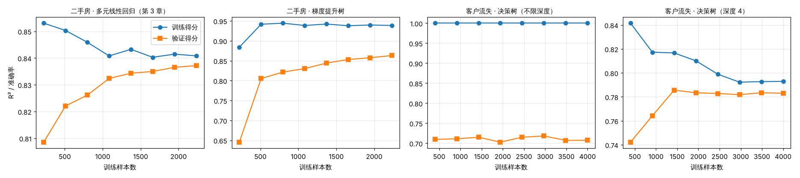
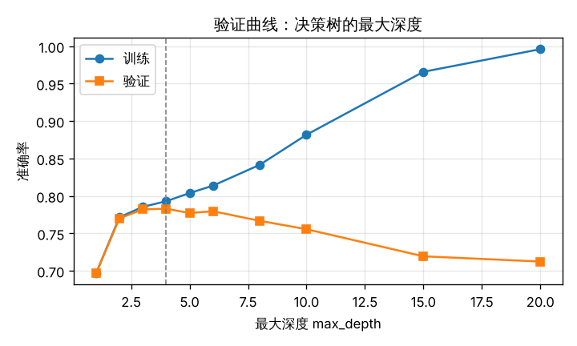
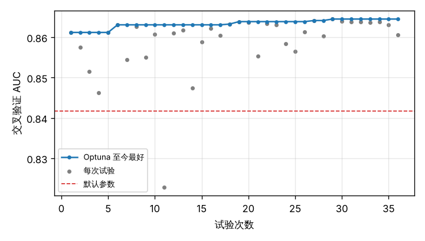
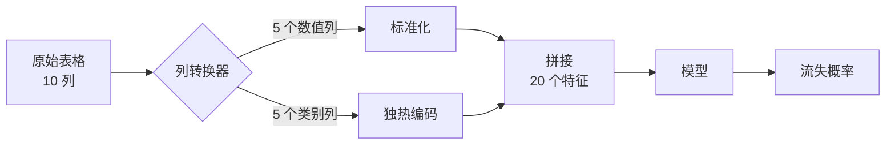
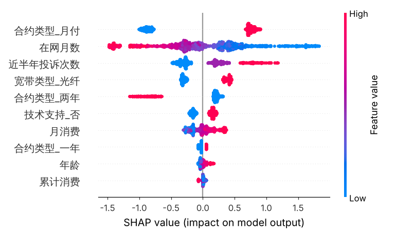
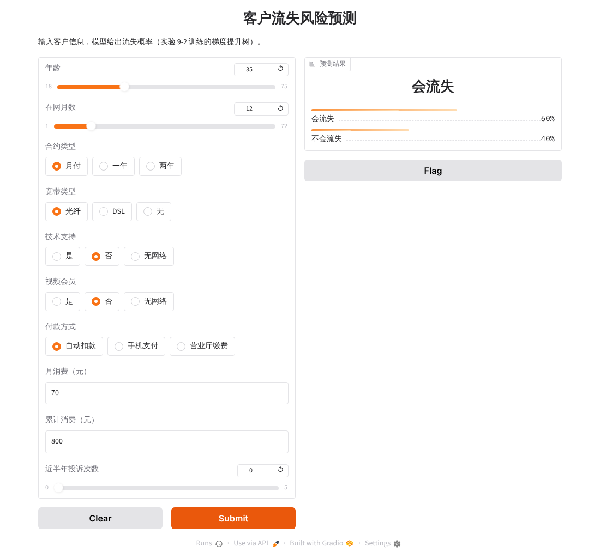
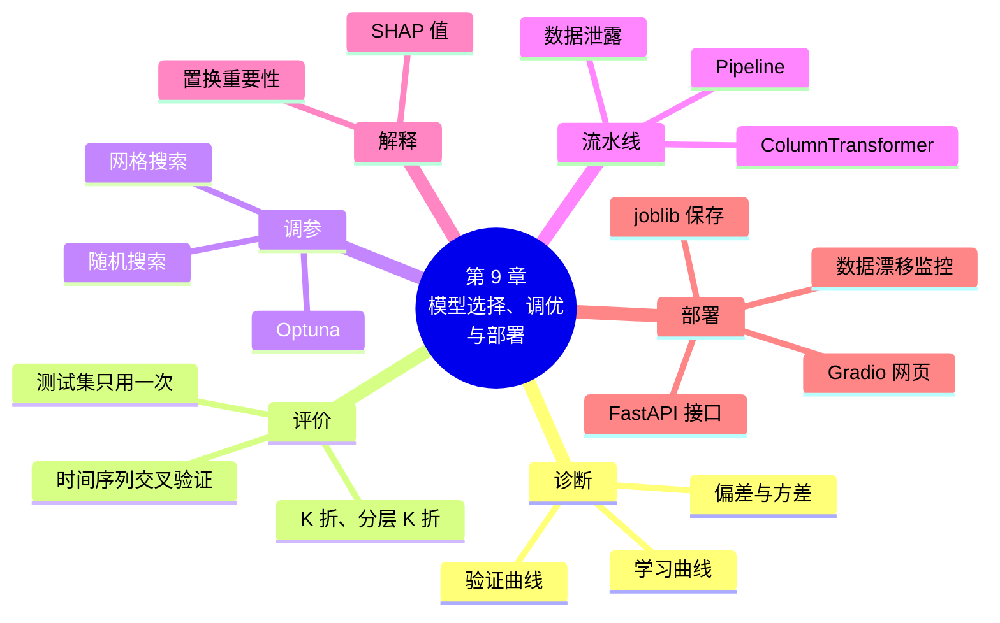

# 第 9 章 模型选择、调优与部署

!!! abstract "本章学时"
    理论 5 学时 · 实验 3 学时（本章共 3 个实验，教师可任选）

## 学习目标

学完本章，你应该能够：

1. **说出**偏差与方差、交叉验证、学习曲线、验证曲线、网格搜索、流水线、SHAP 值、数据漂移的含义（记忆）；
2. **解释**为什么一次划分的成绩不可靠，为什么预处理要放进流水线，为什么最终模型要按验证集而不是测试集挑选（理解）；
3. **运用** scikit-learn 完成交叉验证、学习曲线、网格搜索和流水线，用 Optuna 自动调参，用 joblib、FastAPI、Gradio 保存和发布模型（应用）；
4. 根据学习曲线**分析**模型是欠拟合还是过拟合，并提出改进办法；用置换重要性和 SHAP 值分析模型为什么这样预测（分析）；
5. 判断调参带来的提升是否值得，**评价**一个模型能否上线、上线后要监控什么（评价）。

!!! info "先修要求"
    学习本章前，你需要掌握：

    - 训练集、验证集、测试集和泛化能力（[1.2.3 训练集、测试集与泛化能力](../01-intro/index.md#123)）；
    - 欠拟合、过拟合与正则化（[3.5.2 欠拟合与过拟合](../03-linear-regression/index.md#352)）；
    - AUC 和模型测试报告（[4.4.2 ROC 曲线与 AUC](../04-logistic-regression/index.md#442-roc-auc)、[4.6.2 模型测试报告](../04-logistic-regression/index.md#462)）；
    - 决策树的剪枝、随机森林的特征重要性（[5.3.3 剪枝](../05-decision-tree/index.md#533)、[5.5.3 特征重要性](../05-decision-tree/index.md#553)）。

??? abstract "本章概念清单（21 个，点击查看定义和例子）"
    1. [偏差与方差](../../appendix/glossary.md#g-偏差与方差)
    2. [交叉验证](../../appendix/glossary.md#g-交叉验证)
    3. [K 折交叉验证](../../appendix/glossary.md#g-K-折交叉验证)
    4. [分层抽样](../../appendix/glossary.md#g-分层抽样)
    5. [时间序列交叉验证](../../appendix/glossary.md#g-时间序列交叉验证)
    6. [学习曲线](../../appendix/glossary.md#g-学习曲线)
    7. [验证曲线](../../appendix/glossary.md#g-验证曲线)
    8. [网格搜索](../../appendix/glossary.md#g-网格搜索)
    9. [随机搜索](../../appendix/glossary.md#g-随机搜索)
    10. [Optuna 调参](../../appendix/glossary.md#g-Optuna-调参)
    11. [流水线](../../appendix/glossary.md#g-流水线)
    12. [列转换器](../../appendix/glossary.md#g-列转换器)
    13. [置换重要性](../../appendix/glossary.md#g-置换重要性)
    14. [SHAP 值](../../appendix/glossary.md#g-SHAP-值)
    15. [模型保存](../../appendix/glossary.md#g-模型保存)
    16. [joblib](../../appendix/glossary.md#g-joblib)
    17. [模型接口](../../appendix/glossary.md#g-模型接口)
    18. [FastAPI](../../appendix/glossary.md#g-FastAPI)
    19. [Gradio](../../appendix/glossary.md#g-Gradio)
    20. [模型部署](../../appendix/glossary.md#g-模型部署)
    21. [数据漂移](../../appendix/glossary.md#g-数据漂移)

## 情景导入

前面八章，我们给客户流失预测做了好几个模型：第 4 章的逻辑回归测试 AUC 0.836，第 5 章的随机森林 0.819、LightGBM 0.828。业务部门拿到报告后问了一连串问题：

“你们说逻辑回归最好，可它只比 LightGBM 高 0.008，换一批测试数据会不会就反过来了？”

“LightGBM 的参数是默认的吧？好好调一调，会不会比逻辑回归强？”

“模型说这位客户流失概率 94%，凭什么？我们得跟客户经理讲清楚原因。”

“模型做好了，客服系统怎么用它？明年客户的情况变了，模型还准吗？”

这些问题都超出了“训练一个模型、看一个分数”的范围。本章把前面学过的内容串起来：怎样可靠地评价模型，怎样调参，怎样防止不知不觉中“作弊”，怎样解释预测结果，最后怎样把模型交到别人手上，并在上线后持续盯着它。

## 9.1 偏差、方差与学习曲线

### 9.1.1 偏差与方差

第 3 章讲过欠拟合和过拟合。从误差的来源看，模型在新数据上的误差主要有两部分，合称[**偏差与方差**](../../appendix/glossary.md#g-偏差与方差 "模型误差的两个来源：偏差是模型假设与真实规律的系统性差距（欠拟合），方差是模型对训练数据变化的敏感程度（过拟合）"){ .term }：

- **偏差**：模型的“想法”本身就不对，离真实规律有系统性的差距。比如用一条直线去拟合一条弯曲的曲线，换多少数据都拟合不好。偏差大就是**欠拟合**。
- **方差**：模型对训练数据太敏感，换一批训练数据，学出来的模型就变样。比如一棵不限深度的决策树，把训练集里的偶然现象都记了下来。方差大就是**过拟合**。

打个比方：偏差大的射手，每一枪都偏向靶心左上方，打得很集中，但整体偏了；方差大的射手，平均位置在靶心附近，但每一枪都东一枪西一枪。模型越复杂，偏差越小、方差越大；模型越简单，偏差越大、方差越小。调模型，就是在两者之间找平衡。

### 9.1.2 学习曲线：诊断欠拟合与过拟合

怎样知道一个模型是偏差大还是方差大？画[**学习曲线**](../../appendix/glossary.md#g-学习曲线 "训练得分和验证得分随训练样本数变化的曲线，用于诊断欠拟合和过拟合"){ .term }：横轴是训练样本数，纵轴是模型在训练集上的得分和在验证集上的得分（用交叉验证求平均）。实验 9-1 画了四条学习曲线：



| 模型 | 训练样本最多时 训练得分 | 验证得分 | 差距 | 诊断 |
|---|---|---|---|---|
| 二手房 · 多元线性回归（第 3 章） | R² 0.841 | 0.837 | 0.004 | 两条线贴在一起，但都不高：**偏差大** |
| 二手房 · 梯度提升树 | R² 0.939 | 0.863 | 0.076 | 验证得分更高，仍在上升 |
| 客户流失 · 决策树（不限深度） | 准确率 1.000 | 0.707 | 0.293 | 训练满分、验证很低：**方差大** |
| 客户流失 · 决策树（深度 4） | 准确率 0.793 | 0.783 | 0.010 | 差距很小，验证得分提高了 0.076 |

看学习曲线的方法：

- **两条线都低，而且很快贴在一起**：偏差大、欠拟合。再加数据也没用（线性回归的验证得分从 1085 套到 2234 套只升了 0.005），应该换更复杂的模型、加更有用的特征，或减弱正则化。
- **训练得分高、验证得分低，中间隔着一大段**：方差大、过拟合。可以增加数据、简化模型（限制树的深度、加强正则化）、减少无关特征。
- **验证得分随样本增加还在上升**：再多收集一些数据，效果还会变好。梯度提升树就是这样。

不限深度的决策树在 4000 条训练样本下训练准确率仍是 1.000，验证只有 0.707，比深度 4 的树低了 0.076：树把训练集背了下来，学到的“规律”到了新数据上就不灵了。

### 9.1.3 验证曲线：给超参数找合适的值

学习曲线横轴是样本数；如果横轴换成某个超参数的取值，就是[**验证曲线**](../../appendix/glossary.md#g-验证曲线 "训练得分和验证得分随某个超参数取值变化的曲线，用于选择超参数"){ .term }。实验 9-1 第③步让决策树的最大深度从 1 变到 20：



- 深度 1：训练、验证都是 0.697，欠拟合；
- 深度 4：验证得分最高，0.783；
- 深度 20：训练 0.996，验证 0.712，过拟合。

验证曲线把“偏差—方差”的权衡画了出来：左边两条线一起低，是偏差大；右边两条线分得很开，是方差大；验证得分最高的那个点就是合适的取值。scikit-learn 中用 `validation_curve(模型, X, y, param_name="max_depth", param_range=[...])` 一行就能算出来。

## 9.2 交叉验证

### 9.2.1 为什么一次划分不够

前几章都是把数据一次性分成训练集和测试集。这样得到的分数有偶然性：哪些样本恰好分进了测试集，会影响成绩。实验 9-1 第①步，同一个深度 5 的决策树，换 10 种不同的随机划分，测试准确率从 0.769 到 0.797，相差 0.028。情景导入中逻辑回归和 LightGBM 只差 0.008，换一种划分完全可能反过来。

[**交叉验证**](../../appendix/glossary.md#g-交叉验证 "把数据分成几份、轮流做测试集，取多次成绩平均值的评价方法"){ .term }把数据分成几份，轮流拿其中一份做验证、其余的训练，取多次成绩的平均值。这样每个样本都当过一次验证数据，平均成绩比一次划分稳定得多，还能算出标准差，看成绩的波动有多大。

### 9.2.2 K 折与分层 K 折

最常用的是 [**K 折交叉验证**](../../appendix/glossary.md#g-K-折交叉验证 "把数据平均分成 K 份，做 K 轮，每轮用一份验证、其余 K − 1 份训练，取 K 个分数平均的方法"){ .term }：把训练数据平均分成 K 份（K 通常取 5 或 10），做 K 轮，第 i 轮用第 i 份验证、其余 K − 1 份训练，得到 K 个分数取平均。实验 9-1 中深度 5 的决策树 5 折交叉验证：五折分别是 0.790、0.776、0.800、0.749、0.783，平均 0.780，标准差 0.017。

分类问题还要注意每一折里各类别的比例。如果数据按某种顺序存放（比如流失客户集中在后面），按顺序切成 K 份，有的折可能一个流失客户都没有。即使先打乱，数据少时比例也会波动。实验 9-1 从客户流失数据中抽 200 条（流失率 24.0%）：

- 普通 K 折，五折验证集的流失率分别是 22.5%、27.5%、27.5%、17.5%、25.0%；
- 分层 K 折，五折分别是 22.5%、22.5%、25.0%、25.0%、25.0%。

[**分层抽样**](../../appendix/glossary.md#g-分层抽样 "按类别比例抽取样本，使每一份中各类别的比例与整体一致的抽样方法"){ .term }就是按类别比例抽取样本，让每一份中各类别的比例和整体一致。第 4 章 `train_test_split(..., stratify=y)` 用的就是它。分层 K 折（`StratifiedKFold`）在每一折都这样做，scikit-learn 的 `cross_val_score` 遇到分类模型时默认就用分层 K 折。下面的动画可以对比几种划分方法：

<iframe class="sim-frame" src="../../sims/kfold-cv/main.html" height="560" loading="lazy" title="K 折交叉验证"></iframe>

动画：K 折交叉验证。按“下一折”逐折查看训练集（蓝）和验证集（橙），比较普通 K 折、分层 K 折和时间序列交叉验证。[全屏打开](../../sims/kfold-cv/main.html){ target=_blank }
{ .sim-caption }

### 9.2.3 时间序列交叉验证

如果数据有时间先后，比如每天的销量、每月的客户行为，就不能随便打乱：打乱后，模型可能用“下个月的数据”去预测“上个月”，相当于提前看到了答案，成绩虚高，上线后才发现不准。

[**时间序列交叉验证**](../../appendix/glossary.md#g-时间序列交叉验证 "按时间顺序划分、每一折只用过去的数据训练并预测之后一段的交叉验证方法"){ .term }始终只用过去预测未来：第 1 折用前几个月训练、预测紧接着的一两个月；第 2 折把训练期往后延长，再预测后面一段；以此类推。实验 9-1 把 12 个月分成 4 折：

| 折 | 训练 | 验证 |
|---|---|---|
| 第 1 折 | 2025-01～2025-04 | 2025-05～2025-06 |
| 第 2 折 | 2025-01～2025-06 | 2025-07～2025-08 |
| 第 3 折 | 2025-01～2025-08 | 2025-09～2025-10 |
| 第 4 折 | 2025-01～2025-10 | 2025-11～2025-12 |

scikit-learn 中用 `TimeSeriesSplit`。第 12 章的销量预测会用到它。

### 9.2.4 训练集、验证集、测试集各管什么

有了交叉验证，三种数据的分工是：

| 数据 | 用途 | 注意 |
|---|---|---|
| 训练集 | 训练模型，求出参数 | |
| 验证集（或交叉验证） | 比较不同模型、选超参数 | 可以反复使用 |
| 测试集 | 最后评价一次选定的模型 | **只用一次**，不能用来挑模型 |

一个常见的错误是：试了很多模型和参数，每次都看测试集的成绩，最后选测试集上最好的那个。这样测试集实际上也参与了“挑选”，最终报告的测试成绩会偏乐观。第 5 章实验 5-3 的做法是对的：按验证集挑出学习率 0.03 的 LightGBM，它在测试集上的成绩反而比另一个略低，也照实报告。

??? microvideo "思维工具微课｜考试之前，偷看了一眼试卷　4 分 46 秒"

    <video class="mv-video" controls preload="none" playsinline poster="../../assets/video/m5.jpg">
      <source src="../../assets/video/m5.mp4" type="video/mp4">
    </video>

    **这一集的思维工具：改一处，记一笔。** 什么时候用：反复试、反复改。怎么用：一次一样，马上记下。局限：验收的数据，平时不碰。

    **看完选两件做：**

    - 玩一玩：在实验里找出那个泄露的特征。
    - 审一审 AI：让它写训练代码，数数测试集用了几次。
    - 想一想自己：哪次好成绩是“刷”出来的。

    <p class="mv-note">本片配音和部分画面由 AI 生成。</p>

## 9.3 超参数调优

### 9.3.1 参数与超参数

模型里有两种“参数”：

- **参数**：模型从数据中学出来的，如线性回归的系数 w、决策树每个节点的划分阈值、神经网络的权重；
- **超参数**：训练之前由人设定的，如决策树的最大深度、随机森林的树的数量、SVM 的 C 和 gamma、KNN 的 K、梯度提升的学习率。

超参数没法从训练数据中直接学，只能试：设一组值，训练，用交叉验证打分，再换一组。这个过程叫调参。

### 9.3.2 网格搜索与随机搜索

[**网格搜索**](../../appendix/glossary.md#g-网格搜索 "列出每个超参数的候选值，试遍所有组合并用交叉验证打分的调参方法"){ .term }把每个超参数的候选值列出来，所有组合都试一遍。实验 9-2 对梯度提升树（`HistGradientBoostingClassifier`，与 LightGBM 原理相同的 scikit-learn 实现）调三个超参数：

```python
grid = {"model__learning_rate": [0.03, 0.1, 0.3],
        "model__max_depth": [2, 3, 5, None],
        "model__min_samples_leaf": [20, 50, 100]}
gs = GridSearchCV(pipe, grid, cv=5, scoring="roc_auc", n_jobs=-1).fit(X_train, y_train)
print(gs.best_params_, gs.best_score_)
```

3 × 4 × 3 = 36 种组合，每种做 5 折交叉验证，一共训练 180 次。网格搜索简单可靠，但组合数随超参数个数成倍增长：5 个超参数各取 5 个值，就是 3125 种组合。

[**随机搜索**](../../appendix/glossary.md#g-随机搜索 "在给定范围内随机抽取若干组超参数进行试验的调参方法"){ .term }不试遍所有组合，而是在给定的范围里随机抽若干组。它的好处是：在同样的次数下，每个超参数能试到更多不同的取值；而通常只有少数几个超参数真正重要，随机搜索更容易碰到它们的好值。scikit-learn 中用 `RandomizedSearchCV`，`n_iter` 指定抽多少组。

### 9.3.3 Optuna 自动调参

网格搜索和随机搜索每次试验都互不相干，不会“吸取教训”。[**Optuna 调参**](../../appendix/glossary.md#g-Optuna-调参 "用 Optuna 库根据已有试验结果决定下一次试验取值的自动调参方法"){ .term }用的是贝叶斯优化的思路：根据前面试过的结果，估计哪片区域更可能出好成绩，下一次就多往那里试。<sup class="cite">[[4]](#ref9-4)</sup> 用法是写一个目标函数，在里面让 Optuna 建议超参数的取值，返回交叉验证分数：

```python
def objective(trial):
    pipe.set_params(model__learning_rate=trial.suggest_float("learning_rate", 0.01, 0.5, log=True),
                    model__max_depth=trial.suggest_int("max_depth", 2, 8),
                    model__min_samples_leaf=trial.suggest_int("min_samples_leaf", 10, 200))
    return cross_val_score(pipe, X_train, y_train, cv=5, scoring="roc_auc").mean()

study = optuna.create_study(direction="maximize")
study.optimize(objective, n_trials=36)
print(study.best_params, study.best_value)
```



图中灰点是每次试验的分数，蓝线是“到目前为止最好的分数”。前几次是随机试探，之后试验点越来越集中在好的区域，最好分数一步步上升。

### 9.3.4 调参的收益有多大

实验 9-2 三种方法各试 36 次的结果：

| 方法 | 交叉验证 AUC | 测试 AUC | 用时 | 最好的参数 |
|---|---|---|---|---|
| 默认参数 | 0.842 | | | |
| 网格搜索 | 0.864 | 0.835 | 7.6 秒 | 学习率 0.1，最大深度 2，叶子最少 50 |
| 随机搜索 | 0.863 | 0.831 | 5.4 秒 | 学习率 0.054，最大深度 2，叶子最少 68 |
| Optuna | 0.865 | 0.829 | 6.4 秒 | 学习率 0.069，最大深度 2，叶子最少 198 |
| 逻辑回归（不调参） | 0.866 | 0.836 | | |

几点值得注意：

1. 调参让梯度提升树的交叉验证 AUC 从 0.842 升到 0.864 左右，三种方法的结果相差不到 0.002，而且都选了很浅的树（深度 2）。在这份数据上，三种方法没有本质区别；超参数多、每次训练很慢时，Optuna 的优势才明显。
2. 调好的梯度提升树在测试集上仍然没有超过不调参的逻辑回归（0.836）。客户流失数据的规律比较简单，接近“线性”，复杂模型发挥不出优势。这回答了情景导入的第二个问题：**调参能把一个模型的潜力发挥出来，但不能改变数据本身的上限。**
3. 交叉验证 AUC 比测试 AUC 高了约 0.03，这是因为挑参数用的就是交叉验证分数，挑出来的“最好”多少带点运气。这也是为什么要留一个从不参与挑选的测试集。

所以，实际工作中不要一上来就花大量时间调参。先做好数据和特征，用简单模型建一个基线；再试几种不同的模型；最后才对最有希望的一两个模型调参。

!!! cert "证书考点 · 人工智能训练师（三级）· 智能训练"
    常考：参数与超参数的区别；训练集、验证集、测试集的用途，测试集只用于最终评价；K 折交叉验证的步骤，K 常取 5 或 10；分层 K 折适用于分类、类别不平衡的数据；时间序列数据不能打乱，要用时间序列交叉验证；学习曲线判断欠拟合与过拟合的方法及对应的改进措施；网格搜索与随机搜索的区别。容易错在把交叉验证的分数当作最终的测试成绩，以及看测试集成绩来挑模型。

## 9.4 流水线：防止数据泄露

### 9.4.1 数据泄露

第 2 章讲过**数据泄露**：训练时用到了真实预测时无法获得的信息。在调参和交叉验证中有一种很隐蔽的泄露：**在划分训练、验证之前，就用全部数据做了预处理**。

实验 9-2 第①步做了一个极端的演示：200 个样本，1000 个特征全是随机数，标签也是随机的，任何模型的真实准确率都只能在 50% 左右。

- **错误做法**：先在全部 200 个样本上，按特征与标签的相关程度挑出最好的 20 个特征，再做 5 折交叉验证：准确率 0.740。
- **正确做法**：把挑特征放进流水线，每一折只用这一折的训练部分挑特征：准确率 0.415。

错误做法中，挑特征时已经看过验证折的标签，挑出的 20 个特征恰好在这些样本上“碰巧”和标签相关，交叉验证自然虚高。标准化、填充缺失值、过采样（第 4 章）、PCA（第 8 章）也一样，只是影响通常小一些。原则只有一条：**一切从数据中“学”东西的预处理步骤，都只能在训练部分上 fit，再去 transform 验证部分和测试部分。**

### 9.4.2 Pipeline 与 ColumnTransformer

手工保证“每一折都只在训练部分 fit”很麻烦，scikit-learn 用[**流水线**](../../appendix/glossary.md#g-流水线 "把预处理步骤和模型按顺序串成一个整体，统一 fit 和 predict，防止数据泄露"){ .term }（Pipeline）解决：把预处理步骤和模型按顺序串成一个整体，它对外就像一个模型，`fit` 时依次 fit 每一步，`predict` 时依次 transform 再预测。交给交叉验证或网格搜索时，每一折都会自动重新 fit 整条流水线，不会泄露。

真实表格里既有数值列又有类别列，要分别处理。[**列转换器**](../../appendix/glossary.md#g-列转换器 "对表格中不同的列分别做不同预处理再拼接结果的工具"){ .term }（ColumnTransformer）把不同的列交给不同的预处理器，再把结果拼在一起：

```python
num = ["年龄", "在网月数", "月消费", "累计消费", "近半年投诉次数"]
cat = ["合约类型", "宽带类型", "技术支持", "视频会员", "付款方式"]
prep = ColumnTransformer([("num", StandardScaler(), num),
                          ("cat", OneHotEncoder(handle_unknown="ignore"), cat)])
pipe = Pipeline([("prep", prep), ("model", LogisticRegression(max_iter=1000))])
pipe.fit(X_train, y_train)            # X_train 是原始表格，不用自己先编码
```



流水线还有两个好处。一是**上线方便**：保存整条流水线，使用时直接把原始的一行客户信息交给它，编码、标准化都在里面自动完成，不会出现“训练时编码了、上线时忘了编码”或者“独热编码的列顺序对不上”的错误。实验 9-2 中，把测试集第一位客户的原始信息直接交给流水线，就得到了流失概率 0.448。二是**一起调参**：网格搜索时，模型的超参数写成“步骤名__参数名”（如 `model__max_depth`），预处理的参数也能一起调。`OneHotEncoder(handle_unknown="ignore")` 的作用是：上线后遇到训练时没见过的类别（如新增的付款方式），不报错，全部填 0。

## 9.5 模型解释

### 9.5.1 特征重要性与置换重要性

第 5 章介绍了随机森林的**特征重要性**，它按每个特征在树中带来的不纯度下降来算，是在训练集上算的，而且偏爱取值多的特征。另一种更通用的方法是[**置换重要性**](../../appendix/glossary.md#g-置换重要性 "把某一列的值随机打乱后模型成绩下降的幅度，用来衡量模型对该特征的依赖程度"){ .term }：把测试集中某一列的值随机打乱，其他列不动，看模型的成绩下降了多少。下降越多，说明模型越依赖这一列。它对任何模型都适用，算的是在测试集上的真实影响。

实验 9-2 对调好的梯度提升树计算置换重要性（测试 AUC 下降多少）：

| 特征 | 合约类型 | 在网月数 | 近半年投诉次数 | 宽带类型 | 技术支持 | 月消费 | 年龄 | 付款方式、视频会员、累计消费 |
|---|---|---|---|---|---|---|---|---|
| AUC 下降 | 0.140 | 0.056 | 0.022 | 0.021 | 0.008 | 0.006 | 0.001 | 约 0 |

合约类型最重要：打乱它，AUC 从 0.83 降到 0.69 左右。累计消费的重要性约为 0，并不是说它和流失无关，而是它约等于“在网月数 × 月消费”（相关系数 0.999），信息已经被这两列包含了，打乱它模型还能从别的列得到同样的信息。

### 9.5.2 SHAP 值

置换重要性说明的是“整体上哪些特征重要”。业务部门还想知道：**对这一位客户**，模型为什么判他高风险？这需要 [**SHAP 值**](../../appendix/glossary.md#g-SHAP-值 "把一次预测分解为基准值加各特征贡献的解释方法，贡献为正推高预测、为负拉低预测"){ .term }。<sup class="cite">[[5]](#ref9-5)</sup>

SHAP 的思路来自博弈论中的“公平分配”：把一次预测看作几个特征合作完成的，模型的输出 = 基准值（所有客户的平均预测）+ 每个特征的贡献。贡献为正，把预测往“流失”方向推；为负，往“不流失”方向拉。实验 9-2 中流失概率最高的一位客户：

| 项目 | 值 |
|---|---|
| 客户信息 | 在网 2 个月、月付、光纤、近半年投诉 2 次、月消费 97.8 元 |
| 基准值（对数几率） | −1.341（相当于概率约 0.21） |
| 在网月数 = 2 | +1.402 |
| 合约类型 = 月付 | +0.896 |
| 近半年投诉 2 次 | +0.641 |
| 宽带类型 = 光纤 | +0.417 |
| 月消费 97.8 | +0.332 |
| 基准值 + 全部贡献 | 2.774 → 流失概率 0.941 |

梯度提升树分类器内部输出的是对数几率（第 4 章 Sigmoid 函数的输入），SHAP 值也是按对数几率相加的，最后再用 Sigmoid 换算成概率。这样就能跟客户经理说清楚：“这位客户刚来两个月、按月付费、近半年投诉了两次，这三条是模型判他高风险的主要原因。”挽留时可以针对性地处理投诉、推荐长期合约优惠。

把所有测试客户的 SHAP 值画在一张图上，就是 SHAP 摘要图：



每一行是一个特征，每个点是一位客户，横坐标是这个特征对他的贡献（SHAP value），颜色表示特征取值的高低（红色 High 高，蓝色 Low 低）。例如“在网月数”一行：蓝色（在网时间短）的点在右边，红色（在网时间长）的点在左边，说明在网时间越短越容易流失；“合约类型_两年”一行：红色（是两年合约）的点都在左边，长期合约能明显降低流失风险。

!!! warning "解释不等于因果"
    SHAP 值说明的是“模型为什么这样预测”，不是“客户为什么流失”。模型学到的是相关关系：如果“使用光纤”的客户流失多，可能是因为光纤套餐价格高、竞争对手促销多，而不是光纤本身让人流失。据此决策前，仍要结合业务调查，必要时做小范围试验。

## 9.6 模型保存与部署

### 9.6.1 用 joblib 保存模型

训练好的模型要保存下来，下次直接加载使用，不用重新训练，这叫[**模型保存**](../../appendix/glossary.md#g-模型保存 "把训练好的模型存成文件，以后直接加载使用而不必重新训练"){ .term }。scikit-learn 推荐用 [**joblib**](../../appendix/glossary.md#g-joblib "scikit-learn 推荐的模型保存与加载工具"){ .term }：

```python
import joblib
joblib.dump(pipe, "churn_model.joblib")       # 保存（包括预处理和模型）
model = joblib.load("churn_model.joblib")     # 加载
model.predict_proba(new_customers)
```

实验 9-2 保存的流水线文件约 69 KB，加载只用了 0.009 秒，加载后的预测和保存前完全相同。要注意两点：一是加载时 scikit-learn 等库的版本最好和保存时一致，版本差别大可能报错或结果不同，所以要在 `requirements.txt` 中写明版本；二是 joblib 文件加载时会执行其中的代码，**不要加载来路不明的模型文件**。

### 9.6.2 用 FastAPI 做预测接口

模型保存好了，客服系统、手机 App 怎么用它？最常见的做法是把它做成一个[**模型接口**](../../appendix/glossary.md#g-模型接口 "把模型放在服务器上，其他程序通过网络发送数据、获取预测结果的服务方式"){ .term }（API）：模型运行在一台服务器上，其他程序通过网络发来客户信息，服务器返回预测结果。这样调用方不需要懂 Python、不需要装 scikit-learn。

[**FastAPI**](../../appendix/glossary.md#g-FastAPI "用 Python 编写网络接口的框架，能自动检查请求数据并生成接口文档"){ .term } 是 Python 中写接口最常用的框架之一，几十行代码就够了（完整代码见 `labs/ch09/app_fastapi.py`）：

```python
model = joblib.load("churn_model.joblib")       # 启动时加载一次
app = FastAPI(title="客户流失预测接口")

class Customer(BaseModel):                      # 规定请求里必须有哪些字段、取值范围
    年龄: int = Field(ge=18, le=100)
    合约类型: Literal["月付", "一年", "两年"]
    ...

@app.post("/predict")
def predict(c: Customer):
    prob = float(model.predict_proba(pd.DataFrame([c.model_dump()]))[0, 1])
    return {"流失概率": round(prob, 3), "风险等级": "高" if prob >= 0.6 else "中" if prob >= 0.3 else "低"}
```

用 `uvicorn app_fastapi:app --port 8000` 启动后，任何程序向 `http://服务器地址:8000/predict` 发送一段 JSON 格式的客户信息，就能拿到结果：

```text
请求：{"年龄": 37, "在网月数": 25, "合约类型": "月付", "宽带类型": "光纤", ...}
返回：{"流失概率": 0.454, "风险等级": "中"}
```

`Customer` 类的作用是**检查输入**：实验 9-3 故意发了一个“合约类型 = 三年、年龄 = 8”的请求，FastAPI 直接返回状态码 422 并指出这两个字段不合法，不会把错误数据交给模型。打开 `http://127.0.0.1:8000/docs`，还能看到自动生成的接口说明页面，可以在网页上直接试用。

### 9.6.3 用 Gradio 做网页小工具

如果使用者是业务人员，他们更需要一个能直接操作的网页。[**Gradio**](../../appendix/glossary.md#g-Gradio "用几行 Python 代码把函数变成可交互网页的工具，常用于模型演示"){ .term } 能用几行代码把一个 Python 函数变成网页：

```python
def predict(年龄, 在网月数, 合约类型, ...):
    prob = float(model.predict_proba(pd.DataFrame([locals()]))[0, 1])
    return {"会流失": prob, "不会流失": 1 - prob}

demo = gr.Interface(fn=predict, inputs=[gr.Slider(18, 75, label="年龄"), ...], outputs=gr.Label())
demo.launch()                                   # launch(share=True) 生成临时公网链接
```



运行后在浏览器打开 `http://127.0.0.1:7860`，拖动滑块、点选项，点 Submit 就能看到预测结果。上图是默认输入（35 岁、在网 12 个月、月付、光纤）的结果：流失概率约 60%。`launch(share=True)` 会生成一个临时公网链接（最长保留约一周），方便发给同学或老师试用。Gradio 适合做演示和内部小工具；面向大量用户的正式服务，一般用 FastAPI 一类的接口，再由前端工程师做界面。

本节的 FastAPI 和 Gradio 都是在自己电脑上运行的。真正的生产部署还要考虑并发、容器、负载均衡、权限认证等问题，在“人工智能开发框架技术”课程中详细介绍。所有这些把模型交给别人使用的工作，统称[**模型部署**](../../appendix/glossary.md#g-模型部署 "把训练好的模型交给使用者、在实际业务中运行的全部工作"){ .term }。

### 9.6.4 上线以后：监控与数据漂移

模型上线不是终点。业务在变、客户在变，模型训练时依据的数据规律可能慢慢失效。上线后的数据分布和训练时不一样了，叫[**数据漂移**](../../appendix/glossary.md#g-数据漂移 "上线后输入数据的分布与训练时相比发生变化的现象，常用 PSI 监控"){ .term }。比如公司涨价后客户的月消费整体上升，或者推出新政策后月付客户变多。

常用的监控指标是 PSI（群体稳定性指数）：把训练数据的某个特征分成 10 段，比较新旧两批数据在各段的占比差多少。一般认为 PSI 小于 0.1 是稳定，0.1～0.25 是轻微漂移，大于 0.25 是明显漂移。实验 9-3 模拟了“三个月后”的一批客户：月消费整体上涨 15%，四成长期合约客户改成了月付：

| 特征 | PSI | 判断 |
|---|---|---|
| 月消费 | 0.313 | 明显漂移 |
| 合约类型 | 0.161 | 轻微漂移 |
| 其他 8 个特征 | 0.001～0.024 | 稳定 |

模型给出的平均流失概率也从 0.310 升到 0.369。这时要追问：是客户真的更容易流失了，还是模型“没见过”这种情况、判断失准了？一套完整的监控通常包括：

1. **输入监控**：每天或每周计算各特征的 PSI，发现漂移就报警；
2. **输出监控**：预测结果的分布（如平均流失概率、高风险客户占比）是否突变；
3. **效果监控**：等真实结果出来（如一个月后客户是否真的流失了），计算实际的 AUC、召回率，与上线前比较；
4. **定期重训**：效果明显下降时，用最新的数据重新训练、重新评价，确认更好之后再替换线上模型。

!!! cert "证书考点 · 人工智能训练师（三级）· 智能系统设计"
    常考：模型上线后为什么要监控；数据漂移的含义和常见原因；PSI 的判断标准；模型效果下降时的处理流程（分析原因、补充数据、重新训练、评估后替换）；模型保存与加载；模型以接口方式提供服务的基本流程。数据处理工程师（高级）“可视化与分析报告”常结合 SHAP 摘要图、特征重要性图考查模型解释，要能读懂图并用业务语言说明结论。

## 9.7 前沿视窗

**MLOps：把模型当作产品来管理。**一个模型从开发到上线再到下线，要经历数据准备、训练、评估、部署、监控、重训的循环，参与的人有数据工程师、算法工程师、运维工程师。把软件工程中的持续集成、持续部署思想用到机器学习上，就是 MLOps。<sup class="cite">[[6]](#ref9-6)</sup> 常用工具如 MLflow：自动记录每次实验用了哪些数据、参数、代码版本，得到了什么成绩，模型存在哪里；需要时可以一键回到任何一次实验，把选中的模型登记、发布。研究者很早就指出，真实的机器学习系统中，模型代码只占很小一部分，数据管道、监控、配置等“周边”工作才是大头，不加管理就会越积越多，成为“技术债”。<sup class="cite">[[7]](#ref9-7)</sup>

**国产平台上的一键部署。**阿里云人工智能平台 PAI 的模型在线服务（PAI-EAS）、华为云 ModelArts、百度智能云千帆等平台，都提供“上传模型文件 → 选择机器规格 → 生成接口地址”的部署服务，自动处理扩容、监控和版本切换。对中小企业来说，这比自己维护服务器省事得多。

**自动机器学习（AutoML）。**既然调参、选模型都能自动化，能不能让机器把整个建模流程都做了？AutoGluon、FLAML 等 AutoML 工具只需给出数据和目标列，就能自动尝试多种模型和参数并组合起来，在很多表格数据竞赛中成绩不错。不过本章的结论仍然成立：AutoML 能省去重复劳动，但理解数据、定义问题、判断结果是否可信、监控上线后的表现，仍然需要人来做。

## 本章实验

!!! abstract "实验总览"
    | 实验 | 类型 | 建议时长 | 内容 |
    |---|---|---|---|
    | 实验 9-1 | ★ 基础 | 45 分钟 | 比较一次划分与交叉验证，比较普通 K 折与分层 K 折，用学习曲线诊断第 3、5 章模型，用验证曲线选决策树深度 |
    | 实验 9-2 | ★ 基础 | 60 分钟 | 演示数据泄露；用 ColumnTransformer + Pipeline 搭流水线；网格搜索、随机搜索、Optuna 三种方法调参；用置换重要性和 SHAP 值解释模型，保存模型 |
    | 实验 9-3 | ☆ 拓展 | 45 分钟 | 用 FastAPI 做预测接口、用 Gradio 做网页小工具，让同学远程调用；用 PSI 检查数据漂移 |

    三个实验都在本机 CPU 上运行。实验代码见配套资源 `labs/ch09/` 目录。需要安装：`pip install optuna shap fastapi uvicorn gradio`。实验 9-3 要用实验 9-2 保存的模型。

### 实验 9-1 ★ 交叉验证与学习曲线

**实验目的**

1. 体会一次划分的成绩有偶然性，学会用交叉验证；
2. 比较普通 K 折与分层 K 折，了解时间序列交叉验证的划分方式；
3. 画学习曲线，诊断模型是欠拟合还是过拟合；
4. 画验证曲线，为决策树选择最大深度。

**实验环境**：Python 3.11，NumPy、pandas、Matplotlib、scikit-learn。

**实验数据**：`labs/data/telco_churn.csv`（第 4、5 章的客户流失数据，5000 条）和 `labs/data/house_clean.csv`（第 3 章清洗好的二手房数据，去掉面积、建成年份或总价缺失的记录后 2793 套）。

**实验步骤与代码**

第 1 步，用 10 个不同的随机种子划分数据，记录深度 5 的决策树的测试准确率；再做 5 折交叉验证：

```python
cv = cross_val_score(tree5, X, y, cv=StratifiedKFold(5, shuffle=True, random_state=42))
print(cv, cv.mean(), cv.std())
```

第 2 步，从客户流失数据中抽 200 条，分别用 `KFold(5)` 和 `StratifiedKFold(5)` 划分，打印每一折验证集的流失率；用 `TimeSeriesSplit(n_splits=4, test_size=2)` 划分 12 个月，打印每一折的训练、验证月份。

第 3 步，用 `learning_curve` 为二手房的线性回归、梯度提升树，以及客户流失的不限深度决策树画学习曲线：

```python
sizes, train_scores, val_scores = learning_curve(
    model, X, y, train_sizes=np.linspace(0.1, 1.0, 8), cv=5, scoring="r2")
plt.plot(sizes, train_scores.mean(axis=1), label="训练得分")
plt.plot(sizes, val_scores.mean(axis=1), label="验证得分")
```

第 4 步，用 `validation_curve` 让决策树的 `max_depth` 取 1～20，找出验证得分最高的深度，再为它画学习曲线。

完整代码见 `lab9_1_cv_learning_curve.py`。

**运行结果**

```text
客户流失 5000 条（流失率 30.3%）；二手房 2793 套

① 深度 5 的决策树：10 次不同的随机划分，测试准确率 0.769～0.797（相差 0.028）
  5 折交叉验证每一折：0.790，0.776，0.800，0.749，0.783；平均 0.780，标准差 0.017
  抽 200 条（流失率 24.0%），普通 K 折每一折验证集的流失率：22.5%，27.5%，27.5%，17.5%，25.0%
  抽 200 条（流失率 24.0%），分层 K 折每一折验证集的流失率：22.5%，22.5%，25.0%，25.0%，25.0%
  时间序列交叉验证（12 个月，分 4 折）：
    第 1 折：训练 2025-01～2025-04，验证 2025-05～2025-06
    第 2 折：训练 2025-01～2025-06，验证 2025-07～2025-08
    第 3 折：训练 2025-01～2025-08，验证 2025-09～2025-10
    第 4 折：训练 2025-01～2025-10，验证 2025-11～2025-12

② 学习曲线（5 折交叉验证）
  二手房 · 多元线性回归（第 3 章）
    训练样本   223：训练得分 0.853，验证得分 0.809，差距 0.044
    训练样本  1085：训练得分 0.841，验证得分 0.832，差距 0.008
    训练样本  2234：训练得分 0.841，验证得分 0.837，差距 0.004
  二手房 · 梯度提升树
    训练样本   223：训练得分 0.884，验证得分 0.645，差距 0.239
    训练样本  1085：训练得分 0.939，验证得分 0.830，差距 0.108
    训练样本  2234：训练得分 0.939，验证得分 0.863，差距 0.076
  客户流失 · 决策树（不限深度）
    训练样本   400：训练得分 1.000，验证得分 0.710，差距 0.290
    训练样本  1942：训练得分 1.000，验证得分 0.703，差距 0.297
    训练样本  4000：训练得分 1.000，验证得分 0.707，差距 0.293

③ 验证曲线：决策树的最大深度
  深度  1：训练 0.697，验证 0.697
  深度  2：训练 0.772，验证 0.770
  深度  3：训练 0.785，验证 0.782
  深度  4：训练 0.793，验证 0.783
  深度  5：训练 0.804，验证 0.777
  深度  6：训练 0.814，验证 0.780
  深度  8：训练 0.842，验证 0.767
  深度 10：训练 0.882，验证 0.756
  深度 15：训练 0.966，验证 0.719
  深度 20：训练 0.996，验证 0.712
  验证得分最高的深度 = 4
  深度 4 的学习曲线：全部训练样本时训练 0.793，验证 0.783，差距 0.010
```

几点解读：

- ①中一次划分的成绩能相差 0.028；交叉验证给出了平均值和标准差，更可靠。
- ②中线性回归训练、验证得分很快贴在一起，是偏差大；梯度提升树样本少时差距很大，随样本增加验证得分不断上升，说明多收集数据还有用。
- ②中不限深度的决策树样本再多，训练得分仍是 1.000、差距始终约 0.29，是典型的方差大。
- ③中深度 3～6 的验证得分都在 0.78 左右，差别不大，选其中较简单的即可。

**实验记录表**

| 项目 | 结果 |
|---|---|
| 10 次随机划分的测试准确率范围 | |
| 5 折交叉验证的平均值和标准差 | |
| 线性回归、不限深度决策树的诊断（欠拟合 / 过拟合）和依据 | |
| 验证曲线选出的最大深度和验证得分 | |

**常见问题排查**

| 现象 | 原因 | 解决办法 |
|---|---|---|
| `learning_curve` 报错说某一折只有一个类别 | 数据按标签排序，没打乱也没分层 | `cv=StratifiedKFold(5, shuffle=True, random_state=42)` |
| 学习曲线锯齿很多 | 每一折样本少，分数波动大 | 增大折数或训练样本，关注整体趋势 |
| 运行很慢 | 每个点都要训练 K 次 | 加 `n_jobs=-1` 用上全部 CPU 核心 |
| R² 出现很大的负数 | 小样本时线性回归的验证集上遇到没见过的类别组合 | 正常现象，看样本多时的结果 |

**思考与练习**

1. 第 3 章实验 3-2 把目标改成 log(总价)、特征加入 log(面积) 后，模型变好了。按本实验的方法画它的学习曲线，验证得分有什么变化？
2. 把客户流失决策树的 `min_samples_leaf` 设为 50、不限深度，再画验证曲线，结果和限制深度有什么不同？
3. 你的数据如果是按日期记录的每日门店销量，应该选哪种交叉验证？为什么？

**实验报告要求**

提交学习曲线、验证曲线和运行结果截图，填写实验记录表；用不超过 300 字写出两个模型的诊断结论和改进建议。

### 实验 9-2 ★ 一条完整的建模流水线

**实验目的**

1. 通过演示理解数据泄露，学会把预处理放进流水线；
2. 用 ColumnTransformer 和 Pipeline 处理含数值列和类别列的原始表格；
3. 用网格搜索、随机搜索和 Optuna 调参，比较效果和用时；
4. 用置换重要性和 SHAP 值解释模型，保存最终模型。

**实验环境**：同实验 9-1，另需 `pip install optuna shap`。

**实验数据**：`labs/data/telco_churn.csv`，按 7 : 3 分层划分，与第 4、5 章相同（`random_state=42`），测试集成绩可以与前几章直接比较。

**实验步骤与代码**

第 1 步，数据泄露演示：生成 200 × 1000 的随机特征和随机标签，比较“先选特征再交叉验证”和“把选特征放进流水线”两种做法。

```python
Xsel = SelectKBest(f_classif, k=20).fit_transform(Xr, yr)       # 错误：先在全部数据上选
wrong = cross_val_score(LogisticRegression(), Xsel, yr, cv=5).mean()
right = cross_val_score(make_pipeline(SelectKBest(f_classif, k=20), LogisticRegression()),
                        Xr, yr, cv=5).mean()                       # 正确：每一折里面选
```

第 2 步，用 ColumnTransformer 和 Pipeline 搭建“标准化 + 独热编码 + 逻辑回归”的流水线，交叉验证并在测试集上评价；把原始表格的一行直接交给流水线预测。

第 3 步，把模型换成 `HistGradientBoostingClassifier`，分别用网格搜索、随机搜索（36 组）、Optuna（36 次）调参，比较交叉验证 AUC、测试 AUC 和用时；画出 Optuna 的调参过程。

第 4 步，用 `permutation_importance` 计算置换重要性；用 `shap.TreeExplainer` 计算 SHAP 值，解释流失概率最高的客户，画 SHAP 摘要图：

```python
explainer = shap.TreeExplainer(final.named_steps["model"])
sv = explainer.shap_values(final.named_steps["prep"].transform(X_test))
shap.summary_plot(sv, Z_test, feature_names=names)
```

第 5 步，用 `joblib.dump` 保存整条流水线。

完整代码见 `lab9_2_pipeline_tuning.py`，全部运行约 30 秒。

**运行结果**

```text
① 数据泄露演示（200 条样本、1000 个随机特征、标签随机）
  先在全部数据上选 20 个特征，再交叉验证：准确率 0.740  ← 虚高
  把选特征放进流水线，每一折只用训练部分选：准确率 0.415  ← 真实水平

② 流水线：数值列 5 个标准化，类别列 5 个独热编码 → 20 个特征 → 逻辑回归
  逻辑回归：交叉验证 AUC 0.866，测试 AUC 0.836
  直接把原始表格的一行交给流水线：{'年龄': 37, '在网月数': 25, '合约类型': '月付', '宽带类型': '光纤', '技术支持': '否', '视频会员': '否', '付款方式': '自动扣款', '月消费': 65.7, '累计消费': 1614.2, '近半年投诉次数': 0} → 流失概率 0.448

③ 梯度提升树调参（5 折交叉验证 AUC；默认参数 0.842）
  方法          试验次数    交叉验证 AUC    测试 AUC     用时（秒）   最好的参数
  网格搜索          36       0.864     0.835       7.6   {'learning_rate': 0.1, 'max_depth': 2, 'min_samples_leaf': 50}
  随机搜索          36       0.863     0.831       5.4   {'l2_regularization': 0.126, 'learning_rate': 0.054, 'max_depth': 2, 'min_samples_leaf': 68}
  Optuna        36       0.865     0.829       6.4   {'learning_rate': 0.069, 'max_depth': 2, 'min_samples_leaf': 198, 'l2_regularization': 0.201}
  Optuna 前 12 次中最好 0.863，前 24 次 0.864，36 次 0.865

④ 置换重要性（把一列打乱后测试 AUC 下降多少）：
  合约类型 0.140，在网月数 0.056，近半年投诉次数 0.022，宽带类型 0.021，技术支持 0.008，月消费 0.006，年龄 0.001，付款方式 0.000，视频会员 0.000，累计消费 -0.000

  SHAP：测试集中流失概率最高的客户（第 1326 条，概率 0.941）
  年龄=38，在网月数=2，合约类型=月付，宽带类型=光纤，技术支持=否，视频会员=是，付款方式=自动扣款，月消费=97.8，累计消费=192.8，近半年投诉次数=2
  基准值（平均预测，对数几率）-1.341；贡献最大的 5 项：
    在网月数          +1.402
    合约类型_月付       +0.896
    近半年投诉次数       +0.641
    宽带类型_光纤       +0.417
    月消费           +0.332
  基准值 + 全部贡献 = 2.774（对数几率）→ 概率 0.941

  模型已保存到 churn_model.joblib（69 KB），包含预处理和模型两步
```

几点解读：

- ①中随机数据“学”出了 0.740 的准确率，这就是数据泄露的危害；正确做法给出 0.415，在 50% 附近随机波动。
- ②中流水线接收原始表格，编码和标准化都在内部完成，测试 AUC 0.836 与第 4 章实验 4-1 相同。
- ③中三种调参方法的结果相近，都没有超过逻辑回归；用时因电脑不同而不同。
- ④中置换重要性和 SHAP 都显示合约类型、在网月数、投诉次数最重要，与第 4 章逻辑回归系数、第 5 章随机森林特征重要性的结论一致，结论可信度更高。

**实验记录表**

| 项目 | 结果 |
|---|---|
| 数据泄露演示中错误做法、正确做法的准确率 | |
| 逻辑回归流水线的交叉验证 AUC、测试 AUC | |
| 三种调参方法的最好交叉验证 AUC 和测试 AUC | |
| 置换重要性最高的 3 个特征 | |
| 流失概率最高的客户的 3 条主要原因（用业务语言写） | |

**常见问题排查**

| 现象 | 原因 | 解决办法 |
|---|---|---|
| 网格搜索报错 `Invalid parameter` | 超参数名没加步骤名前缀 | 写成 `model__max_depth`（两个下划线） |
| 测试集出现训练时没见过的类别，报错 | `OneHotEncoder` 默认遇到新类别报错 | `OneHotEncoder(handle_unknown="ignore")` |
| SHAP 的特征名是 x0、x1…… | 传给 SHAP 的是没有列名的数组 | 用 `prep.get_feature_names_out()` 取得列名 |
| SHAP 图中文显示成方框 | Matplotlib 没有设置中文字体 | 按代码开头设置 `font.sans-serif` |
| Optuna 输出大量日志 | 默认日志级别为 INFO | `optuna.logging.set_verbosity(optuna.logging.WARNING)` |

**思考与练习**

1. 网格搜索中把 `max_depth` 的候选值改成 [1, 2, 3]，最好的结果有变化吗？这说明了什么？
2. 用 SHAP 解释流失概率最低的客户，贡献最大的几项是什么？
3. 如果业务部门只关心召回率（尽量不漏掉要流失的客户），调参时 `scoring` 应该怎样改？

**实验报告要求**

提交 Optuna 调参过程图、SHAP 摘要图和运行结果截图，填写实验记录表；以“客户流失模型选型与解释”为题写一份不超过 400 字的报告：比较几个模型、说明最终选择哪个及理由，用 SHAP 结果给客户经理提出挽留建议。

### 实验 9-3 ☆ 把模型发布成服务

**实验目的**

1. 加载保存的模型，确认预测结果一致；
2. 用 FastAPI 写预测接口，测试正常请求和不合法的请求；
3. 用 Gradio 做网页小工具，让同学远程试用；
4. 用 PSI 检查数据漂移。

**实验环境**：同实验 9-1，另需 `pip install fastapi uvicorn gradio`。

**实验数据**：实验 9-2 保存的 `churn_model.joblib`，客户流失数据的测试集。

**实验步骤与代码**

第 1 步，阅读 `app_fastapi.py`（代码见 9.6.2 节），在 `labs/ch09` 目录下启动服务：

```bash
uvicorn app_fastapi:app --host 0.0.0.0 --port 8000
```

浏览器打开 `http://127.0.0.1:8000/docs`，点开 `/predict`，点 Try it out，填入一位客户的信息，点 Execute 查看返回结果。同一局域网的同学可以把 `127.0.0.1` 换成你电脑的 IP 地址来调用。

第 2 步，不启动服务器，也可以用 FastAPI 的测试客户端在程序里调用接口：

```python
client = TestClient(app)
r = client.post("/predict", json={"年龄": 37, "在网月数": 25, "合约类型": "月付", ...})
print(r.status_code, r.json())
```

第 3 步，运行 `python app_gradio.py`，在浏览器打开 `http://127.0.0.1:7860` 试用；改成 `demo.launch(share=True)`，把生成的链接发给同学。

第 4 步，运行 `lab9_3_serve_monitor.py`：模拟三个月后的新客户（月消费上涨 15%，四成长期合约客户改为月付），计算每个特征的 PSI。

**运行结果**

```text
① 加载模型用时 0.009 秒；测试集前 3 位客户的流失概率：0.454，0.237，0.110

② GET /health → {'status': 'ok'}
  POST /predict，请求：{'年龄': 37, '在网月数': 25, '合约类型': '月付', '宽带类型': '光纤', '技术支持': '否', '视频会员': '否', '付款方式': '自动扣款', '月消费': 65.7, '累计消费': 1614.2, '近半年投诉次数': 0}
  状态码 200，返回：{'流失概率': 0.454, '风险等级': '中'}
  不合法的请求（合约类型=三年，年龄=8）→ 状态码 422，出错字段：年龄，合约类型
  连续请求 100 次，平均每次 20.1 毫秒

③ Gradio 预测函数：月付、在网 2 个月、投诉 2 次 → {'会流失': 0.941, '不会流失': 0.059}
  两年合约、在网 60 个月、无投诉 → {'会流失': 0.004, '不会流失': 0.996}

④ 数据漂移检查（PSI < 0.1 稳定，0.1～0.25 轻微漂移，> 0.25 明显漂移）
  年龄       PSI 0.008  稳定
  在网月数     PSI 0.013  稳定
  合约类型     PSI 0.161  轻微漂移
  宽带类型     PSI 0.001  稳定
  技术支持     PSI 0.001  稳定
  视频会员     PSI 0.001  稳定
  付款方式     PSI 0.001  稳定
  月消费      PSI 0.313  明显漂移
  累计消费     PSI 0.024  稳定
  近半年投诉次数  PSI 0.001  稳定
  模型给出的平均流失概率：原测试集 0.310 → 新数据 0.369
```

几点解读：

- ①中加载后测试集第 1 位客户的概率是 0.454，和②中接口返回的结果一致。注意这里是调参后的梯度提升树，和实验 9-2 第②步逻辑回归给出的 0.448 不同。
- ②中不合法的请求被直接拒绝，接口不会因为错误输入而崩溃或给出离谱的结果。
- ②中每次请求约 20 毫秒，主要花在网络框架上，模型计算本身不到 1 毫秒；不同电脑上数字会不同。
- ④中 PSI 准确找出了两个被改动的特征；“累计消费”没有改动，PSI 也很小。

**实验记录表**

| 项目 | 结果 |
|---|---|
| `/predict` 对一位测试客户的返回结果 | |
| 不合法请求的状态码和出错字段 | |
| Gradio 小工具的截图（含你自己设计的一位客户） | |
| PSI 判断为漂移的特征及数值 | |

**常见问题排查**

| 现象 | 原因 | 解决办法 |
|---|---|---|
| 启动时报 `FileNotFoundError: churn_model.joblib` | 没有先运行实验 9-2，或不在 `labs/ch09` 目录下启动 | 先运行 `lab9_2_pipeline_tuning.py`，再 `cd labs/ch09` |
| 端口被占用 | 8000 或 7860 已有程序在用 | 换端口：`--port 8001`，`demo.launch(server_port=7861)` |
| 同学访问不了你的接口 | 只监听了本机，或被防火墙拦截 | `--host 0.0.0.0`，并在防火墙中放行端口 |
| `share=True` 没有生成链接 | 网络无法连接 Gradio 的中转服务器 | 改在同一局域网内用 IP 访问 |
| 加载模型报版本警告 | 保存和加载时 scikit-learn 版本不同 | 安装与保存时相同的版本 |

**思考与练习**

1. 风险等级的阈值 0.6 和 0.3 是怎样定的？如何结合第 4 章的方法，根据挽留成本和客户价值来定？
2. 给接口增加一个 `/predict_batch`，一次接收多位客户、返回每位的概率。（见课后实操题 2）
3. 如果 PSI 报警说“月消费”明显漂移，但一个月后实际的 AUC 没有下降，要不要重新训练模型？

**实验报告要求**

提交接口测试和 Gradio 小工具的截图、PSI 结果，填写实验记录表；用不超过 300 字为这个模型写一份“上线监控方案”：监控哪些指标、多久检查一次、什么情况下重新训练。

## 本章小结

- 模型在新数据上的误差来自**偏差与方差**：偏差大是欠拟合，方差大是过拟合。**学习曲线**看训练得分和验证得分随样本数的变化，**验证曲线**看它们随超参数的变化，用来诊断问题、选择超参数。
- 一次划分的成绩有偶然性，要用**交叉验证**。**K 折交叉验证**轮流用每一份做验证；分类问题用**分层抽样**保证每一折的类别比例；有时间顺序的数据用**时间序列交叉验证**，只用过去预测未来。测试集只在最后用一次。
- 超参数要靠试：**网格搜索**试遍所有组合，**随机搜索**随机抽取组合，**Optuna 调参**根据已有结果决定下一次试哪里。调参能发挥模型的潜力，但不能突破数据的上限，先做好数据和基线再调参。
- 预处理放在划分之前会造成数据泄露。**流水线**把预处理和模型串成一体，**列转换器**对不同的列做不同的处理，交叉验证和上线时都不会出错。
- **置换重要性**看打乱某一列后成绩下降多少；**SHAP 值**把一次预测分解成各特征的贡献，能解释单个客户的预测。解释说明的是模型的依据，不等于因果。
- **模型保存**用 **joblib**；**FastAPI** 把模型做成**模型接口**，**Gradio** 做成网页小工具，这些都属于**模型部署**。上线后要监控**数据漂移**（如 PSI）和实际效果，必要时重新训练。



**下一章预告**

到这里，经典机器学习的主要方法已经学完。前面的模型都要靠人来设计特征，比如客户的“在网月数”“近半年投诉次数”。对于图片、语音、文本这类数据，人很难设计出好的特征。下一章开始学习神经网络：从一个神经元出发，看多层神经元怎样自己从数据中学出特征，这也是今天深度学习和大模型的基础。

## 参考文献

正文中的上标编号（如<sup class="cite">[[1]](#ref9-1)</sup>）对应下面的文献。带链接的可以直接打开；书籍可在图书馆或电子书平台查阅。

<div class="refs" markdown>

**教材与专著**

- <span id="ref9-1"></span>[1] 周志华. 机器学习[M]. 北京: 清华大学出版社, 2016.
    <span class="ref-note">第 2 章“模型评估与选择”讲留出法、交叉验证、调参与最终模型、偏差与方差，对应 9.1、9.2 节。</span>
- <span id="ref9-2"></span>[2] HASTIE T, TIBSHIRANI R, FRIEDMAN J. The elements of statistical learning: data mining, inference, and prediction[M]. 2nd ed. New York: Springer, 2009.
    <span class="ref-note">第 7 章“模型评估与选择”系统讨论偏差—方差分解和交叉验证，并专门指出“先用全部数据选特征再交叉验证”的错误做法，对应 9.1、9.4.1 节。</span>
- <span id="ref9-3"></span>[3] MOLNAR C. Interpretable machine learning: a guide for making black box models explainable[M/OL]. 3rd ed. 2025. https://christophm.github.io/interpretable-ml-book/.
    <span class="ref-note">免费在线书，介绍置换重要性、SHAP 等模型解释方法的原理、用法和局限，对应 9.5 节。</span>

**经典论文**

- <span id="ref9-4"></span>[4] AKIBA T, SANO S, YANASE T, et al. Optuna: a next-generation hyperparameter optimization framework[C]//Proceedings of the 25th ACM SIGKDD International Conference on Knowledge Discovery & Data Mining. Anchorage: ACM, 2019: 2623-2631.
    <span class="ref-note">Optuna 的论文，介绍“边运行边定义”的搜索空间写法和基于 TPE 的采样、提前终止策略，对应 9.3.3 节。</span>
- <span id="ref9-5"></span>[5] LUNDBERG S M, LEE S I. A unified approach to interpreting model predictions[C]//Advances in Neural Information Processing Systems 30. Long Beach: Curran Associates, 2017: 4765-4774.
    <span class="ref-note">提出 SHAP，把博弈论中的 Shapley 值用于解释单个预测，统一了多种解释方法，对应 9.5.2 节。</span>
- <span id="ref9-7"></span>[7] SCULLEY D, HOLT G, GOLOVIN D, et al. Hidden technical debt in machine learning systems[C]//Advances in Neural Information Processing Systems 28. Montreal: Curran Associates, 2015: 2503-2511.
    <span class="ref-note">谷歌工程师总结的机器学习系统“技术债”，指出模型代码只占真实系统的很小一部分，数据依赖、配置和监控才是难点，对应 9.7 节。</span>
- <span id="ref9-8"></span>[8] BERGSTRA J, BENGIO Y. Random search for hyper-parameter optimization[J]. Journal of Machine Learning Research, 2012, 13: 281-305.
    <span class="ref-note">说明在同样的试验次数下，随机搜索通常比网格搜索更有效，因为只有少数超参数真正重要，对应 9.3.2 节。</span>

**在线资源与工具**

- <span id="ref9-6"></span>[6] Google Cloud. MLOps: continuous delivery and automation pipelines in machine learning[EB/OL]. https://cloud.google.com/architecture/mlops-continuous-delivery-and-automation-pipelines-in-machine-learning.
    <span class="ref-note">谷歌云的 MLOps 架构指南，把 MLOps 分为手工、流水线自动化、持续集成与部署三个成熟度等级，对应 9.7 节。</span>
- <span id="ref9-9"></span>[9] scikit-learn developers. Common pitfalls and recommended practices[EB/OL]. https://scikit-learn.org/stable/common_pitfalls.html.
    <span class="ref-note">scikit-learn 官方文档“常见陷阱”一节，用例子说明预处理不一致、数据泄露和随机性控制的问题，对应 9.4 节。</span>
- <span id="ref9-10"></span>[10] FastAPI 官方文档[EB/OL]. https://fastapi.tiangolo.com/zh/.
    <span class="ref-note">FastAPI 的中文教程，介绍路径操作、请求体、数据校验和自动生成的接口文档，对应 9.6.2 节和实验 9-3。</span>
- <span id="ref9-11"></span>[11] Gradio 官方文档[EB/OL]. https://www.gradio.app/docs.
    <span class="ref-note">Gradio 的接口说明和示例，包括 `Interface`、各种输入输出组件和 `share` 公网链接，对应 9.6.3 节和实验 9-3。</span>

</div>

## 课后练习

选择题和判断题可以直接点击选项作答，系统会马上告诉你对错，并展开答案与解析；多选题选好后点“提交答案”。简答和实操题请先自己作答，再点开“答案与解析”核对。每道题的解析下方都有“回看”链接，做错了可以直接跳回正文复习。

**一、单项选择题**

<div class="quiz" data-answer="C" markdown>

**1.** 某模型的学习曲线显示：训练得分 1.000，验证得分 0.70，随着训练样本增加，两者的差距几乎不变。这个模型的主要问题是（　　）。

- A. 偏差大，欠拟合
- B. 数据泄露
- C. 方差大，过拟合
- D. 训练数据太多

</div>

??? tip "答案与解析"
    **答案：C**

    训练得分远高于验证得分，是方差大、过拟合，与实验 9-1 中不限深度的决策树相同。可以限制模型复杂度、加强正则化或增加数据。

    考查：偏差与方差、学习曲线 · 认知层次：分析 · [回看 9.1.2](#912)
    { .quiz-meta }

<div class="quiz" data-answer="A" markdown>

**2.** 某回归模型的学习曲线显示：训练 R² 和验证 R² 很快贴在一起，都停在 0.6 左右。下列改进措施中最可能有效的是（　　）。

- A. 换更复杂的模型或增加更有用的特征
- B. 收集更多的训练数据
- C. 加强正则化
- D. 减少特征个数

</div>

??? tip "答案与解析"
    **答案：A**

    两条线都低、贴在一起，是偏差大、欠拟合。加数据（B）对欠拟合帮助不大；加强正则化、减少特征（C、D）会让模型更简单，欠拟合更严重。

    考查：偏差与方差、学习曲线 · 认知层次：应用 · [回看 9.1.2](#912)
    { .quiz-meta }

<div class="quiz" data-answer="B" markdown>

**3.** 关于 5 折交叉验证，下列说法正确的是（　　）。

- A. 训练 1 次，验证 5 次
- B. 把数据分成 5 份，轮流用其中 1 份验证、其余 4 份训练，得到 5 个分数取平均
- C. 每个样本都会当 5 次验证数据
- D. 交叉验证的平均分就是最终报告的测试成绩

</div>

??? tip "答案与解析"
    **答案：B**

    要训练 5 次；每个样本恰好当一次验证数据；交叉验证用于比较模型和选参数，最终成绩要在从未参与挑选的测试集上评价。

    考查：K 折交叉验证 · 认知层次：理解 · [回看 9.2.2](#922-k-k)
    { .quiz-meta }

<div class="quiz" data-answer="D" markdown>

**4.** 用过去两年每天的门店销量预测下个月的销量，评价模型时应该使用（　　）。

- A. 打乱后的 K 折交叉验证
- B. 分层 K 折交叉验证
- C. 随机抽取 30% 的天作为测试集
- D. 时间序列交叉验证，只用过去的数据预测之后的数据

</div>

??? tip "答案与解析"
    **答案：D**

    时间序列数据打乱后，模型会用未来的数据预测过去，成绩虚高。分层 K 折用于分类问题的类别比例，这里是回归预测。

    考查：时间序列交叉验证 · 认知层次：应用 · [回看 9.2.3](#923)
    { .quiz-meta }

<div class="quiz" data-answer="C" markdown>

**5.** 下列属于超参数而不是模型参数的是（　　）。

- A. 线性回归的系数
- B. 决策树某个节点的划分阈值
- C. 随机森林中树的数量
- D. 逻辑回归的截距

</div>

??? tip "答案与解析"
    **答案：C**

    树的数量要在训练前由人设定；A、B、D 都是模型从数据中学出来的。

    考查：网格搜索 · 认知层次：理解 · [回看 9.3.1](#931)
    { .quiz-meta }

<div class="quiz" data-answer="B" markdown>

**6.** 网格搜索中，学习率取 [0.01, 0.1, 0.3]，最大深度取 [2, 4, 6, 8]，叶子最少样本数取 [10, 50]，使用 5 折交叉验证，一共要训练（　　）次模型（不算最后用最好参数重新训练的一次）。

- A. 24
- B. 120
- C. 45
- D. 9

</div>

??? tip "答案与解析"
    **答案：B**

    组合数 3 × 4 × 2 = 24，每种组合做 5 折交叉验证，共 24 × 5 = 120 次。

    考查：网格搜索 · 认知层次：应用 · [回看 9.3.2](#932)
    { .quiz-meta }

<div class="quiz" data-answer="A" markdown>

**7.** 某同学先对全部数据做标准化和特征选择，再用交叉验证评价模型。这种做法的主要问题是（　　）。

- A. 预处理时用到了验证数据的信息，交叉验证成绩偏乐观
- B. 计算量太大
- C. 标准化后模型无法训练
- D. 没有问题，这是推荐做法

</div>

??? tip "答案与解析"
    **答案：A**

    这是数据泄露。实验 9-2 中在随机数据上先选特征再交叉验证，准确率虚高到 0.740。应把预处理放进流水线。

    考查：流水线 · 认知层次：理解 · [回看 9.4.1](#941)
    { .quiz-meta }

<div class="quiz" data-answer="D" markdown>

**8.** 某客户的流失预测中，基准值（对数几率）为 −1.0，各特征的 SHAP 值之和为 +1.5。下列说法正确的是（　　）。

- A. 该客户的流失概率为 1.5
- B. 该客户的流失概率为 0.5
- C. SHAP 值之和为正，说明该客户一定会流失
- D. 模型输出的对数几率为 0.5，流失概率高于平均水平

</div>

??? tip "答案与解析"
    **答案：D**

    模型输出 = 基准值 + SHAP 值之和 = −1.0 + 1.5 = 0.5（对数几率），经 Sigmoid 换算后概率约 0.62，高于基准值对应的约 0.27。SHAP 值说明的是模型的依据，不代表一定会流失。

    考查：SHAP 值 · 认知层次：应用 · [回看 9.5.2](#952-shap)
    { .quiz-meta }

<div class="quiz" data-answer="C" markdown>

**9.** 模型上线三个月后，监控发现“月消费”特征的 PSI 为 0.31。这说明（　　）。

- A. 模型的准确率下降了 31%
- B. 月消费特征对模型不重要
- C. 新数据中月消费的分布与训练时相比发生了明显漂移
- D. 应立即删除月消费特征

</div>

??? tip "答案与解析"
    **答案：C**

    PSI 大于 0.25 一般认为是明显漂移。它只说明输入分布变了，模型效果是否下降要等真实结果出来再验证，不能直接删特征。

    考查：数据漂移 · 认知层次：理解 · [回看 9.6.4](#964)
    { .quiz-meta }

**二、多项选择题**

<div class="quiz quiz-multi" data-answer="ABD" markdown>

**10.** 使用 Pipeline 把预处理和模型串在一起的好处有（　　）。

- A. 交叉验证时每一折自动只在训练部分 fit 预处理，防止数据泄露
- B. 上线时直接输入原始数据，不会漏掉或做错预处理步骤
- C. 能自动提高模型的准确率
- D. 网格搜索时可以一起调预处理和模型的参数

</div>

??? tip "答案与解析"
    **答案：ABD**

    流水线保证流程正确，本身不会让模型变准。

    考查：流水线、列转换器 · 认知层次：理解 · [回看 9.4.2](#942-pipeline-columntransformer)
    { .quiz-meta }

<div class="quiz quiz-multi" data-answer="ACD" markdown>

**11.** 关于网格搜索、随机搜索和 Optuna，下列说法正确的有（　　）。

- A. 网格搜索试遍所有候选组合，超参数多时组合数增长很快
- B. 随机搜索一定比网格搜索找到更好的参数
- C. Optuna 会根据已有试验的结果决定下一次试哪些取值
- D. 三种方法都应以交叉验证分数（而不是测试集分数）作为挑选标准

</div>

??? tip "答案与解析"
    **答案：ACD**

    随机搜索在同样次数下通常更有效率，但不保证一定更好。实验 9-2 中三种方法结果相近。

    考查：网格搜索、随机搜索、Optuna 调参 · 认知层次：理解 · [回看 9.3.4](#934)
    { .quiz-meta }

<div class="quiz quiz-multi" data-answer="ABC" markdown>

**12.** 下列关于模型解释的说法，正确的有（　　）。

- A. 置换重要性是打乱某一列后看模型成绩下降多少
- B. SHAP 值可以解释单个样本的预测
- C. 两个高度相关的特征，置换重要性可能都不高
- D. SHAP 值大的特征就是导致结果的原因

</div>

??? tip "答案与解析"
    **答案：ABC**

    SHAP 说明的是模型依据，是相关关系，不等于因果。累计消费与在网月数、月消费高度相关，打乱它时模型还能从其他列获得信息，所以置换重要性约为 0。

    考查：置换重要性、SHAP 值 · 认知层次：分析 · [回看 9.5](#95)
    { .quiz-meta }

<div class="quiz quiz-multi" data-answer="ABCD" markdown>

**13.** 一个流失预测模型上线后，合理的监控和维护措施包括（　　）。

- A. 定期计算各输入特征的 PSI，发现漂移就报警
- B. 监控预测结果的分布，如高风险客户占比是否突变
- C. 等真实结果出来后计算实际的 AUC、召回率
- D. 效果下降时用新数据重新训练，评估确认更好后再替换线上模型

</div>

??? tip "答案与解析"
    **答案：ABCD**

    输入监控、输出监控、效果监控和定期重训构成完整的监控方案。

    考查：模型部署、数据漂移 · 认知层次：应用 · [回看 9.6.4](#964)
    { .quiz-meta }

**三、判断题**

<div class="quiz quiz-judge" data-answer="×" markdown>

**14.** 比较多个模型时，应该选择测试集成绩最好的模型作为最终模型。

</div>

??? tip "答案与解析"
    **答案：×**

    应按验证集或交叉验证成绩选模型，测试集只在最后评价一次。按测试集挑模型，测试成绩就不再可信。

    考查：交叉验证 · 认知层次：理解 · [回看 9.2.4](#924)
    { .quiz-meta }

<div class="quiz quiz-judge" data-answer="√" markdown>

**15.** 对类别不平衡的分类数据做交叉验证，应优先使用分层 K 折。

</div>

??? tip "答案与解析"
    **答案：√**

    分层 K 折让每一折中各类别的比例与整体一致，避免某一折几乎没有少数类。

    考查：分层抽样 · 认知层次：理解 · [回看 9.2.2](#922-k-k)
    { .quiz-meta }

<div class="quiz quiz-judge" data-answer="×" markdown>

**16.** 只要花足够多的时间调参，复杂模型一定能超过简单模型。

</div>

??? tip "答案与解析"
    **答案：×**

    实验 9-2 中调好的梯度提升树测试 AUC 0.829～0.835，仍未超过不调参的逻辑回归 0.836。数据本身的规律决定了上限。

    考查：网格搜索、Optuna 调参 · 认知层次：评价 · [回看 9.3.4](#934)
    { .quiz-meta }

<div class="quiz quiz-judge" data-answer="√" markdown>

**17.** 用 joblib 保存流水线后，加载它时最好使用与保存时相同版本的 scikit-learn。

</div>

??? tip "答案与解析"
    **答案：√**

    版本差别大时可能报错或结果不一致，应在 requirements.txt 中写明版本。另外不要加载来路不明的模型文件。

    考查：模型保存、joblib · 认知层次：记忆 · [回看 9.6.1](#961-joblib)
    { .quiz-meta }

<div class="quiz quiz-judge" data-answer="√" markdown>

**18.** 用 FastAPI 写预测接口时，可以通过定义请求的数据格式，自动拒绝不合法的输入。

</div>

??? tip "答案与解析"
    **答案：√**

    实验 9-3 中“合约类型 = 三年、年龄 = 8”的请求被直接拒绝，返回状态码 422。

    考查：FastAPI、模型接口 · 认知层次：理解 · [回看 9.6.2](#962-fastapi)
    { .quiz-meta }

**四、简答题**

**1.** 什么是偏差和方差？怎样从学习曲线判断一个模型是偏差大还是方差大？对两种情况各提出两条改进措施。

??? tip "答案与解析"
    **参考答案：** 偏差是模型本身的假设与真实规律之间的系统性差距，偏差大表现为欠拟合；方差是模型对训练数据变化的敏感程度，方差大表现为过拟合。学习曲线上，如果训练得分和验证得分都低、很快贴在一起，是偏差大；如果训练得分很高、验证得分明显较低、中间有较大差距，是方差大。偏差大时可以换更复杂的模型、增加更有用的特征、减弱正则化；方差大时可以增加训练数据、简化模型（如限制树的深度）、加强正则化、减少无关特征。

    **评分要点：** 偏差、方差的含义（2 分）；学习曲线的判断方法（2 分）；两种情况的改进措施（2 分）。

    考查：偏差与方差、学习曲线 · 认知层次：理解 · [回看 9.1](#91)
    { .quiz-meta }

**2.** 某同学的做法是：读入数据 → 对全部数据填充缺失值、独热编码、标准化 → 划分训练集和测试集 → 在训练集上网格搜索 → 在测试集上评价。请指出其中的问题，并写出改进后的流程。

??? tip "答案与解析"
    **参考答案：** 问题：填充缺失值（用均值或中位数）、标准化（用均值和标准差）都是从数据中“学”东西的步骤，在划分前对全部数据做，测试集的信息就泄露进了训练过程；网格搜索时，每一折的验证部分也参与了预处理，交叉验证成绩偏乐观。另外，预处理和模型分开，上线时容易漏掉步骤或顺序不一致。改进流程：读入数据 → 先划分训练集和测试集 → 用 ColumnTransformer（数值列：填充 + 标准化；类别列：填充 + 独热编码）和模型组成 Pipeline → 在训练集上对整条流水线做网格搜索（交叉验证）→ 用最好的流水线在测试集上评价一次 → 保存整条流水线用于上线。

    **评分要点：** 指出数据泄露及原因（3 分）；改进流程正确完整（3 分）。

    考查：流水线、列转换器 · 认知层次：分析 · [回看 9.4](#94)
    { .quiz-meta }

**3.** 你训练了一个流失预测模型，准备交给客服部门使用。请说明可以采用哪些方式提供给客服部门，并说明上线后需要做哪些工作来保证模型持续有效。

??? tip "答案与解析"
    **参考答案：** 提供方式：先用 joblib 保存整条流水线；如果客服系统需要自动调用，用 FastAPI 做成预测接口，客服系统通过网络发送客户信息、获取流失概率和风险等级，接口要检查输入的合法性；如果是客服人员手工查询，可以用 Gradio 做一个网页小工具；正式上线一般由开发人员部署到服务器或云平台。上线后：监控输入特征的分布（如 PSI），发现数据漂移及时报警；监控预测结果的分布；等真实结果出来后计算实际的 AUC、召回率等；效果明显下降时用新数据重新训练、评估，确认更好后再替换；记录每个版本的模型、数据和成绩，便于回退。

    **评分要点：** 提供方式（3 分）；上线后的监控与维护（3 分）。

    考查：模型部署、数据漂移 · 认知层次：应用 · [回看 9.6](#96)
    { .quiz-meta }

**五、实操题**

**1.** 在实验 9-2 的基础上，用 `validation_curve` 画出逻辑回归流水线中参数 C（`model__C`）取 0.0001、0.001、0.01、0.1、1、10、100 时的训练 AUC 和验证 AUC（5 折分层交叉验证），判断 C 取多少合适，并说明 C 太小时模型处于什么状态。写出关键代码和结果。

??? tip "答案与解析"
    **参考答案：** 关键代码：

    ```python
    Cs = [0.0001, 0.001, 0.01, 0.1, 1, 10, 100]
    tr, va = validation_curve(pipe, X_train, y_train, param_name="model__C", param_range=Cs,
                              cv=StratifiedKFold(5, shuffle=True, random_state=42), scoring="roc_auc")
    for c, a, b in zip(Cs, tr.mean(1), va.mean(1)):
        print(c, round(a, 3), round(b, 3))
    ```

    编者运行结果：

    ```text
    C=0.0001  训练 AUC 0.839  验证 AUC 0.838
    C=0.001   训练 AUC 0.846  验证 AUC 0.844
    C=0.01    训练 AUC 0.862  验证 AUC 0.860
    C=0.1     训练 AUC 0.868  验证 AUC 0.865
    C=1       训练 AUC 0.869  验证 AUC 0.866
    C=10      训练 AUC 0.869  验证 AUC 0.866
    C=100     训练 AUC 0.869  验证 AUC 0.866
    ```

    C 是正则化强度的倒数，C 越小正则化越强。C 很小时训练、验证 AUC 都较低，是偏差大、欠拟合；C ≥ 0.1 后验证 AUC 稳定在 0.865～0.866，训练和验证始终只差约 0.003，没有出现过拟合。逻辑回归模型简单、特征只有 20 个，方差本来就小，所以 C 取默认值 1 即可。

    **评分要点：** 代码正确（2 分）；结果正确（2 分）；判断与解释（1 分）。

    考查：验证曲线、偏差与方差 · 认知层次：分析 · [回看 9.1.3](#913)
    { .quiz-meta }

**2.** 在 `app_fastapi.py` 的基础上增加一个批量预测接口 `/predict_batch`：一次接收 1～1000 位客户的列表，返回每位客户的序号和流失概率；空列表要返回 422 错误而不是让服务器出错。用测试客户端发送测试集的前 5 位客户，并发送一个空列表，写出代码和结果。

??? tip "答案与解析"
    **参考答案：** 关键代码：

    ```python
    from typing import Annotated, List
    from fastapi import Body

    @app.post("/predict_batch")
    def predict_batch(cs: Annotated[List[Customer], Body(min_length=1, max_length=1000)]):
        probs = model.predict_proba(pd.DataFrame([c.model_dump() for c in cs]))[:, 1]
        return [{"序号": i + 1, "流失概率": round(float(p), 3)} for i, p in enumerate(probs)]

    client = TestClient(app)
    r = client.post("/predict_batch", json=X_test.head(5).to_dict("records"))
    print(r.status_code, r.json())
    r = client.post("/predict_batch", json=[])
    print(r.status_code, r.json()["detail"][0]["type"])
    ```

    编者运行结果：

    ```text
    200 [{'序号': 1, '流失概率': 0.454}, {'序号': 2, '流失概率': 0.237}, {'序号': 3, '流失概率': 0.11}, {'序号': 4, '流失概率': 0.248}, {'序号': 5, '流失概率': 0.478}]
    422 too_short
    ```

    前 3 位的概率与实验 9-3 中逐个预测的结果（0.454、0.237、0.110）相同。批量预测时模型一次处理整张表，比逐个请求快得多。如果不限制最少 1 条，空列表会生成一张空表格，模型预测时报错，服务器返回 500 错误；用 `min_length=1` 在输入检查阶段就拒绝。`max_length=1000` 防止一次请求太大拖垮服务器。

    **评分要点：** 接口代码正确（2 分）；测试结果正确（2 分）；说明输入限制的作用（1 分）。

    考查：FastAPI、模型接口 · 认知层次：应用 · [回看 9.6.2](#962-fastapi)
    { .quiz-meta }
