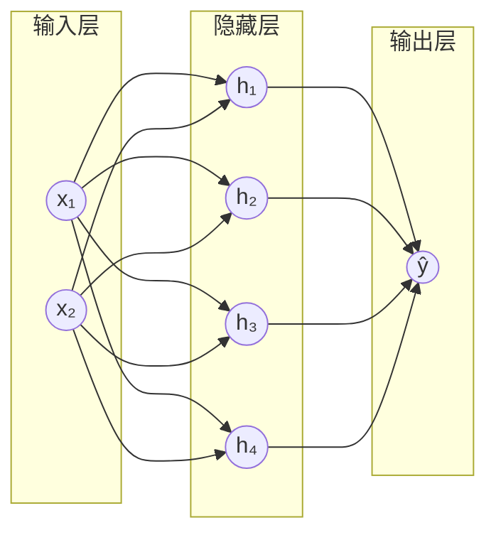
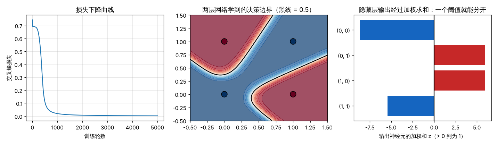
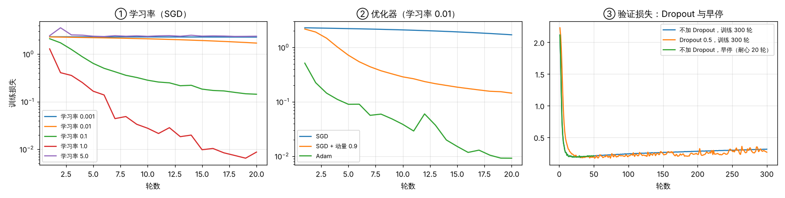
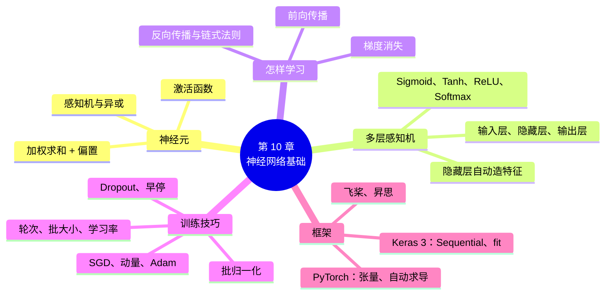

# 第 10 章 神经网络基础

!!! abstract "本章学时"
    理论 5 学时 · 实验 2 学时（本章共 3 个实验，教师可任选）

## 学习目标

学完本章，你应该能够：

1. **说出**神经元、感知机、多层感知机、激活函数、前向传播、反向传播、梯度消失、优化器、Dropout、批归一化的含义（记忆）；
2. **解释**感知机为什么学不会异或、多加一个隐藏层为什么就能学会，反向传播怎样把误差一层层往回传（理解）；
3. **运用** NumPy 从零实现一个两层网络，用 PyTorch 和 Keras 3 搭建、训练多层感知机（应用）；
4. 根据损失曲线和验证成绩**分析**学习率、优化器、Dropout、早停、批归一化对训练的影响（分析）；
5. 针对一个具体任务，**评价**该用经典机器学习模型还是神经网络（评价）。

!!! info "先修要求"
    学习本章前，你需要掌握：

    - 梯度下降、学习率和小批量梯度下降（[3.3 梯度下降](../03-linear-regression/index.md#33)）；
    - 逻辑回归的 Sigmoid 函数、交叉熵损失和 Softmax（[4.2.1 从线性回归到 Sigmoid](../04-logistic-regression/index.md#421-sigmoid)、[4.2.3 交叉熵损失](../04-logistic-regression/index.md#423)、[4.2.5 多分类：一对多与 Softmax](../04-logistic-regression/index.md#425-softmax)）；
    - 过拟合、正则化和早停（[3.5.2 欠拟合与过拟合](../03-linear-regression/index.md#352)）；
    - 训练集、验证集、测试集的用途（[9.2.4 训练集、验证集、测试集各管什么](../09-model-tuning/index.md#924)）。

??? abstract "本章概念清单（22 个，点击查看定义和例子）"
    1. [神经网络](../../appendix/glossary.md#g-神经网络)
    2. [神经元](../../appendix/glossary.md#g-神经元)
    3. [感知机](../../appendix/glossary.md#g-感知机)
    4. [异或问题](../../appendix/glossary.md#g-异或问题)
    5. [多层感知机](../../appendix/glossary.md#g-多层感知机)
    6. [激活函数](../../appendix/glossary.md#g-激活函数)
    7. [ReLU](../../appendix/glossary.md#g-ReLU)
    8. [隐藏层](../../appendix/glossary.md#g-隐藏层)
    9. [前向传播](../../appendix/glossary.md#g-前向传播)
    10. [反向传播](../../appendix/glossary.md#g-反向传播)
    11. [链式法则](../../appendix/glossary.md#g-链式法则)
    12. [梯度消失](../../appendix/glossary.md#g-梯度消失)
    13. [优化器](../../appendix/glossary.md#g-优化器)
    14. [Adam](../../appendix/glossary.md#g-Adam)
    15. [轮次与批大小](../../appendix/glossary.md#g-轮次与批大小)
    16. [Dropout](../../appendix/glossary.md#g-Dropout)
    17. [批归一化](../../appendix/glossary.md#g-批归一化)
    18. [PyTorch](../../appendix/glossary.md#g-PyTorch)
    19. [张量](../../appendix/glossary.md#g-张量)
    20. [自动求导](../../appendix/glossary.md#g-自动求导)
    21. [Keras](../../appendix/glossary.md#g-Keras)
    22. [TensorFlow](../../appendix/glossary.md#g-TensorFlow)

## 情景导入

一家银行的信贷科每天要审几百份小额贷款申请。老科长的经验是：“有稳定工作加分，有房子加分，信用记录好加分，三样里占两样以上就可以批。”这其实就是一个简单的计算：给每个条件一个分量，加起来，超过门槛就批准。

把这个计算画出来：三个输入，各乘一个权重，加起来，再和门槛比较，输出“批”或“不批”。这就是一个**人工神经元**。1958 年，美国心理学家罗森布拉特（Rosenblatt）按这个思路造出了“感知机”，用来识别简单的图形，当时的报纸说它“将来能走路、说话、看东西、写字，还能意识到自己的存在”。<sup class="cite">[[4]](#ref10-4)</sup>

可是没过几年，人们就发现单个感知机连一个非常简单的问题都学不会。神经网络研究因此沉寂了十多年，直到人们学会把很多神经元一层层连起来，并找到了训练这种多层网络的办法：反向传播。今天识别人脸的、听懂语音的、和你聊天的大模型，最基本的组成单元仍然是这样的神经元。

本章从一个神经元讲起：它为什么学不会那个“非常简单的问题”，多加一层为什么就能学会，网络怎样从错误中学习，训练时有哪些技巧；最后用 PyTorch 和 Keras 两个框架，把第 6 章用 SVM 识别过的手写数字再识别一遍。

## 10.1 从逻辑回归到神经元

### 10.1.1 人工神经元

[**神经网络**](../../appendix/glossary.md#g-神经网络 "由大量神经元按层连接而成、通过数据学习连接权重的模型"){ .term }是由大量简单的计算单元连接而成、通过数据学习连接权重的模型。这种计算单元叫[**神经元**](../../appendix/glossary.md#g-神经元 "神经网络的基本计算单元：对输入加权求和、加偏置，再经过激活函数得到输出"){ .term }，名字来自生物学：大脑中的神经细胞从树突接收其他细胞传来的信号，信号足够强时就“兴奋”起来，沿轴突把信号传给下一个细胞。人工神经元只借用了这个思路，做三件事：

1. **加权求和**：每个输入乘一个权重，再加起来；
2. **加偏置**：再加一个偏置 b，相当于调节“门槛”的高低；
3. **过激活函数**：把加权和 z 送进一个函数 f，得到输出 a。

写成公式：

\[
z = w_1x_1 + w_2x_2 + \cdots + w_nx_n + b, \qquad a = f(z)
\]

你会发现这和第 4 章的逻辑回归一模一样：逻辑回归先算 z = w·x + b，再用 Sigmoid 函数把 z 变成概率。**一个用 Sigmoid 作激活函数的神经元，就是一个逻辑回归**。神经网络并不神秘，它就是把许多个“逻辑回归”连在一起。

!!! example "算一算：一个神经元审贷款"
    三个输入：有稳定工作 x₁、有房子 x₂、信用记录好 x₃，有为 1，没有为 0。权重 w₁ = 0.5、w₂ = 0.4、w₃ = 0.3，偏置 b = −0.6。

    一位申请人有工作、没有房子、信用记录好，x = (1, 0, 1)：

    z = 0.5 × 1 + 0.4 × 0 + 0.3 × 1 − 0.6 = 0.2

    - 用阶跃函数（大于 0 输出 1）：输出 1，批准；
    - 用 Sigmoid：σ(0.2) = 1 / (1 + e⁻⁰·²) = 1 / (1 + 0.819) ≈ 0.550，可以理解为“批准的把握约 55%”。

    如果只有房子，x = (0, 1, 0)：z = 0.4 − 0.6 = −0.2，阶跃函数输出 0，不批；Sigmoid 输出约 0.450。

### 10.1.2 感知机及其局限

用阶跃函数作激活函数、只有一个神经元的模型，叫[**感知机**](../../appendix/glossary.md#g-感知机 "只有一个神经元、用阶跃函数输出 0 或 1 的分类模型，预测错时按 w ← w + η(y − ŷ)x 更新权重"){ .term }。它的学习规则非常简单：对每个样本先预测，预测对了什么也不做；预测错了，就把权重往正确的方向挪一点：

\[
w \leftarrow w + \eta\,(y - \hat{y})\,x, \qquad b \leftarrow b + \eta\,(y - \hat{y})
\]

η 是学习率。真实是 1、预测成 0 时，y − ŷ = 1，权重加上 ηx，让 z 变大；真实是 0、预测成 1 时，权重减去 ηx，让 z 变小。

拿最简单的逻辑运算来试。两个输入各取 0 或 1，共四种情况：

| x₁ | x₂ | 与（都为 1 才是 1） | 或（有一个 1 就是 1） | 异或（两个不同才是 1） |
|---|---|---|---|---|
| 0 | 0 | 0 | 0 | 0 |
| 0 | 1 | 0 | 1 | 1 |
| 1 | 0 | 0 | 1 | 1 |
| 1 | 1 | 1 | 1 | 0 |

实验 10-1 第①步让感知机从 w = [0, 0]、b = 0 开始，学习率 0.1，一轮把四个样本各看一遍：

- **与**：每轮出错次数为 1、3、3、2、1、0，训练 5 轮后全部正确，学到 w = [0.2, 0.1]，b = −0.2；
- **或**：每轮出错次数为 1、2、1、0，训练 3 轮后全部正确；
- **异或**：训练 20 轮，每轮都有 2～4 个错，永远学不会。

为什么？感知机的判断规则是 w₁x₁ + w₂x₂ + b > 0，分界线 w₁x₁ + w₂x₂ + b = 0 是一条直线。把四个点画在平面上：“与”只有右上角 (1, 1) 是 1，一条直线就能把它和另外三个点分开；“或”只有左下角 (0, 0) 是 0，也能分开。“异或”的两个 1 在左上和右下，两个 0 在左下和右上，交叉摆放，无论怎样画一条直线都分不开。这叫[**异或问题**](../../appendix/glossary.md#g-异或问题 "两个输入不同时输出 1、相同时输出 0，两类点交叉摆放、线性不可分，单层感知机无法解决"){ .term }。第 6 章讲过“线性可分”，异或就是最简单的线性不可分的例子。

1969 年，明斯基（Minsky）和佩珀特（Papert）在《感知机》一书中严格证明了单层感知机解决不了异或这类问题，<sup class="cite">[[5]](#ref10-5)</sup>神经网络研究随后进入了十多年的低谷。下面的动画可以自己试一试：

<iframe class="sim-frame" src="../../sims/neuron-activation/main.html" height="620" loading="lazy" title="神经元与激活函数"></iframe>

动画：神经元与激活函数。上半部分勾选输入、拖动权重和偏置，看加权和与输出；下半部分让感知机学与、或、异或。[全屏打开](../../sims/neuron-activation/main.html){ target=_blank }
{ .sim-caption }

## 10.2 多层感知机

### 10.2.1 输入层、隐藏层、输出层

单个神经元只能画一条直线。办法是把神经元一层层连起来，组成[**多层感知机**](../../appendix/glossary.md#g-多层感知机 "由输入层、一个或多个隐藏层和输出层组成、相邻层全连接的前馈神经网络"){ .term }（MLP）。名字里虽然有“感知机”，它的神经元一般不再用阶跃函数，而用 Sigmoid、ReLU 等可以求导的激活函数，这样才能用梯度下降训练。

多层感知机分三种层：

- **输入层**：接收原始特征，不做计算。手写数字的每张图有 8 × 8 = 64 个像素，输入层就有 64 个“格子”。
- [**隐藏层**](../../appendix/glossary.md#g-隐藏层 "位于输入层和输出层之间的层，把输入变换成对任务更有用的新特征"){ .term }：夹在中间的层，每个神经元接收上一层所有神经元的输出，加权求和、过激活函数，再交给下一层。叫“隐藏”是因为它的输出既不是输入数据，也不是最终答案，使用者看不到。
- **输出层**：给出最终结果。二分类用 1 个神经元加 Sigmoid，输出属于正类的概率；多分类用 K 个神经元加 Softmax，输出每一类的概率；回归用 1 个神经元、不加激活函数。

相邻两层的神经元两两相连，这种层叫**全连接层**。层数多了，就叫“深度”神经网络，用深度神经网络做机器学习就是**深度学习**。



上图是实验 10-1 用来学异或的网络，记作“2 → 4 → 1”。它有多少个参数？输入层到隐藏层 2 × 4 = 8 个权重加 4 个偏置，隐藏层到输出层 4 个权重加 1 个偏置，共 17 个。实验 10-2 识别手写数字的网络是“64 → 64 → 10”，参数有 64 × 64 + 64 + 64 × 10 + 10 = 4810 个。参数这么多，模型能力很强，也更容易过拟合，这是 10.4 节要解决的问题。

### 10.2.2 激活函数

[**激活函数**](../../appendix/glossary.md#g-激活函数 "神经元对加权和做的非线性变换，使网络能表达非线性关系"){ .term }是神经元对加权和做的非线性变换。为什么非要它不可？如果去掉激活函数，每一层都只是“乘权重、加偏置”，两层叠起来还是“乘权重、加偏置”，十层叠起来仍然等于一层，永远只能画直线。激活函数让网络能表达弯曲的分界线。常用的有四种：

| 激活函数 | 公式 | 输出范围 | 特点与用途 |
|---|---|---|---|
| 阶跃函数 | z > 0 输出 1，否则 0 | 0 或 1 | 感知机用；导数处处为 0，没法用梯度下降 |
| Sigmoid | 1 / (1 + e⁻ᶻ) | 0～1 | 可解释为概率，二分类输出层用；在隐藏层容易造成梯度消失 |
| Tanh | (eᶻ − e⁻ᶻ) / (eᶻ + e⁻ᶻ) | −1～1 | 以 0 为中心，第 11 章 RNN 常用 |
| [**ReLU**](../../appendix/glossary.md#g-ReLU "修正线性单元，小于 0 输出 0、大于 0 原样输出的激活函数，隐藏层的首选"){ .term } | max(0, z) | 0～+∞ | 计算最快、不易梯度消失，隐藏层的首选 |

**ReLU**（修正线性单元）看起来过于简单：小于 0 输出 0，大于 0 原样输出。但正是这种简单让它在深层网络中表现最好，2010 年后成为隐藏层的默认选择。<sup class="cite">[[7]](#ref10-7)</sup>

输出层的激活函数按任务选：二分类用 Sigmoid，多分类用第 4 章学过的 Softmax（把 K 个得分变成和为 1 的概率），回归不用激活函数。实验 10-2 中，网络对测试集第 1 张图（数字 1）的 Softmax 输出是：

| 数字 | 0 | 1 | 2 | 3 | 4 | 5 | 6 | 7 | 8 | 9 |
|---|---|---|---|---|---|---|---|---|---|---|
| 概率 | 0.000 | **0.955** | 0.022 | 0.001 | 0.000 | 0.002 | 0.013 | 0.000 | 0.006 | 0.000 |

概率最大的是 1，预测正确；第二可能的是 2（0.022），1 和 2 的写法确实有些像。

### 10.2.3 为什么多一层就能学会异或

实验 10-1 第②步用一个“2 → 4 → 1”的网络学异或，隐藏层和输出层都用 Sigmoid，损失用交叉熵，学习率 1.0：

| 训练轮数 | 损失 | 四个点的输出（应为 0、1、1、0） | 判对 |
|---|---|---|---|
| 1 | 0.7441 | 0.358、0.342、0.354、0.343 | 2 个 |
| 100 | 0.6904 | 0.481、0.504、0.503、0.520 | 3 个 |
| 500 | 0.1105 | 0.030、0.885、0.899、0.168 | 4 个 |
| 1000 | 0.0198 | 0.003、0.979、0.980、0.034 | 4 个 |
| 5000 | 0.0024 | 0.000、0.997、0.997、0.004 | 4 个 |

损失在前 100 轮几乎不动，之后迅速下降，500 轮时四个点就全分对了。它是怎么做到的？看训练后隐藏层 4 个神经元的输出：

| 输入 | h₁ | h₂ | h₃ | h₄ |
|---|---|---|---|---|
| (0, 0) | 0.66 | 0.75 | 0.35 | 0.39 |
| (0, 1) | 0.03 | 1.00 | 0.99 | 0.99 |
| (1, 0) | 1.00 | 0.03 | 0.99 | 0.99 |
| (1, 1) | 0.99 | 0.99 | 1.00 | 1.00 |

隐藏层把原来的四个点“搬”到了一个 4 维的新空间：h₃、h₄ 像是在算“或”（只有 (0, 0) 较小），h₁、h₂ 一起看，只有 (0, 1)、(1, 0) 中有一个接近 0，像是在找“两个输入不一样”。在新空间里，输出神经元只要再做一次加权求和，就能用一个阈值把四个点分开：



中间的图是网络学到的分界线（黑线），它弯了过来，把左上和右下两个红点围在一起；右边的图是输出神经元对四个隐藏输出的加权和，两个 1 都大于 0，两个 0 都小于 0。

这就是隐藏层的作用：**自动把原始特征变换成新的特征**，在新特征上问题变简单了。第 6 章 SVM 的核函数也是把数据映射到新空间，但映射方式是人选定的；神经网络的映射是从数据里学出来的。理论上已经证明，只要隐藏层的神经元足够多，一个隐藏层的网络就能以任意精度逼近任何连续函数，这叫**万能逼近定理**。<sup class="cite">[[8]](#ref10-8)</sup>当然，“能表示”不等于“能学到”，还要靠好的训练方法。

下面的动画用和实验 10-1 相同的初始权重训练这个网络，可以改隐藏神经元个数、学习率和激活函数：

<iframe class="sim-frame" src="../../sims/nn-playground/main.html" height="600" loading="lazy" title="神经网络训练场"></iframe>

动画：神经网络训练场。默认设置训练 100 轮、1000 轮，看分界线怎样弯过来；把隐藏神经元调成 1，或把学习率调成 0.01、30，看看会怎样。[全屏打开](../../sims/nn-playground/main.html){ target=_blank }
{ .sim-caption }

## 10.3 神经网络怎样学习

### 10.3.1 前向传播与损失

神经网络的训练和第 3 章的梯度下降是同一个思路：定义损失，求梯度，沿梯度的反方向更新参数，反复进行。不同的是参数多、层数多，需要一套办法高效地算出每个参数的梯度。一次训练分两步：

**第一步，前向传播**：输入数据从输入层出发，一层层往前算——加权求和、过激活函数、交给下一层——直到输出层得到预测值，再和真实值比较算出损失。分类用交叉熵损失，回归用均方误差，和第 3、4 章相同。

实验 10-1 中前向传播只有四行：

```python
z1 = X @ W1 + b1          # 隐藏层的加权和
a1 = sigmoid(z1)          # 隐藏层的输出
z2 = a1 @ W2 + b2         # 输出层的加权和
a2 = sigmoid(z2)          # 网络的输出：判为 1 的概率
```

`@` 是矩阵乘法，四个样本一起算。[**前向传播**](../../appendix/glossary.md#g-前向传播 "输入数据从输入层出发逐层计算，直到得到输出和损失的过程"){ .term }的结果除了预测值，还要把每一层的中间结果（z1、a1 等）保存下来，第二步要用。

### 10.3.2 反向传播：误差一层层往回传

**第二步，反向传播**：从损失出发，一层层往回，算出损失对每个参数的梯度。

为什么要“往回”算？输出层的权重直接影响损失，梯度好算；隐藏层的权重要先影响隐藏层的输出，再通过输出层影响损失，它的梯度依赖于后面那一层的梯度。所以从后往前算最省事：先算输出层的“误差”，再把误差按权重分摊回隐藏层，乘上激活函数的导数，得到隐藏层的误差，依此类推。每往回一层，就乘上这一层的“传递系数”，这就是微积分中的[**链式法则**](../../appendix/glossary.md#g-链式法则 "复合函数求导的法则：L 通过 y 依赖于 x 时，dL/dx = dL/dy × dy/dx"){ .term }：如果 L 通过 y 依赖于 x，那么 dL/dx = dL/dy × dy/dx。

!!! example "算一算：手算一次反向传播"
    一个最小的网络：输入 x = 2，隐藏神经元 h = ReLU(w₁x)，输出 ŷ = w₂h，真实值 y = 2，损失 L = (ŷ − y)²。初始 w₁ = 0.5，w₂ = 3。

    **前向传播**：h = ReLU(0.5 × 2) = 1，ŷ = 3 × 1 = 3，L = (3 − 2)² = 1。

    [**反向传播**](../../appendix/glossary.md#g-反向传播 "从损失出发、利用链式法则逐层往回计算每个参数梯度的算法"){ .term }（从后往前）：

    1. 损失对输出：dL/dŷ = 2(ŷ − y) = 2 × 1 = **2**；
    2. 输出层权重：ŷ = w₂h，所以 dL/dw₂ = dL/dŷ × h = 2 × 1 = **2**；
    3. 误差传回隐藏层：dL/dh = dL/dŷ × w₂ = 2 × 3 = **6**；
    4. 穿过 ReLU：h 大于 0，ReLU 的导数是 1，误差不变，仍是 6；
    5. 隐藏层权重：dL/dw₁ = 6 × x = 6 × 2 = **12**。

    **更新**（学习率 0.01）：w₂ = 3 − 0.01 × 2 = 2.98，w₁ = 0.5 − 0.01 × 12 = 0.38。

    再前向传播一次：h = 0.76，ŷ = 2.98 × 0.76 ≈ 2.265，损失从 1 降到约 0.070。

    注意第 3 步：传回隐藏层的误差要乘上输出层的权重 w₂。“误差一层层往回传”，传的就是这个。

实验 10-1 的 `backward` 函数对两层网络做了同样的事：

```python
d2 = (a2 - y) / n                     # 输出层的误差（Sigmoid + 交叉熵时恰好是 预测 − 真实）
gW2, gb2 = a1.T @ d2, d2.sum(0)       # 输出层参数的梯度
d1 = (d2 @ W2.T) * a1 * (1 - a1)      # 误差乘权重传回隐藏层，再乘 Sigmoid 的导数 a(1 − a)
gW1, gb1 = X.T @ d1, d1.sum(0)        # 隐藏层参数的梯度
```

怎么知道自己写对了？用数值方法验算：把某个参数加上、减去一个很小的数 ε，算两次损失，差值除以 2ε 就是这个参数梯度的近似值。实验 10-1 第③步对 17 个参数逐个验算，与反向传播结果的最大差别是 1.2 × 10⁻¹¹，说明反向传播写对了。这叫“梯度检查”，自己实现新的网络层时常用。

反向传播的思想在 1986 年由鲁梅尔哈特（Rumelhart）、辛顿（Hinton）和威廉姆斯（Williams）在《自然》杂志上发表后广为人知，<sup class="cite">[[6]](#ref10-6)</sup>它让多层网络第一次能被有效训练，神经网络因此复兴。今天的框架都会[**自动求导**](../../appendix/glossary.md#g-自动求导 "框架记录计算过程并自动用反向传播求出梯度的功能"){ .term }，不需要再手写反向传播（10.5 节），但理解它有助于看懂训练中出现的问题，比如下面的梯度消失。

### 10.3.3 梯度消失

反向传播时，误差每往回传一层，都要乘上这一层激活函数的导数。Sigmoid 的导数最大只有 0.25（在 z = 0 处），z 稍大或稍小时更接近 0。如果网络有 10 层，误差传到第 1 层时至少要乘 10 次不超过 0.25 的数：0.25¹⁰ ≈ 9.5 × 10⁻⁷，前面几层的梯度几乎为 0，参数基本不更新，网络就训练不动了。这叫[**梯度消失**](../../appendix/glossary.md#g-梯度消失 "误差往回传时层层乘上小于 1 的导数，使前面层的梯度趋近于 0、几乎无法更新的现象"){ .term }。

实验 10-3 第⑤步搭了两个 10 个隐藏层的网络，在训练前看各层权重梯度的大小：

| 网络 | 第 1 层 | 第 5 层 | 第 10 层 | 输出层 | 第 1 层 ÷ 输出层 |
|---|---|---|---|---|---|
| Sigmoid | 1.26 × 10⁻¹¹ | 2.51 × 10⁻⁸ | 4.56 × 10⁻⁴ | 8.28 × 10⁻³ | 1.5 × 10⁻⁹ |
| ReLU | 5.42 × 10⁻⁷ | 4.05 × 10⁻⁷ | 2.94 × 10⁻⁵ | 2.96 × 10⁻⁴ | 1.8 × 10⁻³ |
| ReLU + He 初始化 | 4.05 × 10⁻³ | 5.04 × 10⁻³ | 2.19 × 10⁻³ | 5.73 × 10⁻³ | 0.71 |

Sigmoid 网络第 1 层的梯度只有输出层的十亿分之一，前面的层几乎学不到东西。换成 ReLU 好了很多：ReLU 在 z > 0 时导数是 1，误差穿过它不会变小。但默认的初始权重偏小，每过一层信号都会缩小一些，第 1 层的梯度仍然只有输出层的千分之二。第三行按 ReLU 的特点调整初始权重的大小（He 初始化，按每层输入的个数确定权重的范围），各层梯度就差不多大了。

缓解梯度消失的办法可以总结为：隐藏层用 ReLU，用合适的初始化方法，使用 10.4.4 节的批归一化，以及第 11 章将提到的残差连接。与梯度消失相反，梯度在往回传的过程中越乘越大，叫梯度爆炸，在循环神经网络中常见，第 11 章再讲。

## 10.4 训练技巧

### 10.4.1 优化器：SGD、动量与 Adam { #1041 }

决定“拿到梯度以后怎样更新参数”的算法叫[**优化器**](../../appendix/glossary.md#g-优化器 "根据梯度决定怎样更新参数的算法"){ .term }。

- **SGD**（随机梯度下降）：就是第 3 章的小批量梯度下降，参数 = 参数 − 学习率 × 梯度。简单，但在“狭长山谷”形状的损失面上会来回震荡、前进很慢。
- **动量**：像一个从山上滚下来的球，除了当前的坡度，还带着之前的速度。每次更新 = 0.9 × 上次的更新 + 本次的梯度步。方向一致的分量越滚越快，来回震荡的分量相互抵消。
- [**Adam**](../../appendix/glossary.md#g-Adam "结合动量并为每个参数自适应调整步长的优化器，默认学习率 0.001"){ .term }：在动量的基础上，再为每个参数单独调整步长：梯度一直很大的参数步子迈小一点，梯度一直很小的参数步子迈大一点。<sup class="cite">[[9]](#ref10-9)</sup>**Adam** 对学习率不太敏感，默认学习率 0.001 在很多问题上都能用，是最常用的优化器。

实验 10-3 第②步用学习率 0.01 训练手写数字网络 20 轮：

| 优化器 | 第 5 轮训练损失 | 第 20 轮训练损失 | 第 20 轮验证准确率 | 验证准确率首次达到 0.95 |
|---|---|---|---|---|
| SGD | 2.213 | 1.703 | 0.829 | 20 轮内未达到 |
| SGD + 动量 0.9 | 0.718 | 0.144 | 0.956 | 第 17 轮 |
| Adam | 0.090 | 0.009 | 0.976 | 第 3 轮 |

同样的学习率，普通 SGD 20 轮还没学好，动量快了许多，Adam 3 轮就达到 0.95。实际工作中，一般先用 Adam；追求极致效果时，有经验的人也会用精心调过学习率的 SGD + 动量。

### 10.4.2 轮次、批大小与学习率

训练神经网络时，几个最常调的超参数是：

- **轮次**（epoch）：把全部训练数据完整地看一遍叫一轮。轮数太少学不充分，太多会过拟合。
- **批大小**（batch size）：每次更新参数用多少个样本算梯度。实验 10-2 训练集 1005 张、批大小 32，一轮要更新 ⌈1005 / 32⌉ = 32 次。批大小常取 32、64、128；太小时梯度噪声大、速度慢，太大时占用内存多，泛化有时反而变差。
- **学习率**：每一步迈多大。这是最重要的超参数。

[**轮次与批大小**](../../appendix/glossary.md#g-轮次与批大小 "轮次是完整看一遍全部训练数据的次数，批大小是每次更新参数所用的样本数"){ .term }和学习率都写在训练代码的最外面。一般先定批大小，再调学习率，用验证集或早停决定轮数。实验 10-3 第①步用普通 SGD 比较五种学习率：



| 学习率 | 第 1 轮训练损失 | 第 20 轮训练损失 | 第 20 轮验证准确率 | 判断 |
|---|---|---|---|---|
| 0.001 | 2.311 | 2.272 | 0.183 | 太小，几乎没动 |
| 0.01 | 2.292 | 1.703 | 0.829 | 偏小，还在慢慢下降 |
| 0.1 | 2.103 | 0.143 | 0.960 | 合适 |
| 1.0 | 1.287 | 0.009 | 0.972 | 对这个小网络正好，曲线有些抖 |
| 5.0 | 2.436 | 2.375 | 0.095 | 太大，来回乱跳，不收敛 |

十分类随便猜的交叉熵损失是 ln 10 ≈ 2.30，学习率 0.001 训练 20 轮损失还是 2.27，和瞎猜差不多；学习率 5.0 时损失一直在 2.4 附近跳，验证准确率 0.095，比瞎猜（0.1）还差。看损失曲线判断学习率：**降得很慢就调大，来回跳甚至变大就调小**，每次按 10 倍或 3 倍调整。

### 10.4.3 防止过拟合：Dropout 与早停 { #1043 }

神经网络参数多，训练数据少时很容易过拟合。第 3、5 章学过正则化和早停，神经网络还有一个专门的办法：[**Dropout**](../../appendix/glossary.md#g-Dropout "训练时每一步随机让一部分神经元输出为 0 以减轻过拟合的方法，预测时不丢弃"){ .term }（随机失活）。训练时每一步随机让一部分神经元（比如一半）“休息”，输出置为 0，下一步换另一批。这样网络不能依赖某几个神经元，每个神经元都要学到更有用的特征，相当于同时训练了很多个小网络再取平均。<sup class="cite">[[10]](#ref10-10)</sup>预测时所有神经元都参加，不再随机丢弃。

**早停**在第 5 章用于梯度提升树：每一轮训练后看验证损失，连续若干轮（叫“耐心”）不再下降就停止，并取回验证损失最低时的参数。

实验 10-3 第③步故意制造过拟合：每个数字只取 20 张、共 200 张图训练，网络用两个 256 个神经元的隐藏层（约 8.5 万个参数）：

| 做法 | 实际训练轮数 | 训练准确率 | 最低验证损失（出现在） | 停止时验证损失 | 测试准确率 |
|---|---|---|---|---|---|
| 不加 Dropout，训练 300 轮 | 300 | 1.000 | 0.181（第 30 轮） | 0.312 | 0.941 |
| Dropout 0.5，训练 300 轮 | 300 | 1.000 | 0.170（第 51 轮） | 0.264 | 0.944 |
| 不加 Dropout，早停（耐心 20 轮） | 50 | 1.000 | 0.181（第 30 轮） | 0.206 | 0.939 |

三种做法训练准确率都是 1.000，都把 200 张图背了下来。不加 Dropout 时验证损失在第 30 轮最低，之后一路上升到 0.312，是典型的过拟合（上图右）。Dropout 让最低点推迟到第 51 轮、数值也更低，之后上升得也慢；早停在第 50 轮停下，取回第 30 轮的参数，只用了六分之一的训练时间。

不过，三者的测试准确率只差 0.005，在 540 张测试图上只差两三张，看不出谁更好。这个结果提醒我们：正则化方法的作用主要是让训练更稳、更省事，效果提升往往有限；**数据太少时，最有效的办法还是增加数据**。实验 10-2 用全部 1005 张训练图，一个只有 64 个隐藏神经元的小网络测试准确率就有 0.957～0.965。

### 10.4.4 批归一化

第 2 章讲过，特征的量纲差别大时要先标准化，梯度下降才好走。深层网络里，每一层的输入是上一层的输出，训练过程中上一层的参数一直在变，这一层输入的分布也跟着变，后面的层要不停地适应。[**批归一化**](../../appendix/glossary.md#g-批归一化 "在网络层中用当前批数据的均值和标准差做标准化，再做可学习的缩放和平移，使深层网络训练更快更稳"){ .term }（Batch Normalization）在每一层加权求和之后，用当前这一批样本的均值和标准差把数据标准化，再乘一个可学习的缩放系数、加一个可学习的平移量，然后过激活函数。<sup class="cite">[[11]](#ref10-11)</sup>

效果很明显。实验 10-3 第④步搭一个 4 个隐藏层的网络，用普通 SGD、学习率 0.01 训练 20 轮：

| 网络 | 第 5 轮训练损失 | 第 20 轮训练损失 | 测试准确率 |
|---|---|---|---|
| 不加批归一化 | 2.301 | 2.295 | 0.113 |
| 加批归一化 | 0.749 | 0.080 | 0.972 |

不加批归一化的 4 层网络 20 轮根本没训练起来（损失停在 ln 10 附近）；加上之后同样的学习率很快收敛。批归一化让深层网络可以用更大的学习率，对初始化也不那么敏感。注意：训练时用当前批的均值、标准差，预测时用训练中累积的平均值，所以 PyTorch 中预测前要调用 `model.eval()` 切换模式，Dropout 也一样。

!!! cert "证书考点 · 人工智能数据处理工程师（高级）· 深度学习实战"
    常考：神经元的计算过程；常用激活函数（Sigmoid、Tanh、ReLU、Softmax）的输出范围和用途，为什么需要非线性激活函数；前向传播与反向传播的过程；梯度消失的原因与缓解办法；优化器（SGD、动量、Adam）的区别；轮次、批大小、学习率的含义；Dropout、早停、批归一化的作用。容易错在：认为 Dropout 在预测时也随机丢弃神经元；认为层数越多一定越好；把批大小和轮次混淆。

## 10.5 深度学习框架入门

手写前向传播和反向传播能帮助理解原理，但真实的网络有几十上百层、上百万个参数，必须用深度学习框架。框架提供三样东西：能在 GPU 上计算的张量、自动求导、现成的网络层和优化器。目前最常用的是 PyTorch；Keras 是更简洁的上层写法；国产框架有百度的飞桨和华为的昇思（10.6 节）。

### 10.5.1 PyTorch：张量与自动求导 { #1051 }

[**PyTorch**](../../appendix/glossary.md#g-PyTorch "Meta 开源的深度学习框架，以张量和自动求导为核心"){ .term } 是 Meta（原 Facebook）开源的深度学习框架，2017 年发布，<sup class="cite">[[12]](#ref10-12)</sup>目前在科研和工业界使用最广。

[**张量**](../../appendix/glossary.md#g-张量 "深度学习框架中存放数据的多维数组，可以放在 GPU 上计算并支持自动求导"){ .term }（tensor）是 PyTorch 中存放数据的基本结构，可以理解为“能放在 GPU 上、能自动求导的 NumPy 数组”：一个数是 0 维张量，一行数是 1 维张量，一张表格是 2 维张量，一批彩色图片是 4 维张量（张数 × 通道 × 高 × 宽），第 11 章会大量用到。

**自动求导**：创建张量时写上 `requires_grad=True`，PyTorch 就会记下它参与的每一步计算；对最终结果调用 `.backward()`，就自动用反向传播算出梯度，存在 `.grad` 里。实验 10-2 的小例子：

```python
w = torch.tensor(2.0, requires_grad=True)
L = (3 * w - 4) ** 2          # L = 4
L.backward()                  # 反向传播
print(w.grad)                 # tensor(12.)，手算：2 × (3×2 − 4) × 3 = 12
```

用 PyTorch 搭一个“64 → 64 → 10”的网络并训练，核心代码如下：

```python
model = nn.Sequential(nn.Linear(64, 64), nn.ReLU(), nn.Linear(64, 10))
loss_fn = nn.CrossEntropyLoss()                 # 内部先做 Softmax，再算交叉熵
opt = torch.optim.Adam(model.parameters(), lr=1e-3)
for epoch in range(30):
    for xb, yb in 每一批数据:
        loss = loss_fn(model(xb), yb)           # ① 前向传播，算损失
        opt.zero_grad()                         # ② 清空上一步的梯度
        loss.backward()                         # ③ 反向传播，求出所有梯度
        opt.step()                              # ④ 优化器更新参数
```

训练循环中的四步，每个 PyTorch 程序都一样，要记住。初学者最常犯的错是漏了 `opt.zero_grad()`：PyTorch 的梯度默认是累加的，不清零就会把上一步的梯度也加进来。

### 10.5.2 Keras 3：几行搭一个网络 { #1052 }

[**Keras**](../../appendix/glossary.md#g-Keras "高层深度学习接口，用 Sequential 等方式搭建网络，Keras 3 可选 TensorFlow、PyTorch、JAX 作后端"){ .term } 是一个高层的深度学习接口，用“搭积木”的方式描述网络，训练只要一行 `fit`。它原来是 TensorFlow 的一部分；2023 年发布的 Keras 3 可以选择 TensorFlow、PyTorch 或 JAX 作为底层（后端），同一份代码可以在不同框架上运行。[**TensorFlow**](../../appendix/glossary.md#g-TensorFlow "谷歌开源的深度学习框架，在移动端和生产部署方面工具丰富"){ .term } 是谷歌 2015 年开源的深度学习框架，在移动端和生产部署方面有很多工具，不少证书考试以它为准。本书的 Keras 代码以 PyTorch 为后端运行，不用另装 TensorFlow；换成 TensorFlow 后端，代码一行都不用改。

```python
import os
os.environ["KERAS_BACKEND"] = "torch"           # 选择后端，要写在 import keras 之前
import keras

model = keras.Sequential([
    keras.Input(shape=(64,)),
    keras.layers.Dense(64, activation="relu"),
    keras.layers.Dense(10, activation="softmax"),
])
model.compile(optimizer=keras.optimizers.Adam(1e-3),
              loss="sparse_categorical_crossentropy", metrics=["accuracy"])
model.fit(X_train, y_train, epochs=30, batch_size=32, validation_data=(X_val, y_val))
model.evaluate(X_test, y_test)
```

`Dense` 就是全连接层。`compile` 指定优化器、损失和评价指标；`fit` 包办了训练循环里的四步，还能自动记录每轮的损失和验证准确率；早停只要在 `fit` 中加上 `callbacks=[keras.callbacks.EarlyStopping(patience=20, restore_best_weights=True)]`。

### 10.5.3 两种框架对照

实验 10-2 用两种框架训练同一个网络（结构、优化器、学习率、批大小、轮数都相同）识别手写数字：

| 项目 | PyTorch | Keras 3 |
|---|---|---|
| 搭网络 | `nn.Sequential(nn.Linear(64, 64), nn.ReLU(), nn.Linear(64, 10))` | `keras.Sequential([Input, Dense(64, "relu"), Dense(10, "softmax")])` |
| 输出层的 Softmax | 写在损失函数 `CrossEntropyLoss` 里 | 写在最后一层 `activation="softmax"` |
| 训练 | 自己写循环：前向、清零、反向、更新 | `compile` + `fit` |
| 参数个数 | 4810 | 4810 |
| 第 30 轮验证准确率 | 0.964 | 0.968 |
| 测试准确率 | 0.957 | 0.965 |
| 训练用时（4 核 CPU） | 0.6 秒 | 3.4 秒 |

两者成绩相近，测试准确率相差 0.008，即 540 张中差 4 张，主要来自随机初始化和打乱顺序的不同。PyTorch 写起来长一些，但每一步都看得见、改得动，适合研究和自定义；Keras 写起来短，适合快速搭建常规网络。两个框架思路完全相同，学会一个，另一个很快就能上手。

还有一点值得注意：第 6 章用 SVM（RBF 核）识别同一份数据，测试准确率 0.989，逻辑回归 0.981，都比这里的神经网络高。8 × 8 的小图片、一千多张训练样本，经典方法已经足够好；神经网络的优势在数据量大、原始数据复杂（大图片、语音、文本）时才显现出来。**选模型要看数据，不要看名气**。

!!! cert "证书考点 · 人工智能应用工程师（高级）· 神经网络与深度学习、TensorFlow"
    常考：用 Keras 搭建 Sequential 模型的步骤（定义层 → compile → fit → evaluate → predict）；Dense 层参数个数的计算（输入数 × 神经元数 + 神经元数）；compile 中优化器、损失函数、评价指标的选择（多分类整数标签用 sparse_categorical_crossentropy）；fit 中 epochs、batch_size、validation_data 的含义；张量的形状。考试多以 TensorFlow 为后端，写法与本书相同。

## 10.6 前沿视窗

**从多层感知机到大模型。**今天的大语言模型都基于 Transformer 结构，它的每一层由两部分组成：一个注意力模块，让每个词“看”句子里的其他词；一个前馈网络，就是本章的两层多层感知机，先把维度放大约 4 倍、过激活函数，再缩回来。大模型的参数，大约三分之二在这些多层感知机里。<sup class="cite">[[13]](#ref10-13)</sup>训练大模型用的也是本章的方法：前向传播算损失、反向传播求梯度、Adam 类优化器更新参数，只是数据和参数多了几百万倍，要用成千上万块 GPU。注意力机制和 Transformer 在“自然语言处理”课程中学习。

**国产深度学习框架。**百度的飞桨（PaddlePaddle）2016 年开源，提供大量中文场景的预训练模型和产业套件，如文字识别 PaddleOCR；华为的昇思（MindSpore）2020 年开源，与昇腾 AI 芯片配合使用。它们的写法与 PyTorch 非常接近，下面是同一个网络的对照：

| 框架 | 全连接层 | 搭网络 | 自动求导 |
|---|---|---|---|
| PyTorch | `nn.Linear(64, 64)` | `nn.Sequential(...)` | `loss.backward()` |
| 飞桨 | `paddle.nn.Linear(64, 64)` | `paddle.nn.Sequential(...)` | `loss.backward()` |
| 昇思 | `mindspore.nn.Dense(64, 64)` | `mindspore.nn.SequentialCell(...)` | `mindspore.value_and_grad(...)` |

学会 PyTorch，换到国产框架主要是查一查名字。更系统的框架用法在“人工智能开发框架技术”课程中学习。

**深度学习的三位奠基人。**2018 年度图灵奖（2019 年公布）授予辛顿（Hinton）、本吉奥（Bengio）和杨立昆（LeCun），表彰他们使深度神经网络成为计算的关键部分。<sup class="cite">[[14]](#ref10-14)</sup>2024 年，辛顿又与霍普菲尔德（Hopfield）一起获得诺贝尔物理学奖。神经网络从被认为“走不通”，到改变整个人工智能领域，用了近半个世纪。

## 本章实验

!!! abstract "实验总览"
    | 实验 | 类型 | 建议时长 | 内容 |
    |---|---|---|---|
    | 实验 10-1 | ★ 基础 | 45 分钟 | 用 NumPy 实现感知机学与、或、异或；手写前向传播和反向传播，训练两层网络学会异或；梯度检查；画决策边界 |
    | 实验 10-2 | ★ 基础 | 45 分钟 | 同一个多层感知机用 PyTorch 和 Keras 3 各写一遍，识别手写数字，比较代码和结果；体会张量与自动求导 |
    | 实验 10-3 | ☆ 拓展 | 45 分钟 | 比较学习率、优化器、Dropout、早停、批归一化对训练的影响，观察梯度消失，写一份调参记录 |

    三个实验都在本机 CPU 上运行，各用时不到 1 分钟。实验代码见配套资源 `labs/ch10/` 目录。实验 10-2、10-3 需要安装：`pip install torch keras`（PyTorch 安装包较大，网速慢时可按 PyTorch 官网的说明只装 CPU 版）。

### 实验 10-1 ★ 用 NumPy 从零实现神经网络

**实验目的**

1. 实现感知机的学习规则，验证它能学会“与”“或”、学不会“异或”；
2. 手写两层神经网络的前向传播和反向传播，用梯度下降训练它学会异或；
3. 用数值方法检查反向传播算出的梯度；
4. 画出决策边界，理解隐藏层的作用。

**实验环境**：Python 3.11，NumPy、Matplotlib。

**实验数据**：与、或、异或的四个样本，写在代码里。

**实验步骤与代码**

第 1 步，实现感知机。对每个样本预测，错了就按学习规则更新：

```python
w, b = np.array([0.0, 0.0]), 0.0
for epoch in range(20):
    for xi, yi in zip(X, y):
        pred = int(w @ xi + b > 0)
        if pred != yi:
            w = w + 0.1 * (yi - pred) * xi
            b = b + 0.1 * (yi - pred)
```

第 2 步，搭一个“2 → 4 → 1”的网络，用随机种子 0 初始化权重（正态分布），偏置为 0。写出 `forward`（10.3.1 节的四行）和 `backward`（10.3.2 节的四行），学习率 1.0，训练 5000 轮：

```python
for epoch in range(1, 5001):
    grads = backward(params, X, y)
    params = [p - lr * g for p, g in zip(params, grads)]
```

第 3 步，梯度检查：对每个参数加、减 ε = 10⁻⁵，用 (L₊ − L₋) / 2ε 近似梯度，与反向传播的结果比较。

第 4 步，在 [−0.5, 1.5] × [−0.5, 1.5] 的网格上算网络输出，画出等高线和 0.5 分界线。

完整代码见 `lab10_1_numpy_nn.py`。

**运行结果**

```text
① 感知机（初始 w = [0, 0]，b = 0，学习率 0.1，最多 20 轮）
  与：每轮错误数 [1, 3, 3, 2, 1, 0] → 第 6 轮全对，w = [0.20, 0.10]，b = -0.20
  或：每轮错误数 [1, 2, 1, 0] → 第 4 轮全对，w = [0.10, 0.10]，b = 0.00
  异或：每轮错误数 [2, 3, 4, 4, 4, 4, 4, 4, 4, 4, 4, 4, 4, 4, 4, 4, 4, 4, 4, 4] → 20 轮后仍然有错，学不会

② 两层神经网络学异或（2 → 4 → 1，Sigmoid，交叉熵损失，学习率 1.0，全批量梯度下降）
  训练前的输出：[0.218 0.188 0.206 0.182]，损失 0.926
  第    1 轮：损失 0.7441，输出 [0.358 0.342 0.354 0.343]，判对 2 个
  第  100 轮：损失 0.6904，输出 [0.481 0.504 0.503 0.52 ]，判对 3 个
  第  500 轮：损失 0.1105，输出 [0.03  0.885 0.899 0.168]，判对 4 个
  第 1000 轮：损失 0.0198，输出 [0.003 0.979 0.98  0.034]，判对 4 个
  第 2000 轮：损失 0.0071，输出 [0.001 0.992 0.992 0.012]，判对 4 个
  第 5000 轮：损失 0.0024，输出 [0.    0.997 0.997 0.004]，判对 4 个
  训练后隐藏层 4 个神经元对四个输入的输出：
    (0, 0) → 0.66，0.75，0.35，0.39
    (0, 1) → 0.03，1.00，0.99，0.99
    (1, 0) → 1.00，0.03，0.99，0.99
    (1, 1) → 0.99，0.99，1.00，1.00

③ 梯度检查：17 个参数，反向传播与数值差分的最大差别 1.2e-11（小于 1e-7 说明反向传播写对了）
  例：W2 第 1 个元素的梯度，反向传播 -0.091537
```


几点解读：

- ①中“与”的错误数最后一个 0 表示第 6 轮检查时一个都没错，也就是训练 5 轮后已经学会；“异或”到第 3 轮以后每轮 4 个全错，权重来回摆动。
- ②中损失前 100 轮几乎不动（0.7441 → 0.6904），这是因为初始时隐藏层还没有分化出有用的特征；之后损失快速下降。
- 隐藏层的四个神经元分工不同，在新的 4 维空间中，两类点可以用一个阈值分开（结果图右）。
- ③说明反向传播的公式和代码都写对了。

**实验记录表**

| 项目 | 结果 |
|---|---|
| 感知机学“与”“或”各用了几轮，学到的 w、b | |
| 感知机学“异或”的结果及原因 | |
| 两层网络第 500、5000 轮的损失和判对个数 | |
| 梯度检查的最大差别 | |

**常见问题排查**

| 现象 | 原因 | 解决办法 |
|---|---|---|
| 感知机“与”的结果和书上的轮数不同 | 浮点误差使 0.1 + 0.2 ≠ 0.3，影响“是否大于 0”的判断 | 按代码对更新后的权重保留 10 位小数 |
| 损失一直停在 0.69 左右 | 学习率太小，或随机初始化不好，卡在了“平地”上 | 多训练一些轮，或换一个随机种子、调大学习率 |
| 损失变成 nan | 学习率太大，Sigmoid 输出变成严格的 0 或 1，log(0) 无穷大 | 减小学习率，或计算损失时把输出限制在 [10⁻⁷, 1 − 10⁻⁷] |
| 梯度检查差别很大 | 反向传播公式写错，常见是漏乘激活函数的导数或矩阵没转置 | 逐层对照 10.3.2 节的代码检查形状 |

**思考与练习**

1. 把隐藏层的激活函数从 Sigmoid 换成 Tanh（导数为 1 − a²），需要改哪两行？训练速度有什么变化？
2. 把隐藏神经元减为 1 个，还能学会异或吗？为什么？
3. 感知机学“与”时，换一个学习率（如 0.5），学到的分界线一样吗？

**实验报告要求**

提交运行结果和决策边界图，填写实验记录表；用不超过 200 字解释“为什么多一层就能学会异或”。

### 实验 10-2 ★ PyTorch 与 Keras 识别手写数字

**实验目的**

1. 学会用 PyTorch 搭建、训练、评价一个多层感知机，掌握训练循环的四步；
2. 学会用 Keras 3 的 Sequential、compile、fit 完成同样的任务；
3. 体会张量和自动求导；比较两种框架的写法和结果。

**实验环境**：Python 3.11，scikit-learn、PyTorch 2.x、Keras 3（后端为 PyTorch）。

**实验数据**：scikit-learn 自带的手写数字数据（1797 张 8 × 8 灰度图，0～9 共 10 类），与第 6 章实验 6-3 相同。像素值 0～16 除以 16 缩放到 0～1。按 7:3 分层划分训练集和测试集，再从训练集中分出 20% 作为验证集。

**实验步骤与代码**

第 1 步，读入数据、划分：

```python
X, y = load_digits(return_X_y=True)
X = (X / 16.0).astype("float32")             # PyTorch 默认用 32 位浮点数
X_train, X_test, y_train, y_test = train_test_split(X, y, test_size=0.3, random_state=42, stratify=y)
X_tr, X_val, y_tr, y_val = train_test_split(X_train, y_train, test_size=0.2, random_state=42, stratify=y_train)
```

第 2 步，用 PyTorch 搭“64 → 64 → 10”网络，Adam 学习率 0.001，批大小 32，训练 30 轮，每一批按 10.5.1 节的四步更新。预测时用 `model.eval()` 和 `torch.no_grad()`，取输出最大的类别：

```python
model.eval()
with torch.no_grad():
    pred = model(torch.tensor(X_test)).argmax(1)
```

第 3 步，用自动求导算 L = (3w − 4)² 在 w = 2 处的导数，和手算结果比较。

第 4 步，用 Keras 3 按 10.5.2 节的代码搭同样的网络，`fit` 训练 30 轮、`evaluate` 评价。

完整代码见 `lab10_2_torch_keras_digits.py`。

**运行结果**

```text
训练 1005 张，验证 252 张，测试 540 张；每张 64 个像素，10 个类别

① PyTorch：Sequential(
  (0): Linear(in_features=64, out_features=64, bias=True)
  (1): ReLU()
  (2): Linear(in_features=64, out_features=10, bias=True)
)
  参数个数 4810（64×64 + 64 + 64×10 + 10）
  第  1 轮：训练损失 2.1034，验证准确率 0.611
  第  5 轮：训练损失 0.8561，验证准确率 0.889
  第 10 轮：训练损失 0.3754，验证准确率 0.933
  第 20 轮：训练损失 0.1829，验证准确率 0.956
  第 30 轮：训练损失 0.1185，验证准确率 0.964
  测试准确率 0.957，训练用时 0.6 秒
  测试集第 1 张（真实数字 1）的 Softmax 输出：0.000 0.955 0.022 0.001 0.000 0.002 0.013 0.000 0.006 0.000 → 预测 1
  自动求导：L = (3w − 4)²，w = 2 时 L = 4，dL/dw = 12（手算 2 × (3×2 − 4) × 3 = 12）

② Keras 3（后端 torch）：参数个数 4810
  第  1 轮：训练损失 2.1632，验证准确率 0.448
  第  5 轮：训练损失 0.7597，验证准确率 0.913
  第 10 轮：训练损失 0.3275，验证准确率 0.944
  第 20 轮：训练损失 0.1558，验证准确率 0.964
  第 30 轮：训练损失 0.0982，验证准确率 0.968
  测试准确率 0.965，训练用时 3.4 秒

③ 对比（同一份数据、同样的网络结构和训练设置）
  PyTorch  测试准确率 0.957   用时 0.6 秒
  Keras 3  测试准确率 0.965   用时 3.4 秒
  第 6 章 SVM（RBF 核）测试准确率 0.989；逻辑回归 0.981
```

几点解读：

- 两个网络的参数个数都是 4810，结构完全相同。
- PyTorch 打印的是每轮结束后在整个训练集上重新算的损失；Keras 打印的是这一轮中各批损失的平均值（参数一边训练一边在变），两者算法不同，不能直接比较。
- 两种框架的测试准确率分别是 0.957 和 0.965，差别来自随机初始化和数据打乱顺序的不同；换几个随机种子，谁高谁低会变。Keras 用时较长，是因为 `fit` 每轮还要算验证集、记录历史，这些在小数据上占了主要时间。
- 两者都低于第 6 章 SVM 的 0.989：数据小而简单时，经典方法往往更好。

**实验记录表**

| 项目 | PyTorch | Keras 3 |
|---|---|---|
| 搭网络的代码行数 | | |
| 第 30 轮验证准确率 | | |
| 测试准确率 | | |
| 训练用时 | | |
| 自动求导的结果与手算是否一致 | | |

**常见问题排查**

| 现象 | 原因 | 解决办法 |
|---|---|---|
| `RuntimeError: mat1 and mat2 must have the same dtype` | NumPy 数组默认是 64 位浮点数，PyTorch 层的参数是 32 位 | 读入后 `.astype("float32")` |
| `ModuleNotFoundError: No module named 'tensorflow'` | Keras 3 默认用 TensorFlow 后端 | 在 `import keras` 之前设置 `os.environ["KERAS_BACKEND"] = "torch"`，或安装 TensorFlow |
| 损失越训练越大或忽高忽低 | 漏了 `opt.zero_grad()`，梯度一直累加 | 每一步在 `backward()` 之前清零 |
| CrossEntropyLoss 报错说目标类型不对 | 标签不是整数类型 | 标签用 `torch.tensor(y)`（整数），不要转成浮点数 |
| 每次运行结果不一样 | 随机初始化和打乱顺序 | 固定随机种子：`torch.manual_seed(42)`、`keras.utils.set_random_seed(42)` |

**思考与练习**

1. 把隐藏层从 64 个神经元改为 16 个和 256 个，参数个数和测试准确率各是多少？
2. 把 PyTorch 代码中的 Adam 换成 `torch.optim.SGD(model.parameters(), lr=0.1)`，30 轮后验证准确率有什么变化？
3. 打印出测试集中认错的几张图片（`plt.imshow(X_test[i].reshape(8, 8))`），看看网络把哪些数字认错了。

**实验报告要求**

提交两种框架的代码和运行结果，填写实验记录表；用不超过 200 字比较两种框架的写法和适用场合。

### 实验 10-3 ☆ 训练技巧对比实验

**实验目的**

1. 观察学习率过大、过小时的损失曲线；
2. 比较 SGD、带动量的 SGD 和 Adam 的收敛速度；
3. 在小数据、大网络时观察过拟合，比较 Dropout 和早停的作用；
4. 观察批归一化对深层网络训练的影响和梯度消失现象；
5. 学写调参记录。

**实验环境**：同实验 10-2（只用 PyTorch）。

**实验数据**：同实验 10-2。第③步每个数字只取 20 张训练图，共 200 张，故意制造“数据少、模型大”的情况。

**实验步骤与代码**

先写一个能按参数生成网络的函数，和一个通用的训练函数（每轮记录训练损失、验证损失和验证准确率，可选早停）：

```python
def mlp(hidden=64, layers=1, dropout=0.0, bn=False, act=nn.ReLU):
    mods, d = [], 64
    for _ in range(layers):
        mods += [nn.Linear(d, hidden)] + ([nn.BatchNorm1d(hidden)] if bn else []) + [act()]
        mods += [nn.Dropout(dropout)] if dropout else []
        d = hidden
    return nn.Sequential(*mods, nn.Linear(d, 10))
```

早停的核心几行：

```python
if val_loss < best - 1e-4:
    best, best_state, wait = val_loss, copy.deepcopy(model.state_dict()), 0
else:
    wait += 1
    if wait >= patience:
        model.load_state_dict(best_state)        # 取回验证损失最低时的参数
        break
```

第 1 步，用普通 SGD 分别以学习率 0.001、0.01、0.1、1.0、5.0 训练 20 轮。

第 2 步，学习率都取 0.01，比较 SGD、SGD + 动量 0.9、Adam。

第 3 步，200 张训练图、两个 256 的隐藏层，比较不加 Dropout、Dropout 0.5、早停（耐心 20 轮）。

第 4 步，4 个隐藏层的网络，比较加与不加批归一化。

第 5 步，10 个隐藏层的网络，分别用 Sigmoid、ReLU、ReLU + He 初始化，做一次前向和反向传播，打印各层权重梯度的平均绝对值。

完整代码见 `lab10_3_training_tricks.py`。

**运行结果**

```text
① 学习率（普通 SGD，20 轮）
  学习率 0.001  第 1 轮训练损失 2.311，第 20 轮 2.272，验证准确率 0.183
  学习率 0.01   第 1 轮训练损失 2.292，第 20 轮 1.703，验证准确率 0.829
  学习率 0.1    第 1 轮训练损失 2.103，第 20 轮 0.143，验证准确率 0.960
  学习率 1.0    第 1 轮训练损失 1.287，第 20 轮 0.009，验证准确率 0.972
  学习率 5.0    第 1 轮训练损失 2.436，第 20 轮 2.375，验证准确率 0.095

② 优化器（学习率 0.01，20 轮）
  SGD           第 5 轮训练损失 2.213，第 20 轮 1.703，验证准确率 0.829，验证准确率首次达到 0.95：未达到
  SGD + 动量 0.9  第 5 轮训练损失 0.718，第 20 轮 0.144，验证准确率 0.956，验证准确率首次达到 0.95：第 17 轮
  Adam          第 5 轮训练损失 0.090，第 20 轮 0.009，验证准确率 0.976，验证准确率首次达到 0.95：第 3 轮

③ 训练数据很少（200 张）、网络很大（两个 256 的隐藏层），Adam 学习率 0.001
  不加 Dropout，训练 300 轮     实际训练 300 轮，训练准确率 1.000，最低验证损失 0.181（第 30 轮），停止时验证损失 0.312，测试准确率 0.941
  Dropout 0.5，训练 300 轮    实际训练 300 轮，训练准确率 1.000，最低验证损失 0.170（第 51 轮），停止时验证损失 0.264，测试准确率 0.944
  不加 Dropout，早停（耐心 20 轮）  实际训练  50 轮，训练准确率 1.000，最低验证损失 0.181（第 30 轮），停止时验证损失 0.206，测试准确率 0.939

④ 批归一化（4 个隐藏层，每层 64，普通 SGD 学习率 0.01，20 轮）
  不加批归一化：第 5 轮训练损失 2.301，第 20 轮 2.295，测试准确率 0.113
  加批归一化：第 5 轮训练损失 0.749，第 20 轮 0.080，测试准确率 0.972

⑤ 梯度消失：10 个隐藏层的网络，未训练时各层权重梯度的大小（平均绝对值）
  Sigmoid       第 1 层 1.26e-11，第 5 层 2.51e-08，第 10 层 4.56e-04，输出层 8.28e-03；第 1 层 ÷ 输出层 = 1.5e-09
  ReLU          第 1 层 5.42e-07，第 5 层 4.05e-07，第 10 层 2.94e-05，输出层 2.96e-04；第 1 层 ÷ 输出层 = 1.8e-03
  ReLU + He 初始化 第 1 层 4.05e-03，第 5 层 5.04e-03，第 10 层 2.19e-03，输出层 5.73e-03；第 1 层 ÷ 输出层 = 7.1e-01
  Sigmoid 导数最大 0.25：连乘 10 层 0.25^10 = 9.5e-07
```


几点解读：

- ①学习率 0.001 和 5.0 都没学会，一个太慢，一个乱跳；对这个小网络 0.1～1.0 比较合适。
- ②同样的学习率下，Adam 第 5 轮的损失（0.090）已经比 SGD 第 20 轮（1.703）低得多。
- ③三种做法训练准确率都是 1.000，都过拟合了。Dropout 降低了最低验证损失，早停省下了六分之五的训练时间；测试准确率只差 0.005，在这个数据上看不出明显差别，如实记录即可。
- ④⑤的解读见 10.4.4 节和 10.3.3 节。

**调参记录表**（每改一处记一行，这是实际工作的好习惯）

| 序号 | 改了什么 | 训练损失 | 验证准确率 | 结论 |
|---|---|---|---|---|
| 1 | 基线：SGD，学习率 0.01 | | | |
| 2 | | | | |
| 3 | | | | |

**常见问题排查**

| 现象 | 原因 | 解决办法 |
|---|---|---|
| 加了 Dropout 后验证准确率忽高忽低 | 计算验证成绩时没有切换到预测模式，Dropout 仍在随机丢弃 | 评价前调用 `model.eval()`，训练前调用 `model.train()` |
| 加批归一化后报错 `Expected more than 1 value per channel` | 某一批只剩 1 个样本，算不出标准差 | 训练时丢掉最后不完整的一批，或调整批大小 |
| 早停后测试成绩比训练结束时还差 | 没有取回最好的参数 | 保存验证损失最低时的 `state_dict` 并在停止时载入；Keras 用 `restore_best_weights=True` |

**思考与练习**

1. 在第③步中把训练图增加到每个数字 50 张，过拟合还明显吗？
2. 第④步中，不加批归一化的网络如果改用 Adam，能训练起来吗？
3. 第⑤步中，Tanh 网络的梯度比 Sigmoid 大还是小？为什么？（提示：Tanh 的导数最大为 1）

**实验报告要求**

提交三张对比图和调参记录表；用不超过 300 字总结：训练神经网络时，你会按什么顺序调整哪些设置？

## 本章小结

- **神经网络**由许多**神经元**连接而成，每个神经元做加权求和、加偏置、过激活函数三件事；一个用 Sigmoid 的神经元就是逻辑回归。
- **感知机**只能画一条直线，学不会**异或问题**。**多层感知机**加入**隐藏层**，把原始特征变换成新的特征，就能学会异或。**激活函数**提供非线性：隐藏层首选 **ReLU**，二分类输出用 Sigmoid，多分类输出用 Softmax。
- 训练分两步：**前向传播**算出预测值和损失；**反向传播**用**链式法则**把误差一层层往回传，求出每个参数的梯度。Sigmoid 网络层数多时会出现**梯度消失**，用 ReLU、合适的初始化、批归一化缓解。
- **优化器**决定怎样用梯度更新参数，**Adam** 收敛快、对学习率不敏感，最常用。**轮次与批大小**、学习率是最常调的超参数，学习率最重要。
- 防止过拟合：**Dropout** 训练时随机让神经元休息，**早停**在验证损失不再下降时停止；**批归一化**让深层网络训练得更快更稳。数据太少时，最有效的办法是增加数据。
- **PyTorch** 用**张量**存放数据，**自动求导**代替手写反向传播，训练循环四步：前向、清零、反向、更新。**Keras** 用 Sequential、compile、fit 几行搭好网络，可以 **TensorFlow** 或 PyTorch 为后端。
- 小而简单的表格数据，经典方法往往更好；神经网络的优势在大数据和图片、语音、文本等复杂数据上。



**下一章预告**

本章的多层感知机把每张手写数字图拉平成 64 个数，像素之间的位置关系就丢了。一张 28 × 28 的图片还好，一张 1000 × 1000 的照片拉平后有 100 万个输入，全连接层的参数会多得无法训练。下一章学习专门处理图片的卷积神经网络，它用一个小小的“窗口”在图上滑动，抓住局部的形状；还会学习处理文本、语音这类序列数据的循环神经网络。

## 参考文献

正文中的上标编号（如<sup class="cite">[[1]](#ref10-1)</sup>）对应下面的文献。带链接的可以直接打开；书籍可在图书馆或电子书平台查阅。

<div class="refs" markdown>

**教材与专著**

- <span id="ref10-1"></span>[1] 周志华. 机器学习[M]. 北京: 清华大学出版社, 2016.
    <span class="ref-note">第 5 章“神经网络”讲神经元模型、感知机与多层网络、误差逆传播算法，对应 10.1～10.3 节。</span>
- <span id="ref10-2"></span>[2] 邱锡鹏. 神经网络与深度学习[M]. 北京: 机械工业出版社, 2020. https://nndl.github.io/.
    <span class="ref-note">国内广泛使用的深度学习教材，有免费电子版。第 4 章“前馈神经网络”、第 7 章“网络优化与正则化”对应 10.2～10.4 节。</span>
- <span id="ref10-3"></span>[3] 阿斯顿·张, 李沐, 扎卡里·C. 立顿, 等. 动手学深度学习（PyTorch 版）[M]. 北京: 人民邮电出版社, 2023. https://zh.d2l.ai/.
    <span class="ref-note">边讲边写代码的深度学习教材，有免费在线版和配套视频。“多层感知机”“优化算法”两章对应 10.2～10.5 节。</span>

**经典论文**

- <span id="ref10-4"></span>[4] ROSENBLATT F. The perceptron: a probabilistic model for information storage and organization in the brain[J]. Psychological Review, 1958, 65(6): 386-408.
    <span class="ref-note">提出感知机及其学习规则，对应 10.1.2 节和情景导入。</span>
- <span id="ref10-5"></span>[5] MINSKY M, PAPERT S. Perceptrons: an introduction to computational geometry[M]. Cambridge: MIT Press, 1969.
    <span class="ref-note">证明了单层感知机无法解决异或等线性不可分问题，对应 10.1.2 节。</span>
- <span id="ref10-6"></span>[6] RUMELHART D E, HINTON G E, WILLIAMS R J. Learning representations by back-propagating errors[J]. Nature, 1986, 323(6088): 533-536.
    <span class="ref-note">使反向传播广为人知的论文，展示了多层网络的隐藏层能学到有用的内部表示，对应 10.3.2 节。</span>
- <span id="ref10-7"></span>[7] GLOROT X, BORDES A, BENGIO Y. Deep sparse rectifier neural networks[C]//Proceedings of the 14th International Conference on Artificial Intelligence and Statistics. Fort Lauderdale: PMLR, 2011: 315-323.
    <span class="ref-note">说明 ReLU 在深层网络中比 Sigmoid、Tanh 训练效果更好，对应 10.2.2 节。</span>
- <span id="ref10-8"></span>[8] HORNIK K, STINCHCOMBE M, WHITE H. Multilayer feedforward networks are universal approximators[J]. Neural Networks, 1989, 2(5): 359-366.
    <span class="ref-note">万能逼近定理：一个隐藏层、足够多神经元的网络能逼近任意连续函数，对应 10.2.3 节。</span>
- <span id="ref10-9"></span>[9] KINGMA D P, BA J. Adam: a method for stochastic optimization[C]//3rd International Conference on Learning Representations. San Diego, 2015.
    <span class="ref-note">提出 Adam 优化器，对应 10.4.1 节。</span>
- <span id="ref10-10"></span>[10] SRIVASTAVA N, HINTON G, KRIZHEVSKY A, et al. Dropout: a simple way to prevent neural networks from overfitting[J]. Journal of Machine Learning Research, 2014, 15: 1929-1958.
    <span class="ref-note">系统介绍 Dropout 的做法和效果，对应 10.4.3 节。</span>
- <span id="ref10-11"></span>[11] IOFFE S, SZEGEDY C. Batch normalization: accelerating deep network training by reducing internal covariate shift[C]//Proceedings of the 32nd International Conference on Machine Learning. Lille: PMLR, 2015: 448-456.
    <span class="ref-note">提出批归一化，对应 10.4.4 节。</span>
- <span id="ref10-13"></span>[13] VASWANI A, SHAZEER N, PARMAR N, et al. Attention is all you need[C]//Advances in Neural Information Processing Systems 30. Long Beach: Curran Associates, 2017: 5998-6008.
    <span class="ref-note">提出 Transformer，每层由注意力模块和前馈网络（两层多层感知机）组成，对应 10.6 节。</span>

**在线资源与工具**

- <span id="ref10-12"></span>[12] PyTorch 官方教程[EB/OL]. https://pytorch.org/tutorials/.
    <span class="ref-note">“Learn the Basics”系列从张量、自动求导讲到搭网络和训练循环，对应 10.5.1 节和实验 10-2。</span>
- <span id="ref10-14"></span>[14] ACM. Fathers of the deep learning revolution receive ACM A.M. Turing Award[EB/OL]. (2019-03-27). https://awards.acm.org/about/2018-turing.
    <span class="ref-note">2018 年度图灵奖的官方公告，介绍三位获奖者对深度学习的贡献，对应 10.6 节。</span>

</div>

## 课后练习

选择题和判断题可以直接点击选项作答，系统会马上告诉你对错，并展开答案与解析；多选题选好后点“提交答案”。简答和实操题请先自己作答，再点开“答案与解析”核对。每道题的解析下方都有“回看”链接，做错了可以直接跳回正文复习。

**一、单项选择题**

<div class="quiz" data-answer="B" markdown>

**1.** 一个神经元的三个输入为 x = (1, 0, 1)，权重为 (0.5, 0.4, 0.3)，偏置为 −0.6，激活函数为阶跃函数（大于 0 输出 1，否则输出 0）。它的输出是（　　）。

- A. 0
- B. 1
- C. 0.2
- D. 0.55

</div>

??? tip "答案与解析"
    **答案：B**

    z = 0.5 × 1 + 0.4 × 0 + 0.3 × 1 − 0.6 = 0.2 > 0，阶跃函数输出 1。0.2 是加权和 z，0.55 是用 Sigmoid 时的输出。

    考查：神经元 · 认知层次：应用 · [回看 10.1.1](#1011)
    { .quiz-meta }

<div class="quiz" data-answer="C" markdown>

**2.** 单层感知机学不会“异或”的根本原因是（　　）。

- A. 学习率太小
- B. 训练轮数不够
- C. 感知机只能用一条直线分类，而异或的两类点线性不可分
- D. 异或的样本太少

</div>

??? tip "答案与解析"
    **答案：C**

    感知机的分界线 w₁x₁ + w₂x₂ + b = 0 是一条直线，异或的两类点交叉摆放，任何直线都分不开，调学习率、加轮数都没用。

    考查：感知机、异或问题 · 认知层次：理解 · [回看 10.1.2](#1012)
    { .quiz-meta }

<div class="quiz" data-answer="A" markdown>

**3.** 一个多层感知机的结构是“64 → 32 → 10”（全连接，每层都有偏置），它的参数个数是（　　）。

- A. 2410
- B. 2368
- C. 2090
- D. 106

</div>

??? tip "答案与解析"
    **答案：A**

    第一层 64 × 32 + 32 = 2080，第二层 32 × 10 + 10 = 330，共 2410。B 漏了偏置（64 × 32 + 32 × 10 = 2368）。

    考查：多层感知机 · 认知层次：应用 · [回看 10.2.1](#1021)
    { .quiz-meta }

<div class="quiz" data-answer="D" markdown>

**4.** 如果把多层感知机所有隐藏层的激活函数都去掉，那么（　　）。

- A. 训练会更快，效果更好
- B. 网络只能做回归，不能做分类
- C. 网络会出现梯度消失
- D. 无论多少层，整个网络都等价于一个线性模型

</div>

??? tip "答案与解析"
    **答案：D**

    每层只是“乘权重、加偏置”，多层叠起来仍是“乘权重、加偏置”，只能画直线（超平面）。激活函数提供的非线性是神经网络能力的来源。

    考查：激活函数 · 认知层次：理解 · [回看 10.2.2](#1022)
    { .quiz-meta }

<div class="quiz" data-answer="B" markdown>

**5.** 一个识别 10 种手写数字的网络，输出层通常用（　　）。

- A. 1 个神经元 + Sigmoid
- B. 10 个神经元 + Softmax
- C. 10 个神经元 + ReLU
- D. 1 个神经元、不加激活函数

</div>

??? tip "答案与解析"
    **答案：B**

    多分类用 K 个神经元加 Softmax，输出每一类的概率，和为 1。A 用于二分类，D 用于回归，ReLU 一般用在隐藏层。

    考查：激活函数 · 认知层次：应用 · [回看 10.2.2](#1022)
    { .quiz-meta }

<div class="quiz" data-answer="C" markdown>

**6.** 网络 ŷ = w₂ · ReLU(w₁x)，x = 2，w₁ = 0.5，w₂ = 3，真实值 y = 2，损失 L = (ŷ − y)²。损失对 w₁ 的梯度 dL/dw₁ 是（　　）。

- A. 2
- B. 6
- C. 12
- D. 1

</div>

??? tip "答案与解析"
    **答案：C**

    前向：h = 1，ŷ = 3，L = 1。反向：dL/dŷ = 2(ŷ − y) = 2；传回隐藏层 dL/dh = 2 × w₂ = 6；ReLU 导数为 1；dL/dw₁ = 6 × x = 12。A 是 dL/dw₂，B 是 dL/dh。

    考查：反向传播、链式法则 · 认知层次：应用 · [回看 10.3.2](#1032)
    { .quiz-meta }

<div class="quiz" data-answer="A" markdown>

**7.** 一个 10 层的网络，隐藏层全用 Sigmoid，训练时发现前几层的参数几乎不变。最可能的原因和最直接的改进是（　　）。

- A. 梯度消失；隐藏层改用 ReLU
- B. 学习率太大；减小学习率
- C. 过拟合；加 Dropout
- D. 数据太少；增加数据

</div>

??? tip "答案与解析"
    **答案：A**

    Sigmoid 的导数最大 0.25，误差往回传时层层相乘，前面几层的梯度趋近于 0。实验 10-3 中 Sigmoid 网络第 1 层的梯度只有输出层的 1.5 × 10⁻⁹。改用 ReLU、合适的初始化或批归一化可以缓解。

    考查：梯度消失 · 认知层次：分析 · [回看 10.3.3](#1033)
    { .quiz-meta }

<div class="quiz" data-answer="D" markdown>

**8.** 用普通 SGD 训练神经网络，损失曲线在前几轮后一直在 2.4 附近上下乱跳、不下降，最可能的原因是（　　）。

- A. 学习率太小
- B. 批大小太大
- C. 训练轮数太少
- D. 学习率太大

</div>

??? tip "答案与解析"
    **答案：D**

    学习率太大时每一步迈过了头，损失来回跳甚至变大，实验 10-3 中学习率 5.0 就是这样；学习率太小时损失下降很慢，但不会乱跳。

    考查：轮次与批大小、学习率 · 认知层次：分析 · [回看 10.4.2](#1042)
    { .quiz-meta }

<div class="quiz" data-answer="B" markdown>

**9.** 训练集有 1005 个样本，批大小为 32，训练 30 轮，参数一共更新了（　　）次。

- A. 30
- B. 960
- C. 1005
- D. 30150

</div>

??? tip "答案与解析"
    **答案：B**

    每轮更新 ⌈1005 / 32⌉ = 32 次（最后一批只有 13 个样本），30 轮共 32 × 30 = 960 次。

    考查：轮次与批大小 · 认知层次：应用 · [回看 10.4.2](#1042)
    { .quiz-meta }

**二、多项选择题**

<div class="quiz quiz-multi" data-answer="ABD" markdown>

**10.** 关于 Dropout，下列说法正确的有（　　）。

- A. 训练时每一步随机让一部分神经元的输出为 0
- B. 作用是减轻过拟合
- C. 预测时也要随机丢弃同样比例的神经元
- D. 在 PyTorch 中，评价模型前要调用 `model.eval()`

</div>

??? tip "答案与解析"
    **答案：ABD**

    预测时所有神经元都参加，不再随机丢弃；`model.eval()` 就是让 Dropout 和批归一化切换到预测模式。

    考查：Dropout · 认知层次：理解 · [回看 10.4.3](#1043)
    { .quiz-meta }

<div class="quiz quiz-multi" data-answer="ACD" markdown>

**11.** 下列措施中，能缓解深层网络梯度消失的有（　　）。

- A. 隐藏层用 ReLU 代替 Sigmoid
- B. 增加网络层数
- C. 使用批归一化
- D. 根据激活函数选择合适的权重初始化方法（如 He 初始化）

</div>

??? tip "答案与解析"
    **答案：ACD**

    层数越多，误差往回传时相乘的次数越多，梯度消失越严重。

    考查：梯度消失、批归一化 · 认知层次：理解 · [回看 10.3.3](#1033)
    { .quiz-meta }

<div class="quiz quiz-multi" data-answer="ABC" markdown>

**12.** PyTorch 训练循环中，每一批数据都要执行的步骤有（　　）。

- A. 前向传播算出损失
- B. `opt.zero_grad()` 清空梯度
- C. `loss.backward()` 反向传播、`opt.step()` 更新参数
- D. `model.eval()` 切换到预测模式

</div>

??? tip "答案与解析"
    **答案：ABC**

    训练循环四步：前向、清零、反向、更新。`model.eval()` 在评价时调用，训练时应处于 `model.train()` 模式。

    考查：PyTorch、自动求导 · 认知层次：应用 · [回看 10.5.1](#1051)
    { .quiz-meta }

<div class="quiz quiz-multi" data-answer="BD" markdown>

**13.** 关于优化器，下列说法正确的有（　　）。

- A. Adam 一定比 SGD 得到更高的测试准确率
- B. 动量让方向一致的更新越来越快，来回震荡的部分相互抵消
- C. 优化器决定网络有几层
- D. Adam 为每个参数单独调整步长，对学习率不太敏感

</div>

??? tip "答案与解析"
    **答案：BD**

    Adam 通常收敛更快，但最终成绩不一定最好，精心调过的 SGD + 动量有时更好；优化器只决定怎样用梯度更新参数，与网络结构无关。

    考查：优化器、Adam · 认知层次：理解 · [回看 10.4.1](#1041)
    { .quiz-meta }

**三、判断题**

<div class="quiz quiz-judge" data-answer="√" markdown>

**14.** 一个用 Sigmoid 作激活函数的神经元，计算方式与逻辑回归相同。

</div>

??? tip "答案与解析"
    **答案：√**

    都是先算 z = w·x + b，再用 Sigmoid 变成 0～1 之间的概率。

    考查：神经元 · 认知层次：理解 · [回看 10.1.1](#1011)
    { .quiz-meta }

<div class="quiz quiz-judge" data-answer="×" markdown>

**15.** 神经网络的层数越多、参数越多，测试准确率就一定越高。

</div>

??? tip "答案与解析"
    **答案：×**

    层数多了容易过拟合、梯度消失，训练也更难。本章实验中，“64 → 64 → 10”的网络识别手写数字还不如 SVM；200 张图训练 8.5 万参数的网络明显过拟合。

    考查：多层感知机 · 认知层次：评价 · [回看 10.5.3](#1053)
    { .quiz-meta }

<div class="quiz quiz-judge" data-answer="√" markdown>

**16.** 反向传播从输出层开始往回计算，每往回一层都要乘上这一层激活函数的导数。

</div>

??? tip "答案与解析"
    **答案：√**

    这就是链式法则。Sigmoid 的导数不超过 0.25，乘多了会造成梯度消失。

    考查：反向传播、链式法则 · 认知层次：理解 · [回看 10.3.2](#1032)
    { .quiz-meta }

<div class="quiz quiz-judge" data-answer="×" markdown>

**17.** 早停是指训练损失不再下降时停止训练。

</div>

??? tip "答案与解析"
    **答案：×**

    早停看的是验证损失：验证损失连续若干轮不再下降就停止，并取回验证损失最低时的参数。训练损失通常会一直下降。

    考查：早停 · 认知层次：理解 · [回看 10.4.3](#1043)
    { .quiz-meta }

<div class="quiz quiz-judge" data-answer="√" markdown>

**18.** Keras 3 可以使用 PyTorch 作为后端，同一份 Keras 代码换成 TensorFlow 后端也能运行。

</div>

??? tip "答案与解析"
    **答案：√**

    Keras 3 支持 TensorFlow、PyTorch、JAX 三种后端，在 `import keras` 之前用环境变量 `KERAS_BACKEND` 选择。

    考查：Keras、TensorFlow · 认知层次：记忆 · [回看 10.5.2](#1052)
    { .quiz-meta }

**四、简答题**

**1.** 什么是异或问题？为什么单层感知机解决不了它，而加一个隐藏层就能解决？

??? tip "答案与解析"
    **参考答案：** 异或是两个输入不同时输出 1、相同时输出 0 的逻辑运算。把四个样本画在平面上，两个 1 在 (0, 1)、(1, 0)，两个 0 在 (0, 0)、(1, 1)，交叉摆放，线性不可分。单层感知机的分界线是一条直线，因此无论怎样训练都分不开。加一个隐藏层后，隐藏层的神经元对输入做加权求和和非线性变换，把四个点映射到新的空间（实验 10-1 中，有的隐藏神经元像在算“或”，有的在找“两个输入不同”），在新空间中两类点可以被输出层用一个阈值分开，整体在原平面上形成弯曲的分界线。

    **评分要点：** 异或的含义与线性不可分（2 分）；感知机只能画直线（2 分）；隐藏层做特征变换的作用（2 分）。

    考查：异或问题、多层感知机、隐藏层 · 认知层次：理解 · [回看 10.2.3](#1023)
    { .quiz-meta }

**2.** 用自己的话说明神经网络训练一步的过程（前向传播、损失、反向传播、更新参数），并说明为什么反向传播要从输出层往回算。

??? tip "答案与解析"
    **参考答案：** 一步训练：取一批样本，前向传播——从输入层开始一层层加权求和、过激活函数，得到输出层的预测，并保存各层的中间结果；用损失函数（分类用交叉熵、回归用均方误差）比较预测和真实值；反向传播——从损失开始，先求输出层参数的梯度，再把误差乘上权重传回上一层、乘上激活函数的导数，依次求出每一层参数的梯度；最后由优化器按梯度更新所有参数。从后往前算是因为前面层的参数要通过后面的层才影响损失，它的梯度依赖于后面层的梯度（链式法则），从后往前可以重复利用已经算好的结果，一次就算出全部梯度。

    **评分要点：** 四个步骤完整、顺序正确（4 分）；说明从后往前的原因（2 分）。

    考查：前向传播、反向传播、链式法则 · 认知层次：理解 · [回看 10.3](#103)
    { .quiz-meta }

**3.** 某同学用 300 张图片训练一个三层、每层 512 个神经元的网络，训练准确率 100%，验证准确率只有 70%，而且验证损失从第 20 轮开始不断上升。请诊断问题，并按优先顺序提出至少四条改进建议。

??? tip "答案与解析"
    **参考答案：** 训练准确率远高于验证准确率、验证损失后期上升，是严重的过拟合：数据只有 300 张，网络参数却有几十万个。建议：① 增加训练数据，或对图片做旋转、平移等数据增强（第 11 章），这是最有效的；② 减小网络，比如一个隐藏层、几十个神经元；③ 使用早停，在验证损失最低的第 20 轮左右停止并取回当时的参数；④ 加 Dropout 或 L2 正则化（权重衰减）；⑤ 如果有现成的预训练模型，可以用迁移学习；⑥ 也可以试试 SVM、随机森林等经典模型作为基线比较。

    **评分要点：** 诊断为过拟合并说明依据（2 分）；改进建议合理（每条 1 分，最多 4 分）。

    考查：Dropout、早停 · 认知层次：分析 · [回看 10.4.3](#1043)
    { .quiz-meta }

**五、实操题**

**1.** 修改实验 10-1 的两层网络，把隐藏神经元个数分别改为 1、2、8 个（其余设置不变：随机种子 0 初始化、Sigmoid、学习率 1.0、训练 5000 轮），记录最终损失、四个点的输出和判对个数，并解释结果。

??? tip "答案与解析"
    **参考答案：** 只需把初始化中的 4 换成 H：

    ```python
    rng = np.random.default_rng(0)
    params = [rng.normal(0, 1, (2, H)), np.zeros(H), rng.normal(0, 1, (H, 1)), np.zeros(1)]
    ```

    编者运行结果：

    ```text
    隐藏神经元 1 个：损失 0.4798，输出 [0.336 0.333 0.997 0.335]，判对 3 个
    隐藏神经元 2 个：损失 0.0023，输出 [0.002 0.998 0.997 0.002]，判对 4 个
    隐藏神经元 8 个：损失 0.0011，输出 [0.001 0.999 0.999 0.001]，判对 4 个
    ```

    只有 1 个隐藏神经元时，网络相当于对一条直线的结果再做一次单调变换，仍然只能用一条直线分类，最多判对 3 个。2 个隐藏神经元理论上就够（一个算“或”、一个算“与”），这次学会了；但并不稳定：编者用随机种子 0～19 各试一次，2 个神经元有 3 次卡住学不会，8 个神经元 20 次全部学会。神经元多一些，训练更容易成功，损失也更低。

    **评分要点：** 代码修改正确（2 分）；结果正确（2 分）；解释合理（1 分）。

    考查：隐藏层、异或问题 · 认知层次：分析 · [回看 10.2.3](#1023)
    { .quiz-meta }

**2.** 在实验 10-2 的 Keras 网络中，在隐藏层后加一层 `Dropout(0.2)`，并使用早停（监控验证损失，耐心 10 轮，取回最好的参数），把 `epochs` 设为 200，其余不变。记录实际训练了多少轮、最好的是第几轮、测试准确率，并与实验 10-2 的结果比较。

??? tip "答案与解析"
    **参考答案：** 关键代码：

    ```python
    keras.utils.set_random_seed(42)
    model = keras.Sequential([
        keras.Input(shape=(64,)),
        keras.layers.Dense(64, activation="relu"),
        keras.layers.Dropout(0.2),
        keras.layers.Dense(10, activation="softmax"),
    ])
    model.compile(optimizer=keras.optimizers.Adam(1e-3),
                  loss="sparse_categorical_crossentropy", metrics=["accuracy"])
    es = keras.callbacks.EarlyStopping(monitor="val_loss", patience=10, restore_best_weights=True)
    hist = model.fit(X_tr, y_tr, epochs=200, batch_size=32, validation_data=(X_val, y_val),
                     callbacks=[es], verbose=0)
    print(len(hist.history["val_loss"]), np.argmin(hist.history["val_loss"]) + 1)
    print(model.evaluate(X_test, y_test, verbose=0)[1])
    ```

    编者运行结果：

    ```text
    实际训练 89 轮，验证损失最低在第 79 轮（0.0708），测试准确率 0.978，参数个数 4810
    ```

    与实验 10-2 固定训练 30 轮（测试准确率 0.965）相比，早停让网络训练到了验证损失真正不再下降的第 79 轮，Dropout 层没有参数，参数个数不变，测试准确率提高到 0.978。可见实验 10-2 的 30 轮其实还没训练充分；用早停就不必事先猜训练多少轮。

    **评分要点：** 代码正确（2 分）；结果正确（2 分）；比较与解释（1 分）。

    考查：Dropout、早停、Keras · 认知层次：应用 · [回看 10.5.2](#1052)
    { .quiz-meta }

