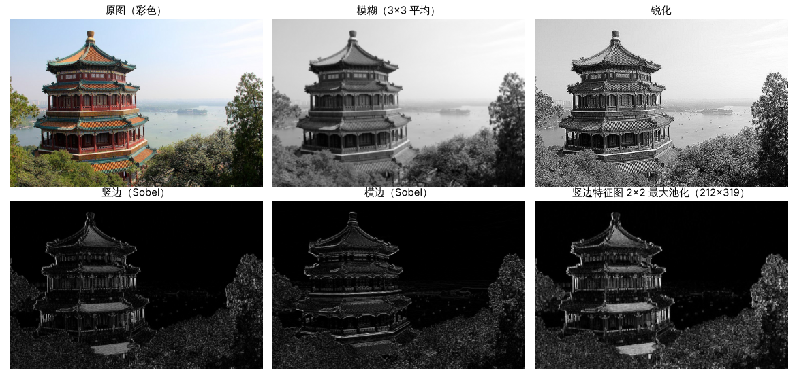
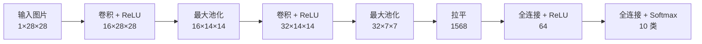
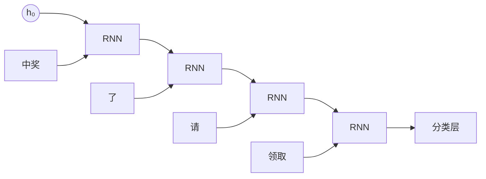
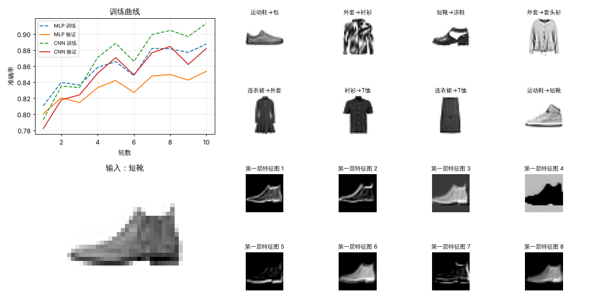
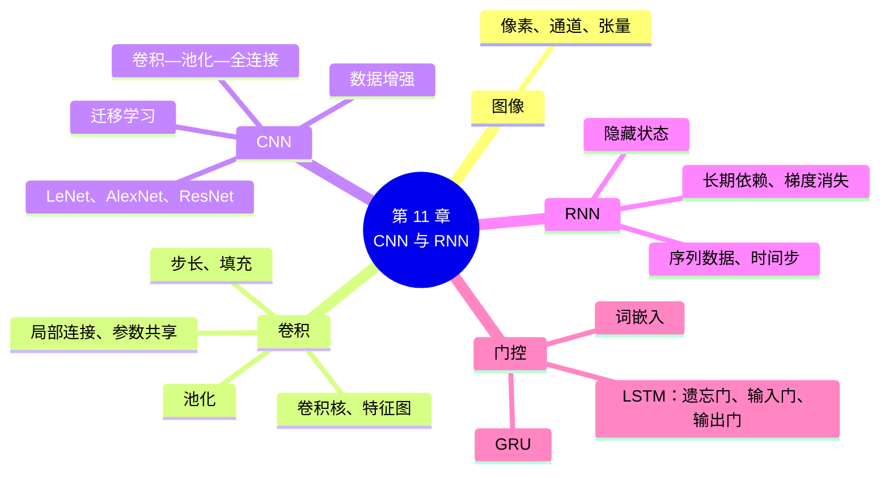

# 第 11 章 卷积神经网络与循环神经网络

!!! abstract "本章学时"
    理论 5 学时 · 实验 3 学时（本章共 3 个实验，教师可任选）

## 学习目标

学完本章，你应该能够：

1. **说出**卷积、卷积核、特征图、步长与填充、池化、循环神经网络、隐藏状态、LSTM、门控机制、迁移学习的含义（记忆）；
2. **解释**卷积层为什么比全连接层更适合处理图片，循环神经网络为什么能处理序列，LSTM 怎样缓解长期依赖问题（理解）；
3. 手算卷积和池化的结果与特征图尺寸，**运用** PyTorch 和 Keras 搭建卷积神经网络分类图片、搭建 LSTM 分类文本（应用）；
4. 根据训练曲线、混淆矩阵和认错的样本**分析**模型的问题（分析）；
5. 针对图片、文本等任务，**评价**该选卷积网络、循环网络还是经典方法，是否需要数据增强或迁移学习（评价）。

!!! info "先修要求"
    学习本章前，你需要掌握：

    - 多层感知机、激活函数（[10.2 多层感知机](../10-neural-network/index.md#102)）；
    - 反向传播与梯度消失（[10.3 神经网络怎样学习](../10-neural-network/index.md#103)）；
    - PyTorch 训练循环和 Keras 的 Sequential 写法（[10.5 深度学习框架入门](../10-neural-network/index.md#105)）；
    - 朴素贝叶斯垃圾短信分类（[7.3 朴素贝叶斯](../07-knn-bayes-rules/index.md#73)）。

??? abstract "本章概念清单（21 个，点击查看定义和例子）"
    1. [卷积神经网络](../../appendix/glossary.md#g-卷积神经网络)
    2. [图像的数字表示](../../appendix/glossary.md#g-图像的数字表示)
    3. [卷积](../../appendix/glossary.md#g-卷积)
    4. [卷积核](../../appendix/glossary.md#g-卷积核)
    5. [特征图](../../appendix/glossary.md#g-特征图)
    6. [步长与填充](../../appendix/glossary.md#g-步长与填充)
    7. [池化](../../appendix/glossary.md#g-池化)
    8. [全连接层](../../appendix/glossary.md#g-全连接层)
    9. [LeNet](../../appendix/glossary.md#g-LeNet)
    10. [数据增强](../../appendix/glossary.md#g-数据增强)
    11. [迁移学习](../../appendix/glossary.md#g-迁移学习)
    12. [预训练模型](../../appendix/glossary.md#g-预训练模型)
    13. [循环神经网络](../../appendix/glossary.md#g-循环神经网络)
    14. [序列数据](../../appendix/glossary.md#g-序列数据)
    15. [隐藏状态](../../appendix/glossary.md#g-隐藏状态)
    16. [时间步](../../appendix/glossary.md#g-时间步)
    17. [长期依赖](../../appendix/glossary.md#g-长期依赖)
    18. [LSTM](../../appendix/glossary.md#g-LSTM)
    19. [门控机制](../../appendix/glossary.md#g-门控机制)
    20. [GRU](../../appendix/glossary.md#g-GRU)
    21. [词嵌入](../../appendix/glossary.md#g-词嵌入)

## 情景导入

一家服装电商每天上新几千件商品，运营人员要给每张商品图打上类别标签：T 恤、衬衫、外套、连衣裙……人工打标签又慢又容易出错。能不能让模型看图自动分类？

第 10 章的多层感知机做过手写数字识别：把 8 × 8 的图片拉平成 64 个数，送进全连接层。换成商品图就有两个麻烦。第一，图片大了参数会爆炸：一张 1000 × 1000 的彩色照片有 300 万个数，接一个 1000 个神经元的全连接层，就要 30 亿个权重。第二，拉平以后，像素之间“谁挨着谁”的位置关系丢了，而识别衣领、袖口、鞋跟这些局部形状，恰恰要靠相邻像素之间的关系。

同一家电商还有另一个问题：客服每天收到大量用户留言和短信，要自动挑出垃圾信息。第 7 章的朴素贝叶斯把短信看成“一袋词”，不管词的顺序；可“不是很好”和“很不好”、“我没中奖”和“我中奖了”，意思差别就在顺序上。

本章学习两种专门的神经网络：处理图片的[**卷积神经网络**](../../appendix/glossary.md#g-卷积神经网络 "以卷积层为主要组成部分、通过卷积和池化逐层提取图像特征的神经网络"){ .term }，用一个小窗口在图上滑动，抓住局部的形状；处理序列的[**循环神经网络**](../../appendix/glossary.md#g-循环神经网络 "按时间步逐个处理序列，用隐藏状态把前面的信息传给后面，各时间步共享参数的神经网络"){ .term }，一个词一个词地读，边读边记。

## 11.1 图像在计算机中的样子

在计算机眼里，一张图片就是一个数字表格。[**图像的数字表示**](../../appendix/glossary.md#g-图像的数字表示 "把图像分成像素，用数字表示每个像素的亮度或颜色；彩色图有红、绿、蓝三个通道"){ .term }是：把图片分成一个个小方格（**像素**），每个像素用数字表示亮度。

- **灰度图**：每个像素一个数，通常是 0～255 的整数，0 是黑、255 是白。Fashion-MNIST 的服装图片是 28 × 28 的灰度图，就是一个 28 行 28 列的表格。
- **彩色图**：每个像素用红、绿、蓝（RGB）三个数表示，相当于三张同样大小的表格叠在一起，每一张叫一个**通道**。实验 11-1 用的示例照片是 427 × 640 × 3：高 427 像素、宽 640 像素、3 个通道，共 819 840 个数。

训练时，数据以张量的形式送进网络（10.5.1 节）。PyTorch 中一批图片的形状是“张数 × 通道 × 高 × 宽”，实验 11-2 中训练集的形状是 (10000, 1, 28, 28)；Keras 默认把通道放在最后，是 (10000, 28, 28, 1)。像素值一般先除以 255 缩放到 0～1，和第 2 章的特征缩放是同一个道理。

把彩色图转成灰度图，常用的公式是 灰度 = 0.299 × 红 + 0.587 × 绿 + 0.114 × 蓝。绿色的权重最大，因为人眼对绿光最敏感。

## 11.2 卷积与池化

### 11.2.1 卷积：一个小窗口在图上滑动

[**卷积**](../../appendix/glossary.md#g-卷积 "用卷积核在输入上滑动，每个位置对应元素相乘再相加得到一个输出值的运算"){ .term }是用一个小的数字方阵在图上从左到右、从上到下滑动，每到一个位置，把方阵和它盖住的那块图对应位置的数相乘、再全部加起来，得到一个数。这个小方阵叫[**卷积核**](../../appendix/glossary.md#g-卷积核 "卷积中在输入上滑动的小权重矩阵，又称滤波器，在卷积网络中通过训练得到"){ .term }（也叫滤波器），常见大小是 3 × 3。卷积核滑过整张图，得到的这些数排成一张新的表格，叫[**特征图**](../../appendix/glossary.md#g-特征图 "卷积核在整个输入上滑动后得到的输出矩阵，表示某种图案在各位置出现的强弱"){ .term }。

!!! example "算一算：手算 3 × 3 卷积"
    输入是一张 5 × 5 的小图，左边两列暗（0）、右边三列亮（1），中间有一条竖直的边：

    | 0 | 0 | 1 | 1 | 1 |
    |---|---|---|---|---|
    | 0 | 0 | 1 | 1 | 1 |
    | 0 | 0 | 1 | 1 | 1 |
    | 0 | 0 | 1 | 1 | 1 |
    | 0 | 0 | 1 | 1 | 1 |

    卷积核每一行都是 [−1, 0, 1]，意思是“右边减左边”。

    - 放在左上角（覆盖第 1～3 列）：每一行是 0 × (−1) + 0 × 0 + 1 × 1 = 1，三行共 **3**；
    - 向右移一格（覆盖第 2～4 列）：每一行是 0 × (−1) + 1 × 0 + 1 × 1 = 1，共 **3**；
    - 再向右移一格（覆盖第 3～5 列）：每一行是 1 × (−1) + 1 × 0 + 1 × 1 = 0，共 **0**。

    往下移动结果相同，得到 3 × 3 的特征图，每一行都是 [3, 3, 0]。有边的地方输出 3，颜色均匀的地方输出 0：这个卷积核在“找竖直的边”。

不同的卷积核找不同的图案。实验 11-1 用四个卷积核处理一张照片：

| 卷积核 | 数值 | 作用 |
|---|---|---|
| 模糊 | 九个格子都是 1/9 | 取周围平均，图像变平滑 |
| 锐化 | 中间 5，上下左右 −1 | 突出和周围差别大的地方 |
| 竖边（Sobel） | 每行 [−1, 0, 1]，中间一行加倍 | 找竖直的边缘 |
| 横边（Sobel） | 每列 [−1, 0, 1]（从上到下），中间一列加倍 | 找水平的边缘 |



竖边特征图中，建筑的柱子、树干等竖直线条很亮；横边特征图中，屋檐、栏杆等水平线条很亮。传统的图像处理就是由人设计这些卷积核；**卷积神经网络的卷积核不用人设计，而是像权重一样从数据中学出来**。实验 11-2 训练好的网络，第一层的 16 个卷积核有的学成了找边缘，有的学成了找亮区或暗区（实验结果图下半部分）。

严格地说，数学上的“卷积”要先把卷积核翻转再相乘，深度学习框架里做的其实是不翻转的“互相关”。因为卷积核是学出来的，翻不翻转没有区别，大家仍然叫它卷积。实验 11-1 用 NumPy 算的结果与 PyTorch 的 `Conv2d` 最大只差 4.4 × 10⁻⁷（浮点误差），可见两者做的是同一件事。

### 11.2.2 步长、填充与特征图

卷积核每次移动几格叫**步长**；在输入图四周补几圈 0 叫**填充**。两者合称[**步长与填充**](../../appendix/glossary.md#g-步长与填充 "步长是卷积核每次移动的格数，填充是在输入四周补 0 的圈数，二者决定特征图大小 (n + 2p − k) / s + 1"){ .term }，决定了特征图的大小。

输入边长为 n、卷积核边长为 k、填充 p、步长 s 时：

\[
\text{特征图边长} = \frac{n + 2p - k}{s} + 1
\]

（不能整除时向下取整。）实验 11-1 中 5 × 5 的小图配 3 × 3 卷积核：

| 步长 s | 填充 p | 计算 | 特征图 |
|---|---|---|---|
| 1 | 0 | (5 + 0 − 3) ÷ 1 + 1 | 3 × 3 |
| 1 | 1 | (5 + 2 − 3) ÷ 1 + 1 | 5 × 5，与输入一样大 |
| 2 | 1 | (5 + 2 − 3) ÷ 2 + 1 | 3 × 3 |

3 × 3 的卷积核配填充 1、步长 1，特征图大小不变，这是最常用的设置（PyTorch 写 `padding=1`，Keras 写 `padding="same"`）。填充也有副作用：补的 0 和图像边缘之间会形成“假边”，实验 11-1 中填充后特征图最右一列出现了 −3。

一个卷积层通常有很多个卷积核，每个卷积核得到一张特征图，叠在一起就是这一层输出的多个通道。实验 11-2 第一个卷积层有 16 个卷积核，把 1 × 28 × 28 的输入变成 16 × 28 × 28。下一层的每个卷积核要同时看这 16 个通道，所以它的大小是 3 × 3 × 16。

下面的动画可以一格一格地看卷积怎样计算：

<iframe class="sim-frame" src="../../sims/conv-calculator/main.html" height="640" loading="lazy" title="卷积计算器"></iframe>

动画：卷积计算器。选输入图和卷积核，按“下一个位置”逐格计算；改步长、填充，再做 2 × 2 最大池化。[全屏打开](../../sims/conv-calculator/main.html){ target=_blank }
{ .sim-caption }

### 11.2.3 池化

[**池化**](../../appendix/glossary.md#g-池化 "把特征图分成小块、每块只保留一个值（最大值或平均值）以缩小尺寸的操作，没有参数"){ .term }是把特征图分成一个个小格子（常用 2 × 2），每个格子只留一个数，让特征图缩小。留最大值叫**最大池化**，留平均值叫平均池化，卷积网络中最常用的是最大池化。

例如一张 4 × 4 的特征图：

| 1 | 3 | 2 | 0 |
|---|---|---|---|
| 4 | 6 | 1 | 1 |
| 0 | 2 | 5 | 7 |
| 1 | 1 | 3 | 2 |

左上 2 × 2 格子最大是 6，右上是 2，左下是 2，右下是 7，池化后变成 2 × 2：[[6, 2], [2, 7]]。

池化有两个作用：一是缩小特征图，像素数变为四分之一，减少后面的计算量；二是让网络对小的位置变化不敏感，比如衣领的边缘向右偏了一个像素，2 × 2 格子里的最大值往往不变。池化层没有要学的参数。

### 11.2.4 为什么卷积比全连接更适合图片

卷积层有两个重要特点：

- **局部连接**：特征图上的每个数只看输入的一小块（3 × 3），而不是整张图。图片中有意义的图案（边、角、纹理）都是局部的。
- **参数共享**：同一个卷积核在整张图上滑动，用的是同一组权重。一个能找竖边的卷积核，在图的左上角能找，在右下角也能找。

所以卷积层的参数非常少。实验 11-1 算了一笔账（输入 28 × 28 灰度图）：

| 层 | 参数个数 |
|---|---|
| 全连接层，128 个神经元 | 28 × 28 × 128 + 128 = 100 480 |
| 卷积层，16 个 3 × 3 卷积核 | 3 × 3 × 1 × 16 + 16 = 160 |
| 卷积层，输入 16 通道、输出 32 通道 | 3 × 3 × 16 × 32 + 32 = 4640 |

卷积层的参数个数只和卷积核的大小、个数有关，和图片多大无关。一张 1000 × 1000 的照片，16 个 3 × 3 卷积核也只要 160 个参数（彩色图是 3 × 3 × 3 × 16 + 16 = 448 个）。

!!! cert "证书考点 · 人工智能数据处理工程师（高级）· 深度学习实战"
    常考：图像的像素、通道表示；卷积的计算过程（会手算一个位置的结果）；特征图尺寸公式 (n + 2p − k) / s + 1；卷积层参数个数 = 卷积核高 × 宽 × 输入通道数 × 卷积核个数 + 卷积核个数；池化的作用，最大池化的计算；局部连接和参数共享。容易错在算参数时漏乘输入通道数或漏加偏置，以及把池化层也算上参数。

## 11.3 卷积神经网络的结构

### 11.3.1 卷积层、池化层、全连接层

**卷积神经网络**（CNN）是以卷积层为主要组成部分的神经网络，结构通常是：



这是实验 11-2 用的网络。前面几组“卷积 + 激活 + 池化”负责提取特征：越往后特征图越小、通道越多，前面的层找边缘、角点这样的简单图案，后面的层把简单图案组合成衣领、袖子、鞋跟这样的复杂形状。最后把特征图拉平，交给[**全连接层**](../../appendix/glossary.md#g-全连接层 "每个神经元与上一层所有神经元相连的层，卷积网络中常放在最后做分类"){ .term }（就是第 10 章多层感知机里的层）做分类。

PyTorch 写法：

```python
cnn = nn.Sequential(
    nn.Conv2d(1, 16, kernel_size=3, padding=1), nn.ReLU(), nn.MaxPool2d(2),    # 16 × 14 × 14
    nn.Conv2d(16, 32, kernel_size=3, padding=1), nn.ReLU(), nn.MaxPool2d(2),   # 32 × 7 × 7
    nn.Flatten(), nn.Linear(32 * 7 * 7, 64), nn.ReLU(), nn.Linear(64, 10),
)
```

训练方法和第 10 章完全一样：交叉熵损失、Adam 优化器、训练循环四步。实验 11-2 在 10 000 张 Fashion-MNIST 图片上训练 10 轮，在 10 000 张测试图上比较：

| 模型 | 参数个数 | 第 10 轮训练准确率 | 验证准确率 | 测试准确率 | 用时 |
|---|---|---|---|---|---|
| 多层感知机（784 → 128 → 10） | 101 770 | 0.887 | 0.854 | 0.847 | 2 秒 |
| 卷积神经网络（PyTorch） | 105 866 | 0.913 | 0.882 | **0.877** | 24 秒 |
| 卷积神经网络（Keras 3） | 105 866 | — | 0.878 | 0.871 | 24 秒 |

参数差不多，卷积网络的测试准确率比多层感知机高 0.030，即 10 000 张中多认对约 300 张。值得注意的是，卷积网络的 105 866 个参数中，两个卷积层只有 160 + 4640 = 4800 个，95% 都在拉平后的第一个全连接层（1568 × 64 + 64 = 100 416）。

看各类的准确率，**衬衫**最差（0.55），最常被认成 T 恤（178 张）、外套（111 张）和套头衫（104 张）。28 × 28 的灰度小图上，这几类本来就很难分，人看也会犹豫。这提示我们：要进一步提高，与其换更复杂的网络，不如先看看认错的图片，判断是模型的问题还是数据本身的局限（第 4 章错误案例分析的思路）。

### 11.3.2 从 LeNet 到 ResNet { #1132 }

卷积神经网络的发展大致经历了这几步：

| 年份 | 网络 | 特点 |
|---|---|---|
| 1998 | [**LeNet**](../../appendix/glossary.md#g-LeNet "1998 年杨立昆等提出的卷积神经网络，由卷积、池化、全连接层组成，用于手写数字识别"){ .term }-5 | 杨立昆（LeCun）等提出，两个卷积层 + 池化 + 全连接，用于银行支票上的手写数字识别，是现代 CNN 的雏形<sup class="cite">[[4]](#ref11-4)</sup> |
| 2012 | AlexNet | 在 ImageNet 图像识别大赛（120 万张训练图、1000 类）上把前五错误率从 26.2% 降到 15.3%，用了 ReLU、Dropout 和 GPU 训练，开启了深度学习热潮<sup class="cite">[[5]](#ref11-5)</sup> |
| 2014 | VGG | 全部用 3 × 3 小卷积核，堆到 16～19 层 |
| 2015 | ResNet | 加入“残差连接”（让输入跳过几层直接加到输出上），缓解梯度消失，网络深到 152 层，前五错误率降到 3.57%，低于人类约 5% 的水平<sup class="cite">[[6]](#ref11-6)</sup> |

**LeNet** 的结构与实验 11-2 的网络几乎一样，只是当年用的是 Sigmoid 和平均池化。二十多年来，CNN 的基本组成没有变，变的是层数、数据量和算力。

实验 11-2 只用了 Fashion-MNIST 六分之一的训练数据和一个两层卷积的小网络，在普通电脑的 CPU 上半分钟就能训练完。编者用完整的训练数据（55 000 张训练、5000 张验证）训练同一个小网络 10 轮，测试准确率从 0.877 提高到 0.909，在 4 核 CPU 上用时约 2 分钟。再换更深的网络、训练更多轮，CPU 就吃力了，这时最好借助**云算力**：飞桨 AI Studio、阿里云 PAI-DSW 等平台都提供带 GPU 的在线编程环境，本实验的代码可以直接上传运行。

## 11.4 数据增强与迁移学习

深度网络参数多，需要大量数据。数据不够时，有两种常用的办法。

### 11.4.1 数据增强

[**数据增强**](../../appendix/glossary.md#g-数据增强 "训练时对样本做随机变换（翻转、旋转、平移、调亮度等）以增加样本多样性、减轻过拟合的方法"){ .term }是在训练时对图片做随机的小变换（翻转、旋转、平移、缩放、裁剪、调亮度等），生成“新”样本，让模型见过更多样的情况，减轻过拟合。一张猫的照片左右翻转后还是猫，稍微转一点、亮一点也还是猫。

但增强方法要符合真实数据的情况。本章实操题 1 给实验 11-2 的 CNN 加上“随机左右翻转”，训练 10 轮，测试准确率反而从 0.877 降到 0.868。原因是 Fashion-MNIST 的图片都经过统一整理，鞋子全部朝左，翻转后的“朝右的鞋”在测试集中根本不会出现，模型白白花力气去学。手写数字也不能左右翻转（翻转后的 3 就不是 3 了）。选择增强方法前，先想一想：**变换后的图片在实际使用中会不会出现？**

### 11.4.2 迁移学习与预训练模型

[**迁移学习**](../../appendix/glossary.md#g-迁移学习 "把在一个任务上学到的知识（模型参数）用到另一个相关任务上的方法"){ .term }是把在一个任务上学到的知识用到另一个相关任务上。在 ImageNet 这样的大数据集上训练好的网络，前面的卷积层已经学会了找边缘、纹理、形状这些通用的图案，换一个任务也用得上。这种事先在大数据上训练好、可以拿来再用的模型叫[**预训练模型**](../../appendix/glossary.md#g-预训练模型 "事先在大规模数据上训练好、可以直接使用或微调的模型"){ .term }。

常见做法：下载一个预训练好的 ResNet，去掉最后的全连接层，换成自己任务的类别数（比如 10 种服装），先冻结前面的层只训练新的输出层；数据多一些时，再用小学习率微调全部层。这样只要几百、几千张图就能得到不错的效果，训练时间也短得多。PyTorch 的 torchvision、Keras 的 keras.applications、飞桨的 PaddleClas 都提供了大量预训练模型。

迁移学习的思想不只用在图片上，今天的大语言模型也是“先在海量文本上预训练，再针对具体任务微调”。图像方面的更多应用在“计算机视觉”课程中学习，大模型的预训练与微调在“自然语言处理”课程中学习。

## 11.5 循环神经网络

### 11.5.1 序列数据

[**序列数据**](../../appendix/glossary.md#g-序列数据 "按顺序排列、前后有关联、长度可以不固定的数据"){ .term }是按顺序排列、前后有关联的数据：一句话是一串词，一段语音是一串声音信号，股票价格、每天的销量是一串数字（第 12 章）。序列数据有两个特点：长度不固定；顺序很重要。

多层感知机和卷积网络要求输入大小固定，也不擅长“记住前面说过什么”。第 7 章的朴素贝叶斯用词袋表示短信，干脆丢掉了顺序。要按顺序处理，就需要**循环神经网络**（RNN）。

### 11.5.2 隐藏状态与时间步

循环神经网络一个词一个词地读，每读一个词叫一个[**时间步**](../../appendix/glossary.md#g-时间步 "循环神经网络处理序列时的每一步，通常对应序列中的一个元素"){ .term }。它有一个“记忆”，叫[**隐藏状态**](../../appendix/glossary.md#g-隐藏状态 "循环神经网络在每个时间步保存的向量，概括了到目前为止读过的内容"){ .term } h，每一步用当前的输入 xₜ 和上一步的隐藏状态 hₜ₋₁ 算出新的隐藏状态：

\[
h_t = \tanh(W x_t + U h_{t-1} + b)
\]

读完最后一个词，最后的隐藏状态就“总结”了整个序列，交给全连接层做分类。



图中的四个方框其实是**同一个**网络、同一组参数 W、U、b，只是在不同时刻被重复使用，就像卷积核在图上滑动时用同一组权重。把它按时间“展开”画出来，看起来像一个很深的网络，但参数个数和序列长短无关。

!!! example "算一算：RNN 读短信"
    为了好算，隐藏状态只有 1 维，表示“垃圾嫌疑”。设 hₜ = tanh(1.5 xₜ + 0.5 hₜ₋₁)，“中奖”的 x = 1，其他中性词 x = 0，h₀ = 0。读“中奖 了 这 是 上次”：

    - h₁ = tanh(1.5 × 1 + 0.5 × 0) = tanh(1.5) ≈ 0.905
    - h₂ = tanh(0 + 0.5 × 0.905) ≈ 0.424
    - h₃ = tanh(0.5 × 0.424) ≈ 0.209
    - h₄ ≈ 0.104，h₅ ≈ 0.052

    每读一个中性词，记忆就缩小一半多。读了十几个词以后，开头的“中奖”几乎被忘光了。

### 11.5.3 长期依赖与梯度问题

上面的例子说明了简单 RNN 的毛病：序列一长，前面的信息就传不到后面。要正确理解一个序列，常常需要记住很久以前的信息，这叫[**长期依赖**](../../appendix/glossary.md#g-长期依赖 "序列后面的输出依赖于很早之前输入的情况，简单 RNN 因梯度消失难以学到"){ .term }。比如“我在北京长大，……（中间二十个词）……，所以我说一口流利的___”，要填“普通话”，就得记住开头的“北京”。

从训练的角度看，这是第 10 章梯度消失问题的又一种表现：反向传播时，误差从最后一个时间步往回传，每过一步都要乘上 U 和 tanh 的导数。在上面的例子里，每一步乘的数不超过 0.5，往回传 15 步后，开头那个词的梯度只剩约 2.4 × 10⁻⁵，模型几乎学不到它和结果的关系。反过来，如果每一步乘的数大于 1，连乘后梯度会越来越大，叫**梯度爆炸**，训练时损失会突然变成很大的数甚至 nan，常用“梯度裁剪”（梯度太大时按比例缩小）来处理。

## 11.6 LSTM 与 GRU { #116 }

### 11.6.1 LSTM 的门 { #1161 }

1997 年，霍赫赖特（Hochreiter）和施米德胡贝（Schmidhuber）提出了**长短期记忆网络**（[**LSTM**](../../appendix/glossary.md#g-LSTM "长短期记忆网络，用记忆细胞和遗忘门、输入门、输出门控制信息流动，能记住长期信息的循环网络"){ .term }），<sup class="cite">[[7]](#ref11-7)</sup>专门解决长期依赖问题。它的关键是两样东西：

- **记忆细胞** c：一条贯穿所有时间步的“传送带”，信息可以在上面几乎原样地传下去；
- **门**：三个 0～1 之间的系数，决定信息怎样进出记忆细胞。

| 门 | 作用 | 打个比方 |
|---|---|---|
| 遗忘门 f | 旧记忆保留多少 | 1 是全部保留，0 是全部忘掉 |
| 输入门 i | 新内容写入多少 | 重要的词多写，无关的词少写 |
| 输出门 o | 记忆中输出多少给隐藏状态 | 这一步需要用到多少记忆 |

更新方式是：新记忆 = 遗忘门 × 旧记忆 + 输入门 × 候选的新内容，即 cₜ = f × cₜ₋₁ + i × g。门的值不是人定的，而是由当前输入和上一步的隐藏状态经过 Sigmoid 算出来，和其他参数一样从数据中学习。这种用“门”控制信息流动的做法叫[**门控机制**](../../appendix/glossary.md#g-门控机制 "用 0～1 之间、由网络学习得到的系数控制信息保留、写入和输出多少的结构"){ .term }。

为什么门能缓解梯度消失？沿着记忆细胞往回传，每一步只乘遗忘门 f。只要网络学会在无关的词上让 f 接近 1、i 接近 0，记忆和梯度就能几乎不衰减地传很远。用同一个例子，设中性词的遗忘门 0.93、输入门 0.05，“中奖”的输入门为 1：

- c₁ = 0 + 1 × tanh(2) ≈ 0.964
- c₂ = 0.93 × 0.964 + 0.05 × 0 ≈ 0.893
- c₃ ≈ 0.827，c₄ ≈ 0.766，c₅ ≈ 0.710

比简单 RNN 的 0.052 大得多。下面的动画可以比较两者：

<iframe class="sim-frame" src="../../sims/rnn-lstm/main.html" height="720" loading="lazy" title="RNN 与 LSTM 逐步展开"></iframe>

动画：RNN 与 LSTM 逐步展开。选第二个例句，分别用简单 RNN 和 LSTM 读完，比较最后的判断和开头词的梯度；再把遗忘门基准调小试试。[全屏打开](../../sims/rnn-lstm/main.html){ target=_blank }
{ .sim-caption }

### 11.6.2 GRU { #1162 }

2014 年提出的[**GRU**](../../appendix/glossary.md#g-GRU "门控循环单元，只有更新门和重置门的 LSTM 简化版，参数更少"){ .term }（门控循环单元）<sup class="cite">[[8]](#ref11-8)</sup>是 LSTM 的简化版：只有两个门（更新门和重置门），没有单独的记忆细胞，参数比 LSTM 少约四分之一，效果在很多任务上差不多。实操题 2 把实验 11-3 的 LSTM 换成 GRU，参数从 112 673 降到 110 561（只算循环层，从 8448 个降到 6336 个），测试准确率都是 0.987。实际工作中两者都可以先试试。

### 11.6.3 词嵌入：把词变成向量

神经网络只能处理数字，文本要先变成数字。实验 11-3 分三步：

1. **分词并建词表**：英文按空格和标点切开，统计训练集中出现至少 2 次的词，共 3254 个，各编一个号；0 留给补齐，1 留给没见过的词。
2. **截断与补齐**：短信长短不一，中位数 12 个词，90% 不超过 30 个词，统一成 40 个词：太长的只留最后 40 个，太短的在前面补 0。
3. [**词嵌入**](../../appendix/glossary.md#g-词嵌入 "把词表示成稠密的实数向量，向量随模型一起训练，意思相近的词向量相近"){ .term }：用 `nn.Embedding` 把每个词的编号变成一个 32 维的向量。

**词嵌入**是把每个词表示成一个稠密的实数向量，这些向量作为参数一起训练，意思相近的词向量也相近。和第 7 章的词袋相比，词袋中每个词是词表那么长、只有一个 1 的向量，词与词之间没有任何联系；词嵌入用几十到几百维就能表示，还能体现词的相似性。词嵌入是自然语言处理的基础，word2vec 等经典方法和大模型中的词向量在“自然语言处理”课程中详细学习。

搭建 LSTM 分类器（PyTorch）：

```python
class TextRNN(nn.Module):
    def __init__(self):
        super().__init__()
        self.emb = nn.Embedding(V, 32, padding_idx=0)     # 词编号 → 32 维向量
        self.rnn = nn.LSTM(32, 32, batch_first=True)      # 换成 nn.RNN、nn.GRU 就是另外两种
        self.out = nn.Linear(32, 1)

    def forward(self, x):
        h, _ = self.rnn(self.emb(x))                       # h：(批大小, 40 个时间步, 32)
        return self.out(h[:, -1]).squeeze(1)               # 取最后一个时间步的隐藏状态
```

Keras 写法只要四行：`Input(shape=(40,))`、`Embedding(V, 32)`、`LSTM(32)`、`Dense(1, activation="sigmoid")`。实验 11-3 在第 7 章同样的测试集（1673 条，垃圾短信 224 条）上比较：

| 模型 | 准确率 | 精确率 | 召回率 | 漏判 | 误判 | 训练用时 |
|---|---|---|---|---|---|---|
| 多项式朴素贝叶斯（第 7 章） | 0.984 | 0.967 | 0.911 | 20 | 7 | 0.04 秒 |
| 简单 RNN | 0.978 | 0.912 | 0.924 | 17 | 20 | 2.6 秒 |
| LSTM（PyTorch） | **0.987** | 0.972 | **0.933** | 15 | 6 | 2.3 秒 |
| LSTM（Keras 3） | **0.987** | **0.977** | 0.929 | 16 | 5 | 9.5 秒 |

LSTM 比朴素贝叶斯少漏判 4～5 条、少误判 1～2 条，提升不大；简单 RNN 反而不如朴素贝叶斯，误判多了很多，训练过程中验证准确率也上下波动。朴素贝叶斯训练只要 0.04 秒，LSTM 要几秒到十几秒。垃圾短信主要靠“free”“prize”“claim”这类关键词就能识别，词的顺序帮助有限，所以简单方法已经很好。**任务越依赖词序和上下文（如情感分析、机器翻译），循环网络的优势越明显**。

!!! cert "证书考点 · 人工智能数据处理工程师（高级）· 深度学习实战"
    常考：序列数据的特点；RNN 的结构、隐藏状态和参数共享；RNN 的梯度消失和梯度爆炸；LSTM 三个门（遗忘门、输入门、输出门）的作用和记忆细胞；GRU 与 LSTM 的区别；文本分类的流程（分词、建词表、截断补齐、词嵌入、循环层、全连接输出）；用 Keras 搭建 Embedding + LSTM + Dense 模型。容易错在把 LSTM 的门当作人为设定的值，以及认为循环网络在所有文本任务上都优于传统方法。

## 11.7 前沿视窗

**视觉 Transformer 与多模态大模型。**2020 年，谷歌的研究者把一张图切成 16 × 16 像素的小块，每一块当作一个“词”，直接送进自然语言处理中的 Transformer，得到了视觉 Transformer（ViT）。<sup class="cite">[[9]](#ref11-9)</sup>在足够大的数据上，它的效果超过了 CNN。此后，能同时看图、读文字的多模态大模型迅速发展，可以描述图片内容、回答关于图片的问题、根据文字生成图片。不过在数据量不大、算力有限的场合，CNN 仍然是首选，手机上的人脸识别、工厂的缺陷检测大多用 CNN。

**RNN 为什么被 Transformer 取代？**RNN 必须一个词一个词按顺序算，没法并行，长文本训练很慢；即使用了 LSTM，相隔几百个词的信息也很难传过去。Transformer 用注意力机制让每个词直接“看”到句子里所有的词，可以并行计算，成为大语言模型的基础。<sup class="cite">[[10]](#ref11-10)</sup>近年出现的状态空间模型（如 Mamba）又借鉴了 RNN“边读边更新一个状态”的思路，在处理超长序列时速度更快，循环的思想并没有过时。这些内容在“自然语言处理”课程中学习。

**国产视觉模型与平台。**飞桨的 PaddleClas<sup class="cite">[[12]](#ref11-12)</sup>、PaddleDetection、PaddleOCR 提供了大量图像分类、目标检测、文字识别的预训练模型，很多已经用在票据识别、工业质检等场景；华为昇思的 MindCV 也提供了类似的模型库。用这些工具做迁移学习，往往几十行代码就能完成一个实用的图像应用。

## 本章实验

!!! abstract "实验总览"
    | 实验 | 类型 | 建议时长 | 内容 |
    |---|---|---|---|
    | 实验 11-1 | ★ 基础 | 40 分钟 | 用 NumPy 实现卷积和最大池化，手算验证；用模糊、锐化、竖边、横边卷积核处理照片；与 PyTorch 卷积层比较；比较全连接层和卷积层的参数个数 |
    | 实验 11-2 | ★ 基础 | 50 分钟 | 用 PyTorch 和 Keras 搭建 CNN 分类 Fashion-MNIST 服装图片，与多层感知机比较；画训练曲线，查看认错的图片和第一层特征图 |
    | 实验 11-3 | ☆ 拓展 | 45 分钟 | 用第 7 章的垃圾短信数据，搭建简单 RNN 和 LSTM 分类器，与朴素贝叶斯比较效果和速度 |

    三个实验都在本机 CPU 上运行，各用时 1～2 分钟。实验代码见配套资源 `labs/ch11/` 目录。需要 `torch`、`keras`（第 10 章已安装）。实验 11-2 第一次运行会从网上下载 Fashion-MNIST（约 30 MB）；如果下载失败，可以从课程资源中拷贝 `fashion-mnist` 文件夹到用户目录下的 `.keras/datasets/`。

### 实验 11-1 ★ 手算卷积与池化

**实验目的**

1. 用 NumPy 实现卷积（含步长、填充）和最大池化，用小图验证手算结果和尺寸公式；
2. 观察不同卷积核在真实照片上提取的特征；
3. 确认 PyTorch 的卷积层做的是同样的计算，体会卷积层参数少的原因。

**实验环境**：Python 3.11，NumPy、Matplotlib、scikit-learn（取示例照片）、PyTorch。

**实验数据**：代码中的 5 × 5 小图；scikit-learn 自带的示例照片 `china.jpg`（427 × 640 彩色图）。

**实验步骤与代码**

第 1 步，写卷积函数。先按填充在四周补 0，算出特征图大小，再用两重循环滑动卷积核：

```python
def conv2d(img, k, stride=1, pad=0):
    if pad:
        img = np.pad(img, pad)                       # 四周补 0
    kh, kw = k.shape
    oh, ow = (img.shape[0] - kh) // stride + 1, (img.shape[1] - kw) // stride + 1
    out = np.zeros((oh, ow))
    for i in range(oh):
        for j in range(ow):
            win = img[i * stride:i * stride + kh, j * stride:j * stride + kw]
            out[i, j] = (win * k).sum()              # 对应元素相乘再相加
    return out
```

第 2 步，写最大池化函数：把特征图变形成 (h, 2, w, 2)，在两个大小为 2 的维度上取最大值。

```python
def max_pool(img, size=2):
    h, w = img.shape[0] // size, img.shape[1] // size
    return img[:h * size, :w * size].reshape(h, size, w, size).max(axis=(1, 3))
```

第 3 步，用 11.2.1 节的 5 × 5 小图和竖边卷积核，分别取（步长 1，填充 0）、（1，1）、（2，1），与手算结果和尺寸公式核对。

第 4 步，读入照片，转成灰度，用四个卷积核卷积，画出特征图；对竖边特征图做 2 × 2 最大池化。

第 5 步，把竖边卷积核放进 `torch.nn.Conv2d` 的权重，比较输出与 NumPy 结果的差别和用时。

完整代码见 `lab11_1_conv_numpy.py`。

**运行结果**

```text
① 5×5 小图（左暗右亮）：
   0 0 1 1 1
   0 0 1 1 1
   0 0 1 1 1
   0 0 1 1 1
   0 0 1 1 1
  竖边卷积核：
   -1  0  1
   -1  0  1
   -1  0  1
  步长 1、填充 0：特征图 3×3，
    3  3  0
    3  3  0
    3  3  0
  步长 1、填充 1：特征图 5×5，
    0  2  2  0 -2
    0  3  3  0 -3
    0  3  3  0 -3
    0  3  3  0 -3
    0  2  2  0 -2
  步长 2、填充 1：特征图 3×3，
    0  2 -2
    0  3 -3
    0  2 -2
  输出尺寸公式 (n + 2p − k) / s + 1：5×5、3×3 核 → 不填充 3，填充 1 得 5，填充 1 步长 2 得 3
  4×4 特征图 [[1, 3, 2, 0], [4, 6, 1, 1], [0, 2, 5, 7], [1, 1, 3, 2]] 做 2×2 最大池化 → [[6, 2], [2, 7]]

② 照片：彩色 (427, 640, 3)（高 × 宽 × 通道），转为灰度 (427, 640)，像素值 0～1
  模糊（3×3 平均）特征图 425×638，取值 0.00～1.00，平均绝对值 0.568
  锐化        特征图 425×638，取值 -2.00～3.81，平均绝对值 0.646
  竖边（Sobel） 特征图 425×638，取值 -3.61～3.40，平均绝对值 0.219
  横边（Sobel） 特征图 425×638，取值 -3.16～3.49，平均绝对值 0.218
  用 Python 循环做 4 次卷积用时 2.0 秒
  竖边特征图 425×638 → 2×2 最大池化 212×319，像素数从 271150 减到 67628（四分之一）

③ PyTorch Conv2d 同一个卷积核：输出 425×638，与 NumPy 结果的最大差别 4.4e-07，用时 32 毫秒
  参数个数比较（输入 28×28 灰度图）：
    全连接层，输出 128 个神经元：28×28×128 + 128 = 100480
    卷积层，16 个 3×3 卷积核：3×3×1×16 + 16 = 160
    卷积层，输入 16 通道、输出 32 通道：3×3×16×32 + 32 = 4640
```

几点解读：

- ①中填充 1 以后，最右一列出现 −2、−3：右边补的 0 和亮区之间形成了一条“由亮变暗”的假边。
- ②中模糊核的输出范围仍是 0～1（平均值不会超出原范围）；锐化和边缘核会出现负数，画图时取绝对值或截断到 0～1。
- ②中用 Python 两重循环做 4 次卷积要 2 秒，③中 PyTorch 只要几十毫秒，框架用了高度优化的底层代码。实际工作中都用框架，自己写循环只是为了理解。
- ③说明卷积层参数个数只和卷积核有关，与图片大小无关。

**实验记录表**

| 项目 | 结果 |
|---|---|
| 5 × 5 小图三种设置下的特征图尺寸，与公式是否一致 | |
| 4 × 4 特征图最大池化的结果 | |
| 竖边和横边特征图中最亮的分别是照片中的哪些部分 | |
| NumPy 与 PyTorch 的最大差别、用时 | |

**常见问题排查**

| 现象 | 原因 | 解决办法 |
|---|---|---|
| 特征图全黑或全白 | 显示时没有处理负数或超过 1 的值 | 边缘图用 `np.abs`，其他用 `np.clip(m, 0, 1)` |
| `reshape` 报错 | 特征图边长是奇数，不能整除 2 | 先切掉多余的一行一列，如代码中的 `img[:h * size, :w * size]` |
| 和 PyTorch 结果形状对不上 | PyTorch 卷积层要求 4 维输入 | 变成 (1, 1, 高, 宽)：`reshape(1, 1, *gray.shape)` |
| 运行很慢 | Python 循环处理大图 | 正常，耐心等几秒；或先把图片缩小 |

**思考与练习**

1. 设计一个找“从左上到右下的斜线”的 3 × 3 卷积核，用“斜线”图在卷积计算器动画里验证。
2. 把模糊核换成 5 × 5（每个格子 1/25），照片的变化有什么不同？特征图尺寸是多少？
3. 如果照片是彩色的、不转灰度，一个卷积核应该是什么形状？

**实验报告要求**

提交六张特征图和运行结果，填写实验记录表；用不超过 200 字说明卷积层为什么比全连接层更适合处理图片。

### 实验 11-2 ★ CNN 服装图片分类

**实验目的**

1. 学会用 PyTorch 和 Keras 搭建卷积神经网络，理解每一层输出的形状；
2. 比较卷积网络和多层感知机在图片分类上的效果；
3. 通过混淆矩阵和认错的图片分析模型的问题。

**实验环境**：Python 3.11，PyTorch、Keras 3（后端为 PyTorch）、scikit-learn、Matplotlib。

**实验数据**：Fashion-MNIST，德国电商 Zalando 发布的服装图片数据集，<sup class="cite">[[11]](#ref11-11)</sup>共 70 000 张 28 × 28 灰度图，10 类（T 恤、裤子、套头衫、连衣裙、外套、凉鞋、衬衫、运动鞋、包、短靴），训练集 60 000 张、测试集 10 000 张。为了在普通电脑上几分钟内跑完，本实验从训练集随机取 12 000 张（10 000 张训练、2000 张验证），测试用完整的 10 000 张。

**实验步骤与代码**

第 1 步，读入数据，像素除以 255，变成 PyTorch 需要的 (张数, 1, 28, 28)：

```python
(x_all, y_all), (x_test, y_test) = keras.datasets.fashion_mnist.load_data()
prep = lambda a: (a.astype("float32") / 255)[:, None, :, :]
```

第 2 步，训练一个多层感知机（`nn.Flatten()` 拉平后接 784 → 128 → 10）作对照。

第 3 步，按 11.3.1 节的结构搭卷积网络，先让一张图依次通过每一层，打印输出形状；再用 Adam（学习率 0.001）、批大小 64 训练 10 轮。

第 4 步，在测试集上计算各类准确率，找出最常认错的类别。

第 5 步，用 Keras 搭同样的网络（注意 Keras 的输入是 (28, 28, 1)，通道在最后）：

```python
km = keras.Sequential([
    keras.Input(shape=(28, 28, 1)),
    keras.layers.Conv2D(16, 3, padding="same", activation="relu"), keras.layers.MaxPooling2D(2),
    keras.layers.Conv2D(32, 3, padding="same", activation="relu"), keras.layers.MaxPooling2D(2),
    keras.layers.Flatten(), keras.layers.Dense(64, activation="relu"), keras.layers.Dense(10, activation="softmax"),
])
```

第 6 步，画训练曲线、认错的图片和第一层卷积后的特征图。

完整代码见 `lab11_2_cnn_fashion.py`。

**运行结果**

```text
训练 10000 张，验证 2000 张，测试 10000 张；每张 28×28 灰度图；张量形状 (10000, 1, 28, 28)
类别：0 T恤、1 裤子、2 套头衫、3 连衣裙、4 外套、5 凉鞋、6 衬衫、7 运动鞋、8 包、9 短靴

① 多层感知机（784 → 128 → 10）
  MLP：参数 101770，第 1 轮验证 0.800，第 10 轮训练 0.887 / 验证 0.854，测试 0.847，用时 2 秒

② 卷积神经网络（PyTorch）
  每一层输出的形状：
    Conv2d    → (16, 28, 28)，参数 160
    ReLU      → (16, 28, 28)
    MaxPool2d → (16, 14, 14)
    Conv2d    → (32, 14, 14)，参数 4640
    ReLU      → (32, 14, 14)
    MaxPool2d → (32, 7, 7)
    Flatten   → (1568,)
    Linear    → (64,)，参数 100416
    ReLU      → (64,)
    Linear    → (10,)，参数 650
  CNN：参数 105866，第 1 轮验证 0.782，第 10 轮训练 0.913 / 验证 0.882，测试 0.877，用时 24 秒
  各类测试准确率：T恤 0.87，裤子 0.96，套头衫 0.83，连衣裙 0.88，外套 0.84，凉鞋 0.98，衬衫 0.55，运动鞋 0.92，包 0.98，短靴 0.95
  最常认错：衬衫→T恤 178 张；衬衫→外套 111 张；衬衫→套头衫 104 张；外套→套头衫 87 张

③ 同一个 CNN 用 Keras 3
  Keras CNN：参数 105866，第 10 轮验证 0.878，测试 0.871，用时 24 秒

④ 汇总（测试集 10000 张）
  MLP（PyTorch）  0.847
  CNN（PyTorch）  0.877
  CNN（Keras 3）  0.871
```



几点解读：

- 卷积网络测试准确率 0.877，比多层感知机高 0.030；两种框架写的同一个网络相差 0.006，来自随机性。
- 训练曲线上卷积网络的训练、验证准确率都高于多层感知机，两者都还在上升，多训练几轮还能提高。
- 衬衫最难认（0.55），常被认成 T 恤、外套、套头衫；认错的图片中有的人看也很难判断。
- 第一层特征图中，有的突出鞋子的轮廓边缘，有的突出整个鞋身，有的把背景和鞋子反过来，说明不同的卷积核学会了找不同的图案。
- 卷积网络在 CPU 上的用时是多层感知机的十几倍。训练数据增加到 55 000 张，同一个网络测试准确率可到 0.909（编者实测，约 2 分钟）；网络更深时，建议在带 GPU 的云平台上运行。

**实验记录表**

| 项目 | 多层感知机 | CNN（PyTorch） | CNN（Keras） |
|---|---|---|---|
| 参数个数 | | | |
| 第 10 轮验证准确率 | | | |
| 测试准确率 | | | |
| 最难认的类别及常被认成什么 | | | |

**常见问题排查**

| 现象 | 原因 | 解决办法 |
|---|---|---|
| 下载数据超时或失败 | 网络无法访问数据所在的服务器 | 从课程资源拷贝数据文件到 `~/.keras/datasets/fashion-mnist/` |
| `Expected 4-dimensional input` | 图片少了通道维 | PyTorch 用 `[:, None, :, :]` 加上通道维 |
| `mat1 and mat2 shapes cannot be multiplied (64x1568 and 800x64)` | 全连接层的输入个数算错 | 按每层输出形状算：32 × 7 × 7 = 1568；或先打印拉平后的形状 |
| 训练很慢 | CPU 上卷积计算量大 | 减少训练样本或轮数做练习，正式训练用 GPU |

**思考与练习**

1. 去掉两个池化层（全连接层的输入相应改成 32 × 28 × 28），参数个数会变成多少？训练速度和准确率怎样变化？
2. 第一层卷积核从 16 个增加到 32 个，参数和准确率怎样变化？
3. 把训练样本从 10 000 张减到 2000 张，多层感知机和卷积网络谁下降得更多？

**实验报告要求**

提交两种框架的代码、运行结果和结果图，填写实验记录表；用不超过 300 字分析模型最常犯的错误和可能的改进办法。

### 实验 11-3 ☆ LSTM 短信分类

**实验目的**

1. 学会把文本变成整数序列：分词、建词表、截断与补齐；
2. 用词嵌入 + 循环层搭建文本分类器，比较简单 RNN 和 LSTM；
3. 与第 7 章的朴素贝叶斯比较效果和速度，学会按任务选择方法。

**实验环境**：Python 3.11，PyTorch、Keras 3、scikit-learn、pandas。

**实验数据**：`labs/data/sms_spam.csv`，第 7 章的垃圾短信数据（5574 条英文短信，垃圾短信 747 条）。测试集与第 7 章相同（30%，`random_state=42`，分层），训练部分再分出 10% 做验证。为保护隐私和避免不良内容，程序不打印数据集中的短信原文，只用两条自编的短信演示。

**实验步骤与代码**

第 1 步，分词、建词表，把每条短信变成长度为 40 的整数序列：

```python
tok = lambda s: re.findall(r"[a-z0-9']+", s.lower())             # 小写，按非字母数字切开
cnt = Counter(w for s in txt_tr for w in tok(s))                 # 只用训练集统计
vocab = {w: i + 2 for i, (w, c) in enumerate(cnt.most_common()) if c >= 2}

def encode(s):
    ids = [vocab.get(w, 1) for w in tok(s)][-40:]                # 生词记为 1，太长只留最后 40 个
    return [0] * (40 - len(ids)) + ids                           # 太短在前面补 0
```

在前面补 0，是为了让真正的词靠近序列末尾，最后一个时间步的隐藏状态刚读完短信。

第 2 步，按 11.6.3 节的 `TextRNN` 搭建网络，分别用 `nn.RNN` 和 `nn.LSTM`。二分类输出一个数，损失用 `nn.BCEWithLogitsLoss()`（内部先做 Sigmoid 再算交叉熵）。Adam 学习率 0.003，批大小 64，训练 10 轮，每轮记录验证准确率。

第 3 步，用 Keras 搭同样的 LSTM：

```python
km = keras.Sequential([
    keras.Input(shape=(40,)),
    keras.layers.Embedding(V, 32),
    keras.layers.LSTM(32),
    keras.layers.Dense(1, activation="sigmoid"),
])
km.compile(optimizer=keras.optimizers.Adam(3e-3), loss="binary_crossentropy", metrics=["accuracy"])
```

第 4 步，训练第 7 章的多项式朴素贝叶斯，四个模型在同一测试集上比较准确率、精确率、召回率和用时。

完整代码见 `lab11_3_lstm_sms.py`。

**运行结果**

```text
训练 3510 条，验证 391 条，测试 1673 条（测试集中垃圾短信 224 条）

① 词表：训练集出现至少 2 次的词 3254 个（另有补齐符 0、生词 1）
  短信长度（词数）：中位数 12，90% 的短信不超过 30 个词，最长 189；统一截断或补齐到 40 个词
  例：“Are you coming home for dinner tonight?”
   → 分词 ['are', 'you', 'coming', 'home', 'for', 'dinner', 'tonight']
   → 序列（只显示最后 12 个）[0, 0, 0, 0, 0, 23, 4, 257, 80, 13, 366, 226]
  例：“WIN a FREE prize now! Text WIN to 80888 to claim”
   → 分词 ['win', 'a', 'free', 'prize', 'now', 'text', 'win', 'to', '80888', 'to', 'claim']
   → 序列（只显示最后 12 个）[0, 174, 5, 47, 158, 22, 71, 174, 3, 1, 3, 122]

② PyTorch 循环神经网络（词嵌入 32 维，隐藏状态 32 维，Adam 学习率 0.003，批大小 64，10 轮）
  RNN 每轮验证准确率：0.893 0.951 0.918 0.967 0.977 0.980 0.954 0.980 0.982 0.972；参数 106337
  LSTM 每轮验证准确率：0.875 0.939 0.962 0.977 0.980 0.985 0.987 0.985 0.985 0.987；参数 112673

③ Keras 3 写的 LSTM（结构相同）
  每轮验证准确率：0.974 0.987 0.980 0.985 0.987 0.985 0.987 0.987 0.987 0.987；参数 112545

④ 测试集对比（1673 条）
  多项式朴素贝叶斯          准确率 0.984  精确率 0.967  召回率 0.911  漏判  20  误判  7  训练  0.04 秒  预测   13 毫秒
  简单 RNN（PyTorch）   准确率 0.978  精确率 0.912  召回率 0.924  漏判  17  误判 20  训练  2.55 秒  预测   14 毫秒
  LSTM（PyTorch）     准确率 0.987  精确率 0.972  召回率 0.933  漏判  15  误判  6  训练  2.34 秒  预测   12 毫秒
  LSTM（Keras 3）     准确率 0.987  精确率 0.977  召回率 0.929  漏判  16  误判  5  训练  9.53 秒  预测  224 毫秒

  LSTM 对两条自编短信的判断：“Are you coming home for …”垃圾概率 0.000；“WIN a FREE prize now! Te…”垃圾概率 0.996
```

几点解读：

- ①中“80888”不在词表里，编成了 1（生词）。词表只用训练集建，测试时遇到的新词统一当作生词，避免数据泄露。
- ②中简单 RNN 的验证准确率上下波动（0.918、0.954、0.972），LSTM 稳步上升，训练更稳定。
- PyTorch 和 Keras 的 LSTM 参数差 128 个：PyTorch 的 LSTM 每个门有两组偏置（4 × 32 × 2 = 256 个），Keras 只有一组（128 个），效果没有区别。
- ④中 LSTM 只比朴素贝叶斯多抓到 4～5 条垃圾短信，训练时间却多了几十倍。朴素贝叶斯的数字与第 7 章完全相同，因为训练数据和测试集都一样。
- Keras 的预测用时较长，主要是 `predict` 每次调用的准备开销，数据量大时差别会变小。

**实验记录表**

| 项目 | 朴素贝叶斯 | 简单 RNN | LSTM |
|---|---|---|---|
| 准确率 | | | |
| 召回率 | | | |
| 误判（正常短信被拦） | | | |
| 训练用时 | | | |

**常见问题排查**

| 现象 | 原因 | 解决办法 |
|---|---|---|
| `IndexError: index out of range in self` | 词编号超过了嵌入层的大小 | 嵌入层大小要等于词表大小 + 2（补齐符和生词） |
| 准确率一直是 0.866 | 模型把所有短信都判成正常短信（正常短信占 86.6%） | 检查标签是否对应、学习率是否太小；看召回率而不是只看准确率 |
| 在后面补 0 后效果变差 | 读到最后几步都是 0，隐藏状态被冲淡 | 在前面补 0，或用 `pack_padded_sequence` 只读真实长度 |
| BCEWithLogitsLoss 报类型错误 | 标签是整数 | 标签转成浮点数：`torch.tensor(y, dtype=torch.float32)` |

**思考与练习**

1. 把 `MAXLEN` 从 40 改成 10，LSTM 的效果有什么变化？为什么？
2. 把词嵌入维度从 32 改成 8 和 128，参数个数和测试效果怎样变化？
3. 你认为在什么样的文本任务上，LSTM 会明显超过朴素贝叶斯？举一个例子。

**实验报告要求**

提交运行结果，填写实验记录表；用不超过 300 字说明：如果你是开发者，这个任务你会选哪种模型，为什么？

## 本章小结

- 图片是像素组成的数字表格，彩色图有红、绿、蓝三个通道（**图像的数字表示**）。
- **卷积**用**卷积核**在图上滑动，对应相乘再相加，得到**特征图**；**步长与填充**决定特征图大小：(n + 2p − k) / s + 1。**池化**（常用 2 × 2 最大池化）缩小特征图，对小的位置变化不敏感。卷积层局部连接、参数共享，参数个数与图片大小无关。
- **卷积神经网络**由若干组“卷积 + 激活 + 池化”提取特征，再接**全连接层**分类。从 **LeNet** 到 AlexNet、ResNet，结构基本不变，层数、数据和算力大大增加。实验中 CNN 比多层感知机高 0.030。
- 数据少时，用**数据增强**生成更多样的样本（变换要符合实际），用**迁移学习**借用在大数据上训练好的**预训练模型**。
- **循环神经网络**按**时间步**逐个读入**序列数据**，用**隐藏状态**记住前面的内容，每一步共享同一组参数。序列长时会出现**长期依赖**问题，即梯度消失。
- **LSTM** 用记忆细胞和遗忘门、输入门、输出门（**门控机制**）控制信息的保留和写入，能记住更久；**GRU** 是两个门的简化版。文本先分词、建词表、截断补齐，再用**词嵌入**变成向量。
- 短信分类中 LSTM 只比朴素贝叶斯略好、慢得多。任务越依赖顺序和上下文，循环网络越有优势；选模型要看任务和数据。



**下一章预告**

本章用循环神经网络处理了文本序列。还有一类常见的序列是按时间记录的数字：每天的销量、每小时的用电量、每分钟的股价。下一章学习时间序列预测，比较移动平均、指数平滑等经典方法和机器学习、LSTM 方法；最后认识另一类机器学习——强化学习：没有标准答案，靠“试错”和“奖励”学会做决策。

## 参考文献

正文中的上标编号（如<sup class="cite">[[1]](#ref11-1)</sup>）对应下面的文献。带链接的可以直接打开；书籍可在图书馆或电子书平台查阅。

<div class="refs" markdown>

**教材与专著**

- <span id="ref11-1"></span>[1] 邱锡鹏. 神经网络与深度学习[M]. 北京: 机械工业出版社, 2020. https://nndl.github.io/.
    <span class="ref-note">第 5 章“卷积神经网络”、第 6 章“循环神经网络”讲卷积、池化、典型 CNN 结构、RNN、LSTM、GRU，对应 11.2～11.6 节。</span>
- <span id="ref11-2"></span>[2] 阿斯顿·张, 李沐, 扎卡里·C. 立顿, 等. 动手学深度学习（PyTorch 版）[M]. 北京: 人民邮电出版社, 2023. https://zh.d2l.ai/.
    <span class="ref-note">“卷积神经网络”“现代卷积神经网络”“循环神经网络”“现代循环神经网络”四章有可运行的代码，对应全章和三个实验。</span>
- <span id="ref11-3"></span>[3] GOODFELLOW I, BENGIO Y, COURVILLE A. Deep learning[M]. Cambridge: MIT Press, 2016. https://www.deeplearningbook.org/.
    <span class="ref-note">深度学习的经典教材，第 9 章“卷积网络”、第 10 章“序列建模：循环和递归网络”，适合想深入理解原理的读者。</span>

**经典论文**

- <span id="ref11-4"></span>[4] LECUN Y, BOTTOU L, BENGIO Y, et al. Gradient-based learning applied to document recognition[J]. Proceedings of the IEEE, 1998, 86(11): 2278-2324.
    <span class="ref-note">提出 LeNet-5，用于手写数字和支票识别，对应 11.3.2 节。</span>
- <span id="ref11-5"></span>[5] KRIZHEVSKY A, SUTSKEVER I, HINTON G E. ImageNet classification with deep convolutional neural networks[C]//Advances in Neural Information Processing Systems 25. Lake Tahoe: Curran Associates, 2012: 1097-1105.
    <span class="ref-note">AlexNet 的论文，在 ImageNet 大赛上大幅领先，开启深度学习热潮，对应 11.3.2 节。</span>
- <span id="ref11-6"></span>[6] HE K, ZHANG X, REN S, et al. Deep residual learning for image recognition[C]//Proceedings of the IEEE Conference on Computer Vision and Pattern Recognition. Las Vegas: IEEE, 2016: 770-778.
    <span class="ref-note">提出 ResNet 和残差连接，使上百层的网络可以训练，对应 11.3.2 节。</span>
- <span id="ref11-7"></span>[7] HOCHREITER S, SCHMIDHUBER J. Long short-term memory[J]. Neural Computation, 1997, 9(8): 1735-1780.
    <span class="ref-note">提出 LSTM，用记忆细胞和门解决长期依赖问题，对应 11.6.1 节。</span>
- <span id="ref11-8"></span>[8] CHO K, VAN MERRIËNBOER B, GULCEHRE C, et al. Learning phrase representations using RNN encoder-decoder for statistical machine translation[C]//Proceedings of the 2014 Conference on Empirical Methods in Natural Language Processing. Doha: ACL, 2014: 1724-1734.
    <span class="ref-note">提出 GRU，对应 11.6.2 节。</span>
- <span id="ref11-9"></span>[9] DOSOVITSKIY A, BEYER L, KOLESNIKOV A, et al. An image is worth 16x16 words: Transformers for image recognition at scale[C]//9th International Conference on Learning Representations. Virtual, 2021.
    <span class="ref-note">提出视觉 Transformer（ViT），对应 11.7 节。</span>
- <span id="ref11-10"></span>[10] VASWANI A, SHAZEER N, PARMAR N, et al. Attention is all you need[C]//Advances in Neural Information Processing Systems 30. Long Beach: Curran Associates, 2017: 5998-6008.
    <span class="ref-note">提出 Transformer，用注意力机制取代循环结构，对应 11.7 节。</span>

**在线资源与工具**

- <span id="ref11-11"></span>[11] XIAO H, RASUL K, VOLLGRAF R. Fashion-MNIST: a novel image dataset for benchmarking machine learning algorithms[EB/OL]. (2017-08-25). https://github.com/zalandoresearch/fashion-mnist.
    <span class="ref-note">Fashion-MNIST 数据集的说明和下载地址，列出了多种模型的成绩，对应实验 11-2。</span>
- <span id="ref11-12"></span>[12] PaddleClas 图像分类开发套件[EB/OL]. https://github.com/PaddlePaddle/PaddleClas.
    <span class="ref-note">飞桨的图像分类工具，提供大量预训练模型和迁移学习教程，对应 11.4.2 节和 11.7 节。</span>

</div>

## 课后练习

选择题和判断题可以直接点击选项作答，系统会马上告诉你对错，并展开答案与解析；多选题选好后点“提交答案”。简答和实操题请先自己作答，再点开“答案与解析”核对。每道题的解析下方都有“回看”链接，做错了可以直接跳回正文复习。

**一、单项选择题**

<div class="quiz" data-answer="C" markdown>

**1.** 一张 427 × 640 的彩色照片，用 RGB 表示，一共有（　　）个数。

- A. 427 × 640
- B. 427 × 640 × 255
- C. 427 × 640 × 3
- D. 427 + 640 + 3

</div>

??? tip "答案与解析"
    **答案：C**

    每个像素有红、绿、蓝 3 个通道，各一个数，共 427 × 640 × 3 = 819 840 个。255 是每个数的最大取值，不是个数。

    考查：图像的数字表示 · 认知层次：理解 · [回看 11.1](#111)
    { .quiz-meta }

<div class="quiz" data-answer="B" markdown>

**2.** 一块 3 × 3 的图像区域为 [[1, 2, 0], [0, 1, 3], [2, 0, 1]]，卷积核为 [[1, 0, −1], [1, 0, −1], [1, 0, −1]]，这个位置的卷积结果是（　　）。

- A. 0
- B. −1
- C. 1
- D. 10

</div>

??? tip "答案与解析"
    **答案：B**

    对应相乘再相加：第一行 1 × 1 + 2 × 0 + 0 × (−1) = 1；第二行 0 + 0 − 3 = −3；第三行 2 + 0 − 1 = 1；合计 1 − 3 + 1 = −1。

    考查：卷积、卷积核 · 认知层次：应用 · [回看 11.2.1](#1121)
    { .quiz-meta }

<div class="quiz" data-answer="A" markdown>

**3.** 输入 32 × 32，用 5 × 5 的卷积核、步长 1、不填充，特征图的大小是（　　）。

- A. 28 × 28
- B. 32 × 32
- C. 27 × 27
- D. 16 × 16

</div>

??? tip "答案与解析"
    **答案：A**

    (n + 2p − k) / s + 1 = (32 + 0 − 5) / 1 + 1 = 28。这正是 LeNet-5 第一层的设置。

    考查：步长与填充、特征图 · 认知层次：应用 · [回看 11.2.2](#1122)
    { .quiz-meta }

<div class="quiz" data-answer="D" markdown>

**4.** 一张 4 × 4 的特征图为 [[1, 3, 2, 0], [4, 6, 1, 1], [0, 2, 5, 7], [1, 1, 3, 2]]，做 2 × 2 最大池化（步长 2）的结果是（　　）。

- A. [[3.5, 1], [1, 4.25]]
- B. [[1, 0], [0, 2]]
- C. [[6, 7]]
- D. [[6, 2], [2, 7]]

</div>

??? tip "答案与解析"
    **答案：D**

    四个 2 × 2 格子的最大值分别是 6、2、2、7。A 是平均池化的结果。

    考查：池化 · 认知层次：应用 · [回看 11.2.3](#1123)
    { .quiz-meta }

<div class="quiz" data-answer="C" markdown>

**5.** 一个卷积层的输入有 16 个通道，使用 32 个 3 × 3 的卷积核（每个卷积核有一个偏置），这一层的参数个数是（　　）。

- A. 3 × 3 × 32 + 32 = 320
- B. 3 × 3 × 16 = 144
- C. 3 × 3 × 16 × 32 + 32 = 4640
- D. 16 × 32 = 512

</div>

??? tip "答案与解析"
    **答案：C**

    每个卷积核要同时看 16 个通道，大小是 3 × 3 × 16，共 32 个，再加 32 个偏置。A 漏乘了输入通道数。

    考查：卷积神经网络、卷积核 · 认知层次：应用 · [回看 11.2.4](#1124)
    { .quiz-meta }

<div class="quiz" data-answer="B" markdown>

**6.** 只有几百张自己工厂的零件图片，要训练一个缺陷识别模型，最合适的做法是（　　）。

- A. 从零开始训练一个 152 层的 ResNet
- B. 用在大数据集上训练好的预训练模型做迁移学习，并配合合适的数据增强
- C. 把图片拉平后用多层感知机训练
- D. 不用训练，直接用 ImageNet 的分类结果

</div>

??? tip "答案与解析"
    **答案：B**

    数据少时从零训练深网络会严重过拟合；预训练模型已学会通用的边缘、纹理特征，只需针对新任务微调。ImageNet 的 1000 类中没有“零件缺陷”，不能直接用。

    考查：迁移学习、预训练模型、数据增强 · 认知层次：应用 · [回看 11.4](#114)
    { .quiz-meta }

<div class="quiz" data-answer="A" markdown>

**7.** 循环神经网络每一个时间步计算隐藏状态时，用到的是（　　）。

- A. 当前时间步的输入和上一个时间步的隐藏状态
- B. 只有当前时间步的输入
- C. 整个序列的所有输入
- D. 下一个时间步的输入

</div>

??? tip "答案与解析"
    **答案：A**

    hₜ = tanh(W xₜ + U hₜ₋₁ + b)，隐藏状态把前面的信息一步步传下去。

    考查：循环神经网络、隐藏状态 · 认知层次：记忆 · [回看 11.5.2](#1152)
    { .quiz-meta }

<div class="quiz" data-answer="D" markdown>

**8.** LSTM 中决定“旧记忆保留多少”的是（　　）。

- A. 输入门
- B. 输出门
- C. 词嵌入层
- D. 遗忘门

</div>

??? tip "答案与解析"
    **答案：D**

    遗忘门接近 1 时旧记忆几乎全部保留，接近 0 时全部忘掉；输入门决定写入多少新内容，输出门决定输出多少记忆。

    考查：LSTM、门控机制 · 认知层次：记忆 · [回看 11.6.1](#1161)
    { .quiz-meta }

<div class="quiz" data-answer="C" markdown>

**9.** 实验 11-3 中，垃圾短信分类任务上 LSTM 只比朴素贝叶斯略好，训练却慢得多。最合理的解释是（　　）。

- A. LSTM 的代码写错了
- B. LSTM 只能处理图片
- C. 这个任务主要靠关键词就能判断，词的顺序帮助不大
- D. 朴素贝叶斯考虑了词的顺序

</div>

??? tip "答案与解析"
    **答案：C**

    朴素贝叶斯用词袋，不考虑顺序；垃圾短信中“free”“prize”等关键词已经很能说明问题，LSTM 利用顺序的优势发挥不出来。

    考查：LSTM、词嵌入 · 认知层次：评价 · [回看 11.6.3](#1163)
    { .quiz-meta }

**二、多项选择题**

<div class="quiz quiz-multi" data-answer="ABD" markdown>

**10.** 与全连接层相比，卷积层更适合处理图片的原因有（　　）。

- A. 局部连接，每个输出只看输入的一小块，适合提取边缘、角点等局部图案
- B. 参数共享，同一个卷积核在整张图上使用，参数少
- C. 卷积层不需要训练
- D. 参数个数与图片大小无关

</div>

??? tip "答案与解析"
    **答案：ABD**

    卷积核的值是和其他权重一样训练出来的。

    考查：卷积、卷积神经网络 · 认知层次：理解 · [回看 11.2.4](#1124)
    { .quiz-meta }

<div class="quiz quiz-multi" data-answer="AC" markdown>

**11.** 关于池化层，下列说法正确的有（　　）。

- A. 2 × 2 最大池化使特征图的高和宽各减半
- B. 池化层有大量需要训练的参数
- C. 池化使网络对小的位置变化不那么敏感
- D. 池化会增加特征图的通道数

</div>

??? tip "答案与解析"
    **答案：AC**

    池化层没有参数，也不改变通道数，只缩小高和宽。

    考查：池化 · 认知层次：理解 · [回看 11.2.3](#1123)
    { .quiz-meta }

<div class="quiz quiz-multi" data-answer="BCD" markdown>

**12.** 训练一个 Fashion-MNIST 服装分类模型，下列数据增强方法中，比较合适的有（　　）。

- A. 随机左右翻转（数据集中鞋子都朝左）
- B. 随机平移一两个像素
- C. 随机小角度旋转
- D. 随机微调亮度和对比度

</div>

??? tip "答案与解析"
    **答案：BCD**

    增强后的图片要在实际使用中可能出现。数据集中鞋子都朝左，翻转后的图片测试时不会出现；实操题 1 中加了翻转，测试准确率从 0.877 降到 0.868。

    考查：数据增强 · 认知层次：评价 · [回看 11.4.1](#1141)
    { .quiz-meta }

<div class="quiz quiz-multi" data-answer="ABC" markdown>

**13.** 用 LSTM 做文本分类，在数据进入循环层之前，需要的步骤有（　　）。

- A. 分词，并用训练集建立词表，把词变成编号
- B. 把序列截断或补齐到相同长度
- C. 用词嵌入层把编号变成向量
- D. 把每条文本的词打乱顺序

</div>

??? tip "答案与解析"
    **答案：ABC**

    循环网络正是要利用词的顺序，打乱顺序就失去了意义。

    考查：词嵌入、序列数据 · 认知层次：应用 · [回看 11.6.3](#1163)
    { .quiz-meta }

**三、判断题**

<div class="quiz quiz-judge" data-answer="√" markdown>

**14.** 卷积神经网络中卷积核的数值是通过训练从数据中学出来的，不需要人工设计。

</div>

??? tip "答案与解析"
    **答案：√**

    传统图像处理由人设计卷积核（如 Sobel 边缘检测），卷积神经网络的卷积核像其他权重一样用反向传播训练。

    考查：卷积核 · 认知层次：理解 · [回看 11.2.1](#1121)
    { .quiz-meta }

<div class="quiz quiz-judge" data-answer="×" markdown>

**15.** 使用 3 × 3 卷积核、步长 1、填充 1 时，特征图会比输入小 2 行 2 列。

</div>

??? tip "答案与解析"
    **答案：×**

    (n + 2 − 3) / 1 + 1 = n，特征图与输入一样大。不填充时才会小 2 行 2 列。

    考查：步长与填充 · 认知层次：应用 · [回看 11.2.2](#1122)
    { .quiz-meta }

<div class="quiz quiz-judge" data-answer="√" markdown>

**16.** 循环神经网络在不同时间步使用的是同一组参数。

</div>

??? tip "答案与解析"
    **答案：√**

    这叫参数共享，所以参数个数与序列长短无关。

    考查：循环神经网络、时间步 · 认知层次：理解 · [回看 11.5.2](#1152)
    { .quiz-meta }

<div class="quiz quiz-judge" data-answer="×" markdown>

**17.** 简单 RNN 能很好地记住很长序列开头的信息，所以不存在长期依赖问题。

</div>

??? tip "答案与解析"
    **答案：×**

    简单 RNN 每往回传一步梯度都要乘一个不大于 1 的数，序列长时开头的信息几乎传不到后面，这就是长期依赖问题，LSTM、GRU 正是为解决它提出的。

    考查：长期依赖 · 认知层次：理解 · [回看 11.5.3](#1153)
    { .quiz-meta }

<div class="quiz quiz-judge" data-answer="√" markdown>

**18.** GRU 只有两个门，参数比同样大小的 LSTM 少。

</div>

??? tip "答案与解析"
    **答案：√**

    GRU 有更新门和重置门，没有单独的记忆细胞。实验 11-3 的设置下，循环层参数从 LSTM 的 8448 个降到 GRU 的 6336 个。

    考查：GRU · 认知层次：记忆 · [回看 11.6.2](#1162)
    { .quiz-meta }

**四、简答题**

**1.** 用“竖边”卷积核 [[−1, 0, 1], [−1, 0, 1], [−1, 0, 1]] 处理一张左边暗、右边亮的图，说明特征图中哪些位置的值大、哪些位置为 0，并说明卷积神经网络中卷积核与传统图像处理中卷积核的区别。

??? tip "答案与解析"
    **参考答案：** 这个卷积核计算“右边一列减左边一列”的和。在亮暗交界的竖直边缘附近，右边亮、左边暗，结果是较大的正数（如 11.2.1 节例子中的 3）；在颜色均匀的区域，左右相等，结果为 0；如果是左亮右暗的边，结果为负数。传统图像处理中的卷积核是人根据经验设计的，每个卷积核找一种固定的图案；卷积神经网络中的卷积核是可训练的参数，随机初始化后通过反向传播从数据中学习，网络自己决定要找哪些图案，而且后面的层能把简单图案组合成复杂的形状。

    **评分要点：** 正确说出边缘处值大、均匀处为 0（3 分）；说明卷积核是学出来的（2 分）；提到多层组合（1 分）。

    考查：卷积、卷积核、特征图 · 认知层次：理解 · [回看 11.2.1](#1121)
    { .quiz-meta }

**2.** 画出（或写出）一个用于 28 × 28 灰度图、10 分类的卷积神经网络的结构，写出每一层输出的形状，并说明为什么越往后特征图越小、通道越多。

??? tip "答案与解析"
    **参考答案：** 例如实验 11-2 的网络：输入 1 × 28 × 28 → 卷积（16 个 3 × 3，填充 1）+ ReLU：16 × 28 × 28 → 2 × 2 最大池化：16 × 14 × 14 → 卷积（32 个 3 × 3，填充 1）+ ReLU：32 × 14 × 14 → 最大池化：32 × 7 × 7 → 拉平：1568 → 全连接 + ReLU：64 → 全连接 + Softmax：10。池化让特征图逐层变小，减少计算量，同时让后面层的每个位置“看到”原图更大的范围；后面的层要表示更多种更复杂的组合图案（衣领、袖口、鞋跟等），所以用更多的卷积核，通道数增多。

    **评分要点：** 结构合理、形状正确（4 分）；解释原因（2 分）。

    考查：卷积神经网络、全连接层、池化 · 认知层次：应用 · [回看 11.3.1](#1131)
    { .quiz-meta }

**3.** 什么是长期依赖问题？简单 RNN 为什么难以处理长期依赖？LSTM 是怎样缓解这个问题的？

??? tip "答案与解析"
    **参考答案：** 长期依赖是指序列中后面的输出依赖于很久以前的输入，比如长句末尾要用到开头的信息。简单 RNN 每一步都把旧的隐藏状态和新输入混在一起再经过 tanh，没有选择地覆盖旧信息，前面的信息越传越弱；训练时误差往回传，每一步都要乘上权重和 tanh 的导数，乘多了梯度趋近于 0（梯度消失），学不到开头和结果的关系。LSTM 增加了一条记忆细胞，用遗忘门、输入门、输出门控制信息：遇到无关内容时，输入门接近 0、遗忘门接近 1，记忆几乎原样传下去；沿记忆细胞往回传梯度时每一步只乘遗忘门，不容易消失。门的值由网络从数据中学习。

    **评分要点：** 长期依赖的含义（2 分）；简单 RNN 的原因（2 分）；LSTM 的门控机制（2 分）。

    考查：长期依赖、LSTM、门控机制 · 认知层次：理解 · [回看 11.6.1](#1161)
    { .quiz-meta }

**五、实操题**

**1.** 在实验 11-2 的 PyTorch 卷积网络训练时加入数据增强：每一批中随机一半的图片左右翻转（`torch.flip(x, dims=[3])`），其余设置不变，训练 10 轮，记录训练、验证、测试准确率，与不增强时比较，并解释原因。

??? tip "答案与解析"
    **参考答案：** 在训练循环中取出一批后加两行：

    ```python
    xb = Xtr[b].clone()
    flip = torch.rand(len(b)) < 0.5                  # 一半图片左右翻转
    xb[flip] = torch.flip(xb[flip], dims=[3])        # dims=[3] 是宽度方向
    loss = loss_fn(model(xb), ytr[b])
    ```

    编者运行结果：

    ```text
    不增强（实验 11-2）：训练 0.913，验证 0.882，测试 0.877
    左右翻转增强：      训练 0.897，验证 0.873，测试 0.868
    （各训练 20 轮：不增强测试 0.883，翻转增强测试 0.870）
    ```

    翻转后训练准确率和测试准确率之差从 0.036 缩小到 0.029，过拟合减轻了，但测试准确率反而下降，训练 20 轮也一样。原因是 Fashion-MNIST 的图片经过统一整理，鞋子、包等都朝同一个方向，翻转后的图片在测试集中不会出现，模型分心去学了无用的情况。数据增强要选择实际中可能出现的变化，比如小幅平移、旋转，或者实际拍照时可能有的亮度变化。

    **评分要点：** 代码正确（2 分）；结果正确（2 分）；解释合理（1 分）。

    考查：数据增强 · 认知层次：分析 · [回看 11.4.1](#1141)
    { .quiz-meta }

**2.** 把实验 11-3 中的 `nn.LSTM` 换成 `nn.GRU`，其余设置不变，记录参数个数、每轮验证准确率和测试集上的准确率、召回率、训练用时，与 LSTM 比较。

??? tip "答案与解析"
    **参考答案：** 只需在 `TextRNN` 中把 `nn.LSTM(32, 32, batch_first=True)` 改为 `nn.GRU(32, 32, batch_first=True)`，GRU 和 LSTM 的输出格式相同，其他代码不用改。

    编者运行结果：

    ```text
    LSTM 每轮验证准确率：0.875 0.939 0.962 0.977 0.980 0.985 0.987 0.985 0.985 0.987；参数 112673
    GRU  每轮验证准确率：0.946 0.954 0.980 0.982 0.972 0.985 0.974 0.980 0.982 0.982；参数 110561
    LSTM  准确率 0.987  精确率 0.972  召回率 0.933  漏判 15  误判 6  训练 2.32 秒
    GRU   准确率 0.987  精确率 0.972  召回率 0.929  漏判 16  误判 6  训练 5.92 秒
    ```

    GRU 少了 2112 个参数（循环层从 8448 降到 6336，少四分之一），开始几轮验证准确率上升更快，但后面有些波动；测试结果与 LSTM 几乎相同，只多漏判 1 条。本次 GRU 训练用时反而更长，是 CPU 上底层实现的差别，理论计算量 GRU 更小，用时会因电脑和版本而不同。

    **评分要点：** 代码修改正确（2 分）；结果正确（2 分）；比较分析（1 分）。

    考查：GRU、LSTM · 认知层次：应用 · [回看 11.6.2](#1162)
    { .quiz-meta }

