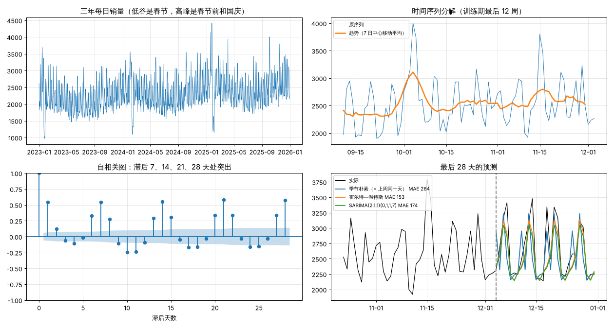
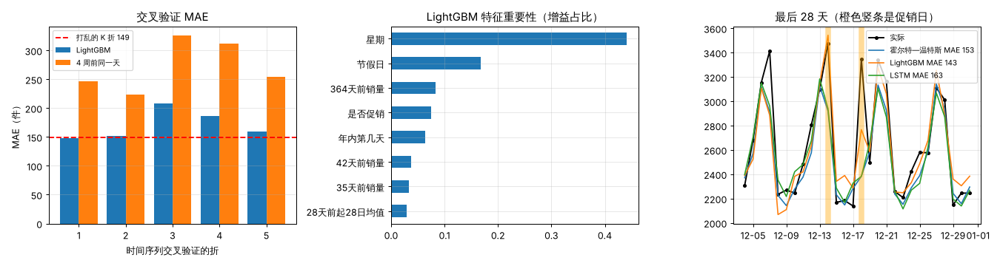
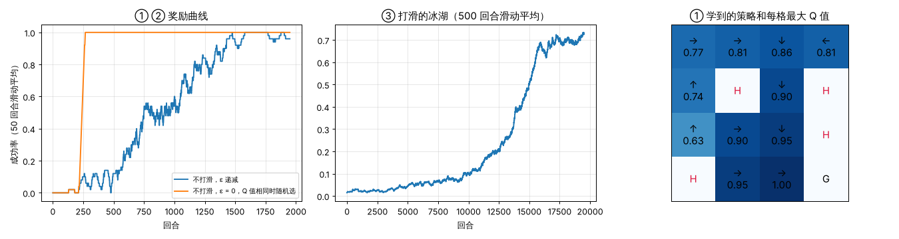
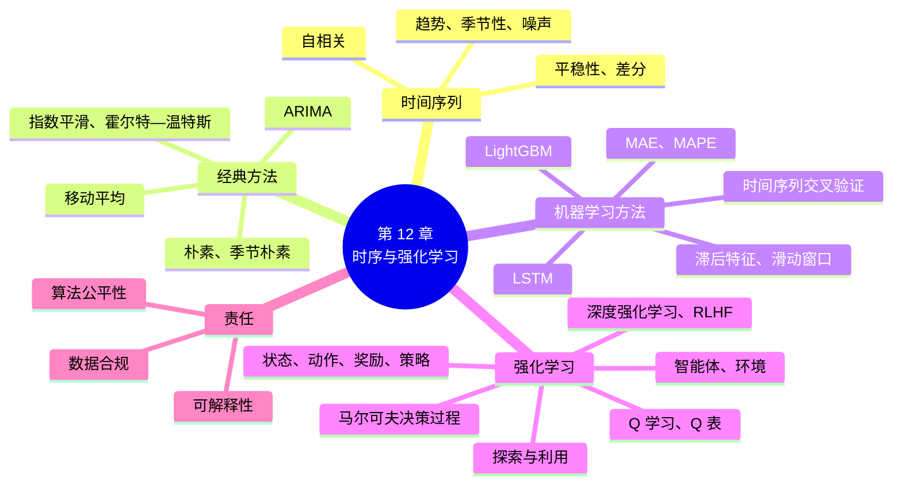

# 第 12 章 时间序列预测与强化学习入门

!!! abstract "本章学时"
    理论 5 学时 · 实验 2 学时（本章共 3 个实验，教师可任选）

## 学习目标

学完本章，你应该能够：

1. **说出**时间序列的趋势、季节性、平稳性、自相关，强化学习的智能体、环境、状态、动作、奖励、策略的含义（记忆）；
2. **解释**差分、指数平滑、滞后特征和滑动窗口的作用，时间序列为什么不能打乱做交叉验证，Q 学习为什么要在探索与利用之间平衡（理解）；
3. 手算移动平均、指数平滑、MAE、MAPE 和一步 Q 值更新，**运用** statsmodels、LightGBM、PyTorch 预测销量，用 Gymnasium 实现 Q 学习（应用）；
4. 比较不同预测方法的误差，**分析**特征重要性、促销日误差和学到的策略（分析）；
5. 针对一个预测或决策任务，**评价**该选经典方法、机器学习还是深度学习，并检查模型在公平性、可解释性和数据合规方面的风险（评价）。

!!! info "先修要求"
    学习本章前，你需要掌握：

    - 日期特征与数据泄露（[2.4 特征构造与特征选择](../02-preprocessing/index.md#24)、[2.5 数据集划分与数据泄露](../02-preprocessing/index.md#25)）；
    - 回归的评价指标 MAE（[3.4.3 回归评价指标](../03-linear-regression/index.md#343)）；
    - LightGBM（[5.6.4 XGBoost 和 LightGBM](../05-decision-tree/index.md#564-xgboost-lightgbm)）、时间序列交叉验证与模型解释（[9.2.3 时间序列交叉验证](../09-model-tuning/index.md#923)、[9.5 模型解释](../09-model-tuning/index.md#95)）；
    - LSTM（[11.6 LSTM 与 GRU](../11-cnn-rnn/index.md#116)）。

??? abstract "本章概念清单（28 个，点击查看定义和例子）"
    1. [时间序列](../../appendix/glossary.md#g-时间序列)
    2. [趋势](../../appendix/glossary.md#g-趋势)
    3. [季节性](../../appendix/glossary.md#g-季节性)
    4. [平稳性](../../appendix/glossary.md#g-平稳性)
    5. [差分](../../appendix/glossary.md#g-差分)
    6. [滞后特征](../../appendix/glossary.md#g-滞后特征)
    7. [滑动窗口](../../appendix/glossary.md#g-滑动窗口)
    8. [移动平均](../../appendix/glossary.md#g-移动平均)
    9. [指数平滑](../../appendix/glossary.md#g-指数平滑)
    10. [ARIMA](../../appendix/glossary.md#g-ARIMA)
    11. [自相关](../../appendix/glossary.md#g-自相关)
    12. [基于特征的时序预测](../../appendix/glossary.md#g-基于特征的时序预测)
    13. [LSTM 时序预测](../../appendix/glossary.md#g-LSTM-时序预测)
    14. [时序评价指标](../../appendix/glossary.md#g-时序评价指标)
    15. [智能体](../../appendix/glossary.md#g-智能体)
    16. [环境](../../appendix/glossary.md#g-环境)
    17. [状态](../../appendix/glossary.md#g-状态)
    18. [动作](../../appendix/glossary.md#g-动作)
    19. [奖励](../../appendix/glossary.md#g-奖励)
    20. [策略](../../appendix/glossary.md#g-策略)
    21. [探索与利用](../../appendix/glossary.md#g-探索与利用)
    22. [马尔可夫决策过程](../../appendix/glossary.md#g-马尔可夫决策过程)
    23. [Q 学习](../../appendix/glossary.md#g-Q-学习)
    24. [Q 表](../../appendix/glossary.md#g-Q-表)
    25. [深度强化学习](../../appendix/glossary.md#g-深度强化学习)
    26. [人类反馈强化学习](../../appendix/glossary.md#g-人类反馈强化学习)
    27. [算法公平性](../../appendix/glossary.md#g-算法公平性)
    28. [数据合规](../../appendix/glossary.md#g-数据合规)

## 情景导入

一家社区超市的店长每个月底都要做两件事：一是订下个月的货，二是排下个月的班。货订多了，牛奶、面包、蔬菜过期报废；订少了，周末和促销日货架空空，顾客扭头去了别家。排班也一样，周六的客流比周二多四成多，人手却常常是一样的。店长手里有过去三年每一天的销量记录，能不能用它预测接下来四周每天卖多少？

这类按时间先后记下来的数据叫时间序列。它和前面各章的数据有一个根本区别：样本之间有先后顺序，今天的销量和昨天、上周同一天、去年同一天都有关系。前面学的方法能不能直接用？“打乱后划分训练集和测试集”还行不行？本章前半部分回答这些问题，用同一份销量数据比较经典方法、LightGBM 和 LSTM。

本章后半部分认识另一类机器学习——强化学习。设想要教一个送货机器人走出仓库：没有人能给它一份“每个位置该往哪走”的标准答案，它只能自己试，撞了墙、掉进坑里就记住“这样不好”，走到终点就记住“这样好”。这就是第 1 章介绍过的“试错 + 奖励”的学习方式。下棋程序、推荐系统，乃至让大模型回答得更好的训练方法，都用到了它。

最后，学完全书的各种模型以后，我们要回头想一想：模型给出的结论公平吗？说得清理由吗？训练用的数据合规吗？这是每个机器学习从业者都要承担的责任。

## 12.1 时间序列的特点

[**时间序列**](../../appendix/glossary.md#g-时间序列 "按时间先后顺序、通常以相等间隔记录的一串观测值"){ .term }是按时间先后顺序记录的一串观测值，通常时间间隔相等，如每天的销量、每小时的用电量、每月的客户数。本章的例子是 `labs/data/store_sales.csv`：一家社区超市 2023 年 1 月 1 日至 2025 年 12 月 31 日共 1096 天的每日销量，同时记录了星期几、当天是否促销、是否节假日（春节前、春节、国庆）。这是教材编写的模拟数据，按照真实超市常见的规律生成。

预测的任务是：只用 2025 年 12 月 3 日及以前的 1068 天，预测 12 月 4 日至 31 日共 28 天的销量。超市每月底订下个月的货，所以要一次预测未来 4 周，而不是每天预测第二天。

### 12.1.1 趋势、季节性与噪声

先把三年的销量画出来（实验 12-1，下图左上）。图上能看出几种规律：

- [**趋势**](../../appendix/glossary.md#g-趋势 "时间序列长期的上升或下降"){ .term }：长期的上升或下降。三年的日均销量分别是 2134、2294、2447 件，每年增长约 7%。
- [**季节性**](../../appendix/glossary.md#g-季节性 "时间序列中以固定周期反复出现的波动，周期可以是一天、一周、一年等"){ .term }：固定周期反复出现的波动。超市最明显的是“星期效应”：非节假日周六日均 2830 件，周二只有 1931 件，周末明显高。此外冬季略高、夏季略低，是以一年为周期的季节性。“季节性”里的“季节”泛指任何固定周期，不一定是春夏秋冬。
- **节假日与特殊事件**：春节前十天备年货，日均 3150 件；春节七天很多居民回老家，日均只有 1275 件；国庆日均 2810 件。春节每年的公历日期不同，不是固定周期，要单独处理。促销日比平日高 24%。
- **噪声**：去掉上面这些规律以后剩下的、无法解释的随机波动。

此外还有一种**周期**波动，比如经济的繁荣与衰退，持续时间不固定，一般要很长的数据才能看出来，短期预测中常常归到趋势里。

把一条序列拆成趋势、季节、剩余三部分，叫时间序列分解。如果季节波动的大小随着整体水平同比例变大（销量翻倍，周末多卖的也翻倍），用乘法模型：销量 = 趋势 × 季节因子 × 剩余；如果波动大小不变，用加法模型：销量 = 趋势 + 季节 + 剩余。超市的销量更适合乘法模型。实验 12-1 用 statsmodels 的 `seasonal_decompose` 按周期 7 分解，得到七天的季节因子：

| 周一 | 周二 | 周三 | 周四 | 周五 | 周六 | 周日 |
|---|---|---|---|---|---|---|
| 0.882 | 0.847 | 0.905 | 0.941 | 1.021 | 1.242 | 1.161 |

意思是：周六的销量大约是“趋势水平”的 1.242 倍，周二只有 0.847 倍。分解中的趋势用 7 日中心移动平均求得（12.2.1 节），平均掉了星期效应，曲线就平滑了（下图右上）。



### 12.1.2 平稳性与差分

很多经典的时间序列方法都假设序列是“平稳”的。[**平稳性**](../../appendix/glossary.md#g-平稳性 "序列的平均水平、波动大小以及不同时刻之间的相关关系不随时间变化的性质"){ .term }直观地说，是序列的统计特征不随时间变化：平均水平不变，波动大小不变，相隔几天的两个值之间的关系只和相隔几天有关，和在哪一天无关。有趋势的序列平均水平在变，有季节性的序列在一周里有规律地起伏，都不平稳。

把不平稳的序列变平稳，最常用的办法是[**差分**](../../appendix/glossary.md#g-差分 "用序列中后一个值减去前一个（或前一个周期同一位置的）值，以去掉趋势或季节性的变换"){ .term }：用后一个值减前一个值，得到“每天变化了多少”。

!!! example "算一算：差分去掉趋势和季节"
    某商品连续 5 天的销量是 100、103、106、109、112，每天多 3 件，有明显的上升趋势。一阶差分：

    103 − 100 = 3，106 − 103 = 3，109 − 106 = 3，112 − 109 = 3

    差分后是 3、3、3、3，平均水平不再变化，趋势被去掉了。代价是序列短了 1 个。

    如果序列有周期为 7 的季节性，可以做**季节差分**：用今天减上周同一天，yₜ − yₜ₋₇。两个周六相减、两个周二相减，星期效应就抵消了。

怎样判断一条序列平稳不平稳？除了看图，还可以做统计检验。实验 12-1 做了两种检验：

| 序列 | ADF 检验（原假设：不平稳） | KPSS 检验（原假设：平稳） |
|---|---|---|
| 原序列 | p = 0.0057，拒绝“不平稳”→ 平稳 | p = 0.01，拒绝“平稳”→ 不平稳 |
| 一阶差分 | p = 0.0000 → 平稳 | p = 0.10 → 平稳 |

两种检验对原序列给出了相反的结论。这是因为销量的趋势增长很慢（每天只增加约 0.4 件），又被强烈的星期波动掩盖，原序列处在“似平稳非平稳”的边界上。一阶差分以后两种检验结论一致。检验结果只是参考，一定要结合图形和业务常识判断：店长都知道销量在逐年增长，这样的序列不能当作平稳的。

### 12.1.3 自相关

普通的数据表中，第 1 行和第 2 行是两个无关的客户；时间序列中，今天和昨天的销量往往有关。一条序列和它自己往后错开几天的序列之间的相关系数，叫[**自相关**](../../appendix/glossary.md#g-自相关 "时间序列与它自身错开若干期后的序列之间的相关程度"){ .term }系数，错开的天数叫“滞后”。把滞后 1、2、3……天的自相关系数画成竖线，就是自相关图（上图左下）。实验 12-1 的结果：

| 滞后天数 | 1 | 2 | 3 | 7 | 14 | 28 |
|---|---|---|---|---|---|---|
| 自相关系数 | 0.54 | 0.12 | −0.07 | 0.54 | 0.55 | 0.58 |

滞后 1 天的相关较强，因为相邻两天的趋势水平接近，周五、周六、周日又是连着高的；滞后 2、3 天就很弱了。而滞后 7、14、21、28 天处自相关又明显突出，说明“和上周同一天、上上周同一天很像”，这正是周期为 7 的季节性。自相关图是找周期的好工具：竖线在哪些滞后上冒出来，周期就是多少。图中浅蓝色的带子是“显著性范围”，竖线超出带子才说明相关是真实存在的，不是偶然。

## 12.2 经典预测方法

### 12.2.1 朴素方法与移动平均

做预测之前，先准备几个最简单的方法当**基准**。复杂的模型只有明显超过基准，才值得用。

- **朴素方法**：明天 = 今天。预测未来 28 天，全部等于最后一天的销量。
- **季节朴素方法**：今天 = 上周同一天。未来 4 周的每个周一都等于最后一个周一，以此类推。
- [**移动平均**](../../appendix/glossary.md#g-移动平均 "用最近若干期观测值的平均作为预测值或趋势估计的方法"){ .term }：用最近 k 天的平均值作预测。k 越大，越平滑，但对变化的反应越慢。

!!! example "算一算：移动平均"
    某商品最近 7 天的销量是 2000、1950、2050、2100、2300、2800、2650。

    最近 7 天移动平均 = (2000 + 1950 + 2050 + 2100 + 2300 + 2800 + 2650) ÷ 7 = 15 850 ÷ 7 ≈ 2264

    用它预测下周每一天都是 2264 件。可是周六明明会卖 2800 件左右，周二只有 1950 件左右，移动平均把星期效应平均掉了。

移动平均除了用来预测，还常用来“看趋势”：12.1.1 节的趋势线就是以每一天为中心、前后各 3 天的 7 日中心移动平均。

### 12.2.2 指数平滑

移动平均对最近 k 天一视同仁，k 天以前的完全不管。更自然的想法是：越近的数据越重要，但旧数据也不全扔掉，权重逐渐减小。这就是[**指数平滑**](../../appendix/glossary.md#g-指数平滑 "对过去观测值按指数递减的权重加权平均进行预测的方法，可扩展为含趋势和季节的霍尔特—温特斯方法"){ .term }：

\[ \hat{y}_{t+1} = \alpha \, y_t + (1 - \alpha) \, \hat{y}_t \]

新的预测 = α × 今天的实际值 + (1 − α) × 原来的预测。平滑系数 α 在 0～1 之间：α 大，紧跟最新的数据；α 小，更平稳、更看重历史。把式子一层层展开，昨天的权重是 α(1 − α)，前天是 α(1 − α)²……权重按指数递减，所以叫指数平滑。

!!! example "算一算：指数平滑"
    三天销量 2000、2400、2200，取 α = 0.3，第一天的平滑值就取 2000。

    - 第二天：0.3 × 2400 + 0.7 × 2000 = 720 + 1400 = 2120
    - 第三天：0.3 × 2200 + 0.7 × 2120 = 660 + 1484 = 2144

    预测第四天为 2144 件。如果 α = 0.8：第二天 0.8 × 2400 + 0.2 × 2000 = 2320，第三天 0.8 × 2200 + 0.2 × 2320 = 2224。α 越大，越接近最近一天的 2200。

上面这种只有一个“水平”的叫简单指数平滑，预测出来是一条水平线。在它的基础上：

- **霍尔特（Holt）方法**再加一个“趋势”，也用指数平滑来更新，系数记作 β；
- **霍尔特—温特斯（Holt-Winters）方法**再加一组“季节因子”（比如七天各一个），系数记作 γ。它能预测出“有趋势、有星期效应”的曲线，是零售、能源等行业最常用的经典方法之一。<sup class="cite">[[1]](#ref12-1)</sup>

三个系数不用手调，statsmodels 会在训练数据上自动找使误差最小的值。实验 12-1 中，简单指数平滑学到 α = 0.040，非常小：它没有星期效应，只能把每周的起伏当成噪声，干脆少理会最近的数据，几乎就是一个长期平均。霍尔特—温特斯学到 α = 0.518，β 和 γ 都接近 0，说明水平跟得比较紧，而趋势的斜率和七天的季节因子在三年里基本稳定，一开始估计好就不用改了。

### 12.2.3 ARIMA 的直观理解 { #1223 }

[**ARIMA**](../../appendix/glossary.md#g-ARIMA "自回归差分移动平均模型，用差分使序列平稳，再用过去的值和过去的预测误差进行预测"){ .term } 是另一类经典方法，名字由三部分组成，写作 ARIMA(p, d, q)：

| 部分 | 含义 | 直观理解 |
|---|---|---|
| AR（自回归），阶数 p | 用前 p 天的值做线性回归 | “今天和昨天、前天有关” |
| I（差分），阶数 d | 先做 d 次差分，让序列平稳 | “先看变化量” |
| MA（移动平均），阶数 q | 用前 q 天的预测误差修正 | “昨天猜高了，今天往回调一点” |

注意 ARIMA 中的 MA 指“用过去的误差”，和 12.2.1 节的移动平均不是一回事。有季节性时，再加一组季节部分 (P, D, Q, s)，叫 SARIMA，s 是周期，超市数据中 s = 7。

p、d、q 怎么选？d 由平稳性决定，超市销量做一阶差分和一次季节差分；p、q 一般在 0～2 之间试，用 AIC（赤池信息量准则）比较，AIC 越小越好，它在“拟合得好”和“参数少”之间取平衡。实验 12-1 在训练集上试了 6 种组合：

| (p, 1, q) | (0,1,0) | (0,1,1) | (1,1,0) | (1,1,1) | (2,1,0) | (2,1,1) |
|---|---|---|---|---|---|---|
| AIC | 15 075 | 14 855 | 14 895 | 14 810 | 14 872 | **14 775** |

于是选 SARIMA(2,1,1)(0,1,1,7)。选阶数只用训练集，不能看测试集的成绩来挑，否则就是数据泄露。

### 12.2.4 六种方法的比较

六种方法预测最后 28 天（实际日均 2637 件），误差如下（MAE 和 MAPE 见 12.4.2 节，都是越小越好）：

| 方法 | MAE（件） | MAPE |
|---|---|---|
| 朴素（明天 = 今天） | 412.4 | 13.60% |
| 季节朴素（= 上周同一天） | 263.5 | 9.23% |
| 移动平均（最近 7 天） | 383.7 | 13.82% |
| 简单指数平滑 | 385.8 | 14.06% |
| 霍尔特—温特斯 | **153.5** | **5.28%** |
| SARIMA(2,1,1)(0,1,1,7) | 174.4 | 5.94% |

几点结论：

- 不考虑星期效应的三种方法（朴素、移动平均、简单指数平滑）误差都在 380～410 件，MAPE 13%～14%，都不如最简单的季节朴素。**抓住季节性是销量预测的第一步。**
- 霍尔特—温特斯和 SARIMA 同时考虑了趋势和季节性，误差比季节朴素少了三分之一以上。
- 12 月 14 日和 18 日是促销日，霍尔特—温特斯在这两天分别少预测了 557 件和 964 件。经典方法只看销量自己的历史，用不上“哪天促销”这样的外部信息，而超市的促销日是提前定好的。下一节的机器学习方法可以解决这个问题。

!!! cert "证书考点 · 人工智能数据处理工程师（高级）· 时序模式"
    常考：时间序列的组成（趋势、季节性、周期、噪声）；加法模型与乘法模型；平稳性的含义，差分与季节差分的计算；读自相关图找周期；移动平均、简单指数平滑的计算，平滑系数 α 大小的影响；ARIMA(p, d, q) 三个参数的含义。容易错在把 ARIMA 中的 MA 当成移动平均法，以及只看一种平稳性检验就下结论。

## 12.3 用机器学习做时序预测

### 12.3.1 滞后特征与滑动窗口

前面各章的机器学习模型需要一张“特征 → 标签”的表格。时间序列只有一列销量，怎么变成表格？办法是把过去的值当作特征。

- [**滞后特征**](../../appendix/glossary.md#g-滞后特征 "把序列往后错开若干期得到的特征，表示若干期以前的值"){ .term }：把序列往后错开若干天，作为新的一列。“7 天前销量”这一列，第 8 天的值就是第 1 天的销量。
- [**滑动窗口**](../../appendix/glossary.md#g-滑动窗口 "用固定长度的窗口沿时间滑动，把窗口内的值作为特征、后面的值作为标签来构造样本的方法"){ .term }：用一个固定长度的窗口沿时间滑动，窗口里的 W 天当特征，下一天（或后面若干天）当标签，每滑一格切出一行样本。也可以对窗口里的值算统计量，如平均值、最大值，作为“滑动窗口统计特征”。

!!! example "算一算：用滑动窗口切出训练表"
    序列 10、12、11、13、15、14，窗口长度 W = 3，预测下一天：

    | 样本 | 特征（窗口里的 3 天） | 标签（下一天） |
    |---|---|---|
    | 1 | 10、12、11 | 13 |
    | 2 | 12、11、13 | 15 |
    | 3 | 11、13、15 | 14 |

    6 个值切出 3 行样本。窗口平均特征分别是 11、12、13。

<iframe class="sim-frame" src="../../sims/ts-window/main.html" height="760" loading="lazy" title="滑动窗口与时序预测"></iframe>

动画：滑动窗口与时序预测。拖动窗口长度，按“窗口向右滑一格”，看销量序列怎样切成训练表格；比较不同窗口长度下“窗口平均”“上周同一天”“线性回归”三种预测的误差。窗口至少要覆盖一个完整的季节周期（7 天），模型才能学到星期效应。[全屏打开](../../sims/ts-window/main.html){ target=_blank }

**一个关键的限制：特征必须在预测的那一刻已经知道。**超市在 12 月 3 日要预测 12 月 4 日至 31 日，预测 12 月 31 日时，12 月 30 日的销量还没发生。所以只能用“至少 28 天以前”的销量当特征，“1 天前销量”“7 天前销量”都不能用，否则就是数据泄露（2.5 节）。而星期几、是否促销、是否节假日这些信息是提前知道的，可以放心使用。

实验 12-2 构造了 11 个特征：

| 类别 | 特征 |
|---|---|
| 日期特征（2.4 节） | 星期、月份、年内第几天 |
| 提前知道的外部信息 | 是否促销、节假日（无、春节前、春节、国庆） |
| 滞后特征 | 28、35、42、364 天前销量（364 天前是去年同一个星期几） |
| 滑动窗口统计特征 | 28 天前起 7 日均值、28 天前起 28 日均值 |

“364 天前销量”需要一年的历史，所以有完整特征的训练样本从 2023 年 12 月 31 日开始，共 704 天。

### 12.3.2 用 LightGBM 预测 { #1232 }

把时间序列整理成表格以后，就可以用第 5 章的 LightGBM 这样的回归模型来预测，这叫[**基于特征的时序预测**](../../appendix/glossary.md#g-基于特征的时序预测 "把时间序列构造成含滞后、窗口统计、日期和外部信息等特征的表格，再用回归模型预测的方法"){ .term }。它的好处是可以方便地加入促销、节假日、天气、价格等外部信息，而且一个模型可以同时预测成千上万种商品。

```python
params = dict(n_estimators=300, learning_rate=0.05, num_leaves=15, min_child_samples=10, verbose=-1, random_state=0)
gbm = lgb.LGBMRegressor(**params).fit(train[feats], train["销量"])
p_lgb = gbm.predict(test[feats])
```

结果：LightGBM 在最后 28 天的 MAE 为 142.9 件，MAPE 5.37%，比霍尔特—温特斯（153.5）略好，训练只用了 0.09 秒。特征重要性（按增益）前 5 名是：

| 特征 | 星期 | 节假日 | 364 天前销量 | 是否促销 | 年内第几天 |
|---|---|---|---|---|---|
| 增益占比 | 44.1% | 16.7% | 8.3% | 7.4% | 6.4% |

星期效应最重要，与 12.1.1 节的分析一致。再看两个促销日：12 月 14 日误差只有 −66 件，比霍尔特—温特斯的 +557 件好得多，因为模型知道这天促销；12 月 18 日仍少预测了 580 件，促销加上随机波动，那天的销量格外高。

### 12.3.3 时间序列交叉验证

只看最后 28 天的一次结果，可能有运气成分。第 9 章介绍过，有时间先后的数据要用时间序列交叉验证（[9.2.3 节](../09-model-tuning/index.md#923)），每一折只用过去训练、预测紧接着的一段。实验 12-2 在训练期内做了 5 折，每折验证 28 天：

| 折 | 训练到 | 验证 | LightGBM MAE | “= 4 周前同一天” MAE |
|---|---|---|---|---|
| 1 | 2025-07-16 | 07-17～08-13 | 147.8 | 246.9 |
| 2 | 2025-08-13 | 08-14～09-10 | 152.2 | 224.0 |
| 3 | 2025-09-10 | 09-11～10-08 | 208.8 | 325.8 |
| 4 | 2025-10-08 | 10-09～11-05 | 186.7 | 311.4 |
| 5 | 2025-11-05 | 11-06～12-03 | 158.9 | 254.9 |
| 平均 | | | **170.9** | 272.6 |

LightGBM 每一折都明显好于基准。第 3 折误差最大，因为验证期包含国庆。

如果像普通数据那样打乱顺序做 5 折交叉验证，MAE 是 148.7，比时间序列交叉验证的 170.9 好看不少。这是虚高：打乱后，模型会用 8 月的数据去“预测” 7 月，等于偷看了未来。上线后真正的误差更接近 170.9。**时间序列的数据，划分时一定要保持时间顺序。**

## 12.4 LSTM 时序预测与评价指标 { #124 }

### 12.4.1 用 LSTM 预测 { #1241 }

第 11 章用 LSTM 一个词一个词地读短信，同样可以让它一天一天地读销量。[**LSTM 时序预测**](../../appendix/glossary.md#g-LSTM-时序预测 "用 LSTM 逐个时间步读入过去的序列，输出未来一期或多期预测值的方法"){ .term }的做法是：用滑动窗口切出“过去 56 天 → 未来 28 天”的样本，LSTM 读完 56 天后，用最后的隐藏状态接一个全连接层，一次输出 28 个数。

```python
class Seq2Out(nn.Module):
    def __init__(self):
        super().__init__()
        self.lstm = nn.LSTM(1, 64, batch_first=True)   # 每个时间步输入 1 个数（当天销量）
        self.out = nn.Linear(64, 28)                    # 一次输出未来 28 天

    def forward(self, x):
        h, _ = self.lstm(x)
        return self.out(h[:, -1])                       # 读完 56 天后的隐藏状态 → 28 个数
```

训练前要先标准化（第 10 章），均值和标准差只能用训练期的数据计算。训练期 1068 天切出 985 个样本，最后 112 个做验证、用于早停。模型有 18 972 个参数，训练 31 轮后早停（验证损失最低在第 11 轮），用时 4.1 秒。最后 28 天的 MAE 为 162.6 件，MAPE 5.69%。

四种方法在最后 28 天的对比：

| 方法 | MAE（件） | MAPE | 能否用促销信息 |
|---|---|---|---|
| 季节朴素 | 263.5 | 9.23% | 否 |
| 霍尔特—温特斯 | 153.5 | **5.28%** | 否 |
| LightGBM | **142.9** | 5.37% | 能 |
| LSTM | 162.6 | 5.69% | 本实验未加入 |

在这份数据上，LSTM 不如霍尔特—温特斯和 LightGBM。原因是数据只有一条序列、一千多天，规律（趋势 + 星期效应 + 节假日）比较简单，经典方法正好能描述，而 LSTM 要从头学这些规律，样本不够多。深度学习方法的优势在于数据量大、序列很多的场合，比如一家电商同时预测几万种商品的销量，一个模型可以从所有商品中学习共同的规律。**选方法不看“新不新”，先用季节朴素当基准，再从霍尔特—温特斯、LightGBM 这样简单可靠的方法开始。**

### 12.4.2 评价指标：MAE 与 MAPE { #1242 }

时间序列预测常用的[**时序评价指标**](../../appendix/glossary.md#g-时序评价指标 "衡量时间序列预测误差的指标，常用 MAE、RMSE、MAPE"){ .term }有：

- **MAE（平均绝对误差）**：误差绝对值的平均，单位和原数据相同，“平均每天差多少件”，第 3 章已经学过。
- **RMSE（均方根误差）**：误差平方平均后开根号，大误差的影响更大。
- **MAPE（平均绝对百分比误差）**：每天的误差占实际值的百分比，再取平均。它没有单位，可以比较不同商品、不同门店，业务人员也容易理解：“平均差 5%”。

\[ \text{MAPE} = \frac{1}{n} \sum_{t=1}^{n} \frac{|y_t - \hat{y}_t|}{y_t} \times 100\% \]

!!! example "算一算：MAE 与 MAPE"
    三天的实际销量是 2000、2500、3000，预测是 2100、2400、2700。

    - 误差的绝对值：100、100、300，MAE = (100 + 100 + 300) ÷ 3 ≈ 166.7 件
    - 百分比误差：100 ÷ 2000 = 5%，100 ÷ 2500 = 4%，300 ÷ 3000 = 10%，MAPE = (5% + 4% + 10%) ÷ 3 ≈ 6.33%

MAPE 有一个缺点：实际值很小或为 0 时，百分比误差会特别大甚至无法计算。比如某种冷门商品某天只卖了 1 件，预测 3 件，误差就是 200%。这种情况改用 MAE，或者用“总误差 ÷ 总销量”（加权 MAPE）。

此外，单看一个数字很难判断好坏，要和基准比：本例中霍尔特—温特斯的 MAE 比季节朴素少了 42%，这才说明它确实有用。

!!! cert "证书考点 · Python 技术应用工程师（高级）· 时序预测"
    常考：用 pandas 处理日期索引（`parse_dates`、`asfreq`、`shift`、`rolling`）；构造滞后特征和滑动窗口特征，特征只能用预测时已知的信息；用 statsmodels 做指数平滑和 ARIMA 预测；用 `TimeSeriesSplit` 做时间序列交叉验证；MAE、RMSE、MAPE 的计算和适用场合。容易错在构造滞后特征时用了预测期内还不知道的值，以及打乱时间序列做交叉验证。

## 12.5 强化学习入门

### 12.5.1 智能体与环境

前面学的监督学习有“标准答案”（标签），无监督学习没有标签但有一堆数据。强化学习两样都没有：它面对的是一个可以互动的世界，要通过一次次尝试，学会在各种情况下怎样行动。强化学习的基本要素是<sup class="cite">[[2]](#ref12-2)</sup>：

- [**智能体**](../../appendix/glossary.md#g-智能体 "强化学习中观察环境状态、做出决策并执行动作的主体"){ .term }：做决策、采取行动的一方，比如走迷宫的机器人、下棋程序。
- [**环境**](../../appendix/glossary.md#g-环境 "强化学习中智能体所处的外部世界，接收动作并返回新状态和奖励"){ .term }：智能体所处的外部世界，它接收智能体的动作，给出新的情况和奖励。
- [**状态**](../../appendix/glossary.md#g-状态 "环境在某一时刻的情况，智能体据此选择动作"){ .term }：环境当前的情况，智能体据此做决策，比如机器人在哪一格。
- [**动作**](../../appendix/glossary.md#g-动作 "智能体在某个状态下可以做出的选择"){ .term }：智能体在某个状态下可以做的选择，比如上、下、左、右。
- [**奖励**](../../appendix/glossary.md#g-奖励 "环境对智能体一次动作给出的反馈数值，强化学习的目标是使累计奖励最大"){ .term }：环境对一次动作给出的反馈数值，好的结果奖励高，坏的结果奖励低或为负。
- [**策略**](../../appendix/glossary.md#g-策略 "智能体在每个状态下如何选择动作的规则"){ .term }：智能体在每个状态下选什么动作的规则，强化学习的目标就是学到能获得最多累计奖励的策略。

它们之间是一个循环：


本章的实验用 Gymnasium 提供的“冰湖”（FrozenLake）环境。<sup class="cite">[[10]](#ref12-10)</sup>一个 4 × 4 的结了冰的湖面，从左上角 S 出发，要走到右下角 G 拿到礼物，路上有 4 个冰窟窿 H，掉进去本回合就结束：

```text
S F F F        格子编号：  0  1  2  3
F H F H                    4  5  6  7
F F F H                    8  9 10 11
H F F G                   12 13 14 15
```

| 要素 | 冰湖中是什么 |
|---|---|
| 智能体 | 在冰面上走的人 |
| 环境 | 4 × 4 的冰湖 |
| 状态 | 所在的格子，共 16 个（0～15） |
| 动作 | 左、下、右、上，共 4 个 |
| 奖励 | 走到 G 得 1 分，其余每一步都是 0 分 |
| 策略 | 每个格子往哪个方向走 |

和监督学习相比，强化学习有两个难点。第一，**没有人告诉它每一步该怎么走**，只有最后的结果。第二，**奖励是延迟的**：只有走到终点才得 1 分，中间每一步都是 0，智能体要自己弄明白“前面哪几步走对了”。

### 12.5.2 探索与利用

假设你家附近有十家饭馆，你吃过其中三家，有一家很不错。今天中午去哪？去那家不错的，肯定吃得满意，这叫**利用**已有的经验；去一家没吃过的，可能更好吃，也可能踩雷，这叫**探索**。只利用，可能永远不知道还有更好的；只探索，就总在踩雷。[**探索与利用**](../../appendix/glossary.md#g-探索与利用 "尝试新动作以获取更多信息（探索）和选择当前认为最好的动作以获得奖励（利用）之间的权衡"){ .term }的平衡，是强化学习的核心问题之一。

最常用的办法是 **ε-贪心**（ε 读作“艾普西隆”）：以 ε 的概率随机选一个动作（探索），以 1 − ε 的概率选目前认为最好的动作（利用）。一般开始时 ε 大，多探索；随着经验增加，ε 逐渐减小，多利用。实验 12-3 中 ε 从 1 逐渐降到 0.01。

实验 12-3 还试了完全不探索（ε = 0）会怎样：

- 如果几个动作看起来一样好时总选第一个（往左），智能体在起点一直往左撞墙，2000 回合一次也没有走到终点，什么也没学到。
- 如果一样好时随机选，第 180 回合碰巧走到了终点，之后就一直走这条路，成功了 1736 次。但它的 Q 表（12.6.1 节）只有 7 个非零的数，而正常探索的有 35 个：它只认得碰巧找到的那一条路，别的格子该怎么走一无所知。环境稍有变化（比如那条路上多了一个冰窟窿），它就不知所措了。

### 12.5.3 马尔可夫决策过程

强化学习问题通常用[**马尔可夫决策过程**](../../appendix/glossary.md#g-马尔可夫决策过程 "由状态、动作、奖励、状态转移和折扣因子组成，下一步只取决于当前状态和动作的决策问题模型"){ .term }（MDP）来描述，它由状态、动作、奖励、状态转移规则和折扣因子组成。<sup class="cite">[[3]](#ref12-3)</sup>“马尔可夫”的意思是：下一步会到哪个状态、得到多少奖励，只取决于现在的状态和动作，和以前怎么走到这里的无关。冰湖满足这个条件：站在第 6 格往下走，结果和你是从第 2 格还是第 7 格过来的没有关系。

智能体要最大化的不是下一步的奖励，而是今后得到的全部奖励。远处的奖励要打一个折扣：

\[ G_t = r_t + \gamma \, r_{t+1} + \gamma^2 \, r_{t+2} + \cdots \]

γ 叫折扣因子，在 0～1 之间。γ 接近 1，智能体“有远见”，重视长远的奖励；γ 小，智能体“只顾眼前”。折扣还有一个好处：同样能拿到奖励，走得越快，折扣越少，所以智能体会倾向于走最短的路。

!!! example "算一算：最短路线值多少分"
    冰湖从 S 到 G 最少要走 6 步（如 0 → 1 → 2 → 6 → 10 → 14 → 15）。只有最后一步得 1 分，γ = 0.95：

    从起点出发的累计奖励 = 0 + 0.95 × 0 + 0.95² × 0 + 0.95³ × 0 + 0.95⁴ × 0 + 0.95⁵ × 1 = 0.95⁵ ≈ 0.774

    如果绕远多走 2 步，就是 0.95⁷ ≈ 0.698，少了一些。

## 12.6 Q 学习 { #126 }

### 12.6.1 Q 表与更新规则 { #1261 }

[**Q 学习**](../../appendix/glossary.md#g-Q-学习 "通过 Q(s,a) ← Q(s,a) + α[r + γ max Q(s′,·) − Q(s,a)] 反复更新状态—动作价值、学习最优策略的强化学习方法"){ .term }是最经典的强化学习方法之一，1989 年由沃特金斯提出。<sup class="cite">[[4]](#ref12-4)</sup>它为每个“状态—动作”组合记一个分数 Q(s, a)，表示“在状态 s 做动作 a，以后按最好的方式走，能得到的累计奖励”。所有的 Q 值排成一张表，就是[**Q 表**](../../appendix/glossary.md#g-Q-表 "记录每个状态下每个动作的 Q 值的表格，行是状态、列是动作"){ .term }：冰湖有 16 个状态、4 个动作，Q 表就是 16 行 4 列，开始时全是 0。

有了 Q 表，策略就很简单：在每个状态选 Q 值最大的动作。问题是怎样把 Q 表学出来。智能体每走一步，得到一条经历（状态 s，动作 a，奖励 r，新状态 s′），就按下面的规则更新一个格子：

\[ Q(s, a) \leftarrow Q(s, a) + \alpha \left[ r + \gamma \max_{a'} Q(s', a') - Q(s, a) \right] \]

方括号里，r + γ × max Q(s′, ·) 是“这一步的奖励 + 新状态下最好的那个动作的分数打个折”，叫**目标值**，是根据刚才的经历对 Q(s, a) 的新估计；减去原来的 Q(s, a)，就是“估计错了多少”。α 是学习率，每次往目标值方向挪一小步。如果新状态是终点或冰窟窿，回合结束，以后没有奖励了，目标值就只有 r。

!!! example "算一算：Q 值怎样一格一格往回传"
    取 α = 0.1，γ = 0.95，Q 表全是 0。

    1. 某回合智能体在第 14 格往右走，到了终点 G，r = 1，回合结束。目标值 = 1，Q(14, 右) = 0 + 0.1 × (1 − 0) = **0.1**。
    2. 下一回合，智能体在第 13 格往右走，到了第 14 格，r = 0。第 14 格最大的 Q 值是 0.1，目标值 = 0 + 0.95 × 0.1 = 0.095，Q(13, 右) = 0 + 0.1 × (0.095 − 0) = **0.0095**。
    3. 再有一回合在第 14 格往右走到终点：Q(14, 右) = 0.1 + 0.1 × (1 − 0.1) = **0.19**，越来越接近 1。

    终点的奖励就这样一格一格往起点方向传，每传一格乘一次 γ。学够了以后，Q(14, 右) 接近 1，第 10、13 格最好的 Q 值接近 0.95，……，起点接近 0.95⁵ ≈ 0.774。

### 12.6.2 Q 学习的完整过程 { #1262 }

把探索与利用和更新规则合起来，Q 学习的过程是：

1. Q 表全部置 0；
2. 每个回合从起点出发，重复：用 ε-贪心选一个动作 → 执行，得到奖励和新状态 → 用更新规则修改 Q(s, a) → 移到新状态，直到回合结束；
3. 逐渐减小 ε，重复很多回合；
4. 训练结束后，每个状态选 Q 值最大的动作，就是学到的策略。

用代码写出来只有十几行（实验 12-3）：

```python
for ep in range(episodes):
    s, _ = env.reset()
    done = False
    while not done:
        if rng.random() < eps:                       # 探索：随机试一个动作
            a = int(rng.integers(4))
        else:                                        # 利用：选 Q 值最大的动作
            a = int(Q[s].argmax())
        s2, r, term, trunc, _ = env.step(a)
        target = r + (0 if term else gamma * Q[s2].max())
        Q[s, a] += alpha * (target - Q[s, a])        # Q 学习的更新规则
        s, done = s2, term or trunc
```

实验 12-3 在不打滑的冰湖上训练 2000 回合（α = 0.1，γ = 0.95）。前 179 回合一次也没走到终点，Q 表一直全是 0；第 180 回合第一次成功后，Q 值开始往回传，成功率逐步上升，最后 200 回合达到 0.97（还有 1% 的探索，偶尔走错）。起点四个动作的 Q 值为 左 0.735、下 0.698、右 0.774、上 0.735，最大的“往右”恰好等于理论最优值 0.95⁵ = 0.774。按学到的策略走：0 → 1 → 2 → 6 → 10 → 14 → 15，6 步到达，是最短路线之一。

<iframe class="sim-frame" src="../../sims/q-learning/main.html" height="640" loading="lazy" title="Q 学习网格世界"></iframe>

动画：Q 学习网格世界。按“走一步”，看每一步是探索还是利用、更新公式怎样代入数字；连续跑几十回合，看 Q 值怎样从终点附近一格一格传回起点。再拖动 α、γ、ε，比较学习的快慢。[全屏打开](../../sims/q-learning/main.html){ target=_blank }

### 12.6.3 打滑的冰湖

真实世界往往有不确定性。Gymnasium 的冰湖默认是“打滑”的：往一个方向走，只有 1/3 的概率走对，另外各有 1/3 的概率滑到左右两侧。这时同样的动作可能有不同的结果，问题难了很多。

实验 12-3 在打滑的冰湖上训练 20 000 回合（α = 0.05，γ = 0.99），然后各测试 1000 回合：随机乱走的成功率只有 0.012，按学到的策略走成功率是 0.735。学到的策略看起来很奇怪，比如在起点选“往左”：

```text
← ↑ ↑ ↑
← H ← H
↑ ↓ ← H
H → ↓ G
```

仔细想想就明白了：在起点往左，可能撞墙留在原地，可能滑到下面，也可能滑到上面（撞墙留在原地），无论如何都不会掉进冰窟窿；而第 4 格往左，可能滑到下面的第 8 格，绝不会滑进右边的冰窟窿。在会打滑的冰面上，**先保证安全、慢慢挪向终点**，比走“最短路线”更划算。这正是强化学习的特点：它学到的是在这个环境里真正有效的策略，不一定符合人的直觉。

### 12.6.4 深度强化学习与 RLHF { #1264 }

Q 表只适合状态很少的问题。围棋的局面数比宇宙中的原子还多，一张电子游戏画面就是几万个像素，不可能为每个状态记一行。办法是用一个神经网络代替 Q 表：输入状态，输出每个动作的 Q 值，这就是[**深度强化学习**](../../appendix/glossary.md#g-深度强化学习 "用深度神经网络代替 Q 表等表格来表示价值或策略的强化学习方法"){ .term }。2015 年，DeepMind 的 DQN 用卷积神经网络读取游戏画面，在 49 款雅达利游戏中的 29 款上达到了人类专业测试员 75% 以上的得分。<sup class="cite">[[5]](#ref12-5)</sup>此后的 AlphaGo（第 1 章）也用到了深度强化学习。

强化学习在大模型的训练中也很重要。[**人类反馈强化学习**](../../appendix/glossary.md#g-人类反馈强化学习 "用人对模型输出的偏好训练奖励模型，再用强化学习调整模型，使输出更符合人的期望的方法"){ .term }（RLHF）的做法大致是：<sup class="cite">[[6]](#ref12-6)</sup>

1. 让大模型对同一个问题写出几个回答，请人来排出好坏；
2. 用这些排序训练一个“奖励模型”，让它学会给回答打分；
3. 把大模型当作智能体，“写出一个回答”当作动作，奖励模型的打分当作奖励，用强化学习调整大模型，让它写出得分更高的回答。

经过这一步，大模型的回答更有帮助、更礼貌、更安全。《自然语言处理导论》第 9 章详细介绍了大模型的训练流程（[链接](https://mingzifu9.github.io/nlp-textbook/chapters/09-transformer/)）。

## 12.7 本领域的责任

全书学了很多模型。模型做出的预测和决定会影响到真实的人：谁能拿到贷款，谁会被认为“可能流失”而收到挽留优惠，谁的简历会被筛掉。作为机器学习从业者，除了让模型准确，还要回答三个问题：公平吗？说得清吗？数据合规吗？人工智能伦理的总体框架见“人工智能导论”课程第 9 章，本节只讲机器学习项目中的具体做法。

### 12.7.1 算法公平性

[**算法公平性**](../../appendix/glossary.md#g-算法公平性 "模型对不同人群的预测和决定不存在不合理系统性差别的性质，常用分组评估检查"){ .term }是指模型对不同人群（如不同性别、年龄、地区）的预测和决定，不应有不合理的系统性差别。模型本身没有偏见，但它会忠实地学到数据中的偏见：

- **历史数据带偏见**：如果过去的招聘中某类人被录用得少，用这些数据训练的筛选模型也会给他们打低分。
- **样本不均衡**：某个群体的样本很少，模型对他们的预测就不准（第 4 章的类别不平衡）。
- **代理特征**：即使删掉了“性别”“民族”这些敏感特征，邮政编码、购物习惯等其他特征仍可能间接反映它们。

检查公平性的基本方法是**分组评估**：把测试集按人群分开，分别计算批准率、精确率、召回率等指标，看差距有多大。

!!! example "算一算：分组看批准率和召回率"
    某贷款审批模型在测试集上的结果（虚构的示例数据）：

    | 群体 | 申请人数 | 批准人数 | 批准率 | 其中实际能按时还款的 | 能还款者中被批准的 | 召回率 |
    |---|---|---|---|---|---|---|
    | A | 1000 | 600 | 60% | 700 | 560 | 0.80 |
    | B | 500 | 200 | 40% | 350 | 175 | 0.50 |

    两个群体中能按时还款的人都占 70%，但 B 群体中能还款的人只有一半被批准，A 群体有八成。批准率之比 40% ÷ 60% ≈ 0.67。国外常用的一个经验标准是“五分之四规则”：这个比值低于 0.8，就要认真查一查原因。

发现差距后，可以检查数据和特征（有没有代理特征、某个群体样本是否太少），调整样本权重或分组阈值，并请业务、法务人员一起判断。公平有多种定义，有时彼此冲突，没有一个公式能解决所有问题，关键是**主动去查、记录下来、说得出理由**。

### 12.7.2 可解释性

第 9 章学过特征重要性和 SHAP 值（[9.5 模型解释](../09-model-tuning/index.md#95)）。在金融、医疗、招聘这些影响重大的场合，可解释性不只是“方便调试”，还是法律的要求：《个人信息保护法》规定，通过自动化决策作出对个人权益有重大影响的决定，个人有权要求说明，并有权拒绝仅通过自动化决策的方式作出决定。所以，这些场合优先选择能解释的模型，或者为复杂模型配上 SHAP 这样的解释工具，并保留人工复核的渠道。本章的销量预测也一样：店长更愿意相信一个能说出“因为是周六、又赶上促销”的预测。

### 12.7.3 数据合规

[**数据合规**](../../appendix/glossary.md#g-数据合规 "数据的收集、存储、使用、提供等全过程符合法律法规要求"){ .term }是指收集、存储、使用、提供数据的全过程都要符合法律法规的要求。机器学习的每一个模型都建立在数据之上，和机器学习关系最密切的有：

| 法规 | 施行时间 | 与机器学习项目相关的要点 |
|---|---|---|
| 《个人信息保护法》<sup class="cite">[[11]](#ref12-11)</sup> | 2021 年 11 月 1 日 | 处理个人信息要有明确、合理的目的，限于实现目的的最小范围；一般要取得个人同意，人脸、医疗健康、金融账户、行踪轨迹等敏感个人信息要单独同意；利用个人信息进行自动化决策，应当保证透明度和结果公平、公正，不得在交易价格等交易条件上实行不合理的差别待遇；处理敏感个人信息、进行自动化决策前要做个人信息保护影响评估 |
| 《数据安全法》<sup class="cite">[[12]](#ref12-12)</sup> | 2021 年 9 月 1 日 | 国家对数据实行分类分级保护；开展数据处理活动要建立数据安全管理制度，采取技术措施保障数据安全；要以合法、正当的方式收集数据，不得窃取或以其他非法方式获取 |
| 《互联网信息服务算法推荐管理规定》 | 2022 年 3 月 1 日 | 推荐服务要向用户提供不针对其个人特征的选项，或者便捷的关闭算法推荐的选项；不得根据消费者的偏好、交易习惯等特征，在交易价格等交易条件上实行不合理的差别待遇（即所谓“大数据杀熟”） |

落到一个机器学习项目中，可以对照下面的清单自查：

1. **数据来源**：数据是怎么来的？有没有取得用户同意？能不能用于这个新的目的？不要用爬虫随意抓取他人数据。
2. **最小必要**：只收集和使用完成任务必需的字段；训练流失预测模型不需要客户的身份证号和家庭住址。
3. **去标识化**：建模前去掉姓名、手机号等能直接识别个人的信息，或用编号代替。
4. **安全保管**：数据和模型文件要控制访问权限，不随意拷贝、外传，不上传到来路不明的网站或公共大模型。
5. **公平与解释**：上线前做分组评估，重要决定保留人工复核和说明的渠道。
6. **记录留档**：数据来源、处理步骤、模型版本、评估结果都要记录，出了问题可以追溯（第 4 章的测试报告、第 9 章的模型监控）。

## 12.8 前沿视窗

**时间序列基础模型。**大语言模型读了海量文本，学会了“接着往下写”。研究者用同样的思路，拿海量的时间序列（销量、电力、交通、天气……）训练出时间序列基础模型，如谷歌的 TimesFM<sup class="cite">[[9]](#ref12-9)</sup>和亚马逊的 Chronos。<sup class="cite">[[8]](#ref12-8)</sup>Chronos 甚至把数值切成一段段“词”，直接用语言模型的结构来训练。这类模型不需要在你的数据上训练，把历史数据给它，就能直接预测（零样本预测），效果在很多数据上接近专门训练的模型。不过它们一般不认识“促销”“春节”这样的业务信息，在本章这样外部因素影响很大的场合，基于特征的方法仍然不可替代。国产工具方面，飞桨的 PaddleTS 提供了经典方法和深度学习时序模型的统一接口。

**强化学习的广泛应用。**在推荐系统中，强化学习把“让用户长期满意”而不仅是“这一次点击”作为目标；在机器人领域，机器人先在模拟环境里试错几百万次，再把学到的策略迁移到真实机器人上，学会走路、抓取物品；在大模型中，除了 RLHF，强化学习还被用来训练推理能力：给数学题、编程题，答案对了就给奖励，模型自己学会一步步思考、检查和纠错。2025 年初，深度求索发布的 DeepSeek-R1 主要靠这种基于规则奖励的强化学习获得了很强的推理能力，引起了广泛关注。<sup class="cite">[[7]](#ref12-7)</sup>

**给本课程的结语。**从第 1 章的鸢尾花到本章的 Q 学习，我们学的方法有新有旧，但思路是一贯的：先把业务问题变成机器学习问题，找一个简单的基准，用正确的方式划分数据和评估，再一步步改进，最后让模型可靠、可解释、合规地用起来。工具会更新换代，这个思路不会过时。

## 本章实验

!!! abstract "实验总览"
    | 实验 | 类型 | 建议时长 | 内容 |
    |---|---|---|---|
    | 实验 12-1 | ★ 基础 | 40 分钟 | 门店销量数据探索、时间序列分解、平稳性检验与自相关图；用朴素、季节朴素、移动平均、指数平滑、霍尔特—温特斯、SARIMA 预测最后 28 天，比较 MAE、MAPE |
    | 实验 12-2 | ★ 基础 | 50 分钟 | 构造日期、滞后和滑动窗口特征，用 LightGBM 预测并做时间序列交叉验证；用 LSTM 预测同一份数据；四种方法对比 |
    | 实验 12-3 | ★ 基础 | 40 分钟 | 在 Gymnasium 冰湖环境中从零实现 Q 学习，画出奖励曲线和学到的策略；比较不探索和打滑的情况 |

    三个实验都在本机 CPU 上运行，各用时不超过 1 分钟。实验代码见配套资源 `labs/ch12/` 目录。需要新安装 `statsmodels` 和 `gymnasium`：`pip install statsmodels gymnasium`；LightGBM、PyTorch 在第 5、10 章已经安装。

### 实验 12-1 ★ 门店销量预测（经典方法）

**实验目的**

1. 学会用 pandas 读入带日期的数据，观察趋势、星期效应和节假日的影响；
2. 会做时间序列分解、平稳性检验，会读自相关图；
3. 用六种经典方法预测未来 28 天，用 MAE、MAPE 比较，体会“先做基准”和“抓住季节性”的重要性。

**实验环境**：Python 3.11，pandas、NumPy、Matplotlib、statsmodels。

**实验数据**：`labs/data/store_sales.csv`，社区超市 2023-01-01 至 2025-12-31 的每日销量（教材编写的模拟数据），共 1096 行，列为日期、星期（1～7）、是否促销（0/1）、节假日（无、春节前、春节、国庆）、销量。最后 28 天（12-04 至 12-31）作为测试期。

**实验步骤与代码**

第 1 步，读入数据，把“日期”设为索引，并用 `asfreq("D")` 声明这是按天的序列。划分训练期和测试期时**不能打乱**，直接切最后 28 天：

```python
df = pd.read_csv("../data/store_sales.csv", parse_dates=["日期"], index_col="日期")
y = df["销量"].asfreq("D")
H = 28
train, test = y[:-H], y[-H:]
```

第 2 步，按年、按星期、按节假日、按是否促销分组求平均；做乘法分解；对原序列和一阶差分做 ADF、KPSS 检验；计算自相关系数并画自相关图：

```python
dec = seasonal_decompose(train, model="multiplicative", period=7)   # 乘法分解，周期 7
p_adf = adfuller(train, autolag="AIC")[1]                            # ADF 检验的 p 值
p_kpss = kpss(train, regression="c", nlags="auto")[1]                # KPSS 检验的 p 值
r = acf(train, nlags=28)                                             # 滞后 0～28 天的自相关系数
```

第 3 步，六种方法预测未来 28 天。前三种一行代码就能写出，后三种用 statsmodels：

```python
preds = {
    "朴素（明天 = 今天）": np.repeat(train.iloc[-1], H),
    "季节朴素（= 上周同一天）": np.tile(train.iloc[-7:].values, H // 7),
    "移动平均（最近 7 天平均）": np.repeat(train.iloc[-7:].mean(), H),
}
ses = SimpleExpSmoothing(train, initialization_method="estimated").fit()
preds["简单指数平滑"] = ses.forecast(H).values
hw = ExponentialSmoothing(train, trend="add", seasonal="mul", seasonal_periods=7,
                          initialization_method="estimated").fit()
preds["霍尔特—温特斯"] = hw.forecast(H).values
```

SARIMA 先在训练集上按 AIC 选阶数，再用选出的阶数拟合、预测：

```python
for p_ in range(3):
    for q_ in range(2):
        aics[(p_, q_)] = SARIMAX(train, order=(p_, 1, q_), seasonal_order=(0, 1, 1, 7)).fit(disp=False).aic
p_, q_ = min(aics, key=aics.get)
sar = SARIMAX(train, order=(p_, 1, q_), seasonal_order=(0, 1, 1, 7)).fit(disp=False)
```

第 4 步，计算每种方法的 MAE、MAPE，找出促销日的误差，画图。

完整代码见 `lab12_1_classic_forecast.py`。

**运行结果**

```text
共 1096 天（2023-01-01 至 2025-12-31）；训练 1068 天，预测最后 28 天（12-04 至 12-31）

① 数据的规律
  各年日均销量：2023 年 2134，2024 年 2294，2025 年 2447
  非节假日按星期的日均销量：周一 2004，周二 1931，周三 2061，周四 2149，周五 2318，周六 2830，周日 2647
  按节假日的日均销量：无 2277，春节前 3150，春节 1275，国庆 2810
  非节假日：不促销 2231，促销 2776（高 24%）
  乘法分解（周期 7）的季节因子：周一 0.882，周二 0.847，周三 0.905，周四 0.941，周五 1.021，周六 1.242，周日 1.161
  平稳性检验（ADF 的原假设是“不平稳”，KPSS 的原假设是“平稳”，p < 0.05 表示拒绝原假设）：
    原序列   ADF p = 0.0057（平稳）；KPSS p = 0.01（不平稳）
    一阶差分  ADF p = 0.0000（平稳）；KPSS p = 0.10（平稳）
  自相关系数：滞后 1 天 0.54，2 天 0.12，3 天 -0.07，7 天 0.54，14 天 0.55，28 天 0.58

  SARIMA 选阶：季节部分 (0,1,1,7)，非季节部分 (p,1,q) 的 AIC：(0,1,0) 15075，(0,1,1) 14855，(1,1,0) 14895，(1,1,1) 14810，(2,1,0) 14872，(2,1,1) 14775

② 预测未来 28 天（实际日均 2637 件）
  简单指数平滑学到的平滑系数 α = 0.040；霍尔特—温特斯 α = 0.518，β = 0.0000，γ = 0.000
  朴素（明天 = 今天）             MAE  412.4 件   MAPE 13.60%
  季节朴素（= 上周同一天）           MAE  263.5 件   MAPE  9.23%
  移动平均（最近 7 天平均）          MAE  383.7 件   MAPE 13.82%
  简单指数平滑                  MAE  385.8 件   MAPE 14.06%
  霍尔特—温特斯                 MAE  153.5 件   MAPE  5.28%
  SARIMA(2,1,1)(0,1,1,7)  MAE  174.4 件   MAPE  5.94%
  MAE 最小：霍尔特—温特斯
  预测期内促销 2 天（12-14，12-18），霍尔特—温特斯在这几天的误差：+557，+964 件
```

图见 12.1.1 节。几点解读：

- 三年日均销量逐年上升，是趋势；周六、周日明显高于周一到周四，是季节性；春节前和国庆高、春节低，促销日高 24%。
- 乘法分解的季节因子与数据生成时设定的星期效应（周一 0.88、周二 0.86 …… 周六 1.22、周日 1.16）很接近，说明分解方法有效。
- 原序列的两种平稳性检验结论相反，一阶差分后一致，见 12.1.2 节的讨论。
- 霍尔特—温特斯的 β、γ 学到接近 0，意思是趋势斜率和季节因子在三年中稳定，不需要随时间调整。
- 六种方法中，同时考虑趋势和星期效应的霍尔特—温特斯、SARIMA 误差最小；但在两个促销日都明显少预测。

**实验记录表**

| 项目 | 结果 |
|---|---|
| 周六与周二的日均销量之比 | |
| 自相关图中突出的滞后天数，说明什么 | |
| 原序列和一阶差分的平稳性检验结论 | |
| 六种方法中 MAE 最小的方法和数值 | |
| 霍尔特—温特斯在促销日的误差 | |

**常见问题排查**

| 现象 | 原因 | 解决办法 |
|---|---|---|
| `ModuleNotFoundError: statsmodels` | 没有安装 | `pip install statsmodels` |
| 出现很多 `ConvergenceWarning` | 优化算法的收敛提示，一般不影响结果 | 代码中已用 `warnings.filterwarnings("ignore")` 关掉 |
| `ValueError: ... frequency` 或预测结果没有日期 | 索引不是日期类型，或没有指定频率 | 读入时用 `parse_dates`、`index_col`，再 `.asfreq("D")` |
| 霍尔特—温特斯报错，提示数据要为正数 | 乘法季节模型要求数据大于 0 | 改成 `seasonal="add"`，或检查数据中的 0 和缺失值 |
| SARIMA 运行很慢 | 阶数大、数据长 | 正常要十几秒；不要把阶数试得太大 |

**思考与练习**

1. 把霍尔特—温特斯的 `seasonal="mul"` 改成 `"add"`，误差有什么变化？哪个更适合这份数据？
2. 把“移动平均”的窗口从 7 天改成 28 天，误差怎样变化？为什么窗口长度最好是 7 的倍数？
3. 把测试期改成最后 56 天，各方法的排名会变吗？

**实验报告要求**

提交四张图和运行结果，填写实验记录表；用不超过 200 字向店长说明：下个月的订货应该参考哪种方法的预测，促销日要怎样另外处理。

### 实验 12-2 ★ 机器学习与 LSTM 时序预测对比 { #lab12-2 }

**实验目的**

1. 学会把时间序列转换成“特征 → 标签”的表格：日期特征、滞后特征、滑动窗口统计特征，理解“特征只能用预测时已知的信息”；
2. 用 LightGBM 预测，用时间序列交叉验证评估，体会打乱顺序的交叉验证为什么偏乐观；
3. 用 LSTM 做“多天输入、多天输出”的预测，与经典方法和 LightGBM 比较。

**实验环境**：Python 3.11，pandas、NumPy、scikit-learn、LightGBM、PyTorch、statsmodels、Matplotlib。

**实验数据**：同实验 12-1。

**实验步骤与代码**

第 1 步，构造特征。要预测未来 28 天，滞后特征至少要错开 28 天；滑动窗口统计量也要在 `shift(28)` 之后再算：

```python
X = pd.DataFrame(index=df.index)
X["星期"] = df.index.dayofweek + 1
X["月份"] = df.index.month
X["年内第几天"] = df.index.dayofyear
X["是否促销"] = df["是否促销"]
X["节假日"] = df["节假日"].map({"无": 0, "春节前": 1, "春节": 2, "国庆": 3})
for lag in [28, 35, 42, 364]:
    X[f"{lag}天前销量"] = y.shift(lag)
X["28天前起7日均值"] = y.shift(28).rolling(7).mean()      # 第 28～34 天前的平均
X["28天前起28日均值"] = y.shift(28).rolling(28).mean()
data = X.join(y).dropna()                                # 去掉前 364 天（滞后特征有缺失）
```

第 2 步，时间序列交叉验证。`TimeSeriesSplit(n_splits=5, test_size=28)` 把训练期最后 5 个 28 天依次作为验证集，每一折只用它之前的数据训练。同时算“销量 = 4 周前同一天”这个基准的误差，再用打乱顺序的 `KFold` 做对比：

```python
tss = TimeSeriesSplit(n_splits=5, test_size=H)
for tr, va in tss.split(train):
    m = lgb.LGBMRegressor(**params).fit(train.iloc[tr][feats], train.iloc[tr]["销量"])
    cv_lgb.append(mae(train.iloc[va]["销量"], m.predict(train.iloc[va][feats])))
    cv_naive.append(mae(train.iloc[va]["销量"], train.iloc[va]["28天前销量"]))
```

第 3 步，用全部训练数据训练 LightGBM，预测最后 28 天，查看特征重要性和促销日的误差。

第 4 步，LSTM。用训练期的均值和标准差标准化，切出“56 天 → 28 天”的样本，最后 112 个样本做验证；按 12.4.1 节的 `Seq2Out` 搭网络，Adam 学习率 0.003，批大小 32，验证损失连续 20 轮不下降就早停，恢复验证损失最低时的参数：

```python
z = (series - mu) / sd
Xs = np.stack([z[i:i + W] for i in range(len(z) - W - H + 1)])        # 每行 56 天
Ys = np.stack([z[i + W:i + W + H] for i in range(len(z) - W - H + 1)])  # 对应的后 28 天
...
p_lstm = net(torch.tensor(z[-W:].reshape(1, W, 1))).numpy().ravel() * sd + mu   # 最后 56 天 → 未来 28 天，再还原
```

第 5 步，与实验 12-1 的季节朴素、霍尔特—温特斯比较，画图。

完整代码见 `lab12_2_lgbm_lstm.py`。

**运行结果**

```text
① 特征 11 个：星期、月份、年内第几天、是否促销、节假日、28天前销量、35天前销量、42天前销量、364天前销量、28天前起7日均值、28天前起28日均值
  有完整滞后特征的训练样本 704 天（2023-12-31 起），测试 28 天
  训练集前 2 行（只显示部分列）：
            星期  是否促销  28天前销量  364天前销量  28天前起7日均值    销量
日期                                                    
2023-12-31   7     0  2577.0   2615.0     2318.4  2909
2024-01-01   1     0  1909.0   1832.0     2299.1  2298

② LightGBM
  时间序列交叉验证第 1 折：训练到 2025-07-16，验证 07-17～08-13，LightGBM MAE 147.8，“= 4 周前同一天” MAE 246.9
  时间序列交叉验证第 2 折：训练到 2025-08-13，验证 08-14～09-10，LightGBM MAE 152.2，“= 4 周前同一天” MAE 224.0
  时间序列交叉验证第 3 折：训练到 2025-09-10，验证 09-11～10-08，LightGBM MAE 208.8，“= 4 周前同一天” MAE 325.8
  时间序列交叉验证第 4 折：训练到 2025-10-08，验证 10-09～11-05，LightGBM MAE 186.7，“= 4 周前同一天” MAE 311.4
  时间序列交叉验证第 5 折：训练到 2025-11-05，验证 11-06～12-03，LightGBM MAE 158.9，“= 4 周前同一天” MAE 254.9
  平均：LightGBM 170.9，4 周前同一天 272.6
  对比：打乱顺序的 5 折交叉验证 MAE 148.7（用了“未来”的数据训练，偏乐观）
  特征重要性（增益占比）前 5：星期 44.1%，节假日 16.7%，364天前销量 8.3%，是否促销 7.4%，年内第几天 6.4%
  测试 28 天：MAE 142.9，MAPE 5.37%，训练用时 0.09 秒
  促销日的误差：12-14 -66，12-18 +580 件

③ LSTM：滑动窗口切出 985 个样本，每个输入 56 天、输出 28 天
  训练 31 轮后早停，验证损失最低在第 11 轮（0.381），用时 4.1 秒；参数 18972
  测试 28 天：MAE 162.6，MAPE 5.69%

④ 最后 28 天的预测对比
  季节朴素（实验 12-1）       MAE  263.5   MAPE  9.23%
  霍尔特—温特斯（实验 12-1）    MAE  153.5   MAPE  5.28%
  LightGBM            MAE  142.9   MAPE  5.37%
  LSTM                MAE  162.6   MAPE  5.69%
```



几点解读：

- 训练集第一行（2023-12-31）的“28 天前销量”是 2023-12-03 的销量，“364 天前销量”是 2023-01-01（同为周日）的销量，都是在 12 月 3 日以前就知道的。
- 时间序列交叉验证中 LightGBM 每一折都好于基准；打乱顺序的 K 折给出的 148.7 偏乐观（见 12.3.3 节）。
- 星期、节假日、是否促销三个“提前知道”的特征合计占了约 68% 的重要性。
- LSTM 训练很快早停，误差介于霍尔特—温特斯和季节朴素之间。它只用了销量本身，没有用促销信息。
- LSTM 的结果会随随机种子、电脑和 PyTorch 版本略有不同；LightGBM 的结果是固定的。

**实验记录表**

| 项目 | 结果 |
|---|---|
| 特征个数，有完整特征的训练样本数 | |
| 时间序列交叉验证的平均 MAE（LightGBM、基准），打乱 K 折的 MAE | |
| 重要性前 3 的特征 | |
| LightGBM、LSTM 在测试期的 MAE、MAPE | |
| 四种方法中最好的是哪种，你认为原因是什么 | |

**常见问题排查**

| 现象 | 原因 | 解决办法 |
|---|---|---|
| 交叉验证或测试成绩好得不正常 | 用了 `shift(1)`、`shift(7)` 这类预测时不知道的特征，或打乱了顺序 | 预测未来 28 天，滞后至少 28 天；用 `TimeSeriesSplit` |
| LightGBM 报错，提示特征中有字符串 | “节假日”没有转成数字 | 用 `map` 转成整数，或把这一列设为 `category` 类型 |
| `dropna()` 后数据少了很多 | 364 天前的滞后特征让第一年全是缺失 | 正常；数据短时可去掉 364 天滞后 |
| LSTM 的预测是一条平线或数值很怪 | 没有标准化，或还原时忘了乘标准差、加均值 | 标准化只用训练期统计量，预测后 `* sd + mu` |
| LSTM 每次结果不同 | 随机初始化和随机批次 | 固定 `torch.manual_seed(0)`；比较时多跑几次取平均 |

**思考与练习**

1. 去掉“364 天前销量”，训练样本会多出多少天？交叉验证 MAE 怎样变化？
2. 如果只需要预测“明天”的销量，可以加入哪些新的滞后特征？你预计误差会变大还是变小？
3. 给 LSTM 的输入加上“是否促销”一列（每个时间步输入 2 个数），需要改哪几处代码？

**实验报告要求**

提交三张图和运行结果，填写实验记录表；用不超过 300 字比较三类方法（经典方法、LightGBM、LSTM）在这份数据上的优缺点，并说明你会推荐超市用哪一种。

### 实验 12-3 ★ Q 学习走冰湖

**实验目的**

1. 认识 Gymnasium 环境的基本用法：`reset`、`step`、状态、动作、奖励、回合结束；
2. 从零实现 Q 学习和 ε-贪心，观察 Q 表怎样学出来，把学到的 Q 值和理论最优值核对；
3. 通过不探索、打滑两种情况，理解探索与利用的平衡和环境不确定性的影响。

**实验环境**：Python 3.11，NumPy、Matplotlib、Gymnasium（`pip install gymnasium`）。

**实验数据**：没有数据集，数据来自智能体与环境的互动。环境为 Gymnasium 的 `FrozenLake-v1`，4 × 4 地图（12.5.1 节）。

**实验步骤与代码**

第 1 步，创建环境，看看状态和动作：

```python
env = gym.make("FrozenLake-v1", map_name="4x4", is_slippery=False)
print(env.observation_space.n, env.action_space.n)     # 16 个状态，4 个动作
s, _ = env.reset(seed=0)                                # 回到起点，s = 0
s2, r, term, trunc, _ = env.step(2)                     # 往右走一步：新状态、奖励、是否结束、是否超时
```

`term` 为 True 表示走到终点或掉进冰窟窿，`trunc` 为 True 表示步数到了上限（4 × 4 地图为 100 步）。

第 2 步，写 Q 学习函数（12.6.2 节）。探索率 ε 从 1 线性降到 0.01；几个动作 Q 值一样大时随机选一个：

```python
def q_learning(env, episodes, alpha=0.1, gamma=0.95, eps_start=1.0, eps_end=0.01, seed=0, random_tie=True):
    rng = np.random.default_rng(seed)
    Q = np.zeros((env.observation_space.n, env.action_space.n))
    for ep in range(episodes):
        eps = max(eps_end, eps_start - (eps_start - eps_end) * ep / (0.8 * episodes))
        s, _ = env.reset(seed=int(rng.integers(1e9)))
        done = False
        while not done:
            if rng.random() < eps:
                a = int(rng.integers(4))
            else:
                a = int(rng.choice(np.flatnonzero(Q[s] == Q[s].max()))) if random_tie else int(Q[s].argmax())
            s2, r, term, trunc, _ = env.step(a)
            target = r + (0 if term else gamma * Q[s2].max())
            Q[s, a] += alpha * (target - Q[s, a])
            s, done = s2, term or trunc
    ...
```

第 3 步，在不打滑的冰湖上训练 2000 回合，打印成功率、起点 Q 值、学到的策略和完整 Q 表，按策略走一遍。

第 4 步，ε = 0 时分别用“总选第一个”和“随机选”两种方式各训练 2000 回合，比较 Q 表非零元素个数。

第 5 步，在打滑的冰湖上训练 20 000 回合，各测试 1000 回合，比较随机乱走和学到的策略的成功率。

完整代码见 `lab12_3_qlearning.py`。

**运行结果**

```text
冰湖地图（S 起点，F 冰面，H 冰窟窿，G 终点）：
   S F F F
   F H F H
   F F F H
   H F F G
状态 16 个（格子编号 0～15），动作 4 个（0 左，1 下，2 右，3 上）

① 不打滑的冰湖，Q 学习 2000 回合（α = 0.1，γ = 0.95，ε 从 1 逐渐降到 0.01）
  第一次走到终点：第 180 回合
  每 200 回合的成功率：0.01 0.07 0.10 0.34 0.48 0.65 0.81 0.93 1.00 0.97
  起点的 Q 值（左、下、右、上）：0.735，0.698，0.774，0.735
  理论最优：最短 6 步到终点，起点最优 Q 值 = γ⁵ = 0.95⁵ = 0.774
  学到的策略（每格 Q 值最大的动作）：
    → → ↓ ←
    ↑ H ↓ H
    ↑ → ↓ H
    H → → G
  按策略走一遍：0 → 1 → 2 → 6 → 10 → 14 → 15，6 步，奖励 1
  Q 表（行是格子 0～15，列是左、下、右、上）：
     0 0.735 0.698 0.774 0.735
     1 0.735 0.000 0.815 0.774
     2 0.774 0.857 0.773 0.814
     3 0.814 0.000 0.633 0.647
     4 0.614 0.480 0.000 0.735
     5 0.000 0.000 0.000 0.000
     6 0.000 0.902 0.000 0.814
     7 0.000 0.000 0.000 0.000
     8 0.142 0.000 0.326 0.628
     9 0.249 0.559 0.900 0.000
    10 0.848 0.950 0.000 0.855
    11 0.000 0.000 0.000 0.000
    12 0.000 0.000 0.000 0.000
    13 0.000 0.499 0.948 0.466
    14 0.894 0.949 1.000 0.901
    15 0.000 0.000 0.000 0.000

② 不探索（ε = 0），各 2000 回合
  Q 值一样大时总选第一个动作（左）：成功 0 次，Q 表非零元素 0 个——在起点一直往左撞墙，到 100 步上限才结束
  Q 值一样大时随机选：第 180 回合碰巧走到终点，之后成功 1736 次，但 Q 表非零元素只有 7 个（①中为 35 个）——只认得碰巧找到的那一条路

③ 打滑的冰湖，Q 学习 20000 回合（α = 0.05，γ = 0.99）
  训练中每 2000 回合的成功率：0.02 0.02 0.04 0.06 0.08 0.13 0.23 0.48 0.68 0.70
  测试 1000 回合：随机乱走成功率 0.012，按学到的策略走成功率 0.735
  学到的策略：
    ← ↑ ↑ ↑
    ← H ← H
    ↑ ↓ ← H
    H → ↓ G
```



几点解读：

- ①中第 180 回合以前一次也没成功，这段时间 Q 表全是 0，智能体完全在乱走。之后成功率逐步上升。
- ①的 Q 表中，每格最大的 Q 值大致等于 0.95 的“到终点还要走的步数 − 1”次方：第 14 格 1.000，第 10、13 格约 0.95，第 6、9 格约 0.90，……起点 0.774，与 12.5.3 节的计算一致。冰窟窿和终点的行全是 0，因为在那里回合已经结束，不会再选动作。
- 图中橙色曲线（ε = 0、随机选）在第 180 回合后很快达到 1，看上去比蓝色曲线学得还快。但它只认识一条路（Q 表只有 7 个非零元素），这是“只利用不探索”的代价。
- ③打滑的冰湖难得多，20 000 回合中前一半成功率不到 0.1，最后达到约 0.7。学到的策略“先保证安全”，见 12.6.3 节。
- 不同版本的 Gymnasium、NumPy 随机数可能不同，具体回合数和数值会略有差别，但规律相同。

**实验记录表**

| 项目 | 结果 |
|---|---|
| 不打滑冰湖第一次成功的回合、最后 200 回合成功率 | |
| 起点的最大 Q 值，与 0.95⁵ 比较 | |
| 学到的路线和步数 | |
| ε = 0 两种做法的成功次数和 Q 表非零元素个数 | |
| 打滑冰湖：随机乱走与学到的策略的成功率 | |

**常见问题排查**

| 现象 | 原因 | 解决办法 |
|---|---|---|
| `ModuleNotFoundError: gymnasium` | 没有安装，或装成了旧的 `gym` | `pip install gymnasium`，代码中 `import gymnasium as gym` |
| `step` 返回值个数不对（解包报错） | 旧版 `gym` 返回 4 个值，Gymnasium 返回 5 个 | 统一使用 Gymnasium |
| 训练很久成功率一直是 0 | ε 太小、不探索；或 Q 值相同时总选第一个动作 | ε 从 1 开始逐渐减小；Q 值相同时随机选 |
| 打滑冰湖成功率只有 0.1～0.2 | 回合数太少或 γ 太小 | 训练 20 000 回合以上，γ 取 0.99 |
| 想看智能体怎么走 | 默认不显示画面 | `gym.make(..., render_mode="human")`，需要图形界面 |

**思考与练习**

1. 把学习率 α 改成 0.5 和 0.01，第一次成功的回合和最终的 Q 值有什么变化？
2. 掉进冰窟窿时给 −1 的奖励（修改 `r`），学到的策略会有什么不同？
3. 为什么 ①学到的路线只是最短路线之一？还有哪些 6 步的路线？

**实验报告要求**

提交三张图和运行结果，填写实验记录表；用不超过 200 字说明 Q 学习中 α、γ、ε 三个参数各起什么作用。

## 本章小结

- **时间序列**是按时间顺序记录的数据，由**趋势**、**季节性**、周期和噪声组成；季节波动随水平同比例变化时用乘法分解。
- 很多经典方法要求**平稳性**；**差分**（后一天减前一天）去掉趋势，季节差分（减上周同一天）去掉星期效应。**自相关**图中突出的滞后天数就是周期。
- 先做基准（朴素、季节朴素）。**移动平均**对最近 k 天一视同仁；**指数平滑**按指数递减加权，霍尔特—温特斯方法再加趋势和季节；**ARIMA** 由自回归、差分、误差修正三部分组成，有季节时用 SARIMA。实验中霍尔特—温特斯 MAE 153.5，比季节朴素少 42%。
- **基于特征的时序预测**用**滞后特征**、**滑动窗口**统计量、日期特征和促销等外部信息构造表格，再用 LightGBM 等模型预测。特征必须在预测时已经知道；评估要用时间序列交叉验证，打乱顺序会虚高。实验中 LightGBM 测试 MAE 142.9。
- **LSTM 时序预测**用滑动窗口切出“过去 56 天 → 未来 28 天”的样本；在数据少、规律简单时不一定比经典方法好。常用**时序评价指标**是 MAE、RMSE、MAPE，要和基准比较。
- 强化学习中，**智能体**在**环境**中根据**状态**选择**动作**，得到**奖励**，目标是学到累计奖励最多的**策略**。要在**探索与利用**之间平衡，常用 ε-贪心。问题通常用**马尔可夫决策过程**描述，远处的奖励按折扣因子 γ 打折。
- **Q 学习**用 **Q 表**记录每个状态—动作的分数，按 Q(s,a) ← Q(s,a) + α[r + γ max Q(s′,·) − Q(s,a)] 更新，奖励一格一格往回传。实验中不打滑冰湖学到最优值 0.95⁵ = 0.774；打滑冰湖成功率从随机的 0.012 提高到 0.735。
- **深度强化学习**用神经网络代替 Q 表；**人类反馈强化学习**用人的偏好训练奖励模型，再用强化学习调整大模型。
- 机器学习从业者要关注**算法公平性**（分组评估）、可解释性（重大决定要说得清理由）和**数据合规**（《个人信息保护法》《数据安全法》，最小必要、去标识化、安全保管、记录留档）。



**课程回顾**

本章是全书的最后一章。回头看，全书沿着一个机器学习项目的流程展开：第 1、2 章认识问题和数据，第 3～8 章学习回归、分类、聚类、降维、关联规则等经典算法，第 9 章学会评估、调参和部署，第 10～12 章进入神经网络、序列数据和强化学习。建议对照[学习图谱](../../learning-graph/index.md)和[附录 D 术语表](../../appendix/glossary.md)，把各章的概念串起来复习。

## 参考文献

正文中的上标编号（如<sup class="cite">[[1]](#ref12-1)</sup>）对应下面的文献。带链接的可以直接打开；书籍可在图书馆或电子书平台查阅。

<div class="refs" markdown>

**教材与专著**

- <span id="ref12-1"></span>[1] HYNDMAN R J, ATHANASOPOULOS G. Forecasting: principles and practice[M]. 3rd ed. Melbourne: OTexts, 2021. https://otexts.com/fpp3/.
    <span class="ref-note">免费在线的时间序列预测教材，讲分解、指数平滑、ARIMA、预测评价，例子丰富，对应 12.1～12.4 节；第 2 版有中文译本《预测：方法与实践》（https://otexts.com/fppcn/）。</span>
- <span id="ref12-2"></span>[2] SUTTON R S, BARTO A G. Reinforcement learning: an introduction[M]. 2nd ed. Cambridge: MIT Press, 2018. http://incompleteideas.net/book/the-book-2nd.html.
    <span class="ref-note">强化学习最经典的入门教材，作者公开了全书电子版；第 3 章讲马尔可夫决策过程，第 6 章讲 Q 学习，对应 12.5～12.6 节。</span>
- <span id="ref12-3"></span>[3] 周志华. 机器学习[M]. 北京: 清华大学出版社, 2016.
    <span class="ref-note">第 16 章“强化学习”用中文讲解探索与利用、马尔可夫决策过程和 Q 学习，适合想深入一步的读者。</span>

**经典论文**

- <span id="ref12-4"></span>[4] WATKINS C J C H, DAYAN P. Q-learning[J]. Machine Learning, 1992, 8(3-4): 279-292.
    <span class="ref-note">Q 学习的经典论文，证明了 Q 学习在一定条件下能收敛到最优值，对应 12.6.1 节。</span>
- <span id="ref12-5"></span>[5] MNIH V, KAVUKCUOGLU K, SILVER D, et al. Human-level control through deep reinforcement learning[J]. Nature, 2015, 518(7540): 529-533.
    <span class="ref-note">提出 DQN，用卷积神经网络代替 Q 表玩雅达利游戏，对应 12.6.4 节。</span>
- <span id="ref12-6"></span>[6] OUYANG L, WU J, JIANG X, et al. Training language models to follow instructions with human feedback[C]//Advances in Neural Information Processing Systems 35. New Orleans: Curran Associates, 2022: 27730-27744.
    <span class="ref-note">InstructGPT 的论文，详细介绍了人类反馈强化学习的三个步骤，对应 12.6.4 节。</span>
- <span id="ref12-7"></span>[7] DeepSeek-AI. DeepSeek-R1: incentivizing reasoning capability in LLMs via reinforcement learning[EB/OL]. (2025-01-22). https://arxiv.org/abs/2501.12948.
    <span class="ref-note">用基于规则奖励的强化学习训练大模型的推理能力，对应 12.8 节。</span>
- <span id="ref12-8"></span>[8] ANSARI A F, STELLA L, TURKMEN C, et al. Chronos: learning the language of time series[J]. Transactions on Machine Learning Research, 2024. https://arxiv.org/abs/2403.07815.
    <span class="ref-note">把时间序列切成“词”、用语言模型结构训练的时间序列基础模型，对应 12.8 节。</span>
- <span id="ref12-9"></span>[9] DAS A, KONG W, SEN R, et al. A decoder-only foundation model for time-series forecasting[C]//Proceedings of the 41st International Conference on Machine Learning. Vienna: PMLR, 2024. https://arxiv.org/abs/2310.10688.
    <span class="ref-note">谷歌 TimesFM 的论文，零样本预测的时间序列基础模型，对应 12.8 节。</span>

**在线资源与法规**

- <span id="ref12-10"></span>[10] Farama Foundation. Gymnasium documentation: Frozen Lake[EB/OL]. https://gymnasium.farama.org/environments/toy_text/frozen_lake/.
    <span class="ref-note">冰湖环境的官方说明：地图、动作编号、奖励、打滑规则，对应 12.5.1 节和实验 12-3。</span>
- <span id="ref12-11"></span>[11] 中华人民共和国个人信息保护法[EB/OL]. (2021-08-20). 国家法律法规数据库, https://flk.npc.gov.cn/.
    <span class="ref-note">第 24 条自动化决策、第 28～29 条敏感个人信息、第 55～56 条个人信息保护影响评估，对应 12.7 节。</span>
- <span id="ref12-12"></span>[12] 中华人民共和国数据安全法[EB/OL]. (2021-06-10). 国家法律法规数据库, https://flk.npc.gov.cn/.
    <span class="ref-note">第 21 条数据分类分级保护、第 27 条数据安全保护义务、第 32 条合法正当收集数据，对应 12.7.3 节。</span>

</div>

## 课后练习

选择题和判断题可以直接点击选项作答，系统会马上告诉你对错，并展开答案与解析；多选题选好后点“提交答案”。简答和实操题请先自己作答，再点开“答案与解析”核对。每道题的解析下方都有“回看”链接，做错了可以直接跳回正文复习。

**一、单项选择题**

<div class="quiz" data-answer="B" markdown>

**1.** 超市的销量每到周六、周日就明显升高，每周重复出现。这种规律属于时间序列的（　　）。

- A. 趋势
- B. 季节性
- C. 噪声
- D. 平稳性

</div>

??? tip "答案与解析"
    **答案：B**

    以固定周期（这里是 7 天）反复出现的波动叫季节性，“季节”泛指任何固定周期。趋势是长期的上升或下降，噪声是无法解释的随机波动。

    考查：季节性、趋势 · 认知层次：理解 · [回看 12.1.1](#1211)
    { .quiz-meta }

<div class="quiz" data-answer="A" markdown>

**2.** 序列 5、8、12、13 的一阶差分是（　　）。

- A. 3、4、1
- B. 8、12、13
- C. 13、25
- D. 3、7、8

</div>

??? tip "答案与解析"
    **答案：A**

    后一个减前一个：8 − 5 = 3，12 − 8 = 4，13 − 12 = 1。差分后序列少 1 个值。

    考查：差分 · 认知层次：应用 · [回看 12.1.2](#1212)
    { .quiz-meta }

<div class="quiz" data-answer="C" markdown>

**3.** 某商品日销量的自相关图中，滞后 7、14、21、28 天处的竖线明显高出其他位置，这说明（　　）。

- A. 序列有明显的上升趋势
- B. 序列已经是平稳的
- C. 序列有周期为 7 天的季节性
- D. 序列中的噪声很大

</div>

??? tip "答案与解析"
    **答案：C**

    相隔 7 的倍数天的两个值高度相关，即“和上周同一天很像”，说明周期为 7。

    考查：自相关、季节性 · 认知层次：分析 · [回看 12.1.3](#1213)
    { .quiz-meta }

<div class="quiz" data-answer="A" markdown>

**4.** 用简单指数平滑预测销量，α = 0.5。上一期的预测值是 100，本期实际销量是 120，下一期的预测值是（　　）。

- A. 110
- B. 120
- C. 100
- D. 105

</div>

??? tip "答案与解析"
    **答案：A**

    0.5 × 120 + (1 − 0.5) × 100 = 60 + 50 = 110。

    考查：指数平滑 · 认知层次：应用 · [回看 12.2.2](#1222)
    { .quiz-meta }

<div class="quiz" data-answer="B" markdown>

**5.** ARIMA(p, d, q) 模型中，d 表示（　　）。

- A. 自回归用到前几期的值
- B. 为了让序列平稳所做的差分次数
- C. 用到前几期的预测误差
- D. 季节的周期长度

</div>

??? tip "答案与解析"
    **答案：B**

    AR 的阶数是 p，I（差分）的阶数是 d，MA（误差修正）的阶数是 q；季节周期 s 写在 SARIMA 的季节部分。

    考查：ARIMA、差分 · 认知层次：记忆 · [回看 12.2.3](#1223)
    { .quiz-meta }

<div class="quiz" data-answer="C" markdown>

**6.** 超市每月初要一次预测未来 28 天每天的销量，用 LightGBM 建模时，下列特征中不能直接使用的是（　　）。

- A. 星期几
- B. 当天是否促销（促销日提前一个月公布）
- C. 前 1 天的销量
- D. 35 天前的销量

</div>

??? tip "答案与解析"
    **答案：C**

    预测第 28 天时，前 1 天（第 27 天）的销量还没有发生。日期、提前公布的促销和至少 28 天前的销量在预测时都已经知道。用了预测时不知道的信息就是数据泄露。

    考查：滞后特征、基于特征的时序预测 · 认知层次：应用 · [回看 12.3.1](#1231)
    { .quiz-meta }

<div class="quiz" data-answer="C" markdown>

**7.** 对时间序列数据评估模型，正确的交叉验证方法是（　　）。

- A. 打乱顺序后做 K 折交叉验证
- B. 分层 K 折交叉验证
- C. 每一折只用之前的数据训练，预测紧接着的一段
- D. 留一法交叉验证

</div>

??? tip "答案与解析"
    **答案：C**

    时间序列要保持时间顺序，只能用过去预测未来。实验 12-2 中打乱顺序的 K 折 MAE 为 148.7，时间序列交叉验证为 170.9，打乱后成绩虚高。

    考查：时间序列交叉验证 · 认知层次：理解 · [回看 12.3.3](#1233)
    { .quiz-meta }

<div class="quiz" data-answer="B" markdown>

**8.** 三天的实际销量是 100、200、400，预测值是 110、180、400，MAPE 是（　　）。

- A. 10%
- B. 约 6.67%
- C. 10 件
- D. 20%

</div>

??? tip "答案与解析"
    **答案：B**

    百分比误差：10 ÷ 100 = 10%，20 ÷ 200 = 10%，0 ÷ 400 = 0，平均 (10% + 10% + 0) ÷ 3 ≈ 6.67%。MAE 是 (10 + 20 + 0) ÷ 3 = 10 件。

    考查：时序评价指标 · 认知层次：应用 · [回看 12.4.2](#1242)
    { .quiz-meta }

<div class="quiz" data-answer="A" markdown>

**9.** Q 学习中，α = 0.5，γ = 0.9。当前 Q(s, a) = 0.2，执行动作后得到奖励 r = 0，新状态 s′ 下最大的 Q 值是 0.6，回合未结束。更新后的 Q(s, a) 是（　　）。

- A. 0.37
- B. 0.54
- C. 0.47
- D. 0.32

</div>

??? tip "答案与解析"
    **答案：A**

    目标值 = 0 + 0.9 × 0.6 = 0.54；Q(s, a) = 0.2 + 0.5 × (0.54 − 0.2) = 0.2 + 0.17 = 0.37。

    考查：Q 学习、Q 表 · 认知层次：应用 · [回看 12.6.1](#1261)
    { .quiz-meta }

**二、多项选择题**

<div class="quiz quiz-multi" data-answer="ACD" markdown>

**10.** 下列预测方法中，能够反映星期效应这类季节性的有（　　）。

- A. 季节朴素方法
- B. 简单指数平滑
- C. 霍尔特—温特斯方法
- D. SARIMA

</div>

??? tip "答案与解析"
    **答案：ACD**

    简单指数平滑只有一个“水平”，预测是一条水平线，实验 12-1 中它的 MAE 为 385.8，与不考虑季节的朴素方法、移动平均差不多。

    考查：移动平均、指数平滑、ARIMA · 认知层次：理解 · [回看 12.2.4](#1224)
    { .quiz-meta }

<div class="quiz quiz-multi" data-answer="ABD" markdown>

**11.** 关于用 LightGBM 做基于特征的时序预测，下列说法正确的有（　　）。

- A. 可以方便地加入促销、节假日等外部信息
- B. 特征只能使用预测时已经知道的信息
- C. 训练集和验证集可以随意打乱划分
- D. 可以输出特征重要性，帮助解释预测

</div>

??? tip "答案与解析"
    **答案：ABD**

    实验 12-2 中星期、节假日、是否促销三个特征的重要性合计约 68%。时间序列不能打乱划分。

    考查：基于特征的时序预测、滞后特征 · 认知层次：理解 · [回看 12.3.2](#1232)
    { .quiz-meta }

<div class="quiz quiz-multi" data-answer="ABD" markdown>

**12.** 下列属于强化学习基本要素的有（　　）。

- A. 智能体
- B. 环境
- C. 每个样本的标准答案（标签）
- D. 奖励

</div>

??? tip "答案与解析"
    **答案：ABD**

    强化学习没有标签，只有环境给出的奖励，而且奖励往往是延迟的。

    考查：智能体、环境、奖励 · 认知层次：记忆 · [回看 12.5.1](#1251)
    { .quiz-meta }

<div class="quiz quiz-multi" data-answer="ABD" markdown>

**13.** 在一个客户流失预测项目中，下列做法符合数据合规要求的有（　　）。

- A. 只收集和使用完成预测必需的字段
- B. 建模前去掉姓名、手机号等能直接识别个人的信息
- C. 为了省事，把客户明细上传到公共网站，让在线大模型帮忙分析
- D. 处理敏感个人信息前取得个人的单独同意

</div>

??? tip "答案与解析"
    **答案：ABD**

    把客户数据上传到来路不明的网站或公共大模型，可能造成个人信息泄露，违反数据安全保护义务。

    考查：数据合规 · 认知层次：应用 · [回看 12.7.3](#1273)
    { .quiz-meta }

**三、判断题**

<div class="quiz quiz-judge" data-answer="×" markdown>

**14.** 时间序列数据也可以像普通数据一样随机打乱后，再划分训练集和测试集。

</div>

??? tip "答案与解析"
    **答案：×**

    打乱后模型会用未来的数据去“预测”过去，成绩虚高。时间序列应按时间先后切分，最后一段做测试。

    考查：时间序列、时间序列交叉验证 · 认知层次：理解 · [回看 12.3.3](#1233)
    { .quiz-meta }

<div class="quiz quiz-judge" data-answer="√" markdown>

**15.** 简单指数平滑中，平滑系数 α 越大，预测值越紧跟最近的实际值。

</div>

??? tip "答案与解析"
    **答案：√**

    α 是最近一个实际值的权重。12.2.2 节的例子中，α = 0.3 时预测 2144，α = 0.8 时预测 2224，更接近最近一天的 2200。

    考查：指数平滑 · 认知层次：理解 · [回看 12.2.2](#1222)
    { .quiz-meta }

<div class="quiz quiz-judge" data-answer="×" markdown>

**16.** 实验 12-2 说明，LSTM 这类深度学习方法预测时间序列总是比经典方法更准。

</div>

??? tip "答案与解析"
    **答案：×**

    实验 12-2 中 LSTM 的 MAE（162.6）大于霍尔特—温特斯（153.5）和 LightGBM（142.9）。数据少、规律简单时，经典方法常常更好；深度学习在数据量大、序列多时才有优势。

    考查：LSTM 时序预测 · 认知层次：评价 · [回看 12.4.1](#1241)
    { .quiz-meta }

<div class="quiz quiz-judge" data-answer="√" markdown>

**17.** ε-贪心策略中取 ε = 0，表示智能体只利用已有经验、从不随机探索。

</div>

??? tip "答案与解析"
    **答案：√**

    以 ε 的概率随机选动作，ε = 0 时每次都选 Q 值最大的动作。实验 12-3 中这样做要么什么也学不到，要么只认识碰巧找到的一条路。

    考查：探索与利用 · 认知层次：理解 · [回看 12.5.2](#1252)
    { .quiz-meta }

<div class="quiz quiz-judge" data-answer="×" markdown>

**18.** 训练模型时删掉了“性别”这一列，模型就一定不会对不同性别的人产生不公平的结果。

</div>

??? tip "答案与解析"
    **答案：×**

    其他特征（如职业、购物习惯）可能与性别相关，起到“代理特征”的作用；历史数据中的偏见也会被学到。要用分组评估检查结果。

    考查：算法公平性 · 认知层次：分析 · [回看 12.7.1](#1271)
    { .quiz-meta }

**四、简答题**

**1.** 什么是时间序列的平稳性？为什么很多方法要先做差分？分别说明一阶差分和季节差分（周期 7）能去掉什么。

??? tip "答案与解析"
    **参考答案：** 平稳性是指序列的统计特征不随时间变化：平均水平不变，波动大小不变，相隔几天的两个值之间的关系只和相隔几天有关。ARIMA 等经典方法假设序列平稳，有趋势、有季节性的序列不满足，所以要先做差分把它变平稳，预测完再还原。一阶差分 yₜ − yₜ₋₁ 表示每天的变化量，能去掉趋势，如 100、103、106、109 差分后是 3、3、3；季节差分 yₜ − yₜ₋₇ 用今天减上周同一天，能去掉星期效应。

    **评分要点：** 平稳性的含义（2 分）；差分的目的（2 分）；两种差分各去掉什么，有例子（2 分）。

    考查：平稳性、差分 · 认知层次：理解 · [回看 12.1.2](#1212)
    { .quiz-meta }

**2.** 以超市每日销量为例，说明怎样把一条时间序列转换成 LightGBM 能用的训练表格。如果要一次预测未来 28 天，构造滞后特征时要注意什么？

??? tip "答案与解析"
    **参考答案：** 每一天作为一行样本，当天的销量是标签；特征包括：日期特征（星期、月份、年内第几天），提前知道的外部信息（是否促销、节假日），滞后特征（把销量序列往后错开若干天，如 28、35、364 天前的销量），滑动窗口统计特征（如第 28～34 天前的平均销量）。去掉因错开而产生缺失值的行，就得到一张普通的表格。一次预测未来 28 天时，预测最后一天时前 27 天的销量都还不知道，所以滞后至少 28 天，滑动窗口也要在错开 28 天之后再计算；否则就是数据泄露，交叉验证成绩虚高，上线后用不了。评估时要用时间序列交叉验证。

    **评分要点：** 三类以上特征（3 分）；滞后至少 28 天及原因（2 分）；提到数据泄露或时间序列交叉验证（1 分）。

    考查：滞后特征、滑动窗口、基于特征的时序预测 · 认知层次：应用 · [回看 12.3.1](#1231)
    { .quiz-meta }

**3.** 写出 Q 学习的更新规则，说明其中“目标值”的含义，以及学习率 α、折扣因子 γ、探索率 ε 各起什么作用。

??? tip "答案与解析"
    **参考答案：** Q(s, a) ← Q(s, a) + α[r + γ max Q(s′, ·) − Q(s, a)]。目标值 r + γ max Q(s′, ·) 是根据刚才这一步的经历对 Q(s, a) 的新估计：这一步得到的奖励，加上到了新状态以后按最好的方式走能得到的分数（打一个折扣）；它减去原来的 Q(s, a) 就是估计的偏差。α 决定每次往目标值挪多少，太大学得不稳，太小学得慢；γ 决定对远处奖励的重视程度，接近 1 时有远见，太小时只顾眼前；ε 是 ε-贪心中随机探索的概率，用来平衡探索与利用，一般开始大、逐渐减小。

    **评分要点：** 更新规则正确（2 分）；目标值的含义（2 分）；三个参数的作用（2 分）。

    考查：Q 学习、探索与利用、马尔可夫决策过程 · 认知层次：理解 · [回看 12.6.1](#1261)
    { .quiz-meta }

**五、实操题**

**1.** 在实验 12-2 中，分别去掉“是否促销”特征、去掉全部 6 个滞后和滑动窗口特征，其余设置不变，重新做时间序列交叉验证并预测最后 28 天，记录交叉验证 MAE、测试 MAE 和两个促销日的误差，与使用全部特征时比较，并解释结果。

??? tip "答案与解析"
    **参考答案：** 把特征列表 `feats` 中相应的列去掉再训练即可：

    ```python
    for drop in [[], ["是否促销"], ["28天前销量", "35天前销量", "42天前销量", "364天前销量", "28天前起7日均值", "28天前起28日均值"]]:
        fs = [f for f in feats if f not in drop]
        # 用 fs 代替 feats，做时间序列交叉验证、训练、预测
    ```

    编者运行结果：

    ```text
    全部 11 个特征：      交叉验证 MAE 170.9，测试 MAE 142.9，MAPE 5.37%，促销日误差 12-14 -66，12-18 +580
    去掉“是否促销”：      交叉验证 MAE 198.6，测试 MAE 174.3，MAPE 6.25%，促销日误差 12-14 +561，12-18 +848
    去掉 6 个滞后与窗口特征：交叉验证 MAE 199.1，测试 MAE 134.8，MAPE 4.91%，促销日误差 12-14 +39，12-18 +584
    ```

    去掉“是否促销”后，交叉验证和测试误差都明显变大，两个促销日少预测了 561 和 848 件，与不知道促销的霍尔特—温特斯（+557、+964）相近，说明提前知道的外部信息很有价值。去掉滞后和窗口特征后，测试 MAE 反而降到 134.8，但交叉验证 MAE 从 170.9 升到 199.1。最后 28 天只是一次检验，有偶然性；5 折交叉验证覆盖了 140 天，更可靠。所以不能只凭一次测试结果就删掉特征，要以交叉验证为准。

    **评分要点：** 代码修改正确（2 分）；结果正确（2 分）；能解释促销特征的作用，并指出要以交叉验证为准（1 分）。

    考查：基于特征的时序预测、滞后特征 · 认知层次：分析 · [回看 12.3.2](#1232)
    { .quiz-meta }

**2.** 在实验 12-3 中，把折扣因子 γ 分别设为 0.5、0.95、0.99，在不打滑的冰湖上各训练 2000 回合，记录起点的最大 Q 值；再把 γ 分别设为 0.5、0.9、0.99，在打滑的冰湖上各训练 20 000 回合（α = 0.05），测试学到的策略的成功率。比较并解释。

??? tip "答案与解析"
    **参考答案：** 调用 `q_learning` 时传入不同的 `gamma`：

    ```python
    for g in [0.5, 0.95, 0.99]:
        Q, R, first = q_learning(env, 2000, gamma=g)
    for g in [0.5, 0.9, 0.99]:
        Qs, Rs, _ = q_learning(envs, 20000, alpha=0.05, gamma=g)
        rate = evaluate(envs, lambda s: Qs[s].argmax())
    ```

    编者运行结果：

    ```text
    不打滑 γ = 0.5：起点最大 Q 0.031（γ⁵ = 0.031），第一次成功第 180 回合，最后 200 回合成功率 0.98
    不打滑 γ = 0.95：起点最大 Q 0.774（γ⁵ = 0.774），第一次成功第 180 回合，最后 200 回合成功率 0.97
    不打滑 γ = 0.99：起点最大 Q 0.951（γ⁵ = 0.951），第一次成功第 180 回合，最后 200 回合成功率 0.97
    打滑 γ = 0.5：测试成功率 0.202，起点最大 Q 0.000
    打滑 γ = 0.9：测试成功率 0.717，起点最大 Q 0.072
    打滑 γ = 0.99：测试成功率 0.735，起点最大 Q 0.569
    ```

    不打滑时，三种 γ 学到的起点 Q 值都正好等于 γ⁵，都学会了 6 步的最短路线，γ 只改变了 Q 值的大小。打滑时差别很大：γ = 0.5 时，远处终点的奖励每走一步打五折，在打滑的冰面上到达终点往往要走很多步，传回起点时已几乎为 0（显示为 0.000），智能体看不到终点的价值，成功率只有 0.202；γ = 0.9 和 0.99 时智能体“有远见”，愿意绕远走安全的路线，成功率在 0.7 以上。路程越长、越不确定的任务，γ 越要接近 1。

    **评分要点：** 代码正确（2 分）；结果正确（2 分）；能解释 γ 对远处奖励的影响（1 分）。

    考查：马尔可夫决策过程、Q 学习 · 认知层次：分析 · [回看 12.5.3](#1253)
    { .quiz-meta }
