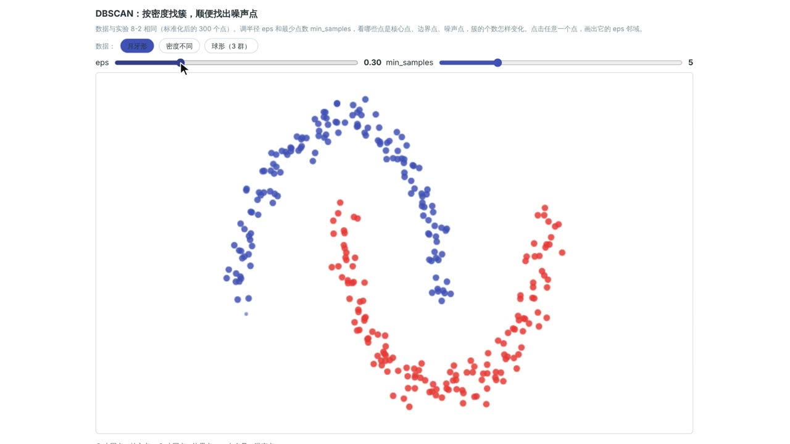
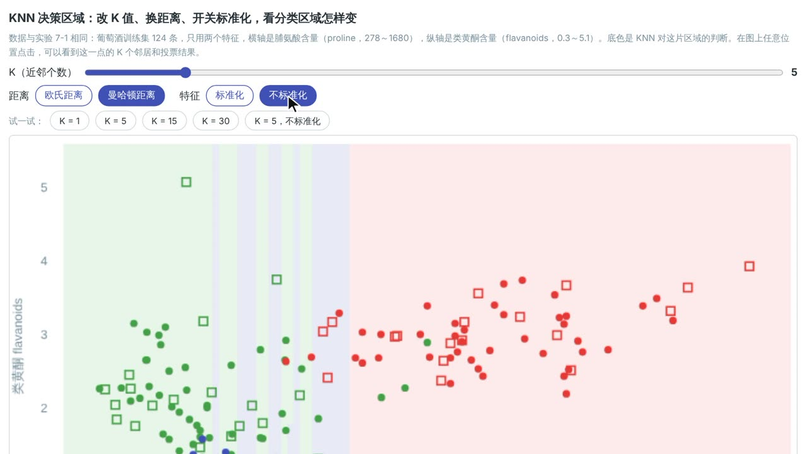
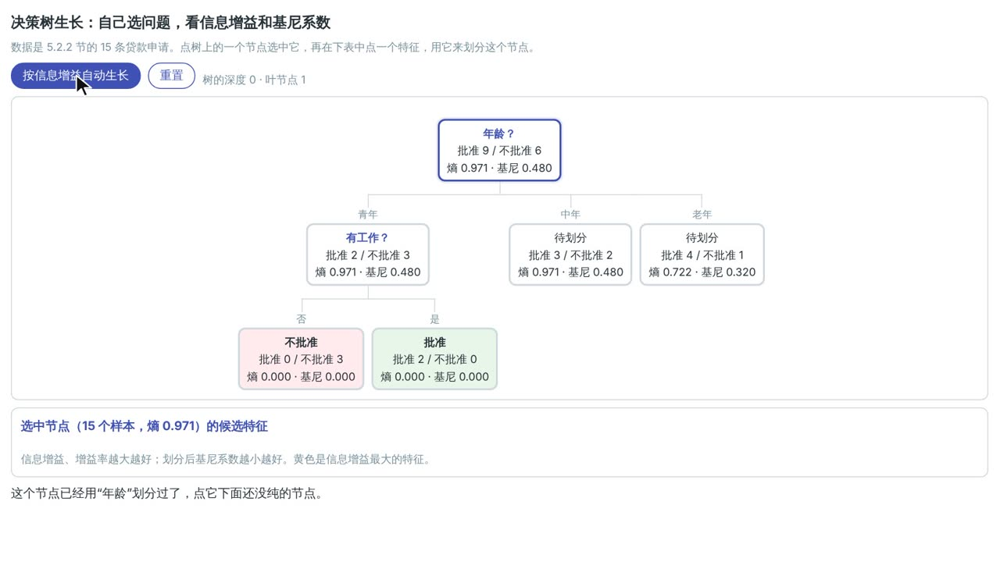
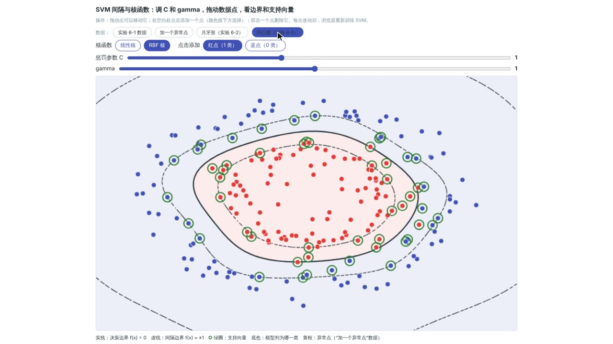
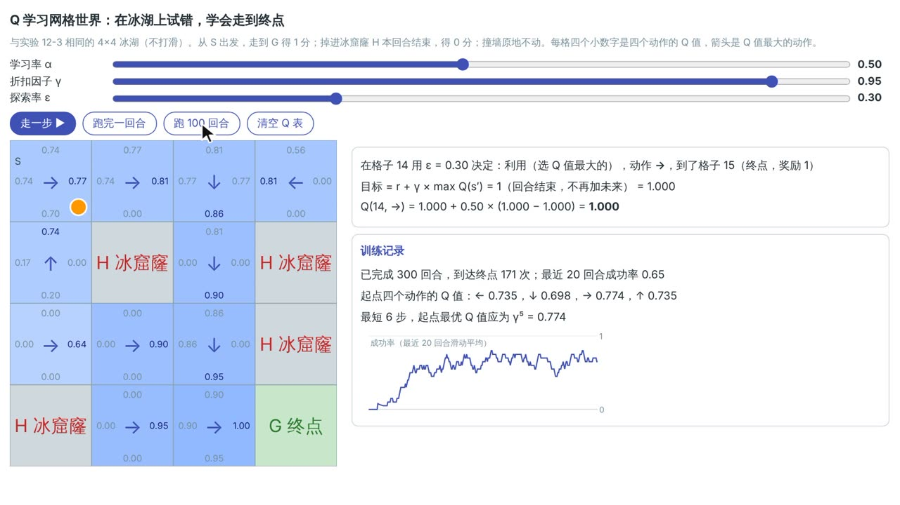

# 机器学习

**面向成人教育人工智能技术应用专业（专科）的机器学习教材**

!!! abstract "课程信息"
    5 学分 · 90 学时（理论 60 学时 + 实验 30 学时）· 12 章 · 36 个实验 · 第 3 学期 · 闭卷

<!-- showcase:start -->
## 先玩一玩

拖一拖、点一点，看算法怎样从数据里学出规律

<ol class="sc-list">
<li data-sim="sims/dbscan-density/main.html" data-video="assets/showcase/dbscan-density" data-title="DBSCAN 密度聚类" data-play="调一下半径 eps，颜色马上重新分组。">
两道弯月缠在一起，算法能把它们分开吗？

<b>DBSCAN 密度聚类</b>　调一下半径 eps，颜色马上重新分组。

<a href="sims/dbscan-density/main.html">打开动画</a>　<a class="sc-chap" href="chapters/08-clustering/" title="第 8 章 聚类、降维与异常检测">去读第8章 →</a>
</li>
<li data-sim="sims/knn-regions/main.html" data-video="assets/showcase/knn-regions" data-title="KNN 决策区域" data-play="在图上点一点，看新样本被分到哪一类。">
改一下 K，彩色地盘就重新划分

<b>KNN 决策区域</b>　在图上点一点，看新样本被分到哪一类。

<a href="sims/knn-regions/main.html">打开动画</a>　<a class="sc-chap" href="chapters/07-knn-bayes-rules/" title="第 7 章 K 近邻、朴素贝叶斯与关联规则">去读第7章 →</a>
</li>
<li data-sim="sims/decision-tree-split/main.html" data-video="assets/showcase/decision-tree-split" data-title="决策树生长" data-play="按信息增益一层层长出来。">
贷款批不批？看一棵树自己学会提问

<b>决策树生长</b>　按信息增益一层层长出来。

<a href="sims/decision-tree-split/main.html">打开动画</a>　<a class="sc-chap" href="chapters/05-decision-tree/" title="第 5 章 决策树与集成学习">去读第5章 →</a>
</li>
<li data-sim="sims/svm-margin/main.html" data-video="assets/showcase/svm-margin" data-title="SVM 间隔与核函数" data-play="换成 RBF 核，直线变成弯曲的边界。">
点一下添加数据点，分界线马上跟着动

<b>SVM 间隔与核函数</b>　换成 RBF 核，直线变成弯曲的边界。

<a href="sims/svm-margin/main.html">打开动画</a>　<a class="sc-chap" href="chapters/06-svm/" title="第 6 章 支持向量机">去读第6章 →</a>
</li>
<li data-sim="sims/q-learning/main.html" data-video="assets/showcase/q-learning" data-title="Q 学习网格世界" data-play="一键跑 100 回合，看箭头指向终点。">
掉进冰窟窿 100 次之后，机器人学会了绕路

<b>Q 学习网格世界</b>　一键跑 100 回合，看箭头指向终点。

<a href="sims/q-learning/main.html">打开动画</a>　<a class="sc-chap" href="chapters/12-timeseries-rl/" title="第 12 章 时间序列预测与强化学习入门">去读第12章 →</a>
</li>
</ol>

<!-- showcase:end -->

## 这本书讲什么

机器学习研究怎样让计算机从数据里自己总结规律，再用规律去预测和决策。银行判断贷款会不会违约，电商预测下个月卖多少货，外卖平台估算送达时间，医院辅助筛查病灶，背后都是机器学习模型；今天的大模型也建立在它的基本思想之上。

本书按一个机器学习项目的完整流程组织：先认识数据、清洗数据、构造特征，再学习线性回归、逻辑回归、决策树与集成学习、支持向量机、K 近邻、朴素贝叶斯、关联规则、聚类与降维等经典算法，掌握模型评估、交叉验证、调参和部署，然后进入神经网络、卷积神经网络和循环神经网络的基础，最后学习时间序列预测和强化学习入门。

## 本书的特点

- **通俗易懂**：用生活中的例子和“算一算”小计算讲清原理，公式只保留最必要的部分；
- **每章三个实验**：全书 36 个实验，★ 为基础实验，☆ 为拓展实验，默认在普通笔记本电脑的 CPU 上完成，需要更大算力的部分写明云算力平台；
- **结果真实**：全部 36 个实验都由编者实际运行，书中的运行结果、课后实操题的参考答案都来自真实输出；
- **在线练习**：每章课后的单选、多选和判断题可以在网页上直接作答，并查看解析；
- **贴近岗位与证书**：对应人工智能训练师（三级）、人工智能数据处理工程师（高级）、Python 技术应用工程师（高级）、人工智能应用工程师（高级），正文用“证书考点”提示框标出考点，见[证书考点对照](certificate.md)；实验报告按“测试报告 + 错误案例分析”格式撰写。

## 全书概览

<!-- stats:start -->

| 章 | 正文字数 | 实验 | 课后练习 （可在线作答） | 术语 | 参考文献 | 交互动画 |
|---|---|---|---|---|---|---|
| [第 1 章](chapters/01-intro/index.md) | 1.1 万 | 3 | 23（18） | 24 | 10 | 1 |
| [第 2 章](chapters/02-preprocessing/index.md) | 0.9 万 | 3 | 23（18） | 31 | 11 | 1 |
| [第 3 章](chapters/03-linear-regression/index.md) | 1.0 万 | 3 | 23（18） | 24 | 12 | 2 |
| [第 4 章](chapters/04-logistic-regression/index.md) | 1.1 万 | 3 | 23（18） | 26 | 10 | 1 |
| [第 5 章](chapters/05-decision-tree/index.md) | 1.4 万 | 3 | 23（18） | 28 | 16 | 2 |
| [第 6 章](chapters/06-svm/index.md) | 1.0 万 | 3 | 23（18） | 16 | 12 | 1 |
| [第 7 章](chapters/07-knn-bayes-rules/index.md) | 1.0 万 | 3 | 23（18） | 25 | 12 | 2 |
| [第 8 章](chapters/08-clustering/index.md) | 1.1 万 | 3 | 23（18） | 17 | 12 | 3 |
| [第 9 章](chapters/09-model-tuning/index.md) | 1.0 万 | 3 | 23（18） | 21 | 11 | 1 |
| [第 10 章](chapters/10-neural-network/index.md) | 1.1 万 | 3 | 23（18） | 22 | 14 | 2 |
| [第 11 章](chapters/11-cnn-rnn/index.md) | 1.0 万 | 3 | 23（18） | 21 | 12 | 2 |
| [第 12 章](chapters/12-timeseries-rl/index.md) | 1.4 万 | 3 | 23（18） | 28 | 12 | 2 |
| **合计** | **13.2 万** | **36** | **276（216）** | **283** | **144** | **20** |

正文字数只统计汉字，不含代码和课后练习；单选、多选和判断题可以在网页上直接作答。配套学习资源：[交互动画](sims/index.md) 20 个 · [学习图谱](learning-graph/index.md) 283 个概念 · [常见问题](faq/index.md) 43 问 · [术语表](appendix/glossary.md) 283 条。

<!-- stats:end -->

## 目录与实验

| 章节 | 实验 |
|---|---|
| [第 1 章 机器学习概述与项目流程](chapters/01-intro/index.md) | 实验 1-1 ★ 搭建机器学习实验环境 实验 1-2 ★ 第一个机器学习模型：鸢尾花分类 实验 1-3 ☆ 写规则 vs 学规则 |
| [第 2 章 数据预处理与特征工程](chapters/02-preprocessing/index.md) | 实验 2-1 ★ 认识一份真实数据：二手房数据探索 实验 2-2 ★ 按规范清洗并编码 实验 2-3 ☆ 特征构造、特征选择与数据泄露“侦探” |
| [第 3 章 线性回归与梯度下降](chapters/03-linear-regression/index.md) | 实验 3-1 ★ 手算与 NumPy 实现梯度下降 实验 3-2 ★ 二手房价格预测 实验 3-3 ☆ 过拟合与正则化 |
| [第 4 章 逻辑回归与分类模型评估](chapters/04-logistic-regression/index.md) | 实验 4-1 ★ 电信客户流失预测 实验 4-2 ★ 阈值、混淆矩阵与 ROC 实验 4-3 ☆ 类别不平衡：信用卡欺诈识别 |
| [第 5 章 决策树与集成学习](chapters/05-decision-tree/index.md) | 实验 5-1 ★ 手算信息增益并训练决策树 实验 5-2 ★ 随机森林预测客户流失 实验 5-3 ☆ XGBoost 与 LightGBM 对比 |
| [第 6 章 支持向量机](chapters/06-svm/index.md) | 实验 6-1 ★ 线性 SVM 与参数 C 实验 6-2 ★ 核函数与非线性分类 实验 6-3 ☆ 手写数字识别 |
| [第 7 章 K 近邻、朴素贝叶斯与关联规则](chapters/07-knn-bayes-rules/index.md) | 实验 7-1 ★ KNN 葡萄酒分类与 K 值选择 实验 7-2 ★ 朴素贝叶斯垃圾短信过滤 实验 7-3 ★ 超市购物篮分析 |
| [第 8 章 聚类、降维与异常检测](chapters/08-clustering/index.md) | 实验 8-1 ★ 电商客户分群（RFM 模型） 实验 8-2 ★ 三种聚类算法对比与异常检测 实验 8-3 ☆ PCA 与 t-SNE 降维可视化 |
| [第 9 章 模型选择、调优与部署](chapters/09-model-tuning/index.md) | 实验 9-1 ★ 交叉验证与学习曲线 实验 9-2 ★ 一条完整的建模流水线 实验 9-3 ☆ 把模型发布成服务 |
| [第 10 章 神经网络基础](chapters/10-neural-network/index.md) | 实验 10-1 ★ 用 NumPy 从零实现神经网络 实验 10-2 ★ PyTorch 与 Keras 识别手写数字 实验 10-3 ☆ 训练技巧对比实验 |
| [第 11 章 卷积神经网络与循环神经网络](chapters/11-cnn-rnn/index.md) | 实验 11-1 ★ 手算卷积与池化 实验 11-2 ★ CNN 服装图片分类 实验 11-3 ☆ LSTM 短信分类 |
| [第 12 章 时间序列预测与强化学习入门](chapters/12-timeseries-rl/index.md) | 实验 12-1 ★ 门店销量预测（经典方法） 实验 12-2 ★ 机器学习与 LSTM 时序预测对比 实验 12-3 ★ Q 学习走冰湖 |

## 配套资源

- [交互动画](sims/index.md)、[学习图谱](learning-graph/index.md)、[常见问题](faq/index.md)
- 实验代码与数据：仓库中的 `labs/` 目录
- 课件、教案和 Word/PDF 版教材：见仓库的 Releases 页面
